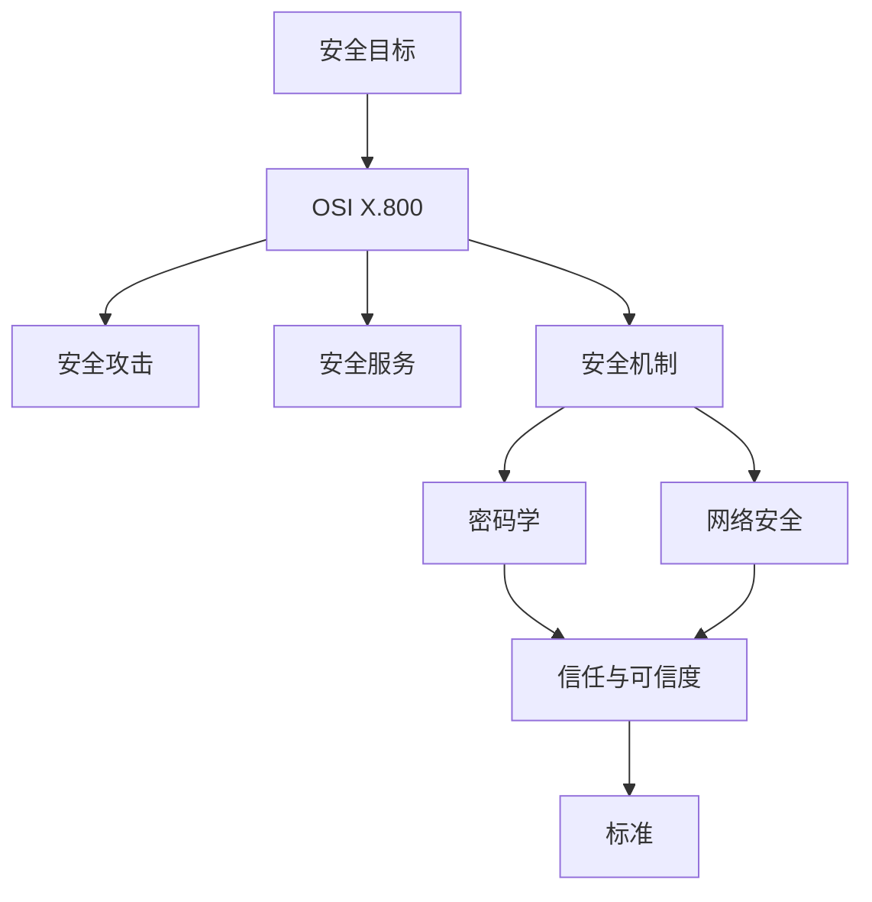
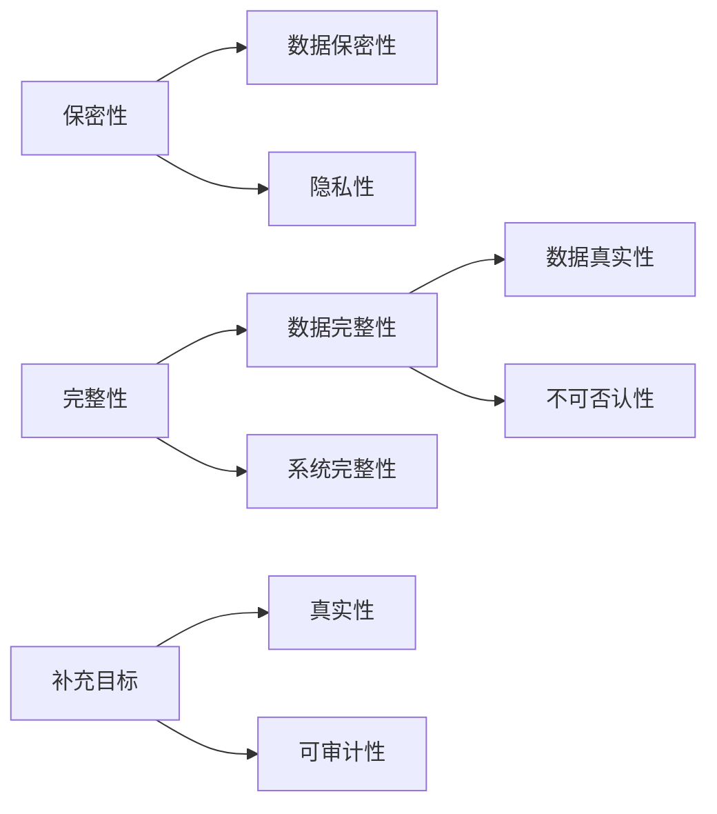
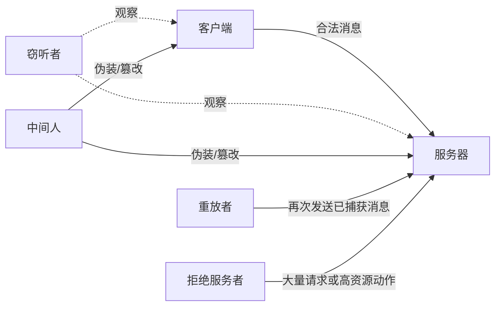
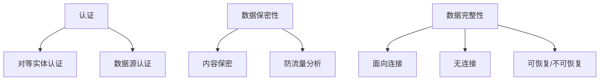
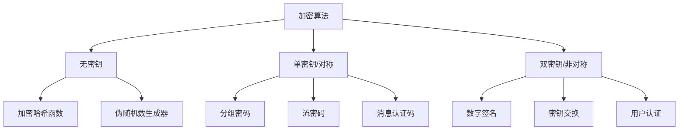
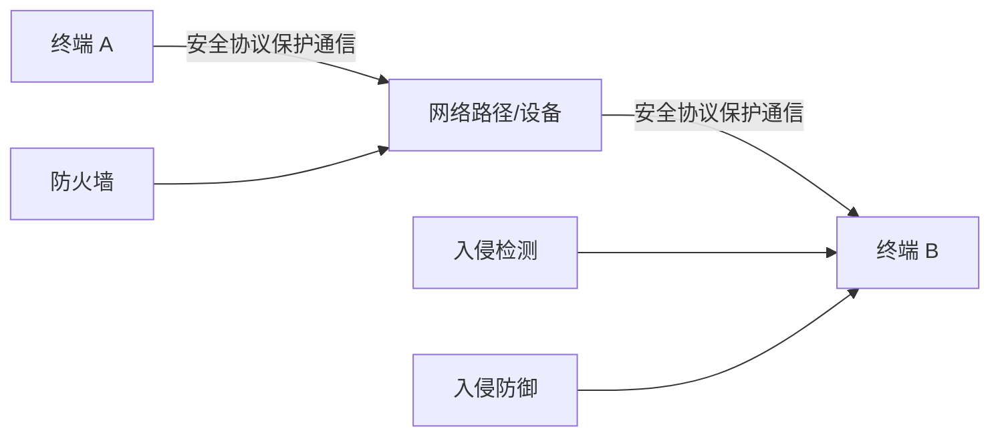
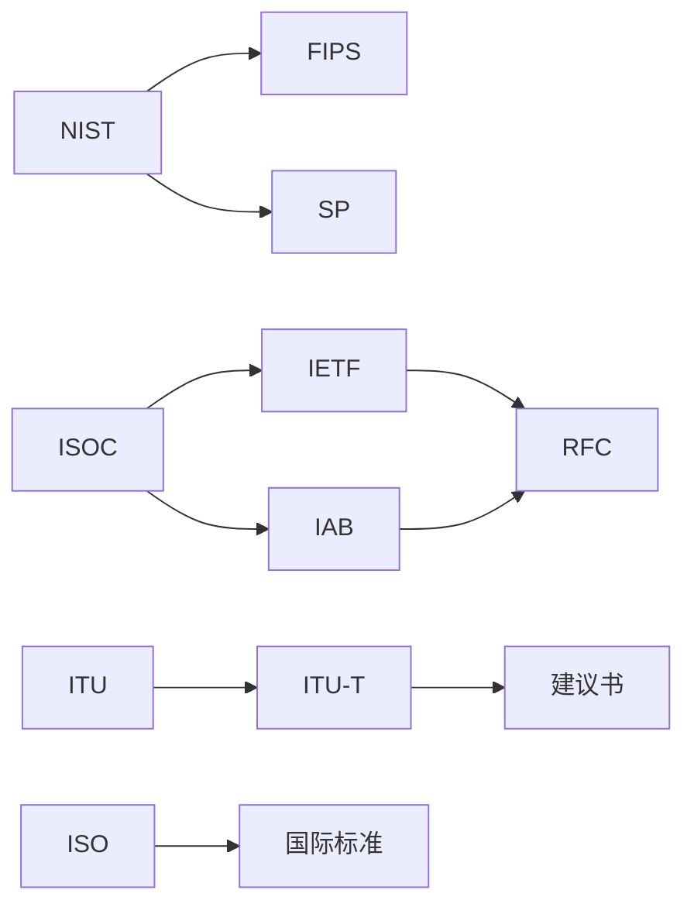

# 第一章 信息与网络安全概念

## 本章复习

> [!IMPORTANT] 信息边界
> 定义、分类、标准名称和图表释义均依据本章教材原文；标为“辅助总结”或“辅助重建”的内容用于记忆和检索，不是教材原句。本章没有数学公式和教材编号例题，因此不虚构公式或例题栏目。

### 章节逻辑总图

复习主线：**保护什么（目标）→面对什么（威胁/攻击）→需要什么（服务）→如何实现（机制/算法/协议）→能否依赖（信任）→如何共同遵循（标准）**。

## 1.1 网络空间安全、信息安全与网络安全

### 核心定义

| 概念 | 教材要点 | 关键词 |
|---|---|---|
| 网络空间安全 | 保护计算机、数字设备、网络设备和传输线路中存储、传输、处理的信息 | 保密性、完整性、可用性、真实性、可审计性 |
| 信息安全 | 保留信息的保密性、完整性、可用性，并涉及真实性、可审计性、不可否认性、可靠性 | 信息本身；也包括物理信息 |
| 网络安全 | 保护网络及其服务免遭未授权修改、破坏或泄露，并保证正确执行关键功能 | 网络及服务 |

### CIA 与补充目标

| 目标 | 定义 | 缺失表现（FIPS 199） |
|---|---|---|
| 数据保密性 | 秘密信息不向非授权者泄露或被使用 | 非授权泄露 |
| 隐私性 | 个人控制与自身有关信息的收集、保存和公开 | 失去控制 |
| 数据完整性 | 信息和程序只能以特定、授权方式改变 | 非授权修改和毁坏 |
| 系统完整性 | 系统按预定功能正常执行，免受非授权操作 | 功能被破坏 |
| 可用性 | 系统及时运行，授权用户不被拒绝服务 | 访问/使用中断 |
| 真实性 | 实体可验证且可信；信息和来源正确 | 来源或身份无法确认 |
| 可审计性 | 行为可唯一追溯到实体 | 无法取证、追责 |

### 教材上下文保留

- 网络空间安全的保护对象包括计算机、其他数字设备、网络设备、传输线路和 Internet 中存储、传输、处理的信息；保护手段同时包括组织策略、程序和技术手段。
- 信息安全还涉及真实性、可审计性、不可否认性和可靠性；网络空间安全包括电子信息安全和网络安全，而信息安全还与纸质等物理信息有关。
- 数据完整性包含数据真实性与不可否认性：数据对象应确实是其所声称的对象，发送方和接收方不能否认已经处理信息。
- 可审计性支持不可否认性、阻止、故障隔离、入侵检测和预防、事后恢复及法律诉讼；系统必须保留活动记录以便取证和解决争议。
- 教材脚注说明 RFC 4949 区分“信息”和“数据”，但安全文献通常不严格区分，本书也不作区分。

### 知识关系

> [!NOTE] 辅助总结
> 做场景题时可用“谁能看、谁能改、何时能用、是否真实、能否追责”五问定位安全目标；这是复习方法，不是教材原句。

### 十项挑战

1. 安全要求直观，但机制复杂。
2. 必须考虑针对安全功能的各种潜在攻击。
3. 机制的必要性通常不能从需求直接看出。
4. 必须选择正确的物理位置和逻辑位置。
5. 算法、协议和秘密信息的生成、分发、保护相互制约。
6. 攻防是智力战争：攻击者找到一个弱点即可，设计者要封堵所有弱点。
7. 安全投资收益常在事件后才显现。
8. 安全需要经常或连续监管。
9. 安全常在系统完成后才补上，而非设计起点就纳入。
10. 强安全可能与效率、易用性和信息访问发生矛盾。

### 图表释义

![[attachments/fig_1_1_security_goals.png]]

图 1.1：安全目标整体视图。复习时用它检查 CIA、真实性、可审计性之间的概念边界。

### 重点难点

- 重点：CIA 定义及三种“缺失”表述。
- 难点：数据保密性与隐私性、数据完整性与系统完整性、真实性与不可否认性、可审计性的区别。

### 易错点

- 把隐私性写成“所有信息都必须保密”。
- 把可审计性写成“保证不会发生攻击”。
- 把网络安全缩小成“加密网络通信”。

### 关键词索引

`cybersecurity` `information security` `network security` `CIA triad` `confidentiality` `integrity` `availability` `authenticity` `accountability` `FIPS 199`

### Related

1.3 的攻击对应目标损失；1.4 的服务和 1.5 的机制提供保护；第 2 章开始提供密码学所需数学基础。

## 1.2 OSI 安全架构

### 核心定义

| 术语 | 定义 | 判断关键词 |
|---|---|---|
| OSI 安全架构 | ITU-T X.800 提供的系统化安全要求和措施组织方法 | X.800 |
| 安全攻击 | 任何危及信息系统安全的行为 | 实际行为 |
| 安全机制 | 检测、阻止攻击或从攻击状态恢复的过程/设备 | 手段 |
| 安全服务 | 利用机制加强数据处理和传输安全的过程/服务 | 保护功能 |
| 威胁 | 可能破坏安全并造成不利影响的情况或事件 | 潜在可能 |

### 三层关系

`威胁（可能） → 攻击（行动） → 安全服务（需求） ← 安全机制（实现）`

### 教材上下文保留

OSI 安全架构用于有效评价机构的安全要求，并评价、选择安全产品和政策。集中式环境中已很困难，局域网和广域网进一步增加复杂度，因此需要系统化定义方法。X.800 作为国际标准，也使计算机和通信服务商能够开发与其安全特性相适应的产品和服务。

威胁的影响范围不仅包括系统资源，还包括组织运营、组织资产、个人、其他组织乃至国家；攻击则是试图收集、破坏、拒绝、降级或破坏信息系统资源或信息本身的恶意活动。

### 图表释义

![[attachments/fig_1_2_security_concepts.png]]

图 1.2 汇总安全攻击、安全服务和安全机制。原图用于核验完整分类；下文各节再将其展开为可检索的表格和关系图。

> [!NOTE] 辅助总结
> “问题—要求—手段”可分别对应攻击、服务、机制，但实际关系是多对多，不是固定配对表。

### 重点难点

- X.800 是框架，不是产品。
- “攻击—服务—机制”不是一一对应；一个服务可由多个机制实现。

### 易错点

把“威胁”当成已发生事件，或把“防火墙”直接称为安全服务。

### 关键词索引

`X.800` `threat` `attack` `security service` `security mechanism`

### Related

1.3、1.4、1.5 分别展开三类核心概念；思考题 1.1 要求完整表述本节。

## 1.3 安全攻击

### 分类表

| 类别 | 子类 | 核心动作 | 教材侧重点 |
|---|---|---|---|
| 被动攻击 | 信息内容泄露 | 获取传输内容 | 预防 |
| 被动攻击 | 流量分析 | 观察来源、目的、频率、长度 | 预防 |
| 主动攻击 | 伪装 | 假装成其他实体 | 检测与恢复 |
| 主动攻击 | 重放 | 再次发送截获消息 | 检测与恢复 |
| 主动攻击 | 消息篡改 | 修改、延迟或重排消息 | 检测与恢复 |
| 主动攻击 | 拒绝服务 | 阻止、破坏或过载服务 | 检测与恢复 |

### 判别规则

被动攻击不改变系统资源或运行；主动攻击改变数据流、资源或系统运行。中间人攻击可以同时体现伪装和选择性篡改。

### 教材上下文保留

- 信息内容泄露针对电话、电子邮件消息和传输文件等敏感内容。
- 流量分析即使在消息内容被加密后仍可能成功，因为攻击者可观察通信主机身份和位置，以及消息频率和长度。
- 伪装常与其他主动攻击结合，例如截获认证信息并重放，使无权限实体获得额外权限。
- 消息篡改不仅包括改文字，也包括延迟消息和改变消息顺序。
- 拒绝服务既可能针对特定目的地的消息，也可能破坏整个网络、使网络失效或过载。
- 主动攻击难以绝对预防，因为这要求始终对所有通信设施和路径实施物理保护；检测还具有威慑作用。

### 客户端/服务器场景关系

> [!NOTE] 辅助重建
> 上图根据教材图 1.3 的文字说明重建，用于检索和复习；权威图像仍是下方两张教材附件。

### 图表释义

![[attachments/fig_1_3_security_attacks_p1.png]]

![[attachments/fig_1_3_security_attacks_p2.png]]

两张图片共同组成图 1.3；第二张是续图。

### 重点难点

- 流量分析即使看不到明文也可能泄露通信性质。
- 被动攻击难发现但可用加密等方法预防；主动攻击难以绝对预防，因此要重检测和恢复。

### 易错点

重放不是修改；加密明文不能自动隐藏频率和长度；拒绝服务不要求攻击者读取内容。

### 关键词索引

`passive attack` `disclosure of message contents` `traffic analysis` `masquerade` `replay` `modification` `denial of service` `man-in-the-middle`

### Related

1.4 将攻击映射到服务；1.6 的加密、认证和 MAC 分别处理不同攻击面。

## 1.4 安全服务

### 六类服务

| 服务 | 保护/确认对象 | 关键边界 |
|---|---|---|
| 认证 | 通信实体或数据来源的真实性 | 数据源认证不防复制/修改 |
| 访问控制 | 通过连接访问主机与应用的能力 | 先识别或认证，再授权 |
| 数据保密性 | 消息内容和流量特征 | 可保护连接、消息或消息范围 |
| 数据完整性 | 消息流、单条消息或指定部分 | 面向连接比无连接处理更多攻击 |
| 不可否认性 | 发送/接收行为证据 | 防止发送方或接收方事后否认 |
| 可用性 | 授权实体及时访问资源 | 依赖资源管理和其他服务 |

### 教材上下文保留

- 认证服务在单条消息场景中向接收方保证消息来源；在持续连接中先确认双方实体，再保证连接不被第三方伪装干扰。
- 对等实体认证适用于实现相同协议的两个对等实体，可在连接建立或数据传输阶段使用，并防范伪装和旧连接重放。
- 访问控制要求实体先被识别或认证，之后才获得相应访问权限。
- 数据保密性可保护一段时间内连接的全部用户数据，也可保护单条消息或消息内指定范围；后者范围更窄、实现可能更复杂和昂贵。
- 面向连接完整性保护整个消息流，保证收到和发出的消息一致；无连接完整性处理单条消息，不利用上下文。
- 完整性服务与主动攻击相关，重点通常在检测；检测后可以报告并由软件或人工恢复，也可以采用自动恢复机制。
- X.800 把可用性视为与多种服务相关的性质，但教材认为单独说明可用性服务有意义。
- 教材脚注指出信息安全术语在不同文献中并未完全统一；本书采用 X.800 的术语边界。

### 服务逻辑关系

### 完整性服务的层次

- 面向连接：防复制、插入、修改、重排、重放和数据破坏，也要处理拒绝服务。
- 无连接：不考虑上下文，通常只防止消息修改。
- 可恢复/不可恢复：检测到破坏后，可报告并由软件或人工恢复，也可自动恢复。

### 重点难点

对等实体认证确认连接双方；数据源认证只确认来源。保密性还需防流量分析；不可否认性提供事后证据，不等于实时阻断。

### 易错点

把认证写成完整性，把流量分析写成主动攻击，把可用性写成“系统永不出错”。

### 关键词索引

`peer entity authentication` `data-origin authentication` `access control` `data confidentiality` `data integrity` `nonrepudiation` `availability`

### Related

1.3 的被动攻击主要涉及保密性，主动攻击主要涉及完整性和可用性；1.5 解释服务的实现机制。

## 1.5 安全机制

### 八类机制

| 机制 | 教材定义要点 | 主要用途 |
|---|---|---|
| 密码算法 | 可逆加密或不可逆哈希/MAC | 内容和完整性保护 |
| 数据完整性 | 确保数据单元或数据流完整 | 检测修改 |
| 数字签名 | 对数据做密码转换并附加签名 | 证明来源和完整性、防伪造 |
| 认证交换 | 通过信息交换确认实体身份 | 防伪装 |
| 流量填充 | 在空隙插入位 | 阻止流量分析 |
| 路由控制 | 选择或更改安全路由 | 降低路径风险 |
| 公证 | 使用可信第三方保证属性 | 证明和争议处理 |
| 访问控制 | 执行资源访问权限 | 限制未授权访问 |

### 教材上下文保留

- 可逆密码机制先加密再解密；教材把哈希算法和消息认证码归入不可逆加密机制，并说明它们用于数字签名和消息认证应用。
- 数字签名附加到数据单元或对数据单元进行密码转换，使接收方证明来源和完整性并防止伪造。
- 路由控制允许为某些数据选择特定的物理或逻辑安全路由，并在怀疑安全被破坏时更改路由。
- 公证不是普通日志，而是由可信第三方保证数据交换的某些属性。

### 服务—机制关系示例

| 安全需求 | 可用服务 | 可能涉及的教材机制 | 边界说明 |
|---|---|---|---|
| 防止内容泄露 | 数据保密性 | 密码算法 | 不自动隐藏流量特征 |
| 确认实体身份 | 认证 | 认证交换 | 不自动等于授权 |
| 证明来源与完整性 | 认证/完整性/不可否认性 | 数字签名、公证 | 具体保证依赖机制设计 |
| 防止流量分析 | 数据保密性 | 流量填充 | 只加密内容可能不足 |
| 限制资源访问 | 访问控制 | 访问控制机制 | 通常以识别/认证为前提 |

> [!NOTE] 辅助总结
> 上表是依据教材定义整理的复习映射，不表示 X.800 中唯一或完整的一一对应关系。

### 重点难点

机制是手段，不是服务；流量填充针对流量外观，路由控制针对传输路径，公证依赖第三方。

### 易错点

哈希/MAC不能笼统写成“可解密”；数字签名不是单纯的保密加密；访问控制不等于认证交换。

### 关键词索引

`cryptographic algorithm` `data integrity` `digital signature` `authentication exchange` `traffic padding` `routing control` `notarization` `access control`

### Related

1.6 展开密码算法；1.7 将机制放进通信协议和设备；后续章节给出具体算法。

## 1.6 密码学

### 三类算法

| 类型 | 密钥 | 典型对象/用途 |
|---|---|---|
| 无密钥 | 不使用密钥 | 加密哈希函数、伪随机数生成器 |
| 单密钥（对称） | 一个秘密密钥 | 分组密码、流密码、MAC |
| 双密钥（非对称） | 相关的私钥和公钥 | 数字签名、密钥交换、用户认证 |

### 教材上下文保留

- 密码学是数学的一个分支，涉及数据变换，是安全存储、数据传输和各方安全交互的重要组成部分。
- 加密哈希函数把变长文本转换为较小的定长哈希值、哈希码或摘要；其额外属性使它可作为 MAC 或数字签名的一部分。
- 伪随机数生成器产生确定但看似随机的数字或位序列，序列会在一定长度后重复，但对某些密码学目的仍然足够。
- 单密钥可以只由一个用户持有，也可由通信双方共享；某些应用允许两方以上共享同一密钥，保护组内数据免受组外人员攻击。
- 分组密码的典型分组大小为 128 位，许多工作模式使当前转换还依赖先前分组内容。
- MAC 的接收方对消息执行相同计算，若结果与附带 MAC 匹配，则可确认消息未被篡改。
- 非对称算法的重要应用包括数字签名、密钥交换和用户认证；教材后续章节会分别展开。

### 算法分类关系

> [!NOTE] 辅助重建
> 上图把教材 1.6 的文字分类转为可检索结构；教材原图 1.4 仍作为权威图示保留。

### 单密钥要点

- 分组密码按块处理，典型分组大小为 128 位；工作模式可能依赖先前分组。
- 流密码按位序列处理，典型方式是逐位异或。
- MAC 以消息和密钥为输入，输出用于验证完整性。

### 双密钥两种方式

1. 私钥输入生成转换，公钥恢复：只有私钥持有者能生成，适合签名语境。
2. 公钥输入生成转换，私钥恢复：任何公钥持有者能加密，只有私钥持有者能解密，适合保密语境。

### 图表释义

![[../../../temp_achive/密码编码学与网络安全（第八版）/第1章 信息与网络安全概念/attachments/fig_1_4_encryption_algorithms.png]]

图 1.4：三类加密算法的分类关系。

### 重点难点

“有无密钥”是分类轴；“分组/流”是单密钥算法的处理方式；“签名/保密”对应双密钥的不同方向。

### 易错点

私钥不只用于解密；MAC 不提供公开可验证的数字签名性质；伪随机序列虽确定但可用于某些密码学目的。

### 关键词索引

`cryptography` `hash function` `pseudorandom number generator` `block cipher` `stream cipher` `MAC` `public key` `private key`

### Related

第 2–9 章提供算法基础；后续章节分别深入哈希、MAC、数字签名和密钥管理。

## 1.7 网络安全

### 两个主要要素

| 要素 | 保护范围 | 教材例子 |
|---|---|---|
| 通信安全 | 网络通信路径及协议传输 | IPsec、IEEE 802.11i、TLS、SSH |
| 设备安全 | 路由器、交换机、客户端、服务器 | 防火墙、入侵检测、入侵防御 |

### 教材上下文保留

- 网络协议定义网络各点之间数据传输和接收的格式与过程，包括数据单元结构和管理传输的控制命令。
- 安全协议可以是现有协议的一部分或增强，也可以是独立协议；它们共同使用多种密码算法作为安全机制。
- 设备侧主要问题包括入侵者执行未授权操作、植入恶意软件，或耗尽资源降低可用性。
- 防火墙可由硬件和/或软件实现，按流量内容和/或流量模式规则允许或拒绝传入、传出流量。
- 入侵检测提供实时或接近实时告警；入侵防御还尝试停止活动，最好在活动到达目标前阻止。
- 教材指出设备安全与计算机安全关系更紧密，因此第六部分对它的讨论比通信安全概略。

### 两类要素的依赖关系

> [!NOTE] 辅助重建
> 上图只表达通信安全与设备安全的对象关系，不替代教材图 1.5。

### 设备功能对比

- 防火墙：按策略过滤传入和传出流量。
- 入侵检测：收集和分析信息，发现未授权访问并告警。
- 入侵防御：检测并尝试在到达目标前阻止入侵活动。

### 图表释义

![[../../../temp_achive/密码编码学与网络安全（第八版）/第1章 信息与网络安全概念/attachments/fig_1_5_network_security_elements.png]]

图 1.5：网络通信、网络设备和终端系统构成网络安全的关键要素。

### 重点难点

IPsec/802.11i 是现有协议或标准的一部分的增强；TLS/SSH 是独立安全协议。所有这些协议都把密码算法作为安全机制的一部分。

### 易错点

网络安全不等于“链路加密”；入侵检测与入侵防御的动作边界不能互换。

### 关键词索引

`communication security` `device security` `IPsec` `IEEE 802.11i` `TLS` `SSH` `firewall` `IDS` `IPS`

### Related

第六部分详细讨论安全网络协议；设备安全与计算机安全关系更紧密，教材对其讨论较概略。

## 1.8 信任与可信度

### 信任模型

信任是信任方基于期望而愿意依赖被信任方执行重要操作；可信度反映实体被信任的程度；信任倾向是广泛信任他人的趋势；风险由不利影响和发生可能性构成。

### 教材上下文保留

- 信任方的期望是：不管是否受到监视或控制，被信任方都会执行对信任方重要的特定操作。
- 信任是信任方的信任倾向与被信任方可信度的函数；信任倾向也可表示为实体准备承受的风险级别。
- 根据信任级别和感知风险，信任方决定是否采取某种程度的冒险行动；结果可能依赖被信任方的操作或向其披露并受约定保护的信息。
- 信息安全语境中的信任总是限制在特定功能或行为方式内，并且只在安全策略上下文中有意义；“实体”可以是硬件组件、软件模块、设备、站点、位置或组织。

### 可信度三因素

| 因素 | 关注点 |
|---|---|
| 能力（Ability/Competence） | 能否完成任务 |
| 善意（Benevolence） | 是否无意伤害信任方 |
| 完整性（Integrity） | 是否遵守可接受原则 |

### 三个应用层面

- 个人：人力资源安全；安全意识和培训。
- 组织：合同、服务级别协议、工作说明、谅解备忘录、互连安全协议等。
- 信息系统：在威胁下保持保密性、完整性、可用性；由安全功能和安全保证共同构成可信度。

#### 个人可信度上下文

内部用户涉及雇员和现场承包商，外部用户涉及客户和供应商。人力资源安全要覆盖入职、日常管理和离职各阶段，并明确信息拥有者及保护责任；安全意识和培训应覆盖 IT、IT 安全、管理员、IT 用户和其他雇员。外部用户的信任取决于环境，而且信任是双向的。

#### 组织可信度上下文

组织会依赖外部组织提供的信息和服务，例如云服务商和供应链伙伴。正式信任可记录在合同、服务级别协议、工作说明、协议/谅解备忘录或互连安全协议中；关系可以跨组织或组织内部，可以是双边关系，也可以是多对多关系。要求取决于任务、参与者、信息敏感性、服务类型、历史记录和总体风险。

#### 信息系统可信度上下文

安全功能是系统实际使用的安全特性和功能；安全保证是相信这些功能在应用中有效的理由，常通过审核以及把安全考虑纳入系统开发生命周期来建立。

### 四种建立信任的方法

| 方法 | 依据 |
|---|---|
| 验证的信任 | 获得安全策略、措施、监督等证据 |
| 直接历史信任 | 过去交互中的安全记录 |
| 中介信任 | 双方共同信任的第三方保证 |
| 强制信任 | 权威地位下的授权 |

组织可组合使用多种方法：验证证据与历史记录可以同时存在，中介或权威授权也不会自动消除组织自己的风险评估责任。

### 图表释义

![[../../../temp_achive/密码编码学与网络安全（第八版）/第1章 信息与网络安全概念/attachments/fig_1_6_trust_model.png]]

图 1.6：信任倾向、可信度、风险与行动之间的关系。

### 重点难点

本节的“信任模型”是一般安全信任模型，不是 PGP 信任网；安全功能与安全保证缺一不可。

### 易错点

把信任倾向当成被信任方的能力；把中介信任误写成任意第三方认证；把组织可信度简化为技术产品可信度。

### 关键词索引

`trust` `trustworthiness` `propensity to trust` `risk` `ability` `benevolence` `integrity` `security functionality` `security assurance`

### Related

用户认证、公钥基础设施和网络安全协议都需要信任关系；相关实现见后续部分。

## 1.9 标准

### 组织—产物对照表

| 组织/体系 | 作用范围 | 典型产物 |
|---|---|---|
| NIST | 美国测量科学、标准与技术；影响政府和私营部门 | FIPS、SP |
| ISOC（含 IETF、IAB 等组织机构） | 互联网基础设施与标准 | RFC |
| ITU-T | 电信领域技术标准 | 建议书 |
| ISO | 各国国家标准机构组成的国际联盟 | 国际标准 |

### 教材上下文保留

- NIST 是美国联邦机构，工作涉及美国政府使用及促进美国私营部门创新的测量科学、标准与技术；FIPS 和 SP 具有全球影响。
- ISOC 是具有全球组织和个人会员资格的专业协会，并作为包括 IETF 和 IAB 在内的互联网基础设施标准小组的组织机构；相关标准和规范以 RFC 形式发布。
- ITU 是联合国系统内协调全球电信网络和服务的国际组织；ITU-T 是其三个部门之一，负责涵盖电信领域的技术标准。
- ISO 由全球多个国家的国家标准机构组成，每个国家一个；它是非政府组织，通过国际协议形成国际标准。
- 教材脚注明确：ISO 不是英文缩写，而是由希腊语中表示“等于”的词演化而来。

### 标准体系关系

> [!NOTE] 辅助重建
> 上图用于记忆教材明确给出的组织与文档形式，不表示这些组织全部层级或全部出版物。

### 重点难点

教材列出的四个重要组织不要擅自添加其他组织；RFC 是发布形式，ISO 是源自希腊语“等于”的名称而非英文缩写。

### 易错点

把 ISOC、IETF、IAB 写成同一组织；把 FIPS/SP 归给 ISO；把 ITU-T 建议书写成 RFC。

### 关键词索引

`NIST` `FIPS` `SP` `ISOC` `IETF` `IAB` `RFC` `ITU-T` `ISO`

### Related

X.800、FIPS 199、RFC 4949 等前文标准术语都可在本节定位其体系背景。

## 1.10 关键术语、思考题和习题

### 关键术语检索组

访问控制、认证、真实性、可用性、主动攻击、被动攻击、保密性、数据完整性、数据保密性、网络空间安全、网络安全、OSI 安全架构、密码学、加密哈希函数、无密钥/单密钥/双密钥算法、分组密码、流密码、消息认证码、数字签名算法、路由控制、认证交换、入侵检测、入侵防御、防火墙、信任、可信度、信任关系、拒绝服务、重放、中间人攻击、伪装、不可否认性、用户认证、密钥交换。

### 重点难点

- 思考题 1.1–1.5 是教材定义复述题。
- 思考题 1.6 要求“基本安全设计准则”，但 1.1–1.9 正文没有列出专门清单，答案必须标记待人工确认。
- 思考题 1.7–1.9 分别检查算法分类、网络安全两要素、信任模型。
- 习题 1.1–1.4 是把 CIA 和影响级别应用到场景；不存在唯一数值答案，应给出假设和理由。
- 习题 1.5 明确要求阅读六篇外部文献，不能用未阅读的材料代写结论。

### 复盘顺序

1. 不看资料写出 CIA 和两个补充目标。
2. 用一句话区分威胁、攻击、服务、机制。
3. 写出被动 2 类、主动 4 类攻击。
4. 写出 6 类服务和 8 类机制。
5. 画出三类密码算法、两类网络安全、三层信任对象和四种信任建立方法。
6. 最后做课后习题，并把教材明确内容与推导内容分栏。

### 易错点总表

| 易混淆 | 一句话区分 |
|---|---|
| 威胁/攻击 | 潜在可能/实际恶意活动 |
| 服务/机制 | 要达到的保护功能/实现手段 |
| 数据源认证/完整性 | 确认来源/防止内容被改 |
| 通信安全/设备安全 | 保护路径协议/保护网络设备和终端 |
| 可信度/安全保证 | 被信任程度/相信安全功能有效的理由 |
| 重放/篡改 | 再次发送旧消息/改变消息或顺序 |

### 复盘建议

把无法从教材原文直接确认的题目答案保留为 `REVIEW_NEEDED`，不要用常识或其他版本教材替换。题目原文与辅助解答必须在《课后习题》中视觉隔离。
