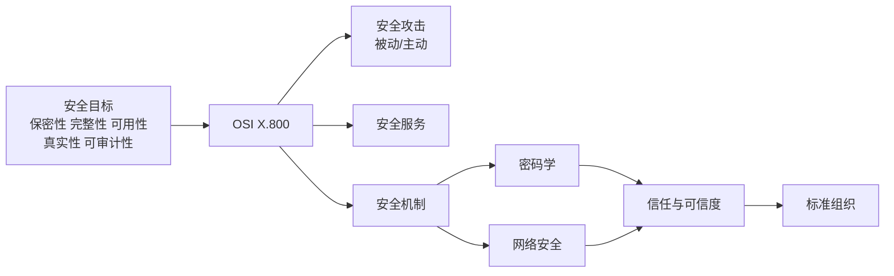

# 第一章 信息与网络安全概念

## 本章导学

### 本章学习路线

本章先定义安全目标，再用 OSI 安全架构把“攻击—服务—机制”组织起来；随后分别学习攻击类型、安全服务、安全机制、密码学和网络安全，最后以信任与标准收束。阅读每节时都问三个问题：要保护什么、面对什么威胁、用什么服务或机制处理。

### 学习目标

- 能区分网络空间安全、信息安全和网络安全。
- 能准确解释保密性、完整性、可用性、真实性、可审计性。
- 能按 X.800 框架区分威胁、攻击、安全服务和安全机制。
- 能识别被动攻击与主动攻击，并说明预防、检测和恢复的侧重点。
- 能概述无密钥、单密钥和双密钥算法及其用途。
- 能解释通信安全、设备安全、信任与可信度及相关标准组织。

## 1.1 网络空间安全、信息安全与网络安全

### 本节学习目标

知识目标：说清三个安全术语及 CIA 三元组；能力目标：面对一个系统时，能指出受影响的安全目标。

### 本节核心问题

1. 三个“安全”术语的范围如何嵌套？
2. 保密性、完整性、可用性分别防止什么损失？
3. 为什么还需要真实性和可审计性？

### 学习价值（为什么学）

后续的密码算法、认证协议和网络防护技术都服务于这些目标。目标说错，后面的机制选择就会错位。

### 知识背景

网络空间安全覆盖计算机、数字设备、网络设备和传输线路中的信息；信息安全还涉及纸质等物理信息；网络安全聚焦网络及其服务。教材指出实际使用中两个术语常被互换，但分析时仍要区分范围。

### 核心知识原理

保密性回答“谁可以看”，完整性回答“谁可以改、改后是否仍正确”，可用性回答“授权者需要时能否使用”。真实性确认实体或来源确实可信；可审计性使行为可以追溯到实体。五者不是同义词，也不能由单一技术全部实现。

### 从零开始理解：为什么要拆成五个目标

先想象一份在线成绩单。只有“不让别人看到”还不够：如果分数被改了，完整性已经破坏；如果老师和学生在截止时间无法打开，涉及可用性；如果一份伪造的成绩单被系统当成教务处发出，真实性出了问题；如果系统无法说明是谁改了记录，事后也无法审计。这个例子说明“安全”不是一个开关，而是一组可以分别失效的性质。

把事件按动词拆开是最稳的方法：**看到了**通常先检查保密性，**改掉了**检查完整性，**用不了**检查可用性，**冒充了**检查真实性，**查不出是谁**检查可审计性。一个事件可以同时破坏多个目标，例如攻击者伪造管理员身份并修改成绩，就同时涉及真实性和完整性。

### 教师式示例推演

场景：员工把含有工资的表格发到错误的公开群组。第一步，资产是工资信息；第二步，未授权人员看到了它，直接判断为数据保密性损失；第三步，若还无法查出发送账号或责任人，则可审计性也受影响。不要因为“没有修改文件”就说系统完全安全，安全目标必须逐项检查。

### 教材原文精细化讲解

- 数据保密性保护秘密信息；隐私性强调个人对其信息的收集、保存和公开拥有控制权。
- 数据完整性与系统完整性不同：前者保护信息和程序的授权改变，后者保护系统按预定功能运行。
- 不可否认性在教材中作为完整性相关概念出现；可审计性则强调行为追责和取证。
- FIPS 199 对 CIA 的“缺失”分别定义为非授权泄露、非授权修改/毁坏、访问中断。

### 图表辅助讲解

![[attachments/fig_1_1_security_goals.png]]

图 1.1 用来建立安全目标的整体视图。阅读时先定位 CIA，再看真实性和可审计性如何补充它们；本图不是新的目标清单，具体定义以教材正文为准。

### 典型示例分析

例：员工能登录系统但读取了不属于自己的工资单，主要是保密性问题；若员工把工资改成错误数值，是完整性问题；若系统全天无法登录，是可用性问题；若日志无法证明是谁改的，是可审计性问题。

### 生活化类比

把档案室想成系统：保密性是门禁，完整性是封条和修改审批，可用性是营业时间，真实性是核验身份证，可审计性是出入登记。

### 常见误区避雷

- 保密性不等于“只要加密”；访问控制和物理措施也可能参与实现。
- 数据完整性不等于系统完整性；一个文件没被改，不代表运行它的系统没有被非授权操纵。
- 可审计性不是“系统永远安全”，而是出事后能够追溯。

### 易混淆知识点对比

| 概念 | 关注问题 | 教材关键词 |
|---|---|---|
| 数据保密性 | 秘密是否泄露 | 非授权公开 |
| 隐私性 | 个人能否控制信息 | 收集、保存、公开 |
| 数据完整性 | 信息是否被非授权改变 | 授权方式改变 |
| 系统完整性 | 系统是否按预定功能运行 | 非授权操作 |
| 可审计性 | 行为能否追溯 | 记录、取证、追责 |

### 高效记忆技巧

先记 CIA：“保、完、用”；再加“真、审”。做题时分别用“看、改、用、真、追”五个动词检查。

### 章节知识关联

1.3 的攻击会破坏本节目标；1.4 的服务和 1.5 的机制是实现目标的手段；1.6 的密码算法是其中一类机制。

### 专属自学建议

先遮住定义表，分别用一句话回答五个目标；再给三个现实场景各标注主要目标和次要目标。不要先背英文缩写，先建立“目标—损失”关系。

### 扩展阅读/拓展学习

无。先掌握教材定义；相关标准组织在 1.9 介绍。

## 1.2 OSI 安全架构

### 本节学习目标

知识目标：记住 X.800 及攻击、机制、服务的定义；能力目标：能用三层框架分析一个安全需求。

### 本节核心问题

1. 为什么需要一个安全架构？
2. 威胁和攻击有什么区别？
3. 攻击、机制、服务怎样相互配合？

### 学习价值（为什么学）

X.800 提供统一词汇，能避免把“防火墙”这种机制误称为“保密性服务”，也便于评价产品和政策。

### 知识背景

局域网和广域网使安全要求分散在多层、多设备和多组织之间，单靠经验难以系统评价，因此 ITU-T 推荐 X.800。

### 核心知识原理

攻击是问题或行为，服务是希望得到的安全功能，机制是实现服务、检测攻击、阻止攻击或恢复的手段。威胁表示潜在不利情况，攻击表示实际的恶意活动。

### 从零开始理解：把 X.800 当作分析语法

面对“服务器被黑了”这类含糊说法，可以用 X.800 把句子拆开：可能发生的“服务器资源被非授权访问”是威胁；攻击者实际发送恶意请求是攻击；“限制访问”是安全服务；身份认证、访问控制和日志是机制。这样做的价值是让需求、产品和测试用例使用同一套词。

### 教师式示例推演

题目若问“防止窃听应采用什么”，不要直接回答某个产品。先写攻击是被动的信息内容泄露，再写需要数据保密性服务，最后才选择加密等机制。若题目改成“确认邮件来源”，服务就变成数据源认证，机制也会不同。先定层级，再选手段。

### 教材原文精细化讲解

- 安全攻击：任何危及信息系统安全的行为。
- 安全机制：检测、阻止攻击，或从攻击状态恢复到正常状态的过程或设备。
- 安全服务：加强数据处理和信息传输安全性的处理过程或通信服务，利用一个或多个机制阻止攻击。

### 图表辅助讲解

![[attachments/fig_1_2_security_concepts.png]]

图 1.2 是本章概念索引。使用它时按“目标/威胁 → 攻击 → 服务 → 机制”的方向阅读，不要把图中的关系理解为一一对应。

### 典型示例分析

“防止窃听”是安全需求；“数据保密性”是服务；“加密算法”是机制；“攻击者监听链路”是攻击；“窃听可能发生”是威胁。这个例子说明同一场景中的词语层级不同。

### 生活化类比

医院安全管理中，“有人可能闯入”是威胁，“闯入行为”是攻击，“限制访客进入”是服务目标，“门禁和登记系统”是机制。

### 常见误区避雷

- 威胁不等于已经发生的攻击。
- 机制不是服务的同义词；机制回答“怎么做”，服务回答“保护什么”。
- X.800 是组织安全概念的框架，不是某个具体加密算法。

### 易混淆知识点对比

| 术语 | 状态 | 典型表述 |
|---|---|---|
| 威胁 | 潜在可能 | 可能导致泄露或拒绝服务的情况 |
| 攻击 | 实际恶意活动 | 收集、破坏、拒绝或降级资源 |
| 安全服务 | 要达到的保护功能 | 保密性、认证、完整性等 |
| 安全机制 | 实现或恢复手段 | 加密、认证交换、访问控制等 |

### 高效记忆技巧

记作“威胁想发生，攻击已行动；服务定目标，机制来实现”。

### 章节知识关联

1.3、1.4、1.5 分别展开攻击、服务、机制；1.10 思考题 1.1 直接检查 X.800 的理解。

### 专属自学建议

每遇到一个安全产品，先写它提供的服务，再写它采用的机制；不要从产品名称直接猜安全目标。

### 扩展阅读/拓展学习

无。标准组织的职责见 1.9。

## 1.3 安全攻击

### 本节学习目标

知识目标：掌握被动/主动攻击及其子类；能力目标：从攻击是否改变资源或运行状态来分类。

### 本节核心问题

1. 被动攻击和主动攻击的判据是什么？
2. 四类主动攻击如何区分？
3. 为什么被动攻击重预防、主动攻击重检测和恢复？

### 学习价值（为什么学）

攻击分类决定防护策略：只做加密可能挡住内容泄露，却不一定挡住重放或拒绝服务。

### 知识背景

X.800 和 RFC 4949 都采用被动/主动二分。分类关注攻击对信息流和系统资源的影响，而不只看工具名称。

### 核心知识原理

被动攻击监听和分析传输，不改变系统资源；主动攻击改变数据流或影响系统运行。被动攻击通常难以觉察但可以预防，主动攻击难以绝对预防，因而需要检测与恢复。

### 从零开始理解：先看攻击者有没有“动手改东西”

把通信画成发送方到接收方的箭头。攻击者只站在旁边读内容或数消息，箭头仍按原样走，这是被动攻击；攻击者插入、删除、延迟、重排或伪造消息，箭头的内容或服务状态发生变化，这是主动攻击。这个判据比“攻击是否隐蔽”更可靠。

### 教师式示例推演

攻击者截获一次“开门”消息，稍后原样再发一次：消息没有被改写，但旧消息被重新使用，因此是重放。攻击者把“允许 Alice”改为“允许 Bob”：这是消息篡改。攻击者持续发送大量请求让服务器无法服务：这是拒绝服务。每一步都先描述动作，再给出分类。

### 教材原文精细化讲解

- 被动：信息内容泄露、流量分析。
- 主动：伪装、重放、消息篡改、拒绝服务。
- 中间人攻击可表现为伪装，也可表现为选择性数据篡改。
- 重放会把已截获的合法消息再次发送；拒绝服务可通过淹没服务器或触发高资源消耗动作实现。

### 图表辅助讲解

![[attachments/fig_1_3_security_attacks_p1.png]]

![[attachments/fig_1_3_security_attacks_p2.png]]

两幅附件共同构成图 1.3。第一幅和续图必须合起来看，不能把续图误当成另一张图。

### 典型示例分析

监听加密邮件的发送频率属于流量分析；截获登录令牌后再次发送属于重放；把“允许 John”改为“允许 Fred”属于消息篡改；大量请求压垮服务器属于拒绝服务。

### 生活化类比

被动攻击像在墙外偷听或观察车流；主动攻击像冒充住户、篡改信件、重复递交旧凭证或堵住道路。

### 常见误区避雷

- 加密内容不代表流量分析也被阻止。
- 重放不是“修改消息”，而是把旧消息再次使用。
- 中间人攻击是攻击方式，可与伪装或篡改同时出现。

### 易混淆知识点对比

| 攻击 | 是否改变原信息流 | 关键动作 |
|---|---:|---|
| 信息内容泄露 | 否 | 获取内容 |
| 流量分析 | 否 | 观察来源、目的、频率、长度 |
| 重放 | 增加再次发送 | 重用已截获消息 |
| 消息篡改 | 是 | 改内容、延迟或重排 |
| 拒绝服务 | 影响服务 | 阻止、破坏或过载 |

### 高效记忆技巧

被动两类“看内容、看流量”；主动四类“冒充、重放、篡改、阻断”。

### 章节知识关联

1.4 的保密性服务主要应对被动攻击；完整性和可用性服务分别处理篡改和拒绝服务；1.6 的密码机制可用于预防部分攻击。

### 专属自学建议

给每个攻击写“是否改变资源/运行”一问，再写“攻击者具体做了什么”，避免只凭关键词分类。

### 扩展阅读/拓展学习

无。中间人攻击的协议实例在后续章节展开。

## 1.4 安全服务

### 本节学习目标

知识目标：掌握认证、访问控制、数据保密性、数据完整性、不可否认性、可用性六类服务；能力目标：为攻击选择合适的服务。

### 本节核心问题

1. 认证服务确认什么？
2. 面向连接与无连接完整性有何差别？
3. 保密性为什么还要考虑流量分析？

### 学习价值（为什么学）

安全服务是需求语言。它把抽象的“系统要安全”拆成可设计、可测试的功能。

### 知识背景

X.800 的术语有时与其他文献不同，本书遵循 X.800 的用法。不要用日常语言替代教材的服务边界。

### 核心知识原理

认证确认通信实体或数据来源；访问控制限制已识别实体的访问；保密性防止被动攻击；完整性保护消息流或消息；不可否认性提供发送/接收证据；可用性确保授权实体能获得资源。

### 从零开始理解：服务是“可验收的安全要求”

“系统要安全”无法直接测试，但“只有认证后的实体能访问”“消息被修改时能检测”“授权用户在请求时获得资源”都可以写成验收条件。安全服务把抽象目标变成可观察行为。服务之间也可能组合：网上银行登录先需要认证和访问控制，交易过程需要保密性和完整性，交易结束还要留下可审计证据。

### 教师式示例推演

比较两个问题：“这封邮件是谁发的？”对应数据源认证；“邮件内容是否被改？”对应完整性。前者即使成立，也不能推出后者成立。再比较“用户身份正确”和“用户有权读取文件”：前者是认证，后者是访问控制。做题时把每个问题改写成“确认什么/防止什么”。

### 教材原文精细化讲解

- 对等实体认证用于连接建立或数据传输阶段，防止伪装和旧连接重放。
- 数据源认证确认来源，但不保护数据免遭复制或修改。
- 保密性既可保护整个连接，也可保护单条消息或消息的一部分；还要防止流量分析。
- 面向连接完整性处理复制、插入、修改、重排、重放和破坏；无连接完整性通常只防修改。
- 完整性服务可分可恢复和不可恢复；实践中检测后自动恢复更有吸引力。
- 不可否认性分别处理发送方否认发送和接收方否认接收。
- 可用性服务依赖资源管理、访问控制和其他安全服务。

### 图表辅助讲解

复看图 1.2 中的安全服务分支。不要把图上的服务数量当作本书全部安全功能的总数；应以 1.4 的六个小节为准。

### 典型示例分析

电子邮件在通信前可能没有预先交互，适合用数据源认证确认来源；TCP 连接的双方需要对等实体认证；在线交易要同时使用访问控制、保密性、完整性和可审计相关机制。

### 生活化类比

进入会议室：认证是核验身份，访问控制是决定能进哪间房，保密性是关门防旁听，完整性是防止文件被换页，不可否认性是签收凭证，可用性是会议室在预约时可使用。

### 常见误区避雷

- 数据源认证不等于完整性保护。
- 保密性保护内容不自动隐藏通信频率和长度。
- 可用性不是“永不故障”，而是授权实体请求时按设计提供服务。

### 易混淆知识点对比

| 服务 | 主要确认/保护对象 | 不自动保证 |
|---|---|---|
| 对等实体认证 | 连接双方身份 | 消息内容未被修改 |
| 数据源认证 | 消息来源 | 消息未被复制或修改 |
| 保密性 | 内容和流量特征 | 来源真实性 |
| 完整性 | 消息流或消息 | 绝对可用 |
| 不可否认性 | 发送/接收证据 | 实时阻断攻击 |
| 可用性 | 授权访问和资源 | 内容保密 |

### 高效记忆技巧

六类服务按“认、控、密、整、否、用”记忆。

### 章节知识关联

服务由 1.5 的机制实现，并分别对应 1.3 的攻击；后续密码章节会具体实现保密性、完整性和认证。

### 专属自学建议

先按服务名称背定义，再用“攻击—服务”配对练习；重点练习数据源认证与完整性的边界。

### 扩展阅读/拓展学习

无。

## 1.5 安全机制

### 本节学习目标

知识目标：掌握八类机制及基本作用；能力目标：能说明某机制主要用于检测、阻止还是恢复。

### 本节核心问题

1. 可逆与不可逆密码机制如何区分？
2. 流量填充和路由控制分别针对什么问题？
3. 为什么需要公证和访问控制等非密码机制？

### 学习价值（为什么学）

机制是把安全服务落地的工具箱。理解工具边界，才能避免“用加密解决所有问题”。

### 知识背景

教材在此只做概览，详细机制将在后文展开；本节的任务是形成分类地图。

### 核心知识原理

密码算法、数据完整性、数字签名、认证交换、流量填充、路由控制、公证、访问控制八类机制分别覆盖转换、校验、身份、流量特征、路径、第三方证明和权限管理。

### 从零开始理解：为什么一个机制不够

攻击面不同，所需机制就不同。加密可以隐藏内容，却不会自动证明发送者身份，也不会让服务器在洪水请求下继续可用；流量填充可以改变流量外观，却不能替代访问控制。安全设计通常是多个机制组合，而不是寻找“万能机制”。

### 教师式示例推演

若要求“防止窃听并确认对方身份”，至少要分别考虑保密性机制和认证交换；若还要求“发生争议时证明发送者”，则需要数字签名或公证等能够提供证据的机制。把需求逐项列出，再为每项配机制，可以避免漏项或错配。

### 教材原文精细化讲解

- 可逆密码机制可先加密再解密；不可逆机制包括哈希算法和消息认证码。
- 数字签名让接收方证明来源和完整性，防止伪造。
- 认证交换通过信息交换确认实体身份。
- 流量填充在数据流空隙插入位，以阻止流量分析。
- 路由控制允许选择或更改安全路由。
- 公证依赖可信第三方保证数据交换的某些属性。
- 访问控制执行资源访问权限。

### 图表辅助讲解

结合图 1.2 复习“服务由机制实现”的关系；本节没有新的独立附件，避免重复截取同一张图。

### 典型示例分析

若目标是隐藏消息内容，可选可逆加密；若要证明消息未被改，可选数据完整性机制或数字签名；若要减少流量分析，则需要流量填充，而不是只加密内容。

### 生活化类比

安全服务像建筑要求，机制像门锁、摄像头、登记簿、路线规划和公证书；不同要求需要不同工具组合。

### 常见误区避雷

- 哈希和 MAC 在本书这里归入不可逆密码机制，但它们的输入、密钥和用途并不相同。
- 数字签名不仅是“加密一段文字”，还要支持来源和完整性证明。
- 路由控制不是访问控制；一个管路径，一个管权限。

### 易混淆知识点对比

| 机制 | 核心作用 | 主要针对 |
|---|---|---|
| 密码算法 | 转换或摘要 | 内容保护、完整性 |
| 认证交换 | 交换信息确认身份 | 伪装 |
| 流量填充 | 改变流量外观 | 流量分析 |
| 路由控制 | 选定安全路径 | 路径风险 |
| 公证 | 第三方保证 | 争议与证据 |
| 访问控制 | 执行权限 | 未授权访问 |

### 高效记忆技巧

八类机制可按“密、整、签、认、填、路、公、控”串联。

### 章节知识关联

1.6 将重点展开密码算法；1.7 展开网络安全中的协议和设备功能；1.10 思考题 1.5要求逐类定义。

### 专属自学建议

做一张两列表：左侧写服务，右侧至少配一种机制，并注明该机制不能解决什么。

### 扩展阅读/拓展学习

无。

## 1.6 密码学

### 本节学习目标

知识目标：掌握三类算法和单/双密钥算法的基本用途；能力目标：能根据输入密钥和输出用途进行分类。

### 本节核心问题

1. 无密钥、单密钥、双密钥的划分依据是什么？
2. MAC 与加密、数字签名分别解决什么问题？
3. 双密钥算法的两种使用方式如何区分？

### 学习价值（为什么学）

后续章节按这三类算法组织。现在建立分类，能降低学习 AES、哈希、数字签名和密钥交换的认知负担。

### 知识背景

密码学研究数据变换，是安全存储、数据传输和安全交互的重要组成部分。

### 核心知识原理

分类的关键是密钥数量与角色：无密钥算法不使用密钥；单密钥算法的加解密共享秘密密钥；双密钥算法使用相关的公钥和私钥。

### 从零开始理解：先问“谁知道哪把钥匙”

无密钥算法没有秘密钥匙，典型输出是摘要或确定性的伪随机序列；单密钥算法要求参与方共享秘密，优点是处理直接，难点是共享密钥的保护；双密钥算法把“可公开的公钥”和“只由实体持有的私钥”分开，解决了公开分发和身份绑定等问题，但并不意味着它在所有场景都替代单密钥算法。

### 教师式示例推演

保密场景：发送方用接收方公钥转换，接收方用私钥恢复，目标是只有私钥持有者能读。签名场景：签名者用私钥生成签名，验证者用公钥检查，目标是验证来源和完整性。两种方向相反，不能只背“公钥加密、私钥解密”这一句。

### 教材原文精细化讲解

- 无密钥：加密哈希函数把变长文本变为定长摘要；伪随机数生成器产生确定但看似随机的序列。
- 单密钥：分组密码按块处理，流密码按位序列处理；MAC 以消息和密钥为输入，验证完整性。
- 双密钥：私钥只由单个实体知晓，公钥可公开；可用私钥生成签名，也可用公钥加密后由私钥解密。
- 双密钥算法的重要应用包括数字签名、密钥交换和用户认证。

### 图表辅助讲解

![[../../../temp_achive/密码编码学与网络安全（第八版）/第1章 信息与网络安全概念/attachments/fig_1_4_encryption_algorithms.png]]

图 1.4 只用于确认三类算法的分类关系。阅读时先看“是否使用密钥”，再看单密钥的分组/流处理和双密钥的公钥/私钥角色。

### 典型示例分析

需要保密传输时，发送方用接收方公钥加密，接收方用私钥解密；需要证明来源时，签名者用私钥生成签名，验证者用公钥验证。两种场景的目标不同。

### 生活化类比

单密钥像两人共享同一把钥匙；双密钥像公开的投递口和只有收件人持有的取件钥匙；无密钥哈希像把文件压成固定长度的指纹。

### 常见误区避雷

- “私钥只能解密”不准确；教材明确说明私钥可用于生成签名。
- MAC 能验证完整性，但不能像数字签名那样让任何人用公开信息验证来源。
- 流密码不是“没有分组”，而是按位序列处理。

### 易混淆知识点对比

| 类型 | 密钥 | 典型用途 |
|---|---|---|
| 无密钥 | 无 | 哈希、伪随机数 |
| 单密钥 | 一个共享秘密密钥 | 分组/流加密、MAC |
| 双密钥 | 公钥+私钥 | 签名、密钥交换、用户认证 |

### 高效记忆技巧

“零、一、二”对应“无密钥、秘密密钥、公私密钥”；“块、流、MAC”对应单密钥的三类典型对象。

### 章节知识关联

第 2–9 章重点学习单密钥和双密钥算法；哈希、MAC、数字签名在后续章节分别展开。

### 专属自学建议

每次看到算法名称先回答三个问题：输入是什么、是否有密钥、输出用于保密还是认证/完整性。

### 扩展阅读/拓展学习

无。

## 1.7 网络安全

### 本节学习目标

知识目标：掌握通信安全和设备安全两个要素；能力目标：能把协议型防护与设备型防护区分开。

### 本节核心问题

1. 网络安全的范围为何不只包括通信链路？
2. 现有协议增强和独立安全协议有何差异？
3. 防火墙、入侵检测、入侵防御各做什么？

### 学习价值（为什么学）

密码算法要嵌入协议和设备才能保护真实网络。理解两类要素，能避免只关注传输而忽略端点。

### 知识背景

教材把网络通信路径、网络设备和连接到网络的设备都纳入网络安全。

### 核心知识原理

通信安全主要通过网络协议保护数据传输并应对被动/主动攻击；设备安全保护路由器、交换机、客户端和服务器，重点应对未授权访问、恶意软件和资源耗尽。

### 从零开始理解：把网络看成“线”和“点”

通信安全关注“线”上经过的数据和控制过程，例如连接建立、数据封装和传输；设备安全关注“点”本身，例如路由器规则、服务器进程和终端资源。只保护线而不保护点，攻击者仍可直接控制端点；只保护点而不保护线，通信仍可能被监听或篡改。

### 教师式示例推演

用户访问网站时，TLS 保护浏览器与服务器之间的通信，属于通信安全；服务器上的入侵检测分析异常行为，属于设备安全；边界防火墙根据策略过滤流量，也属于设备安全。一个产品可能同时涉及多个目标，但分类依据是它保护的对象和动作。

### 教材原文精细化讲解

- IPsec 和 IEEE 802.11i 是现有协议/标准的一部分的增强。
- TLS 和 SSH 是独立的安全协议。
- 防火墙按安全策略过滤传入和传出流量。
- 入侵检测收集分析信息并告警；入侵防御检测后尝试在到达目标前阻止活动。

### 图表辅助讲解

![[../../../temp_achive/密码编码学与网络安全（第八版）/第1章 信息与网络安全概念/attachments/fig_1_5_network_security_elements.png]]

图 1.5 用于区分通信路径、网络设备和终端系统三个对象层面。

### 典型示例分析

浏览器与服务器间的 TLS 属于通信安全；边界设备上的防火墙、服务器上的入侵检测和主动阻断功能属于设备安全。一个系统可能同时需要两者。

### 生活化类比

通信安全像保护运送过程，设备安全像保护仓库、车辆和收发点；只保护路上而不保护仓库，整体仍不安全。

### 常见误区避雷

- 网络安全不等于通信加密；端点和设备同样在范围内。
- 入侵检测主要告警，入侵防御还尝试阻止；二者不能混写。
- TLS 与 IPsec 的协议定位不同，不能只按“都加密”处理。

### 易混淆知识点对比

| 对象 | 保护重点 | 教材例子 |
|---|---|---|
| 通信安全 | 网络路径和协议数据 | IPsec、802.11i、TLS、SSH |
| 设备安全 | 路由器、交换机、客户端、服务器 | 防火墙、入侵检测、入侵防御 |

### 高效记忆技巧

网络安全两要素记作“通信线、设备点”；设备功能记作“防火墙过滤、检测告警、防御阻断”。

### 章节知识关联

通信协议将在第六部分展开；密码算法是这些协议共同使用的安全机制之一。

### 专属自学建议

看到一个安全产品，先标注它保护“线”还是“点”，再写它是在过滤、告警还是阻断。

### 扩展阅读/拓展学习

无。设备安全的详细内容教材指向 STAL18。

## 1.8 信任与可信度

### 本节学习目标

知识目标：掌握信任模型、个人/组织/信息系统可信度和四种建立信任的方法；能力目标：能根据能力、善意、完整性分析信任。

### 本节核心问题

1. 信任、可信度、信任倾向和风险怎样关联？
2. 信息系统可信度为什么同时需要安全功能和安全保证？
3. 验证、历史、中介、强制信任分别依据什么？

### 学习价值（为什么学）

密码和网络技术最终由实体、组织和系统使用。没有信任边界，安全功能本身也无法被正确依赖。

### 知识背景

教材采用 MAYER95 的一般信任模型，并将它应用到个人、组织和信息系统三个层面。

### 核心知识原理

信任是信任方基于期望而愿意依赖被信任方的行为；可信度反映被信任程度；信任倾向是信任他人的总体趋势；风险由不利影响和发生可能性共同决定。能力、善意、完整性是常用判断因素。

### 从零开始理解：信任不是“无条件相信”

教材中的信任总是针对某种功能、某种行为和某个风险场景。组织可以信任云服务商保存备份，却不一定信任它修改业务数据；这种限定让信任可以被评估。能力回答“做不做得到”，善意回答“有没有伤害意图”，完整性回答“是否遵守约定原则”。即使三者良好，也仍要结合风险决定愿意授予的权限。

### 教师式示例推演

评估一个外部服务商时，查看审计报告和安全计划属于验证的信任；参考过去合作记录属于直接历史信任；依赖双方认可的证书机构属于中介信任；依据监管授权建立关系属于强制信任。把“依据”写清楚，才能区分四种方法。

### 教材原文精细化讲解

- 能力关注完成任务的潜能；善意关注是否有意造成损害；完整性关注是否遵守可接受原则。
- 个人可信度涉及人力资源安全及安全意识和培训。
- 组织可信度可通过合同、服务级别协议、工作说明、谅解备忘录或互连安全协议正式建立。
- 信息系统可信度是系统在威胁下维持保密性、完整性和可用性的程度；安全功能提供技术能力，安全保证提供对其有效性的信心。

### 图表辅助讲解

![[../../../temp_achive/密码编码学与网络安全（第八版）/第1章 信息与网络安全概念/attachments/fig_1_6_trust_model.png]]

图 1.6 应按“信任倾向—可信度—风险—行动”理解。它是模型关系图，不是密码学中的信任网或证书链图。

### 典型示例分析

组织评估云服务商：查看安全评估证据属于验证的信任；根据过去合作记录属于直接历史信任；依赖证书颁发机构属于中介信任；依据监管机构授权建立关系属于强制信任。

### 生活化类比

把合作方想成维修人员：能力是会不会修，善意是是否想害你，完整性是是否遵守约定；风险决定你愿意给他多大权限。

### 常见误区避雷

- 本节不是 PGP 的信任网模型。
- 有安全功能不等于可信度充分；还需要安全保证。
- 中介信任依赖双方共同信任的第三方，不是“任何第三方背书”。

### 易混淆知识点对比

| 概念 | 问题 |
|---|---|
| 可信度 | 被信任方有多值得信任 |
| 信任倾向 | 信任方总体愿意信任到什么程度 |
| 风险 | 不利影响和发生可能性的组合 |
| 安全功能 | 系统实际提供哪些保护 |
| 安全保证 | 为什么相信保护在应用中有效 |

### 高效记忆技巧

判断个人可信度记“能不能做、想不想害、会不会守规”；建立关系记“证据、历史、中介、强制”。

### 章节知识关联

用户认证、公钥基础设施和网络安全协议都依赖信任判断；相关应用在后续部分展开。

### 专属自学建议

先画图 1.6 的四个概念关系，再把四种建立信任方法各写一个教材中的例子，不要混入其他章节的术语。

### 扩展阅读/拓展学习

无。教材已给出 MAYER95、SCHN91、STAL19 和 SP 800-39 的出处。

## 1.9 标准

### 本节学习目标

知识目标：记住 NIST、ISOC、ITU-T、ISO 的职责和标准形式；能力目标：能根据标准来源识别组织。

### 本节核心问题

1. 哪些组织参与密码学和网络安全标准？
2. FIPS、SP、RFC 和 ITU-T 建议书分别与谁相关？
3. ISO 为什么不是英文缩写？

### 学习价值（为什么学）

标准决定安全技术如何被共同实现和评价，是阅读后续协议和规范的基础。

### 知识背景

教材介绍的是参与安全技术、管理实践和总体架构标准制定与推广的重要组织。

### 核心知识原理

NIST 主要发布 FIPS 和 SP；ISOC 是 IETF、IAB 等组织的机构依托，互联网标准以 RFC 发布；ITU-T 制定电信领域技术标准并发布建议书；ISO 通过各国标准机构联盟发布国际标准。

### 从零开始理解：标准解决“大家按什么做”

安全技术只有在不同厂商、组织和国家之间能够互相理解，才有实际价值。标准组织提供共同术语、接口、评估方法或协议规范。阅读资料时先看文档的发布体系，再判断它是技术标准、指南还是建议书；不要把所有文档都当成同一种强制规则。

### 教师式示例推演

题目出现 FIPS 或 SP 时，先定位 NIST；出现 RFC 时，定位互联网标准体系；出现 ITU-T 建议书时，定位电信标准；出现 ISO 国际标准时，定位国家标准机构联盟。这个“组织—产物”映射比死记组织全称更容易迁移。

### 教材原文精细化讲解

- NIST 是美国联邦机构，影响不局限于美国。
- ISOC 具有全球组织和个人会员，支持互联网基础设施标准组织。
- ITU 是联合国系统内的国际组织，ITU-T 是其电信标准化部门。
- ISO 是全球国家标准机构联盟；教材脚注说明 ISO 来自希腊语“等于”，不是 IOS 的缩写。

### 图表辅助讲解

本节教材没有独立图表附件；用下表结构化记忆即可，不另造图片。

### 典型示例分析

看到 FIPS 或 SP，先联想到 NIST；看到 RFC，联想到互联网标准体系和 ISOC/IETF；看到 ITU-T 建议书，联想到电信标准。

### 生活化类比

标准组织像不同领域的“共同规则制定者”：NIST偏政府与技术指南，互联网组织偏网络规范，ITU-T偏电信，ISO偏国际通用标准。

### 常见误区避雷

- 教材本节没有把 IEEE 列入“最重要组织”列表，不要擅自补入。
- RFC 是发布形式，不是组织名称。
- ISO 的含义不能按英文首字母硬译。

### 易混淆知识点对比

| 组织/体系 | 重点范围 | 典型产物 |
|---|---|---|
| NIST | 美国政府与私营部门测量、标准、技术 | FIPS、SP |
| ISOC/IETF/IAB | 互联网基础设施与标准 | RFC |
| ITU-T | 电信技术标准 | 建议书 |
| ISO | 国际标准化 | 国际标准 |

### 高效记忆技巧

“NIST 出 FIPS/SP，互联网出 RFC，电信出建议书，ISO 出国际标准”。

### 章节知识关联

前面各节的 X.800、FIPS 199、RFC 4949 等术语都依赖标准体系；后续章节会反复出现这些组织和文档。

### 专属自学建议

用“组织—范围—文档形式”三列卡片复习，不要只背组织全称。

### 扩展阅读/拓展学习

无。

## 1.10 章末复习入口

### 本节学习目标

能使用关键术语复述本章框架，并区分教材原题与自己的扩展分析。

### 本节核心问题

本章的术语如何串成“目标—攻击—服务—机制—算法—网络—信任—标准”的链条？

### 学习价值（为什么学）

章末题目是检查概念边界的入口。题目答案不应脱离 1.1–1.9 的定义。

### 知识背景

教材 1.10 包含关键术语、9 道思考题和 5 道习题；完整题目与逐题辅助解答见《第一章_信息与网络安全概念_课后习题》。

### 核心知识原理

复习顺序建议为：先背五个安全目标，再掌握 X.800 三概念，随后按攻击、服务、机制三组展开，最后回到算法、网络安全和信任。

### 教材原文精细化讲解

关键术语表是检索索引，不应替代各节定义；习题 1.5 要求阅读指定文献，教材原文没有给出统一答案。

### 图表辅助讲解

复习图 1.1–1.6 时，每张图都要能回答“它在本章哪个概念层级、解决什么理解困难”。

### 典型示例分析

遇到“某攻击破坏了什么”先判断攻击类型，再映射到受损安全目标，最后选服务和机制；这比直接背产品名称更稳。

### 生活化类比

把本章当作一张地图：目标是目的地，攻击是风险，服务是路线要求，机制是交通工具，标准是共同地图符号，信任是是否愿意乘坐某辆车。

### 常见误区避雷

- 不能把课后题的开放性参考分析伪装成教材原句。
- 不能把教材没有列出的设计准则或论文结论写成已确认答案。

### 易混淆知识点对比

重点对比：威胁/攻击、服务/机制、数据源认证/完整性、设备安全/通信安全、可信度/安全保证。

### 高效记忆技巧

用一条链记忆：**目标决定服务，服务选择机制，机制应对攻击，攻击来自威胁；算法和协议是机制的具体实现，信任和标准提供使用边界。**

### 章节知识关联

第 2 章开始进入数论基础，为后续密码算法提供数学工具；网络协议和认证应用在后续部分展开。

### 专属自学建议

第一次复习用 30 分钟画框架；第二次用 20 分钟做思考题；第三次只看错题和易混淆对比表。对无法从教材确认的内容保留 REVIEW_NEEDED。

### 扩展阅读/拓展学习

习题 1.5 指定的六篇文献属于教材要求的外部阅读任务，不应在没有实际阅读记录时擅自生成论文结论。

## 本章一页式总览

> [!NOTE] 内容边界
> 本讲义是对教材原文的导学解释，不替代《教材原文》。例子和类比用于理解；涉及章末题目的具体答案、推导和人工确认状态，以《课后习题》为准。
