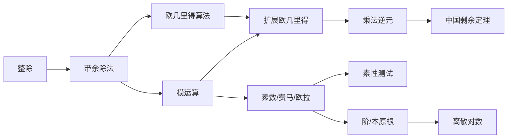
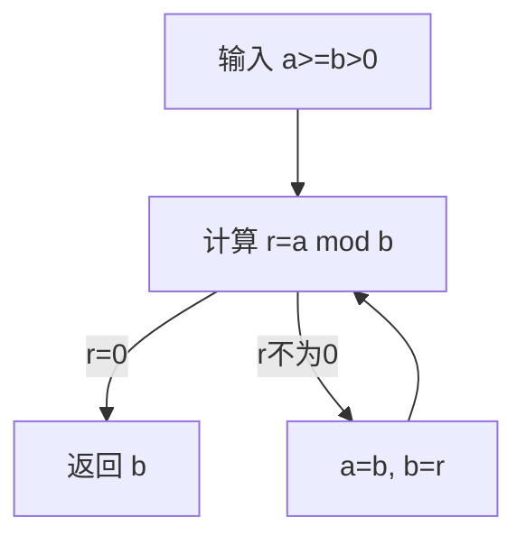
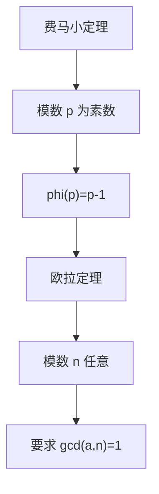
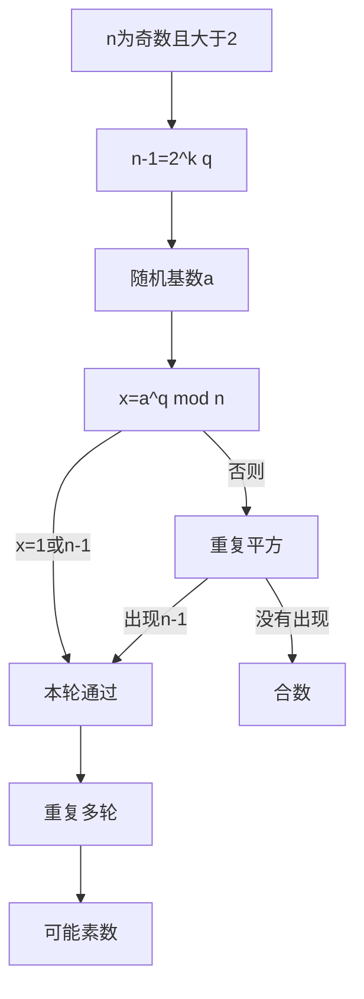

# 第二章 数论基础

## 本章复习

> [!IMPORTANT] 信息边界
> 定义、定理、公式、算法、例子和图表编号均依据本章教材原文；标为“辅助总结”或“辅助重建”的内容用于复习和检索，不是教材原句。

### 章节知识链



## 2.1 整除性和带余除法

### 2.1.1 整除性

#### 定义

设 $a,b,n$ 为整数，若存在整数 $n$ 使 $a=nb$，则非零整数 $b$ 整除 $a$，记作 $b\mid a$；b 是 a 的因子。

#### 教材性质

1. 若 $a\mid1$，则 $a=\pm1$。
2. 若 $a\mid b$ 且 $b\mid a$，则 $a=\pm b$。
3. 任意非零整数整除 0。
4. 若 $a\mid b$ 且 $b\mid c$，则 $a\mid c$。
5. 若 $b\mid g$ 且 $b\mid h$，则对任意整数 $m,n$，有 $b\mid(mg+nh)$。

#### 线性组合证明

若 $g=bg_1,h=bh_1$，则

\[
mg+nh=mbg_1+nbh_1=b(mg_1+nh_1),
\]

所以 $b\mid(mg+nh)$。

#### 教材例子

$13\mid182$、$-5\mid20$、$17\mid289$、$-3\mid33$、$17\mid0$。

### 2.1.2 带余除法

#### 公式（2.1）

对正整数 n 和任意整数 a，唯一存在整数 q、r 使

\[
a=qn+r,\qquad0\le r<n,\qquad q=\lfloor a/n\rfloor. \tag{2.1}
\]

其中 $\lfloor x\rfloor$ 是不大于 x 的最大整数，r 称为余数或剩余数。

#### 正负数例子

\[
11=1\times7+4,\quad 11\bmod7=4;
\]
\[
-11=(-2)\times7+3,\quad -11\bmod7=3.
\]

#### 图表释义

![[attachments/fig_2_1_division_algorithm_page_18.png]]

![[attachments/fig_2_1_division_algorithm_page_19.png]]

图 2.1 两个附件共同展示数轴上 $qn\le a<(q+1)n$ 以及 $70=4\times15+10$。

#### 重点/难点/易错点

- **重点**：余数的规范范围 $0\le r<n$。
- **难点**：负数的商使用向下取整。
- **易错**：把 $-11\bmod7$ 写成 -4；教材定义下正确结果是 3。

#### 关键词索引

`divisibility` `factor` `division algorithm` `quotient` `remainder` `floor`

#### Related

2.2 欧几里得算法；2.3.1 模；附录 2A `mod` 的含义。

## 2.2 欧几里得算法

### 2.2.1 最大公因子

#### 定义

正整数 c 是 a、b 的最大公因子，当且仅当：

1. c 是 a、b 的公因子；
2. a、b 的任意公因子都整除 c。

等价写法：

\[
\gcd(a,b)=\max\{k\mid k\mid a\text{ 且 }k\mid b\}.
\]

教材约定 $\gcd(0,0)=0$，且

\[
\gcd(a,b)=\gcd(|a|,|b|),\qquad \gcd(a,0)=|a|.
\]

若 $\gcd(a,b)=1$，则 a、b 互素。

### 2.2.2 求最大公因子

#### 不变性

若

\[
a=q_1b+r_1,\qquad0\le r_1<b, \tag{2.2}
\]

则 a、b 的公因子也整除 $r_1=a-q_1b$；反过来，b、$r_1$ 的公因子也整除 $a=q_1b+r_1$。因此

\[
\gcd(a,b)=\gcd(b,r_1).
\]

#### 余数序列（2.3）

\[
\begin{aligned}
a&=q_1b+r_1, &0<r_1<b,\\
b&=q_2r_1+r_2, &0<r_2<r_1,\\
r_1&=q_3r_2+r_3, &0<r_3<r_2,\\
&\vdots\\
r_{n-2}&=q_nr_{n-1}+r_n, &0<r_n<r_{n-1},\\
r_{n-1}&=q_{n+1}r_n+0.
\end{aligned} \tag{2.3}
\]

最后一个非零余数 $r_n=\gcd(a,b)$。余数严格递减且非负，因此算法终止。

#### 算法流程



> [!NOTE] 辅助重建
> 流程图根据教材图 2.2 和公式重建，用于检索；权威图像如下。

![[attachments/fig_2_2_euclidean_algorithm.png]]

![[attachments/fig_2_3_euclidean_algorithm_example.png]]

图 2.3 的 $\gcd(710,310)$ 例子最终得到最后一个非零余数 10。

![[attachments/table_2_1_euclidean_algorithm_example.png]]

表 2.1 给出大数实例 $\gcd(1160718174,316258250)=1078$。

#### 重点/难点/易错点

- **重点**：$\gcd(a,b)=\gcd(b,a\bmod b)$。
- **难点**：证明两组数的公因子集合相同。
- **易错**：返回最终的 0，而不是上一项非零余数。

#### 关键词索引

`greatest common divisor` `GCD` `coprime` `Euclidean algorithm` `remainder sequence`

#### Related

2.3.5 欧几里得算法回顾；2.3.6 扩展欧几里得算法；2.4 素因子分解求 GCD。

## 2.3 模运算

### 2.3.1 模

#### 定义

$a\bmod n$ 是 a 除以正整数 n 的规范余数。若

\[
(a\bmod n)=(b\bmod n),
\]

则称 a、b 模 n 同余，记为

\[
a\equiv b\pmod n.
\]

若 $a\equiv0\pmod n$，则 $n\mid a$。

### 2.3.2 同余的性质

1. 若 $n\mid(a-b)$，则 $a\equiv b\pmod n$。
2. 若 $a\equiv b\pmod n$，则 $b\equiv a\pmod n$。
3. 若 $a\equiv b\pmod n,b\equiv c\pmod n$，则 $a\equiv c\pmod n$。

教材例子：$21\equiv5\pmod8$、$-13\equiv3\pmod8$、$81\equiv0\pmod{27}$。

### 2.3.3 模算术运算

#### 剩余类集合

\[
\mathbb Z_n=\{0,1,\dots,n-1\}.
\]

每个元素代表一个模 n 剩余类。

#### 三条运算性质

设 $r_a=a\bmod n,r_b=b\bmod n$：

\[
(a+b)\bmod n=[(a\bmod n)+(b\bmod n)]\bmod n,
\]
\[
(a-b)\bmod n=[(a\bmod n)-(b\bmod n)]\bmod n,
\]
\[
(ab)\bmod n=[(a\bmod n)(b\bmod n)]\bmod n.
\]

教材例子：$11\bmod8=3,15\bmod8=7$，因此和、差、积分别同余于 2、4、5。

![[attachments/table_2_2_mod_8_operations.png]]

表 2.2 完整列出模 8 加法和乘法，直观展示封闭性。

### 2.3.4 模运算的性质

| 性质 | 表达式 |
|---|---|
| 交换律 | $(w+x)\bmod n=(x+w)\bmod n$；$(wx)\bmod n=(xw)\bmod n$ |
| 结合律 | $[(w+x)+y]\bmod n=[w+(x+y)]\bmod n$；乘法同理 |
| 分配律 | $w(x+y)\bmod n=(wx+wy)\bmod n$ |
| 单位元 | $0+w\equiv w\pmod n$；$1\cdot w\equiv w\pmod n$ |
| 加法逆元 | 对任意 w，存在 z 使 $w+z\equiv0\pmod n$ |

![[attachments/table_2_3_modular_arithmetic_properties.png]]

#### 乘法逆元与约去条件

若 $\gcd(a,n)=1$，a 在 $\mathbb Z_n$ 中存在唯一乘法逆元 $a^{-1}$，满足

\[
aa^{-1}\equiv1\pmod n.
\]

只有这时，才可由

\[
ax\equiv ay\pmod n
\]

推出 $x\equiv y\pmod n$。教材反例：$6\times3\equiv6\times7\pmod8$，但 $3\not\equiv7\pmod8$，因为 6 与 8 不互素。

### 2.3.5 欧几里得算法回顾

#### 定理（2.6）

\[
\gcd(a,b)=\gcd(b,a\bmod b),\qquad a\ge b\ge0. \tag{2.6}
\]

#### 递归伪代码

```text
Euclid(a,b)
    if b=0 then return a;
    else return Euclid(b, a mod b);
```

### 2.3.6 扩展欧几里得算法

#### 贝祖形式（2.7）

扩展算法求出 $d=\gcd(a,b)$ 及整数 x、y，使

\[
ax+by=d. \tag{2.7}
\]

余数关系变形为

\[
r_i=r_{i-2}-q_ir_{i-1},
\]

并令每项 $r_i=ax_i+by_i$，可迭代更新系数。

教材实例：

\[
\gcd(1759,550)=1,\quad x=-111,\quad y=355,
\]

\[
1759(-111)+550(355)=1.
\]

![[attachments/table_2_4_extended_euclidean_example.png]]

表 2.4 展示每一步余数、商和系数的更新。

#### 逆元关系

若 $\gcd(a,n)=1$ 且 $ax+ny=1$，则 $ax\equiv1\pmod n$，所以 $x\bmod n$ 是 a 的模 n 逆元。

#### 重点/难点/易错点

- **重点**：同余等价于差被模数整除；逆元存在当且仅当互素。
- **难点**：扩展欧几里得的系数回代或迭代更新。
- **易错**：未检查 GCD 就约去因子；负数余数未规范化。

#### 关键词索引

`modulus` `residue` `congruence` `residue class` `modular arithmetic` `multiplicative inverse` `extended Euclidean algorithm` `Bézout coefficients`

#### Related

2.5 欧拉定理；2.7 CRT；附录 2A；后续 RSA。

## 2.4 素数

### 定义

整数 $p>1$ 只有正因子 1 和 p 时为素数；大于 1 且不是素数的数为合数。1 不属于素数或合数。

### 算术基本定理（2.9）

任意整数 $a>1$ 唯一分解为

\[
a=p_1^{a_1}p_2^{a_2}\cdots p_k^{a_k},\qquad p_1<p_2<\cdots<p_k. \tag{2.9}
\]

也可写成

\[
a=\prod_{p\in P}p^{a_p},\qquad a_p\ge0,
\]

其中除有限项外指数均为 0。

### 乘法和 GCD 的指数表示

若 $a=\prod p^{a_p},b=\prod p^{b_p}$，则

\[
ab=\prod p^{a_p+b_p},
\]

\[
\gcd(a,b)=\prod p^{\min(a_p,b_p)}.
\]

教材例子：

\[
300=2^2\times3\times5^2,\quad18=2\times3^2,\quad\gcd(300,18)=6.
\]

![[attachments/table_2_5_primes_below_2000.png]]

表 2.5 列出 2000 以内素数，用于小数查验。

### 重点/难点/易错点

- **重点**：唯一素因子分解。
- **难点**：用统一指数表示乘法和 GCD。
- **易错**：把 1 当作素数；求 GCD 时取最大指数。

### 关键词索引

`prime` `composite` `fundamental theorem of arithmetic` `prime factorization`

### Related

2.5 费马/欧拉；2.6 素性测试；2.8 本原根。

## 2.5 费马定理和欧拉定理

### 2.5.1 费马定理

#### 费马小定理（2.10）

若 p 为素数，a 为正整数且 $p\nmid a$，则

\[
a^{p-1}\equiv1\pmod p. \tag{2.10}
\]

#### 等价形式（2.11）

若 p 为素数，a 为任意正整数，则

\[
a^p\equiv a\pmod p. \tag{2.11}
\]

教材例子：$p=7,a=3$，$3^6\equiv1\pmod7$，$3^7\equiv3\pmod7$。

### 2.5.2 欧拉函数

$\phi(n)$ 是小于 n 且与 n 互素的正整数个数。

#### 性质

1. p 为素数：$\phi(p)=p-1$。
2. p 为素数，$a\ge1$：

   \[
   \phi(p^a)=p^a-p^{a-1}=p^{a-1}(p-1).
   \]

3. $\gcd(m,n)=1$：

   \[
   \phi(mn)=\phi(m)\phi(n).
   \]

4. 若 $n=p_1^{k_1}\cdots p_r^{k_r}$：

   \[
   \phi(n)=n\prod_{i=1}^r\left(1-\frac1{p_i}\right).
   \]

教材例子：$\phi(37)=36,\phi(6)=2,\phi(21)=12$。

![[attachments/table_2_6_euler_totient_values.png]]

表 2.6 给出欧拉函数数值，可用于复核。

### 2.5.3 欧拉定理

若 $\gcd(a,n)=1$，则

\[
a^{\phi(n)}\equiv1\pmod n. \tag{2.12}
\]

推论：

\[
a^{-1}\equiv a^{\phi(n)-1}\pmod n.
\]

教材例子：$a=3,n=10,\phi(10)=4$，故 $3^4\equiv1\pmod{10}$。

### 定理关系



> [!NOTE] 辅助总结
> 费马小定理可视为欧拉定理在素数模数下的特殊情形。

### 重点/难点/易错点

- **重点**：每个定理的前提条件。
- **难点**：从素因子分解计算 $\phi(n)$。
- **易错**：对合数 n 直接写 $\phi(n)=n-1$；未检查互素就使用欧拉定理。

### 关键词索引

`Fermat's little theorem` `Euler's totient` `Euler's theorem` `modular exponentiation`

### Related

2.3 乘法逆元；2.6 Miller–Rabin；2.8 阶和本原根。

## 2.6 素性测试

### 2.6.1 Miller–Rabin 算法

#### 输入分解

对奇数 $n>2$，写

\[
n-1=2^kq,
\]

其中 q 为奇数。

#### 一轮测试

1. 随机选择 $a\in(1,n-1)$。
2. 计算 $x=a^q\bmod n$。
3. 若 $x=1$ 或 $x=n-1$，本轮通过。
4. 否则最多重复平方 (k-1) 次；中途出现 (n-1) 则通过。
5. 始终未出现 (n-1)，则 n 是合数。

#### 结论边界

| 测试结果 | 可得结论 |
|---|---|
| 未通过 | n 一定是合数 |
| 一轮或多轮通过 | n 很可能是素数，不能 100% 确认 |

多轮独立选择不同 a 可大幅降低误判概率。

### 2.6.2 确定性素性判定

Agrawal、Kayal、Saxena 于 2002 年提出 AKS 算法，证明素性可以在多项式时间内确定；教材指出 AKS 比 Miller–Rabin 慢，尚未取代后者。

### 2.6.3 素数分布

素数定理：在 n 附近平均每 $\ln n$ 个整数有一个素数；只测试奇数时，平均测试数约为

\[
0.5\ln n.
\]

在 $2^{200}$ 附近平均约测试 $0.5\ln(2^{200})\approx69$ 个奇数。

素数分布不均匀。教材给出连续合数例子：

\[
1001!+2,1001!+3,\ldots,1001!+1001.
\]

### 算法流程



### 重点/难点/易错点

- **重点**：概率算法结论边界。
- **难点**：$n-1=2^kq$ 分解与重复平方过程。
- **易错**：把“可能素数”写成“确定素数”。

### 关键词索引

`Miller-Rabin` `probabilistic [[Course Notes/算法概论 （Algorithm）/1 3 素性测试/1.3 素性测试|primality test]]` `witness` `AKS` `prime number theorem`

### Related

2.4 素数；2.5 费马定理；后续公钥密钥生成。

## 2.7 中国剩余定理

### 定理条件与结论

设 $m_1,\dots,m_k$ 两两互素，

\[
M=\prod_{i=1}^k m_i.
\]

$\mathbb Z_M$ 中每个 A 唯一对应余数组 $(a_1,\dots,a_k)$，其中 $a_i=A\bmod m_i$；反过来，每组余数唯一确定 $A\in[0,M$)。加、减、乘可在各分量独立执行。

### 求解公式（2.16、2.17）

令

\[
M_i=M/m_i,
\]

$M_i^{-1}$ 为 $M_i$ 模 $m_i$ 的逆元：

\[
c_i=M_i\left(M_i^{-1}\bmod m_i\right), \tag{2.16}
\]

\[
A=\left(\sum_{i=1}^k a_ic_i\right)\bmod M. \tag{2.17}
\]

### 教材实例

解 $x\equiv3\pmod7,x\equiv4\pmod{13}$：

\[
M=91,\quad M_1=13,\quad M_2=7,
\]
\[
13^{-1}\bmod7=6,\quad7^{-1}\bmod13=2,
\]
\[
c_1=78,\quad c_2=14,
\]
\[
A=(3\times78+4\times14)\bmod91=17.
\]

验证：$17\bmod7=3,17\bmod13=4$。

### 密码学用途

大数模运算可拆分为多个小模数计算，再用 CRT 合并结果；教材指出它用于 RSA 解密/签名优化。

### 重点/难点/易错点

- **重点**：模数两两互素、解在 ([0,M)) 唯一。
- **难点**：计算每个 $M_i$ 的模逆元。
- **易错**：不回代验证；忘记最终对 M 取模。

### 关键词索引

`Chinese remainder theorem` `pairwise coprime` `reconstruction` `modular inverse`

### Related

2.3.6 扩展欧几里得；后续 RSA 优化。

## 2.8 离散对数

### 2.8.1 模 n 的整数幂

若 $\gcd(a,n)=1$，则欧拉定理给出 $a^{\phi(n)}\equiv1\pmod n$。满足

\[
a^m\equiv1\pmod n
\]

的最小正整数 m 称为 a 模 n 的阶或周期。若阶等于 $\phi(n)$，则 a 是模 n 的本原根。

教材给出的本原根存在条件：

\[
n=2,4,p^\alpha,2p^\alpha,
\]

其中 p 为奇素数。

![[attachments/table_2_7_integer_powers_mod_19.png]]

表 2.7 中 2 是模 19 的本原根，其幂遍历 1–18 的全部非零剩余。

### 2.8.2 模算术对数

若 g 是模素数 p 的本原根，对非零剩余 b，存在唯一 x 使

\[
g^x\equiv b\pmod p.
\]

x 称为 b 以 g 为底的离散对数，记作 $\log_g(b)\pmod{\phi(p)}$。

#### 运算性质

\[
\log_g(ab)\equiv\log_g(a)+\log_g(b)\pmod{\phi(p)},
\]

\[
\log_g(a^c)\equiv c\log_g(a)\pmod{\phi(p)}.
\]

![[attachments/table_2_8_discrete_logarithms_mod_19.png]]

表 2.8 是表 2.7 的反向索引，可查得 $\log_2(14)=7$。

### 2.8.3 离散对数的计算

| 问题方向 | 输入 | 输出 | 教材结论 |
|---|---|---|---|
| 模幂 | g、x、p | $y=g^x\bmod p$ | 快速幂，计算简单 |
| 离散对数 | g、y、p | x | 计算困难，无多项式高效算法 |

离散对数困难性是 Diffie–Hellman 密钥交换和 DSA 等体系的安全基础。

### 重点/难点/易错点

- **重点**：阶、本原根、离散对数的定义。
- **难点**：从模幂表反向理解离散对数。
- **易错**：把普通实数对数的值域和离散对数混为一谈。

### 关键词索引

`order` `period` `primitive root` `[[Course Notes/算法概论 （Algorithm）/6 4 离散对数的计算：大步小步法/6.4 离散对数的计算：大步小步法|discrete logarithm]]` `[[Course Notes/密码学 (Cipher)/Key Management and the Public-Key Revolution/Key Management and the Public-Key Revolution|Diffie-Hellman]]` `DSA`

### Related

2.5 欧拉定理；后续 Diffie–Hellman、数字签名算法。

## 2.9 关键术语、思考题和习题

### 关键术语索引

`最大公因子` `互素` `带余除法` `模数` `余数` `模运算` `素数` `本原根` `费马定理` `欧拉函数` `欧拉定理` `中国剩余定理` `离散对数` `Miller-Rabin测试` `扩展欧几里得算法`

### 题型—知识点映射

| 题型 | 对应内容 |
|---|---|
| 定义题 | 整除、带余除法、GCD、欧拉函数、本原根、离散对数 |
| 手算题 | GCD、模运算、逆元、$\phi(n)$、CRT、离散对数查表 |
| 算法题 | 欧几里得、扩展欧几里得、Miller–Rabin |
| 模幂题 | 费马/欧拉定理及前提条件 |
| 编程题 | Miller–Rabin 概率素性测试 |

### 全章重点/难点/易错点

1. 负数的规范余数必须非负。
2. 欧几里得算法取最后一个非零余数。
3. 逆元存在当且仅当与模数互素。
4. 费马和欧拉定理使用前必须检查条件。
5. Miller–Rabin 通过不等于确定为素数。
6. CRT 要求模数两两互素，结果要回代。
7. 离散对数是模幂的反向困难问题。

### 复盘建议

第一轮背定义和条件；第二轮手算 GCD、逆元、$\phi$ 和 CRT；第三轮复述算法流程；第四轮完成《第二章_数论基础_课后习题》，检查每个公式的适用条件。

## 附录 2A mod 的含义

| 写法 | 角色 | 含义 |
|---|---|---|
| $a\bmod n$ | 二元运算符 | 返回 a 除以 n 的规范余数 |
| $a\equiv b\pmod n$ | 同余关系 | a、b 模 n 余数相同 |

剩余类将全部整数划分成 n 个不相交集合，代表元可取 $0,1,\dots,n-1$。核心等价关系：

\[
a\equiv b\pmod n\iff n\mid(a-b).
\]

### 关键词索引

`mod operator` `congruence relation` `residue class`

### Related

2.1.2 带余除法；2.3.1 模；2.3.2 同余性质。
