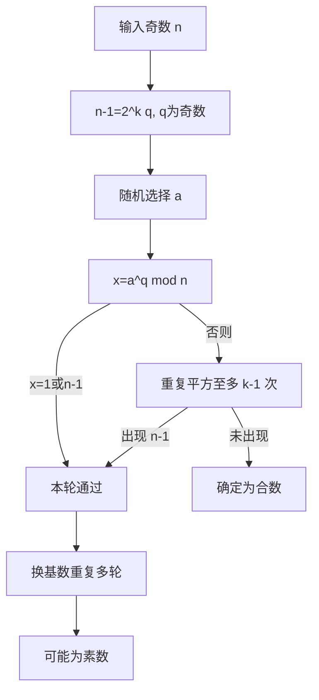
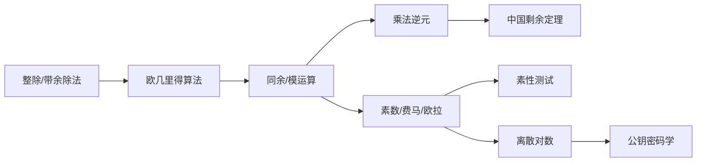

# 第二章 数论基础

## 本章导学

### 学习路线

本章不是把一堆公式孤立地背下来，而是建立一条密码学所需的“整数工具链”：先学整除和余数语言，再用欧几里得算法求最大公因子；然后把余数限制到有限集合，形成模运算和乘法逆元；接着学习素数、费马/欧拉定理和素性测试；最后用中国剩余定理和离散对数把这些工具连接到公钥密码学。

### 全章学习目标

- 能用整除符号和带余除法准确描述整数关系。
- 能手算欧几里得算法和扩展欧几里得算法。
- 能区分“余数”“同余”“剩余类”和模运算。
- 能判断乘法逆元何时存在，并计算它。
- 能使用素因子分解、费马定理和欧拉定理进行模幂计算。
- 能解释 Miller–Rabin 是概率素性测试，并说明“通过”与“不通过”的含义。
- 能用 CRT 合并同余信息，理解离散对数的正向易算和反向困难。

## 2.1 整除性和带余除法

### 本节学习目标

能够把“整除”翻译成存在整数倍数的等式，并对正、负被除数使用唯一的带余除法表示。

### 本节核心问题

1. 符号 $b\mid a$ 究竟声明了什么？
2. 为什么余数必须满足 $0\le r<n$？
3. 负数做模运算时，为什么余数仍然是非负的？

### 为什么需要学习

密码学的大量运算不是在普通整数上无限增长，而是在某个模数下折回有限范围。整除和带余除法是理解同余、逆元、欧几里得算法的共同语言。

### 知识背景

教材把整数 $a,b,n$ 作为基本对象。整除描述“能否写成整数倍数”，带余除法则把任何整数分解成“商 × 模数 + 规范余数”。

### 知识原理

若存在整数 $n$ 使 $a=nb$，则非零 $b$ 整除 $a$，记为 $b\mid a$。对正整数 $n$ 和任意整数 $a$，唯一存在 $q,r$ 使

\[
a=qn+r,\qquad 0\le r<n,\qquad q=\lfloor a/n\rfloor .
\]

### 教材内容详细讲解

整除的关键是“存在整数倍数”，不是“商看起来接近整数”。例如 $13\mid182$，因为 $182=14\times13$；$-5\mid20$，因为 $20=(-4)\times(-5)$；任何非零整数都整除 0。教材列出的性质包括传递性和线性组合封闭性：若 $b\mid g$ 且 $b\mid h$，则对任意整数 $m,n$，有 $b\mid(mg+nh)$。证明时把 $g,h$ 分别写成 $bg_1,bh_1$ 即可。

带余除法中，商是向下取整而不是向零取整。$11=1\times7+4$，所以 $11\bmod7=4$；$-11=(-2)\times7+3$，所以 $-11\bmod7=3$。这正是规定 $0\le r<n$ 的结果。

### 图表辅助讲解

![[attachments/fig_2_1_division_algorithm_page_18.png]]

![[attachments/fig_2_1_division_algorithm_page_19.png]]

图 2.1 的两张附件共同说明数轴上的 $a=qn+r$，并给出 $70=(4\times15)+10$ 的实例。第二张不是独立新图，而是同一图的续页。

### 示例分析

求 $-23\bmod12$：先取 $q=\lfloor-23/12\rfloor=-2$，再算 $r=-23-(-2)\times12=1$。因为 $0\le1<12$，所以余数是 1；写成 (-1) 不符合本章的规范余数定义。

### 生活中的类比

整除像“整箱装满”：如果每箱容量是 $b$，物品总数 $a$ 能恰好装满若干整箱，就有 $b\mid a$。带余除法像“整箱后剩下几件”，剩下数量必须落在 0 到箱容量减 1 之间。

### 常见误区

- 把 $b\mid a$ 误读成 $a\mid b$。
- 认为负数的余数可以是负数；本章要求 $0\le r<n$。
- 认为整除只适用于正整数；教材允许整数，除数要求非零。

### 易混淆知识点对比

| 概念 | 表达 | 核心含义 |
|---|---|---|
| 整除 | $b\mid a$ | $a$ 是 $b$ 的整数倍 |
| 商 | $q=\lfloor a/n\rfloor$ | 向下取整得到的整数 |
| 余数 | $r=a-qn$ | 满足 $0\le r<n$ |
| 模运算结果 | $a\bmod n$ | 带余除法得到的 $r$ |

### 记忆技巧

整除记“能写成整数倍”；带余除法记“商向下、余数非负且小于模数”。

### 与前后章节联系

2.2 用带余除法递归求 GCD；2.3 把余数变成模运算；2.5–2.8 的定理和算法都依赖这些定义。

### 学习建议

先手算 5 个正数和 5 个负数的商余数对，再开始背同余性质。每次都检查 $a=qn+r$ 和 $0\le r<n$ 两个条件。

### 推荐扩展阅读

无。先掌握教材定义和图 2.1。

## 2.2 欧几里得算法

### 本节学习目标

能定义最大公因子，解释余数递归为什么保持 GCD 不变，并独立执行欧几里得算法。

### 本节核心问题

1. 最大公因子为什么可以由一串余数得到？
2. 为什么余数序列必然终止？
3. 最后一项非零余数为何就是 GCD？

### 为什么需要学习

GCD 是判断互素和判断逆元存在性的基础；扩展版本还能给出模逆元和 RSA 所需的系数。

### 知识背景

教材先定义互素，再从 GCD 的定义出发构造算法。算法不是经验性的“试除”，而是由整除关系严格保证的递归过程。

### 知识原理

对 $a\ge b\ge0$，有

\[
\gcd(a,b)=\gcd(b,a\bmod b).
\]

若 $a=q_1b+r_1$，则 $a,b$ 的公因子集合与 $b,r_1$ 的公因子集合相同，因此 GCD 不变。余数严格递减且非负，最终必出现 0。

### 教材内容详细讲解

GCD 是同时整除 $a,b$ 的最大正整数，也可写成

\[
\gcd(a,b)=\max\{k\mid k\mid a\text{ 且 }k\mid b\}.
\]

教材定义 $\gcd(0,0)=0$，并指出 $\gcd(a,0)=|a|$。互素表示唯一正公因子是 1，即 $\gcd(a,b)=1$。欧几里得算法每一步都把较大的数替换成余数，最后一个非零余数是结果。

### 图表辅助讲解

![[attachments/fig_2_2_euclidean_algorithm.png]]

![[attachments/fig_2_3_euclidean_algorithm_example.png]]

![[attachments/table_2_1_euclidean_algorithm_example.png]]

图 2.2 展示算法流程，图 2.3 展示 $\gcd(710,310)$，表 2.1 展示大数实例 $\gcd(1160718174,316258250)=1078$。

### 示例分析

\[
\begin{aligned}
710&=2\times310+90\\
310&=3\times90+40\\
90&=2\times40+10\\
40&=4\times10+0.
\end{aligned}
\]

因此 GCD 是 10。每一行都必须满足“被除数 = 商 × 除数 + 余数”。

### 生活中的类比

把两根长度不同的绳子剪成尽可能大的相同长度。每次用较短段去分割较长段，剩余段继续参与，最后能整齐分割的最长段就是 GCD。

### 常见误区

- 把最后的 0 当成 GCD；应取最后一个非零余数。
- 忽略绝对值，直接把负数 GCD 写成负数。
- 只给答案不写余数序列，无法检查算法过程。

### 易混淆知识点对比

| 方法 | 输出 | 是否给出系数 |
|---|---|---|
| 欧几里得算法 | $\gcd(a,b)$ | 否 |
| 扩展欧几里得算法 | $\gcd(a,b)$ | 是，给出 $ax+by=d$ |

### 记忆技巧

“除、余、换、停”：相除得余数，交换除数和余数，余数为 0 停止。

### 与前后章节联系

2.3.5 回顾该算法，2.3.6 扩展它求逆元；2.4 的素因子分解也可求 GCD，但欧几里得算法更直接。

### 学习建议

先做小数验证不变性，再做大数表格。每步同时写商 $q_i$ 和余数 $r_i$，不要跳步。

### 推荐扩展阅读

无。

## 2.3 模运算

### 本节学习目标

理解模、同余、剩余类、模运算和逆元；能进行加减乘模运算，并执行扩展欧几里得算法。

### 本节核心问题

1. “$a\bmod n$”和“$a\equiv b\pmod n$”分别是什么？
2. 为什么可以先取余再加减乘？
3. 什么时候可以约去一个因子？
4. 如何从 GCD 得到乘法逆元？

### 为什么需要学习

密码算法通常在有限集合中计算。模运算使数值保持在有限范围内，同余关系则允许把无限整数压缩为有限个剩余类。

### 知识背景

教材把 $\mathbb Z_n=\{0,1,\dots,n-1\}$ 作为剩余代表集合，并逐步引出运算性质、逆元和扩展欧几里得算法。

### 知识原理

定义 $a\bmod n$ 为带余除法余数；若两数余数相等，则 $a\equiv b\pmod n$，等价于 $n\mid(a-b)$。加、减、乘均可先分别取模再运算；乘法逆元 $a^{-1}$ 只在 $\gcd(a,n)=1$ 时存在。

### 教材内容详细讲解

同余具有自反、对称、传递等性质。模算术在 $\mathbb Z_n$ 中封闭：结果再取模仍回到 0 到 (n-1)。交换律、结合律、分配律和单位元与普通整数运算相似，但“约去因子”需要额外条件。若 $a$ 与 $n$ 互素，则存在 $a^{-1}$，可将 $ax\equiv ay\pmod n$ 两边乘以逆元得到 $x\equiv y\pmod n$。若不互素，约去可能错误。

### 图表辅助讲解

![[attachments/table_2_2_mod_8_operations.png]]

![[attachments/table_2_3_modular_arithmetic_properties.png]]

表 2.2 展示模 8 的加法、乘法封闭性；表 2.3 汇总交换律、结合律、分配律、单位元和加法逆元等性质。

### 示例分析

取 $11\bmod8=3,15\bmod8=7$：

\[
(11+15)\bmod8=(3+7)\bmod8=2,
\]
\[
(11\times15)\bmod8=(3\times7)\bmod8=5.
\]

但 $6\times3\equiv6\times7\pmod8$，而 $3\not\equiv7\pmod8$，因为 $\gcd(6,8)=2$，6 在模 8 下没有逆元。

### 生活中的类比

模运算像钟表：超过 12 就绕回 1；但“约去一个数字”不能随意进行，只有当这个数字在当前钟表模数下有逆时才可靠。

### 常见误区

- 把同余当作普通等号；同余只说明差是模数的倍数。
- 负数余数写成负值。
- 未检查 GCD 就约去因子。

### 易混淆知识点对比

| 表达式 | 结果/含义 |
|---|---|
| $a\bmod n$ | 一个规范余数 |
| $a\equiv b\pmod n$ | 一个关系，等价于 $n\mid(a-b)$ |
| $a^{-1}\pmod n$ | 满足 $aa^{-1}\equiv1\pmod n$ 的数 |
| $a\mid b$ | 普通整数整除关系 |

### 记忆技巧

“先取余、再运算、最后再取余”；约去前先问“互素吗？”

### 与前后章节联系

2.3.5 将 GCD 写成递归；2.3.6 用扩展算法求逆元；2.5 的定理、2.7 的 CRT 和后续 RSA 都建立在模运算上。

### 学习建议

先用模 8 表格练习，再用一般符号证明性质。所有逆元题都先算 GCD，再开始求系数。

### 推荐扩展阅读

无。

### 2.3.5 欧几里得算法回顾

教材给出递归伪代码：

```text
Euclid(a,b)
    if b=0 then return a;
    else return Euclid(b, a mod b);
```

把它看成“将一轮除法压缩成一个递归调用”，而不是新的算法。递归终点 $b=0$ 时返回当前 $a$，即最后一个非零余数。

### 2.3.6 扩展欧几里得算法

扩展算法不仅返回 $d=\gcd(a,b)$，还返回 $x,y$，满足

\[
ax+by=d.
\]

沿用余数序列 $r_i=r_{i-2}-q_ir_{i-1}$，把每个余数表示为 $r_i=ax_i+by_i$，系数随迭代更新。教材实例给出 $1759x+550y=1$ 的一组解 $x=-111,y=355$。当 $d=1$ 时，$x$ 或 $y$ 可转化为相应模数下的乘法逆元。

## 2.4 素数

### 本节学习目标

能区分素数和合数，使用算术基本定理进行唯一分解，并用素因子指数求 GCD。

### 本节核心问题

1. 素数定义为什么排除 1？
2. 唯一素因子分解如何表示整数？
3. GCD 为什么对应各素因子指数的最小值？

### 为什么需要学习

素数是公钥密码学的重要构件；唯一分解还把乘法问题转化成指数加法，并提供另一种理解 GCD 的方法。

### 知识背景

教材称数论的核心围绕素数展开，并给出 2000 以内素数表供查阅。

### 知识原理

整数 $p>1$ 只有因子 1 和 $p$ 时为素数；其他大于 1 的整数为合数。任意 $a>1$ 都能唯一写成

\[
a=p_1^{a_1}p_2^{a_2}\cdots p_k^{a_k},
\]

其中素数按升序排列。若 $a=\prod p^{a_p},b=\prod p^{b_p}$，则 $\gcd(a,b)=\prod p^{\min(a_p,b_p)}$。

### 教材内容详细讲解

乘法对应素因子指数相加。比如 $300=2^2\times3\times5^2$，$18=2\times3^2$，GCD 取每个素数指数的最小值，得到 $2\times3=6$。另一种对所有素数的乘积表示中，大多数指数为 0，因此表达仍是有限的。

### 图表辅助讲解

![[attachments/table_2_5_primes_below_2000.png]]

表 2.5 是素数查找表，适合核对小数实例，不应被误解为素数分布均匀。

### 示例分析

判断 91：$91=7\times13$，因此不是素数；判断 17：只有 1 和 17 两个正因子，因此是素数。求 GCD 时比较指数而不是比较素数本身的大小。

### 生活中的类比

素数像整数世界的“基本积木”：合数是积木组合，唯一分解说明同一个合数不能用另一套素数积木组合出来。

### 常见误区

- 把 1 当作素数；教材定义要求 $p>1$。
- 把“素数表”理解成所有素数的规律表。
- 求 GCD 时取最大指数，正确的是最小指数。

### 易混淆知识点对比

| 对象 | 定义 |
|---|---|
| 素数 | 大于 1，正因子只有 1 和自身 |
| 合数 | 大于 1，至少可分解为两个整数的积 |
| 因子 | 能整除目标数的整数 |
| 素因子指数 | 唯一分解中某素数的幂次 |

### 记忆技巧

“素数只两因子，合数能拆积；GCD 取指数小者”。

### 与前后章节联系

2.5 的费马/欧拉定理以素数为前提；2.6 讨论如何测试大数是否为素数；2.8 的本原根和公钥算法也依赖模素数结构。

### 学习建议

先熟悉 2、3、5、7 等小素数，再练习把数写成素因子分解。不要把试除分解法当作大整数算法。

### 推荐扩展阅读

无。

## 2.5 费马定理和欧拉定理

### 本节学习目标

能在条件满足时使用费马小定理、欧拉函数和欧拉定理化简模幂。

### 本节核心问题

1. 费马定理的条件是什么？
2. $\phi(n)$ 数的是什么？
3. 费马定理和欧拉定理之间是什么关系？

### 为什么需要学习

模幂是公钥密码学的核心操作。定理可以把很大的指数折叠到较小范围，欧拉函数则给出指数周期。

### 知识背景

费马定理针对素数模数；欧拉定理推广到与模数互素的任意整数。

### 知识原理

若 $p$ 为素数且 $p\nmid a$，则

\[
a^{p-1}\equiv1\pmod p.
\]

对任意正整数 $a$，也有 $a^p\equiv a\pmod p$。欧拉函数 $\phi(n)$ 统计小于 $n$ 且与 $n$ 互素的正整数个数；若 $\gcd(a,n)=1$，则 $a^{\phi(n)}\equiv1\pmod n$。

### 教材内容详细讲解

欧拉函数满足：$\phi(p)=p-1$；$\phi(p^a)=p^a-p^{a-1}$；若 $\gcd(m,n)=1$，则 $\phi(mn)=\phi(m)\phi(n)$。若 $n=\prod p_i^{k_i}$，则

\[
\phi(n)=n\prod_i\left(1-\frac1{p_i}\right).
\]

欧拉定理还给出逆元公式：若 $a,n$ 互素，则 $a^{-1}\equiv a^{\phi(n)-1}\pmod n$。

### 图表辅助讲解

![[attachments/table_2_6_euler_totient_values.png]]

表 2.6 可用于核对 $\phi(n)$ 的小数值；计算时仍应先做素因子分解并应用公式。

### 示例分析

计算 $3^{201}\bmod11$：11 为素数，$\phi(11)=10$，且 3 与 11 互素。因为 $201=20\times10+1$，所以 $3^{201}\equiv(3^{10})^{20}3\equiv3\pmod{11}$。

### 生活中的类比

定理像“周期表”：当指数绕完一个周期，模结果回到 1；欧拉函数告诉你周期上限，但前提条件决定能否使用。

### 常见误区

- 忘记检查 $p\nmid a$ 或 $\gcd(a,n)=1$。
- 把 $\phi(n)$ 误写成 (n-1) 对所有 n 都成立。
- 直接把 $a^{\phi(n)-1}$ 当逆元而不检查互素。

### 易混淆知识点对比

| 定理/函数 | 条件 | 结论 |
|---|---|---|
| 费马小定理 | $p$ 素数，$p\nmid a$ | $a^{p-1}\equiv1\pmod p$ |
| 费马等价形式 | $p$ 素数，a 任意正整数 | $a^p\equiv a\pmod p$ |
| 欧拉定理 | $\gcd(a,n)=1$ | $a^{\phi(n)}\equiv1\pmod n$ |
| 欧拉函数 | 计数函数 | 小于 n 且与 n 互素的正整数个数 |

### 记忆技巧

“费马看素数，欧拉看互素；先分解求 $\phi$，再折叠指数”。

### 与前后章节联系

2.6 素性测试利用费马思想；2.8 的阶和本原根与模幂周期有关；RSA 等算法会使用这些定理。

### 学习建议

每道模幂题按四步写：确认条件、求周期、分解指数、验证余数。不要一上来就套公式。

### 推荐扩展阅读

无。

## 2.6 素性测试

### 本节学习目标

理解 Miller–Rabin 的流程和概率含义，知道 AKS 的定位，并能用素数定理估计测试次数。

### 本节核心问题

1. 为什么“通过测试”不等于确定是素数？
2. Miller–Rabin 每一步检查什么？
3. 素数定理如何估计找到大素数的平均尝试次数？

### 为什么需要学习

公钥算法需要大素数，但大整数分解和逐一试除都不现实。素性测试提供快速筛选候选数的办法。

### 知识背景

教材强调 Miller–Rabin 是概率算法：不通过一定是合数，通过只说明很可能是素数。AKS 是确定性多项式时间算法，但通常比 Miller–Rabin 慢。

### 知识原理

对奇数 $n>2$，写成 $n-1=2^kq$，其中 $q$ 奇数。随机选择 $a\in(1,n-1)$，计算 $x=a^q\bmod n$。若 $x=1$ 或 (n-1)，本轮通过；否则连续平方，若出现 (n-1) 通过，否则 $n$ 为合数。

### 教材内容详细讲解

未通过时，找到的是合数的证据；多轮使用不同随机基数，可以大幅降低把合数误判为“可能素数”的概率，但不会把概率测试变成绝对证明。素数定理说在 n 附近平均每 $\ln n$ 个整数有一个素数；只测试奇数时平均约需 $0.5\ln n$ 个奇数。教材示例在 $2^{200}$ 附近约需 69 次测试。

### 图表辅助讲解

本节教材没有独立图表附件；算法步骤使用下列流程辅助理解：



### 示例分析

若某轮得到 $x\ne1,n-1$，且所有后续平方都没有得到 (n-1)，则可以立即判定 n 为合数；若得到 (n-1)，只能说本轮通过，不能宣称绝对为素数。

### 生活中的类比

Miller–Rabin 像抽查证件：发现一张假证就能确定是假，连续多次没发现问题只能提高可信度，不能证明世界上没有伪造。

### 常见误区

- 把“通过”写成“确定是素数”。
- 忘记先把 (n-1) 分解为 $2^kq$。
- 把 AKS 说成已经取代 Miller–Rabin。

### 易混淆知识点对比

| 结果 | 结论 |
|---|---|
| Miller–Rabin 未通过 | n 一定是合数 |
| Miller–Rabin 多轮通过 | n 很可能是素数 |
| AKS | 确定性、多项式时间，但教材指出通常更慢 |

### 记忆技巧

“不通过必合数，通过只可能素数；分解、取幂、平方、换基数”。

### 与前后章节联系

2.4 说明素数为何重要；2.5 提供测试思想的定理背景；后续公钥算法需要从候选大数中筛出素数。

### 学习建议

先能手动走完一轮小 n 流程，再写程序；程序输出应区分“合数”和“可能素数”。

### 推荐扩展阅读

无。

## 2.7 中国剩余定理

### 本节学习目标

理解两两互素模数下的唯一重构，能按公式求解同余方程组，并说明其密码学用途。

### 本节核心问题

1. 为什么一组余数可以唯一确定一个范围内的整数？
2. $M_i$ 和其逆元在公式中分别做什么？
3. CRT 为什么能加速大数模运算？

### 为什么需要学习

CRT 将一个大模数问题拆成多个较小模数问题，再合并结果；教材指出它可用于 RSA 解密/签名优化。

### 知识背景

设 $m_1,\ldots,m_k$ 两两互素，$M=\prod m_i$。$\mathbb Z_M$ 中每个整数都对应一组模 $m_i$ 的余数。

### 知识原理

给定余数 $a_i=A\bmod m_i$，存在唯一 $A\in[0,M$)。令 $M_i=M/m_i$，令 $M_i^{-1}$ 为 $M_i$ 在模 $m_i$ 下的逆元：

\[
c_i=M_i(M_i^{-1}\bmod m_i),\qquad A=\left(\sum_i a_ic_i\right)\bmod M.
\]

加、减、乘可以在各个分量中独立进行。

### 教材内容详细讲解

每个 $c_i$ 在模 $m_i$ 下等于 1，在其他模数下等于 0，因此加权求和会保留对应余数。两两互素保证这些逆元存在，也保证唯一性。

### 示例分析

解 $x\equiv3\pmod7,x\equiv4\pmod{13}$：$M=91,M_1=13,M_2=7$，$13^{-1}\bmod7=6,7^{-1}\bmod13=2$，故 $c_1=78,c_2=14$，

\[
x=(3\times78+4\times14)\bmod91=17.
\]

验证 $17\bmod7=3,17\bmod13=4$。

### 生活中的类比

像通过多个不同刻度的钟表时间推断一个共同日期：每个钟表只给局部余数，模数互素且乘积范围足够大时，可以唯一定位整体。

### 常见误区

- 忘记要求模数两两互素。
- 计算 $M_i^{-1}$ 时不检查 GCD。
- 得到的解未化到 ([0,M)) 或未回代验证。

### 易混淆知识点对比

| 对象 | 作用 |
|---|---|
| $M$ | 所有模数的乘积，决定唯一范围 |
| $M_i$ | 去掉第 i 个模数后的乘积 |
| $M_i^{-1}$ | 使 $M_i$ 在模 $m_i$ 下变成 1 |
| $c_i$ | 只保留第 i 个余数的组合项 |

### 记忆技巧

“乘总模、除本模、求逆元、乘余数、最后取模”。

### 与前后章节联系

CRT 依赖 2.3 的逆元和同余；其密码学用途在 RSA 等公钥算法中出现。

### 学习建议

先解两个模数的简单系统，再解三个模数；每一步都写出 $M,M_i,M_i^{-1}$，不要跳过验证。

### 推荐扩展阅读

无。

## 2.8 离散对数

### 本节学习目标

区分模幂和离散对数，理解阶、本原根的含义，能查表求小规模离散对数。

### 本节核心问题

1. 模 $n$ 下整数幂的周期从哪里来？
2. 什么是本原根和离散对数？
3. 为什么正向模幂容易、反向离散对数困难？

### 为什么需要学习

Diffie–Hellman 密钥交换和 DSA 等公钥算法把离散对数问题作为安全基础。

### 知识背景

欧拉定理保证互素元素的幂最终回到 1。阶是最小正周期；阶等于 $\phi(n)$ 时，元素是本原根。

### 知识原理

若 $a,n$ 互素，满足 $a^m\equiv1\pmod n$ 的最小正整数 $m$ 称为 a 的阶。若阶等于 $\phi(n)$，称 a 为本原根。对模素数 $p$ 的本原根 $g$，任意非零剩余 $b$ 都有唯一 $x$ 使 $g^x\equiv b\pmod p$，这个 x 是离散对数。

### 教材内容详细讲解

教材指出只有 $n=2,4,p^\alpha,2p^\alpha$（p 为奇素数）时才存在本原根。离散对数满足类似普通对数的关系：

\[
\log_g(ab)\equiv\log_g(a)+\log_g(b)\pmod{\phi(p)},
\]
\[
\log_g(a^c)\equiv c\log_g(a)\pmod{\phi(p)}.
\]

### 图表辅助讲解

![[attachments/table_2_7_integer_powers_mod_19.png]]

![[attachments/table_2_8_discrete_logarithms_mod_19.png]]

表 2.7 展示模 19 下以 2 为底的幂；表 2.8 将这些幂反向标成离散对数。

### 示例分析

模 19 下 $2^7=128\equiv14$，所以 $\log_2(14)=7$。已知 $g,x,p$ 求 $g^x\bmod p$ 是快速幂；已知 $g,y,p$ 求 x 则是离散对数问题。

### 生活中的类比

正向模幂像按说明书输入密码得到验证码；离散对数像只看到验证码，反过来猜出输入次数。前者可快速重复，后者可能需要大量搜索。

### 常见误区

- 把普通对数和离散对数混为一谈。
- 把本原根写成“任意底数都能生成全部剩余”。
- 只记住正向易算，却漏掉离散对数是安全困难问题这一方向性。

### 易混淆知识点对比

| 问题 | 输入/输出 | 教材结论 |
|---|---|---|
| 模幂 | $g,x,p\to y=g^x\bmod p$ | 计算简单 |
| 离散对数 | $g,y,p\to x$ | 计算困难，是密码学基础 |
| 阶 | 求最小 $m$ 使 $a^m\equiv1$ | 描述周期 |
| 本原根 | 阶为 $\phi(n)$ 的元素 | 生成全部相关剩余 |

### 记忆技巧

“幂是正向，离散对数是反向；阶看周期，本原根看全覆盖”。

### 与前后章节联系

2.5 提供幂周期，2.3 提供模运算；离散对数将在 Diffie–Hellman、DSA 等章节再次出现。

### 学习建议

先手工列出模 19 的幂表，再从表中反查离散对数；不要一开始就尝试大数算法。

### 推荐扩展阅读

无。

## 2.9 章末复习入口

### 本节学习目标

能把整除、GCD、模、素数、定理、CRT 和离散对数串成一条完整知识链，并独立完成章末题目。

### 本节核心问题

本章每个工具解决什么问题？使用公式前需要检查哪些条件？

### 教材内容详细讲解

关键术语包括最大公因子、互素、带余除法、模数、余数、模运算、素数、本原根、费马定理、欧拉函数、欧拉定理、中国剩余定理、离散对数、Miller–Rabin 测试和扩展欧几里得算法。题目原文及逐题解答见《第二章_数论基础_课后习题》。

### 知识关联



### 易错点总表

| 问题 | 复核动作 |
|---|---|
| 负数余数 | 检查 $0\le r<n$ |
| GCD | 取最后一个非零余数 |
| 逆元 | 先检查 GCD 是否为 1 |
| 费马/欧拉 | 先检查素数或互素条件 |
| Miller–Rabin | 通过不是确定素数 |
| CRT | 检查模数两两互素并回代 |
| 离散对数 | 区分正向模幂和反向求指数 |

### 记忆技巧

“整除造语言，GCD 找公因，模运算限范围，逆元能约去；素数给周期，CRT 合信息，离散对数守密码。”

### 学习建议

按“定义题 → 手算题 → 证明/算法题 → 密码学联系”四轮复习。每轮都保留计算过程，尤其是商、余数、逆元系数和 CRT 验证。

### 推荐扩展阅读

无。

## 附录 2A mod 的含义

### 学习目标与核心问题

区分 `mod` 作为二元运算符和 `mod` 出现在同余关系中的符号，避免把余数和关系混写。

### 教材内容详细讲解

1. 二元运算符：$a\bmod n$ 表示 a 除以 n 的余数，范围为 $0\le r<n$。
2. 同余关系：$a\equiv b\pmod n$ 表示 a、b 的模 n 余数相等，二者属于同一剩余类。

模 n 把全体整数划分为 n 个互不相交的剩余类，且

\[
a\equiv b\pmod n\iff n\mid(a-b).
\]

### 易混淆对比

| 写法 | 类型 | 示例含义 |
|---|---|---|
| $11\bmod7=4$ | 运算 | 求出余数 4 |
| $11\equiv4\pmod7$ | 关系 | 11 与 4 属于同一剩余类 |

### 学习建议

做题时先圈出 `mod` 所在位置：若它连接两个数并给出结果，是运算；若它出现在 (equiv) 右侧，是同余关系的模数。
