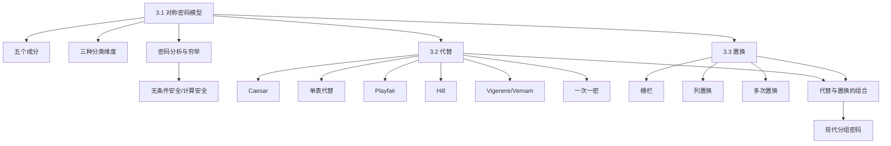
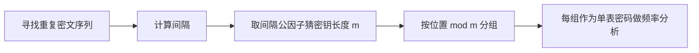

# 第三章 传统加密技术

## 本章复习

> [!IMPORTANT] 信息边界
> “教材知识”严格整理自 `第三章_传统加密技术_教材原文.md`；“复习提示”是辅助记忆，不属于教材原文。教材原文保持只读。

### 章节知识图谱



## 3.1 对称密码模型

### 3.1.1 基本成分

| 成分 | 教材定义 | 检索提示 |
|---|---|---|
| 明文 | 可理解的原始消息或数据 | 加密输入 |
| 加密算法 | 对明文进行代替和变换 | 由密钥决定具体变换 |
| 密钥 | 独立于明文和算法的输入 | 必须保密 |
| 密文 | 依赖明文和密钥的算法输出 | 看起来随机且不可理解 |
| 解密算法 | 加密算法的逆运算 | 输入密文和同一密钥 |

$$
Y=E(K,X),\qquad X=D(K,Y).
$$

教材原图：

![[attachments/fig_3_1_symmetric_cipher_model.png]]

![[attachments/fig_3_2_symmetric_cipher_system_model.png]]

**逻辑关系**：算法公开并不破坏模型；安全使用要求算法足够强，并要求双方安全获得和保护密钥。攻击者可能恢复单个明文估计值 `X̂`，也可能恢复会影响多条通信的密钥估计值 `K̂`。

### 3.1.2 密码编码系统的三种分类

| 维度 | 类型 | 教材要点 |
|---|---|---|
| 运算 | 代替 | 一个元素映射成另一个元素 |
| 运算 | 置换 | 重新排列元素，不丢失信息 |
| 运算 | 乘积密码 | 多层代替和置换 |
| 密钥数 | 对称/单钥/传统 | 发收双方使用相同密钥 |
| 密钥数 | 非对称/双钥/公钥 | 发收双方使用不同密钥 |
| 处理方式 | 分组密码 | 一次处理并输出一组元素 |
| 处理方式 | 流密码 | 连续处理，每次输出一个元素 |

### 3.1.3 密码分析学与穷举攻击

| 方法 | 利用的信息 | 目标/代价 |
|---|---|---|
| 密码分析 | 算法性质、明文一般特征、明密文对 | 推导明文或密钥 |
| 穷举 | 逐个尝试所有候选密钥 | 平均尝试密钥空间一半，并识别正确明文 |

表 3.1：

| 攻击类型 | 密码分析者已知的信息 |
|---|---|
| 唯密文攻击 | 加密算法、密文 |
| 已知明文攻击 | 算法、密文、同一密钥下一个或多个明密文对 |
| 选择明文攻击 | 算法、密文、自选明文及其密文 |
| 选择密文攻击 | 算法、密文、自选密文及其明文 |
| 选择文本攻击 | 同时具有选择明文和选择密文信息 |

![[attachments/table_3_1_cryptanalysis_attack_types.png]]

**可能词攻击**：利用文件头、版权声明、会计关键词等可能出现的已知内容。一般算法至少应经受已知明文攻击。

### 3.1.4 安全性概念

| 概念 | 判定条件 | 结论 |
|---|---|---|
| 无条件安全 | 任意多密文仍不足以唯一确定明文 | 除一次一密外，本章算法均不满足 |
| 计算上安全 | 破译代价超过信息价值，或时间超过信息有效期 | 工程上的相对标准 |
| 强加密 | 算法、密钥长度、协议、实现和缺陷控制均适当 | 教材指出该词常用但不精确 |

**重点**：穷举不只是“试密钥”，还需要自动识别正确明文。

**难点**：攻击模型是按攻击者可获得的信息分类，不是简单的绝对难度排名。

**易错点**：选择密文攻击中的“选择”是攻击者选择密文并得到对应明文；不要反写。

**关键词**：对称密码、单钥加密、明文、密文、密钥、密码分析、穷举、已知明文、无条件安全、计算安全。

**Related**：[[第一章_信息与网络安全概念_复习笔记]]；[[第四章_分组密码和数据加密标准_复习笔记]]。

> [!NOTE] 教材与辅助边界
> 五成分、三种分类维度、攻击类型和安全性定义均为教材知识；“按信息量组织攻击模型”和下述复盘顺序属于结构化复习提示。

**复盘建议**：遮住表格，默写五个成分、三个分类维度和五类攻击者已知信息，再用一句话区分无条件安全与计算安全。

## 3.2 代替技术

### 3.2.1 Caesar 密码

$$
C=E(k,p)=(p+k)\bmod26,\quad 1\le k\le25,
$$

$$
p=D(k,C)=(C-k)\bmod26.
$$

字母与数字：`a=0,b=1,...,z=25`。

![[attachments/table_3_2_caesar_letter_values.png]]

教材示例：

```text
明文：meet me after the toga party
密文：PHHW PH DIWHU WKH WRJD SDUWB
```

可穷举的三个条件：算法已知；仅 25 个密钥；明文语言已知且结果可识别。

![[attachments/fig_3_3_caesar_bruteforce_analysis.png]]

![[attachments/fig_3_4_compressed_text_sample.png]]

**重点/考点**：模 26 加减、密钥空间 25。

**易错**：负数余数未规范化；把压缩文件的不可读输出误判为错误密钥。

**关键词**：Caesar、移位、模 26、穷举、明文识别。

**Related**：[[第二章_数论基础_复习笔记#2.3 模运算]]。

> [!NOTE] 教材与辅助边界
> 公式、25 个非平凡密钥和教材示例属于教材知识；“先正向、再逆向、最后穷举”的顺序是复习提示。

**复盘建议**：任选 `p=23,k=5` 完成一次加解密闭环，并解释为什么压缩数据会使正确候选难以肉眼识别。

### 3.2.2 单表代替密码

有限集合 `S` 的置换是所有元素各出现一次的有序排列；`n` 个元素共有 `n!` 种置换。单表代替允许 26 个密文字母任意排列，密钥空间为：

$$
26!>4\times10^{26}.
$$

**教材例题上下文**：密文 `UZQS...` 的频率最高项是 `P、Z`，先猜测与 `e、t` 对应，再结合重复片段、常见词和上下文验证，得到：

```text
it was disclosed yesterday that several informal but
direct contacts have been made with political
representatives of the viet cong in moscow
```

![[attachments/fig_3_5_english_letter_frequency.png]]

![[attachments/table_3_3_monoalphabetic_substitution_example.png]]

| 攻击线索 | 用法 |
|---|---|
| 单字母频率 | 提出 `e,t,a...` 候选 |
| 双字母/三字母 | 检验 `th,the...` 等结构 |
| 单字母词 | 提示 `a` 或 `I` |
| 可能词 | 用上下文约束映射 |

**重点**：密钥空间大并不阻止利用语言统计规律的密码分析。

**难点**：频率只给候选，不直接给唯一映射；短文本偏差大。

**易错**：一次猜测后不回代验证；把同音词代替当作彻底解决频率问题。

**关键词**：单表代替、置换、26 阶乘、频率分析、双字母、可能词。

**Related**：本章 3.1.2 已知明文攻击；本章 3.2.5 多表代替。

> [!NOTE] 教材与辅助边界
> `26!`、语言频率和教材破译例子属于教材知识；“候选映射必须多证据回代”是依据教材分析过程提炼的复习方法。

**复盘建议**：不看答案，按“单字母频率 -> 双字母 -> 三字母/可能词 -> 全文回代”复述表 3.3 的破译链。

### 3.2.3 Playfair 密码

**矩阵构造**：密钥词去重后填入 5×5 矩阵，再按字母表填剩余字母，`I/J` 合并。

![[attachments/matrix_3_1_playfair_matrix.png]]

| 情况 | 加密规则 |
|---|---|
| 双字母相同 | 插入填充字母 `X` 后重新分组 |
| 同行 | 各取右侧，越界循环 |
| 同列 | 各取下方，越界循环 |
| 矩形 | 各取同一行的另一顶点 |

**教材结论**：处理双字母会显著削弱单字母频率，但仍保留语言结构，数百字母密文仍可能被破译。

**重点/考点**：构造矩阵、分组、同行/同列/矩形三类运算。

**易错**：相同字母插 `X` 后未重新分组；`I/J` 占两个位置；解密时仍向右/向下移动。

**关键词**：Playfair、双字母、5×5、I/J、矩形规则、填充 X。

**Related**：习题 3.9–3.13；本章 3.2.4 Hill 密码。

> [!NOTE] 教材与辅助边界
> 5×5 矩阵构造、四条处理规则和安全性结论属于教材知识；口诀与自检顺序是辅助记忆。

**复盘建议**：分别造一组同行、同列、矩形字母对，完成加密和逆向解密；最后检查 `I/J` 与填充 `X` 的约定。

### 3.2.4 Hill 密码

对 `m=3`：

$$
C=PK\bmod26,
$$

$$
P=CK^{-1}\bmod26.
$$

密钥矩阵必须满足：

$$
\gcd(\det K,26)=1.
$$

教材 2×2 逆矩阵计算附件：

![[attachments/formula_3_1_hill_matrix_inverse_example.png]]

教材 3×3 例题：

$$
K=\begin{pmatrix}17&17&5\\21&18&21\\2&2&19\end{pmatrix},
$$

$$
K^{-1}=\begin{pmatrix}4&9&15\\15&17&6\\24&0&17\end{pmatrix}.
$$

`paymoremoney` 加密为 `RRLMWBKASPDH`，首块验证：

$$
(15\ 0\ 24)K=(303\ 303\ 531)\bmod26=(17\ 17\ 11)=\text{RRL}.
$$

**已知明文攻击**：将 `m` 个长度为 `m` 的明密文对组成矩阵 `X、Y`，有

$$
Y=XK,\qquad K=X^{-1}Y
$$

（要求 `X` 可逆；否则更换明密文对）。

| 优点 | 弱点 |
|---|---|
| 隐藏单字母频率；矩阵越大，隐藏更高阶频率 | 线性结构使其易受已知明文和选择明文攻击 |

**重点**：模 26 矩阵逆、行向量约定、已知明文攻击公式。

**易错**：只检查 `det K != 0`，却未检查模 26 可逆；普通矩阵逆与模逆混淆。

**关键词**：Hill、矩阵、行列式、模逆、已知明文、线性方程。

**Related**：[[第二章_数论基础_复习笔记#2.3 模运算]]；附录 A 线性代数。

> [!NOTE] 教材与辅助边界
> Hill 公式、教材矩阵、`K=X^{-1}Y` 攻击链均为教材知识；“可逆才能解，线性就能列方程”是复习提示。

**复盘建议**：先验证教材 `K^{-1}`，再手算 `pay -> RRL`，最后闭卷写出已知明文攻击恢复 `K` 的条件。

### 3.2.5 多表代替与 Vigenere

多表代替的共同特征：使用相关的单表规则集；密钥决定当前使用哪一条规则。

$$
C_i=(p_i+k_{i\bmod m})\bmod26,
$$

$$
p_i=(C_i-k_{i\bmod m})\bmod26.
$$

教材示例：

```text
密钥：deceptivedeceptivedeceptive
明文：wearediscoveredsaveyourself
密文：ZICVTWQNGRZGVTWAVZHCQYGLMGJ
```

![[attachments/table_3_4_vigenere_numeric_example.png]]

**攻击链**：



自动生成密钥将密钥词与明文本身连接，能消除短周期，但密钥仍带有明文语言统计特征，仍可分析。

**重点**：一个周期为 `m` 的 Vigenere 本质上是 `m` 个单表代替。

**易错**：重复序列间距只给密钥长度候选，不是必然等于长度；分组位置偏移一位。

**关键词**：多表代替、Vigenere、密钥周期、重复序列、公因子、频率分析。

**Related**：本章 3.2.2 单表代替；本章 3.2.6 一次一密；[[第八章_随机位生成和流密码_复习笔记]]。

> [!NOTE] 教材与辅助边界
> Vigenere 公式、`deceptive` 例子和重复序列攻击均为教材知识；流程图是对教材攻击步骤的可检索重构。

**复盘建议**：标出教材示例中两次 `VTW` 的位置，说明如何从间隔猜测 `m`，再解释为何位置模 `m` 相同的字符形成单表密码。

#### 3.2.5.1 Vernam 密码

$$
c_i=p_i\oplus k_i,\qquad p_i=c_i\oplus k_i.
$$

![[attachments/fig_3_7_vernam_cipher.png]]

教材 Vernam 方案使用最终会循环的连续磁带。长周期增加分析难度，但足够密文配合已知或可能明文仍可能破解。

**关键词**：Vernam、异或、循环密钥、二进制。

**重点/难点/易错点**：重点是异或的自反性；难点是把“运算可逆”与“密钥流安全”分开；易错点是把任何异或密钥流都称为一次一密。

**Related**：本章 3.2.5 Vigenere；本章 3.2.6 一次一密；[[第八章_随机位生成和流密码_复习笔记]]。

> [!NOTE] 教材与辅助边界
> Vernam 公式、循环磁带及其安全性边界属于教材知识；“先审查密钥流，再审查异或运算”是复习提示。

**复盘建议**：用任意 4 位 `p,k` 验证 `(p xor k) xor k=p`，再说明为什么循环密钥即使很长也不等于只用一次的随机密钥。

### 3.2.6 一次一密

必要条件：

1. 密钥与消息等长；
2. 密钥真正随机且无重复；
3. 一个密钥只用于一条消息；
4. 使用后丢弃。

教材用同一密文和两把不同密钥分别得到 `mr mustard with the candlestick in the hall` 与 `miss scarlet with the knife in the library`，说明每个等长明文都存在一把匹配密钥，攻击者无法从密文判断哪个明文正确。

| 性质 | 教材结论 |
|---|---|
| 安全性 | 不可攻破，具有完善保密 |
| 原因 | 密文与明文无统计关系，不含可供分析的模式 |
| 困难 1 | 大规模真随机密钥难生成 |
| 困难 2 | 等长密钥的分发和保护负担巨大 |
| 用途 | 高安全、低带宽信道 |

**易错**：把伪随机、重复或重复使用的密钥称作一次一密；只满足“等长”并不充分。

**关键词**：一次一密、真正随机、只用一次、完善保密、密钥分发。

**Related**：附录 B 保密性和安全性度量；第 8 章随机位生成和流密码。

> [!NOTE] 教材与辅助边界
> 四项条件、完善保密结论和两项实践困难属于教材知识；条件清单是便于检索的结构化整理。

**复盘建议**：面对任意“OTP”方案，逐项审查真随机、等长、单次使用和安全分发；任何一项不满足都不能直接套用完善保密结论。

## 3.3 置换技术

### 3.3.1 栅栏密码

按对角线写、按行读。教材深度 2 示例：

![[attachments/example_3_1_rail_fence_layout.png]]

```text
明文：meet me after the toga party
密文：MEMATRHTGPRYETEFETEOAAT
```

**重点**：写入路径与读出路径不同，但字符集合不变。

**难点**：深度大于 2 时要正确处理折返路径；本章示例只要求先掌握深度 2。

**易错点**：擅自删除或加入字符后又拿频率不变作校验；未说明空格和标点处理规则。

**关键词**：栅栏密码、对角线写入、按行读出、置换、频率保持。

**Related**：本章 3.3.2 列置换；本章 3.2 代替技术。

> [!NOTE] 教材与辅助边界
> 深度 2 示例及密文为教材知识；“用字符计数校验置换”是复习提示。

**复盘建议**：在方格纸上重画示例，逐字符编号并确认每个明文位置恰好出现一次。

### 3.3.2 列置换

将消息按行写入矩形，再按列号从 1 到 `n` 读取。教材密钥 `4312567`：

```text
一次置换：TTNAAPTMTSUOAODWCOIXKNLYPETZ
二次置换：NSCYAUOPTTWLTMDNAOIEPAXTTOKZ
```

**教材结论**：单纯置换保留原明文的字母频率，攻击者可尝试矩阵形状和列顺序，并用双字母、三字母频率判断；多次置换使规律更弱，但不等同于现代强密码。

| 对比 | 代替 | 置换 |
|---|---|---|
| 改变什么 | 元素值 | 元素位置 |
| 保留什么 | 位置顺序 | 字母数量与频率 |
| 主要分析线索 | 字母/词频率映射 | 频率不变、位置重排 |

**重点**：列编号是读取顺序，不一定是物理列从左到右的顺序。

**易错**：填充规则不说明；把密钥 `4312567` 误解为先读第 4 列，而教材定义先读标号 1 所在的第 3 列。

**关键词**：置换、栅栏、列置换、双重置换、字母频率。

**Related**：第 4 章 Feistel 结构；第 6 章 AES 行移位与列混合。

> [!NOTE] 教材与辅助边界
> 密钥 `4312567`、一次/二次置换结果及安全性分析均为教材知识；对照表与“先找标号 1 所在列”的表述是辅助整理。

**复盘建议**：不看密文重做一次列置换，再把输出按相同规则置换第二次；用字符频数和位置编号分别检查“内容未丢”和“顺序已变”。

## 3.4 关键术语、思考题和习题

教材关键术语包括：分组密码、密码分析学、密文、明文、穷举攻击、密码编码系统、加密过程、多表代替密码、密码、密码编码学、单钥加密、密码学、单表代替密码、流密码、计算安全、解密过程、一次一密、对称加密、传统加密、置换、无条件安全。

题目和逐题解答见 [[第三章_传统加密技术_课后习题]]。

## 易混淆知识总表

| 对象 | 密钥/结构 | 主要安全问题 |
|---|---|---|
| Caesar | 固定移位 | 25 个密钥，可穷举 |
| 单表代替 | 26 字母任意置换 | 保留语言频率 |
| Playfair | 5×5 双字母矩阵 | 保留双字母与语言结构 |
| Hill | 模 26 可逆矩阵 | 线性已知明文攻击 |
| Vigenere | 循环密钥词 | 周期与分组频率 |
| Vernam | 循环二进制密钥流 | 足够密文仍可分析 |
| 一次一密 | 等长真随机且不复用 | 理论完善保密，实践密钥负担 |
| 列置换 | 列顺序 | 频率完全保留 |

## 关键词索引

`Caesar` · `Playfair` · `Hill` · `Vigenere` · `Vernam` · `一次一密` · `单表代替` · `多表代替` · `置换` · `栅栏` · `列置换` · `对称密码` · `密码分析` · `穷举` · `无条件安全` · `计算安全` · `已知明文攻击` · `选择明文攻击`

## 复习复盘建议

1. **第一轮**：默写五个成分、三种分类维度和五类攻击信息。
2. **第二轮**：不看笔记手算 Caesar、Playfair、Hill、Vigenere 各一题。
3. **第三轮**：用“保留了什么结构”解释每种古典密码为何可破。
4. **第四轮**：完成 [[第三章_传统加密技术_课后习题]]，重点复演 3.8 的密钥词反推和 3.21 的 8 字母分组取字推理链。
