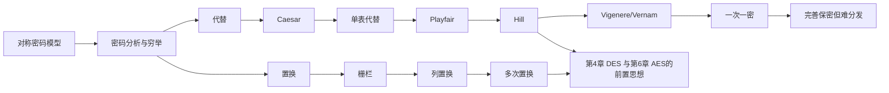
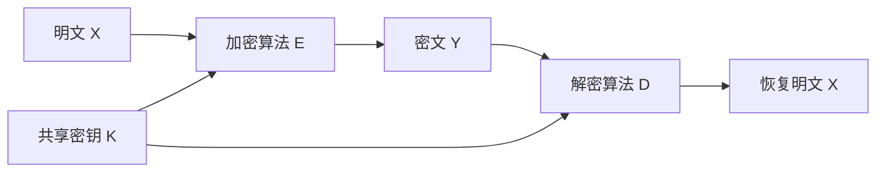
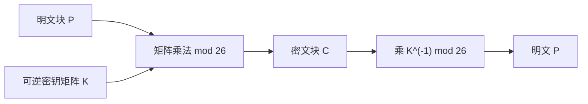

# 第三章 传统加密技术

## 本章导学

### 学习目标

学完本章后，应能用统一的对称密码模型解释明文、密钥、算法、密文和解密之间的关系；区分密码分析与穷举攻击；手算 Caesar、单表代替、Playfair、Hill、Vigenere 和置换密码；说明每种方法的安全性边界，并解释为什么现代密码要把代替与置换组合起来。

### 学习路线



> [!NOTE] 信息边界
> 本文的“教材依据”均来自 `第三章_传统加密技术_教材原文.md`。类比、练习策略和 Mermaid 是辅助解释，不替代教材中的原图和表格。

## 3.1 对称密码模型

### 本节学习目标

- **知识目标**：说出五个基本成分，理解 `Y = E(K, X)` 和 `X = D(K, Y)`。
- **能力目标**：能够判断一个场景属于对称密码、分组密码还是流密码，并选择合适的攻击模型。

### 本节核心问题

1. 为什么算法可以公开而密钥必须保密？
2. 密码分析攻击和穷举攻击分别利用什么信息？
3. “无条件安全”和“计算上安全”差在哪里？

### 为什么需要学习

DES、AES 以及本书后续的工作模式都建立在这一模型上。若没有先区分明文、密钥和算法，后面看到轮密钥、初始化向量或密钥分发时，很容易把“算法公开”和“密钥公开”混为一谈。

### 知识背景与原理

传统密码也称单钥密码。发送方和接收方共享同一个秘密密钥；算法可以由设备制造商公开实现。安全性集中在密钥：同一明文在不同密钥下应产生不同密文，解密是加密的逆运算。

五个成分的输入输出关系如下：



教材原图：

![[attachments/fig_3_1_symmetric_cipher_model.png]]

![[attachments/fig_3_2_symmetric_cipher_system_model.png]]

图 3.1 强调五个成分，图 3.2 进一步表示消息序列 `X=[X_1,...,X_M]`、密钥序列 `K=[K_1,...,K_J]` 和密文序列 `Y=[Y_1,...,Y_N]`。第三方也可以负责生成并安全分发密钥。

### 教材内容详细讲解

教材给出：

$$
Y=E(K,X),\qquad X=D(K,Y).
$$

攻击者窃取 `Y` 后，可能只想恢复当前明文的估计值 `X̂`，也可能想恢复密钥的估计值 `K̂`，因为后者会危及同一密钥保护的过去和未来通信。传统密码安全使用有两项要求：算法足够强；双方以安全方式获得并保护密钥。

密码编码学系统有三个相互独立的观察维度：

| 维度 | 教材分类 | 判断标准 |
|---|---|---|
| 运算类型 | 代替、置换、乘积密码 | 换元素，或重排元素；必须可逆 |
| 密钥数 | 对称、非对称 | 双方是否使用同一个密钥 |
| 处理方式 | 分组、流 | 一次处理一组，或连续处理一个元素 |

### 攻击类型、穷举与安全性

密码分析利用算法性质、明文规律或明密文对；穷举攻击逐一尝试密钥。若密钥空间有 `X` 个密钥，平均尝试 `X/2` 次，但仍要能识别“哪个输出像明文”。压缩数据、数值文件和未知语言会使识别更困难。

| 类型 | 攻击者额外掌握的信息 | 由弱到强的理解 |
|---|---|---|
| 唯密文 | 算法、密文 | 信息最少，最难 |
| 已知明文 | 一个或多个明密文对 | 可利用已知对应关系 |
| 选择明文 | 自选明文及其密文 | 能主动设计最有利输入 |
| 选择密文 | 自选密文及其明文 | 能利用解密接口 |
| 选择文本 | 同时拥有前两类选择能力 | 信息最多 |

教材表格与原图：

![[attachments/table_3_1_cryptanalysis_attack_types.png]]

无条件安全指无论可获得多少密文都不能唯一确定对应明文；除一次一密外，本章其他密码都不满足此条件。计算上安全则要求破译代价超过信息价值，或破译时间超过信息有效期。

### 典型示例分析

设密钥有 25 个候选值，穷举顺序随机，平均试 `25/2=12.5` 个。若明文是英文句子，候选结果可用词典或人工识别；若明文是压缩文件，则“看起来像乱码”不能作为错误判断依据。

### 生活中的类比

算法像公开的锁具结构，密钥像唯一钥匙。公开结构有利于大家检测锁是否有缺陷；把锁具图纸藏起来并不能阻止拿到锁的人拆解它。

### 常见误区

- **误区**：算法保密就等于安全。**纠正**：教材模型假设攻击者知道算法，密钥才是秘密。
- **误区**：穷举一定能自动识别正确明文。**纠正**：还需已知语言、格式或完整性判据。
- **误区**：计算安全等于永远不可破。**纠正**：它是相对于成本和时间窗口的工程判断。

### 易混淆知识点对比

| 对比 | 对称密码 | 非对称密码 |
|---|---|---|
| 密钥 | 同一共享密钥 | 不同的密钥对 |
| 主要问题 | 密钥安全分发 | 密钥数学关系和认证 |
| 本章位置 | 传统密码 | 后续章节 |

### 记忆技巧、章节关联与学习建议

口诀“明、加、密、密、解”对应明文、加密算法、密钥、密文、解密算法；攻击顺序记为“唯、已、选明、选密、选文”。先画图 3.2，再做一次 `Y=E(K,X)` 与 `X=D(K,Y)` 的角色标注；下一节的每一种古典密码都只是这张图中 `E` 和 `D` 的具体实现。推荐先复习第 2 章模运算，再进入 3.2 的手算。

## 3.2 代替技术

### 本节总览

代替改变元素本身，置换只改变顺序。古典密码的演进不是“越复杂就越安全”，而是逐步暴露了密钥空间、频率、周期性和线性结构等不同弱点。

## 3.2.1 Caesar 密码

### 学习目标、核心问题与学习价值

学完后应能独立完成字母与数值的转换、模 26 加解密和 25 个密钥的穷举，并能解释“算法简单”和“密钥空间小”是两个相关但不同的问题。核心问题是：为什么循环移位能够可逆，而又为什么它几乎没有实际安全性？

Caesar 密码是理解现代密码公式的最小模型。它把自然语言问题变成模运算问题：字母先编码为整数，加密做模加，解密做模减。后续 Vigenere 只是让移位量随位置变化，现代分组密码则把这种可逆变换扩展为多轮复杂运算。

### 背景、原理与教材精讲

把 `a=0,...,z=25`，每个字母循环右移 `k` 位：

$$
C=(p+k)\bmod26,\qquad p=(C-k)\bmod26.
$$

教材例子中 `meet me after the toga party` 在 `k=3` 下变成 `PHHW PH DIWHU WKH WRJD SDUWB`。字母数值表：

![[attachments/table_3_2_caesar_letter_values.png]]

### 示例、攻击与误区

例如 `x=23,k=5`，`C=28 mod 26=2`，所以密文是 `c`。只有 25 个非平凡密钥，已知算法、已知语言且结果易识别，三者共同使穷举可行；教材图 3.3 展示所有候选结果，图 3.4提醒压缩文本会让候选难以识别。

![[attachments/fig_3_3_caesar_bruteforce_analysis.png]]

![[attachments/fig_3_4_compressed_text_sample.png]]

生活类比是把转盘上的字母整体拨动；不要把 `k=0` 当成有意义的保密密钥，也不要忘记负数结果要再取模。

### 对比、记忆与关联

Caesar 是单表代替的特例：整个消息使用同一张表；下一节允许任意字母置换，密钥空间变大但仍暴露语言频率。练习顺序是先做正向和逆向各三题，再手工列出 25 个候选密钥。

### 自学检验、记忆与扩展

- **自检**：不看公式说明 `z` 在 `k=3` 下为什么变成 `c`，再把 `c` 解回 `z`。
- **常见误区**：模运算的结果必须规范到 `0..25`；解密不是“继续右移”，而是减去同一密钥。
- **记忆技巧**：`E` 是加，`D` 是减，二者都要“绕回 26”。
- **前后联系**：前接第 2 章模运算，后接 3.2.2 单表代替与 3.2.5 Vigenere。
- **扩展阅读**：本章习题 3.1–3.3 将固定移位推广到仿射变换，可用来检查是否真正理解模逆元与可逆性。

## 3.2.2 单表代替密码

### 学习目标、核心问题与学习价值

目标是会从一张固定替换表完成加解密，并能用单字母、双字母、三字母和可能词逐步恢复映射。核心问题是：`26!` 的巨大密钥空间为什么没有带来同量级的安全性？答案不在穷举，而在自然语言的统计冗余。

学习这一节的价值在于建立密码分析的基本习惯：先提出候选，再用多种证据回代验证。频率最高的密文字母“可能”对应 `e`，却从来不是仅凭一次统计就能确定。

### 背景与原理

用 26 个字母的任意置换作为一张固定替换表，理论密钥空间是 `26! > 4×10^26`。但每个明文字母始终对应同一个密文字母，单字母、双字母和三字母的语言规律仍在。

教材给出的置换例子是集合 `{a,b,c}` 的六种排列；英文密文示例从 `UZQS...` 开始，频率最高的 `P、Z` 可能对应 `e、t`，再利用 `ZWSZ` 等片段和上下文逐步验证，最终得到：

```text
it was disclosed yesterday that several informal but
direct contacts have been made with political
representatives of the viet cong in moscow
```

![[attachments/table_3_3_monoalphabetic_substitution_example.png]]

![[attachments/fig_3_5_english_letter_frequency.png]]

### 典型分析方法

1. 统计密文字母相对频率，提出 `e、t、a...` 的候选对应。
2. 检查常见双字母、三字母和可能词。
3. 把猜测代回全文，发现矛盾就回退，而不是强行接受。

### 类比、误区与对比

这像给每个字母换固定代号：代号表再大，文章中“the”的结构仍可能留下痕迹。密钥空间大不等于抗密码分析；单表代替与 Caesar 的差别是“任意置换”而非“固定移位”。同音词可以暂时打乱频率，但教材指出仍可利用词和结构分析。

### 学习建议与关联

先记住 `26!` 和“固定对应”这两个关键词，再练频率表。Playfair 将两个字母作为单元，是对单表弱点的下一步改进。

### 记忆、自检与扩展

- **类比**：给每个演员永久换一个化名；名字变了，但谁经常出现、谁总和谁同时出现仍会暴露关系。
- **易混淆对比**：Caesar 的密文字母表只能循环移位，单表代替可为任意置换；二者都保持“一字母固定对应一字母”。
- **记忆技巧**：“表很大，规律还在。”大密钥空间主要抵御穷举，不能自动抵御统计分析。
- **自检**：每提出一个映射，都检查它是否与全文的一一对应、常见词和重复模式同时兼容。
- **前后联系**：与 3.1.2 的唯密文/可能词攻击直接相连；后续 Playfair、Hill 和 Vigenere 分别尝试破坏不同层次的统计结构。
- **扩展阅读**：教材图 3.5 和表 3.3 已给出完整分析链；不需要外部资料即可复演一次人工破译。

## 3.2.3 Playfair 密码

### 学习目标、核心问题与学习价值

目标是会构造 5×5 密钥矩阵、正确预处理双字母、执行三类位置规则，并能反向解密。核心问题是：把处理单位从单字母扩大到双字母，究竟隐藏了什么，又保留了什么？

Playfair 是从“单字符替换”走向“分组处理”的直观过渡。它让同一字母的输出依赖同组另一个字母，因而削弱单字母频率，但矩阵规则和语言双字母结构仍会留下可分析信息。

### 背景与核心规则

Playfair 把双字母音节作为单元，使用密钥词构造 5×5 矩阵，`I/J` 合并。构造时删除密钥词重复字母，再按字母表补齐。

教材示例矩阵：

![[attachments/matrix_3_1_playfair_matrix.png]]

加密规则必须按顺序检查：

1. 一对中两个字母相同，在中间插入 `X`，最后不足一对也补 `X`。
2. 同行：各取右侧字母，最右循环到最左。
3. 同列：各取下方字母，最下循环到最上。
4. 不同行不同列：取矩形另外两个顶点，保持各自所在行。

### 示例与图表辅助

将消息分成双字母对时，先处理重复字母和 `I/J`，再查矩阵。它隐藏了单字母频率，但双字母和语言结构仍可能保留，教材称几百个字母就可能被破译。

生活类比是把两个乘客一起安排座位：移动规则取决于两人的相对位置，而不是单独某一个字母。

### 常见误区与对比

最常错的是把同行规则和同列规则对调、忘记绕回、把 `J` 当成独立格、或插入 `X` 后不重新分组。Playfair 比单表更强，但不等于无条件安全；它和 Hill 都扩大处理单元，Hill 进一步使用线性矩阵。

### 记忆与关联

口诀“同插、同行右、同列下、矩形换列”。学习时先手画密钥矩阵，再做一组同行、一组同列和一组矩形例子；之后再做长消息。教材课后题 3.9–3.13 专门检验矩阵构造、密钥数量和弱点。

### 自学检验、章节联系与扩展

- **自检顺序**：先预处理明文，再逐对判断“同行、同列、矩形”，最后检查是否漏掉循环回绕。
- **易错点**：插入 `X` 会改变后续分组；解密同行向左、同列向上；`I/J` 合并约定必须前后一致。
- **易混淆对比**：Playfair 的密钥是字母位置矩阵，Hill 的密钥是参与数值乘法的可逆矩阵，两者不能混用规则。
- **生活类比**：两个人在座位表上的相对位置共同决定各自的新座位；只看其中一人不足以确定输出。
- **前后联系**：它引出分组思想，但没有现代分组密码的多轮扩散与混淆；图 3.6 可与 Vigenere 的频率曲线对照。
- **扩展阅读**：优先完成教材习题 3.10 和 3.11，用两个不同密钥矩阵处理同一消息并比较结果。

## 3.2.4 Hill 密码

### 学习目标、核心问题与学习价值

目标是掌握模 26 下的向量编码、矩阵加解密、可逆性检查和已知明文攻击。核心问题有两个：为什么 `det K ≠ 0` 仍不足以保证模 26 可逆？为什么能很好隐藏频率的 Hill 密码仍会被少量明密文对恢复密钥？

Hill 密码把第 2 章的模逆元与附录 A 的线性代数真正接到密码系统中。它让学习者第一次清楚看到：一种变换可以在统计上很“乱”，却因代数结构过强而不安全。

### 背景与核心原理

Hill 将 `m` 个字母编码为向量，用模 26 矩阵乘法混合：

$$
C=PK\bmod26,\qquad P=CK^{-1}\bmod26.
$$

矩阵必须在模 26 下可逆，即行列式与 26 互素。教材 2×2 示例的逆矩阵计算引用：

![[attachments/formula_3_1_hill_matrix_inverse_example.png]]

### 示例分析

教材 3×3 例子使用

$$
K=\begin{pmatrix}17&17&5\\21&18&21\\2&2&19\end{pmatrix},
\qquad K^{-1}=\begin{pmatrix}4&9&15\\15&17&6\\24&0&17\end{pmatrix}.
$$

明文 `pay` 对应 `(15,0,24)`，乘以 `K` 后得到 `(17,17,11)`，即 `RRL`。计算每一步都要先做普通整数乘法，再统一取模 26。

### 安全性解释

Hill 能隐藏单字母及更高阶频率，但线性结构是致命弱点。若收集 `m` 个长度为 `m` 的明密文对，组成 `Y=XK`；只要 `X` 可逆，就有 `K=X^{-1}Y`。若 `X` 不可逆，继续收集另一组。



### 类比、误区、对比与学习建议

它像把多个字母倒入同一个线性搅拌器：单个字母看不出规律，但知道足够多的输入输出就能反推出搅拌矩阵。常见错误是用普通整数逆而非模 26 逆、未检查 `gcd(det K,26)=1`、把行向量和列向量约定混用。先复习第 2 章扩展欧几里得和矩阵逆，再做课后 3.14、3.17、3.18。

### 分步自检、记忆与章节联系

1. **编码检查**：确认采用 `a=0,...,z=25`，并按矩阵维数正确分块。
2. **密钥检查**：计算 `det K`，再检查 `gcd(det K,26)=1`；只判断行列式非零是不够的。
3. **乘法检查**：明确教材使用行向量 `C=PK`，每个分量取模 26。
4. **逆运算检查**：用 `KK^{-1}=I (mod 26)` 验证逆矩阵，再解密一块回原文。
5. **安全性检查**：能写出 `Y=XK -> K=X^{-1}Y`，才算理解已知明文攻击。

记忆主线是“可逆才能解，线性就能列方程”。它前接第 2 章扩展欧几里得与附录 A，后续第 6 章 AES 也使用矩阵式变换，但工作在不同代数结构中且置于多轮非线性设计里，不能把两者简单等同。

## 3.2.5 多表代替、Vigenere 与 Vernam

### 学习目标、核心问题与学习价值

目标是会用循环密钥完成 Vigenere 加解密，能从重复序列解释密钥长度分析，并准确区分 Vigenere、Vernam 与一次一密。核心问题是：同一明文字母不再固定映射后，攻击者为何仍能通过“周期”重新把问题拆成多个单表密码？

这一知识点把“密钥流”引入视野。它帮助理解后续流密码：安全性不仅取决于运算是模加还是异或，更取决于密钥流如何产生、是否周期重复、是否可预测和是否复用。

### 背景与原理

Vigenere 用 26 张 Caesar 表，密钥词循环使用：

$$
C_i=(p_i+k_{i\bmod m})\bmod26,\qquad p_i=(C_i-k_{i\bmod m})\bmod26.
$$

教材示例密钥 `deceptive`、明文 `wearediscoveredsaveyourself` 产生 `ZICVTWQNGRZGVTWAVZHCQYGLMGJ`；数值表见：

![[attachments/table_3_4_vigenere_numeric_example.png]]

### 攻击逻辑

密钥周期为 `m` 时，位置 `1,1+m,1+2m,...` 实际上使用同一张单表。先找重复密文序列，计算出现位置间隔的公因子以猜测 `m`；再把密文按位置模 `m` 分成若干单表密码，分别做频率分析。自动生成密钥把明文接到密钥后面，虽消除短周期，却仍可能因密钥和明文共享统计特征而被分析。

### Vernam 与一次一密的边界

Vernam 在二进制位上使用异或：

$$
c_i=p_i\oplus k_i,\qquad p_i=c_i\oplus k_i.
$$

![[attachments/fig_3_7_vernam_cipher.png]]

Vernam 的循环磁带密钥周期很长但有限，足够密文和已知/可能明文仍可能攻破。一次一密要求密钥与消息等长、真正随机、只使用一次并随后销毁，因而具有完善保密。

### 典型例子与误区

教材展示同一密文可用不同随机密钥得到 `mr mustard...` 或 `miss scarlet...` 两个合理明文；没有额外信息就不能判定哪一个正确。一次一密的两项实际难点是大规模真随机密钥的生成，以及等长密钥的分发和保护。

| 方法 | 密钥 | 主要弱点/性质 |
|---|---|---|
| Vigenere | 短词循环 | 周期性和频率结构 |
| Vernam | 长但循环的二进制流 | 足够数据可分析 |
| 一次一密 | 等长、随机、只用一次 | 完善保密，但生成和分发困难 |

口诀“循环会留周期，随机一次不留痕”。下一章的现代分组密码会用更复杂的代替和置换获得计算安全，而不是承担一次一密的密钥负担。

### 类比、对比、记忆与自学建议

- **生活类比**：Vigenere 像按周期轮换多枚印章；印章比一枚多，但轮换周期会在长文本中留下节奏。Vernam 的异或像可反复开关的位翻转器，同一密钥再异或一次即可恢复。
- **易混淆对比**：Vernam 说明按位异或的体制，教材原始方案仍使用循环磁带；一次一密还必须满足真随机、等长、只用一次。不能看到异或就称为一次一密。
- **记忆技巧**：Vigenere 记“模加 + 周期”，Vernam 记“异或 + 循环”，一次一密记“随机 + 等长 + 一次”。
- **自检**：给定密钥长度 `m`，能否解释为何位置 `i,i+m,i+2m` 落入同一单表？能否从 `x xor k xor k=x` 解释解密？
- **前后联系**：附录 B 给出完善保密的形式化视角，第 8 章进一步讨论随机位生成和流密码。
- **扩展阅读**：以教材 `deceptive` 示例手工标出两个 `VTW` 的位置和间隔，再完成习题 3.19、3.20。

## 3.3 置换技术

### 学习目标、核心问题与学习价值

目标是会手工执行深度 2 栅栏、单次列置换和双重列置换，并能从“字符频率完全不变”解释其分析弱点。核心问题是：不改变任何字母，只改变位置，能隐藏哪些结构，又必然保留哪些结构？

置换体现密码设计中的“扩散”直觉：一个字符的位置可以被搬到远处，但单独使用置换不会改变字符总数和频率。现代乘积密码需要把置换与非线性代替组合，而不是只把顺序打乱。

### 背景与原理

置换不改变字母，只改变位置。栅栏密码按对角线写、按行读；列置换把消息写成矩形，按密钥指定的列顺序读出；多次置换重复该过程。

教材栅栏示例：

![[attachments/example_3_1_rail_fence_layout.png]]

明文 `meet me after the toga party` 经深度 2 栅栏后为 `MEMATRHTGPRYETEFETEOAAT`。列置换示例密钥为 `4312567`，密文为 `TTNAAPTMTSUOAODWCOIXKNLYPETZ`；第二次置换后为 `NSCYAUOPTTWLTMDNAOIEPAXTTOKZ`。

### 图表、示例与安全性

单纯置换保持字母频率，攻击者可猜矩阵列数，再利用双字母和三字母频率恢复列顺序。双重置换使位置序列更不规则，但仍不是现代强密码。

### 类比、误区、对比和关联

代替像把卡片上的字母换掉，置换像不换卡片内容只重新排队。误区是把“更乱的顺序”误认为隐藏了频率；实际上频率完全不变。现代乘积密码把代替与置换多轮组合，正是从本节弱点得到的设计动机。

### 自学建议

先在方格纸上完成一次栅栏，再按列编号做一次单列和双列置换；每次都保留填表过程，不要只写最终密文。复习时问自己：哪些信息被代替隐藏，哪些信息被置换扩散？

### 记忆、自检与扩展

- **记忆技巧**：“代替换身份，置换换座位。”栅栏看行，列置换看列号所在位置。
- **自检**：一次置换后统计任意字母次数，应与明文完全相同；若不同，说明抄写或填充规则出了问题。
- **常见误区**：密钥 `4312567` 不是先读物理第 4 列，而是先读“标号 1”所在的第 3 列；填充字符是否加入也必须说明。
- **易混淆对比**：栅栏按固定路径读出，列置换由列编号控制；双重置换是再次应用置换，并未引入代替。
- **前后联系**：第 4 章 Feistel 结构把代替型轮函数与位置交换组合，第 6 章 AES 通过字节代替、行移位和列混合共同实现混淆与扩散。
- **扩展阅读**：教材已经给出两次置换后的 28 个位置序列，建议逐项追踪位置 `01` 在两轮后的去向，理解“数据没丢，只是位置改变”。

## 本章总结与复盘

1. 对称密码的五成分是明文、加密算法、密钥、密文、解密算法。
2. 代替换元素，置换换位置；乘积密码把两者组合。
3. Caesar 的问题是密钥太少；单表代替的问题是频率；Playfair 的问题是双字母结构；Hill 的问题是线性已知明文；Vigenere/Vernam 的问题是周期；[[Course Notes/密码学 (Cipher)/Perfectly Secret Encryption/Perfect Indistinguishability|一次一密]]解决统计弱点但带来[[Course Notes/密码学 (Cipher)/Key Management and the Public-Key Revolution/Key Management and the Public-Key Revolution|密钥管理]]困难。
4. 复习顺序：先背定义和安全边界，再手算 Caesar/Playfair/Hill/Vigenere，最后完成章末题。

### 推荐扩展阅读

无。需要的拓展材料已在教材第 2 章、附录 B 及第 4、6 章中安排。
