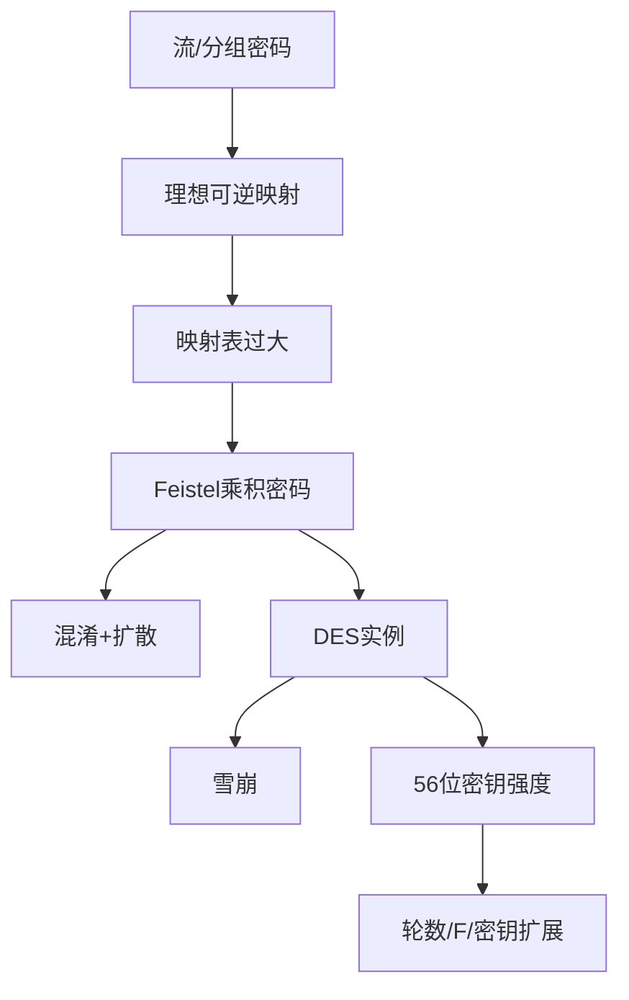
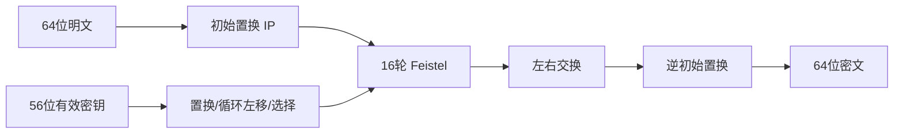

# 第四章 分组密码和数据加密标准

## 本章复习

> [!IMPORTANT] 信息边界
> 教材知识整理自 `第四章_分组密码和数据加密标准_教材原文.md`；记忆和复盘建议属于辅助内容。DES 详细置换表和 S 盒以附录 C 为准。

### 全章逻辑

## 4.1 传统分组密码结构

### 4.1.1 流密码与分组密码

| 项目 | 流密码 | 分组密码 |
|---|---|---|
| 处理方式 | 连续处理位或字节 | 固定长度分组映射为等长分组 |
| 关键组件 | 密钥控制的位流生成器 | 可逆分组变换 |
| 典型分组/单元 | 每次一个元素 | 64 位或 128 位 |
| 本书位置 | 第 8 章 | 本章及第 5–7 章 |

![[attachments/fig_4_1_stream_and_block_ciphers.png]]

**教材关系**：分组密码使用某些工作模式时可获得流密码效果。

### 4.1.2 可逆映射与理想分组密码

`n` 位分组共有 `2^n` 个输入。可逆映射必须是一一对应，因此映射数量是：

$$
(2^n)!.
$$

![[attachments/table_4_0_reversible_irreversible_mapping.png]]

![[attachments/fig_4_2_ideal_block_cipher.png]]

![[attachments/table_4_1_substitution_cipher_mapping.png]]

若直接保存全部映射输出，密钥表需 `n·2^n` 位；`n=64` 时为 `2^70≈10^21` 位，不可实际使用。线性映射虽只需 `n^2` 位，却易受 Hill 型线性攻击。

**逻辑关系**：理想随机置换安全目标 -> 直接实现代价过高 -> 用多轮简单结构近似。

### 4.1.3 混淆、扩散与 Feistel

| 概念 | 复杂化的关系 | 教材说明 |
|---|---|---|
| 扩散 | 明文与密文 | 一个输入位影响多个输出位，消散明文统计特征 |
| 混淆 | 密钥与密文 | 使由密文推导密钥极难，依赖复杂非线性代替 |

教材扩散示例：

$$
y_n=\left(\sum_{i=1}^{k}m_{n+i}\right)\bmod26.
$$

> [!WARNING] 易错
> 置换有助于扩散，但置换本身不等于扩散；置换不改变字符频率。

Feistel 第 `i` 轮：

$$
LE_i=RE_{i-1},
$$

$$
RE_i=LE_{i-1}\oplus F(RE_{i-1},K_i).
$$

逆向：

$$
RE_{i-1}=LE_i,
$$

$$
LE_{i-1}=RE_i\oplus F(LE_i,K_i).
$$

![[attachments/fig_4_3_feistel_encryption_decryption.png]]

![[attachments/fig_4_4_feistel_structure_example.png]]

**可逆性要点**：`A xor B xor B=A`，所以 `F` 无需可逆；解密采用相同结构、逆序子密钥。

### Feistel 参数

| 参数 | 影响 |
|---|---|
| 分组长度 | 越长扩散与安全性通常越好，但速度下降 |
| 密钥长度 | 越长抗穷举和混淆越强，但速度下降 |
| 轮数 | 多轮把弱单轮累积为强变换，典型 16 轮 |
| 子密钥生成 | 越难推导轮密钥与主密钥越好 |
| 轮函数 `F` | 非线性和复杂度决定抗分析能力 |

**关键词**：分组密码、流密码、理想分组密码、可逆映射、Feistel、混淆、扩散、乘积密码。

**Related**：[[第三章_传统加密技术_复习笔记#3.3 置换技术]]；附录 C。

**重点**：理想分组密码的目标、Feistel 的结构可逆性、混淆与扩散的对象。

**难点**：区分 `(2^n)!` 个映射、`log2((2^n)!)` 位理论编号与 `n·2^n` 位直接映射表；从轮输出反解轮输入。

**易错点**：把流/分组与对称/非对称混为一个分类；要求 `F` 可逆；把单次置换等同充分扩散。

> [!NOTE] 教材与辅助边界
> 流/分组定义、理想映射数量、混淆扩散、Feistel 公式与参数均为教材知识；知识图和“扩散看明密、混淆看密钥”属于检索与记忆辅助。

**复盘建议**：闭卷写出正向两式和逆向两式，圈出推导中两次出现的同一个 `F`，说明它们为何异或抵消。

## 4.2 数据加密标准

### 4.2.1 DES 加密

| 参数 | 值 |
|---|---|
| 分组长度 | 64 位 |
| 输入密钥 | 64 位 |
| 有效算法密钥 | 56 位，另 8 位作奇偶校验或设置 |
| 轮数 | 16 |
| 子密钥 | 每轮 48 位 |

流程：

![[attachments/fig_4_5_des_encryption_overview.png]]

### 4.2.2 DES 解密

相同算法结构，子密钥使用顺序由 `K_1...K_16` 反为 `K_16...K_1`；`IP` 与 `IP^{-1}` 互逆。

**重点**：DES 是 Feistel 结构，解密不是另一个独立算法。

**易错**：把 64 位密钥输入当作 64 位有效强度；忘记预输出左右交换。

**关键词**：DES、DEA、FIPS 46、IP、逆初始置换、子密钥。

**Related**：第 7 章 3DES；第 6 章 AES。

**难点**：同时追踪数据路径与密钥路径，以及区分 `L_i||R_i`、最终交换后的预输出和 `IP^{-1}` 后密文。

> [!NOTE] 教材与辅助边界
> DES 历史、参数、16 轮结构和逆序子密钥解密属于本章教材；附录 C 提供位表和 S 盒细节，流程图是对图 4.5 的可检索重构。

**复盘建议**：先默画数据路径，再单独默画密钥路径，最后用箭头把 `K_1...K_16` 接入对应轮；不要一开始背置换表。

## 4.3 DES 的一个例子

### 4.3.1 结果

| 对象 | 值 |
|---|---|
| 明文 | `02468aceeca86420` |
| 密钥 | `0f1571c947d9e859` |
| 密文 | `da02ce3a89ecac3b` |

![[attachments/table_4_2_des_example.png]]

表 4.2 保留了 `IP` 后、16 轮和 `IP^{-1}` 后的左右半部及各轮 48 位子密钥；每轮满足 `L_i=R_{i-1}`。

### 4.3.2 雪崩效应

定义：明文或密钥改变 1 位，引起密文许多位变化。

| 改动 | 3 轮差异 | 16 轮/最终差异 |
|---|---|---|
| 明文第 4 位改变 | 18 位 | 32 位 |
| 密钥第 4 位改变 | 25 位 | 30 位 |

![[attachments/table_4_3_des_avalanche_plaintext.png]]

![[attachments/table_4_4_des_avalanche_key.png]]

**重点**：理想理解是每个输出位约以 1/2 概率改变，不是要求全部位翻转。

**关键词**：雪崩效应、汉明距离、轮扩散。

**Related**：本章 4.1.3 扩散；本章 4.5.2 严格雪崩准则；[[第六章_高级加密标准_复习笔记]]。

**重点/难点/易错点**：重点是“一位输入变化引起多位输出变化”；难点是理解统计期望而非固定输出；易错点是把雪崩解释成所有位必须翻转。

> [!NOTE] 教材与辅助边界
> 表 4.2–4.4 的输入、密钥、轮值和差异位数均为教材知识；用汉明距离组织表格是结构化复习表达。

**复盘建议**：口述明文改变和密钥改变两条实验链，解释为什么三轮后的快速增长比死记最终 `32、30` 更重要。

## 4.4 DES 的强度

### 4.4.1 56 位密钥

$$
|K|=2^{56}\approx7.2\times10^{16},\qquad \text{平均搜索}=2^{55}.
$$

教材结论：现代并行硬件和超级计算机使 DES 穷举达到实际可行范围；增加到 128 位或以上可显著提高抗穷举能力。

![[attachments/table_4_5_exhaustive_key_search_time.png]]

### 4.4.2 算法性质

争议集中于未公开设计准则的 8 个 S 盒。虽发现规律和局部弱点，教材指出没有公开的致命弱点。

### 4.4.3 计时攻击

通过不同输入的运行时间差推导密钥或明文信息。教材提到可获得密钥汉明权重的研究，但未能据此成功攻击 DES、3DES 或 AES。

| 风险层 | 例子 | 不应混淆 |
|---|---|---|
| 密钥空间 | 56 位可穷举 | 不等于算法结构被破解 |
| 算法结构 | S 盒设计争议 | 不等于存在已证实后门 |
| 实现侧信道 | 计时差 | 不等于数学算法本身错误 |

**关键词**：穷举、56 位密钥、S 盒、计时攻击、汉明权重。

**Related**：本章 4.3 雪崩效应；[[第六章_高级加密标准_复习笔记]]；[[第七章_分组密码的工作模式_复习笔记]]。

**重点**：现代算力下 56 位密钥空间是 DES 的现实瓶颈。

**难点**：把密钥穷举、算法结构分析和实现侧信道分成不同证据层。

**易错点**：把“设计准则曾不公开”写成“已经证明有后门”；把计时泄漏写成 DES 数学结构错误。

> [!NOTE] 教材与辅助边界
> 表 4.5、S 盒争议和计时攻击结论均为教材知识；三层风险表是辅助整理，不是教材新增结论。

**复盘建议**：用“攻击对象、所需信息、DES结论”三列分别整理穷举、S盒分析、计时攻击。

## 4.5 分组密码的设计原理

### 4.5.1 迭代轮数

设计标准：最佳已知密码分析的工作量应大于穷举。16 轮 DES 的差分分析约 `2^55.1` 次操作，平均穷举约 `2^55`；15 轮或更少时，差分分析会更有效。

### 4.5.2 函数 F

首要要求是非线性。严格雪崩准则（SAC）：任意输入位改变时，任意输出位改变概率为 1/2。位无关准则（BIC）：由同一输入位变化引起的任意两个输出位变化彼此独立。

### 4.5.3 密钥扩展

主密钥为每轮生成子密钥；应加大由子密钥推导其他子密钥和主密钥的难度。教材没有给出通用原理，但指出密钥/密文应满足 SAC、BIC。

| 设计项 | 核心目标 |
|---|---|
| 轮数 | 让结构攻击成本超过穷举 |
| `F` | 非线性、混淆、SAC、BIC |
| 密钥扩展 | 避免可利用的轮密钥关系 |

**关键词**：轮数、差分密码分析、非线性、SAC、BIC、密钥扩展。

**Related**：第 6 章 AES 变换与密钥扩展；附录 C DES。

**重点**：最佳结构攻击成本应高于穷举；`F` 要非线性并促进雪崩；密钥扩展不得产生易利用关系。

**难点**：区分雪崩、SAC 与 BIC：整体输出差异大不自动证明每个输出位概率为 1/2，也不自动证明位变化独立。

**易错点**：认为增加轮数可以弥补完全线性的 `F`；认为子密钥只是主密钥的重复副本。

> [!NOTE] 教材与辅助边界
> 16/15 轮差分分析比较、SAC、BIC 与密钥扩展要求均为教材知识；“轮数管深度，F管非线性，扩展管关系”是记忆提示。

**复盘建议**：对一个假想分组密码分别删减一轮、线性化 `F`、让子密钥回文，说明三类设计缺陷各自暴露什么攻击面。

## 4.6 关键术语、思考题和习题

关键术语：雪崩效应、不可逆映射、轮函数、分组密码、置换、流密码、混淆、乘积密码、子密钥、扩散、可逆映射、代替、Feistel 密码、轮。

题目与逐题解答：[[第四章_分组密码和数据加密标准_课后习题]]。

**关键词**：可逆映射、乘积密码、Feistel、DES、雪崩效应、SAC、BIC、计时攻击、密钥扩展。

**Related**：[[第四章_分组密码和数据加密标准_导学讲义]]；[[附录C_数据加密标准_复习笔记]]。

## 易混淆知识对比

| 对象 | 定义/作用 | 常见误区 |
|---|---|---|
| 可逆映射 | 每个输入唯一映射到不同输出 | 只要输出位数相同就可逆 |
| 混淆 | 复杂化密钥-密文关系 | 等同置换 |
| 扩散 | 复杂化明文-密文统计关系 | 单次置换自动产生充分扩散 |
| 雪崩 | 1 位输入改变导致多位输出改变 | 所有输出位必须改变 |
| Feistel 可逆 | XOR 自消，逆序子密钥 | `F` 必须可逆 |

## 关键词索引

`Feistel` · `DES` · `DEA` · `分组密码` · `流密码` · `混淆` · `扩散` · `雪崩效应` · `SAC` · `BIC` · `S盒` · `子密钥` · `密钥扩展` · `计时攻击`

## 复习复盘建议

1. 默写 Feistel 正向/逆向四个关系式。
2. 对照图 4.5 说出 DES 数据路径和密钥路径。
3. 用表 4.3、4.4 的数据口述雪崩如何在多轮中形成。
4. 将 DES 风险分成密钥空间、算法结构、实现侧信道三类。
5. 完成 [[第四章_分组密码和数据加密标准_课后习题]]，涉及附录 C 的题目逐项核验位编号。
