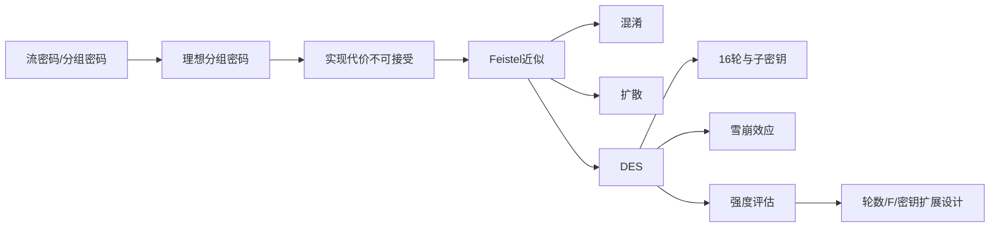
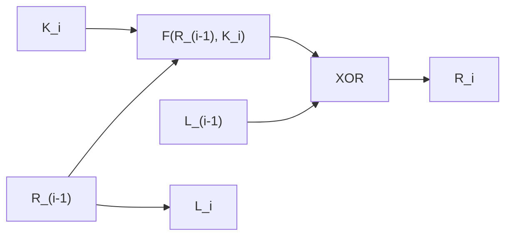
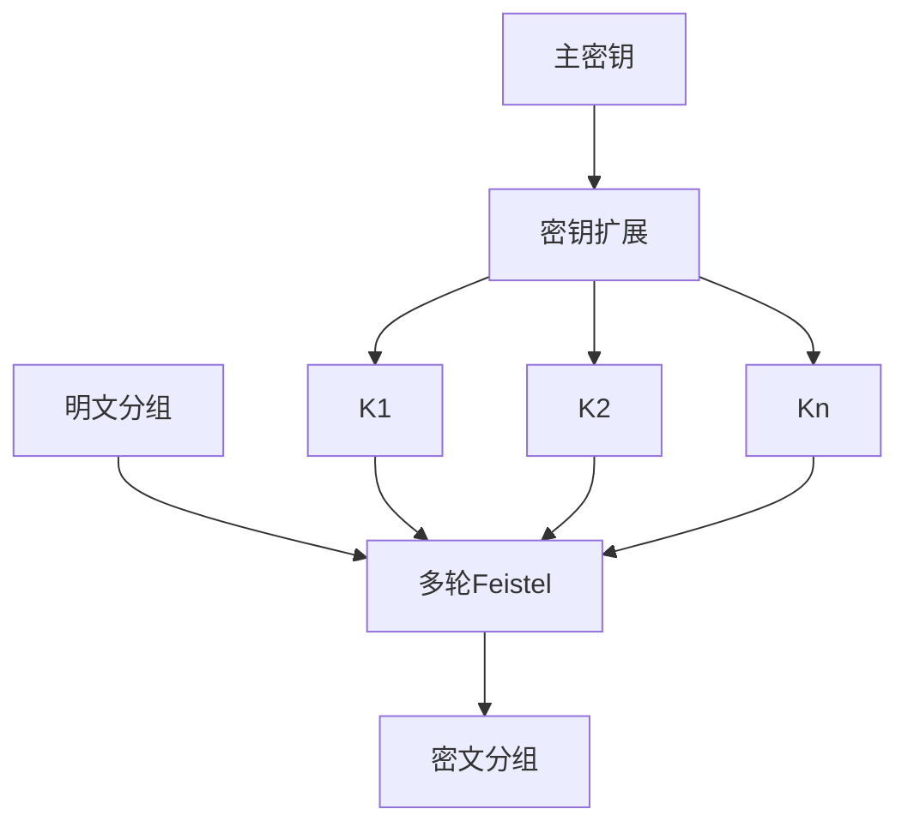

# 第四章 分组密码和数据加密标准

## 本章导学

### 学习目标

学完本章后，应能区分流密码与分组密码，说明理想分组密码为什么理论强而工程上不可行；从混淆、扩散出发理解 Feistel 结构；推导 Feistel 使用逆序子密钥即可解密；解释 DES 的 64 位分组、56 位有效密钥、16 轮结构、雪崩效应和安全性边界；理解轮数、轮函数和密钥扩展的设计要求。

### 核心问题

1. 为什么不能直接把全部 `2^n` 个输入的映射表当作密钥？
2. 为什么 Feistel 的轮函数 `F` 不必可逆，整体仍可逆？
3. DES 的危险主要来自 56 位密钥，还是 S 盒结构？

### 学习路线

> [!NOTE] 信息边界
> 核心结论来自 `第四章_分组密码和数据加密标准_教材原文.md`。Mermaid、类比和学习策略是辅助解释；DES 置换表、S 盒和密钥细节以附录 C 为准。

## 4.1 传统分组密码结构

### 本节学习目标与价值

- **知识目标**：理解流/分组、可逆映射、理想分组密码、混淆、扩散和 Feistel 轮。
- **能力目标**：能从一轮公式推出解密，并能判断设计参数如何影响安全与效率。

这一节是后续 DES、3DES、工作模式和许多现代分组密码的共同语言。

### 4.1.1 流密码与分组密码

#### 学习目标、核心问题与学习价值

目标是能从“每次处理多少数据”判断流密码与分组密码，而不是根据算法名称或密钥类型猜测。核心问题是：一次一密的长随机密钥流为什么不实用，实用流密码怎样只共享短密钥？分组密码又为什么必须是一一对应的等长变换？

这一分类会贯穿第 7 章工作模式和第 8 章流密码。先把处理单元分清，后续才不会把“分组密码采用流式工作模式”误说成“算法本身变成了流密码”。

流密码每次处理一位或一字节；实用流密码用共享密钥控制位流生成器，双方生成相同密钥流。分组密码把固定长度明文块映射为等长密文块，典型分组长度为 64 或 128 位。

![[attachments/fig_4_1_stream_and_block_ciphers.png]]

图 4.1(a) 的关键是“共享短密钥、各自生成长密钥流”，避免一次一密必须安全传输等长随机流；图 4.1(b) 则把一个完整分组送入同一变换。第 7 章会说明某些工作模式可让分组密码表现出类似流密码的效果。

| 对比 | 流密码 | 分组密码 |
|---|---|---|
| 处理单元 | 位/字节连续处理 | 固定长度分组 |
| 主要组件 | 密钥控制的位流生成器 | 可逆分组变换 |
| 本书后续 | 第 8 章 | 第 4–7 章 |

**类比**：流密码像边听边翻译，分组密码像每收到一页才整体盖章。

**误区**：分组和流是处理方式，不等于密钥数量；两者都可使用对称密钥。

**自学检验**：回答三个问题：处理单元是什么？输出长度怎样变化？双方共享的是完整密钥流还是生成密钥流的短密钥？能回答这三点，就能完成基本分类。

### 4.1.2 理想分组密码与设计动机

#### 核心问题与背景

理想分组密码并不是某个要实际部署的算法，而是“所有可能输入都被随机地一一置换”的参照模型。这里要同时理解两个数量：可逆映射的总数 `(2^n)!`，以及直接保存一张映射表所需的 `n·2^n` 位。前者说明选择空间巨大，后者说明工程实现不可承受。

`n` 位输入共有 `2^n` 个分组。可逆加密必须把它们一一映射到 `2^n` 个输出，因此可逆映射数为：

$$
(2^n)!.
$$

![[attachments/table_4_0_reversible_irreversible_mapping.png]]

表 4.0 的不可逆例子把两个明文映射到同一密文，所以解密无法判定原输入。图 4.2 和表 4.1 展示 `n=4` 的任意可逆代替：

![[attachments/fig_4_2_ideal_block_cipher.png]]

![[attachments/table_4_1_substitution_cipher_mapping.png]]

若直接列出每个输入的 `n` 位输出，映射表需要 `n·2^n` 位。`n=64` 时约为 `2^70` 位，工程上不可行。只使用线性方程虽把密钥缩为 `n^2` 位，却像 Hill 密码一样易受线性分析。

**核心原理**：Feistel 不是实现全部理想映射，而是用短密钥从 `2^k` 个复杂变换中选择一个，通过多轮简单部件逼近理想随机置换。

#### 示例、类比、误区与联系

`n=2` 时只有 4 个输入，手工列出 4 行表很容易；`n=64` 时有 `2^64` 行，哪怕每行只存 64 位也不可行。这像一本字典为每一种 64 位“单词”单独保存随机译文：查询简单，字典本身却无法制造、分发和保管。

- **误区**：`log2((2^n)!)` 与 `n·2^n` 矛盾。前者是给所有映射编号的理论最小信息量，后者是直接查表的冗余表示。
- **易混淆**：扩大分组并不能让一个纯线性映射自动安全；教材用二进制 Hill 型方程说明线性结构仍可解。
- **前后联系**：本节承接第 3 章任意单表代替与 Hill 密码，下一知识点用乘积密码解决“表太大、线性太弱”的两难。

### 4.1.3 混淆与扩散

#### 学习目标与核心问题

目标是能分别说清“哪两个对象之间的关系被复杂化”。核心问题不是背两个名词，而是判断某个变换主要在隐藏明文统计结构，还是在隐藏密钥如何影响密文。

扩散让一个明文位影响多个密文位、一个密文位受多个明文位影响，从而消散明文统计结构；混淆让密钥与密文之间的统计关系复杂，阻止从密文推导密钥。

| 目标 | 主要关系 | 典型手段 |
|---|---|---|
| 扩散 | 明文与密文 | 置换后反复与函数组合 |
| 混淆 | 密钥与密文 | 复杂、非线性的代替函数 |

教材给出的平均扩散例子：

$$
y_n=\left(\sum_{i=1}^{k}m_{n+i}\right)\bmod26.
$$

**易错辨析**：置换有助于扩散，但置换本身不等于扩散；单次置换不会改变字符或分组内部的统计分布。

**生活类比**：扩散像把一滴墨水搅入整杯水，使原来位置的信息分散；混淆像把控制搅拌方式的旋钮接入复杂齿轮，使人难以从最终纹理反推旋钮位置。

**记忆技巧**：“扩散看明密，混淆看密钥。”前一个“密”指密文，后一个“密”指密钥。

### Feistel 轮结构

#### 为什么需要这一结构

我们希望轮函数足够复杂甚至不方便求逆，同时又希望整个密码必然可逆。Feistel 用“保留一半 + 另一半异或轮函数输出 + 交换”的结构把这两个目标分开：整体可逆性由结构保证，安全性再交给多轮 `F` 和子密钥。

将 `2w` 位输入分为 `LE_0、RE_0`，第 `i` 轮：

$$
LE_i=RE_{i-1},
$$

$$
RE_i=LE_{i-1}\oplus F(RE_{i-1},K_i).
$$

![[attachments/fig_4_3_feistel_encryption_decryption.png]]

Feistel 的五个主要参数是分组长度、密钥长度、轮数、子密钥生成算法、轮函数 `F`；还要考虑软件速度和算法是否易于公开分析。

### 为什么解密只需逆序子密钥

由 `LE_i=RE_{i-1}` 可知上一轮右半部；再把同一个 `F(LE_i,K_i)` 与 `RE_i` 异或：

$$
RE_{i-1}=LE_i,
$$

$$
LE_{i-1}=RE_i\oplus F(LE_i,K_i).
$$

同一项异或两次抵消，因此 `F` 无需可逆。解密使用相同轮结构，只把 `K_1,...,K_n` 逆序为 `K_n,...,K_1`。

![[attachments/fig_4_4_feistel_structure_example.png]]

教材图 4.4 用 `DE7F03A6` 和子密钥 `12DE52` 展示第 15 轮与解密第 2 轮互相抵消。

### 示例、类比、误区与学习建议

Feistel 像把纸对折成两半：右半经 `F` 后混入左半，再交换；倒推时同样计算 `F` 并再异或一次即可抹去它。常见误区是要求 `F` 本身可逆、忘记最后交换、或正序使用子密钥解密。学习时先用符号推一轮，再追踪图 4.4 数值，不要直接背“逆序密钥”。

**自检闭环**：从 `L_i、R_i` 写出 `L_{i-1}、R_{i-1}`；说明推导只用了异或自消，没有使用 `F^{-1}`；最后解释为什么解密子密钥必须从最后一轮向前使用。

## 4.2 数据加密标准

### 本节目标、背景和学习价值

DES 于 1977 年成为 FIPS 46，2001 年前长期广泛使用。虽然已退出新系统，它仍是理解 Feistel、3DES 和密码工程的重要教材实例。

本节核心问题是：DES 如何把通用 Feistel 框架具体化？学习目标不是立刻背下所有置换表，而是先能沿着数据路径和密钥路径说明每一步的角色，并准确区分 64 位输入密钥与 56 位有效密钥。

### DES 参数与结构

| 参数 | 数值/说明 |
|---|---|
| 明文/密文分组 | 64 位 |
| 输入密钥 | 64 位，其中 56 位用于算法，8 位作奇偶校验或设置 |
| 轮数 | 16 |
| 每轮子密钥 | 48 位 |
| 外层置换 | 初始置换 `IP` 与逆置换 `IP^{-1}` |

![[attachments/fig_4_5_des_encryption_overview.png]]

明文先经 `IP`，再做 16 轮 Feistel 变换；最后交换左右半部形成预输出，再经 `IP^{-1}` 得到密文。密钥侧先置换，再循环左移并选择 48 位生成每轮子密钥。解密流程不另造算法，只逆序使用子密钥。

#### 教材图的阅读方法

先只看左半边：`64位明文 -> IP -> 16轮 -> 左右交换 -> IP^-1 -> 64位密文`。再只看右半边：`64位输入密钥 -> 去掉/忽略8位 -> 两个28位半部循环左移 -> PC-2选择48位子密钥`。最后把每个 `K_i` 接回对应轮。分两次读图比同时追踪所有箭头更不易错。

### 类比、误区与关联

DES 像一台 16 工位流水线：产品工序相同，但每站使用不同子密钥。误区是把 64 位输入密钥等同 64 位安全强度；有效密钥只有 56 位。下一章有限域和第 6 章 AES 会展示不同的现代结构，第 7 章介绍 3DES 和工作模式。

### 学习建议

先能默画 `IP -> 16轮 -> 交换 -> IP^{-1}`，再看附录 C 的 E 扩展、S 盒、P 置换。不要在尚未理解 Feistel 前机械背 DES 表格。

**自检与记忆**：“64进、64出、56有效、16轮、48位轮密钥”。能解释每个数字来自哪里，比只背数字更重要。扩展阅读按教材顺序进入附录 C，不需要引入教材外的 DES 变体。

## 4.3 DES 的一个例子

### 本节目标与核心问题

教材不是要求手工完成全部 DES，而是让读者观察各轮十六进制值如何迅速变化，以及雪崩效应何时出现。

为什么要学这个例子？抽象的“多轮扩散”只有落到每轮 `L_i、R_i、K_i` 才能看见。阅读表 4.2 时，先验证结构不变量 `L_i=R_{i-1}`，再观察右半部和子密钥的变化，不必一开始逐位重算所有 S 盒。

教材输入输出：

| 对象 | 十六进制值 |
|---|---|
| 明文 | `02468aceeca86420` |
| 密钥 | `0f1571c947d9e859` |
| 密文 | `da02ce3a89ecac3b` |

![[attachments/table_4_2_des_example.png]]

表 4.2 中每轮满足 `L_i=R_{i-1}`，子密钥和右半部持续变化。

### 雪崩效应

明文或密钥改变 1 位，应导致密文很多位改变。教材中明文第 4 位改变后，3 轮时已有 18 位不同，16 轮后有 32 位不同；密钥改变 1 位，最终有 30 位不同。

![[attachments/table_4_3_des_avalanche_plaintext.png]]

![[attachments/table_4_4_des_avalanche_key.png]]

**原理**：若只改变少数输出位，攻击者可利用局部关系缩小明文或密钥搜索空间；接近一半输出位变化才像强随机置换。

**类比**：好的雪崩像推倒多层机关，一处微小变化会迅速扩散到全局。

**易错**：雪崩不是“所有位都改变”，理想上是每个输出位约以 1/2 概率改变。

#### 对比、记忆与自学建议

| 对比 | 改明文1位 | 改密钥1位 |
|---|---|---|
| 直接影响 | 数据路径起点 | 轮密钥及随后各轮 |
| 教材最终差异 | 32位 | 30位 |
| 共同结论 | 多轮后接近半数位改变 | 多轮后接近半数位改变 |

记忆“雪崩看概率，不看全翻转”。自学时从表 4.3 或 4.4 任选一列，画出差异位数随轮数变化的序列，解释为什么前几轮增长比最终某个具体数值更重要。

## 4.4 DES 的强度

### 本节学习目标、核心问题与价值

目标是把安全评估拆成三层：密钥空间、算法结构、实现侧信道。核心问题是：一个算法没有公开的致命结构弱点，为什么仍可能因密钥太短而淘汰？反过来，密钥很长又为什么不能掩盖实现泄漏？这种分层方法会在后续每一种密码和协议中重复使用。

### 4.4.1 56 位密钥

DES 有 `2^56≈7.2×10^16` 个密钥，平均搜索一半。并行硬件和现代处理器使这种空间不再安全；教材表 4.5 对比不同密钥长度：

![[attachments/table_4_5_exhaustive_key_search_time.png]]

结论不是“DES 算法已经被数学上完全破解”，而是 56 位穷举已达到实际可行范围。AES 和 3DES 提供更大的密钥空间。

### 4.4.2 算法性质与 S 盒

历史争议集中于未公开设计准则的 8 个 S 盒。公开研究发现若干规律和弱点，但教材指出没有公开的致命弱点。评估时要区分“设计过程不透明”与“已证明存在后门”。

### 4.4.3 计时攻击

计时攻击观察实现处理不同输入的时间差，推导密钥或明文信息。教材提到可推测密钥汉明权重，但 DES 对这种攻击似乎抵抗良好，尚不能由此成功攻破 DES、3DES 或 AES。

### 误区、记忆与建议

- 密钥空间大只解决穷举，不自动消除结构攻击。
- 计时攻击针对实现泄漏，不是直接求解 Feistel 公式。
- 记忆：“56 位是现实瓶颈，S 盒有争议无公开致命结论，计时看实现”。

**生活类比**：密钥空间像门锁可选钥匙数量，算法结构像锁芯设计，计时侧信道像转动钥匙时泄露的声音。三者属于不同攻击面，不能用“锁芯没被数学破解”否定钥匙数量不足。

**自检**：面对“DES不安全”这句话，应能补全为“现代算力下56位密钥可被穷举”，而不是笼统声称 S 盒已被攻破。与第 6 章 AES 和第 7 章 3DES 比较时，先比较密钥空间，再比较结构与性能。

## 4.5 分组密码的设计原理

### 本节学习目标

把算法设计归纳为轮数、`F` 函数和密钥扩展三个互相配合的问题。

核心问题是：怎样让最佳已知结构攻击的成本至少不低于穷举，同时避免轮数、非线性和子密钥关系中的任何一项成为短板？本节不是提供一套万能配方，而是给出评估设计的三个入口。

### 4.5.1 迭代轮数

轮数越多，分析通常越困难。教材给出的设计标准是：已知最佳密码分析的工作量应大于穷举。16 轮 DES 的差分分析约需 `2^55.1` 次操作，而平均穷举约 `2^55`；若减为 15 轮或更少，差分分析会比穷举更有效。

轮数不是越多越好而没有代价：更多轮意味着更慢的加解密。设计者要在安全余量与性能之间留出明确余量，而不是刚好卡在某个攻击复杂度上。

### 4.5.2 函数 F

`F` 提供混淆，首要要求是非线性。严格雪崩准则（SAC）要求改变任意输入位 `i` 时，任意输出位 `j` 改变的概率为 1/2；位无关准则（BIC）要求同一输入位改变所引起的不同输出位变化彼此独立。

SAC 关注每一位“会不会以一半概率改变”，BIC 进一步关注不同输出位的变化“是否互相独立”。两者不能互相替代。一个输出可能每位都经常改变，却总是成对一起改变，此时仍不满足位无关目标。

### 4.5.3 密钥扩展

主密钥生成每轮子密钥。教材指出没有通用设计原理，但子密钥应使推导子密钥和主密钥困难，并支持密钥与密文的 SAC、BIC。

密钥扩展不是把主密钥机械复制16遍。若轮密钥存在简单对称或回文关系，习题 4.2 表明加密可能退化为解密，攻击者甚至能用一次加密查询解开密文。

### 常见误区、关联和学习建议

增加轮数不能挽救一个完全线性的坏结构；强 `F` 也不能补偿过短的密钥。复习时把三项分别回答“抵抗什么”：轮数提高分析成本，非线性 `F` 提供混淆和雪崩，密钥扩展阻止轮密钥关系被利用。

- **易混淆对比**：雪崩效应是整体行为，SAC/BIC是更严格的设计准则；密钥长度决定穷举上限，密钥扩展决定各轮怎样使用这份秘密。
- **记忆技巧**：“轮数管深度，F管非线性，扩展管轮密钥关系。”
- **自检**：给一个假想设计分别问：少一轮会怎样？`F` 若线性会怎样？子密钥若回文会怎样？
- **前后联系**：第 6 章可用同一框架检查 AES 的轮变换与密钥扩展，第 7 章则讨论分组密码在消息级别如何工作。

## 4.6 章末复习入口

关键术语：雪崩效应、不可逆映射、轮函数、分组密码、置换、流密码、混淆、乘积密码、子密钥、扩散、可逆映射、代替、Feistel 密码、轮。

题目和逐题解答见 [[第四章_分组密码和数据加密标准_课后习题]]。

## 本章复盘

1. 先解释理想分组密码的安全吸引力和实现困难。
2. 再用 `L_i、R_i` 两式证明 Feistel 可逆。
3. 用图 4.5 串起 DES 加密与密钥扩展。
4. 用表 4.3、4.4 解释雪崩，而不是只背最终差异位数。
5. 最后把 DES 安全性拆成密钥长度、算法结构和实现侧信道三层。

### 推荐扩展阅读

附录 C（DES 细节）、第 6 章（AES）、第 7 章（3DES 和工作模式）。
