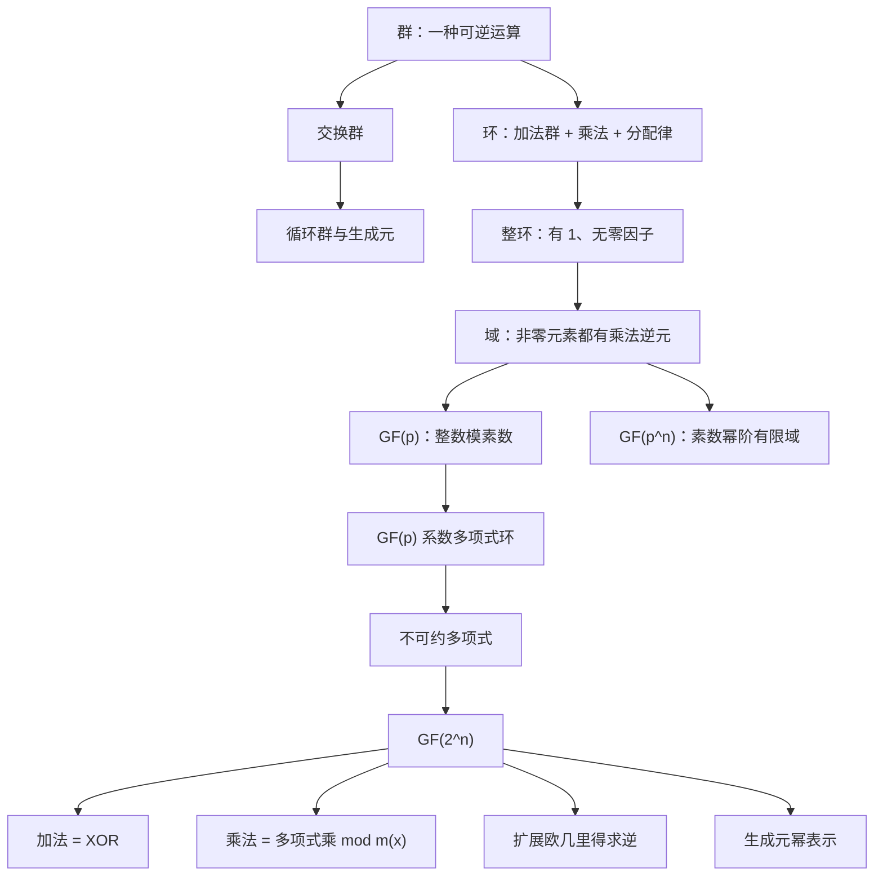

# 第五章 有限域

## 本章定位

> [!IMPORTANT] 信息边界
> “教材知识”均整理自 [[第五章_有限域_教材原文]]；标有“辅助理解”“复习策略”的内容是为检索、记忆和自测所作的结构化补充，不冒充教材原文。

本章从群、环、域逐级建立有限域概念，再用 `GF(p)` 系数多项式和不可约多项式构造 `GF(2^n)`。它是第6章 AES 以及后续多种认证与公钥算法的代数基础。

### 章节知识图谱



### 高频结论速览

| 主题 | 必须掌握的结论 |
|---|---|
| 群 | 封闭、结合、单位元、逆元；交换律不是群公理 |
| 环 | 加法为交换群；乘法封闭结合；满足左右分配律 |
| 域 | 非零元素在乘法下构成交换群；可做非零除法 |
| 有限域阶 | 必为 `p^n`，其中 `p` 为素数 |
| `GF(p)` | `Z_p` 配备模 `p` 加法和乘法 |
| 多项式除法 | `f=qg+r`，且 `deg r<deg g` |
| 不可约多项式 | 在指定系数域上不能分解为两个低次正次数因子 |
| `GF(2^n)` | 次数 `<n` 的二元多项式模 `n` 次不可约多项式 |
| 二元域加法 | 对应系数相加模2，即位串 XOR |
| 二元域乘法 | 多项式乘法后对 `m(x)` 取余 |
| 逆元 | 多项式扩展欧几里得算法 |
| 生成元 | 非零元素可写成 `g^0,...,g^{2^n-2}` |

## 5.1 群

### 5.1.1 定义与公理

**教材知识**：群 `{G;·}` 是定义了一个二元运算的集合，满足：

| 编号 | 公理 | 形式化表达 |
|---|---|---|
| A1 | 封闭性 | `a,b∈G => a·b∈G` |
| A2 | 结合律 | `a·(b·c)=(a·b)·c` |
| A3 | 单位元 | 存在 `e`，使 `a·e=e·a=a` |
| A4 | 逆元 | 每个 `a` 存在 `a'`，使 `a·a'=a'·a=e` |

有限群的**阶**是群中元素个数。

**例：置换群 `S_n`**

- 元素：`n` 个符号的所有置换；
- 运算：置换复合；
- 单位元：恒等置换；
- 逆元：撤销该置换的逆置换；
- 阶：`n!`。

### 5.1.2 交换群

在 A1～A4 外满足 A5：

$$
a\cdot b=b\cdot a.
$$

当 `n>2` 时，`S_n` 不交换。

### 5.1.3 循环群

若存在 `a∈G`，使每个元素均为 `a^k`，则 `G` 是循环群，`a` 为生成元。循环群一定交换。定义：

$$
a^0=e,
\qquad
a^{-n}=(a')^n.
$$

元素 `a` 的阶为最小正整数 `r`，使 `a^r=e`。

![[attachments/fig_5_1_groups_rings_fields.png]]

> [!NOTE] 辅助理解
> 群可以理解为“可连续执行且每一步都能撤销的一组操作”。这种类比只帮助记忆，正式判断仍须逐条核验公理。

**重点**：四条基本公理；单位元和逆元依赖所选运算。

**难点**：置换复合的顺序；循环群中“幂”代表重复群运算。

**易错点**：把交换律当成群公理；只检查封闭性就判定成群。

**关键词**：群、有限群、阶、单位元、逆元、交换群、循环群、生成元。

**Related**：[[第二章_数论基础_复习笔记#2.8 离散对数]]；本章5.6.5生成元。

## 5.2 环

### 定义

**教材知识**：环 `{R,+,×}` 满足：

1. 关于加法满足 A1～A5，即构成交换群；
2. 乘法封闭；
3. 乘法结合；
4. 乘法对加法满足左右分配律。

$$
a(b+c)=ab+ac,
\qquad
(a+b)c=ac+bc.
$$

### 逐级增强

| 结构 | 新增条件 |
|---|---|
| 环 | 加法交换群；乘法封闭结合；分配律 |
| 交换环 | 乘法交换 `ab=ba` |
| 整环 | 交换环；有乘法单位元 `1`；无零因子 |

零因子指非零 `a,b` 满足 `ab=0`。零因子会破坏消去律，并阻止对应元素拥有乘法逆元。

### 教材例子

| 对象 | 结论 | 原因 |
|---|---|---|
| 实数 `n` 阶方阵 | 环，通常非交换环 | 矩阵乘法通常不交换 |
| 偶整数 | 交换环 | 普通加乘封闭且交换 |
| `Z_n` | 交换环 | 模 `n` 加乘封闭 |
| 整数 | 整环 | 有 `1` 且无零因子 |

![[attachments/fig_5_2_properties_groups_rings_fields.png]]

**重点**：环只保证加、减、乘，不保证除法。

**难点**：区分“无零因子”和“每个非零元素有逆元”。

**易错点**：默认乘法有单位元或满足交换律。

**关键词**：环、交换环、整环、零因子、乘法单位元、分配律。

**Related**：5.3域；5.5.2多项式环。

## 5.3 域

### 两种等价描述

**教材知识**：域是满足 A1～A5、M1～M7 的集合。便于复习的等价表述：

1. `F` 在加法下构成交换群；
2. `F\setminus{0}` 在乘法下构成交换群；
3. 分配律成立。

因此可以在域内完成加、减、乘和除，除数不能为 `0`：

$$
a/b=a b^{-1}.
$$

### 有限域

- 元素个数称为阶；
- 有限域的阶必须是 `p^n`，`p` 为素数，`n` 为正整数；
- 记作 `GF(p^n)`；
- 同阶有限域同构，但元素表示可以不同。

![[attachments/fig_5_3_types_of_fields.png]]

### 结构总对比

| 对象 | 加法逆元 | 乘法 | 非零乘法逆元 | 零因子 |
|---|---:|---|---:|---:|
| 环 | 全部有 | 封闭、结合、分配 | 不保证 | 可能有 |
| 整环 | 全部有 | 交换、有 `1` | 不保证 | 无 |
| 域 | 全部有 | 交换、有 `1` | 全部有 | 无 |

**重点**：M7乘法逆元是域相对整环的新增条件。

**易错点**：把整数称为域；给 `0` 寻找乘法逆元；把阶为 `p^n` 理解为整数模 `p^n`。

**关键词**：域、有限域、伽罗瓦域、阶、乘法逆元、除法。

**Related**：5.4 `GF(p)`；5.6 `GF(2^n)`。

## 5.4 有限域 $GF(p)$

### 5.4.1 定义与运算

对素数 `p`：

$$
GF(p)=\{0,1,\ldots,p-1\},
$$

加法和乘法均模 `p`。每个非零元素与 `p` 互素，因此有唯一乘法逆元。

| 运算 | 公式 |
|---|---|
| 加法 | `(a+b) mod p` |
| 减法 | `(a-b) mod p` |
| 乘法 | `ab mod p` |
| 除法 | `ab^{-1} mod p`，`b≠0` |

`GF(2)` 中加法为 XOR，乘法为 AND。

![[attachments/table_5_1_mod7_mod8_arithmetic.png]]

### 消去律

若 `a≠0` 且

$$
ab\equiv ac\pmod p,
$$

则两边乘 `a^{-1}` 得 `b≡c (mod p)`。

### 5.4.2 乘法逆元

扩展欧几里得求

$$
px+ay=1.
$$

则

$$
a^{-1}\equiv y\pmod p.
$$

教材例：`550^{-1} mod 1759=355`，核验 `550×355 mod 1759=1`。

> [!TIP] 复习策略
> 求逆必须写“贝祖等式 → 两边取模 → 识别逆元 → 回乘核验”四步，避免只报结果。

**重点**：模数为素数；除法转化为乘逆元。

**难点**：扩展欧几里得回代与负系数规范化。

**易错点**：把普通小数除法带入有限域；忘记对负数取标准剩余。

**关键词**：`GF(p)`、模算术、互素、贝祖等式、扩展欧几里得、消去律。

**Related**：[[第二章_数论基础_复习笔记#2.3 模运算]]；[[第二章_数论基础_复习笔记#2.2 欧几里得算法]]。

## 5.5 多项式运算

### 三种运算语境

| 语境 | 系数 | 是否模多项式 |
|---|---|---:|
| 普通多项式 | 指定数集中的普通运算 | 否 |
| `GF(p)` 上多项式 | 系数逐项模 `p` | 否 |
| `GF(p^n)` 中多项式 | 系数逐项模 `p` | 对 `n` 次不可约 `m(x)` 取余 |

![[attachments/fig_5_4_polynomial_overview.png]]

### 5.5.1 普通多项式

$$
f(x)=\sum_{i=0}^{n}a_ix^i,
\qquad a_n\ne0.
$$

- `a_n=1`：首一多项式；
- 加减：合并同次项；
- 乘法：分配律展开；
- 带余除法要求系数集为域：

$$
f(x)=q(x)g(x)+r(x),
\qquad \deg r<\deg g.
\tag{5.2}
$$

![[attachments/fig_5_5_polynomial_arithmetic_examples.png]]

### 5.5.2 $GF(p)$ 系数多项式

所有系数运算模 `p`。在 `GF(2)` 中：

$$
f(x)+g(x)=f(x)-g(x),
$$

加减均可用 XOR 实现。

![[attachments/fig_5_6_gf2_polynomial_arithmetic_examples.png]]

#### 因式与不可约

- `g(x)|f(x)` 当且仅当 `f(x) mod g(x)=0`；
- 不可约多项式不能分解为两个次数更低的正次数多项式；
- 不可约性必须相对于系数域说明；
- 在 `GF(2)` 上，二次或三次多项式无 `0`、`1` 根即可判定不可约。

![[attachments/example_5_5_irreducible_polynomial.png]]

### 5.5.3 多项式 GCD

迭代公式：

$$
\gcd[a(x),b(x)]
=\gcd[b(x),a(x)\bmod b(x)].
\tag{5.3}
$$

最后一个非零余式是 GCD；有限域上通常再乘首项系数的逆元，把结果规范为首一多项式。

```text
r[-1] = a
r[0]  = b
r[i]  = r[i-2] mod r[i-1]
直到 r[i] = 0，输出上一个非零余式
```

![[attachments/algorithm_5_1_polynomial_euclidean_algorithm.png]]

![[attachments/example_5_1_polynomial_gcd_part1.png]]

![[attachments/example_5_1_polynomial_gcd_part2.png]]

### 公式与判断清单

| 问题 | 快速判断 |
|---|---|
| 首一多项式之积是否首一 | 是，首项系数 `1×1=1` |
| 非零多项式乘积次数 | 系数在域中时为次数之和 |
| 多项式和的次数 | 不超过最高次数；最高项可能抵消 |
| `GF(2)` 中减法 | 与加法相同 |
| 多项式可约性 | 查低次因式，必须指定系数域 |

**重点**：带余除法、不可约性、欧几里得算法。

**难点**：系数和多项式两个层级的“mod”；有限域系数长除法。

**易错点**：默认多项式和的次数一定等于较大次数；把“无实根”当作不可约定义。

**关键词**：次数、首一多项式、多项式环、带余除法、因式、不可约多项式、最大公因式。

**Related**：5.6.2模多项式；5.6.3多项式扩展欧几里得。

## 5.6 有限域 $GF(2^n)$

### 5.6.1 动机

目标：使用全部 `n` 位编码，同时保留域的四则运算。

- `Z_{2^n}`：编码完整，但因模数为合数，不是域；
- `Z_p` 且 `p<2^n`：是域，但浪费部分位串；
- `GF(2^n)`：用二元多项式构造，兼顾全部位串和域结构。

### 5.6.2 元素与运算

元素集合：

$$
\left\{
\sum_{i=0}^{n-1}a_ix^i:a_i\in GF(2)
\right\}.
$$

选定 `n` 次不可约多项式 `m(x)`：

$$
\begin{aligned}
a(x)+b(x)&=\text{系数逐项模2相加},\\
a(x)b(x)&=\text{多项式乘积}\bmod m(x).
\end{aligned}
$$

次数小于 `n` 的二元多项式共有 `2^n` 个。

![[attachments/table_5_2_gf2_3_arithmetic.png]]

![[attachments/table_5_3_polynomial_arithmetic_mod_x3_x_1.png]]

### 表示转换

对

$$
a(x)=a_{n-1}x^{n-1}+\cdots+a_1x+a_0,
$$

位串写成 `a_{n-1}...a_0`。例如：

$$
x^6+x^4+x^2+x+1
\longleftrightarrow01010111
\longleftrightarrow\{57\}.
$$

### 5.6.3 乘法逆元

扩展欧几里得保持不变量：

$$
r_i(x)=a(x)v_i(x)+b(x)w_i(x).
$$

若最终 GCD 为 `1`，则对应系数给出逆元。对不可约 `m(x)` 与任意非零低次 `b(x)`，GCD 必为 `1`。

![[attachments/algorithm_5_2_extended_euclidean_polynomials.png]]

![[attachments/table_5_4_extended_euclidean_example.png]]

教材结论：

$$
(x^7+x+1)^{-1}=x^7
\pmod{x^8+x^4+x^3+x+1}.
$$

### 5.6.4 计算实现

加法：

$$
(01010111)\oplus(10000011)=(11010100).
$$

AES 模多项式：

$$
m(x)=x^8+x^4+x^3+x+1.
$$

乘 `x`：左移；若原最高位为 `1`，再 XOR `00011011` (`0x1B`)：

$$
\operatorname{xtime}(a)=
\begin{cases}
(a\ll1),&\operatorname{msb}(a)=0,\\
((a\ll1)\bmod256)\oplus\texttt{1B},&\operatorname{msb}(a)=1.
\end{cases}
$$

![[attachments/example_5_2_aes_polynomial_modulus.png]]

![[attachments/example_5_3_binary_gf2_8_multiplication.png]]

教材示例：

$$
\{57\}\times\{83\}=\{C1\}.
$$

### 5.6.5 生成元

若 `g` 生成全部非零元素：

$$
GF(2^n)^*=\{g^0,g^1,\ldots,g^{2^n-2}\},
$$

则

$$
g^i g^j=g^{(i+j)\bmod(2^n-1)},
$$

并且

$$
(g^i)^{-1}=g^{(2^n-1-i)\bmod(2^n-1)}.
$$

对 `GF(2^3)`、`m(x)=x^3+x+1`：

| 幂 | 多项式 | 位串 |
|---|---|---|
| `g^0` | `1` | `001` |
| `g^1` | `g` | `010` |
| `g^2` | `g^2` | `100` |
| `g^3` | `g+1` | `011` |
| `g^4` | `g^2+g` | `110` |
| `g^5` | `g^2+g+1` | `111` |
| `g^6` | `g^2+1` | `101` |

![[attachments/table_5_5_gf2_3_generator.png]]

![[attachments/table_5_6_gf2_3_generator_arithmetic.png]]

![[attachments/example_5_4_generator_part1.png]]

![[attachments/example_5_4_generator_part2.png]]

#### 不可约与本原

| 概念 | 保证 |
|---|---|
| 不可约多项式 | 模该多项式可构造有限域 |
| 本原多项式 | 不可约，且其根生成全部非零元素 |

所有本原多项式都不可约；反过来不成立。AES 使用的 `x^8+x^4+x^3+x+1` 不可约但不本原，其根的阶为51。

### 5.6.6 三种表示对比

| 表示 | 加法 | 乘法 | 逆元 |
|---|---|---|---|
| 位串 | XOR | 移位、条件XOR、累加 | 算法求 |
| 多项式 | 系数模2 | 乘后模 `m(x)` | 扩展欧几里得 |
| 生成元幂 | 需转换或查表 | 指数相加 | 指数取负模 `2^n-1` |

**重点**：`GF(2^n)` 的构造；位串与多项式一一对应；模不可约多项式乘法。

**难点**：多项式长除法和扩展欧几里得；三种表示转换；本原性。

**易错点**：把 `GF(2^n)` 写成 `Z_{2^n}`；乘法只做普通整数乘法；溢出后错误截断；把不可约与本原混同。

**关键词**：`GF(2^n)`、二元多项式、XOR、模多项式、`xtime`、生成元、本原多项式、同构。

**Related**：[[第六章_高级加密标准_复习笔记]]；第2章本原根。

## 5.7 关键术语与题目入口

教材关键术语：交换群、有限域、模算术、因子、最大公因式、阶、域、单位元、互素、群、不可约多项式、环、循环群、逆元。

完整题目、解题思路和解答见 [[第五章_有限域_课后习题]]。

## 公式索引

| 公式 | 用途 |
|---|---|
| `a-b=a+(-b)` | 用逆元定义减法 |
| `a/b=ab^{-1}` | 用逆元定义除法 |
| `f=qg+r`, `deg r<deg g` | 多项式带余除法 |
| `gcd(a,b)=gcd(b,a mod b)` | 欧几里得算法 |
| `av+bw=1` | 扩展欧几里得求逆 |
| `x^n mod m(x)=m(x)-x^n` | `GF(2)` 上首一模多项式的乘 `x` 约简依据 |
| `g^i g^j=g^{i+j mod(q-1)}` | 生成元幂乘法 |

## 关键词索引

`群` · `交换群` · `循环群` · `生成元` · `阶` · `环` · `交换环` · `整环` · `零因子` · `域` · `有限域` · `GF(p)` · `GF(2^n)` · `首一多项式` · `多项式环` · `不可约多项式` · `本原多项式` · `最大公因式` · `扩展欧几里得` · `XOR` · `xtime` · `模多项式` · `同构`

## 易混淆知识对照

| 易混项 | 区分标准 |
|---|---|
| 群 vs 交换群 | 是否额外满足交换律 |
| 环 vs 域 | 非零元素是否全部有乘法逆元 |
| `Z_{2^n}` vs `GF(2^n)` | 前者整数模运算；后者多项式模不可约多项式 |
| 系数模 `p` vs 多项式模 `m(x)` | 前者约束每个系数；后者约束整个多项式次数 |
| 可约 vs 有根 | 对二、三次多项式可通过根判断；高次不充分 |
| 不可约 vs 本原 | 本原还要求根生成全部非零元素 |
| 位串加法 vs 普通二进制加法 | 位串域加法为 XOR，无进位 |
| 生成元幂乘法 vs 加法 | 指数相加只对应域乘法，不对应域加法 |

## 闭卷复盘清单

1. 不看书写出群、环、域的公理差异。
2. 说明 `Z_8` 为什么不是域，`GF(7)` 为什么是域。
3. 用扩展欧几里得求一个模素数逆元并回乘核验。
4. 在 `GF(2)` 上完成一次多项式加、乘、带余除法。
5. 用欧几里得算法求一对多项式 GCD，并把结果规范为首一。
6. 解释 `GF(2^n)` 为何有 `2^n` 个元素。
7. 把一个位串写成多项式，再完成一次模乘法。
8. 写出 AES `xtime` 中 `0x1B` 的来源。
9. 区分不可约多项式和本原多项式。
10. 完成 [[第五章_有限域_课后习题]] 后，再进入第6章。
