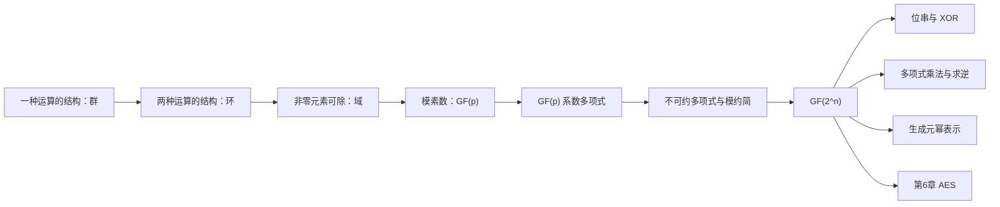
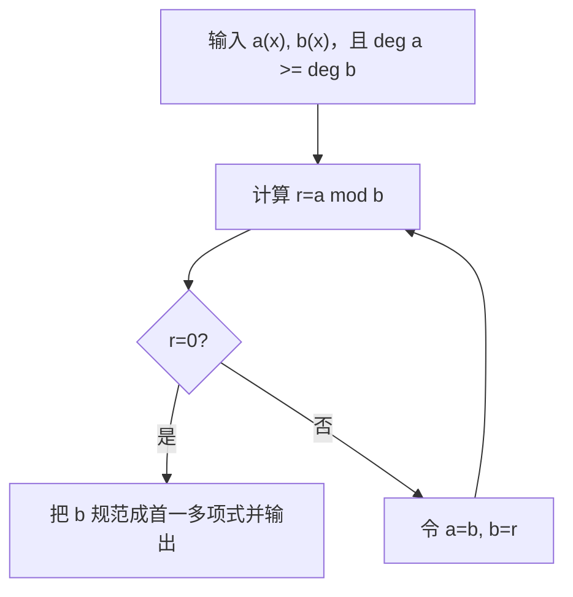
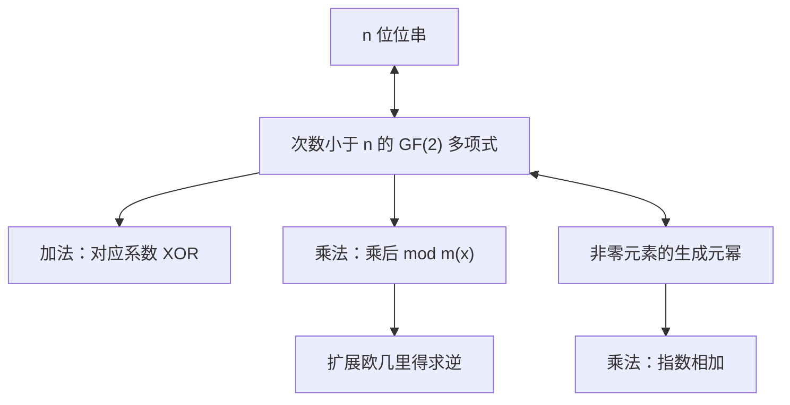

# 第五章 有限域

## 本章导学

### 本章学习目标

学完本章后，应当能够：

1. 从公理出发区分群、交换群、循环群、环、整环和域；
2. 解释为什么模素数的剩余类构成 `GF(p)`，而模合数通常不能构成域；
3. 在 `GF(p)` 中完成加、减、乘、除与乘法逆元计算；
4. 区分普通多项式运算、`GF(p)` 系数多项式运算和模多项式运算；
5. 用多项式欧几里得算法求最大公因式，用扩展欧几里得算法求逆元；
6. 在位串、多项式和生成元幂三种表示之间转换 `GF(2^n)` 的元素；
7. 解释 `GF(2^n)` 中加法为何是 XOR、乘法为何需要模不可约多项式约简；
8. 看懂第6章 AES 中使用的 `GF(2^8)` 运算基础。

### 本章核心问题

- “能做加法和乘法”为什么还不足以称为域？
- 为什么乘法逆元是环与域之间的关键分界？
- 为什么 `GF(2^n)` 不是整数模 `2^n`，却仍然恰好有 `2^n` 个元素？
- 不可约多项式在扩域中扮演什么角色？
- 同一个域元素为什么可以写成位串、多项式或生成元的幂？

### 为什么密码学需要有限域

密码算法处理的是有限长度的比特串。若运算会跑出表示范围，或者某些非零元素没有逆元，算法中的代换、恢复和解密就可能失去可逆性。有限域同时提供三点：

1. **有限**：元素数量与固定比特宽度相配；
2. **封闭**：运算结果仍在同一集合内；
3. **可逆**：每个非零元素都有乘法逆元。

AES、CMAC、GCM 和椭圆曲线密码都依赖有限域。第5章不是孤立的数学插曲，而是在为后续算法建立一套可计算、可逆且适合二进制实现的代数语言。

### 先修知识与学习路线

开始本章前，应先复习第2章的整除、模运算、最大公因数、欧几里得算法、扩展欧几里得算法和本原根。

> [!IMPORTANT] 内容边界
> 本讲义以 [[第五章_有限域_教材原文]] 为事实基础。类比、学习建议、自检题和补充推导用于帮助理解；涉及后续算法时只说明连接关系，不提前替代后续章节。

## 5.1 群

### 本节学习目标

- 能用四条公理判断一个集合及其运算是否构成群；
- 能解释单位元、逆元、阶、交换群和循环群；
- 能用置换群说明“群不一定交换”。

### 本节核心问题与学习价值

群只研究一种运算，但要求这项运算可以稳定组合并且每一步都能撤销。密码学中的置换、轮函数复合、模加法群和非零域元素乘法群都以群为基础。理解群的意义，不是背四个词，而是理解“可组合的可逆操作”具备哪些最低条件。

### 5.1.1 群的定义与四条公理

设集合 `G` 上定义了二元运算 `·`。若对任意 `a,b,c∈G` 满足下列四条公理，则 `{G;·}` 是群。

| 公理 | 数学表达 | 它排除了什么问题 |
|---|---|---|
| 封闭性 | `a·b∈G` | 运算结果跑出集合 |
| 结合律 | `a·(b·c)=(a·b)·c` | 多步运算因括号不同而歧义 |
| 单位元 | 存在 `e`，使 `a·e=e·a=a` | 缺少“不做改变”的操作 |
| 逆元 | 每个 `a` 存在 `a'`，使 `a·a'=a'·a=e` | 某一步操作无法撤销 |

注意：群公理不包含交换律。`a·b` 与 `b·a` 可以不同。

**如何判断**：先写清“集合是什么、运算是什么”，再逐项验证四条公理。不能只因为运算看起来熟悉，就默认它构成群。例如，正整数在普通加法下封闭且结合，却没有加法单位元 `0`，因而不是群。

### 教材置换群示例

`S_n` 是 `n` 个符号的所有置换构成的集合，运算是置换复合。

- 两个置换复合后仍是置换，所以封闭；
- 映射复合满足结合律；
- 恒等置换是单位元；
- 每个置换都有逆置换。

因此 `S_n` 构成群。其元素个数为 `n!`，所以它是阶为 `n!` 的有限群。

### 5.1.2 交换群

若群还满足

$$
a\cdot b=b\cdot a,
$$

则称为交换群或阿贝尔群。整数在普通加法下、非零实数在普通乘法下都是交换群；当 `n>2` 时，置换群 `S_n` 不是交换群，因为不同置换的执行顺序会改变结果。

生活类比：先穿袜子再穿鞋，与先穿鞋再穿袜子的结果不同。这说明“操作能复合且可逆”不代表“操作顺序可以交换”。

### 5.1.3 循环群

若存在 `a∈G`，使群中每个元素都能写成 `a^k`，则 `G` 为循环群，`a` 为生成元。这里的幂表示重复应用群运算；若运算写成加法，`a^k` 对应 `ka`。

有限群中元素 `a` 的阶，是满足 `a^r=e` 的最小正整数 `r`。循环群一定是交换群，因为

$$
a^i a^j=a^{i+j}=a^{j+i}=a^j a^i.
$$

![[attachments/fig_5_1_groups_rings_fields.png]]

### 常见误区与易混点

- **封闭不等于成群**：还要验证结合律、单位元和逆元。
- **单位元依赖运算**：加法单位元通常是 `0`，乘法单位元通常是 `1`。
- **逆元也依赖运算**：`a` 的加法逆元是 `-a`，乘法逆元是 `a^{-1}`。
- **群不要求交换**：交换律是第五条额外条件。
- **生成元不一定唯一**：一个循环群可能有多个生成元。

### 记忆技巧与自检

记忆四字串：“封、结、幺、逆；交换另加。”

自检：`{0,1,2}` 在模3加法下为什么是群？答题时必须指出单位元和每个元素的逆元，而不能只写“因为模运算封闭”。

## 5.2 环

### 本节学习目标

- 理解环同时包含加法和乘法两种运算；
- 区分环、交换环和整环；
- 识别零因子，并说明它为何妨碍除法。

### 本节核心问题与学习价值

只靠一个群无法描述日常代数中的“加法与乘法如何协同”。环把两种运算放到同一集合中，并用分配律连接它们。整数、多项式和矩阵都自然形成环，因此环是进入域与有限域之前不可跳过的一层。

### 定义与结构

集合 `R` 上定义加法和乘法。`R` 为环时：

1. `R` 关于加法构成交换群；
2. 乘法满足封闭性和结合律；
3. 乘法对加法满足左右分配律：

$$
a(b+c)=ab+ac,
\qquad
(a+b)c=ac+bc.
$$

这意味着在环中总能做加法、减法和乘法，但不保证能做除法。

若乘法还满足 `ab=ba`，则为**交换环**。若交换环还具有乘法单位元 `1`，并且不存在非零 `a,b` 使 `ab=0`，则为**整环**。

### 零因子为什么重要

若 `a≠0`、`b≠0`，却有 `ab=0`，则 `a` 和 `b` 是零因子。零因子使消去律失败。例如在 `Z_6` 中：

$$
2\times 1\equiv 2\times 4\pmod 6,
$$

但 `1` 与 `4` 并不模6同余。原因是 `2` 没有乘法逆元，不能在等式两边“除以2”。

### 教材示例与图表

- 所有实数 `n` 阶方阵在矩阵加法和乘法下构成环，但矩阵乘法一般不交换；
- 偶整数在普通加法和乘法下构成交换环；
- `Z_n` 在模 `n` 加法和乘法下构成交换环；
- 普通整数构成整环。

![[attachments/fig_5_2_properties_groups_rings_fields.png]]

### 结构对比

| 结构 | 加法要求 | 乘法要求 | 能否保证除法 |
|---|---|---|---|
| 群 | 只讨论一种运算 | 不涉及 | 只保证该运算有逆 |
| 环 | 加法为交换群 | 封闭、结合、分配 | 不能 |
| 交换环 | 同环 | 再要求交换 | 不能 |
| 整环 | 同环 | 交换、有 `1`、无零因子 | 仍不一定能 |
| 域 | 加法为交换群 | 非零元素形成交换群 | 除数非零时可以 |

### 常见误区、记忆与关联

- 环的乘法不一定交换，也不一定有乘法单位元；具体采用哪套定义，应以教材列出的公理为准。
- “无零因子”不等于“每个非零元素都有逆元”；整数环无零因子，但 `2` 在整数中没有乘法逆元。
- 记忆：“环可加减乘，域再保证除。”
- 5.5节的多项式集合正是环的重要实例。

## 5.3 域

### 本节学习目标

- 能给出域的两种等价描述；
- 能解释为什么域中没有零因子并且消去律成立；
- 能判断熟悉的数集或模剩余类是否为域。

### 本节核心问题与学习价值

域的关键不是“元素有限”，而是除 `0` 外每个元素都能用于除法。密码算法需要可逆变换，乘法逆元正是这种可逆性的数学保证。

### 定义

教材先把域定义为满足 A1～M6 的整环，再增加：对任意非零 `a∈F`，存在 `a^{-1}` 使

$$
aa^{-1}=a^{-1}a=1.
$$

更便于使用的等价描述是：

1. `F` 对加法构成交换群；
2. `F\setminus\{0\}` 对乘法构成交换群；
3. 乘法对加法满足分配律。

所以域内可以做加、减、乘和除，但除数不能为 `0`。除法定义为

$$
\frac ab=a b^{-1},\qquad b\ne0.
$$

### 示例与反例

- 有理数、实数和复数构成无限域；
- 整数不是域，因为除 `1` 和 `-1` 外，其他整数在整数集合内没有乘法逆元；
- `Z_p` 在 `p` 为素数时是有限域；
- `Z_n` 在 `n` 为合数时通常有零因子，不是域。

![[attachments/fig_5_3_types_of_fields.png]]

### 有限域的阶

有限域的元素个数称为域的阶。有限域的阶必须是素数幂 `p^n`，记作 `GF(p^n)`。这个条件只说明“可能存在”，并不意味着整数模 `p^n` 就是该有限域；当 `n>1` 时，通常需要用多项式构造。

### 易错点与自检

- `GF(p^n)` 中的 `p` 必须是素数。
- “阶为素数幂”不等于“运算就是模这个素数幂的整数运算”。
- `0` 只有加法逆元，没有乘法逆元。

自检：为什么 `Z_8` 不是域？至少给出一个非零元素没有乘法逆元，或给出零因子，例如 `2×4≡0 (mod 8)`。

## 5.4 有限域 $GF(p)$

### 本节学习目标

- 能说明 `GF(p)` 的元素集合和运算规则；
- 能构造小型加法表、乘法表和逆元表；
- 能用扩展欧几里得算法求大素数模下的乘法逆元。

### 为什么模素数会得到域

`GF(p)` 的元素是

$$
\{0,1,\ldots,p-1\},
$$

加法和乘法都按模 `p` 进行。关键在于：若 `p` 为素数，则每个 `1≤a<p` 都与 `p` 互素，因此存在整数 `a^{-1}` 使

$$
aa^{-1}\equiv1\pmod p.
$$

于是所有非零元素都有乘法逆元，`Z_p` 从交换环提升为域。

### 5.4.1 运算方法

| 运算 | 做法 |
|---|---|
| `a+b` | 普通相加后模 `p` |
| `a-b` | 普通相减后模 `p`，结果取 `0` 到 `p-1` |
| `ab` | 普通相乘后模 `p` |
| `a/b` | 求 `b^{-1}`，再算 `ab^{-1} mod p` |

最简单的有限域是 `GF(2)`。其中加法等同 XOR，乘法等同 AND。教材表5.1把 `GF(7)` 与非域 `Z_8` 并列，直观展示了素数模与合数模的差异。

![[attachments/table_5_1_mod7_mod8_arithmetic.png]]

**例：在 `GF(7)` 中计算 `4/3`**

因为 `3×5≡1 (mod 7)`，所以 `3^{-1}=5`，从而

$$
4/3\equiv4\times5\equiv6\pmod7.
$$

这里没有小数，除法始终被改写成乘逆元。

### 5.4.2 用扩展欧几里得算法求逆

若 `gcd(a,b)=1`，扩展欧几里得算法可求出

$$
ax+by=1.
$$

两边模 `a`，得到 `by≡1 (mod a)`，所以 `y` 就是 `b` 模 `a` 的逆元。

教材例中：

$$
1759x+550y=1,
$$

求得 `y=355`，因此

$$
550^{-1}\equiv355\pmod{1759}.
$$

核验只需计算 `550×355 mod 1759=1`。

### 消去律的由来

若 `a≠0` 且

$$
ab\equiv ac\pmod p,
$$

两边乘 `a^{-1}`，便有 `b≡c (mod p)`。因此，消去律成立的真正原因是非零元素拥有乘法逆元，而不是符号看起来像普通整数等式。

### 常见误区与学习建议

- 只有 `p` 为素数时，整个 `Z_p` 才是域。
- `a/b mod p` 不是先做实数除法再取模。
- 逆元必须核验乘积模 `p` 是否为 `1`。
- 小 `p` 可查表，大 `p` 应使用扩展欧几里得算法。

## 5.5 多项式运算

### 本节学习目标

- 区分三类多项式运算；
- 掌握加、减、乘、带余除法和最大公因式；
- 理解系数域为何决定除法是否合法；
- 能判断低次 `GF(2)` 多项式是否不可约。

### 本节核心问题与学习价值

`GF(2^n)` 不能靠整数模 `2^n` 构造，而要靠多项式模不可约多项式构造。若不先理解多项式的系数、次数、除法、余式和不可约性，后面的“位移加异或”只会变成没有依据的操作口诀。

### 三类多项式运算

![[attachments/fig_5_4_polynomial_overview.png]]

| 类型 | 系数如何运算 | 乘积是否再约简 | 用途 |
|---|---|---|---|
| 普通多项式 | 普通代数规则 | 否 | 建立基础 |
| `GF(p)` 上多项式 | 每个系数模 `p` | 否 | 形成多项式环 |
| 模 `m(x)` 的多项式 | 系数模 `p` | 是，取模 `m(x)` 余式 | 构造 `GF(p^n)` |

“mod”在本章有两种对象：一是**系数模 `p`**，二是**整个多项式模 `m(x)`**。做题时必须先说明是哪一种。

### 5.5.1 普通多项式运算

一般 `n` 次多项式写成

$$
f(x)=a_nx^n+\cdots+a_1x+a_0,
\qquad a_n\ne0.
$$

若 `a_n=1`，称为首一多项式。加减法合并同次项；乘法用分配律展开。若系数来自一个域，则对 `g(x)≠0` 可作带余除法：

$$
f(x)=q(x)g(x)+r(x),
\qquad \deg r<\deg g.
\tag{5.2}
$$

![[attachments/fig_5_5_polynomial_arithmetic_examples.png]]

为什么系数必须来自域？长除法每一步都要用被除式首项系数除以除式首项系数。若系数集合中不存在这个商，算法就无法继续。例如整数系数下 `5x^2/(3x)` 需要系数 `5/3`，它不属于整数；在 `GF(7)` 中却可计算，因为 `3^{-1}=5`，所以商的首项是 `4x`。

### 5.5.2 $GF(p)$ 系数多项式

系数在 `GF(p)` 中时，每次系数运算都要模 `p`。尤其在 `GF(2)` 中：

$$
1+1=1-1=0,
$$

所以多项式加法和减法完全相同，都是按系数 XOR；相同幂次的项会成对抵消。

![[attachments/fig_5_6_gf2_polynomial_arithmetic_examples.png]]

#### 不可约多项式

若多项式 `f(x)` 不能写成两个次数都低于它的正次数多项式之积，则称 `f(x)` 在给定系数域上不可约。它类似整数中的素数。

不可约性依赖系数域。判断 `GF(2)` 上的二次或三次多项式时，只需检查 `0` 和 `1` 是否为根：若无根，就没有一次因子，因而不可约。对四次及以上多项式，仅检查一次因子通常不够，还要排除更高次因子。

教材用 `x^3+x+1` 展示了对 `x` 和 `x+1` 的除法检查：

![[attachments/example_5_5_irreducible_polynomial.png]]

### 5.5.3 多项式最大公因式

多项式欧几里得算法与整数版本具有相同骨架：

$$
\gcd[a(x),b(x)]
=\gcd[b(x),a(x)\bmod b(x)].
\tag{5.3}
$$

不断做带余除法，直到余式为 `0`；最后一个非零余式就是最大公因式。有限域上最大公因式通常规范成首一多项式。

![[attachments/algorithm_5_1_polynomial_euclidean_algorithm.png]]

![[attachments/example_5_1_polynomial_gcd_part1.png]]

![[attachments/example_5_1_polynomial_gcd_part2.png]]

### 整数与多项式的对应关系

| 整数算术 | 多项式算术 |
|---|---|
| 素数 `p` | 不可约多项式 `m(x)` |
| 余数 `0,...,p-1` | 次数小于 `deg m` 的多项式 |
| 整数模 `p` | 多项式模 `m(x)` |
| 整数欧几里得算法 | 多项式欧几里得算法 |
| 扩展欧几里得求逆 | 多项式扩展欧几里得求逆 |

### 常见误区与自检

- `GF(2)` 多项式没有进位，也没有借位。
- 多项式和的次数只保证不超过两者最高次数；最高次项可能抵消。
- “不可约”必须附带系数域。
- 多项式除法的结果通常是商和余式，不等于整除。

自检：为什么 `x^4+1=(x+1)^4` 在 `GF(2)` 中成立？关键是二项式系数 `4`、`6` 模2为 `0`。

## 5.6 有限域 $GF(2^n)$

### 本节学习目标

- 理解用 `GF(2)` 多项式构造 `2^n` 元有限域的全过程；
- 能完成加法、乘法、模约简和求逆；
- 能实现乘 `x` 的移位-XOR算法；
- 能区分不可约多项式、本原多项式和生成元。

### 5.6.1 为什么不能直接使用 $Z_{2^n}$

`n` 位串恰好有 `2^n` 种，但当 `n>1` 时，`2^n` 是合数，`Z_{2^n}` 有零因子，不是域。若改用小于 `2^n` 的最大素数，又会浪费一些位串。教材以8位字为例：`Z_{256}` 不是域，`Z_{251}` 虽是域，却无法使用 `251` 到 `255` 这5个编码。

解决方案是保留全部 `n` 位串，但改变乘法规则：把位串解释为 `GF(2)` 上的多项式，并模一个 `n` 次不可约多项式。

### 5.6.2 构造方法

域元素是所有次数小于 `n` 的二元多项式：

$$
a_{n-1}x^{n-1}+\cdots+a_1x+a_0,
\qquad a_i\in\{0,1\}.
$$

每个系数有2种选择，共有 `2^n` 个元素。选定 `n` 次不可约多项式 `m(x)` 后：

- 加法：对应系数模2相加；
- 乘法：先做普通多项式乘法，再对 `m(x)` 取余；
- 结果次数始终小于 `n`。

以 `GF(2^3)`、`m(x)=x^3+x+1` 为例，元素是

$$
0,1,x,x+1,x^2,x^2+1,x^2+x,x^2+x+1.
$$

由 `m(x)=0` 得

$$
x^3\equiv x+1\pmod{x^3+x+1}.
$$

例如：

$$
x^2\cdot x=x^3\equiv x+1.
$$

![[attachments/table_5_2_gf2_3_arithmetic.png]]

![[attachments/table_5_3_polynomial_arithmetic_mod_x3_x_1.png]]

所有同阶有限域彼此同构：它们的元素名称和表示可以不同，但运算结构相同。这解释了表5.2的整数标签和表5.3的多项式标签为何描述同一个 `GF(2^3)`。

### 5.6.3 用扩展欧几里得求乘法逆元

对非零 `b(x)` 和不可约 `a(x)=m(x)`，有 `gcd[a(x),b(x)]=1`。扩展欧几里得算法求出

$$
a(x)v(x)+b(x)w(x)=1.
$$

两边模 `a(x)`：

$$
b(x)w(x)\equiv1\pmod{a(x)},
$$

所以 `w(x)` 是 `b(x)` 的乘法逆元。

![[attachments/algorithm_5_2_extended_euclidean_polynomials.png]]

教材表5.4算得：

$$
(x^7+x+1)^{-1}=x^7
\pmod{x^8+x^4+x^3+x+1}.
$$

![[attachments/table_5_4_extended_euclidean_example.png]]

### 5.6.4 位串表示与高效乘法

多项式

$$
f(x)=\sum_{i=0}^{n-1}a_ix^i
$$

可唯一写成位串 `(a_{n-1}...a_0)`。因此：

| 多项式操作 | 位操作 |
|---|---|
| 系数模2加法 | XOR |
| 乘 `x` | 左移1位 |
| 超过 `n-1` 次 | XOR 模多项式的低 `n` 位进行约简 |

AES 使用

$$
m(x)=x^8+x^4+x^3+x+1,
$$

所以

$$
x^8\equiv x^4+x^3+x+1,
$$

低8位是 `00011011`，即 `0x1B`。对字节 `b_7...b_0` 乘 `x`：

$$
x f(x)=
\begin{cases}
(b_6b_5b_4b_3b_2b_1b_0 0),&b_7=0,\\
(b_6b_5b_4b_3b_2b_1b_0 0)\oplus00011011,&b_7=1.
\end{cases}
\tag{5.6}
$$

教材把

$$
(01010111)\times(10000011)
$$

分解为若干次乘 `x` 与 XOR，得到

$$
(11000001).
$$

![[attachments/example_5_2_aes_polynomial_modulus.png]]

![[attachments/example_5_3_binary_gf2_8_multiplication.png]]

生活类比：左移像把多项式每一项的次数都加1；一旦出现 `x^n`，就用 `m(x)=0` 提供的等价关系把它“折回”到低次项。这个折回不是截断，而是严格的模多项式约简。

### 5.6.5 生成元与本原多项式

`GF(q)` 的非零元素在乘法下构成阶为 `q-1` 的循环群。若元素 `g` 的前 `q-1` 个幂产生全部非零元素，则 `g` 是生成元：

$$
GF(q)=\{0,g^0,g^1,\ldots,g^{q-2}\}.
$$

若 `f(x)` 的根是 `GF(p^n)` 非零乘法群的生成元，则 `f(x)` 是本原多项式。所有本原多项式都不可约，但不可约多项式不一定本原。教材给出的 AES 多项式是不可约的，但其根的阶为51，不是255，因此它不是本原多项式。

> [!CAUTION] 容易混淆的边界
> 不可约多项式保证模运算构成域；本原多项式还保证它的根可以生成域中全部非零元素。两者不能互换。

对 `GF(2^3)`、`f(x)=x^3+x+1`，令 `g` 为根，则 `g^3=g+1`，继续相乘得到

$$
g^4=g^2+g,
\quad g^5=g^2+g+1,
\quad g^6=g^2+1,
\quad g^7=1.
$$

于是 `g` 的幂遍历全部7个非零元素。乘法可变为指数相加：

$$
g^i g^j=g^{(i+j)\bmod(2^n-1)}.
$$

例如：

$$
g^4g^6=g^{10\bmod7}=g^3=g+1.
$$

![[attachments/table_5_5_gf2_3_generator.png]]

![[attachments/table_5_6_gf2_3_generator_arithmetic.png]]

![[attachments/example_5_4_generator_part1.png]]

![[attachments/example_5_4_generator_part2.png]]

生成元表示擅长乘法和求逆，但加法通常需要先转回多项式或查表；这正是不同表示各有优势的原因。

### 5.6.6 三种表示的统一理解

| 表示 | 示例 | 加法 | 乘法 | 适用场景 |
|---|---|---|---|---|
| 位串 | `011` | XOR | 移位、XOR、约简 | 软件和硬件实现 |
| 多项式 | `x+1` | 系数模2 | 乘后模 `m(x)` | 推导和证明 |
| 生成元幂 | `g^3` | 通常需转换 | 指数相加模 `2^n-1` | 表驱动乘法、逆元 |

### 本节常见误区

- 把 `GF(2^n)` 当作 `Z_{2^n}`；
- 把二进制整数乘法直接当作域乘法；
- 左移溢出后只截断，没有按 `m(x)` 约简；
- 把模多项式 `m(x)` 当作域中一个非零元素；事实上域元素次数必须小于 `n`；
- 认为所有不可约多项式的根都是生成元；
- 在生成元幂表示下直接对指数做加法来求域加法。

### 学习建议与章节联系

1. 先在 `GF(2^3)` 中手算，不要直接跳到8位。
2. 每次计算同时写出位串和多项式，检查位序。
3. 乘法结果用“次数必须小于 `n`”做第一道自检。
4. 逆元结果必须回乘验证余式是否为 `1`。
5. 进入第6章时，把 AES 中的字节代换、列混合和密钥扩展分别映射回本章的求逆和域乘法。

## 5.7 章末学习入口

### 关键术语

交换群、有限域、模算术、因子、最大公因式、阶、域、单位元、互素、群、不可约多项式、环、循环群、逆元、生成元、本原多项式。

### 一页式复盘

1. 群：一种运算，满足封闭、结合、单位元、逆元。
2. 环：加法为交换群，乘法封闭结合，且满足分配律。
3. 域：非零元素在乘法下也构成交换群。
4. `GF(p)`：整数模素数 `p`。
5. `GF(2^n)`：`GF(2)` 多项式模 `n` 次不可约多项式。
6. 加法：XOR；乘法：多项式乘后约简；逆元：扩展欧几里得。
7. 本原多项式比不可约多项式要求更强。

题目和完整解答见 [[第五章_有限域_课后习题]]，快速检索与长期复习见 [[第五章_有限域_复习笔记]]。

### 推荐扩展阅读

- [[第二章_数论基础_导学讲义]]：模算术、欧几里得算法和扩展欧几里得算法；
- [[第六章_高级加密标准_导学讲义]]：`GF(2^8)` 在 AES 中的实际应用；
- 教材附录A：矩阵与线性变换相关背景。
