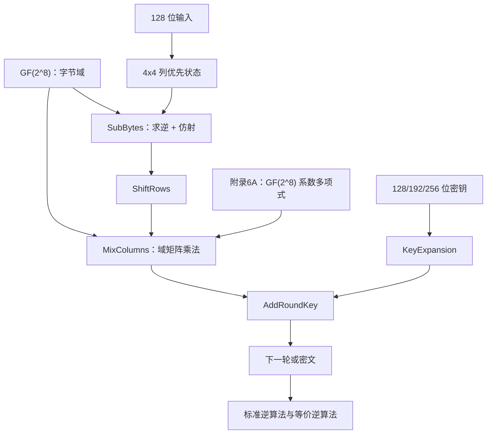

# 第六章 高级加密标准

## 本章定位

> [!IMPORTANT] 信息边界
> “教材知识”来自 [[第六章_高级加密标准_教材原文]]。S-AES 参数来自同一教材的 [[附录D_简化AES_教材原文]]，仅用于本章明确要求 S-AES 的题目。独立复算、记忆方法、侧信道建议和检索标签属于辅助内容。表6.4、表6.5保留教材原图。

AES 把128位分组表示为4×4字节状态，通过非线性代替、位置重排、线性列混合和轮密钥 XOR 反复处理。第5章有限域是本章代数基础，附录6A解释 MixColumns 的多项式来源。

### 一页知识图谱



### 参数速查

| 版本 | 分组 | 密钥 | `Nk` | `Nr` | 扩展密钥字数 |
|---|---:|---:|---:|---:|---:|
| AES-128 | 128位 | 128位 | 4 | 10 | 44 |
| AES-192 | 128位 | 192位 | 6 | 12 | 52 |
| AES-256 | 128位 | 256位 | 8 | 14 | 60 |

轮结构：

```text
第0轮：ARK
普通轮：SB -> SR -> MC -> ARK
最终轮：SB -> SR -> ARK
```

## 6.1 有限域算术

### 教材知识

AES 字节属于

$$
GF(2^8)=GF(2)[x]/(x^8+x^4+x^3+x+1).
$$

| 项目 | 规则 |
|---|---|
| 元素 | 次数小于8的二元多项式，等价于1字节 |
| 加法、减法 | XOR |
| 乘法 | 多项式乘后模 `m(x)` |
| 除法 | 乘以非零元素的逆元 |
| `{02}A` | 左移；原最高位为1时 XOR `1B` |
| `{03}A` | `{02}A XOR A` |

`Z_256` 不是域，因为2等非零元素没有乘法逆元；`GF(2^8)` 通过不可约多项式保证非零元素可逆。

### `xtime` 公式

$$
\operatorname{xtime}(a)=
\begin{cases}
(a\ll1)\mathbin{\&}\texttt{FF},&a_7=0,\\
((a\ll1)\mathbin{\&}\texttt{FF})\oplus\texttt{1B},&a_7=1.
\end{cases}
$$

例：

$$
\{02\}\{87\}=\{15\},
\qquad
\{03\}\{6E\}=\{B2\}.
$$

**重点**：加法无进位；乘法必须约简。

**难点**：区分 `0x11B` 定义多项式和约简时使用的低8位 `0x1B`。

**易错点**：普通整数乘法、模256乘法和 `GF(2^8)` 乘法混用。

**关键词**：`GF(2^8)`、不可约多项式、XOR、`xtime`、乘法逆元。

**Related**：[[第五章_有限域_复习笔记#5.6 有限域 $GF(2^n)$]]。

## 6.2 AES 的结构

### 6.2.1 状态与密钥

输入 `in_0,...,in_15` 按列装入：

$$
\begin{bmatrix}
in_0&in_4&in_8&in_{12}\\
in_1&in_5&in_9&in_{13}\\
in_2&in_6&in_{10}&in_{14}\\
in_3&in_7&in_{11}&in_{15}
\end{bmatrix}.
$$

![[attachments/fig_6_1_aes_encryption_process.png]]

![[attachments/fig_6_2_data_structure_of_aes.png]]

![[attachments/table_6_1_aes_parameters.png]]

### 6.2.2 四阶段职责

| 阶段 | 粒度 | 作用 | 逆变换 | 直接用密钥 |
|---|---|---|---|---:|
| SubBytes | 字节 | 非线性代替 | InvSubBytes | 否 |
| ShiftRows | 行 | 跨列重排 | InvShiftRows | 否 |
| MixColumns | 列 | 线性扩散 | InvMixColumns | 否 |
| AddRoundKey | 全状态 | 密钥注入 | 自身 | 是 |

![[attachments/fig_6_3_aes_encryption_decryption.png]]

![[attachments/fig_6_4_aes_round.png]]

### AES 与 Feistel

| 比较 | Feistel/DES | AES |
|---|---|---|
| 分组处理 | 左右两半 | 整个状态 |
| 轮函数可逆性 | 不要求 | 各阶段可逆 |
| 扩散 | 轮函数与交换 | ShiftRows + MixColumns |
| 解密结构 | 同结构反序子密钥 | 逆阶段、逆次序；可构造等价逆 |

**重点**：AES 分组始终128位；AES-256只表示密钥长度。

**难点**：列优先装载；最终轮不含 MixColumns。

**易错点**：按行装入明文；把第0轮当普通轮；漏掉起始 AddRoundKey。

**关键词**：状态数组、SPN、轮、轮密钥、AES-128、AES-192、AES-256。

**Related**：[[第四章_分组密码和数据加密标准_复习笔记]]。

## 6.3 AES 的变换函数

### 6.3.1 SubBytes

#### 查表

高半字节选行、低半字节选列：

$$
\{95\}\mapsto\{2A\}.
$$

![[attachments/fig_6_5_aes_byte_operations.png]]

![[attachments/table_6_2_aes_sboxes.png]]

#### 构造

1. 非零字节求 `GF(2^8)` 乘法逆元，0映射到0；
2. 对位向量施加仿射变换：

$$
B'=XB\oplus C.
$$

正向常量 `C` 对应 `{63}`，逆向常量 `D` 对应 `{05}`。逆仿射满足：

$$
YX=I_8,
\qquad
YC=D,
$$

所以

$$
Y(XB\oplus C)\oplus D=B.
$$

![[attachments/fig_6_6_sbox_structures.png]]

#### 设计结论

- 非线性来自乘法逆元；
- 仿射常量避免不动点和反不动点；
- S 盒是256元素置换，因此可逆；
- S 盒不是自逆。

**重点**：`{00}` 特例；矩阵加法为 XOR。

**难点**：位顺序与矩阵行列一致；正向、逆向先后顺序。

**易错点**：漏写 `⊕`；把二元矩阵乘法当普通整数乘法；把状态行列与 S 盒索引行列混淆。

**关键词**：S盒、逆S盒、仿射变换、乘法逆元、不动点、非线性。

**Related**：6.1有限域；6.4 `SubWord`。

### 6.3.2 ShiftRows

| 行号 | 正向 | 逆向 | 移动字节数 |
|---:|---|---|---:|
| 0 | 不移 | 不移 | 0 |
| 1 | 左1 | 右1 | 4 |
| 2 | 左2 | 右2 | 4 |
| 3 | 左3 | 右3 | 4 |

发生位置变化的是12字节。它不改变值，只把原同列字节分散到不同列。

![[attachments/fig_6_7_aes_row_column_operations.png]]

**易错点**：移动的是字节位置，不是字节内部比特；第三行左移2和右移2结果相同，但概念上仍须区分正逆方向。

**关键词**：行移位、逆行移位、循环移位、跨列扩散。

### 6.3.3 MixColumns

正向矩阵：

$$
M=
\begin{bmatrix}
02&03&01&01\\
01&02&03&01\\
01&01&02&03\\
03&01&01&02
\end{bmatrix}.
$$

逆矩阵：

$$
M^{-1}=
\begin{bmatrix}
0E&0B&0D&09\\
09&0E&0B&0D\\
0D&09&0E&0B\\
0B&0D&09&0E
\end{bmatrix}.
$$

核验条件：

$$
M^{-1}M=I_4.
$$

列公式：

$$
\begin{aligned}
s'_0&=02s_0\oplus03s_1\oplus s_2\oplus s_3,\\
s'_1&=s_0\oplus02s_1\oplus03s_2\oplus s_3,\\
s'_2&=s_0\oplus s_1\oplus02s_2\oplus03s_3,\\
s'_3&=03s_0\oplus s_1\oplus s_2\oplus02s_3.
\end{aligned}
$$

正向示例：

```text
87 F2 4D 97       47 40 A3 4C
6E 4C 90 EC  -->  37 D4 70 9F
46 E7 4A C3       94 E4 3A 42
A6 8C D8 95       ED A5 A6 BC
```

![[attachments/fig_6_7_aes_row_column_operations.png]]

多项式形式：

$$
a(x)=\{03\}x^3+\{01\}x^2+\{01\}x+\{02\},
$$

$$
b(x)=\{0B\}x^3+\{0D\}x^2+\{09\}x+\{0E\},
$$

$$
a(x)b(x)\equiv1\pmod{x^4+1}.
$$

**重点**：每列独立；矩阵所有运算在 `GF(2^8)` 中。

**难点**：域乘法与循环卷积；逆矩阵验证。

**易错点**：十六进制 `03` 当十进制3普通相乘；把4列混在一起；最终轮仍做 MixColumns。

**关键词**：列混淆、逆列混淆、线性扩散、MDS、循环多项式。

**Related**：本章附录6A；[[第五章_有限域_复习笔记#5.6 有限域 $GF(2^n)$]]。

### 6.3.4 AddRoundKey

$$
S'=S\oplus K_r.
$$

自逆：

$$
(S\oplus K_r)\oplus K_r=S.
$$

![[attachments/fig_6_8_single_aes_round_inputs.png]]

**重点**：唯一直接注入秘密密钥的阶段。

**易错点**：轮密钥也按列布局；不能因它只是 XOR 就低估其结构位置。

**关键词**：轮密钥加、Vernam、XOR、自逆。

## 6.4 AES 的密钥扩展

### 6.4.1 AES-128 算法

```text
w[0..3] = 输入密钥
temp = w[i-1]
if i mod 4 == 0:
    temp = SubWord(RotWord(temp)) XOR Rcon[i/4]
w[i] = w[i-4] XOR temp
```

| 函数 | 作用 |
|---|---|
| RotWord | `[B0,B1,B2,B3] -> [B1,B2,B3,B0]` |
| SubWord | 4个字节分别查 AES S 盒 |
| Rcon | 只在最高字节含 `RC[j]`，其余为0 |

| `j` | 1 | 2 | 3 | 4 | 5 | 6 | 7 | 8 | 9 | 10 |
|---:|---:|---:|---:|---:|---:|---:|---:|---:|---:|---:|
| `RC[j]` | 01 | 02 | 04 | 08 | 10 | 20 | 40 | 80 | 1B | 36 |

![[attachments/fig_6_9_aes_key_expansion.png]]

![[attachments/table_6_3_round_key_example.png]]

全零密钥前8字：

```text
w0=w1=w2=w3=00000000
w4=w5=w6=w7=62636363
```

### 6.4.2 设计目标

- Rcon 消除轮间对称；
- SubWord 提供非线性；
- 字间 XOR 传播差异；
- 任意连续 `Nk` 个字可重建扩展序列；
- 少于 `Nk` 个连续字时难以推出未知部分；
- 实现高效、描述简单。

**重点**：AES-128 每轮使用4个连续字。

**难点**：字节顺序；轮常量只作用于最高字节。

**易错点**：SubWord 与 SubBytes、RotWord 与 ShiftRows 混淆；把 Rcon XOR 到4个字节。

**关键词**：密钥扩展、字、RotWord、SubWord、Rcon、轮常量。

**Related**：6.3.1 S盒；6.1 `xtime`。

## 6.5 AES 示例与雪崩效应

### 6.5.1 教材向量

| 输入 | 值 |
|---|---|
| 明文 | `0123456789abcdeffedcba9876543210` |
| 密钥 | `0f1571c947d9e8590cb7add6af7f6798` |
| 密文 | `ff0b844a0853bf7c6934ab4364148fb9` |

![[attachments/table_6_4_key_expansion_part1.png]]

![[attachments/table_6_4_key_expansion_part2.png]]

![[attachments/table_6_5_aes_example.png]]

表6.4、6.5的检索路径：轮密钥字 → 轮开始状态 → SB → SR → MC → ARK。最终轮无 MC。

### 6.5.2 雪崩效应

![[attachments/table_6_6_avalanche_plaintext.png]]

![[attachments/table_6_7_avalanche_key_part1.png]]

教材结论：明文或密钥改变1位，第一轮即出现明显差异；后续轮差异约占状态位的一半。

**重点**：约一半是随机映射的统计期望。

**易错点**：把“几乎所有位变化”误当作最佳雪崩；若总是全部翻转，输出之间仍有可预测关系。

**关键词**：雪崩效应、汉明距离、明文差分、密钥差分。

**Related**：[[第四章_分组密码和数据加密标准_复习笔记#4.3.2 雪崩效应]]。

## 6.6 AES 的实现

### 6.6.1 标准逆与等价逆

可交换关系：

$$
\operatorname{InvShiftRows}(\operatorname{InvSubBytes}(S))
=\operatorname{InvSubBytes}(\operatorname{InvShiftRows}(S)),
$$

$$
\operatorname{InvMixColumns}(S\oplus W)
=\operatorname{InvMixColumns}(S)
\oplus\operatorname{InvMixColumns}(W).
$$

第二式依赖线性。等价逆算法需对第1到第 `Nr-1` 轮的中间轮密钥预先执行 InvMixColumns；第0和最终轮密钥不处理。

![[attachments/fig_6_10_equivalent_inverse_cipher.png]]

| 算法 | 阶段顺序 | 轮密钥 |
|---|---|---|
| 标准逆 | 按加密阶段逆序撤销 | 反序使用原扩展密钥 |
| 等价逆 | 顺序更接近加密轮 | 中间轮密钥先 InvMixColumns |

### 6.6.2 实现公式

式（6.9）：

$$
\begin{aligned}
T&=s_0\oplus s_1\oplus s_2\oplus s_3,\\
s'_0&=s_0\oplus T\oplus2(s_0\oplus s_1),\\
s'_1&=s_1\oplus T\oplus2(s_1\oplus s_2),\\
s'_2&=s_2\oplus T\oplus2(s_2\oplus s_3),\\
s'_3&=s_3\oplus T\oplus2(s_3\oplus s_0).
\end{aligned}
$$

32位实现可把 SB、SR、MC 合并为4个 T 表；每表256个32位字，总计约4KB。

**重点**：算法等价不等于侧信道等价。

**难点**：查表优化与秘密相关缓存访问；等价逆轮密钥处理。

**易错点**：以为固定循环次数就自动常数时间；忽略查表地址泄漏。

**关键词**：等价逆算法、线性、T表、8位实现、32位实现、计时攻击、AES-NI。

**Related**：[[第四章_分组密码和数据加密标准_复习笔记#4.4 DES的强度]]。

## 6.7 题目入口

14道思考题、13道习题和2道编程题的原题、依据、推理与答案见 [[第六章_高级加密标准_课后习题]]。

## 附录6A 系数在 $GF(2^8)$ 中的多项式

### 两层多项式不要混淆

| 对象 | 系数域 | 次数 | 模多项式 |
|---|---|---:|---|
| AES字节 | `GF(2)` | `<8` | `x^8+x^4+x^3+x+1` |
| AES一列 | `GF(2^8)` | `<4` | `x^4+1` |

### 循环卷积

若 `d(x)=a(x)b(x) mod(x^4+1)`：

$$
\begin{bmatrix}d_0\\d_1\\d_2\\d_3\end{bmatrix}
=
\begin{bmatrix}
a_0&a_3&a_2&a_1\\
a_1&a_0&a_3&a_2\\
a_2&a_1&a_0&a_3\\
a_3&a_2&a_1&a_0
\end{bmatrix}
\begin{bmatrix}b_0\\b_1\\b_2\\b_3\end{bmatrix}.
$$

依据：

$$
x^i\bmod(x^4+1)=x^{i\bmod4}.
$$

### 列混淆对应

代入

$$
(a_0,a_1,a_2,a_3)=(02,01,01,03)
$$

得到正向 MixColumns 矩阵。

### 乘 $x$

$$
x(b_3x^3+b_2x^2+b_1x+b_0)mod(x^4+1)
=b_2x^3+b_1x^2+b_0x+b_3.
$$

这是四个字节系数的循环，不是单字节 `xtime`。

**关键词**：`GF(2^8)` 系数多项式、`x^4+1`、循环卷积、列多项式。

**Related**：6.3.3 MixColumns；[[第五章_有限域_复习笔记#5.5 多项式运算]]。

## 公式索引

| 公式 | 用途 |
|---|---|
| `GF(2^8)=GF(2)[x]/m(x)` | AES字节域定义 |
| `B'=XB XOR C` | S盒仿射变换 |
| `M^{-1}M=I` | 逆列混淆验证 |
| `S'=S XOR K_r` | 轮密钥加 |
| `w[i]=w[i-Nk] XOR temp` | 密钥扩展 |
| `InvMC(S XOR W)=InvMC(S) XOR InvMC(W)` | 等价逆算法 |
| `x^i mod(x^4+1)=x^{i mod4}` | 附录6A循环约简 |

## 关键词索引

`AES` · `Rijndael` · `状态数组` · `GF(2^8)` · `S盒` · `逆S盒` · `SubBytes` · `ShiftRows` · `MixColumns` · `AddRoundKey` · `KeyExpansion` · `RotWord` · `SubWord` · `Rcon` · `雪崩效应` · `标准逆算法` · `等价逆算法` · `T表` · `AES-NI` · `S-AES`

## 易混淆对照

| 易混项 | 正确区分 |
|---|---|
| AES-256 / 256位分组 | AES-256是256位密钥，分组仍为128位 |
| S盒行列 / 状态行列 | 前者由半字节索引，后者组织16字节 |
| SubBytes / SubWord | 状态操作 / 密钥字操作 |
| ShiftRows / RotWord | 状态行循环 / 一个密钥字循环 |
| `0x11B` / `0x1B` | 完整模多项式 / 溢出约简低8位 |
| `xtime` / 列多项式乘 `x` | 单字节域乘法 / 四字节系数循环 |
| 标准逆 / 等价逆 | 逆序阶段 / 预处理轮密钥后统一结构 |
| 算法正确 / 侧信道安全 | 输出正确不代表时间、缓存行为安全 |

## 闭卷复盘清单

1. 写出三种 AES 参数和轮结构。
2. 把 `00...0F` 按列装成状态。
3. 手算一个 `{02}`、`{03}` 乘法。
4. 说明 S 盒的两步构造和 `{00}` 特例。
5. 写出 ShiftRows 的四行位移。
6. 默写正向 MixColumns 第一行并算一列。
7. 写出 AES-128 密钥扩展核心伪代码和前十个 RC。
8. 解释最终轮为何没有 MixColumns。
9. 证明等价逆算法的两个交换关系。
10. 区分两层多项式并解释 `x^4+1` 的作用。
11. 用附录D测试向量完成 S-AES 加解密。
12. 完成 [[第六章_高级加密标准_课后习题]]。
