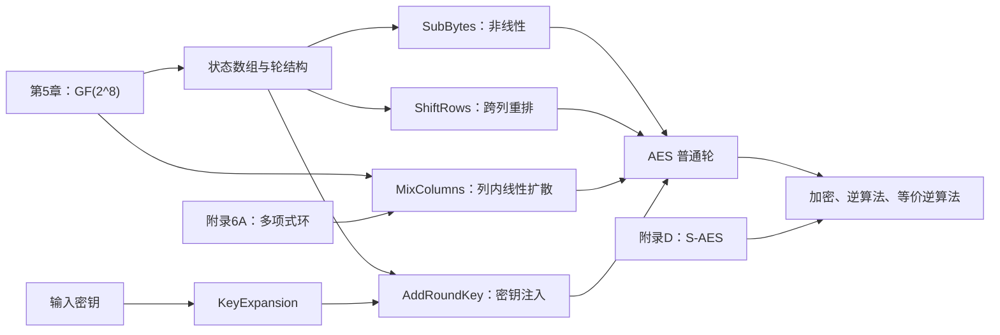

# 第六章 高级加密标准

## 本章导学

### 本章学习目标

学完本章后，应当能够：

1. 说明 AES 为什么在 `GF(2^8)` 上对字节运算；
2. 把16字节输入按列装入4×4状态数组，并在状态、线性字节序列和轮密钥之间正确转换；
3. 解释 AES-128、AES-192、AES-256 的分组长度、密钥长度、轮数和扩展密钥规模；
4. 按顺序讲清 SubBytes、ShiftRows、MixColumns、AddRoundKey 及其逆变换；
5. 从乘法逆元和仿射变换解释 S 盒的非线性、可逆性和设计约束；
6. 手算一列 MixColumns，并用逆矩阵恢复原列；
7. 执行 AES-128 密钥扩展中的 RotWord、SubWord、Rcon 和字间 XOR；
8. 区分普通逆算法和等价逆算法，并证明需要变换中间轮密钥；
9. 理解8位、32位实现及计时侧信道之间的权衡；
10. 用附录6A的多项式环解释列混淆矩阵；用附录D的 S-AES 手算和验证完整流程。

### 本章核心问题

- AES 为什么不采用 DES 的 Feistel 结构，而要处理整个状态矩阵？
- 四个轮变换分别解决什么问题，又如何共同产生混淆与扩散？
- 为什么最后一轮可以省略 MixColumns，却仍能保持可逆？
- S 盒为何不是随意查表，而是“域求逆 + 仿射变换”？
- MixColumns 的十六进制系数到底如何相乘？
- 密钥扩展为何不能只是重复原密钥？
- 解密怎样在数学上逐步撤销加密，等价逆算法为何要预处理轮密钥？

### 为什么需要学习 AES

AES 是应用最广泛的对称分组密码，也是 GCM、CMAC、TLS、磁盘加密和大量系统接口的基础。真正理解 AES，需要同时把握三层：

1. **表示层**：16字节如何放进状态矩阵；
2. **代数层**：XOR、`GF(2^8)` 乘法、矩阵和多项式如何运算；
3. **结构层**：非线性、扩散和密钥注入如何按轮组合。

只记“代替、移位、混淆、加密钥”无法处理矩阵题和实现题；只会有限域计算又无法解释轮结构。本章的目标是把三层连成一条可推导、可实现、可逆向检查的链。

### 学习路线



> [!IMPORTANT] 信息边界
> 本讲义以 [[第六章_高级加密标准_教材原文]] 为事实主线。附录D用于本章 S-AES 题目，是同一本教材的直接依赖；所有跨附录内容均明确标注。教学类比、独立复算和实现建议属于辅助内容。教材表6.4、表6.5保留为原图，不转写为 Markdown 表格。

## 6.1 有限域算术

### 本节学习目标与核心问题

目标是把“字节”理解为一个可进行域运算的元素，而不只是0到255的整数。核心问题是：为什么 `Z_256` 不够用，AES 的 XOR 和乘法又为什么能保证封闭与可逆？

### 从普通字节到 $GF(2^8)$

普通整数模256不是域。例如不存在 `b` 使

$$
2b\equiv1\pmod{256},
$$

所以2没有乘法逆元。AES 改用 `GF(2^8)`：把字节

$$
(a_7a_6\cdots a_1a_0)
$$

解释为二元多项式

$$
a_7x^7+a_6x^6+\cdots+a_1x+a_0,
$$

并模不可约多项式

$$
m(x)=x^8+x^4+x^3+x+1.
$$

次数小于8的二元多项式恰有 `2^8=256` 个，因此全部位模式都被使用。

### 加法、乘法和乘 $x$

| 运算 | 多项式含义 | 位操作含义 |
|---|---|---|
| 加法、减法 | 系数逐项模2 | XOR |
| 乘法 | 多项式乘后模 `m(x)` | 移位、条件XOR和累加 |
| 乘 `{02}` | 乘 `x` 后约简 | `xtime` |

若最高位 `a_7=0`，乘 `{02}` 只需左移；若 `a_7=1`，左移并截成8位后再 XOR `00011011` (`0x1B`)：

$$
\{02\}\cdot A=
\begin{cases}
(a_6a_5\cdots a_0 0),&a_7=0,\\
(a_6a_5\cdots a_0 0)\oplus\{1B\},&a_7=1.
\end{cases}
$$

因为 `{03}={02}⊕{01}`，所以

$$
\{03\}\cdot A=(\{02\}\cdot A)\oplus A.
$$

### 示例与自检

教材列混淆示例中：

$$
\{02\}\cdot\{87\}=\{15\},
$$

原因是 `0x87` 最高位为1：`0x87<<1` 截成 `0x0E`，再 XOR `0x1B` 得 `0x15`。

> [!CAUTION] 常见误区
> `0x1B` 是完整模多项式 `0x11B` 去掉溢出的 `x^8` 位后留下的低8位。域乘法不是普通整数乘法，也不是简单的模256乘法。

**记忆**：加法看同位，乘法看多项式，溢出看 `1B`。

**章节联系**：第5章解释域的构造；本章 S 盒用乘法逆元，列混淆用域乘法，密钥扩展的 Rcon 也连续乘 `{02}`。

## 6.2 AES 的结构

### 6.2.1 基本结构

#### 参数

AES 的分组长度始终是128位。密钥长度决定轮数：

| 版本 | `Nk`（32位字） | 密钥长度 | `Nr` | 扩展密钥字数 |
|---|---:|---:|---:|---:|
| AES-128 | 4 | 128位 | 10 | 44 |
| AES-192 | 6 | 192位 | 12 | 52 |
| AES-256 | 8 | 256位 | 14 | 60 |

![[attachments/fig_6_1_aes_encryption_process.png]]

![[attachments/table_6_1_aes_parameters.png]]

#### 状态数组

输入字节 `in_0,...,in_15` 按列装入：

$$
S=
\begin{bmatrix}
in_0&in_4&in_8&in_{12}\\
in_1&in_5&in_9&in_{13}\\
in_2&in_6&in_{10}&in_{14}\\
in_3&in_7&in_{11}&in_{15}
\end{bmatrix}.
$$

![[attachments/fig_6_2_data_structure_of_aes.png]]

状态数组不是额外数据，而是128位分组在轮函数中的工作表示。SubBytes 按单字节处理，ShiftRows 按行处理，MixColumns 按列处理，AddRoundKey 与同布局的轮密钥 XOR。

生活类比：可以把状态看作一个4×4工位表。SubBytes 更换每个工位上的物品，ShiftRows 移动工位位置，MixColumns 让同列工位交换影响，AddRoundKey 再给每个工位加入一份密钥材料。

#### 加密轮次

```text
第0轮：AddRoundKey
第1轮到第Nr-1轮：SubBytes -> ShiftRows -> MixColumns -> AddRoundKey
第Nr轮：SubBytes -> ShiftRows -> AddRoundKey
```

最后一轮省略 MixColumns。它不是为了保证可逆才省略，因为 MixColumns 本身可逆；这是 AES 结构和加解密对称实现中的设计选择。无论有无最后一次 MixColumns，首尾的密钥注入都不能省略。

### 6.2.2 详细结构与设计思想

![[attachments/fig_6_3_aes_encryption_decryption.png]]

AES 是代替-置换网络，不是 Feistel 网络：

| DES/Feistel | AES/SPN |
|---|---|
| 每轮用一半修改另一半 | 每轮处理整个状态 |
| 轮函数本身不必可逆 | 每个阶段均可逆 |
| 依靠左右交换推进 | 依靠字节替换和线性扩散推进 |
| 加解密可复用同一 Feistel 结构 | 标准解密按逆变换和逆顺序执行 |

四个阶段的分工：

| 阶段 | 主要作用 | 是否直接使用密钥 |
|---|---|---:|
| SubBytes | 非线性、混淆 | 否 |
| ShiftRows | 把一列的字节分散到不同列 | 否 |
| MixColumns | 在每列内扩散 | 否 |
| AddRoundKey | 将密钥材料注入状态 | 是 |

![[attachments/fig_6_4_aes_round.png]]

单独看 AddRoundKey 只是 Vernam 式 XOR；单独看另外三个阶段又没有秘密。安全性来自“密钥注入”和“非线性、扩散”交替多轮组合。

### 学习建议与误区

- 任何状态题先画4×4矩阵并标出列优先顺序；
- 每一步都保留中间状态，不要直接跳到轮末；
- 不要把最后一轮写成完整普通轮；
- “AES-256”指256位密钥，不是256位分组。

## 6.3 AES 的变换函数

### 6.3.1 字节代替变换

#### 学习目标与核心问题

目标是能从字节查 S 盒、解释 S 盒构造，并证明逆 S 盒确实撤销正向 S 盒。核心问题是：非线性从哪里来，仿射矩阵中的运算又属于哪个域？

#### 查表规则

S 盒是16×16的字节置换。输入字节高4位选行、低4位选列。例如 `{95}` 选第9行第5列，输出 `{2A}`。

![[attachments/fig_6_5_aes_byte_operations.png]]

![[attachments/table_6_2_aes_sboxes.png]]

#### 构造步骤

1. 将输入字节视为 `GF(2^8)` 元素；
2. 非零字节求乘法逆元，`{00}` 约定映射到自身；
3. 对逆元的8位施加二元仿射变换并 XOR 常量 `{63}`。

位公式：

$$
b_i'=b_i\oplus b_{(i+4)\bmod8}\oplus b_{(i+5)\bmod8}
\oplus b_{(i+6)\bmod8}\oplus b_{(i+7)\bmod8}\oplus c_i.
\tag{6.1}
$$

按 `(b_0,...,b_7)^T` 排列时，正向矩阵为

$$
X=
\begin{bmatrix}
1&0&0&0&1&1&1&1\\
1&1&0&0&0&1&1&1\\
1&1&1&0&0&0&1&1\\
1&1&1&1&0&0&0&1\\
1&1&1&1&1&0&0&0\\
0&1&1&1&1&1&0&0\\
0&0&1&1&1&1&1&0\\
0&0&0&1&1&1&1&1
\end{bmatrix},
\qquad
C=\begin{bmatrix}1\\1\\0\\0\\0\\1\\1\\0\end{bmatrix}.
$$

所以

$$
B'=XB\oplus C.
$$

逆仿射矩阵和常量为

$$
Y=
\begin{bmatrix}
0&0&1&0&0&1&0&1\\
1&0&0&1&0&0&1&0\\
0&1&0&0&1&0&0&1\\
1&0&1&0&0&1&0&0\\
0&1&0&1&0&0&1&0\\
0&0&1&0&1&0&0&1\\
1&0&0&1&0&1&0&0\\
0&1&0&0&1&0&1&0
\end{bmatrix},
\qquad
D=\begin{bmatrix}1\\0\\1\\0\\0\\0\\0\\0\end{bmatrix}.
$$

所有矩阵乘法与加法都在 `GF(2)` 中进行，因此求和写作 XOR。验证

$$
YX=I_8,
\qquad
YC=D
$$

后，便有

$$
Y(XB\oplus C)\oplus D
=YXB\oplus YC\oplus D
=B.
$$

![[attachments/fig_6_6_sbox_structures.png]]

#### 设计原理

- `GF(2^8)` 乘法逆元提供非线性；
- 仿射变换进一步降低输入输出位的简单相关；
- 常量 `{63}` 避免不动点 `S(a)=a` 和反不动点 `S(a)=\bar a`；
- S 盒可逆，但不是自逆：`InvS(S(a))=a`，不代表 `S(a)=InvS(a)`。

**易错点**：位向量顺序必须与矩阵一致；矩阵元素是比特；`⊕` 不可漏写；求逆和仿射变换的先后顺序不可颠倒。

### 6.3.2 行移位变换

| 状态行 | 正向 | 逆向 |
|---:|---|---|
| 第0行 | 不移 | 不移 |
| 第1行 | 循环左移1字节 | 循环右移1字节 |
| 第2行 | 循环左移2字节 | 循环右移2字节 |
| 第3行 | 循环左移3字节 | 循环右移3字节 |

![[attachments/fig_6_7_aes_row_column_operations.png]]

行移位不改字节内容，只改位置。发生位置变化的是后三行共12字节。由于状态按列装入，它把原来同列的4字节送往4个不同列，使下一次 MixColumns 能把影响扩散到更多位置。

类比：先把四个小组的成员横向换组，再让每个新小组内部交流。ShiftRows 完成换组，MixColumns 完成组内混合。

### 6.3.3 列混淆变换

#### 正向矩阵

每列独立与固定矩阵相乘：

$$
M=
\begin{bmatrix}
02&03&01&01\\
01&02&03&01\\
01&01&02&03\\
03&01&01&02
\end{bmatrix}.
\tag{6.3}
$$

对一列 `(s_0,s_1,s_2,s_3)^T`：

$$
\begin{aligned}
s'_0&=02s_0\oplus03s_1\oplus s_2\oplus s_3,\\
s'_1&=s_0\oplus02s_1\oplus03s_2\oplus s_3,\\
s'_2&=s_0\oplus s_1\oplus02s_2\oplus03s_3,\\
s'_3&=03s_0\oplus s_1\oplus s_2\oplus02s_3.
\end{aligned}
\tag{6.4}
$$

其中系数、乘法和加法全部属于 `GF(2^8)`。

教材示例第一列 `{87,6E,46,A6}` 变为 `{47,37,94,ED}`。第一项：

$$
\{02\}\{87\}\oplus\{03\}\{6E\}\oplus\{46\}\oplus\{A6\}
=\{15\}\oplus\{B2\}\oplus\{46\}\oplus\{A6\}
=\{47\}.
$$

#### 逆矩阵

$$
M^{-1}=
\begin{bmatrix}
0E&0B&0D&09\\
09&0E&0B&0D\\
0D&09&0E&0B\\
0B&0D&09&0E
\end{bmatrix},
$$

并满足

$$
M^{-1}M=I_4.
\tag{6.6}
$$

正向系数 `{01},{02},{03}` 便于实现；逆向系数更复杂。行移位与列混淆结合后，若干轮内每个输出位会受大量输入位影响。

#### 多项式解释

把一列看成系数在 `GF(2^8)` 中的三次多项式，乘固定多项式

$$
a(x)=\{03\}x^3+\{01\}x^2+\{01\}x+\{02\}
$$

并模 `x^4+1`，就得到同一变换。逆多项式是

$$
b(x)=\{0B\}x^3+\{0D\}x^2+\{09\}x+\{0E\},
$$

满足

$$
a(x)b(x)\equiv1\pmod{x^4+1}.
$$

### 6.3.4 轮密钥加变换

状态与对应的128位轮密钥逐位 XOR：

$$
S'=S\oplus K_r.
$$

因为 `(S⊕K_r)⊕K_r=S`，它自逆。

![[attachments/fig_6_8_single_aes_round_inputs.png]]

**误区**：AddRoundKey 虽然简单，却是唯一直接使用秘密密钥的轮阶段。没有它，其余公开变换都可由任何人计算和撤销。

## 6.4 AES 的密钥扩展

### 6.4.1 密钥扩展算法

#### 学习目标与价值

应能从 AES-128 的16字节密钥生成44个32位字，并解释为什么每轮使用4个连续字。密钥扩展的任务不是“增大密钥熵”，而是从同一秘密确定性地产生结构良好、轮间不同的密钥材料。

AES-128 伪代码：

```text
w[0..3] = 初始密钥的4个字
for i = 4..43:
    temp = w[i-1]
    if i mod 4 == 0:
        temp = SubWord(RotWord(temp)) XOR Rcon[i/4]
    w[i] = w[i-4] XOR temp
```

- `RotWord([B0,B1,B2,B3])=[B1,B2,B3,B0]`；
- `SubWord` 对4个字节分别查 S 盒；
- `Rcon[j]=(RC[j],00,00,00)`；
- `RC[1]=01`，后续在 `GF(2^8)` 中连续乘 `{02}`。

| `j` | 1 | 2 | 3 | 4 | 5 | 6 | 7 | 8 | 9 | 10 |
|---:|---:|---:|---:|---:|---:|---:|---:|---:|---:|---:|
| `RC[j]` | 01 | 02 | 04 | 08 | 10 | 20 | 40 | 80 | 1B | 36 |

![[attachments/fig_6_9_aes_key_expansion.png]]

![[attachments/table_6_3_round_key_example.png]]

教材第9轮首字示例：

```text
temp            = 7F8D292F
RotWord         = 8D292F7F
SubWord         = 5DA515D2
XOR Rcon[9]     = 46A515D2
XOR w[i-4]      = AC7766F3
```

#### 全零密钥示例

若 `w0=w1=w2=w3=00000000`：

```text
RotWord(w3) = 00000000
SubWord     = 63636363
XOR Rcon[1] = 62636363
w4=w5=w6=w7 = 62636363
```

### 6.4.2 设计原理

教材列出的目标包括：

- 轮常量消除对称性；
- 知道少于 `Nk` 个连续字时难以推断其余字；
- 任意连续 `Nk` 个字可逆向重建全部扩展密钥；
- 密钥差异能扩散到许多轮密钥位；
- SubWord 提供非线性；
- 能在不同处理器上高效实现，且易于描述。

**易混点**：SubBytes 作用于16字节状态；SubWord 作用于一个4字节密钥字。ShiftRows 作用于状态行；RotWord 只循环一个密钥字。

## 6.5 一个 AES 的例子

### 示例参数

| 项目 | 十六进制值 |
|---|---|
| 明文 | `0123456789abcdeffedcba9876543210` |
| 密钥 | `0f1571c947d9e8590cb7add6af7f6798` |
| 密文 | `ff0b844a0853bf7c6934ab4364148fb9` |

### 6.5.1 逐轮结果如何阅读

表6.4给出密钥扩展，表6.5给出状态在每轮各阶段的变化。两表信息密度很高，应按以下顺序阅读：

1. 从表6.4确认本轮4个轮密钥字；
2. 从表6.5读取轮开始状态；
3. 依次核对 SubBytes、ShiftRows、MixColumns；
4. 与轮密钥 XOR，得到下一轮开始状态；
5. 第10轮跳过 MixColumns。

*表6.4 AES例子的密钥扩展*

![[attachments/table_6_4_key_expansion_part1.png]]

![[attachments/table_6_4_key_expansion_part2.png]]

*表6.5 AES例子*

![[attachments/table_6_5_aes_example.png]]

> [!NOTE]
> 表6.4和表6.5按教材要求保留原图，不转换成 Markdown 表格，以免破坏逐轮矩阵布局和字节对应关系。

### 6.5.2 雪崩效应

若明文或密钥只改变1位，安全分组密码应让密文发生大范围、不可预测的变化。教材示例显示：

- 明文改变1位，第一轮末已有20位不同；
- 两轮后差异接近128位的一半；
- 密钥改变1位也产生类似扩散；
- “约一半”是统计期望，不要求每次恰好64位。

![[attachments/table_6_6_avalanche_plaintext.png]]

![[attachments/table_6_7_avalanche_key_part1.png]]

雪崩效应来自 SubBytes 的非线性与 ShiftRows、MixColumns 的扩散反复组合。它是良好扩散的证据，但单个雪崩样本本身不能证明算法安全。

## 6.6 AES 的实现

### 6.6.1 等价的逆算法

#### 标准逆算法

标准解密反向使用轮密钥，并按逆序撤销加密阶段。普通逆轮为：

```text
InvShiftRows -> InvSubBytes -> AddRoundKey -> InvMixColumns
```

这与加密普通轮的阶段次序不同。

#### 第一次交换：逆行移位与逆字节代替

InvShiftRows 只改变位置，InvSubBytes 只根据字节值替换内容，因此二者可交换：

$$
\operatorname{InvShiftRows}(\operatorname{InvSubBytes}(S))
=\operatorname{InvSubBytes}(\operatorname{InvShiftRows}(S)).
$$

#### 第二次交换：轮密钥加与逆列混淆

InvMixColumns 是 `GF(2^8)` 上的线性变换：

$$
\operatorname{InvMixColumns}(S\oplus W)
=\operatorname{InvMixColumns}(S)
\oplus\operatorname{InvMixColumns}(W).
$$

对第一列，正确矩阵等式是

$$
\begin{aligned}
&\begin{bmatrix}
0E&0B&0D&09\\
09&0E&0B&0D\\
0D&09&0E&0B\\
0B&0D&09&0E
\end{bmatrix}
\begin{bmatrix}
y_0\oplus k_0\\y_1\oplus k_1\\y_2\oplus k_2\\y_3\oplus k_3
\end{bmatrix}\\
&=M_{\mathrm{inv}}
\begin{bmatrix}y_0\\y_1\\y_2\\y_3\end{bmatrix}
\oplus
M_{\mathrm{inv}}
\begin{bmatrix}k_0\\k_1\\k_2\\k_3\end{bmatrix}.
\end{aligned}
$$

因此，应先对第1到第 `Nr-1` 轮的中间轮密钥应用 InvMixColumns，再与状态 XOR。第0轮和最终轮密钥不预处理，因为它们没有与 InvMixColumns 相邻交换。

![[attachments/fig_6_10_equivalent_inverse_cipher.png]]

**关键区别**：普通逆算法改变阶段顺序；等价逆算法还改变中间轮密钥，从而让轮结构更接近加密结构。两者输出相同明文。

### 6.6.2 实现方面

#### 8位处理器

- AddRoundKey：字节 XOR；
- ShiftRows：字节移动；
- SubBytes：256字节 S 盒；
- MixColumns：主要使用 `{02}` 和 `{03}` 乘法。

式（6.9）把一列 `(s_0,s_1,s_2,s_3)` 改写为：

$$
\begin{aligned}
T&=s_0\oplus s_1\oplus s_2\oplus s_3,\\
s'_0&=s_0\oplus T\oplus2(s_0\oplus s_1),\\
s'_1&=s_1\oplus T\oplus2(s_1\oplus s_2),\\
s'_2&=s_2\oplus T\oplus2(s_2\oplus s_3),\\
s'_3&=s_3\oplus T\oplus2(s_3\oplus s_0).
\end{aligned}
\tag{6.9}
$$

这减少重复乘法。若使用秘密相关分支或查表索引，可能泄露计时或缓存信息。一个无分支 `xtime` 思路是用最高位生成全零或全一掩码，再选择性 XOR `0x1B`；现实系统优先使用经过验证的常数时间实现或 AES 硬件指令。

#### 32位处理器

教材把 SubBytes、ShiftRows、MixColumns 合并到4个预计算 T 表中，每个表输入1字节、输出1个32位列向量。普通轮每列可由4次查表、XOR 和轮密钥字组成。优点是速度快，代价是约4KB表空间；现代缓存侧信道环境下，查表地址依赖秘密数据的问题必须额外处理。

### 实现学习建议

1. 教学实现先输出每个阶段状态；
2. 用教材已知向量逐阶段对比，而不只比最终密文；
3. 实际产品不要使用未经审计的自写密码实现；
4. 算法正确性和侧信道安全性是两个不同层面的要求。

## 6.7 章末入口

### 关键术语

高级加密标准、域、有限域、S盒、状态数组、字节代替、行移位、列混淆、轮密钥加、密钥扩展、轮常量、雪崩效应、等价逆算法。

### 学习闭环

1. 画出状态列优先布局；
2. 手算 `{02}`、`{03}` 域乘法；
3. 查 S 盒并完成一列 MixColumns；
4. 展开前8个密钥字；
5. 用附录D手算 S-AES 加解密；
6. 完成 [[第六章_高级加密标准_课后习题]]；
7. 用 [[第六章_高级加密标准_复习笔记]] 做闭卷复盘。

## 附录6A 系数在 $GF(2^8)$ 中的多项式

### 为什么还要引入另一层多项式

第6.1节把**一个字节**解释为 `GF(2)` 上次数小于8的多项式；附录6A又把**一列四字节**解释为系数属于 `GF(2^8)`、次数不超过3的多项式。这是两层不同对象：

| 层次 | 元素 | 模多项式 |
|---|---|---|
| 字节内部 | `GF(2)` 系数多项式 | `x^8+x^4+x^3+x+1` |
| 四字节列 | `GF(2^8)` 系数多项式 | `x^4+1` |

### 环乘法

若

$$
a(x)=a_3x^3+a_2x^2+a_1x+a_0,
$$

$$
b(x)=b_3x^3+b_2x^2+b_1x+b_0,
$$

先得到六次乘积 `c(x)`，再模 `x^4+1`。因为特征为2，`x^4≡1`，所以

$$
x^i\bmod(x^4+1)=x^{i\bmod4}.
$$

最终系数满足循环卷积：

$$
\begin{aligned}
d_0&=a_0b_0\oplus a_3b_1\oplus a_2b_2\oplus a_1b_3,\\
d_1&=a_1b_0\oplus a_0b_1\oplus a_3b_2\oplus a_2b_3,\\
d_2&=a_2b_0\oplus a_1b_1\oplus a_0b_2\oplus a_3b_3,\\
d_3&=a_3b_0\oplus a_2b_1\oplus a_1b_2\oplus a_0b_3.
\end{aligned}
$$

### 附录6A.1 列混淆变换

把 `a_0={02},a_1={01},a_2={01},a_3={03}` 代入循环卷积矩阵，正好得到式（6.3）的 MixColumns 矩阵。这证明矩阵写法和多项式写法是同一变换。

### 附录6A.2 乘以 $x$

对列多项式

$$
b_3x^3+b_2x^2+b_1x+b_0,
$$

乘 `x` 并模 `x^4+1` 得

$$
b_2x^3+b_1x^2+b_0x+b_3,
$$

也就是四字节系数循环左移一次。注意这与字节内部的 `xtime` 不同：前者旋转四个 `GF(2^8)` 系数，后者在一个字节内部乘 `{02}`。

### 常见混淆对比

| 易混对象 | 区分 |
|---|---|
| SubBytes / SubWord | 状态16字节替换 / 密钥字4字节替换 |
| ShiftRows / RotWord | 状态后三行移位 / 一个密钥字循环 |
| `xtime` / 列多项式乘 `x` | 字节域乘 `{02}` / 四字节系数循环 |
| 标准逆算法 / 等价逆算法 | 逆序撤销 / 预处理轮密钥以统一结构 |
| AES / Rijndael | AES 固定128位分组 / Rijndael 原算法族参数更广 |

### 推荐扩展阅读

- [[第五章_有限域_导学讲义]]：有限域、多项式求逆和生成元；
- [[附录D_简化AES_导学讲义]]：可手算的 S-AES；
- [[第七章_分组密码的工作模式_导学讲义]]：如何把 AES 分组原语组织成工作模式；
- [[第十二章_消息认证码_导学讲义]]：CMAC 与 GCM 中的 AES 应用。
