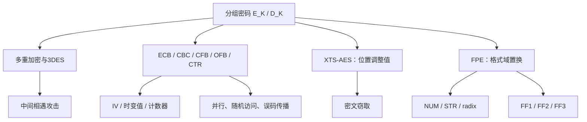

# 第七章 分组密码的工作模式

## 本章定位

> [!IMPORTANT] 信息边界
> “教材知识”来自[[第七章_分组密码的工作模式_教材原文]]。独立推导、检索表、记忆提示和安全实践说明属于辅助内容。图7.18附件右缘不完整，CTS 公式已依据原始 PDF 第172页只读核验，未修改教材原文或附件。

本章把固定长度的分组密码原语扩展到长消息、数据流、扇区和格式受限字段。主线是：复合原语的攻击面 -> 长消息反馈模式 -> 位置可调整加密 -> 有限格式域置换。

### 一页知识图谱

### 高频结论

- 双重 [[Course Notes/密码学 (Cipher)/Practical Constructions of Symmetric-Key Primitive/Practical Constructions of Symmetric-Key Primitives (I)|DES]] 被中间相遇攻击降到约 $2^{56}$ 次正向和 $2^{56}$ 次反向计算，而不是 $2^{112}$ 次完整穷举。
- EDE 的中间解密主要用于兼容单 DES。
- ECB 泄露重复；CBC 加密串行、解密可并行；CFB 反馈密文段；[[Course Notes/密码学 (Cipher)/Private-Key Encryption (VI)/Private-Key Encryption (VI)|OFB]] 反馈密码输出；CTR 加密计数器。
- OFB 的时变值和 CTR 的计数器值在同一密钥下都不能重用。
- XTS 的调整值公开，$i$ 区分扇区，$j$ 区分扇区内分组。
- FPE 必须在格式域内构造可逆置换；“[[Course Notes/密码学 (Cipher)/Practical Constructions of Symmetric-Key Primitive/Practical Constructions of Symmetric-Key Primitives (I)|AES]] 后逐位模 radix”不可逆。
- 工作模式通常只提供保密性，不自动提供完整性或认证。

## 7.1 多重加密和三重 DES

### 7.1.1 双重 DES

定义：

$$
C=E(K_2,E(K_1,P)),\qquad
P=D(K_1,D(K_2,C)).
$$

双重 DES 一般不等价于某个单 DES。DES 的 $2^{56}$ 个密钥只覆盖64位分组所有 $(2^{64})!$ 个置换中的极小部分，两个 DES 置换的复合通常不在单 DES 集合内。

![[attachments/fig_7_1_pdf144.png]]

#### 中间相遇攻击

相遇等式：

$$
E(K_1,P)=D(K_2,C).
$$

| 阶段 | 操作 | 资源 |
|---|---|---|
| 正向表 | 对全部 $K_1$ 计算 $E(K_1,P)$ | 约 $2^{56}$ 次、$2^{56}$ 项存储 |
| 反向查表 | 对全部 $K_2$ 计算 $D(K_2,C)$ | 约 $2^{56}$ 次 |
| 验证 | 用另一组明密文对测试候选 | 去除约 $2^{48}$ 个首对假匹配 |

**重点**：攻击利用复合结构，不依赖 DES 内部细节。

**难点**：区分名义密钥空间 $2^{112}$、计算量、存储量和已知数据量。

**易错点**：中间相遇攻击不是通信中的中间人攻击。

**关键词**：双重DES、中间值、时间-空间折中、已知明文攻击。

**Related**：[[第四章_分组密码和数据加密标准_复习笔记#4.2 数据加密标准]]。

### 7.1.2 双密钥 3DES

$$
C=E(K_1,D(K_2,E(K_1,P))).
$$

兼容性：令 $K_1=K_2=K$，有

$$
E(K,D(K,E(K,P)))=E(K,P).
$$

三次变换只使用两个独立密钥。中间 $D$ 没有额外密码学深意，主要用于向后兼容。

![[attachments/fig_7_2_pdf146.png]]

### 7.1.3 三密钥 3DES

$$
C=E(K_3,D(K_2,E(K_1,P))).
$$

| 版本 | 密钥安排 | 名义密钥长度 | 教材给出的分析边界 |
|---|---|---:|---:|
| 2TDEA | $K_1,K_2,K_1$ | 112位 | 没有实用攻击，但需考虑数据/存储折中 |
| 3TDEA | $K_1,K_2,K_3$ | 168位 | 攻击可把强度限制在112位量级 |

**重点**：变换次数与独立密钥数分开计数。

**易错点**：把168位名义长度直接当成168位实际安全强度。

**关键词**：3DES、TDEA、EDE、双密钥、三密钥、兼容性。

**Related**：7.1.1中间相遇攻击；[[第十四章_轻量级密码和后量子密码_复习笔记]]。

## 7.2 电码本模式

$$
C_j=E(K,P_j),\qquad P_j=D(K,C_j).
$$

![[attachments/fig_7_3_pdf148.png]]

| 性质 | ECB |
|---|---|
| 分组依赖 | 无 |
| 重复明文 | 产生重复密文，泄露结构 |
| 并行 | 加解密都可并行 |
| 随机访问 | 支持 |
| 传输误码 | 只使对应明文块紊乱 |
| 典型用途 | 一个分组以内的独立数据 |

教材提出评价模式的五个维度：开销、错误恢复、错误传播、扩散、安全。

**重点**：ECB 的主要缺陷不是“密钥重复”，而是确定性逐块映射泄露重复。

**难点**：区分块内扩散与块间扩散；底层密码有雪崩效应，仍不消除块间模式泄露。

**易错点**：把可并行、可随机访问误认为适合长结构化消息。

**关键词**：ECB、电码本、确定性、重复模式、填充。

**Related**：[[第六章_高级加密标准_复习笔记#6.2 AES 的结构]]。

## 7.3 密文分组链接模式

### 递推式

$$
\begin{aligned}
C_1&=E(K,P_1\oplus IV),\\
C_j&=E(K,P_j\oplus C_{j-1}),\quad j\ge2,
\end{aligned}
$$

$$
\begin{aligned}
P_1&=D(K,C_1)\oplus IV,\\
P_j&=D(K,C_j)\oplus C_{j-1}.
\end{aligned}
$$

![[attachments/fig_7_4_pdf149.png]]

### IV 与安全边界

- 长度等于分组长度；
- 在明文确定时应不可预测；
- 应防止未经授权的修改；
- IV 可公开传输，不等于可任意篡改。

若 $IV[i]$ 翻转，则 $P_1[i]$ 翻转。

### 并行与错误传播

| 场景 | 结果 |
|---|---|
| 加密 | $C_j$ 依赖 $C_{j-1}$，不能并行 |
| 解密 | 可并行算 $D(K,C_j)$，再 XOR 已知前块 |
| 传输中 $C_j$ 一位错误 | $P_j$ 整块紊乱；$P_{j+1}$ 对应位翻转；随后恢复 |
| 加密前 $P_j$ 一位错误 | $C_j$ 及后续密文均改变；解密后只保留发送端输入的该错误 |

**重点**：CBC 隐藏重复明文块，但模式本身不认证密文。

**难点**：同一错误位置在“信道密文”和“加密前明文”两种场景下传播不同。

**易错点**：说 CBC 解密完全串行；底层解密可并行，最终 XOR 只需已知密文。

**关键词**：CBC、链接、IV、不可预测、位翻转、错误传播。

**Related**：第12章 CBC-MAC；7.9 CTS。

## 7.4 密码反馈模式

设分组长 $b$、段长 $s$：

$$
\begin{aligned}
I_1&=IV,\\
O_j&=E(K,I_j),\\
C_j&=P_j\oplus\operatorname{MSB}_s(O_j),\\
I_{j+1}&=\operatorname{LSB}_{b-s}(I_j)\parallel C_j.
\end{aligned}
$$

解密将第三式改为 $P_j=C_j\oplus\operatorname{MSB}_s(O_j)$，仍调用 $E$。

![[attachments/fig_7_5_pdf151.png]]

| 性质 | CFB-$s$ |
|---|---|
| 反馈内容 | 密文段 $C_j$ |
| 数据粒度 | $s$ 位 |
| 填充 | 按段处理，最后不足段需约定 |
| 加密并行 | 否 |
| 解密并行 | 输入寄存器可由 IV 与密文预构造 |
| 一段误码 | 当前对应位翻转，后续 $b/s$ 段扰乱后同步 |

**重点**：CFB 把分组密码变成自同步流式模式。

**难点**：寄存器移位、最高 $s$ 位截取和密文反馈三者必须同时正确。

**易错点**：解密反馈恢复的明文；正确反馈收到的密文。

**关键词**：CFB、移位寄存器、段长、自同步、密文反馈。

**Related**：[[第八章_随机位生成和流密码_复习笔记]]。

## 7.5 输出反馈模式

$$
I_1=IV,\quad O_j=E(K,I_j),\quad I_{j+1}=O_j,
$$

$$
C_j=P_j\oplus O_j,\quad P_j=C_j\oplus O_j.
$$

![[attachments/fig_7_6_pdf152.png]]

| 性质 | OFB |
|---|---|
| 反馈内容 | 加密输出 $O_j$ |
| 密钥流依赖 | 仅 $K,IV$ |
| IV | 同一密钥下必须唯一 |
| 误码 | 只翻转当前明文对应位 |
| 预处理 | 可生成密钥流，但递推本身串行 |
| 完整性 | 不提供；密文位翻转可控 |

重用 $(K,IV)$：

$$
C\oplus C'=P\oplus P'.
$$

**重点**：不传播误码既是噪声信道优势，也是主动位翻转风险。

**易错点**：把“输出可预处理”说成“所有输出块可并行”；$O_j$ 仍依赖 $O_{j-1}$。

**关键词**：OFB、同步[[Course Notes/密码学 (Cipher)/Private-Key Encryption(II-III)/Private-Key Encryption(II-III)|流密码]]、时变值、密钥流重用、可控位翻转。

**Related**：7.6 CTR；[[第八章_随机位生成和流密码_复习笔记]]。

## 7.6 计数器模式

$$
C_j=P_j\oplus E(K,T_j),\qquad
P_j=C_j\oplus E(K,T_j).
$$

![[attachments/fig_7_7_pdf154.png]]

### 唯一性要求

同一密钥下，所有实际使用的 $T_j$ 必须唯一。计数器不必保密，也不一定随机；关键是不重复。

已知一块明文时：

$$
E(K,T_j)=C_j\oplus P_j.
$$

若 $T_j$ 被重用，其他同计数器密文块可直接恢复。

### 优势

- 硬件和软件均可并行；
- 可预处理密钥流；
- 支持第 $j$ 块随机访问；
- 只实现底层加密函数；
- 最后短块不填充。

![[attachments/fig_7_8_pdf155.png]]

**重点**：消息初始值不同还不够，所有消息覆盖的计数器区间都不得相交。

**难点**：计数器编码、溢出和多发送方分配共同决定唯一性。

**易错点**：加密明文后再 XOR 计数器；正确顺序是先加密计数器，再 XOR 数据。

**关键词**：CTR、计数器块、随机访问、预处理、并行、nonce重用。

**Related**：第8章 CTR_DRBG；第12章 GCM。

### 五模式检索表

| 模式 | 原语调用 | 状态更新 | 加密并行 | 解密并行 | 填充 | 主要风险 |
|---|---|---|---|---|---|---|
| ECB | 加密用 $E$，解密用 $D$ | 无 | 是 | 是 | 需要 | 重复模式泄露 |
| CBC | 加密用 $E$，解密用 $D$ | 前一密文块 | 否 | 是 | 需要 | IV 篡改、密文可塑性 |
| CFB | 只用 $E$ | 密文段 | 否 | 可预构造 | 按段 | 错误扩散到寄存器窗口 |
| OFB | 只用 $E$ | 前一加密输出 | 否 | 否 | 不需要 | IV 重用、位翻转 |
| CTR | 只用 $E$ | 计数器 | 是 | 是 | 不需要 | 计数器重用、位翻转 |

## 7.7 面向分组存储设备的 XTS-AES 模式

### 7.7.1 可调整分组密码

公开调整值 $T$ 使同一 $(K,P)$ 在不同上下文得到不同密文：

$$
C=H(T)\oplus E(K,H(T)\oplus P).
$$

![[attachments/fig_7_9_pdf156.png]]

调整值提供易变性，不提供第二份秘密。

### 7.7.2 存储要求

- 攻击者可能任意读取密文；
- 密文与明文等长；
- 数据单元可随机访问；
- 16字节分组相互独立，短尾块例外；
- 仅使用数据位置作为元数据；
- 不同位置的相同明文应得到不同密文。

### 7.7.3 单块公式

总密钥为 $K_1\parallel K_2$：

$$
T_j=E(K_2,i)\otimes\alpha^j,
$$

$$
C_j=E(K_1,P_j\oplus T_j)\oplus T_j,
$$

$$
P_j=D(K_1,C_j\oplus T_j)\oplus T_j.
$$

![[attachments/fig_7_10_pdf158.png]]

| 符号 | 含义 |
|---|---|
| $i$ | 数据单元/扇区号 |
| $j$ | 扇区内128位分组序号 |
| $\alpha$ | $GF(2^{128})$ 中对应多项式 $x$ 的本原元 |
| $\otimes$ | 模 $x^{128}+x^7+x^2+x+1$ 的域乘法 |

### 7.7.4 密文窃取

最后短块借用倒数第二个临时密文的位，使输出等长，不增加填充分组。

![[attachments/fig_7_11_pdf159.png]]

**重点**：XTS 适合静止数据的等长、随机访问加密。

**难点**：区分扇区号 $i$、块号 $j$ 和短尾块重排。

**易错点**：把 XTS 当认证加密；它不提供篡改检测。

**关键词**：XTS-AES、可调整分组密码、扇区、tweak、密文窃取、$GF(2^{128})$。

**Related**：[[第五章_有限域_复习笔记#5.6 有限域 $GF(2^n)$]]；[[第六章_高级加密标准_复习笔记]]。

## 7.8 保留格式加密

### 定义与动机

FPE 在原格式域内输出密文。例如16位十进制明文映射为另一个16位十进制串。目标是兼容旧数据库字段、COBOL 记录和既有工作流。

### 7.8.1-7.8.2 设计难点

| 难点 | 原因 | 解决方向 |
|---|---|---|
| 格式与长度保持 | 普通 AES 输出128位二进制串 | 直接在有限格式域上构造置换 |
| 可逆性 | 逐位模10会产生碰撞 | [[Feistel]] + 模加/模减 |
| 小域字典 | 只加密少数字符时域太小 | 加入公开调整值区分上下文 |
| 多字符集合 | 现有算法要求统一 radix | 先定义一致字母表与字符映射 |

不可逆反例：

$$
12\bmod10=2\bmod10.
$$

### 7.8.3 Feistel 结构

$$
A_{i+1}=B_i,
$$

$$
B_{i+1}=A_i+F_K(B_i)\pmod{\mathrm{radix}^m}.
$$

逆向：

$$
B_i=A_{i+1},\qquad
A_i=B_{i+1}-F_K(B_i)\pmod{\mathrm{radix}^m}.
$$

![[attachments/fig_7_12_pdf162.png]]

$F_K$ 不必可逆；Feistel 通过保留另一半和使用逆模运算保证整体可逆。

#### 字符串转换

$$
\operatorname{NUM}_{r}(X)=\sum_{i=1}^{m}X[i]r^{m-i}.
$$

$\operatorname{STR}_{r}^{m}$ 将整数反向转为固定 $m$ 字符串。

$$
\mathrm{bitlen}=\left\lceil m\log_2 r\right\rceil.
$$

固定 bitlen 时，radix 越大，可容纳的最大字符数越小。

### 7.8.4 FF1、FF2、FF3

![[attachments/fig_7_13_pdf165.png]]

| 特征 | FF1 | FF2 | FF3 |
|---|---|---|---|
| 轮数 | 10 | 10 | 8 |
| radix | $2..2^{16}$ | $2..2^8$ | $2..2^{16}$ |
| tweak | 最灵活，可为空 | 有 tweakradix，受字段宽度限制 | 固定64位 |
| 核心 | CBC 型 [[PRF]] | 参数先生成子密钥 $J$ | 直接 AES，使用 REV |
| 奇数长度分割 | 右半多1字符 | 右半多1字符 | 左半多1字符 |

![[attachments/fig_7_14_pdf166.png]]

![[attachments/fig_7_15_pdf167.png]]

![[attachments/fig_7_16_pdf169.png]]

FF1 步骤3：

$$
b=\left\lceil\frac{\left\lceil v\log_2(r)\right\rceil}{8}\right\rceil,
\qquad
d=4\left\lceil\frac b4\right\rceil+4.
$$

$b,d$ 的单位均为字节；$v$ 的单位是字符，$v\log_2(r)$ 的单位是位。

**重点**：FPE 的安全对象是一个有限格式域上的置换。

**难点**：字符、数字串、整数、位串、字节串之间的单位转换。

**易错点**：把 tweak 当密钥；把 radix 当字符串长度；遗漏大端字节序约定。

**关键词**：FPE、radix、字母表、NUM、STR、Feistel、FF1、FF2、FF3、tweak。

**Related**：[[第三章_传统加密技术_复习笔记#3.2 代替技术]]；[[第四章_分组密码和数据加密标准_复习笔记#4.1.3 混淆、扩散与 Feistel]]。

## 7.9 题目入口与关键推导

### 图7.17 两种 3DES-CBC

![[attachments/fig_7_17_pdf170.png]]

- 单轮 CBC：把完整 EDE 当作一个分组原语，标准化和安全分析边界清楚；
- 三轮 CBC：E、D、E 各自有反馈链，可跨数据块形成三阶段流水线，吞吐量更高；
- 反馈链数量不能直接证明安全强度更高。

### CBC-CTS 最后两块

设 $|P_N|=j<b$：

$$
Z=E_K(P_{N-1}\oplus C_{N-2})=C_N\parallel X,
$$

$$
C_{N-1}=E_K((P_N\parallel0^{b-j})\oplus Z).
$$

解密：

$$
Y=D_K(C_{N-1})=(P_N\parallel0^{b-j})\oplus Z,
$$

$$
P_N=\operatorname{MSB}_j(Y)\oplus C_N,
$$

$$
Z=C_N\parallel\operatorname{LSB}_{b-j}(Y),
$$

$$
P_{N-1}=D_K(Z)\oplus C_{N-2}.
$$

## 公式索引

| 主题 | 公式 |
|---|---|
| 中间相遇 | $E(K_1,P)=D(K_2,C)$ |
| CBC | $C_j=E(K,P_j\oplus C_{j-1})$ |
| CFB | $C_j=P_j\oplus\mathrm{MSB}_s(E(K,I_j))$ |
| OFB | $O_j=E(K,O_{j-1}),\ C_j=P_j\oplus O_j$ |
| CTR | $C_j=P_j\oplus E(K,T_j)$ |
| XTS | $C_j=E(K_1,P_j\oplus T_j)\oplus T_j$ |
| NUM | $\sum X[i]\,r^{m-i}$ |
| bitlen | $\lceil m\log_2 r\rceil$ |
| FF1字节数 | $b=\lceil\lceil v\log_2r\rceil/8\rceil$ |

## 关键词索引

3DES、TDEA、中间相遇攻击、ECB、CBC、CFB、OFB、CTR、IV、时变值、计数器、错误传播、并行、密文窃取、XTS-AES、tweak、FPE、radix、NUM、STR、FF1、FF2、FF3。

## 易混淆对照

| 易混项 | 正确区分 |
|---|---|
| 中间相遇 / 中间人 | 前者是离线密码分析，后者是通信主动攻击 |
| IV 随机 / IV 唯一 | CBC 强调不可预测；OFB 强调时变值唯一；CTR 强调计数器块不重复 |
| 反馈 / 认证 | 反馈隐藏重复，不等于检测篡改 |
| CFB / OFB | CFB 反馈密文；OFB 反馈加密输出 |
| OFB / CTR | OFB 密钥流递推串行；CTR 各计数器块独立并行 |
| XTS tweak / 密钥 | tweak 公开且表示位置；$K_1,K_2$ 才是秘密 |
| FPE 格式 / 语义 | 格式一致不保证校验位、业务规则有效 |

## 闭卷复盘清单

- [ ] 能写出双重 DES 的相遇等式和攻击三步。
- [ ] 能解释 3DES 中 EDE 的兼容性。
- [ ] 能不看书写出 ECB、CBC、CFB、OFB、CTR 递推式。
- [ ] 能分别判断五种模式的并行性、填充和误码传播。
- [ ] 能说明 CBC IV、OFB 时变值、CTR 计数器的不同要求。
- [ ] 能写出 XTS 的 $T_j$ 和单块加解密公式。
- [ ] 能复原 CBC-CTS 最后两块的加解密步骤。
- [ ] 能解释 Feistel 中 $F$ 不可逆而整体仍可逆。
- [ ] 能完成 NUM/STR 与 bitlen 计算。
- [ ] 能比较 FF1、FF2、FF3 的轮数、radix 和 tweak。
