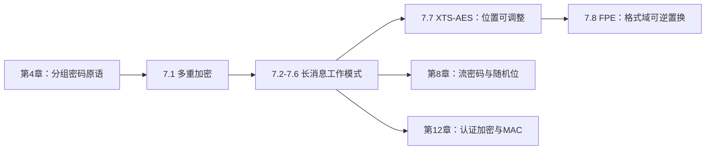
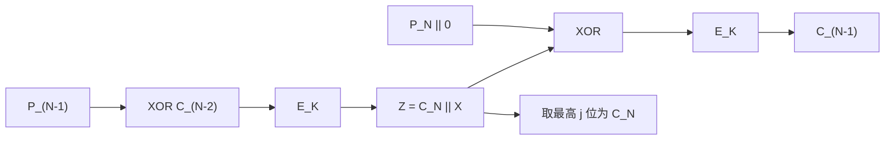

# 第七章 分组密码的工作模式

> [!IMPORTANT] 内容边界
> 教材知识与图示来自[[第七章_分组密码的工作模式_教材原文]]。推导、自检题、生活类比和安全实践说明属于辅助讲解。图7.18的现有附件右缘不完整，本讲义依据原始 PDF 第172页核对流程后使用公式重建，不修改教材原文或附件。

## 本章导学

### 本章学习目标

学完本章后，应当能够：

1. 解释双重 DES 为什么没有获得直觉上的112位安全强度，并完整描述中间相遇攻击；
2. 区分双密钥与三密钥 3DES，说明 EDE 中间采用解密的兼容性目的；
3. 从递推式、反馈路径、IV/计数器要求、错误传播和并行性五个角度比较 ECB、CBC、CFB、OFB、CTR；
4. 说明 XTS-AES 为什么适合扇区存储，以及调整值、分组序号和密文窃取各自解决什么问题；
5. 解释 FPE 的格式域、基数、NUM/STR 转换和 Feistel 可逆性，并比较 FF1、FF2、FF3；
6. 面对一种新模式时，能够沿数据流判断其可逆性、随机值要求、并行边界和误码传播。

### 本章核心问题

- 一个安全的分组密码，为什么不能直接逐块加密长消息？
- 反馈值、IV、时变值和计数器分别在防止什么重复？
- 为什么 CFB、OFB、CTR 的解密仍调用底层加密函数？
- 为什么“密文与明文等长”会成为磁盘加密和旧数据库加密的硬约束？
- 模式提供的保密性与消息完整性有什么区别？

### 为什么需要学习工作模式

AES 或 DES 只定义“一个固定长度分组如何变换”。真实文件、网络流、磁盘扇区和数据库字段往往更长、长度不齐、需要随机访问，甚至必须保持原格式。工作模式负责把一个分组置换扩展成可处理完整数据对象的方案。

可以把分组密码原语类比为一台可靠的印章机：它一次只能处理一张固定尺寸卡片。工作模式决定卡片怎样编号、是否与前一张连接、怎样处理最后半张卡片，以及同一内容在不同位置是否得到不同印记。印章机安全，不代表装配线自动安全。

### 学习路线

建议先掌握五种经典模式的数据路径，再学习 XTS 和 FPE。后两者不是孤立的新算法，而是把“位置”“格式”加入分组密码输入的进一步设计。

## 7.1 多重加密和三重 DES

### 本节学习目标与核心问题

目标是理解多次调用同一分组密码并不必然使安全强度按密钥位数相加。核心问题是：攻击者能否把复合结构从中间拆开？

### 7.1.1 双重 DES

双重加密为

$$
C=E(K_2,E(K_1,P)),
$$

解密必须逆序：

$$
P=D(K_1,D(K_2,C)).
$$

双重 DES 不会一般地约化为某个单密钥 DES。理由是：64位分组的所有置换数量为 $(2^{64})!$，远大于 DES 的 $2^{56}$ 个密钥所选择的置换数量，复合两个 DES 置换通常不在单 DES 置换集合中。

![[attachments/fig_7_1_pdf144.png]]

#### 中间相遇攻击

复合式提供了同一个中间值：

$$
X=E(K_1,P)=D(K_2,C).
$$

攻击过程：

1. 穷举全部 $K_1$，计算并存储 $E(K_1,P)$；
2. 穷举全部 $K_2$，计算 $D(K_2,C)$ 并查表；
3. 用第二组已知明密文对验证匹配候选。

它把约 $2^{112}$ 次的直观穷举降为约 $2^{56}$ 次加密、$2^{56}$ 次解密和约 $2^{56}$ 项存储，是典型的时间-空间折中。第一组明密文对平均留下 $2^{48}$ 个候选，第二组64位明密文对把错误候选概率降到约 $2^{-16}$。

生活类比：两把锁串联时，不必尝试所有钥匙对。可以从门内用第二把钥匙反向试，从门外用第一把钥匙正向试；只要两边到达同一个“中间门状态”，就得到候选钥匙对。

**常见误区**：中间相遇不是中间人攻击；它不需要篡改通信，也不依赖 DES 的 S 盒，只利用复合加密的中间等式。

### 7.1.2 双密钥 3DES

双密钥 3DES 使用 EDE：

$$
C=E(K_1,D(K_2,E(K_1,P))).
$$

中间使用解密的主要目的不是增加神秘的安全性质，而是兼容单 DES。令 $K_1=K_2=K$，则

$$
E(K,D(K,E(K,P)))=E(K,P).
$$

双密钥版本有三次变换、两个独立密钥，名义密钥长度112位。教材给出的已知明文攻击说明，实际分析必须同时考虑计算量、已知数据量和存储量，而不能只数密钥位数。

![[attachments/fig_7_2_pdf146.png]]

### 7.1.3 三密钥 3DES

三密钥版本为

$$
C=E(K_3,D(K_2,E(K_1,P))).
$$

它有三个独立56位密钥，名义长度168位，但教材指出已有攻击把有效安全边界压到112位量级。兼容单 DES 时可令相邻密钥相等，使一对加解密抵消。

| 概念 | 变换次数 | 独立密钥数 | 关键结论 |
|---|---:|---:|---|
| 双重 DES | 2 | 2 | 被中间相遇攻击降到约 $2^{56}$ 量级 |
| 双密钥 3DES | 3 | 2 | EDE，兼容单 DES |
| 三密钥 3DES | 3 | 3 | 名义168位，分析安全边界约112位 |

**记忆技巧**：次数看 E/D 字母个数，密钥数看不同下标个数。

**前后联系**：第4章提供 DES 原语；本节把原语复合；第14章会进一步讨论算法安全寿命和替代。

## 7.2 电码本模式

### 本节学习目标与核心问题

目标是理解最简单模式为什么也最容易泄露结构。核心问题是：相同的输入分组是否总得到相同输出？

ECB 对每块独立处理：

$$
C_j=E(K,P_j),\qquad P_j=D(K,C_j).
$$

![[attachments/fig_7_3_pdf148.png]]

它支持加解密并行、随机访问，单个密文块误码只破坏对应明文块。但是同一密钥下，相同明文块必然产生相同密文块，攻击者会看到重复位置和数据轮廓。

ECB 适合一个分组以内的独立数据，例如教材所举的单个加密密钥，不适合高度结构化的长消息。

### 评价一个模式的五个维度

| 维度 | 要问的问题 |
|---|---|
| 开销 | 比直接调用原语多了多少 XOR、状态和预处理？ |
| 错误恢复 | 发生误码后何时重新同步？ |
| 错误传播 | 一个错误会破坏多少明文单元？ |
| 扩散 | 明文规律会在多少密文块中留下痕迹？ |
| 安全 | 密文是否泄露重复、位置或可控位翻转关系？ |

**易混淆点**：并行性好不等于安全性好；ECB 的速度优势正来自块间没有依赖，而这也造成重复泄露。

## 7.3 密文分组链接模式

### 原理与递推式

CBC 在加密前把当前明文与前一密文 XOR：

$$
\begin{aligned}
C_1&=E(K,P_1\oplus IV),\\
C_j&=E(K,P_j\oplus C_{j-1}),\quad j\ge2.
\end{aligned}
$$

解密为

$$
\begin{aligned}
P_1&=D(K,C_1)\oplus IV,\\
P_j&=D(K,C_j)\oplus C_{j-1}.
\end{aligned}
$$

![[attachments/fig_7_4_pdf149.png]]

链接让相同明文块在不同上下文中得到不同密文。加密必须串行，因为 $C_j$ 依赖 $C_{j-1}$；解密可并行计算所有 $D(K,C_j)$，再分别 XOR 已知前块。

### IV 的三个要求

1. 长度等于分组长度；
2. 对待加密明文而言不可预测；
3. 未经授权不能被修改。

若攻击者把 IV 的第 $i$ 位翻转，解密后的 $P_1$ 第 $i$ 位也会翻转。IV 通常不保密，但必须按协议保证不可预测性和完整性。

### 错误传播

传输中的 $C_j$ 发生一位错误时：

- $P_j=D(K,C_j)\oplus C_{j-1}$ 通常整块紊乱；
- $P_{j+1}=D(K,C_{j+1})\oplus C_j$ 的对应位翻转；
- $P_{j+2}$ 起恢复正常。

若错误发生在加密前的 $P_j$，则它通过反馈改变 $C_j$ 及所有后续密文；接收者解密这组一致生成的密文时，仍只得到发送方实际输入的那一处错误。

**生活类比**：CBC 像接力赛，每一棒都带着上一棒结果出发。发送端不能跳棒，但接收端已经拿到全部棒次记录时，可以并行核对。

## 7.4 密码反馈模式

### 为什么需要 CFB

CFB 把分组密码变成按 $s$ 位处理的流式模式，适合字符到达后立即加密，不必等满一个 $b$ 位分组。

设 $I_1=IV$，则

$$
\begin{aligned}
O_j&=E(K,I_j),\\
C_j&=P_j\oplus \operatorname{MSB}_s(O_j),\\
I_{j+1}&=\operatorname{LSB}_{b-s}(I_j)\parallel C_j.
\end{aligned}
$$

解密只把最后一式中的输出改为

$$
P_j=C_j\oplus\operatorname{MSB}_s(O_j),
$$

底层仍调用 $E$。

![[attachments/fig_7_5_pdf151.png]]

反馈的是密文段，不是明文段，也不是完整加密输出。加密串行；解密时所有输入寄存器可由 IV 和已收到密文预先构造，因此底层加密可并行。

### CFB 的误码传播

一个密文段的某位错误会：

1. 使当前明文段同一位翻转；
2. 随错误段进入 $b$ 位寄存器，使后续 $b/s$ 个明文段受到扰乱；
3. 错误段移出寄存器后恢复同步。

**易错点**：CFB 中的“反馈”使密钥流依赖先前密文，因而它不是典型的、与明文完全无关的同步流密码。

## 7.5 输出反馈模式

OFB 反馈的是加密输出：

$$
I_1=IV,\qquad O_j=E(K,I_j),\qquad I_{j+1}=O_j,
$$

$$
C_j=P_j\oplus O_j,\qquad P_j=C_j\oplus O_j.
$$

![[attachments/fig_7_6_pdf152.png]]

密钥流只取决于 $K$ 和 IV，与明文、密文无关。因此：

- 同一密钥下 IV 必须唯一；
- 密钥流可在消息到达前生成；
- 密文一位误码只翻转当前明文对应位，不传播；
- 同样的可控位翻转性质也意味着模式本身不提供完整性。

若重用 $(K,IV)$，则两条密文满足

$$
C\oplus C'=P\oplus P',
$$

已知其中一条明文即可恢复对应密钥流和另一条明文。

**类比**：OFB 像预先印好的一次性掩码带。传输噪声不会污染下一段掩码，但同一条掩码带绝不能重复使用。

## 7.6 计数器模式

CTR 加密计数器而不是明文：

$$
C_j=P_j\oplus E(K,T_j),\qquad
P_j=C_j\oplus E(K,T_j).
$$

![[attachments/fig_7_7_pdf154.png]]

$T_j$ 通常从消息的初始计数器值开始逐块加1。安全要求不是“计数器随机”，而是同一密钥下所有被使用的计数器块唯一。

### 为什么计数器重用危险

若已知 $P_j$，则

$$
E(K,T_j)=C_j\oplus P_j.
$$

重用同一 $T_j$ 的其他密文即可被解开。CTR 与 OFB 都是密钥流 XOR，因而都具有位翻转可控性；它们提供保密性，不自动提供认证。

### CTR 的优势

- 各块独立，可并行加解密；
- 可预先计算 $E(K,T_j)$；
- 可直接随机访问第 $j$ 块；
- 只实现底层加密函数；
- 最后短块只使用密钥流的相应位，不需要填充。

![[attachments/fig_7_8_pdf155.png]]

### 五种经典模式对比

| 模式 | 底层解密调用 | 随机量要求 | 填充 | 加密并行 | 解密并行 | 传输误码影响 |
|---|---|---|---|---|---|---|
| ECB | 需要 $D$ | 无 | 通常需要 | 是 | 是 | 当前块紊乱 |
| CBC | 需要 $D$ | IV 不可预测且应防篡改 | 需要 | 否 | 是 | 当前块紊乱，下一块对应位翻转 |
| CFB-$s$ | 只用 $E$ | IV 按方案安全生成 | 不足段需约定 | 否 | 可预构造并行 | 当前位翻转，后续 $b/s$ 段扰乱 |
| OFB | 只用 $E$ | IV/时变值唯一 | 不需要 | 密钥流串行 | 密钥流串行 | 仅对应位翻转 |
| CTR | 只用 $E$ | 计数器块同密钥下全局唯一 | 不需要 | 是 | 是 | 仅对应位翻转 |

**记忆技巧**：CBC 反馈 ciphertext block；CFB 反馈 ciphertext fragment；OFB 反馈 output；CTR 不反馈数据，只推进 counter。

## 7.7 面向分组存储设备的 XTS-AES 模式

### 7.7.1 可调整分组密码

可调整分组密码增加公开输入 $T$：

$$
C=E(K,T,P).
$$

调整值不需要保密，它让同一密钥和同一明文在不同位置得到不同密文。教材先用一般结构说明“前后 XOR 同一调整掩码”的可逆性：

$$
C=H(T)\oplus E(K,H(T)\oplus P).
$$

![[attachments/fig_7_9_pdf156.png]]

### 7.7.2 为什么存储加密不同

扇区存储要求密文等长、可随机访问、不同位置同明文不同密文，并且不能依赖额外元数据。攻击者还可能读取、复制或修改整个密文扇区。

CBC 的跨块链接妨碍随机访问；CTR 虽可随机访问，但攻击者能通过密文位翻转精确改变明文位。XTS 的目标是把位置纳入分组变换，同时保持等长和并行。

### 7.7.3 单个分组运算

总密钥拆为 $K_1\parallel K_2$。扇区号为 $i$，扇区内块号为 $j$：

$$
T_j=E(K_2,i)\otimes\alpha^j,
$$

$$
C_j=E(K_1,P_j\oplus T_j)\oplus T_j.
$$

解密把中间 $E$ 换成 $D$，前后仍 XOR 同一 $T_j$。

![[attachments/fig_7_10_pdf158.png]]

$i$ 区分数据单元，$j$ 区分同一扇区内的位置，$\otimes$ 是 $GF(2^{128})$ 中模 $x^{128}+x^7+x^2+x+1$ 的乘法。

### 7.7.4 最后短块与密文窃取

若最后一块不足128位，XTS 不填充扩长，而由倒数第二个临时密文“窃取”所需位，重组最后两个块。这样输出总位数与输入相同。

![[attachments/fig_7_11_pdf159.png]]

**常见误区**：XTS 解决存储保密与位置变化，不提供消息认证。调整值公开不等于可以不受约束地篡改；系统仍需要独立完整性机制。

**前后联系**：第5章的有限域乘法解释 $\alpha^j$；第6章提供 AES；第12章讨论认证机制。

## 7.8 保留格式加密

### 本节目标与动机

FPE 要在同一个有限格式域内实现可逆置换。例如16位十进制账号加密后仍是16位十进制串，从而无需扩大数据库字段或改变旧程序工作流。

表7.2说明：普通 AES 输出128位二进制串，FPE 输出仍属于原字符集合。格式保持不代表语义合法，例如密文不一定通过信用卡校验位。

### 7.8.1 为什么旧系统需要 FPE

- COBOL 或大型旧代码的记录结构难以整体修改；
- 字符串数据库字段不能直接容纳二进制密文；
- Base64 会扩大字段长度；
- 保持格式能让既有传输、索引和界面继续工作。

### 7.8.2 两个设计难点

#### 难点一：格式映射必须可逆

把 AES 输出半字节逐个模10会发生碰撞：

$$
12\bmod10=2\bmod10=2.
$$

不同输入可能得到同一输出，解密无法唯一恢复。因此 FPE 必须直接在格式域上构造置换，不能先普通加密再丢弃超出范围的信息。

#### 难点二：小域会形成字典

若只加密信用卡号中间6位，域大小只有 $10^6$。大量记录会重复，攻击者可积累明密文对建表。调整值把未加密的上下文加入变换，使相同中间6位在不同卡号中得到不同密文。

### 7.8.3 Feistel 为什么适合 FPE

将字符串拆为 $A_i,B_i$，一轮可写为

$$
A_{i+1}=B_i,
$$

$$
B_{i+1}=A_i+F_K(B_i)\pmod{\mathrm{radix}^{m}}.
$$

解密用模减：

$$
B_i=A_{i+1},\qquad
A_i=B_{i+1}-F_K(B_i)\pmod{\mathrm{radix}^{m}}.
$$

$F_K$ 本身不必可逆，因为另一半保留了撤销模加所需的信息。

![[attachments/fig_7_12_pdf162.png]]

#### 字符串、基数和 NUM/STR

字母表大小是 radix。字符先映射为 $0,\dots,\mathrm{radix}-1$。对数字串 $X[1..m]$：

$$
\operatorname{NUM}_{\mathrm{radix}}(X)
=\sum_{i=1}^{m}X[i]\mathrm{radix}^{m-i}.
$$

$\operatorname{STR}_{\mathrm{radix}}^m$ 是反向转换。长度为 len 的 radix 进制串所需位数为

$$
\mathrm{bitlen}=\left\lceil\mathrm{len}\log_2(\mathrm{radix})\right\rceil.
$$

固定二进制字段越小、radix 越大，可容纳的字符数越少。

### 7.8.4 FF1、FF2、FF3

教材中的三种方案都使用 Feistel，但轮函数组织不同。

| 算法 | 轮数 | radix 范围 | 调整值特点 | 轮函数核心 |
|---|---:|---|---|---|
| FF1 | 10 | $[2,2^{16}]$ | 最灵活，可为空 | CBC 型 PRF，输入可跨多个128位块 |
| FF2 | 10 | $[2,2^8]$ | 单独的 tweakradix，长度受13字节字段限制 | 先由参数生成子密钥 $J$，再加密轮输入 |
| FF3 | 8 | $[2,2^{16}]$ | 固定64位，灵活性最低 | 直接 AES，含 REV 与左右32位 tweak |

FF1 的 PRF 是零 IV 的 CBC 链，返回最后分组：

![[attachments/fig_7_13_pdf165.png]]

FF1 中

$$
b=\left\lceil\frac{\left\lceil v\log_2(\mathrm{radix})\right\rceil}{8}\right\rceil,
\qquad
d=4\left\lceil\frac b4\right\rceil+4.
$$

$b$ 是编码 $B$ 所需字节数，$d$ 是轮函数字符串 $S$ 的目标字节数。

![[attachments/fig_7_14_pdf166.png]]

![[attachments/fig_7_15_pdf167.png]]

![[attachments/fig_7_16_pdf169.png]]

**易混淆点**：radix 是字符集合大小，bitlen 是编码后的二进制位数；tweak 是公开上下文，不是第二把密钥；格式保持不等于防篡改。

**记忆技巧**：FF1 最灵活、FF2 先造子密钥、FF3 三者中轮数最少且反转操作最多。

## 7.9 章末学习闭环

### 图7.17：同样三次 DES，不同流水线

![[attachments/fig_7_17_pdf170.png]]

图(a)把完整 EDE 当作一个 CBC 原语，分析边界清楚；图(b)在 E、D、E 三层分别链接，能够在硬件中让不同数据块占据不同流水级，吞吐量更高，但不应把“链接更多”直接等同为“安全更强”。

### CTS 公式重建

设最后短块 $P_N$ 长 $j<b$，先计算

$$
Z=E_K(P_{N-1}\oplus C_{N-2})=C_N\parallel X,
$$

其中 $|C_N|=j$。再计算

$$
C_{N-1}=E_K((P_N\parallel0^{b-j})\oplus Z).
$$

输出 $C_{N-1}\parallel C_N$，长度与原明文最后两块相同。这正是“从临时完整密文中窃取 $j$ 位”的含义。

### 自学建议

1. 每种模式先画底层密码的输入，不要先背优缺点；
2. 用“当前块依赖谁”判断并行性，用“错误值进入谁”判断传播；
3. 把 IV 不可预测、OFB 时变值唯一、CTR 计数器唯一分开记忆；
4. 对 XTS 同时标出扇区号 $i$ 和块号 $j$；
5. 对 FPE 先练 NUM/STR，再读 FF1–FF3 步骤。

### 推荐扩展阅读

- 教材引用的 NIST SP 800-38A：ECB、CBC、CFB、OFB、CTR；
- IEEE Std 1619-2007：XTS-AES 存储加密；
- 教材引用的 NIST SP 800-38G：保留格式加密；
- [[第十二章_消息认证码_导学讲义]]：为什么仅有工作模式仍需要认证。
