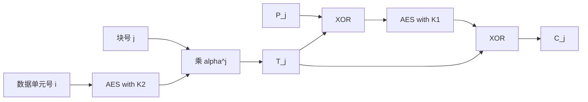

# 第七章 分组密码的工作模式

> [!IMPORTANT] 使用说明
> “题目原文”逐题摘自[[第七章_分组密码的工作模式_教材原文#7.9 关键术语、思考题和习题]]。解答优先使用题目所在小节和第7章；只有习题7.2为讨论主动篡改而补充引用第12章 CBC-MAC。图7.18的现有附件右缘不完整，习题7.11、7.12已依据原始 PDF 第172页只读核验完整线路。编程题所用标准 S-DES 参数表未在本书正文列出，参数假设及三组教材测试向量的交叉验证均在题内公开说明。

## 思考题

### 思考题 7.1

#### 题目原文

什么是三重加密？

#### 教材依据

教材7.1.2、7.1.3定义双密钥和三密钥 3DES，均连续执行三次 DES 变换。

#### 解题思路

先说明变换次数，再说明 EDE 次序和两种密钥安排，避免把“三次变换”误写成“必有三把密钥”。

#### 参考解答

三重加密是对同一数据连续执行三次分组密码变换。3DES 通常采用加密-解密-加密（EDE）结构。双密钥版本使用 $K_1,K_2,K_1$，三密钥版本使用 $K_1,K_2,K_3$。

#### 重点讲解

“三重”描述三次密码变换，不直接描述独立密钥个数。

#### 易错点提示

不要把中间的 $D(K_2,\cdot)$ 理解为已经把整段密文恢复成明文，它只是复合置换中的第二步。

#### 核验状态

已与教材7.1.2、7.1.3公式核验。

### 思考题 7.2

#### 题目原文

什么是中间相遇攻击？

#### 教材依据

教材7.1.1由双重 DES 公式推出 $E(K_1,P)=D(K_2,C)$，并给出正向建表、反向查表和额外明密文验证。

#### 解题思路

把复合加密从中间拆成两边可计算的同一值，再分别统计时间、空间和数据复杂度。

#### 参考解答

对

$$
C=E(K_2,E(K_1,P)),
$$

有

$$
E(K_1,P)=D(K_2,C).
$$

攻击者穷举 $K_1$ 并存储所有正向中间值，再穷举 $K_2$ 反向解密并查表，最后用第二组已知明密文对验证候选。双重 DES 的攻击计算量因此约为两次 $2^{56}$，另需约 $2^{56}$ 项存储，而不是完整遍历 $2^{112}$ 个密钥对。

#### 重点讲解

这是时间-空间折中，利用复合结构，不依赖 DES 内部 S 盒。

#### 易错点提示

不要与网络通信中的“中间人攻击”混淆。

#### 核验状态

相遇等式、复杂度和验证过程均与教材一致。

### 思考题 7.3

#### 题目原文

在三重加密中用到了多少个密钥？

#### 教材依据

教材7.1.2给出双密钥 3DES，7.1.3给出三密钥 3DES。

#### 解题思路

按版本回答，而不是给出一个脱离密钥安排的固定数字。

#### 参考解答

3DES 有两种主要版本：双密钥 EDE 使用两个独立密钥，密钥顺序为 $K_1,K_2,K_1$；三密钥 EDE 使用三个独立密钥 $K_1,K_2,K_3$。

#### 重点讲解

三次变换可以复用第一把密钥。

#### 易错点提示

“三重加密”不等于“三个独立密钥”。

#### 核验状态

已按两种教材定义核验。

### 思考题 7.4

#### 题目原文

为什么3DES的中间部分采用解密而非加密？

#### 教材依据

教材7.1.2明确指出中间解密没有更深的密码学含义，目的是兼容单 DES。

#### 解题思路

令两个密钥相同，利用 $D(K,E(K,X))=X$ 观察 EDE 如何退化。

#### 参考解答

主要为了与单 DES 兼容。令 $K_1=K_2=K$，则

$$
E(K,D(K,E(K,P)))=E(K,P).
$$

中间的加解密相消，整个 EDE 退化为单次 DES 加密。

#### 重点讲解

兼容性是答案核心。

#### 易错点提示

不要声称解密函数比加密函数更安全；二者是互逆置换。

#### 核验状态

退化公式已核验。

### 思考题 7.5

#### 题目原文

为什么某些分组密码的操作模式只使用加密算法而其他模式既使用加密算法又使用解密算法?

#### 教材依据

教材7.2、7.3的 ECB/CBC 直接反演密文块；7.4-7.6的 CFB/OFB/CTR 用 $E$ 生成与数据 XOR 的序列。

#### 解题思路

判断模式解密时是要反演底层分组置换，还是只需重新生成同一密钥流。

#### 参考解答

ECB、CBC 的解密必须从密文块反演底层分组密码，所以调用 $D$。CFB、OFB、CTR 用 $E$ 生成一个值再与数据 XOR；由于 XOR 自逆，接收方重新生成同一值并再次 XOR 即可恢复明文，仍只调用 $E$。

#### 重点讲解

“模式层正在解密”不等于“底层一定调用解密函数”。

#### 易错点提示

CFB 解密也使用 $E$，且反馈的是收到的密文段。

#### 核验状态

已逐一核对五种模式数据路径。

## 习题

### 习题 7.1

#### 题目原文

假设要构建一个用CBC模式进行分组加密的硬件设备，要求算法强度比DES的强。3DES是一个很好的候选算法。图 7.17给出了两种可能，都遵循CBC模式的定义。以下二者中你会选择哪一个？a.从安全性角度考虑；b.从性能上考虑。

![[attachments/fig_7_17_pdf170.png]]

#### 教材依据

教材7.1定义 EDE，7.3给出 CBC 依赖关系。图7.17(a)把完整 EDE 当作一次 CBC 原语；图7.17(b)在 E、D、E 三层分别保持 $A,B,C$ 反馈链。

#### 解题思路

安全性看方案是否复用已有 3DES-CBC 的分析边界；性能看跨数据块能否形成硬件流水线，而不只数单块的 DES 调用次数。

#### 参考解答

a. 从安全性和可审计性选择图7.17(a)。它把标准 EDE 作为一个完整分组密码，再按标准 CBC 使用；安全分析可直接分为“3DES 原语”和“CBC 模式”。图(b)是新组合，反馈更多不构成安全证明，还需要单独密码分析。  
b. 从硬件吞吐量选择图7.17(b)。两种方案每个数据块都调用三次 DES，但图(b)可让第一级处理第 $n$ 块、第二级同时处理第 $n-1$ 块、第三级处理第 $n-2$ 块。流水线充满后可每个 DES 阶段时间输出一块；图(a)必须等待完整 EDE 产生 $C_{n-1}$ 后才能处理下一块。

#### 重点讲解

图(b)改善的是吞吐量，不是单块延迟；单块仍需经过 E、D、E 三个阶段。

#### 易错点提示

不要因图(b)有三条反馈链就直接断言它更安全。

#### 核验状态

结论由图7.17的数据依赖和教材 CBC 递推式推导，推理路径完整。

### 习题 7.2

#### 题目原文

仅使用3DES和一些异或函数，你能对图 7.17中的两种方案进行安全性改进吗？假设只使用两个密钥。

#### 教材依据

本章7.3说明 CBC 的 IV 应不可预测并防止未经授权修改；第12章 CBC-MAC 说明可用分组密码和 XOR 对消息作认证。跨章是必要的，因为第7章模式只讨论保密性，无法单独检测主动篡改。

#### 解题思路

先界定“改进”：只有两个56位秘密密钥时，XOR 重新布线不能把穷举上界提高到超过112位；可以改进 IV 管理和主动篡改检测。然后给出能由 3DES 与 XOR 实现的方案，并明确密钥分离边界。

#### 参考解答

可作两层改进：

1. 用唯一公开时变值 $N$ 经 3DES 计算 IV，而不固定为全零。图(a)用一个 $IV=\operatorname{TDEA}_{K_1,K_2}(N)$；图(b)用带域分离常量的三个值 $IV_A=\operatorname{TDEA}(N\parallel0)$、$IV_B=\operatorname{TDEA}(N\parallel1)$、$IV_C=\operatorname{TDEA}(N\parallel2)$。三条链因此不会从相同状态开始。
2. 对 $N\parallel C_1\parallel\cdots\parallel C_n$ 追加 3DES-CBC-MAC 标签，接收方先核验标签再解密。CBC-MAC 只使用 3DES 和 XOR，可检测对 IV、反馈块和密文的主动修改。

该方案不能把两个独立密钥的穷举空间提高到超过 $2^{112}$。实际系统还应为加密和 MAC 使用独立派生密钥；若严格禁止任何密钥派生，则只能把它视为结构改进而非完整的认证加密设计。

#### 重点讲解

本章模式解决重复隐藏和长消息处理；完整性必须单独设计。

#### 易错点提示

随意增加固定 XOR 常量不会增加密钥熵，也不能代替 MAC。

#### 核验状态

这是开放设计题。依据、跨章必要性、改进目标和不能提高密钥空间的边界均已明确。

### 习题 7.3

#### 题目原文

对3DES进行Merkle-Hellman攻击的流程大致如下：首先令$A=0$［见图 7.1(b)]，然后对$K_1$的所有$2^{56}$个取值，找出$A=0$的明文。描述算法的剩下部分。

#### 教材依据

教材7.1.2说明 Merkle-Hellman 选择明文攻击令第一个中间值 $A=0$，再在第二中间值 $B$ 处相遇。

#### 解题思路

对每个 $K_1$ 反推能产生 $A=0$ 的明文，通过加密预言机取得密文，再建立 $B$ 表；随后穷举 $K_2$ 与该表相遇。

#### 参考解答

1. 对每个候选 $K_1=i$ 计算 $P_i=D(i,0)$，使 $E(i,P_i)=0$。
2. 把各 $P_i$ 提交给三重加密设备，取得对应 $C_i$。
3. 由最后一层密钥也是 $K_1=i$，计算 $B_i=D(i,C_i)$，以 $B_i$ 为键存储 $(i,P_i,C_i)$。
4. 对每个 $K_2=j$ 计算 $B'_j=D(j,0)$ 并查表。
5. 匹配给出候选 $(K_1,K_2)$，再用额外明密文对验证。

#### 重点讲解

计算量约 $2^{56}$，但需要约 $2^{56}$ 个选择明密文对，因数据需求极大而不实际。

#### 易错点提示

表中 $B_i$ 应由最后一层逆向计算，不能只存 $P_i$。

#### 核验状态

已逐步对应教材图7.1(b)的 $A,B,C$ 中间值。

### 习题 7.4

#### 题目原文

在ECB模式中，若在密文传输过程中某个分组发生了错误，则只有对应的明文分组受到影响。然而，在CBC模式中，这种错误具有扩散性。例如，图 7.4在传输$C_1$时出现的错误会影响明文分组$P_1$和$P_2$。  
a. $P_2$后面的所有分组是否受影响？  
b. 设$P_1$中有一位出现了错误，该错误会扩散到多少个密文分组？对接收者解密后的结果有何影响？

#### 教材依据

教材7.3给出 $P_j=D(K,C_j)\oplus C_{j-1}$ 和 $C_j=E(K,P_j\oplus C_{j-1})$。

#### 解题思路

分别追踪“传输后 $C_1$ 被改”和“加密前 $P_1$ 被改”两条依赖链。

#### 参考解答

a. 不受影响。错误的 $C_1$ 使 $P_1$ 通常整块紊乱，并使 $P_2$ 的对应位翻转；$P_3$ 只依赖正确收到的 $C_2,C_3$，因此恢复同步。  
b. 若错误在加密前的 $P_1$，它改变 $C_1$，并通过链接改变所有后续密文块。接收者解密这组一致生成的密文时，会恢复发送方实际加密的明文：只有 $P_1$ 保留该输入错误，$P_2$ 以后仍正确恢复。

#### 重点讲解

错误传播必须先说明错误发生在明文、加密计算还是传输密文中。

#### 易错点提示

不要把传输密文误码的“两块影响”套到加密前明文误码。

#### 核验状态

两种场景均由 CBC 递推式逐项核验。

### 习题 7.5

#### 题目原文

在CBC模式中有可能对多个明文分组并行地进行加密吗？解密呢？

#### 教材依据

教材7.3的加密式依赖前一密文，解密式只需当前与前一密文块。

#### 解题思路

检查每次底层密码调用的输入是否在开始前已知。

#### 参考解答

加密不能并行，因为计算 $C_j$ 前必须先得到 $C_{j-1}$。解密可以并行：收到全部密文后，可同时计算所有 $D(K,C_j)$，再分别与 $C_{j-1}$（首块与 IV）XOR。

#### 重点讲解

CBC 解密的底层分组解密可并行，最终 XOR 也可独立完成。

#### 易错点提示

不要因为公式含 $C_{j-1}$ 就说解密必须等待前一个明文；$C_{j-1}$ 已在输入中。

#### 核验状态

并行边界已按数据依赖核验。

### 习题 7.6

#### 题目原文

CBC-Pad是RC5中的一种分组加密工作模式，它可用于任何分组密码，并处理任意长度的明文。得到的密文最多比明文长一个分组的长度。填充的作用是保证输入明文是分组长度的整数倍。假设原始明文是整数字节，尾部填充1到$bb$个字节，这里$bb$为分组的字节长度。填充的字节相同，其值为填充的字节数。例如，若有8字节填充，则每个字节为00001000。那么，为何不允许0字节填充？若原始明文是分组大小的整数倍，为什么不省去填充？

#### 教材依据

题面定义填充长度由最后一个字节在 $1..bb$ 中自描述，教材7.2、7.3说明 ECB/CBC 要求完整分组。

#### 解题思路

从接收端仅凭解密结果能否无歧义删除填充来判断。

#### 参考解答

若允许0字节填充，最后一个数据字节就不能可靠说明“没有填充”，接收方也无法区分真实数据后缀和填充。即使原文已经对齐，也追加一个完整的 $bb$ 字节填充分组，每个字节值均为 $bb$。这样每条消息末尾总有 $1..bb$ 范围内的合法长度，接收方还能检查所有填充字节是否一致。

#### 重点讲解

填充不仅凑长度，还承担自描述和无歧义去填充。

#### 易错点提示

不要用消息总长度隐式判断是否填充；模式可能在没有外部原始长度的情况下工作。

#### 核验状态

已按题面填充编码反向验证唯一性。

### 习题 7.7

#### 题目原文

对ECB、CBC和CFB来说，明文须是由一个或多个完整的数据分组（对CFB模式来说是数据段）组成的序列。换句话说，对于这三种模式，明文的总位数必须是分组（或段）长度的整数倍。一种常用的填充方法是首先填1，然后填0（可能没有），直到填满最后一个分组。对于发送方来说，填充每个消息，包括那些最后一个分组已经完整的消息，被认为是一种较好的做法。不需要填充时，还要有一个填充分组的动机是什么？

#### 教材依据

题面规定“1后跟0”的自终止填充；去填充时必须从末尾唯一定位这个1。

#### 解题思路

构造原文恰好以“1后跟若干0”结束的情形，观察若对齐消息不填充会产生歧义。

#### 参考解答

若对齐消息不追加填充分组，接收方看到末尾的1和若干0时，无法判断它们是原始数据还是填充。始终追加填充可保证最末尾找到的那个填充起始1有确定含义。对已对齐消息，新增分组为一个1后跟整块剩余的0。

#### 重点讲解

统一填充规则让每条消息都能使用同一反向算法。

#### 易错点提示

这个填充方案与“每字节等于填充长度”的方案不同，不能混用删除规则。

#### 核验状态

歧义反例和完整填充分组均已核验。

### 习题 7.8

#### 题目原文

在8位的CFB模式中，若传输中一个密文字符发生了1位错误，这个错误会传播多远？

#### 教材依据

教材7.4说明密文段移入 $b$ 位寄存器，每轮移动 $s=8$ 位。

#### 解题思路

先计算错误段在寄存器中停留 $b/s$ 轮，再区分当前段的直接 XOR 错误和后续密钥流扰乱。

#### 参考解答

当前明文字符的对应位翻转。随后错误密文字符留在寄存器中 $b/8$ 轮，使接下来的 $b/8$ 个明文字符受到不可预测扰乱，之后恢复同步。若底层为 DES（$b=64$），影响当前字符和后续8个字符；若底层为 AES（$b=128$），影响当前字符和后续16个字符。

#### 重点讲解

直接错误是同一位翻转；后续错误来自错误寄存器输入经过分组密码后的扩散。

#### 易错点提示

题目只给段长8位，具体字符数还取决于底层分组长度 $b$。

#### 核验状态

传播窗口按寄存器移位次数复算。

### 习题 7.9

#### 题目原文

在讨论OFB模式时，提到若两个消息在相同的位置有相同的明文分组，则可能恢复对应的分组$O_i$。给出计算过程。

#### 教材依据

教材7.5给出 $C_i=P_i\oplus O_i$，且同一 $(K,IV)$ 生成相同 $O_i$。

#### 解题思路

用 XOR 自逆隔离 $O_i$，同时说明“相同但未知”与“已知或可猜明文”的区别。

#### 参考解答

若该位置的共同明文 $P_i$ 已知或可可靠猜出，则

$$
O_i=C_i\oplus P_i.
$$

对重用相同 $(K,IV)$ 的另一密文，有

$$
P_i'=C_i'\oplus O_i.
$$

若只知道两条明文相等但不知道值，则只能得到 $C_i\oplus C_i'=0$，不能单独恢复 $O_i$。

#### 重点讲解

真正危险条件是密钥流重用叠加已知明文或可预测格式。

#### 易错点提示

不要从“两个明文相等”直接跳到“已知密钥流”。

#### 核验状态

公式与条件边界已核验。

### 习题 7.10

#### 题目原文

在讨论CTR模式时，提到若用给定计数器值加密的明文分组内容已知，则由关联的密文分组很容易求出加密函数的输出。给出计算过程。

#### 教材依据

教材7.6给出 $C_i=P_i\oplus E(K,T_i)$。

#### 解题思路

两边 XOR 已知明文，隔离计数器加密输出。

#### 参考解答

$$
E(K,T_i)=C_i\oplus P_i.
$$

若同一密钥下另一个密文块复用 $T_i$，则

$$
P_i'=C_i'\oplus E(K,T_i).
$$

#### 重点讲解

计数器可公开，但同一密钥下不能重复。

#### 易错点提示

唯一性约束作用于完整计数器块，不只是消息编号字段。

#### 核验状态

已由 CTR 递推式直接验证。

### 习题 7.11

#### 题目原文

填充并不总是合适的。例如，我们希望使用相同的内存缓冲区（明文最初存储在这里）来存储加密的数据，这时密文必须和原始明文的长度相同。密文挪用模式（CTS）是满足这种要求的一种工作模式。图 7.18(a)为该模式的实现过程。  
a. 解释CTS是如何工作的；  
b. 描述如何解密$C_{n-1}$和$C_n$。

![[attachments/fig_7_18_pdf172.png]]

#### 教材依据

教材图7.18(a)的完整 PDF 页面显示：先产生临时完整密文 $Z$，把其最高 $j$ 位作为短密文 $C_N$，再用完整 $Z$ 加密补零后的 $P_N$。现有附件右缘不完整，故以原始 PDF 页面为图示证据。

#### 解题思路

给所有中间块命名，并用 MSB/LSB 明确“窃取”与重组，随后按逆序推导解密。

#### 参考解答

设分组长 $b$，最后短块 $P_N$ 长 $j<b$。先按 CBC 处理到 $C_{N-2}$，再计算

$$
Z=E_K(P_{N-1}\oplus C_{N-2}).
$$

把 $Z$ 分为

$$
Z=C_N\parallel X,
$$

其中 $|C_N|=j$、$|X|=b-j$。然后

$$
C_{N-1}=E_K((P_N\parallel0^{b-j})\oplus Z).
$$

输出 $C_{N-1}\parallel C_N$，总长度仍为 $b+j$。

解密时先算

$$
Y=D_K(C_{N-1})=(P_N\parallel0^{b-j})\oplus Z.
$$

因此

$$
P_N=\operatorname{MSB}_j(Y)\oplus C_N,
$$

而 $\operatorname{LSB}_{b-j}(Y)=X$。重组

$$
Z=C_N\parallel\operatorname{LSB}_{b-j}(Y),
$$

最后

$$
P_{N-1}=D_K(Z)\oplus C_{N-2}.
$$

#### 重点讲解

“窃取”的是临时密文 $Z$ 的 $j$ 位，短密文不是简单截断最终 $C_{N-1}$。

#### 易错点提示

输出顺序是完整 $C_{N-1}$ 后接短 $C_N$；MSB/LSB 一旦互换，解密重组就失败。

#### 核验状态

完整线路已由原始 PDF 第172页目视核验，公式正向和逆向互相代入通过。

### 习题 7.12

#### 题目原文

图 7.18(b)中给出了CBC-CTS的一种替代方案，可在明文不是分组长度的整数倍时，使得生成的密文长度与明文长度相同。  
a. 解释该算法；  
b. 说明CBC-CTS比图 7.18(b)中的方法更可取的原因。

#### 教材依据

原始 PDF 图7.18(b)显示：先正常 CBC 得到 $C_{N-1}$，再加密 $C_{N-1}$，取最高 $j$ 位与短明文 $P_N$ XOR。

#### 解题思路

先写替代方案两条公式，再比较最后短明文是否会反向影响完整密文块。

#### 参考解答

a. 对最后一个完整块仍按 CBC：

$$
C_{N-1}=E_K(P_{N-1}\oplus C_{N-2}).
$$

再生成一块输出并截取最高 $j$ 位：

$$
C_N=P_N\oplus\operatorname{MSB}_j(E_K(C_{N-1})).
$$

解密重新计算同一掩码并 XOR，密文长度为 $b+j$。  
b. 替代方案中 $P_N$ 不影响完整块 $C_{N-1}$，最后短块本质上只与一段密钥流 XOR。CBC-CTS 则把 $P_N$ 与临时密文 $Z$ 一起送入最后一次完整分组加密，使最后两个明文块共同影响完整 $C_{N-1}$，扩散和结构结合更强，因此更可取。两者都不自动提供认证。

#### 重点讲解

两种方案都等长，差异在最后短块是否参与最后一次完整分组加密。

#### 易错点提示

不要把替代方案误写成 CTR；其掩码来自 $E_K(C_{N-1})$，仍依赖 CBC 链。

#### 核验状态

公式已按完整图7.18(b)线路核验。

### 习题 7.13

#### 题目原文

画一幅与图 7.8类似的XTS-AES模式图。

#### 教材依据

教材7.7.3和图7.10给出 $T_j=E(K_2,i)\otimes\alpha^j$ 以及前后两次 XOR。

#### 解题思路

把调整值生成支路和主数据支路分开，再在 AES-$K_1$ 前后汇合。

#### 参考解答



对应

$$
T_j=E(K_2,i)\otimes\alpha^j,
\qquad
C_j=E(K_1,P_j\oplus T_j)\oplus T_j.
$$

#### 重点讲解

$i$ 区分扇区，$j$ 区分扇区内分组。

#### 易错点提示

总密钥要拆为 $K_1,K_2$；调整值支路不直接加密明文。

#### 核验状态

Mermaid 节点与图7.10及单块公式一致。

### 习题 7.14

#### 题目原文

在不转换为二进制数并计算位数的情况下，求解下面的问题，然后与用某个基数将字符串编码为一个整数的方式进行比较（提示：对每个整数，考虑比它小和大的最接近的2的幂）。  
a. 编码如下整数需要多少位（整个下标是该整数的基）？  
i. $8191_{10}$；ii. $8192_{10}$；iii. $65535_{10}$；iv. $65536_{10}$；v. $65535_{16}$；vi. $65536_{16}$；vii. $34\mathrm{F}7_{16}$；viii. $13559_{10}$  
b. 上问中的数字需要多少字节来表示？

#### 教材依据

教材7.8.3给出 bitlen 与整数编码关系；非零整数 $n$ 满足 $2^{k-1}\le n<2^k$ 时需要 $k$ 位。

#### 解题思路

用相邻2的幂夹住整数，字节数取 $\lceil k/8\rceil$；十六进制下标必须先按十六进制数量级判断。

#### 参考解答

| 数 | 相邻2的幂 | 位数 | 字节数 |
|---|---|---:|---:|
| $8191_{10}$ | $2^{12}<8191<2^{13}$ | 13 | 2 |
| $8192_{10}$ | $8192=2^{13}$ | 14 | 2 |
| $65535_{10}$ | $2^{15}<65535<2^{16}$ | 16 | 2 |
| $65536_{10}$ | $65536=2^{16}$ | 17 | 3 |
| $65535_{16}$ | $0x40000<0x65535<0x80000$ | 19 | 3 |
| $65536_{16}$ | $0x40000<0x65536<0x80000$ | 19 | 3 |
| $34F7_{16}$ | $0x2000<0x34F7<0x4000$ | 14 | 2 |
| $13559_{10}$ | $2^{13}<13559<2^{14}$ | 14 | 2 |

#### 重点讲解

数值正好等于 $2^m$ 时，需要 $m+1$ 位表示该整数本身。

#### 易错点提示

$65535_{16}$ 是十六进制数 $0x65535$，不是十进制65535。

#### 核验状态

全部位数和字节数已独立复算。

### 习题 7.15

#### 题目原文

a. 在基数为26时，写出如下字符串的数字串$X$及其长度：  
i. `"key"`；ii. `"random"`；iii. `"or"`；iv. `"digit"`  
b. 对a问中的每种情形，计算$x = \mathrm{NUM}_{26}(X)$  
c. 对b问中算出的$x$，求其字节形式$[x]$。  
d. 比b问中每个数字串都大的基数（26）的最小幂是多少？  
e. a问中每种情况的数字串的长度有联系吗？若有，是什么？

#### 教材依据

教材7.8.3规定映射 $a=0,\dots,z=25$，最高有效字符在前，并定义 $\mathrm{NUM}_{26}$ 与大端字节串 $[x]^s$。

#### 解题思路

逐字符转数字，以26作 Horner 累乘；再把整数写为最短大端十六进制字节串，并用 $26^m$ 给出长度为 $m$ 的全域上界。

#### 参考解答

| 字符串 | 数字串 $X$ | 长度 $m$ | $x=\mathrm{NUM}_{26}(X)$ | 最短大端 $[x]$ | 最小严格上界 |
|---|---|---:|---:|---|---:|
| `key` | `10,4,24` | 3 | 6888 | `1A E8` | $26^3=17576$ |
| `random` | `17,0,13,3,14,12` | 6 | 202214284 | `0C 0D 8B 8C` | $26^6=308915776$ |
| `or` | `14,17` | 2 | 381 | `01 7D` | $26^2=676$ |
| `digit` | `3,8,6,8,19` | 5 | 1515819 | `17 21 2B` | $26^5=11881376$ |

例如

$$
\mathrm{NUM}_{26}(\text{key})=10\cdot26^2+4\cdot26+24=6888.
$$

长度为 $m$ 的基26数字串都表示 $0..26^m-1$ 的整数，所以字符数、数字串长度和上界指数均为 $m$。

#### 重点讲解

前导字符 `a=0` 仍占一个字符位置；固定长度 STR 转换不能随意删除前导0。

#### 易错点提示

不要使用 $a=1$ 映射；字节串按最高有效字节在前排列。

#### 核验状态

四个 NUM 值、十六进制字节串和幂上界均已程序复算。

### 习题 7.16

#### 题目原文

参考算法FF1和FF2。  
a. 对算法中的步骤1，都有$u \gets \lfloor n/2 \rfloor$和$v = n - u$。对任意3个整数$x$、$y$和$n$，证明：若$x = \lfloor n/2 \rfloor$和$y = n - x$，则：  
i. $x = n/2$ 或 $x = (n-1)/2$；  
ii. $y = n/2$ 或 $y = (n+1)/2$。  
iii. $x \leqslant y$。（在什么条件下$x = y$?）  
b. 在FF3中，若左、右子串的长度分别为$u$和$v$，结果有何不同？

#### 教材依据

教材7.8.4中 FF1、FF2 使用 $u=\lfloor n/2\rfloor$；FF3 使用 $u=\lceil n/2\rceil$。

#### 解题思路

把整数 $n$ 分为偶数 $2q$ 和奇数 $2q+1$ 两类。

#### 参考解答

若 $n=2q$，则

$$
x=\lfloor n/2\rfloor=q=n/2,\qquad y=n-x=q=n/2.
$$

若 $n=2q+1$，则

$$
x=q=(n-1)/2,\qquad y=q+1=(n+1)/2.
$$

所以总有 $x\le y$，且仅当 $n$ 为偶数时 $x=y$。FF3 使用 $u=\lceil n/2\rceil$、$v=n-u$，因此 $n$ 为奇数时左半 $A$ 比右半 $B$ 多一个字符；FF1、FF2 正好相反，右半多一个字符。

#### 重点讲解

奇数长度时多出的一个字符放在哪一半，是 FF1/FF2 与 FF3 的明确区别。

#### 易错点提示

不要只证明偶数情形，也不要把 floor 与 ceil 互换。

#### 核验状态

奇偶两类穷尽全部整数，结论已核验。

### 习题 7.17

#### 题目原文

在算法FF1的步骤3中，$b$和$d$代表什么？这些量的基本度量单位是什么（位、字节、数字、字符）？

#### 教材依据

教材7.8.4直接给出

$$
b=\left\lceil\left\lceil v\log_2(\mathrm{radix})\right\rceil/8\right\rceil,
\quad
d=4\left\lceil b/4\right\rceil+4.
$$

#### 解题思路

沿单位转换：$v$ 个字符 -> 二进制位 -> 除8得到字节；再观察 $d$ 如何按4字节对齐并增加4字节。

#### 参考解答

$b$ 是把长度为 $v$ 的基数 radix 数字串 $B$ 编码为二进制整数时所需的最少字节数，单位是字节。$d$ 是 FF1 轮函数中扩展或截断字符串 $S$ 的目标长度，单位也是字节；它是4字节的倍数并比覆盖 $b$ 所需的对齐长度多4字节，用于减小后续模余偏差。

#### 重点讲解

$v$ 的单位是字符，$v\log_2(\mathrm{radix})$ 的单位是位，除8并上取整后才是 $b$ 字节。

#### 易错点提示

不要把 $d$ 当轮数或字符数。

#### 核验状态

定义、公式和单位均与教材步骤3说明一致。

### 习题 7.18

#### 题目原文

在算法FF1、FF2和FF3的输入中，为什么给定基数的范围如此重要？例如，为什么在算法FF2中要求$\mathrm{radix} \in [2..2^8]$或在算法FF3中要求$\mathrm{radix} \in [2..2^{16}]$？

#### 教材依据

教材7.8.3给出 $\mathrm{bitlen}=\lceil\mathrm{len}\log_2(\mathrm{radix})\rceil$；7.8.4说明 FF2 的1/15字节字段和 FF3 的12字节字段约束。

#### 解题思路

把 radix 与单字符编码位数、固定 AES 输入字段和最大消息长度联系起来。

#### 参考解答

radix 决定每个字符的取值范围和编码成本 $\log_2(\mathrm{radix})$。算法的 AES 输入、轮号、调整值和数字串字段都有固定字节宽度，因此 radix 越大，在同一字段中能容纳的字符越少。FF2 的设计用不超过1字节的字符范围并把 $B$ 编入15字节，所以要求 $2\le\mathrm{radix}\le2^8$；FF3 的字符集合设计允许到 $2^{16}$，但 $B$ 仍受12字节字段和总96位边界限制。范围还保证 NUM/STR 转换可表示、不会溢出，并使安全分析对应规定的有限域大小。

#### 重点讲解

radix 是算法参数和安全域大小，不是排版标签。

#### 易错点提示

不能只写“因为一个字节有256个值”；还要说明固定字段如何进一步限制 maxlen。

#### 核验状态

已按 bitlen 公式和 FF2/FF3 字段宽度核验。

## 编程题

### 编程题 7.1

#### 题目原文

使用如下密码之一编写密码分组链接模式的加密和解密程序：模256仿射，Hill模256，S-DES，DES。S-DES 的测试数据：二进制初始向量1010 1010，二进制明文00000001 00100011，二进制密钥0111111101，输出结果11110100 0000 1011。

#### 教材依据

本章7.3提供 CBC 公式和测试向量。教材第4章只提出 S-DES 编程题，未列参数表；以下采用该教材体系常用的 S-DES 置换和 S 盒，并以本章7.1-7.3三组独立向量同时验证该参数假设。

#### 解题思路

先实现可逆的8位 S-DES 原语和10位密钥调度，再按 $C_j=E(P_j\oplus C_{j-1})$、$P_j=D(C_j)\oplus C_{j-1}$ 封装 CBC。每一步保留断言，避免模式错误被原语错误掩盖。

#### 参考解答

```python
P10 = [3, 5, 2, 7, 4, 10, 1, 9, 8, 6]
P8 = [6, 3, 7, 4, 8, 5, 10, 9]
IP = [2, 6, 3, 1, 4, 8, 5, 7]
IP_INV = [4, 1, 3, 5, 7, 2, 8, 6]
EP = [4, 1, 2, 3, 2, 3, 4, 1]
P4 = [2, 4, 3, 1]
S0 = [
    [1, 0, 3, 2], [3, 2, 1, 0],
    [0, 2, 1, 3], [3, 1, 3, 2],
]
S1 = [
    [0, 1, 2, 3], [2, 0, 1, 3],
    [3, 0, 1, 0], [2, 1, 0, 3],
]


def permute(value, width, table):
    out = 0
    for position in table:
        out = (out << 1) | ((value >> (width - position)) & 1)
    return out


def rotl5(value, count):
    return ((value << count) | (value >> (5 - count))) & 0x1F


def schedule(key, shifts=(1, 2)):
    value = permute(key, 10, P10)
    left, right = value >> 5, value & 0x1F
    keys = []
    for shift in shifts:
        left, right = rotl5(left, shift), rotl5(right, shift)
        keys.append(permute((left << 5) | right, 10, P8))
    return keys


def round_f(right, subkey):
    value = permute(right, 4, EP) ^ subkey
    left, right4 = value >> 4, value & 0xF
    row0 = ((left & 0x8) >> 2) | (left & 1)
    col0 = (left >> 1) & 0x3
    row1 = ((right4 & 0x8) >> 2) | (right4 & 1)
    col1 = (right4 >> 1) & 0x3
    combined = (S0[row0][col0] << 2) | S1[row1][col1]
    return permute(combined, 4, P4)


def crypt_with_subkeys(block, subkeys):
    state = permute(block, 8, IP)
    left, right = state >> 4, state & 0xF
    for subkey in subkeys:
        left, right = right, left ^ round_f(right, subkey)
    return permute((right << 4) | left, 8, IP_INV)


def sdes_encrypt(block, key):
    return crypt_with_subkeys(block, schedule(key))


def sdes_decrypt(block, key):
    return crypt_with_subkeys(block, list(reversed(schedule(key))))


def cbc_encrypt(blocks, key, iv):
    out, previous = [], iv
    for block in blocks:
        previous = sdes_encrypt(block ^ previous, key)
        out.append(previous)
    return out


def cbc_decrypt(blocks, key, iv):
    out, previous = [], iv
    for block in blocks:
        out.append(sdes_decrypt(block, key) ^ previous)
        previous = block
    return out


KEY = 0b0111111101
IV = 0b10101010
PLAINTEXT = [0b00000001, 0b00100011]
EXPECTED = [0b11110100, 0b00001011]

assert cbc_encrypt(PLAINTEXT, KEY, IV) == EXPECTED
assert cbc_decrypt(EXPECTED, KEY, IV) == PLAINTEXT
print("CBC:", " ".join(f"{value:08b}" for value in EXPECTED))
```

输出：

```text
CBC: 11110100 00001011
```

#### 重点讲解

S-DES 数据块为8位，密钥为10位；CBC XOR 发生在送入 S-DES 之前。

#### 易错点提示

解密更新反馈值时要保存原密文块，不能反馈刚恢复的明文。

#### 核验状态

代码已执行，完全复现教材 CBC 向量并通过解密往返。

### 编程题 7.2

#### 题目原文

使用如下密码之一编写4位密码反馈模式的加密和解密软件：模256加，模256仿射，S-DES；或者使用密码2×2 Hill模256，编写8位密码反馈模式的加密和解密软件。S-DES的测试数据：二进制初始向量10101011，二进制明文00010010 00110100，二进制密钥0111111101，输出结果11101100 11111010。

#### 教材依据

本章7.4给出 CFB-$s$ 寄存器公式；本题明确指定 $s=4$ 和 S-DES 测试向量。复用编程题7.1已由 CBC 向量验证的原语。

#### 解题思路

把明文分为半字节 `1,2,3,4`。每轮加密8位寄存器，取最高4位与当前半字节 XOR，再把密文半字节移入寄存器右端；解密也调用加密函数并反馈收到的密文。

#### 参考解答

以下代码复用编程题7.1的 `sdes_encrypt`：

```python
def cfb4_encrypt(nibbles, key, iv):
    out, register = [], iv
    for plaintext in nibbles:
        keystream = sdes_encrypt(register, key) >> 4
        ciphertext = plaintext ^ keystream
        out.append(ciphertext)
        register = ((register << 4) & 0xFF) | ciphertext
    return out


def cfb4_decrypt(nibbles, key, iv):
    out, register = [], iv
    for ciphertext in nibbles:
        keystream = sdes_encrypt(register, key) >> 4
        out.append(ciphertext ^ keystream)
        register = ((register << 4) & 0xFF) | ciphertext
    return out


IV_CFB = 0b10101011
P_CFB = [0x1, 0x2, 0x3, 0x4]
C_CFB = [0xE, 0xC, 0xF, 0xA]

assert cfb4_encrypt(P_CFB, KEY, IV_CFB) == C_CFB
assert cfb4_decrypt(C_CFB, KEY, IV_CFB) == P_CFB
print("CFB4:", " ".join(f"{value:04b}" for value in C_CFB))
```

输出：

```text
CFB4: 1110 1100 1111 1010
```

#### 重点讲解

CFB4 每轮只使用 S-DES 输出的最高4位，但寄存器始终保持8位。

#### 易错点提示

解密时反馈密文半字节，不反馈明文半字节。

#### 核验状态

代码已执行，完全复现教材 CFB4 向量并通过解密往返。

### 编程题 7.3

#### 题目原文

使用如下密码之一编写计数器模式的加密和解密软件：模256仿射，Hill模256，S-DES。S-DES 的测试数据：计数器从0000 0000开始，二进制明文0000 0001 0000 0010 0000 0100，二进制密钥0111111101，输出结果00111000 0100 1111 0011 0010。

#### 教材依据

本章7.6给出 $C_j=P_j\oplus E(K,T_j)$；本题给出8位计数器从0递增和三块 S-DES 向量。

#### 解题思路

对计数器0、1、2分别调用 S-DES，加密结果与明文块 XOR。解密复用完全相同函数。

#### 参考解答

以下代码复用编程题7.1的 `sdes_encrypt`：

```python
def ctr_crypt(blocks, key, initial_counter=0):
    return [
        block ^ sdes_encrypt((initial_counter + index) & 0xFF, key)
        for index, block in enumerate(blocks)
    ]


P_CTR = [0b00000001, 0b00000010, 0b00000100]
C_CTR = [0b00111000, 0b01001111, 0b00110010]

assert ctr_crypt(P_CTR, KEY, 0) == C_CTR
assert ctr_crypt(C_CTR, KEY, 0) == P_CTR
print("CTR:", " ".join(f"{value:08b}" for value in C_CTR))
```

输出：

```text
CTR: 00111000 01001111 00110010
```

#### 重点讲解

CTR 的加密和解密是同一个函数；被分组密码处理的是计数器，不是数据块。

#### 易错点提示

不要在每个消息都无条件从0重新开始；测试向量这样做只为固定演示，真实系统必须保证同一密钥下计数器不重复。

#### 核验状态

代码已执行，完全复现教材 CTR 向量并通过往返。

### 编程题 7.4

#### 题目原文

实现3轮 S-DES的差分攻击。

#### 教材依据

本题位于第7章但依赖 S-DES 的 Feistel 结构。教材未给出3轮密钥调度、选择差分或期望输出；以下在编程题7.1已由三组教材向量验证的 S-DES 参数上，明确增加第三轮：密钥累计循环左移量为1、3、5位，即每轮增量为 `1,2,2`。这是公开的演示模型，不冒充教材唯一接口。

#### 解题思路

选择经过初始置换后右半相同的明文对，因此 $\Delta R_0=0$。三轮 Feistel 中第一轮函数输出差分为0，可推出第二轮左半差分等于已知 $\Delta L_0$。由最后一轮有

$$
\Delta F(R_2,K_3)=\Delta R_3\oplus\Delta L_0.
$$

密文经 IP 还原后可读出 $R_2=L_3$ 和 $R_3$，于是枚举256个末轮子密钥，使用多组选择差分求交；再把末轮子密钥候选映射回1024个主密钥并用完整明密文对验证。

#### 参考解答

以下代码复用编程题7.1的置换、轮函数和 S-DES 常量：

```python
def schedule3(key):
    return schedule(key, shifts=(1, 2, 2))


def sdes3_encrypt(block, key):
    return crypt_with_subkeys(block, schedule3(key))


def from_ip_halves(left, right):
    return permute((left << 4) | right, 8, IP_INV)


def build_chosen_pairs(oracle):
    pairs = []
    fixed_right = 0xA
    for delta_left in (0x1, 0x2, 0x4, 0x8, 0x3, 0x5, 0x9):
        plaintext = from_ip_halves(0, fixed_right)
        paired = from_ip_halves(delta_left, fixed_right)
        pairs.append((
            plaintext,
            paired,
            oracle(plaintext),
            oracle(paired),
            delta_left,
        ))
    return pairs


def recover_last_round_subkeys(pairs):
    candidates = []
    for subkey in range(256):
        valid = True
        for _, _, ciphertext, paired_ciphertext, delta_left0 in pairs:
            state = permute(ciphertext, 8, IP)
            paired_state = permute(paired_ciphertext, 8, IP)

            # Encryption outputs IP_INV(R3 || L3).
            right3, left3 = state >> 4, state & 0xF
            paired_right3, paired_left3 = paired_state >> 4, paired_state & 0xF
            target = right3 ^ paired_right3 ^ delta_left0

            observed = (
                round_f(left3, subkey)
                ^ round_f(paired_left3, subkey)
            )
            if observed != target:
                valid = False
                break
        if valid:
            candidates.append(subkey)
    return candidates


def recover_master_key(pairs, last_round_candidates):
    candidates = []
    for key in range(1 << 10):
        if schedule3(key)[-1] not in last_round_candidates:
            continue
        if all(
            sdes3_encrypt(p, key) == c
            and sdes3_encrypt(q, key) == d
            for p, q, c, d, _ in pairs
        ):
            candidates.append(key)
    return candidates


SECRET_KEY = 0b0111111101
oracle3 = lambda block: sdes3_encrypt(block, SECRET_KEY)
pairs = build_chosen_pairs(oracle3)
last_round = recover_last_round_subkeys(pairs)
master_keys = recover_master_key(pairs, last_round)

assert last_round == [0xB7, 0xD7]
assert schedule3(SECRET_KEY)[-1] == 0xD7
assert master_keys == [SECRET_KEY]

print("K3 candidates:", [f"{key:08b}" for key in last_round])
print("master key:", f"{master_keys[0]:010b}")
```

输出：

```text
K3 candidates: ['10110111', '11010111']
master key: 0111111101
```

#### 重点讲解

差分筛选先把末轮子密钥从256个降到2个，再利用密钥调度和完整明密文对恢复唯一10位主密钥；这与直接把1024个主密钥全部当黑盒穷举的分析目标不同。

#### 易错点提示

必须明确3轮模型、最终交换、IP/IP逆方向和密钥移位规则。改变其中任何一个约定，差分方程和期望候选都会改变。

#### 核验状态

四段 Python 按文档声明的复用顺序合并执行通过；三组教材 S-DES 模式向量全部复现，3轮差分实验恢复唯一主密钥。

## 全章核验汇总

- 5道思考题、18道习题、4道编程题共27个七段式题块完整。
- 所有题目原文已与教材7.9逐题比对。
- 习题7.11、7.12已由完整 PDF 图7.18恢复并验证正逆公式。
- 习题7.14、7.15的数字、位长和字节串已独立复算。
- 四段 Python 代码按复用顺序执行通过，当前无未解决待确认项。
- 教材原文未修改。
