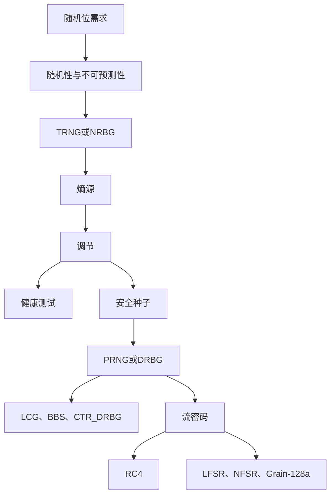

# 第八章 随机位生成和流密码

## 本章定位

> [!IMPORTANT] 信息边界
> “教材知识”来自[[第八章_随机位生成和流密码_教材原文]]；结构化重排、推导提示、记忆提示和显式标注的补充说明属于辅助内容。教材原文与附件未被修改。历史附件中存在错误页码后缀、重复裁剪和局部裁剪，本笔记只引用语义完整对象。

本章建立“熵源 -> 安全种子 -> 确定性扩展 -> 密钥流/随机值 -> 持续健康检查”的完整链路，并用 LCG、BBS、CTR_DRBG、RC4、LFSR/NFSR、Grain-128a 和英特尔 DRNG 展开。

### 一页知识图谱



### 高频结论

- 统计随机性不能推出不可预测性；测试能发现失败，不能证明绝对安全。
- PRNG 是确定性的，安全性依赖不可预测种子、内部状态和经分析的状态更新。
- 长周期是必要条件之一，不是密码安全的充分条件。
- LCG 适合说明周期与参数选择，不适合作为密码学密钥流。
- BBS 的下一位安全性与大整数因子分解困难性关联。
- CTR_DRBG 用熵初始化和补种，用分组密码高速扩展。
- 流密码最忌密钥流重用：$C_1\oplus C_2=P_1\oplus P_2$。
- RC4 存在密钥调度和输出偏差，已被 TLS 禁用。
- 本原多项式可令 $n$ 位 LFSR 达到 $2^n-1$ 周期，但线性使状态可恢复。
- 调节集中已有熵，不能从确定性输入创造熵；健康测试负责发现源或调节器失效。

## 8.1 伪随机数生成的原理

### 8.1.1 随机数的用途

#### 教材知识

| 用途 | 随机位承担的角色 | 相关章节 |
|---|---|---|
| 密钥分发和相互认证 | 时变值、挑战值，防止重放和猜测 | 第 14、15 章 |
| 会话密钥生成 | 为一次事务或会话生成短期密钥 | 后续协议章节 |
| RSA 密钥生成 | 随机选择并测试大素数候选 | 第 9 章 |
| 对称流加密 | 生成与明文等长的密钥流 | 本章 |

#### 随机性

- **分布均匀性**：0 和 1 的频率大致相等。
- **独立性**：任何子序列不能由其他子序列推导。

统计测试只能拒绝某些序列的随机性，不能严格证明独立性。

#### 不可预测性

在相互认证、会话密钥和流密码中，后续成员必须不能由已知历史输出推导。真随机序列因成员统计独立而不可预测；伪随机序列则依赖算法安全和种子保密。

> [!WARNING] 易错点
> “0/1 各占一半”“通过若干测试”“周期很长”都不能单独推出密码学不可预测性。

**关键词**：统计随机性、均匀性、独立性、不可预测性、不确定性算法。

### 8.1.2 TRNG、PRNG 和 PRF

![[attachments/fig_8_1_pdf175.png]]

| 概念 | 输入 | 输出形态 | 是否确定 | 关键约束 |
|---|---|---|---|---|
| TRNG/NRBG | 物理熵源 | 随机位流 | 否 | 源质量、偏差、采样与健康测试 |
| PRNG/DRBG | 种子、状态、可选上下文 | 不限长伪随机位流 | 是 | 种子保密、状态安全、补种 |
| PRF | 种子或密钥、上下文 | 固定长度伪随机串 | 是 | 输入域分离、输出不可预测 |

PRNG 与 PRF 可使用同一算法；差异主要是输出接口和用途。

**Related**：[[第十二章_消息认证码_复习笔记]]、[[第十九章_电子邮件安全_教材原文]]。

### 8.1.3 PRNG 的要求

#### 随机性三项要求

| 要求 | 含义 |
|---|---|
| 均匀性 | 任意位置出现 0 或 1 的概率近似 $1/2$ |
| 可伸缩性 | 随机抽取的子序列也应通过相同测试 |
| 一致性 | 不同初始种子应表现出一致的统计性质 |

#### 教材列举的 SP 800-22 测试

| 测试 | 观察对象 | 检测目标 |
|---|---|---|
| 频率测试 | 0、1 数量 | 是否显著偏离各半 |
| 行程测试 | 连续相同位的行程数和长度 | 是否符合随机序列期望 |
| Maurer 通用统计测试 | 匹配模式间距与可压缩性 | 是否可被明显无损压缩 |

#### 两种不可预测性

- **正向不可预测性**：不知道种子时，已知任意多前缀仍不能预测下一位。
- **反向不可预测性**：不能由生成值反推出种子。

#### 种子要求

种子必须不可预测；通常由 TRNG 提供。PRNG 是确定性算法，一旦种子和状态暴露，敌手可重现输出。

![[attachments/fig_8_2_pdf176.png]]

**重点**：使用 TRNG 供种、PRNG 扩展，兼顾不可预测性和效率。

### 8.1.4 算法设计

| 类型 | 方法 | 教材示例或去向 |
|---|---|---|
| 专用算法 | 为随机位或流密码专门设计 | LCG、BBS、RC4、Grain |
| 复用密码原语 | 分组密码、哈希、MAC | CTR_DRBG；第 12 章哈希和 MAC |

**知识关联**：密码原语的扩散与混淆使输出看起来无规律，但 PRNG 还必须管理种子、状态、输出限制和补种。

## 8.2 伪随机数生成器

### 8.2.1 线性同余生成器

#### 定义

$$
X_{n+1}=(aX_n+c)\bmod m.
$$

| 参数 | 名称 | 范围 |
|---|---|---|
| $m$ | 模 | $m>0$ |
| $a$ | 乘数 | $0<a<m$ |
| $c$ | 增量 | $0\le c<m$ |
| $X_0$ | 初始值/种子 | $0\le X_0<m$ |

#### 教材示例

当 $a=7,c=0,m=32,X_0=1$：

$$
1\to7\to17\to23\to1,
$$

周期为 4。改为 $a=5$：

$$
1\to5\to25\to29\to17\to21\to9\to13\to1,
$$

周期为 8。

#### Park-Miller 三项标准

| 标准 | 内容 |
|---|---|
| $T_1$ | 尽可能全周期 |
| $T_2$ | 输出序列呈现良好随机性 |
| $T_3$ | 能以 32 位算术高效实现 |

经典参数：

$$
m=2^{31}-1,\qquad a=7^5=16807,\qquad c=0.
$$

#### 密码学弱点

若参数已知，一个状态即可确定全部未来输出。参数未知时，少量连续输出满足

$$
\begin{aligned}
X_1&=(aX_0+c)\bmod m,\\
X_2&=(aX_1+c)\bmod m,\\
X_3&=(aX_2+c)\bmod m,
\end{aligned}
$$

可用于恢复 $a,c,m$。

> [!WARNING] 易错点
> LCG 的全周期评价服务于统计质量和状态覆盖，不等于通过下一位测试。

**关键词**：LCG、模、乘数、增量、种子、周期、全周期、状态恢复。

### 8.2.2 BBS 生成器

#### 参数与算法

选择大素数 $p,q$：

$$
p\equiv q\equiv3\pmod4,\qquad n=pq,\qquad \gcd(s,n)=1.
$$

$$
X_0=s^2\bmod n,\qquad X_i=X_{i-1}^2\bmod n,\qquad B_i=X_i\bmod2.
$$

![[attachments/fig_8_3_pdf178.png]]

教材示例使用 $n=192649=383\times503$、$s=101355$，由 $X_0=20749$ 开始。前 20 个输出位为：

```text
11001110000100111010
```

#### 密码安全伪随机位生成器

BBS 能通过下一位测试：不存在多项式时间算法在得到前 $k$ 位后，以大于 $1/2$ 的概率预测第 $k+1$ 位。其安全性建立在分解 $n=pq$ 困难的基础上。

| 对比维度 | LCG | BBS |
|---|---|---|
| 递推结构 | 线性 | 模平方 |
| 计算速度 | 快 | 慢 |
| 密码安全依据 | 无 | 因子分解困难性 |
| 适合用途 | 统计/仿真示例 | 密码安全随机位 |

**Related**：[[第二章_数论基础_复习笔记#2.4 模运算]]、[[第九章_公钥密码学与RSA_复习笔记]]。

## 8.3 使用分组密码生成伪随机数

### 8.3.1 使用分组加密工作模式的 PRNG

![[attachments/fig_8_4_pdf180.png]]

#### CTR-PRNG

```text
while len(temp) < requested_number_of_bits:
    V = (V + 1) mod 2^outlen
    output_block = E(Key, V)
    temp = temp || output_block
```

#### OFB-PRNG

```text
while len(temp) < requested_number_of_bits:
    V = E(Key, V)
    temp = temp || V
```

种子由密钥与 $V$ 组成。CTR 更新计数器；OFB 反馈上一个密码输出。

表 8.2 使用 OFB 的 PRNG 示例结果

| 输出分组 | 1 位的百分比 | 与前一个分组匹配的位的百分比 |
|---|---:|---:|
| 1786f4c7ff6e291dbdfdd90ec3453176 | 0.57 | |
| 5e17b22b14677a4d66890f87565eae64 | 0.51 | 0.52 |
| fd18284ac82251dfb3aa62c326cd46cc | 0.47 | 0.54 |
| c8e545198a758ef5dd86b41946389bd5 | 0.50 | 0.44 |
| fe7bae0e23019542962e252d215a2e3 | 0.47 | 0.48 |
| 14fdf5ec99469598ae0379472803accd | 0.49 | 0.52 |
| 6aeca972e5a3ef17bd1a1b775fc8b929 | 0.57 | 0.48 |
| f7e97badf359d128f00d9b4ae323db64 | 0.55 | 0.45 |

表 8.3 使用 CTR 的 PRNG 示例结果

| 输出分组 | 1 位的百分比 | 与前一个分组匹配的位的百分比 |
|---|---:|---:|
| 1786f4c7ff6e291dbdfdd90ec3453176 | 0.57 | |
| 60809669a3e092a01b463472fdcae420 | 0.41 | 0.41 |
| d4e6e170b46b573eedf88ee39bff33d | 0.59 | 0.45 |
| 5f8fcfc5deca18ea246785d7fadc76f8 | 0.59 | 0.52 |
| 90e63ed27bb07868c753545bdd57ee28 | 0.53 | 0.52 |
| 0125856fdf4a17f747c7833695c52235 | 0.50 | 0.47 |
| f4be2d179b0f2548fd748c8fc7c81990 | 0.51 | 0.48 |
| 1151fc48f90eebac658a3911515c3c66 | 0.47 | 0.45 |

> [!NOTE] 教材结论
> 两组短样例中的 1 位比例和相邻分组匹配比例都围绕 0.5 波动，未显示明显偏差或相关性。该实验是直观检查，不替代完整安全证明。

### 8.3.2 NIST CTR_DRBG

#### 参数

$$
\text{seedlen}=\text{outlen}+\text{keylen}.
$$

| 参数 | 3DES | AES-128 | AES-192 | AES-256 |
|---|---:|---:|---:|---:|
| outlen | 64 | 128 | 128 | 128 |
| keylen | 168 | 128 | 192 | 256 |
| seedlen | 232 | 256 | 320 | 384 |
| reseed_interval | $\le2^{32}$ | $\le2^{48}$ | $\le2^{48}$ | $\le2^{48}$ |

![[attachments/fig_8_5_pdf182.png]]

#### 初始化/更新

1. 旧 $K,V$ 驱动 CTR 生成至少 `seedlen` 位；
2. 与熵源的 `seedlen` 位异或；
3. 最高 `keylen` 位作为新 $K$；
4. 最低 `outlen` 位作为新 $V$。

#### 生成

每轮令 $V\leftarrow V+1$，输出 $E_K(V)$。补种计数器达到 `reseed_interval` 时重新调用更新函数并注入新熵。

**重点**：生成阶段扩展现有状态；更新阶段引入新熵并改变 $K,V$。

**易错点**：`reseed_interval` 是允许生成的最大分组数量，不是密钥长度。

**Related**：[[第七章_分组密码的工作模式_复习笔记#7.6 计数器模式]]。

## 8.4 流密码

![[attachments/fig_8_6_pdf183.png]]

### 通用结构

$$
s_{i+1}=f(s_i,K),\qquad z_i=g(s_i).
$$

$$
c_i=p_i\oplus z_i,\qquad p_i=c_i\oplus z_i.
$$

| 元素 | 含义 |
|---|---|
| $s_i$ | 随时间演化的秘密状态 |
| $f$ | 状态转换函数 |
| $g$ | 密钥流输出函数 |
| $K$ | 秘密密钥 |
| IV | 初始化状态的公开输入；需满足算法的唯一性/不可预测性要求 |

### 设计注意事项

1. 加密序列周期长；
2. 密钥流统计特性接近真随机流；
3. 密钥长度足够，教材建议至少 128 位；
4. 初始状态不得导致密钥流重用。

### 密钥流重用等式

若 $C_1=P_1\oplus Z$、$C_2=P_2\oplus Z$，则

$$
C_1\oplus C_2=P_1\oplus P_2.
$$

**重点**：重用会消去密钥流；攻击者可利用自然语言、格式或已知字段恢复明文。

### 流密码与分组密码

| 维度 | 流密码 | 分组密码 |
|---|---|---|
| 数据单位 | 位或字节流 | 固定长度分组 |
| 典型优势 | 低延迟、实现紧凑 | 模式丰富、适合文件与数据库 |
| 主要使用风险 | 密钥流重用、同步失配 | 模式/IV/填充误用 |

## 8.5 RC4

### 8.5.1 初始化 S：KSA

```text
for i = 0 ... 255:
    S[i] = i
    T[i] = K[i mod keylen]

j = 0
for i = 0 ... 255:
    j = (j + S[i] + T[i]) mod 256
    swap(S[i], S[j])
```

KSA 结束后，$S$ 仍是 $0\ldots255$ 的排列，密钥信息编码在排列顺序中。

### 8.5.2 流生成：PRGA

```text
i = j = 0
while true:
    i = (i + 1) mod 256
    j = (j + S[i]) mod 256
    swap(S[i], S[j])
    t = (S[i] + S[j]) mod 256
    k = S[t]
```

![[attachments/fig_8_7_pdf185.png]]

### 8.5.3 强度

- KSA 存在可降低密钥恢复工作量的结构性漏洞。
- 密钥流存在偏差，可在重复加密场景中恢复明文。
- RFC 7465 禁止在 TLS 中使用 RC4；NIST TLS 指南也禁止政府用途。

> [!WARNING] 结论
> RC4 适合作为状态置换流密码的教学实例，不应作为新系统的算法选项。

**关键词**：RC4、KSA、PRGA、状态置换、索引 $i,j$、密钥流偏差。

## 8.6 使用反馈移位寄存器的流密码

### 8.6.1 线性反馈移位寄存器

#### 定义

$$
B_n=\bigoplus_{i=1}^{n}A_iB_{n-i},\qquad A_i\in\{0,1\}.\tag{8.1}
$$

特征多项式：

$$
P(X)=1+\sum_{i=1}^{n}A_iX^i.\tag{8.3}
$$

![[attachments/fig_8_8_pdf186.png]]

#### 周期

- $n$ 位寄存器有 $2^n$ 个状态；全零状态自锁。
- 非零状态最大周期为 $2^n-1$。
- 当且仅当特征多项式为本原多项式时生成 m 序列。

图 8.9 的 4 位 LFSR：

$$
B_4=B_0\oplus B_1,\qquad P(X)=1+X+X^4.
$$

![[attachments/fig_8_9_pdf187.png]]

从初态 `1000` 得到 15 个状态后回到初态；输出周期为 15。

#### 多项式倒数

在 $GF(2)$ 上展开 $1/P(X)$，系数给出相应周期序列。模 2 中加法和减法都等于异或。

![[attachments/fig_8_10_pdf188.png]]

另一种生成多项式定义：

$$
G(X)=X^nP\left(\frac1X\right)
=X^n+\sum_{i=1}^{n}A_iX^{n-i}.
$$

$P(X)$ 与 $G(X)$ 生成同一输出序列，只是表示方向不同。

#### 安全边界

- 反馈函数已知：$n$ 个连续输出足以恢复状态。
- 反馈函数未知：约 $2n$ 位输出足以确定线性递推。

> [!WARNING] 易错点
> 本原多项式保证最大周期，不保证抵抗已知密钥流攻击。

### 8.6.2 非线性反馈移位寄存器

NFSR 的反馈包含变量乘积，例如

$$
B_4=B_0\oplus B_1B_3.
$$

![[attachments/fig_8_11_pdf188.png]]

NFSR 引入非线性，但周期分析不如 LFSR 完整。实际流密码常把 LFSR 与 NFSR、非线性滤波函数组合。

### 8.6.3 Grain-128a

#### 组件

| 组件 | 长度 | 作用 |
|---|---:|---|
| LFSR | 128 位 | 周期下界与平衡性 |
| NFSR | 128 位 | 非线性状态更新 |
| 滤波函数 | 9 个输入变量 | 混合两个寄存器 |
| 累加器 | 32 位 | 生成认证标记 |
| 认证移位寄存器 | 32 位 | 保存认证用预输出位 |

#### LFSR

$$
s_{i+128}=s_i\oplus s_{i+7}\oplus s_{i+38}\oplus s_{i+70}\oplus s_{i+81}\oplus s_{i+96}.
$$

生成多项式：

$$
f(x)=1+x^{32}+x^{47}+x^{58}+x^{90}+x^{121}+x^{128}.
$$

#### NFSR

$$
\begin{aligned}
b_{i+128}={}&s_i\oplus b_i\oplus b_{i+26}\oplus b_{i+56}\oplus b_{i+91}\oplus b_{i+96}\\
&\oplus b_{i+3}b_{i+67}\oplus b_{i+11}b_{i+13}\oplus b_{i+17}b_{i+18}\\
&\oplus b_{i+27}b_{i+59}\oplus b_{i+40}b_{i+48}\oplus b_{i+61}b_{i+65}\\
&\oplus b_{i+68}b_{i+84}\oplus b_{i+88}b_{i+92}b_{i+93}b_{i+95}\\
&\oplus b_{i+22}b_{i+24}b_{i+25}\oplus b_{i+70}b_{i+78}b_{i+82}.
\end{aligned}
$$

#### 滤波、预输出和输出

$$
h=b_{i+12}s_{i+8}\oplus s_{i+13}s_{i+20}\oplus b_{i+95}s_{i+42}\oplus s_{i+60}s_{i+79}s_{i+94}.
$$

$$
y_i=h\oplus s_{i+93}\oplus\bigoplus_{j\in A}b_{i+j},
\quad A=\{2,15,36,45,64,73,89\}.
$$

$$
z_i=y_{64+2i}.
$$

![[attachments/fig_8_12_pdf190.png]]

#### 密钥和 IV 初始化

128 位密钥装入 NFSR。LFSR 初始化为

$$
s_i=
\begin{cases}
IV_i,&0\le i\le95,\\
1,&96\le i\le126,\\
0,&i=127.
\end{cases}
$$

随后空转 256 次，不输出密钥流，并把预输出反馈到两个寄存器。

#### 加密与认证

$$
c_i=z_i\oplus m_i,\qquad m_i=z_i\oplus c_i.
$$

前 64 个 $y_i$ 分别初始化 32 位累加器和 32 位认证移位寄存器。未用于加密的奇数位置预输出位继续更新认证寄存器；消息位控制累加器异或，最终得到 32 位认证标记。

**重点**：偶数抽样位用于密钥流，另一部分预输出位用于认证，二者共享同一内部状态但用途分离。

**Related**：[[第二十三章_物联网安全_复习笔记]]。

## 8.7 真随机数生成器

### 8.7.1 熵源

教材列举：电离辐射脉冲、气体放电、泄漏电容、反相器热噪声、CCD 噪声、音视频输入、磁盘转速与寻道时间扰动。

| 层次 | 风险 |
|---|---|
| 物理过程 | 环境变化、偏置、相关性、老化或故障 |
| 采样与数字化 | 量化偏差、采样同步、确定性噪声 |
| 调节 | 组件实现错误、错误压缩比 |
| 输出接口 | 缓冲区、状态或调用方式泄漏 |

### 8.7.2 PRNG 和 TRNG 的比较

| 性质 | PRNG | TRNG |
|---|---|---|
| 效率 | 较高 | 较低 |
| 确定性 | 确定 | 非确定 |
| 可复现 | 相同种子可复现 | 通常不可复现 |
| 周期 | 有 | 无算法周期 |

**知识关联**：实际系统常组合使用，而非二选一。

### 8.7.3 调节

#### 偏差与熵率

偏差：潜在输出值的概率不相等。

若 $n$ 位输入具有 $k$ 位最小熵，则熵率为

$$
\rho=\frac{k}{n},\qquad0\le\rho\le1.
$$

调节通过哈希或分组密码混合原始样本，减小偏差并集中熵。

#### `hash_df`

设哈希输出长度为 `outlen`：

$$
\text{len}=\left\lceil\frac{\text{no_of_bits_to_return}}{\text{outlen}}\right\rceil.
$$

```text
temp = empty
counter = 0x01
repeat len times:
    temp = temp || Hash(counter || no_of_bits_to_return || input_string)
    counter = counter + 1
requested_bits = leftmost(temp, no_of_bits_to_return)
```

最大请求长度不超过 $255\times\text{outlen}$。

> [!NOTE] 补充理解
> 确定性调节只能重新分布和压缩已有不确定性，不能提升输入的总最小熵上界。

### 8.7.4 健康测试

![[attachments/fig_8_13_pdf193.png]]

| 测试位置 | 目标 | 合适测试 |
|---|---|---|
| A：数字化噪声源 | 是否继续按预期熵率运行 | 重复计数、自适应比例 |
| B：调节输出 | 是否呈现期望随机位特性 | 可采用 SP 800-22 类统计测试 |

#### 重复计数测试

$$
\Pr[C\text{个连续相同样本}]\le(2^{-H})^{C-1}.
$$

若可接受假阳性概率为 $W$：

$$
C=\left\lceil1+\frac{-\log_2W}{H}\right\rceil.
$$

教材示例：$W=2^{-30}$、$H=7.3$ 位/样本时，$C=6$。

#### 自适应比例测试

记录初始样本值，在 $N$ 个连续样本的窗口内统计它的出现次数；若至少达到 $C$ 次则报警。SP 800-90B 建议以 $W=2^{-30}$ 选择参数。

| 测试 | 检测模式 | 局限 |
|---|---|---|
| 重复计数 | 同值连续重复，源“卡死” | 对渐进或分散熵损失不敏感 |
| 自适应比例 | 窗口内某值过于频繁 | 依赖窗口与截止值选择 |

### 8.7.5 英特尔数字随机数生成器

![[attachments/fig_8_14_pdf195.png]]

#### 数据路径

1. 互相反馈的反相器在不稳定态下受热噪声驱动，产生原始随机位；
2. 每次收集 512 位；
3. AES-CBC-MAC/CMAC 类调节器输出 256 位；
4. 256 位作为 CTR_DRBG 更新输入，拆成 128 位密钥和 128 位 $V$；
5. DRBG 高速生成伪随机位，经 `RDRAND` 提供；
6. 调节输出也可经 ENRNG 和 `RDSEED` 提供为种子。

![[attachments/pdf_8_15_pdf196.png]]

| 接口 | 输出角色 | 教材描述 |
|---|---|---|
| `RDRAND` | PRNG 阶段随机值 | 16、32 或 64 位值写入寄存器 |
| `RDSEED` | ENRNG 随机种子值 | 供软件密码生成器播种 |

**重点**：英特尔 DRNG 是熵源、调节、DRBG 和硬件接口的组合系统。

## 公式索引

| 公式 | 用途 |
|---|---|
| $X_{n+1}=(aX_n+c)\bmod m$ | LCG 状态更新 |
| $X_i=X_{i-1}^2\bmod n$ | BBS 状态更新 |
| $B_i=X_i\bmod2$ | BBS 输出位 |
| $c_i=p_i\oplus z_i$ | 流密码加密 |
| $C_1\oplus C_2=P_1\oplus P_2$ | 密钥流重用泄漏 |
| $B_n=\bigoplus A_iB_{n-i}$ | LFSR 反馈 |
| $P(X)=1+\sum A_iX^i$ | LFSR 特征多项式 |
| $N_{\max}=2^n-1$ | $n$ 位 LFSR 最大周期 |
| $z_i=y_{64+2i}$ | Grain-128a 输出抽样 |
| $\rho=k/n$ | 熵率 |
| $C=\left\lceil1+\dfrac{-\log_2W}{H}\right\rceil$ | 重复计数截止值 |

## 关键词索引

| 关键词 | 检索摘要 |
|---|---|
| 统计随机性 | 均匀性、独立性、统计测试 |
| 不可预测性 | 正向、反向、敌手能力 |
| TRNG/NRBG | 物理熵源、非确定性 |
| PRNG/DRBG | 种子、状态、确定性扩展、补种 |
| PRF | 固定长度伪随机映射 |
| LCG | 线性同余、周期、参数恢复 |
| BBS | 模平方、最低位、下一位测试、因子分解 |
| CTR_DRBG | $K,V$、初始化、生成、更新、补种间隔 |
| 流密码 | 状态函数、输出函数、密钥流、异或 |
| RC4 | KSA、PRGA、置换状态、偏差、禁用 |
| LFSR | 抽头、特征多项式、本原多项式、m 序列 |
| NFSR | 非线性反馈、位乘积 |
| Grain-128a | LFSR、NFSR、滤波、认证 |
| 调节 | 哈希、分组密码、偏差校正、熵集中 |
| 健康测试 | 重复计数、自适应比例、假阳性 |
| `RDRAND`/`RDSEED` | 随机值接口、种子接口 |

## 重点、难点、易错点

### 重点

- 随机性、不可预测性、种子安全三者的层次关系；
- PRNG 与 TRNG 的组合；
- 流密码密钥流重用等式；
- CTR_DRBG 初始化、生成和补种；
- LFSR 周期与线性弱点；
- 调节与健康测试的职责边界。

### 难点

- 从 LFSR 电路图写递推式和多项式；
- 区分统计测试、源健康测试和输出健康测试；
- Grain-128a 的两个寄存器、滤波、抽样与认证数据流；
- 用最小熵估计重复计数阈值。

### 易错点

- 把“全周期”写成“密码安全”；
- 把 PRNG 输出当作新熵；
- 在同一密钥下重用流密码 IV/时变值；
- 把 RC4 的 KSA 与 PRGA 合并成一个循环；
- 忘记 LFSR 全零状态自锁；
- 认为调节可以修复完全失效的物理源；
- 混淆 `RDRAND` 与 `RDSEED`。

## 闭卷复习清单

- [ ] 能用一句话区分随机性与不可预测性。
- [ ] 能画出 TRNG 供种、DRBG 扩展的路径。
- [ ] 能写出 LCG 和 BBS 的递推式并说明安全差异。
- [ ] 能说明 CTR-PRNG 与 OFB-PRNG 的状态更新差异。
- [ ] 能解释 CTR_DRBG 的 `seedlen` 和补种间隔。
- [ ] 能推导密钥流重用等式。
- [ ] 能默写 RC4 KSA、PRGA 的四个关键步骤。
- [ ] 能从 LFSR 抽头写出特征多项式。
- [ ] 能说明本原多项式只保证最大周期。
- [ ] 能区分重复计数测试和自适应比例测试。
- [ ] 能沿图 8.15 解释英特尔 DRNG。

## Related

- [[第七章_分组密码的工作模式_复习笔记#7.5 输出反馈模式]]
- [[第七章_分组密码的工作模式_复习笔记#7.6 计数器模式]]
- [[第二章_数论基础_复习笔记]]
- [[第九章_公钥密码学与RSA_复习笔记]]
- [[第十二章_消息认证码_复习笔记]]
- [[第二十三章_物联网安全_复习笔记]]
- [[附录B_保密性和安全性度量_教材原文]]
- [[附录E_生日攻击的数学基础_教材原文]]
