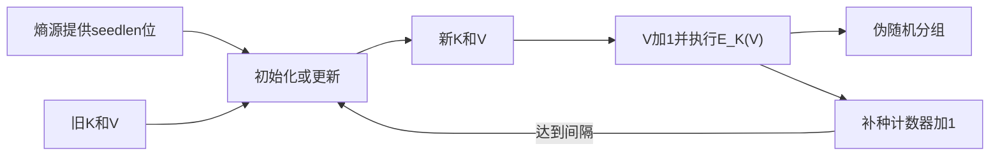

# 第八章 随机位生成和流密码

> [!IMPORTANT] 内容边界
> 教材知识、公式和图示来自[[第八章_随机位生成和流密码_教材原文]]。类比、演算、自检问题和显式标注的“补充理解”属于辅助讲解。历史附件存在文件名与图号不一致及局部重复裁剪，本讲义按图片实际语义选用完整附件，不修改教材原文和附件。

## 本章导学

### 本章学习目标

学完本章后，应当能够：

1. 区分统计随机性与密码学不可预测性，并解释为什么“通过统计测试”不等于“安全”；
2. 区分 TRNG、PRNG、DRBG 与 PRF 的输入、输出、确定性和用途；
3. 分析 LCG、BBS、OFB-PRNG、CTR_DRBG 的状态更新、周期和安全边界；
4. 从状态、状态转换函数、输出函数、密钥和 IV 五个要素解释流密码；
5. 手工跟踪 RC4 的密钥调度与密钥流生成，并说明其已知安全缺陷；
6. 用递推式、特征多项式和状态表分析 LFSR，理解为何还需要 NFSR 和非线性滤波；
7. 解释 TRNG 的熵源、偏差、熵率、调节和健康测试，以及英特尔 DRNG 的完整数据路径。

### 本章核心问题

- “看起来杂乱”与“敌手无法预测”有什么本质区别？
- 既然 TRNG 能提供真实熵，为什么还要使用确定性的 PRNG？
- 一个短密钥如何扩展成与消息等长的密钥流，而不退化成可预测序列？
- 为什么线性反馈结构容易实现，却不能单独承担流密码安全？
- 调节能改善输出，为什么不能修复一个已经失效的熵源？

### 为什么需要学习本章

密码系统不断消耗随机位：生成密钥、会话密钥、时变值、挑战值、素数候选和流密码密钥流都离不开它们。随机数一旦可预测，后续使用再强的 AES 或 RSA 也可能失去安全基础。因此，本章不是“辅助算法合集”，而是在回答密码系统最基础的供给问题：安全随机性从哪里来，怎样扩展，怎样持续检查，怎样用于加密。

### 学习路线


记住这条主线：**物理世界提供不可确定性，密码算法负责整形和扩展，流密码负责把扩展结果用于逐位加密。**

## 8.1 伪随机数生成的原理

### 8.1.1 随机数的用途

#### 本节目标、核心问题与学习价值

目标是理解密码学为什么同时要求随机性和不可预测性。核心问题是：一串 0、1 的比例接近一半，是否足以说明它能用于密钥？答案是否定的。

随机数在教材中有四类主要用途：密钥分发与相互认证中的时变值、会话密钥、RSA 密钥生成，以及流密码位流。前两类主要抵抗重放和猜测；RSA 需要随机选择候选数；流密码则要持续产生与消息等长的密钥流。

#### 核心原理与教材拆解

教材把要求分成两个层次：

| 层次 | 要求 | 能回答的问题 |
|---|---|---|
| 统计随机性 | 分布近似均匀、子序列之间表现独立 | 输出是否呈现随机序列应有的统计特征？ |
| 不可预测性 | 已知过去输出仍不能预测未来；已知输出不能反推种子 | 敌手能否利用算法、状态或历史输出获利？ |

统计测试只能发现某些“不随机”，不能证明绝对独立。一个简单反例是循环输出 `0011`：长期看 0 和 1 各占一半，却可以完全预测下一位。

#### 示例、类比与误区

生活类比：一副按固定规律排好的扑克牌即使花色和点数比例完全正常，也不等于真正洗牌。统计随机性像检查牌面比例；不可预测性像要求旁观者不知道下一张牌。

**常见误区**：

- “频率各占 50%”只是最基本检查，不代表独立，更不代表密码安全。
- 不确定性算法是以可控误差换取效率，不是随意猜测。
- 真随机序列天然不可预测；伪随机序列只能在种子和内部状态保密时表现为不可预测。

**记忆技巧**：随机性回答“像不像”，不可预测性回答“猜不猜得到”。

**章节关联**：第 9 章 RSA 会使用随机化的素数检测；第 14、15 章的认证与密钥分发会使用时变值。

### 8.1.2 TRNG、PRNG 和 PRF

#### 本节目标、核心问题与学习价值

目标是能根据输入来源、输出长度和是否确定性来分类。核心问题是：真实熵、确定性扩展和固定长度派生分别解决什么问题？

![[attachments/fig_8_1_pdf175.png]]

图 8.1 的阅读顺序是“输入从哪里来 -> 是否有反馈状态 -> 输出是连续流还是固定长度”。

| 名称 | 典型输入 | 输出 | 确定性 | 主要用途 |
|---|---|---|---|---|
| TRNG/NRBG | 物理熵源 | 随机位 | 非确定 | 生成种子、少量高价值随机值 |
| PRNG/DRBG | 种子和内部状态 | 任意长度伪随机位流 | 确定 | 流式供给大量随机位 |
| PRF | 种子或密钥加上下文 | 固定长度伪随机串 | 确定 | 密钥、时变值、派生值 |

PRNG 与 PRF 的核心算法可以相同，区别主要在应用接口：前者持续生成，后者按输入得到固定长度输出。知道算法不是问题；知道种子或内部状态才是问题。

生活类比：TRNG 像从自然降雨收集水，PRNG 像用水泵把一小池净水稳定供应给整栋楼，PRF 像按房间编号从总水源分配定量用水。类比只说明分工，不代表 PRNG 能创造新的熵。

**易混点**：PRNG 的输出可通过统计测试，但它仍是确定性的；PRF 中的“函数”不意味着无状态应用一定更安全。

### 8.1.3 PRNG 的要求

#### 三类要求

1. **随机性**：输出应具备均匀性、可伸缩性和一致性。
2. **不可预测性**：包括正向不可预测性和反向不可预测性。
3. **种子安全**：种子本身必须不可预测，并且不能被敌手获得。

NIST SP 800-22 的测试不能证明生成器绝对安全，但可以排除明显失败。教材列举：频率测试检查 0/1 数量；行程测试检查连续相同位的长度分布；Maurer 通用统计测试检查序列是否可被明显压缩。

正向不可预测性是“即使知道过去，也不能预测下一位”；反向不可预测性是“不能从输出倒推出种子”。后者还意味着一次状态泄漏不应轻易暴露此前所有输出，但具体保证取决于生成器设计。

![[attachments/fig_8_2_pdf176.png]]

图 8.2 说明常见组合：TRNG 先生成安全种子，PRNG 再高速扩展。这样做不是多余，因为 TRNG 可能慢且有偏差，PRNG 则能用短种子同步通信双方并持续供给。

**常见误区**：

- 通过测试不能替代算法安全分析。
- 长种子若可预测，仍然不是安全种子。
- 周期很长不等于不可预测，LCG 就是典型反例。

### 8.1.4 算法设计

PRNG 可分为专用算法和复用现有密码算法的方案。后者利用分组密码、哈希函数或消息认证码的扩散和不可预测性。若系统已经可靠实现 AES 或哈希函数，复用经过分析的原语通常比自行设计“随机公式”更稳妥。

**学习建议**：分析任何生成器时都问五个问题：状态是什么、怎样更新、输出怎样取、何时补种、状态泄漏后会发生什么。

## 8.2 伪随机数生成器

### 8.2.1 线性同余生成器

#### 本节目标、核心问题与学习价值

目标是会迭代 LCG、判断周期，并理解“统计上可用”和“密码学安全”之间的边界。LCG 是学习状态生成器的理想样本，因为它简单到可以手算，也脆弱到可以看清预测攻击。

LCG 定义为

$$
X_{n+1}=(aX_n+c)\bmod m,
$$

其中 $m$ 是模、$a$ 是乘数、$c$ 是增量、$X_0$ 是种子。所有后续值都由这四个参数确定。

#### 周期与参数选择

周期是状态首次重复前的输出长度。有限状态生成器必然最终重复，因此目标不是“没有周期”，而是在应用寿命内周期足够长且统计性质良好。

教材给出三个评价标准：

- $T_1$：尽可能达到全周期；
- $T_2$：序列看起来随机；
- $T_3$：能用机器字长高效实现。

当 $c=0$、$m$ 为素数且 $a$ 是模 $m$ 的本原根时，非零状态可形成长度 $m-1$ 的周期。经典参数 $m=2^{31}-1$、$a=7^5=16807$ 适合统计和仿真，但不适合密码密钥流。

#### 基础示例

设 $a=7,c=0,m=32,X_0=1$：

$$
1\to7\to17\to23\to1,
$$

周期只有 4。把 $a$ 改为 5 后周期为 8。这个例子说明参数看似相近，状态图却可能完全不同。

#### 为什么不具备密码安全性

若参数公开，知道一个状态就能预测全部未来状态；即使参数未知，少量连续输出也能形成模同余方程组并恢复参数。重新用时钟值扰动只能缓解重复，不自动把线性结构变成密码学安全结构。

生活类比：LCG 像一个齿轮组。第一次观察时转动似乎复杂，但齿数和当前位置一旦确定，未来轨迹就完全确定。

**常见误区**：全周期只说明“很晚才重复”，不说明下一项难以计算。

### 8.2.2 BBS 生成器

#### 背景与原理

BBS 把安全性建立在大整数因子分解困难性上。选择大素数 $p,q$，满足

$$
p\equiv q\equiv3\pmod4,
$$

令 $n=pq$，再选与 $n$ 互素的随机种子 $s$：

$$
X_0=s^2\bmod n,
$$

$$
X_i=X_{i-1}^2\bmod n,\qquad B_i=X_i\bmod2.
$$

![[attachments/fig_8_3_pdf178.png]]

每轮先平方并模 $n$ 更新内部状态，再取最低有效位输出。BBS 能通过下一位测试：没有多项式时间算法能在给定前 $k$ 位后以显著高于 $1/2$ 的概率预测第 $k+1$ 位，其安全性与分解 $n$ 的困难相关。

#### 与 LCG 对比

| 维度 | LCG | BBS |
|---|---|---|
| 状态更新 | 线性同余 | 模平方 |
| 主要设计目标 | 高效统计序列 | 密码学不可预测性 |
| 已知少量输出 | 可能恢复参数或预测 | 与分解难题关联 |
| 速度 | 快 | 较慢 |

**易错点**：$s$ 必须与 $n$ 互素；$p,q\equiv3\pmod4$ 不是“任意两个素数”；输出位是更新后状态的最低位。

**记忆技巧**：BBS 是“两个 3 模 4 的素数、平方更新、最低位输出”。

## 8.3 使用分组密码生成伪随机数

### 8.3.1 使用分组加密工作模式的 PRNG

#### 本节目标、核心问题与学习价值

目标是把第 7 章的 CTR、OFB 数据路径迁移到随机位生成场景。核心问题是：没有明文时，分组密码加密什么，状态又怎样变化？

![[attachments/fig_8_4_pdf180.png]]

两种机制都用密钥 $K$ 和状态 $V$ 作为种子组成部分：

| 机制 | 本轮输入 | 本轮输出 | 下一状态 |
|---|---|---|---|
| CTR-PRNG | $V+1$ | $E_K(V+1)$ | $V\leftarrow V+1$ |
| OFB-PRNG | $V$ | $E_K(V)$ | $V\leftarrow E_K(V)$ |

CTR 的状态沿计数器空间前进；OFB 的状态沿分组密码映射前进。两者都一次产生一个分组的伪随机位。密钥和初始 $V$ 的重复会重现整个输出流。

教材表 8.2、表 8.3 以同一 256 位种子测试 OFB 和 CTR 输出。每个 128 位分组中 1 的比例围绕 0.5 波动，相邻分组匹配位比例也围绕 0.5 波动。这里的正确结论是“样例没有暴露明显偏差”，不是“八个分组证明算法安全”。

**生活类比**：CTR 像给每张空白票据编号后盖同一枚密码印章；OFB 像把上一次印章结果作为下一张票据。两者都必须避免从同一初始状态重新开始。

### 8.3.2 NIST CTR_DRBG

#### 参数与生命周期

CTR_DRBG 使用 3DES 或 AES。四个参数分别是输出分组长度 `outlen`、密钥长度 `keylen`、种子长度 `seedlen=outlen+keylen` 和补种间隔 `reseed_interval`。

| 算法 | outlen | keylen | seedlen | reseed_interval |
|---|---:|---:|---:|---:|
| 3DES | 64 | 168 | 232 | $\le 2^{32}$ |
| AES-128 | 128 | 128 | 256 | $\le 2^{48}$ |
| AES-192 | 128 | 192 | 320 | $\le 2^{48}$ |
| AES-256 | 128 | 256 | 384 | $\le 2^{48}$ |

![[attachments/fig_8_5_pdf182.png]]

图 8.5 要分成两个闭环阅读：

1. **初始化/更新**：旧 $K,V$ 经 CTR 生成至少 `seedlen` 位，与熵源的新位异或，拆分为新 $K$ 和新 $V$；
2. **生成**：反复增加 $V$，计算 $E_K(V)$，拼接到输出；
3. **补种**：达到补种间隔后回到更新流程，引入新熵。



**常见误区**：补种间隔不是密钥长度；补种不是简单重置计数器；初始化时允许 $K,V$ 从约定值开始，是因为真正的不可预测性由随后注入的 `seedlen` 位熵提供。

## 8.4 流密码

### 本节目标、核心问题与学习价值

目标是从状态机角度理解流密码，而不是把它记成“明文异或随机数”。核心问题是：短密钥如何控制一个持续演化、双方同步的密钥流状态？

![[attachments/fig_8_6_pdf183.png]]

典型流密码包含：

- 秘密状态 $s_i$；
- 状态转换函数 $f$，计算 $s_{i+1}=f(s_i,K)$；
- 输出函数 $g$，计算密钥流 $z_i=g(s_i)$；
- 密钥 $K$ 和可选 IV，用于初始化 $s_0$。

加密和解密使用同一密钥流：

$$
c_i=p_i\oplus z_i,\qquad p_i=c_i\oplus z_i.
$$

这是因为 $x\oplus y\oplus y=x$。安全性完全依赖 $z_i$ 对敌手不可预测且不被重用。

#### 设计检查表

1. 密钥流周期足够长；
2. 输出统计特性接近真随机流；
3. 密钥足够长，教材建议至少 128 位；
4. 同一密钥下的 IV/初始状态不能造成密钥流重用；
5. 状态更新和输出函数不能暴露可恢复的线性关系。

若同一密钥流 $Z$ 加密 $P_1,P_2$：

$$
C_1\oplus C_2=(P_1\oplus Z)\oplus(P_2\oplus Z)=P_1\oplus P_2.
$$

密钥流被消去，语言、文件格式或已知字段会帮助恢复明文。这就是流密码最重要的使用禁忌。

生活类比：密钥流像一次性复写纸。同一张复写纸给两份表格使用，叠加两份印迹就会互相泄露结构。

**易混点**：IV 通常不保密，但必须满足算法规定的唯一性或不可预测性；“密钥不变但 IV 不同”是否安全，取决于组合是否保证密钥流不重复。

## 8.5 RC4

### 本节目标、核心问题与学习价值

目标是理解一个极简流密码怎样用置换状态产生字节流，并能从历史案例认识“实现快、结构简单”不等于长期安全。

RC4 的秘密状态是 $S[0\ldots255]$ 的一个排列以及两个 8 位索引。算法分为密钥调度（KSA）和伪随机生成（PRGA）两个阶段。

### 8.5.1 初始化 S

先令 $S[i]=i$，把变长密钥循环填充到 $T$。然后：

```text
j = 0
for i = 0 ... 255:
    j = (j + S[i] + T[i]) mod 256
    swap(S[i], S[j])
```

交换不会改变元素集合，只会改变排列。密钥的作用是决定这 256 次交换的轨迹。

### 8.5.2 流生成

```text
i = j = 0
repeat:
    i = (i + 1) mod 256
    j = (j + S[i]) mod 256
    swap(S[i], S[j])
    t = (S[i] + S[j]) mod 256
    k = S[t]
```

每轮既改变状态，又从改变后的排列中间接索引一个输出字节。加解密都把该字节与数据异或。

![[attachments/fig_8_7_pdf185.png]]

阅读图 8.7 时先看 $S,T$ 的初始排列，再看密钥调度如何累计 $j$ 并交换。不要把密钥调度和流生成的两个循环混为一谈。

### 8.5.3 强度与现实边界

教材说明 RC4 密钥调度和输出密钥流存在可利用偏差，IETF 已禁止在 TLS 中使用 RC4，NIST 的 TLS 指南也禁止政府用途。学习 RC4 的价值是理解置换状态机和历史密码分析，不是推荐新系统继续采用。

**常见误区**：

- RC4 是面向字节的流密码，不是分组密码。
- 丢弃前若干输出不能概括性修复所有 RC4 风险。
- 只要 KSA 完成，原始密钥数组不再直接参与 PRGA，但秘密已编码在 $S$ 的排列中。

**记忆技巧**：KSA 是“循环密钥、累计 j、交换”；PRGA 是“i 前进、j 跟随、交换、双索引输出”。

## 8.6 使用反馈移位寄存器的流密码

### 8.6.1 线性反馈移位寄存器

#### 本节目标、核心问题与学习价值

目标是会从反馈抽头写递推式和特征多项式，并理解最大周期与安全性不是同一概念。FSR 适合受限设备，因为每个时钟只需移位和少量逻辑门。

对 $n$ 位 LFSR，反馈位可写为

$$
B_n=\bigoplus_{i=1}^{n}A_iB_{n-i},\qquad A_i\in\{0,1\}.
$$

对应特征多项式为

$$
P(X)=1+A_1X+A_2X^2+\cdots+A_nX^n.
$$

![[attachments/fig_8_8_pdf186.png]]

每个时钟执行三件事：最低位移出作为输出，其余位移动一格，抽头位异或得到新最高位。全零状态会永远停在全零，因此最大周期只有 $2^n-1$。

当特征多项式是本原多项式时，非零初态生成最大长度序列（m 序列）。图 8.9 的 4 位 LFSR 满足

$$
B_4=B_0\oplus B_1,\qquad P(X)=1+X+X^4,
$$

周期为 $2^4-1=15$。

![[attachments/fig_8_9_pdf187.png]]

多项式倒数 $1/P(X)$ 在 $GF(2)$ 上展开时，其系数给出同一周期序列；加法与减法都等于异或。

![[attachments/fig_8_10_pdf188.png]]

#### 为什么单个 LFSR 不安全

线性既是优势也是弱点。若反馈函数已知，得到 $n$ 个连续输出就能恢复状态并预测全部输出；反馈函数未知时，约 $2n$ 位输出也足以确定线性递推。因此，周期达到 $2^n-1$ 仍不代表密码安全。

生活类比：LFSR 像透明的机械钟。齿轮组合能走很久才重复，但观察足够多次摆动后就能推断齿轮位置。

**常见误区**：换一个非零初态只会改变同一 m 序列的相位，不会自动产生全新的统计结构。

### 8.6.2 非线性反馈移位寄存器

NFSR 允许反馈函数包含位乘积，例如

$$
B_4=B_0\oplus B_1B_3.
$$

位乘积相当于逻辑与，使递推不再是线性方程。NFSR 增加预测难度，但缺少像 LFSR 那样完整、易用的周期理论，因此实际设计常把 LFSR 的周期保证与 NFSR 的非线性结合。

![[attachments/fig_8_11_pdf188.png]]

### 8.6.3 Grain-128a

#### 结构与分工

Grain-128a 面向紧凑硬件，包含 128 位 LFSR、128 位 NFSR、非线性滤波函数和 32 位认证累加器。

| 组件 | 主要职责 |
|---|---|
| LFSR | 保证至少 $2^{128}-1$ 的周期下界并帮助平衡 |
| NFSR | 引入非线性状态演化 |
| 滤波与预输出函数 | 混合两个寄存器的多个抽头 |
| 抽样规则 | $z_i=y_{64+2i}$ 生成加密密钥流 |
| 累加器与认证寄存器 | 使用未用于加密的预输出位生成 32 位标记 |

LFSR 递推为

$$
s_{i+128}=s_i\oplus s_{i+7}\oplus s_{i+38}\oplus s_{i+70}\oplus s_{i+81}\oplus s_{i+96}.
$$

预输出的核心关系为

$$
y_i=h\oplus s_{i+93}\oplus\bigoplus_{j\in A}b_{i+j},
\quad A=\{2,15,36,45,64,73,89\},
$$

$$
z_i=y_{64+2i}.
$$

![[attachments/fig_8_12_pdf190.png]]

图 8.12(a) 是正常输出阶段；图 8.12(b) 是初始化阶段。初始化时把 128 位密钥装入 NFSR，把 96 位 IV、31 个 1 和最后一个 0 装入 LFSR，然后空转 256 次，并把预输出反馈到两个寄存器。这个预热阶段用于充分混合密钥和 IV，不输出密钥流。

加密仍是

$$
c_i=m_i\oplus z_i,\qquad m_i=c_i\oplus z_i.
$$

**易混点**：LFSR 的线性周期保证不是整个 Grain-128a 的全部安全性；NFSR、滤波函数、初始化反馈和认证结构共同发挥作用。

**章节关联**：第 23 章会从物联网与受限设备角度重新讨论轻量级密码。

## 8.7 真随机数生成器

### 8.7.1 熵源

#### 本节目标、核心问题与学习价值

目标是区分“物理现象本身”和“数字化后的样本”。熵源可以来自热噪声、辐射事件、磁盘时序、音视频输入或 CCD 噪声。真正需要评估的是完整采样链路是否持续提供不可预测性，而不是仅凭来源名称判断。

物理源通常带有偏差、相关性和环境依赖。比如磁盘寻道时间含随机扰动，也可能含设备控制器的确定性结构。因此，采样、数字化、调节和健康测试缺一不可。

### 8.7.2 PRNG 和 TRNG 的比较

| 性质 | PRNG | TRNG |
|---|---|---|
| 效率 | 高，可快速大量生成 | 较低，受物理采样速率限制 |
| 确定性 | 相同种子可复现 | 非确定，通常不可复现 |
| 周期性 | 有限状态下最终周期 | 无算法周期 |
| 典型角色 | 扩展随机位 | 提供种子和新熵 |

二者不是互相替代，而是互补。工程系统常采用“TRNG 供种 + DRBG 扩展 + 定期补种”。

### 8.7.3 调节

偏差是不同输出值出现概率不等；熵率是每个输出位平均提供多少评估熵。若长为 $n$ 的位串具有 $k$ 位最小熵，则熵率为

$$
\frac{k}{n},\qquad 0\le \frac{k}{n}\le1.
$$

调节使用哈希函数或分组密码把有偏、相关的原始样本压缩和混合成更接近均匀的输出。它可以集中已有熵，却不能凭空创造熵：输入完全确定时，任何确定性调节函数的输出也完全确定。

教材的 `hash_df` 反复计算

$$
\operatorname{Hash}(\text{counter}\parallel\text{no_of_bits_to_return}\parallel\text{input_string}),
$$

拼接后取所需的最左位。计数器让每个哈希分组的输入不同，强哈希函数的扩散使输出分组显著不同。

**常见误区**：调节后的位更均匀，不代表原始熵源仍在正常工作；必须配合健康测试。

### 8.7.4 健康测试

![[attachments/fig_8_13_pdf193.png]]

图 8.13 有两个监测点：A 点检查数字化噪声源是否按预期产生熵，B 点检查调节输出是否呈现期望随机特征。两处目标不同，测试也不能简单互换。

#### 重复计数测试

若最小熵为 $H$ 位/样本，连续 $C$ 个相同样本的概率上界为

$$
\Pr[C\text{个连续相同样本}]\le(2^{-H})^{C-1}.
$$

给定可接受的假阳性概率 $W$，截止值可取

$$
C=\left\lceil1+\frac{-\log_2W}{H}\right\rceil.
$$

它擅长发现噪声源长时间“卡死”，但不擅长发现缓慢或局部的熵下降。

#### 自适应比例测试

在长度为 $N$ 的窗口中统计某个样本值的局部出现次数，达到截止值 $C$ 时报警。它用于发现某个值在一段时间内异常频繁，从而捕捉显著熵损失。

**对比记忆**：重复计数看“连续卡住”，自适应比例看“窗口偏多”。

### 8.7.5 英特尔数字随机数生成器

![[attachments/fig_8_14_pdf195.png]]

英特尔 DRNG 把三类机制集成在芯片内：

1. 互相反馈的反相器受热噪声影响，形成硬件熵源；
2. AES-CBC-MAC/CMAC 类硬件调节器把 512 位原始输入压缩成 256 位调节输出；
3. AES-CTR DRBG 用 256 位种子高速扩展，结果经 `RDRAND` 提供；调节器的增强型不确定输出经 `RDSEED` 提供作种子。

![[attachments/pdf_8_15_pdf196.png]]

图 8.15 要沿上到下阅读：硬件熵源 -> 两路 CBC 调节 -> 256 位结果 -> CTR_DRBG 更新 -> 伪随机位。生成器输出还反馈为调节阶段密钥，使状态持续演化。

| 指令 | 数据来源 | 适合角色 |
|---|---|---|
| `RDRAND` | DRBG 扩展输出 | 直接取得随机值 |
| `RDSEED` | 调节后的增强型不确定生成器 | 为软件 PRNG/DRBG 提供种子 |

生活类比：`RDSEED` 更像领取“酵母种”，`RDRAND` 更像领取已经生产好的面团。两者都来自同一硬件体系，但面向的调用目的不同。

**常见误区**：英特尔 DRNG 不是“纯 TRNG 直接以无限速率输出”；它同样组合了熵源、调节器和确定性扩展。

## 本章易混淆知识总表

| 概念 A | 概念 B | 一句话区分 |
|---|---|---|
| 随机性 | 不可预测性 | 前者看统计特征，后者看敌手能力 |
| TRNG | PRNG | 前者从物理过程取熵，后者从种子确定性扩展 |
| PRNG | PRF | 前者面向连续位流，后者面向固定长度映射 |
| 长周期 | 密码安全 | 长周期只防快速重复，不防状态恢复 |
| 调节 | 健康测试 | 调节改善输出分布，测试检查部件是否失效 |
| LFSR | NFSR | 前者线性且周期理论成熟，后者引入非线性 |
| `RDRAND` | `RDSEED` | 前者给扩展随机值，后者给种子级输出 |

## 记忆框架

用“源、种、态、流、测”串联本章：

- **源**：熵从物理世界来；
- **种**：安全种子连接 TRNG 与 PRNG；
- **态**：生成器以内部状态确定性演化；
- **流**：输出可作为随机值或流密码密钥流；
- **测**：统计测试和健康测试持续发现异常。

## 自学建议

1. 第一遍只掌握分类和数据流，不急于背 Grain-128a 的全部抽头；
2. 第二遍手算一个 LCG、一个 4 位 LFSR 和 RC4 的前几轮，建立“状态更新”直觉；
3. 第三遍用“周期、统计、预测、种子、补种”五个维度比较所有生成器；
4. 做习题 8.11、8.12 时先写概率模型，再代数化简；
5. 做习题 8.8 时把 80 位随机值视为有限命名空间，用附录 E 的生日界分析碰撞。

## 扩展阅读

- 教材提及的 NIST SP 800-90A：确定性随机位生成机制；
- NIST SP 800-90B：熵源设计、评估与健康测试；
- NIST SP 800-22：随机与伪随机序列统计测试；
- RFC 7465：TLS 中禁用 RC4 的历史安全结论。

## Related

- [[第七章_分组密码的工作模式_导学讲义#7.5 输出反馈模式]]
- [[第七章_分组密码的工作模式_导学讲义#7.6 计数器模式]]
- [[第二章_数论基础_导学讲义]]
- [[第九章_公钥密码学与RSA_教材原文]]
- [[附录B_保密性和安全性度量_教材原文]]
- [[附录E_生日攻击的数学基础_教材原文]]
