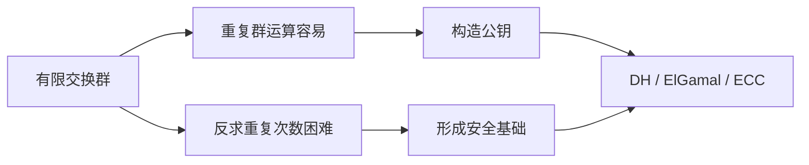

# 第10章 其他公钥密码体制

## 本章复习

### 一页总览

| 主题 | 群运算 | 正向计算 | 困难逆问题 | 主要用途 |
| --- | --- | --- | --- | --- |
| Diffie-Hellman | 模 q 乘法 | $\alpha^x\bmod q$ | 有限域离散对数 | 密钥交换 |
| ElGamal | 模 q 乘法 | $\alpha^x\bmod q$ | 有限域离散对数 | 公钥加密 |
| ECDH | 椭圆曲线点加 | $xG$ | 椭圆曲线离散对数 | 密钥交换 |
| 椭圆曲线加密 | 椭圆曲线点加 | $xG$ | 椭圆曲线离散对数 | 公钥加密 |

> [!IMPORTANT] 本章主线
> DH、ElGamal 和 ECC 的共同思想是：公开“生成元经过秘密次数的重复运算”所得结果，而把重复次数保密。

## 10.1 Diffie-Hellman 密钥交换

### 定义与目标

Diffie-Hellman 密钥交换让两个用户通过公开信道建立共享秘密，供后续对称加密使用。算法本身只交换形成密钥所需的公开值，不直接加密业务消息。

### 离散对数

若 $\alpha$ 是素数 q 的本原根，则其模 q 的幂遍历 $1,\ldots,q-1$。满足

$$
b\equiv\alpha^i\pmod q
$$

的指数 i 称为 b 以 $\alpha$ 为底、模 q 的离散对数，记为

$$
i=\operatorname{dlog}_{\alpha,q}(b).
$$

**重点：** 模幂易算，离散对数在合适的大参数下难算。

### 10.1.1 算法

#### 参数与计算

| 项目 | Alice | Bob |
| --- | --- | --- |
| 公共参数 | $q,\alpha$ | $q,\alpha$ |
| 私钥 | $X_A<q$ | $X_B<q$ |
| 公钥 | $Y_A=\alpha^{X_A}\bmod q$ | $Y_B=\alpha^{X_B}\bmod q$ |
| 共享密钥 | $K=Y_B^{X_A}\bmod q$ | $K=Y_A^{X_B}\bmod q$ |

正确性：

$$
Y_B^{X_A}\equiv(\alpha^{X_B})^{X_A}
\equiv\alpha^{X_AX_B}
\equiv(\alpha^{X_A})^{X_B}
\equiv Y_A^{X_B}\pmod q.
$$

教材图：

![[attachments/fig_10_1_pdf220.png]]

#### 教材例子

$$
q=353,\quad\alpha=3,\quad X_A=97,\quad X_B=233,
$$

$$
Y_A=40,\quad Y_B=248,\quad K=160.
$$

敌手已知 $q,\alpha,Y_A,Y_B$，若要求 K，可先解 $X_A$ 或 $X_B$ 的离散对数。小示例可穷举，实际参数必须足够大。

### 10.1.2 密钥交换协议

- 临时方式：每次连接生成新的私钥和公钥。
- 长期目录方式：每个用户生成长期 $X_i,Y_i$，公开值与 $q,\alpha$ 放在可信中心目录。
- 可信目录方式可提供保密性和某种认证，但不能抵抗重放攻击。

> [!WARNING] 易错点
> DH 的数学正确性只证明双方可得到相同 K，不证明收到的公钥属于声称的对方。

### 10.1.3 中间人攻击

Darth 用自己的一组或两组密钥替换 Alice、Bob 的公钥，分别建立：

$$
K_1=\text{Bob 与 Darth 的密钥},
\qquad
K_2=\text{Alice 与 Darth 的密钥}.
$$

然后执行“用 $K_2$ 解密、读取或修改、再用 $K_1$ 加密”。

![[attachments/fig_10_2_pdf222.png]]

**攻击根因：** 协议未认证参与者和公钥的绑定关系。

**教材防御方向：** 数字签名、公钥证书，见第 13、14 章。

## 10.2 ElGamal 密码体制

### 密钥生成

公开全局量：素数 q 与本原根 $\alpha$。

$$
0<X_A<q-1,
$$

$$
Y_A=\alpha^{X_A}\bmod q.
$$

- 公钥：$\{q,\alpha,Y_A\}$
- 私钥：$X_A$

### 加密

对 $0\le M\le q-1$，为本分组选择随机数 $1\le k\le q-1$：

$$
K=Y_A^k\bmod q,
$$

$$
C_1=\alpha^k\bmod q,
\qquad
C_2=KM\bmod q.
$$

密文为 $(C_1,C_2)$。

### 解密

$$
K=C_1^{X_A}\bmod q,
$$

$$
M=C_2K^{-1}\bmod q.
$$

正确性关键式：

$$
C_1^{X_A}\equiv(\alpha^k)^{X_A}
\equiv(\alpha^{X_A})^k
\equiv Y_A^k\equiv K\pmod q.
$$

![[attachments/fig_10_3_pdf223.png]]

### 教材例子

| 量 | 值 |
| --- | ---: |
| $q,\alpha$ | $19,10$ |
| $X_A,Y_A$ | $5,3$ |
| $M,k$ | $17,6$ |
| K | 7 |
| $(C_1,C_2)$ | $(11,5)$ |
| $K^{-1}\bmod19$ | 11 |
| 恢复 M | 17 |

### k 复用泄密

同一个 k 导致同一个 K。若

$$
C_{2,1}=KM_1,
\qquad
C_{2,2}=KM_2\pmod q,
$$

且 $M_1$ 已知，则

$$
M_2=(C_{2,1})^{-1}C_{2,2}M_1\bmod q.
$$

> [!DANGER] 易错点
> 每个消息分组必须使用唯一 k。k 的重复会产生可消除的共同乘法因子；随机数失误不是轻微性能问题，而是直接破坏机密性。

### 安全性

- 由 $Y_A$ 求私钥：$X_A=\operatorname{dlog}_{\alpha,q}(Y_A)$。
- 由 $C_1$ 求临时秘密：$k=\operatorname{dlog}_{\alpha,q}(C_1)$。
- 安全性依赖离散对数困难性和合适参数选择。

## 10.3 椭圆曲线算术

### 10.3.1 交换群

交换群 $\{G,\cdot\}$ 的五条公理：

| 编号 | 公理 | 表达 |
| --- | --- | --- |
| A1 | 封闭性 | $a,b\in G\Rightarrow a\cdot b\in G$ |
| A2 | 结合律 | $(a\cdot b)\cdot c=a\cdot(b\cdot c)$ |
| A3 | 单位元 | $a\cdot e=e\cdot a=a$ |
| A4 | 逆元 | $a\cdot a'=a'\cdot a=e$ |
| A5 | 交换律 | $a\cdot b=b\cdot a$ |

有限域乘法群中的重复乘法：

$$
a^k=\underbrace{a\times a\times\cdots\times a}_{k\text{ 个 }a}.
$$

椭圆曲线点群中的标量乘：

$$
kP=\underbrace{P+P+\cdots+P}_{k\text{ 个 }P}.
$$

> [!IMPORTANT] 符号边界
> $kP$ 是点的重复相加，不是 $(kx_P,ky_P)$。

### 10.3.2 实数域上的椭圆曲线

#### 曲线与成群条件

$$
y^2=x^3+ax+b. \tag{10.1}
$$

点集 $E(a,b)$ 包括所有满足方程的实点和无穷远点 O。非奇异条件：

$$
4a^3+27b^2\ne0. \tag{10.2}
$$

![[attachments/fig_10_4_pdf226.png]]

图表释义：图 10.4 展示 $E(-1,0)$ 和 $E(1,1)$；曲线关于 x 轴对称。该图用于建立点加法的几何直觉。

#### 群运算规则

1. O 为单位元：$P+O=P$，且 $O=-O$。
2. 若 $P=(x,y)$，则 $-P=(x,-y)$，$P+(-P)=O$。
3. $P\ne Q$ 时，连接 P、Q，与曲线交于第三点，第三点关于 x 轴的镜像为 $P+Q$。
4. 相同 x 坐标的负点由垂线连接，和为 O。
5. $2P$ 使用 P 点处切线与曲线的第三交点，再反射。

#### 点加公式

对 $P=(x_P,y_P)$、$Q=(x_Q,y_Q)$，$P\ne Q$ 且 $P\ne-Q$：

$$
\Delta=\frac{y_Q-y_P}{x_Q-x_P},
$$

$$
x_R=\Delta^2-x_P-x_Q,
\qquad
y_R=-y_P+\Delta(x_P-x_R). \tag{10.3}
$$

#### 倍点公式

当 $y_P\ne0$：

$$
\Delta=\frac{3x_P^2+a}{2y_P},
$$

$$
x_R=\Delta^2-2x_P,
\qquad
y_R=\Delta(x_P-x_R)-y_P. \tag{10.4}
$$

若切线垂直，即 $y_P=0$，则 $2P=O$。

### 10.3.3 $Z_p$ 上的椭圆曲线

#### 定义

$$
y^2\equiv x^3+ax+b\pmod p. \tag{10.5}
$$

$$
E_p(a,b)=\{(x,y):\text{满足式 (10.5)}\}\cup\{O\}.
$$

成群条件：

$$
4a^3+27b^2\not\equiv0\pmod p. \tag{10.6}
$$

教材验证点 $(9,7)\in E_{23}(1,1)$：

$$
7^2\bmod23=(9^3+9+1)\bmod23=3.
$$

![[attachments/fig_10_5_pdf228.png]]

图表释义：$E_{23}(1,1)$ 的有限点在 $0\le x,y<23$ 的网格上离散分布；除 $y=0$ 的点外，点按 $y$ 与 $23-y$ 成负元对。

#### 运算

$$
-(x_P,y_P)=(x_P,-y_P\bmod p).
$$

若 $P\ne-Q$，则

$$
x_R=(\lambda^2-x_P-x_Q)\bmod p,
$$

$$
y_R=(\lambda(x_P-x_R)-y_P)\bmod p,
$$

$$
\lambda=
\begin{cases}
(y_Q-y_P)(x_Q-x_P)^{-1}\bmod p, & P\ne Q,\\
(3x_P^2+a)(2y_P)^{-1}\bmod p, & P=Q.
\end{cases}
$$

#### 教材例子：$E_{23}(1,1)$

$$
P=(3,10),\quad Q=(9,7).
$$

$$
P+Q=(17,20),
\qquad
2P=(7,12).
$$

其中 $4^{-1}\bmod23=6$。所有“分数”都要转换为模逆乘法。

#### 点数范围

若群中点数为 N，则

$$
p+1-2\sqrt p\le N\le p+1+2\sqrt p.
$$

此为 Hasse 界，说明 $N\approx p+1$。

### 10.3.4 $\mathrm{GF}(2^m)$ 上的椭圆曲线

#### 定义

$$
y^2+xy=x^3+ax^2+b. \tag{10.7}
$$

变量、系数及运算均在 $\mathrm{GF}(2^m)$ 中。只要 $b\ne0$，点集与 O 可定义有限交换群。

教材使用不可约多项式

$$
f(x)=x^4+x+1
$$

定义 $\mathrm{GF}(2^4)$，并以 $g^4=g+1$ 生成元素。示例曲线是

$$
y^2+xy=x^3+g^4x^2+1.
$$

![[attachments/fig_10_6_pdf229.png]]

图表释义：图 10.6 展示表 10.3 所列二元曲线点；坐标是有限域元素而非普通十进制实数。

#### 负元与点加

$$
-(x_P,y_P)=(x_P,x_P+y_P).
$$

对 $P\ne Q$ 且 $P\ne-Q$：

$$
\lambda=\frac{y_Q+y_P}{x_Q+x_P},
$$

$$
x_R=\lambda^2+\lambda+x_P+x_Q+a,
$$

$$
y_R=\lambda(x_P+x_R)+x_R+y_P.
$$

倍点：

$$
\lambda=x_P+\frac{y_P}{x_P},
$$

$$
x_R=\lambda^2+\lambda+a,
\qquad
y_R=x_P^2+(\lambda+1)x_R.
$$

> [!WARNING] 易错点
> 特征 2 有限域中的加法与普通整数加法不同；不能用 $Z_p$ 曲线的负元和斜率公式替代本节公式。

## 10.4 椭圆曲线密码学

### 椭圆曲线离散对数问题

给定 $P$ 与 k，求 $Q=kP$ 容易；给定 P、Q，求 k 困难。教材例子在 $E_{23}(9,17)$ 中得到

$$
9(16,5)=(4,5),
$$

因此以 $(16,5)$ 为底，$(4,5)$ 的离散对数为 9。

### 10.4.1 ECDH

公开参数：椭圆群 $E_q(a,b)$、阶为大整数 n 的基点 G。

| 用户 | 私钥 | 公钥 | 共享点 |
| --- | --- | --- | --- |
| A | $n_A<n$ | $P_A=n_AG$ | $K=n_AP_B$ |
| B | $n_B<n$ | $P_B=n_BG$ | $K=n_BP_A$ |

正确性：

$$
n_AP_B=n_A(n_BG)=n_B(n_AG)=n_BP_A.
$$

![[attachments/fig_10_7_pdf231.png]]

教材例子：

$$
p=211,\quad E_p(0,-4),\quad G=(2,2),\quad240G=O,
$$

$$
n_A=121,\quad P_A=(115,48),
$$

$$
n_B=203,\quad P_B=(130,203),
$$

$$
K=(161,69).
$$

共享结果是曲线点；用作对称密钥时可选 x 坐标或其函数。工程实现通常采用规范的密钥派生过程。

### 10.4.2 椭圆曲线加密/解密

先把消息 m 编码为曲线点 $P_m$。不是任意坐标都属于曲线。

Bob 的密钥：

$$
P_B=n_BG.
$$

Alice 选随机 k，发送：

$$
C_m=\{kG,P_m+kP_B\}. 
$$

Bob 解密：

$$
P_m+kP_B-n_B(kG)
=P_m+k(n_BG)-n_B(kG)
=P_m.
$$

教材例子：

$$
q=257,\quad E_{257}(0,-4),\quad G=(2,2),
$$

$$
n_B=101,\quad P_B=(197,167),\quad k=41,
$$

$$
P_m=(112,26),
$$

$$
C_m=\{(136,128),(246,174)\}.
$$

解密：

$$
(246,174)-101(136,128)=(112,26).
$$

### 10.4.3 ECC 安全性

安全基础：由 P 与 kP 求 k 的椭圆曲线离散对数问题。教材指出 Pollard rho 是求椭圆曲线对数的最快已知方法。

教材表 10.4 的安全强度对应：

| 对称密钥强度 | DH/DSA：L,N | RSA | ECC |
| ---: | --- | ---: | ---: |
| 80 | 1024,160 | 1024 | 160–223 |
| 112 | 2048,224 | 2048 | 224–255 |
| 128 | 3072,256 | 3072 | 256–383 |
| 192 | 7680,384 | 7680 | 384–511 |
| 256 | 15360,512 | 15360 | 512+ |

**教材结论：** 同等安全性下 ECC 密钥远短于 RSA，因而处理、存储和传输开销较低。密钥长度相同条件下，两者计算量接近；优势来自达到同等安全性所需长度不同。

## 重点、难点与易错点

### 重点

- DH 共享密钥等式及公开/私有量边界。
- 中间人攻击的身份替换过程。
- ElGamal 的 $(C_1,C_2)$、模逆解密和 k 唯一性。
- 椭圆曲线点加、倍点、负元与 O。
- ECDH 和椭圆曲线加密的正确性推导。

### 难点

- 从普通乘法群迁移到“点加法群”的抽象。
- 在 $Z_p$ 中把除法改写为模逆。
- 区分实数域、$Z_p$ 和 $\mathrm{GF}(2^m)$ 的曲线公式。
- 处理垂线、互为负元、$y=0$ 倍点等特殊情况。

### 高频易错点

1. 把 $kP$ 当坐标乘 k。
2. 把 $P-Q$ 当坐标逐项相减，而不是 $P+(-Q)$。
3. 在模 p 运算中使用普通除法。
4. 认为 DH 自动认证对方。
5. ElGamal 重复使用 k。
6. 把“同密钥长度”误当成“同安全强度”。

## 易混淆知识对比

| 概念 | 含义 | 常见混淆 |
| --- | --- | --- |
| O | 椭圆曲线点群单位元 | 不是平面坐标原点 $(0,0)$ |
| $-P$ | 与 P 相加得 O 的点 | 不是把两个坐标都取负 |
| $2P$ | $P+P$ | 不是 $(2x,2y)$ |
| 群的阶 | 群中元素总数 | 点 G 的阶是最小满足 $nG=O$ 的 n |
| 曲线非奇异 | 判别量不为 0 | 不等于曲线上没有 $y=0$ 的点 |
| 公钥认证 | 证明公钥属于某身份 | 与公钥可以公开不是一回事 |

## 关键词索引

| 关键词 | 定位 | 核心含义 |
| --- | --- | --- |
| 本原根 | 10.1 | 幂模 q 生成全部非零剩余类 |
| 离散对数 | 10.1 | 由 $\alpha^x$ 反求 x |
| 中间人攻击 | 10.1.3 | 替换未认证公钥并建立两条会话 |
| ElGamal | 10.2 | 基于离散对数的随机化公钥加密 |
| 交换群 | 10.3.1 | 满足五条公理的可交换运算结构 |
| 无穷远点 O | 10.3.2 | 椭圆曲线点群的单位元 |
| 点加法 | 10.3 | 曲线点上的群运算 |
| 标量乘 | 10.3 | 点的重复相加 |
| ECDLP | 10.4 | 由 P、kP 反求 k |
| ECDH | 10.4.1 | 椭圆曲线上的 DH 密钥交换 |

## 教材内容与补充理解边界

> [!NOTE] 教材内容
> 本笔记中的算法、公式、教材数值例子、图表和密钥长度比较均依据第 10 章原文整理。

> [!INFO] 补充理解
> “实际协议通常使用密钥派生函数”“参数还需公钥验证和子群检查”等表述用于帮助工程理解，不是教材本章展开的算法步骤；考试作答应以教材定义为主。

## Related

- [[第九章_公钥密码学与RSA_复习笔记]]
- [[第十章_其他公钥密码体制_教材原文]]
- [[第十章_其他公钥密码体制_导学讲义]]
- [[第十章_其他公钥密码体制_课后习题]]
