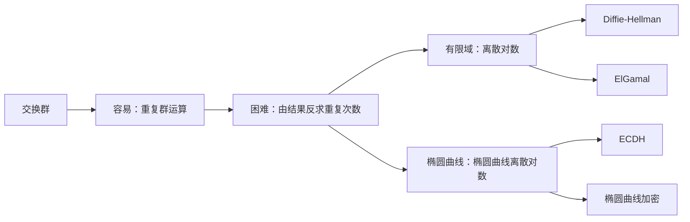
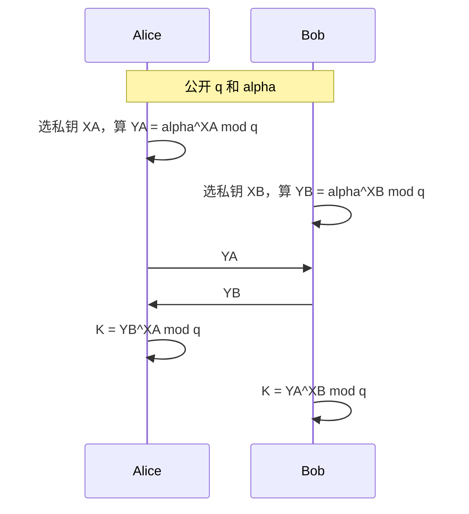
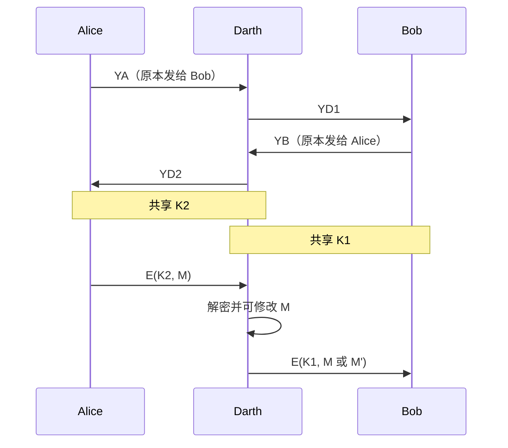
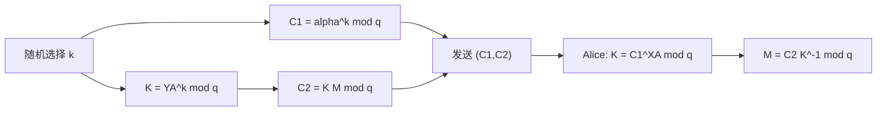
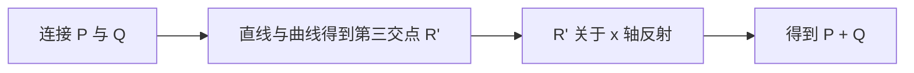
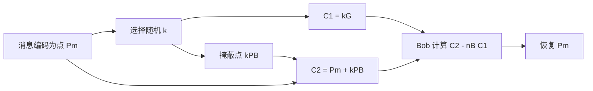
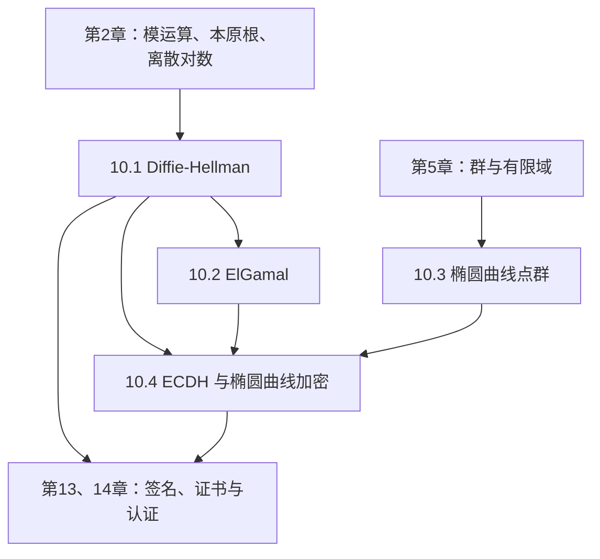

# 第10章 其他公钥密码体制

## 本章导学

第 9 章用 RSA 展示了“容易正向计算、难以反向求解”的公钥密码思想。本章换用另一类困难问题：**离散对数问题**。传统 Diffie-Hellman 和 ElGamal 在有限域的乘法群中工作，椭圆曲线密码则把同一思想搬到椭圆曲线点群中。表面上它们的公式不同，底层结构却高度统一。

### 本章学习目标

学完本章，你应当能够：

1. 完整说明 Diffie-Hellman 的参数、私钥、公钥和共享密钥计算。
2. 解释为什么未经认证的密钥交换会遭受中间人攻击。
3. 完成 ElGamal 的密钥生成、加密、解密，并说明随机数 $k$ 不能复用。
4. 理解交换群、单位元、逆元与椭圆曲线“点加法”的关系。
5. 在实数域和 $Z_p$ 上计算椭圆曲线点的负元、点加与倍点。
6. 区分 $Z_p$ 上的素数曲线与 $\mathrm{GF}(2^m)$ 上的二元曲线。
7. 说明 ECDH 和椭圆曲线加密的正确性与安全基础。
8. 从同等安全强度下的密钥长度解释 ECC 的效率优势。

### 先备知识

建议先复习：

- 第 2 章：模运算、模逆、本原根、离散对数；
- 第 5 章：群、有限域、$\mathrm{GF}(2^m)$；
- 第 9 章：公钥、私钥、单向陷门函数及 RSA。

本章最容易卡住的地方不是计算量，而是符号含义。务必先辨认运算所在的集合：普通整数乘法、模 $p$ 乘法、实数曲线点加法和有限域曲线点加法不是同一种运算。

## 10.1 Diffie-Hellman 密钥交换

### 本节学习目标与核心问题

- 理解双方如何在公开信道上得到相同秘密值。
- 区分公开参数、私钥、公钥和共享密钥。
- 回答核心问题：**窃听者看见所有公开信息，为什么仍难以求出共享密钥？**

### 10.1.1 算法

#### 为什么需要密钥交换

对称密码加解密高效，但通信双方必须先拥有同一把秘密钥。直接通过不安全网络发送这把钥匙会形成循环：为了安全传钥需要密钥，而当前恰恰没有密钥。Diffie-Hellman 的任务不是直接加密业务消息，而是让双方协商出后续对称加密使用的共享秘密。

#### 数学背景：离散对数

设 $q$ 为素数，$\alpha$ 是模 $q$ 的本原根。$\alpha$ 的幂模 $q$ 会遍历 $1$ 到 $q-1$。给定指数 $x$，计算

$$
y=\alpha^x\bmod q
$$

很容易；但给定 $\alpha,q,y$，反求满足该式的 $x$，就是离散对数问题：

$$
x=\operatorname{dlog}_{\alpha,q}(y).
$$

生活类比可以把正向运算想成“把颜料按秘密比例混合”：混合很容易，观察成品再精确恢复比例则很难。这个类比只帮助理解方向性，真正的安全性来自已研究的数学困难问题，而不是颜色本身。

#### 四类量不能混淆

| 类别 | Alice | Bob | 是否公开 |
| --- | --- | --- | --- |
| 全局参数 | $q,\alpha$ | $q,\alpha$ | 公开 |
| 私钥 | $X_A$ | $X_B$ | 保密 |
| 公钥 | $Y_A=\alpha^{X_A}\bmod q$ | $Y_B=\alpha^{X_B}\bmod q$ | 公开 |
| 共享密钥 | $K=Y_B^{X_A}\bmod q$ | $K=Y_A^{X_B}\bmod q$ | 不发送 |

完整过程如下。

教材原图可用于核对参数与消息方向：

![[attachments/fig_10_1_pdf220.png]]

#### 为什么双方结果相同

Alice 的计算为

$$
K_A=(Y_B)^{X_A}\bmod q=(\alpha^{X_B})^{X_A}\bmod q
=\alpha^{X_AX_B}\bmod q.
$$

Bob 的计算为

$$
K_B=(Y_A)^{X_B}\bmod q=(\alpha^{X_A})^{X_B}\bmod q
=\alpha^{X_AX_B}\bmod q.
$$

因为指数乘法满足 $X_AX_B=X_BX_A$，所以 $K_A=K_B$。共享密钥从未在网络上直接出现。

#### 教材示例拆解

教材取 $q=353,\alpha=3,X_A=97,X_B=233$：

$$
Y_A=3^{97}\bmod353=40,
\qquad
Y_B=3^{233}\bmod353=248.
$$

交换公钥后：

$$
248^{97}\bmod353=40^{233}\bmod353=160.
$$

小参数下敌手可穷举指数 97 或 233，因此示例只用于展示机制，不代表安全参数。实际系统必须使用足够大的、经过规范选择的群参数。

#### 常见误区

- **把公钥当成共享密钥。** $Y_A,Y_B$ 可被任何人看到；真正的 K 还需要一方私钥参与。
- **认为模运算只是为了让数变小。** 取模构造了具有离散对数困难性的有限群；去掉取模后，整数开方往往可直接恢复指数或秘密数。
- **认为离散对数难就自动安全。** 算法只提供密钥协商，不认证对方身份。
- **直接把 K 的坐标或整数原样当业务密钥。** 实际协议通常还要通过密钥派生函数生成规定长度、具有上下文绑定的会话密钥。

### 10.1.2 密钥交换协议

一次性私钥可以为单次连接生成临时共享密钥。另一种做法是每个用户长期持有 $X_i$，把 $Y_i$ 与公共参数放入可信目录。教材指出，可信目录场景可提供保密性和某种程度的认证，但不能自动抵抗重放。

这里要区分三件事：

| 属性 | 单纯 DH 是否自动提供 | 原因 |
| --- | --- | --- |
| 共享秘密 | 是 | 双方都得到 $\alpha^{X_AX_B}$ |
| 身份认证 | 否 | 公钥值本身未绑定身份 |
| 消息新鲜性 | 否 | 旧消息可能被重新发送 |

学习时可以记成：**DH 解决“同一把钥匙从哪里来”，不单独解决“对面是谁”和“消息是不是本次会话的”。**

### 10.1.3 中间人攻击

中间人攻击利用的不是离散对数算法漏洞，而是身份认证缺失。Darth 截获双方公钥并替换为自己的值，分别与 Alice 和 Bob 建立两把密钥。

![[attachments/fig_10_2_pdf222.png]]

Alice 和 Bob 的局部计算都完全正确，但他们对“公钥属于谁”的假设错误。防御方向是把临时公钥与身份绑定，例如使用数字签名和公钥证书。第 13、14 章会系统讨论这些机制。

记忆技巧：**机密性保护内容，认证保护对象；没有认证的交换，密钥可能和错误的人共享。**

## 10.2 ElGamal 密码体制

### 本节学习目标与核心问题

- 把 Diffie-Hellman 形成的一次共享量用于公钥加密。
- 理解密文为什么由两个分量组成。
- 解释为什么随机数 $k$ 必须对每个消息分组重新选择。

### 从密钥交换到加密

ElGamal 与 Diffie-Hellman 使用同样的公开参数 $q,\alpha$ 和离散对数困难性。Alice 的密钥为

$$
X_A\text{（私钥）},
\qquad
Y_A=\alpha^{X_A}\bmod q\text{（公钥）}.
$$

Bob 加密明文整数 $0\le M\le q-1$ 时选择新的随机数 $k$，计算

$$
K=Y_A^k\bmod q,
$$

$$
C_1=\alpha^k\bmod q,
\qquad
C_2=KM\bmod q.
$$

密文是二元组 $(C_1,C_2)$。$C_2$ 是被一次密钥 K 掩蔽的消息；$C_1$ 是让 Alice 能用私钥恢复同一个 K 的线索。

![[attachments/fig_10_3_pdf223.png]]

### 解密为什么正确

Alice 从 $C_1$ 得到

$$
C_1^{X_A}=(\alpha^k)^{X_A}=\alpha^{kX_A}
=(\alpha^{X_A})^k=Y_A^k=K\pmod q.
$$

再利用模逆去掉 K：

$$
C_2K^{-1}\equiv KMK^{-1}\equiv M\pmod q.
$$

这与 DH 的共同秘密完全相同，只是发送方把临时公钥 $C_1$ 和被共享量掩蔽的消息 $C_2$ 一起发出。

### 教材示例拆解

教材取 $q=19,\alpha=10,X_A=5$，所以

$$
Y_A=10^5\bmod19=3.
$$

Bob 加密 $M=17$，选择 $k=6$：

$$
K=3^6\bmod19=7,
$$

$$
C_1=10^6\bmod19=11,
\qquad
C_2=7\times17\bmod19=5.
$$

Alice 收到 $(11,5)$ 后：

$$
K=11^5\bmod19=7,
\qquad
K^{-1}=7^{-1}\bmod19=11,
$$

$$
M=5\times11\bmod19=17.
$$

计算链中每一步都要标明模数；“除以 K”必须写成乘 $K^{-1}$，不能使用普通实数除法。

### 为什么 k 不能复用

若两个分组使用同一个 k，则它们共享同一个 K，且 $C_{1,1}=C_{1,2}$。两个第二分量满足

$$
C_{2,1}=KM_1,
\qquad
C_{2,2}=KM_2\pmod q.
$$

若攻击者知道 $M_1$，就可以消去 K 并恢复 $M_2$：

$$
M_2=(C_{2,1})^{-1}C_{2,2}M_1\bmod q.
$$

生活类比是“一次性遮罩重复使用”：看到一组明文与密文关系后，另一组遮罩就不再秘密。这里的 k 不只是普通随机装饰，而是每个密文安全性的核心。

### 易混淆点对比

| 项目 | Diffie-Hellman | ElGamal 加密 |
| --- | --- | --- |
| 目标 | 双方协商秘密 | 用接收者公钥加密消息 |
| 临时秘密 | 双方各自私钥 | 发送方随机 k |
| 输出 | 双方本地得到 K | 密文 $(C_1,C_2)$ |
| 安全基础 | 离散对数 | 离散对数 |
| 身份认证 | 单独使用时没有 | 单独使用时也不自动提供 |

## 10.3 椭圆曲线算术

### 本节学习目标与核心问题

本节不是要求你把曲线画得漂亮，而是建立一个可用于密码学的交换群。核心问题是：**怎样把曲线上的点、点加法和重复相加定义成具有良好代数性质的运算系统？**

### 10.3.1 交换群

交换群由集合 G 和二元运算组成，满足封闭性、结合律、单位元、逆元和交换律。三类系统的对应关系如下：

| 系统 | 群元素 | 群运算 | 重复运算 | 困难逆问题 |
| --- | --- | --- | --- | --- |
| 有限域乘法群 | 非零剩余类 | 模乘 | $a^k$ | 由 $a,a^k$ 求 k |
| 椭圆曲线点群 | 曲线点和 O | 点加法 | $kP$ | 由 $P,kP$ 求 k |

椭圆曲线中的 $kP$ 表示 P 与自己相加 k 次，不是把坐标分别乘 k。这个区别是全章最重要的符号边界之一。

### 10.3.2 实数域上的椭圆曲线

教材采用简化形式

$$
y^2=x^3+ax+b. \tag{10.1}
$$

还要加入一个特殊元素无穷远点 O。为避免曲线出现尖点或自交等奇异情形，需要

$$
4a^3+27b^2\ne0. \tag{10.2}
$$

![[attachments/fig_10_4_pdf226.png]]

曲线关于 x 轴对称。若 $P=(x,y)$，则

$$
-P=(x,-y),
\qquad
P+(-P)=O.
$$

O 是单位元，满足 $P+O=P$。几何上的点加法可记成“连线、找第三点、关于 x 轴反射”：

若计算 $2P$，连接线改为 P 点处的切线。若 P 与 Q 的 x 坐标相同且互为负元，则连接线垂直，和为 O。

#### 代数计算

对 $P\ne Q$ 且 $P\ne-Q$：

$$
\Delta=\frac{y_Q-y_P}{x_Q-x_P},
$$

$$
x_R=\Delta^2-x_P-x_Q,
\qquad
y_R=-y_P+\Delta(x_P-x_R). \tag{10.3}
$$

倍点时斜率为曲线在 P 处的切线斜率：

$$
\Delta=\frac{3x_P^2+a}{2y_P},
$$

$$
x_R=\Delta^2-2x_P,
\qquad
y_R=\Delta(x_P-x_R)-y_P. \tag{10.4}
$$

先判特殊情况再套公式：O、互为负元、$y_P=0$ 的倍点都不能机械地代入带除法的通式。

### 10.3.3 $Z_p$ 上的椭圆曲线

密码学需要有限集合，因此把坐标和系数限制在 $Z_p$：

$$
y^2\equiv x^3+ax+b\pmod p. \tag{10.5}
$$

非奇异条件变为

$$
4a^3+27b^2\not\equiv0\pmod p. \tag{10.6}
$$

![[attachments/fig_10_5_pdf228.png]]

图 10.5 的点是离散的，不再是一条连续曲线；“直线相交”的几何图像只用于建立直觉，实际运算使用模 p 的代数公式。

#### 负元、点加与倍点

$$
-(x,y)=(x,-y\bmod p).
$$

对 $R=P+Q$：

$$
x_R=(\lambda^2-x_P-x_Q)\bmod p,
$$

$$
y_R=(\lambda(x_P-x_R)-y_P)\bmod p,
$$

其中

$$
\lambda=
\begin{cases}
(y_Q-y_P)(x_Q-x_P)^{-1}\bmod p, & P\ne Q,\\
(3x_P^2+a)(2y_P)^{-1}\bmod p, & P=Q.
\end{cases}
$$

注意“分数”表示乘以模逆。例如在 $Z_{23}$ 中，$1/4$ 表示 $4^{-1}\equiv6$，因为 $4\times6\equiv1\pmod{23}$。

教材例子取 $E_{23}(1,1)$、$P=(3,10)$、$Q=(9,7)$：

$$
\lambda=(7-10)(9-3)^{-1}\equiv11\pmod{23},
$$

$$
P+Q=(17,20).
$$

倍点时

$$
\lambda=(3\times3^2+1)(2\times10)^{-1}\equiv6\pmod{23},
$$

$$
2P=(7,12).
$$

Hasse 界给出曲线点总数 N 的范围：

$$
p+1-2\sqrt p\le N\le p+1+2\sqrt p.
$$

它说明点数约为 p，但不表示点数必然等于 p。

### 10.3.4 $\mathrm{GF}(2^m)$ 上的椭圆曲线

二元曲线使用不同方程：

$$
y^2+xy=x^3+ax^2+b. \tag{10.7}
$$

变量、系数和所有运算都在 $\mathrm{GF}(2^m)$ 中，适用条件是 $b\ne0$。加法是多项式系数的异或式运算，不能把式中的“+”当作普通整数加法。

![[attachments/fig_10_6_pdf229.png]]

对 $P=(x_P,y_P)$：

$$
-P=(x_P,x_P+y_P).
$$

当 $P\ne Q$ 且 $P\ne-Q$ 时：

$$
\lambda=\frac{y_Q+y_P}{x_Q+x_P},
$$

$$
x_R=\lambda^2+\lambda+x_P+x_Q+a,
$$

$$
y_R=\lambda(x_P+x_R)+x_R+y_P.
$$

倍点时：

$$
\lambda=x_P+\frac{y_P}{x_P},
$$

$$
x_R=\lambda^2+\lambda+a,
\qquad
y_R=x_P^2+(\lambda+1)x_R.
$$

初学阶段的重点是认识“曲线方程和点加公式随底层域改变”，不必把素数曲线公式直接搬到二元曲线上。

### 素数曲线与二元曲线对比

| 项目 | $Z_p$ 素数曲线 | $\mathrm{GF}(2^m)$ 二元曲线 |
| --- | --- | --- |
| 元素 | $0,1,\ldots,p-1$ | m 位多项式表示 |
| 曲线形式 | $y^2=x^3+ax+b$ | $y^2+xy=x^3+ax^2+b$ |
| 加法基础 | 模 p 整数算术 | 特征 2 有限域算术 |
| 教材给出的适用倾向 | 软件实现 | 硬件实现 |

## 10.4 椭圆曲线密码学

### 本节学习目标与核心问题

- 理解椭圆曲线离散对数问题（ECDLP）。
- 看懂 ECDH 与传统 DH 的结构对应。
- 理解椭圆曲线加密的“点掩蔽与私钥消除”。
- 解释 ECC 为何能在较短密钥下达到较高安全强度。

### 椭圆曲线离散对数

给定点 P 和整数 k，利用倍加算法计算

$$
Q=kP
$$

较容易；给定 P 和 Q 反求 k 很难。教材例子在 $E_{23}(9,17)$ 中逐个计算 P 的倍点，发现 $9P=(4,5)$，所以离散对数是 9。小群可以穷举，实际密码参数使用足够大的子群，使 Pollard rho 等攻击不可行。

### 10.4.1 用椭圆曲线实现 Diffie-Hellman

系统公开椭圆群 $E_q(a,b)$ 和阶为大整数 n 的基点 G。Alice、Bob 分别选择

$$
n_A<n,
\qquad
n_B<n,
$$

并生成公钥

$$
P_A=n_AG,
\qquad
P_B=n_BG.
$$

双方共享点为

$$
K=n_AP_B=n_A(n_BG)=n_B(n_AG)=n_BP_A.
$$

![[attachments/fig_10_7_pdf231.png]]

| 传统 DH | ECDH |
| --- | --- |
| 私钥 $X_A$ | 私钥 $n_A$ |
| 公钥 $\alpha^{X_A}$ | 公钥 $n_AG$ |
| 共享量 $\alpha^{X_AX_B}$ | 共享点 $n_An_BG$ |
| 反向难题：有限域离散对数 | 反向难题：ECDLP |

教材示例中，$p=211,E_p(0,-4),G=(2,2)$，Alice 和 Bob 的公钥分别为 $(115,48)$、$(130,203)$，共享点是 $(161,69)$。共享结果是一个点；实际用作对称密钥时应由其坐标经过规定的派生过程得到比特串。

### 10.4.2 椭圆曲线加密与解密

先把消息 m 编码为曲线点 $P_m$。不能随意把 m 当 x 坐标，因为并非每个 x 都对应曲线点。

若 Bob 的私钥为 $n_B$，公钥为 $P_B=n_BG$，Alice 选择随机 k 并发送

$$
C_m=\{C_1,C_2\}=\{kG,P_m+kP_B\}.
$$

Bob 解密：

$$
C_2-n_BC_1
=P_m+kP_B-n_B(kG)
=P_m.
$$

这里的减法是加上负点。$C_1$ 公开了 kG，但从 kG 反求 k 被 ECDLP 保护；Bob 不必求 k，因为私钥使他直接计算 $n_B(kG)=kP_B$。

教材数值例子最终得到密文

$$
\{(136,128),(246,174)\},
$$

Bob 计算

$$
(246,174)-101(136,128)=(112,26),
$$

恢复消息点。

### 10.4.3 ECC 安全性

ECC 的安全基础是椭圆曲线离散对数问题。教材表 10.4 从密码分析工作量角度比较密钥长度：

| 对称安全强度 | RSA 模数长度 | ECC 模数长度 |
| ---: | ---: | ---: |
| 80 位 | 1024 位 | 160–223 位 |
| 112 位 | 2048 位 | 224–255 位 |
| 128 位 | 3072 位 | 256–383 位 |
| 192 位 | 7680 位 | 384–511 位 |
| 256 位 | 15360 位 | 512 位以上 |

关键结论不是“ECC 算法天生比 RSA 每一步都快”，而是：**达到相同安全强度时，ECC 所需参数和密钥更短，因而通常减少存储、传输和计算开销。** 密钥长度相同不是公平的安全性比较。

### 常见误区

- 椭圆曲线不是椭圆；名称来自相关三次方程的历史。
- 曲线点乘 $kP$ 是重复点加，不是坐标乘法。
- 实数域曲线用于帮助建立几何直觉，实际密码使用有限域曲线。
- 有限域“除法”必须乘逆元；分母为 0 时要先走特殊规则。
- ECC 密钥短不等于可以任意缩短；参数仍需满足规定安全强度和子群条件。
- ECDH 与传统 DH 一样，未经认证时仍可能遭受中间人攻击。

## 本章知识串联

## 学习建议

1. 先把 DH 和 ElGamal 的每个符号写入“公开/私有/发送/不发送”四列表。
2. 做椭圆曲线计算时固定顺序：判特殊情况、求斜率、求 $x_R$、求 $y_R$、最后统一取模。
3. 每次看到分数，立刻改写成“分子乘分母的模逆”。
4. 用第 10.12–10.15 题的小曲线手算倍点表，确认点最终回到 O，建立群的直觉。
5. 把传统 DH 与 ECDH 并排默写，掌握“幂 ↔ 标量乘、生成元 $\alpha$ ↔ 基点 G”的结构映射。

## 推荐扩展阅读

> [!INFO] 补充材料
> 教材在本章引用了 NIST SP 800-57 的密钥管理建议。学习实际系统时，还应结合当前标准了解参数选择、密钥派生、点编码和公钥验证；这些属于教材之外的工程扩展，不替代本章算法定义。

## Related

- [[第九章_公钥密码学与RSA_导学讲义]]
- [[第十章_其他公钥密码体制_教材原文]]
- [[第十章_其他公钥密码体制_复习笔记]]
- [[第十章_其他公钥密码体制_课后习题]]
