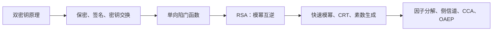
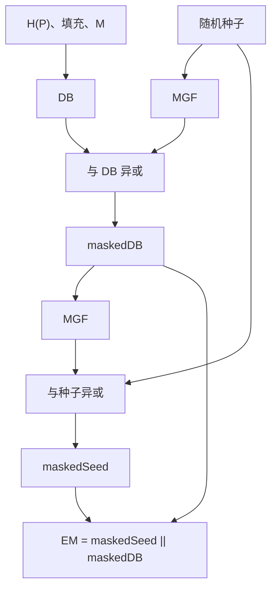

# 第9章 公钥密码学与RSA

## 本章复习



## 9.1 公钥密码体制的原理

### 9.1.1 公钥密码体制

#### 重要术语

| 术语 | 教材定义要点 |
| --- | --- |
| 非对称密钥 | 公钥和私钥执行互补运算 |
| 公钥密码 | 从公钥推出私钥在计算上不可行 |
| 公钥证书 | 认证机构绑定用户身份与公钥 |
| 公钥基础设施 | 管理密钥对和证书的协议、服务、软件与系统 |

#### 组成与步骤

组成：明文、加密算法、公钥、私钥、密文、解密算法。

1. 用户本地产生密钥对。
2. 公开公钥，保护私钥。
3. 发送者用接收者公钥加密。
4. 接收者用自己的私钥解密。

![[attachments/fig_9_1_202.png]]

**图 9.1 释义**：公钥可由多个通信方保存，私钥不分发；两把密钥分别控制互补变换。

#### 保密性

$$
Y=E(PU_b,X),
\qquad X=D(PR_b,Y).
$$

![[attachments/fig_9_2_pdf203.png]]

**图 9.2 释义**：发送方使用接收者 B 的公钥；只有 B 的私钥可完成逆变换。

#### 认证

$$
Y=E(PR_a,X),
\qquad X=D(PU_a,Y).
$$

![[attachments/fig_9_3_pdf204.png]]

**图 9.3 释义**：私钥变换表明消息来自 A，但公钥公开，因此不提供保密。实际签名通常对消息认证符/摘要变换。

#### 认证与保密

$$
Z=E(PU_b,E(PR_a,X)),
$$

$$
X=D(PU_a,D(PR_b,Z)).
$$

![[attachments/fig_9_4_pdf205.png]]

代价：四次公钥运算。

#### 对称与公钥加密

| 项目 | 对称加密 | 公钥加密 |
| --- | --- | --- |
| 密钥 | 同一秘密钥 | 公钥/私钥 |
| 共享要求 | 双方先共享秘密 | 公钥公开，私钥本地保管 |
| 安全要求 | 知算法和密文不足以求密钥 | 知算法、公钥、密文不足以求私钥或明文 |
| 典型用途 | 大量数据加密 | 密钥管理、签名、少量数据变换 |

> [!WARNING] 易错点
> 公钥密码不天然比对称密码更安全，也不能完全取代对称密码；公钥归属仍需认证。

### 9.1.2 公钥密码体制的应用

| 算法 | 加密/解密 | 数字签名 | 密钥交换 |
| --- | --- | --- | --- |
| RSA | 是 | 是 | 是 |
| 椭圆曲线 | 是 | 是 | 是 |
| Diffie-Hellman | 否 | 否 | 是 |
| DSS | 否 | 是 | 否 |

三类应用：加密/解密、数字签名、密钥交换。不是所有双密钥算法都支持全部三类。

### 9.1.3 公钥密码的要求

#### 六项条件

1. 密钥对生成容易。
2. 已知公钥与消息，计算密文容易。
3. 持有私钥，恢复明文容易。
4. 由公钥求私钥不可行。
5. 由公钥和密文求明文不可行。
6. 部分算法支持两把密钥交换顺序。

#### 单向函数

$$
Y=f(X)\text{ 易计算},
\qquad X=f^{-1}(Y)\text{ 不可行}.
$$

#### 单向陷门函数

| 已知条件 | 计算 |
| --- | --- |
| $k,X$ | $Y=f_k(X)$ 容易 |
| 陷门 $k,Y$ | $X=f_k^{-1}(Y)$ 容易 |
| $Y$，未知陷门 | 求 $X$ 不可行 |

> [!WARNING] 易错点
> “单向”不是没有数学逆；“陷门”是使逆计算变容易的秘密信息。

### 9.1.4 公钥密码分析

| 攻击 | 思路 | 防护要点 |
| --- | --- | --- |
| 穷举私钥 | 枚举秘密密钥 | 足够大密钥空间 |
| 由公钥求私钥 | 寻找数学捷径 | 选择经分析的困难问题与参数 |
| 穷举消息 | 公开加密小消息空间并匹配 | 随机化编码/填充 |

小消息空间会把攻击难度降到消息熵。例如只加密 56 位 DES 密钥，攻击者可枚举候选消息，不必破解整个 RSA 私钥。

## 9.2 RSA 算法

### 9.2.1 RSA 算法描述

#### 核心公式

$$
C=M^e\bmod n,
\qquad M=C^d\bmod n=M^{ed}\bmod n.
$$

$$
n=pq,
\qquad \phi(n)=(p-1)(q-1),
$$

$$
ed\equiv1\pmod{\phi(n)},
\qquad d\equiv e^{-1}\pmod{\phi(n)}.
$$

#### 密钥生成表

| 量 | 生成/约束 | 可见性 |
| --- | --- | --- |
| $p,q$ | 大素数 | 保密 |
| $n=pq$ | 模数 | 公开 |
| $\phi(n)$ | $(p-1)(q-1)$ | 保密 |
| $e$ | $1<e<\phi(n)$，$\gcd(e,\phi(n))=1$ | 公开 |
| $d$ | $e$ 模 $\phi(n)$ 的逆元 | 保密 |

公钥 $PU=\{e,n\}$；私钥 $PR=\{d,n\}$；明文分组必须满足 $0\le M<n$。

![[attachments/fig_9_5_pdf208.png]]

**图 9.5 释义**：Alice 生成密钥，Bob 用 Alice 公钥加密，Alice 用私钥解密。

#### 教材例子

$$
p=17, q=11, n=187, \phi(n)=160, e=7, d=23.
$$

$$
88^7\bmod187=11,
\qquad11^{23}\bmod187=88.
$$

![[attachments/fig_9_6_pdf208.png]]

![[attachments/fig_9_7_pdf209.png]]

**图 9.6/9.7 释义**：图 9.6 展示单分组密钥生成与模幂；图 9.7 展示字符编码、分组、逐组 RSA 变换和恢复。

### 9.2.2 计算问题

#### 模乘性质

$$
[(a\bmod n)(b\bmod n)]\bmod n=(ab)\bmod n.
$$

#### 平方-乘快速模幂

若 $b=b_kb_{k-1}\cdots b_0$：

$$
b=\sum_{b_i=1}2^i,
\qquad
a^b\bmod n=\prod_{b_i=1}(a^{2^i}\bmod n)\bmod n.
$$

```text
f = 1
for bit from MSB to LSB:
    f = f*f mod n
    if bit == 1:
        f = f*a mod n
```

![[attachments/fig_9_8_pdf210.png]]

**图 9.8 释义**：每个指数位都执行平方；位为 1 时再乘底数。中间结果始终模 $n$。

#### 公钥指数

常用 $e=65537=2^{16}+1$；二进制仅两个 1，乘法次数少。过小 $e$ 在无随机填充且相同消息发给多个互素模数时可能受 CRT 广播攻击。

#### CRT 私钥加速

$$
V_p=C^{d\bmod(p-1)}\bmod p,
\qquad V_q=C^{d\bmod(q-1)}\bmod q.
$$

$$
X_p=q(q^{-1}\bmod p),
\qquad X_q=p(p^{-1}\bmod q).
$$

$$
M=(V_pX_p+V_qX_q)\bmod n.
$$

教材结论：比直接模 $n$ 私钥运算约快 4 倍。不能简单选择很小的 $d$。

#### 素数生成

1. 随机选择目标位长奇数。
2. 随机选择测试底数 $a<n$。
3. 执行 Miller-Rabin 等概率素性测试。
4. 失败则换候选；通过足够多次后接受。

在 $N$ 附近平均约测试 $\ln N/2$ 个奇数可找到素数。之后选择与 $\phi(n)$ 互素的 $e$，用扩展欧几里得算法计算 $d$。

### 9.2.3 RSA 的安全性

#### 五类攻击

| 类型 | 核心利用点 |
| --- | --- |
| 穷举攻击 | 搜索私钥 |
| 数学攻击 | 分解 $n$、求 $\phi(n)$ 或直接求 $d$ |
| 计时攻击 | 模幂运行时间依赖私钥位与数据 |
| 故障攻击 | 签名计算中的错误结果泄露私钥 |
| 选择密文攻击 | RSA 乘法结构与解密接口 |

#### 因子分解与参数约束

- 分解 $n=pq$ 后可求 $\phi(n)$ 与 $d$。
- 求 $\phi(n)$ 与分解 $n$ 等价；已知算法中由 $e,n$ 求 $d$ 至少与分解一样费时。
- $p,q$ 位长应接近。
- $p-1,q-1$ 各应有大素因子。
- $\gcd(p-1,q-1)$ 应较小。
- 避免 $d<n^{1/4}$。

教材记录的标准建议：NIST/加拿大至少 2048 位，欧盟报告建议 3072 位或更长；这些是教材所处时期的建议。

#### 计时攻击与对策

平方-乘中指数位为 1 时多一次模乘，时间差可能泄露 $d$。对策：

- 固定幂运算时间；
- 随机延时；
- RSA 隐蔽。

隐蔽：

$$
C'=C(r^e)\bmod n,
$$

$$
M'=(C')^d\bmod n,
\qquad M=M'r^{-1}\bmod n.
$$

#### 选择密文攻击

$$
E(M_1)E(M_2)\equiv E(M_1M_2)\pmod n.
$$

取 $X=C2^e\bmod n$ 并获得 $Y=X^d\bmod n$，则 $Y=2M\bmod n$，可进一步恢复 $M$。原始 RSA 必须配合经分析的随机编码。

#### OAEP

![[attachments/fig_9_9_pdf215.png]]



OAEP 用随机种子掩蔽 DB，再用 maskedDB 反向掩蔽种子，使编码随机化并互相绑定。

## 公式速查

| 主题 | 公式 |
| --- | --- |
| RSA 模数 | $n=pq$ |
| 欧拉函数 | $\phi(n)=(p-1)(q-1)$ |
| 密钥关系 | $ed\equiv1\pmod{\phi(n)}$ |
| 加密 | $C=M^e\bmod n$ |
| 解密 | $M=C^d\bmod n$ |
| CRT 子结果 | $V_p=C^{d\bmod(p-1)}\bmod p$ |
| 乘法结构 | $E(M_1)E(M_2)\equiv E(M_1M_2)\pmod n$ |

## 重点、难点与易错点

### 重点

- 公钥/私钥在保密和认证中的方向。
- 公钥体制六项要求与单向陷门函数。
- RSA 密钥生成、加解密和快速模幂。
- 因子分解、计时、故障、CCA 与 OAEP。

### 难点

- $ed\equiv1\pmod{\phi(n)}$ 与 RSA 正确性的关系。
- 二进制平方-乘每一步的模乘记录。
- CRT 私钥加速的指数缩减与重构。
- 原始 RSA 乘法结构如何变成选择密文攻击。

### 易错点

- 把私钥变换误称为保密加密。
- 把 $d=e^{-1}$ 当普通倒数。
- 忘记 $M<n$。
- 认为一次 Miller-Rabin 通过就严格证明素数。
- 为提高速度选择过小 $d$。
- 认为密钥足够长就能阻止小消息字典攻击。
- 把任意随机填充等同于 OAEP。

## 关键词索引

| 关键词 | 位置 |
| --- | --- |
| 公钥、私钥、证书、PKI | 9.1.1 |
| 保密性、认证、数字签名、密钥交换 | 9.1.1–9.1.2 |
| 单向函数、单向陷门函数 | 9.1.3 |
| 穷举消息攻击 | 9.1.4 |
| RSA、欧拉函数、模逆 | 9.2.1 |
| 快速模幂、CRT、Miller-Rabin | 9.2.2 |
| 因子分解、计时攻击、隐蔽、故障攻击 | 9.2.3 |
| 选择密文攻击、OAEP、MGF | 9.2.3 |

## 个人理解与补充

> [!NOTE] 非教材原文：统一检查框架
> 对任何公钥方案，依次检查：公开信息是什么、秘密陷门是什么、正向和逆向各由谁执行、消息空间是否足够大、编码是否随机化、实现是否泄露时间或故障信息。

> [!NOTE] 非教材原文：RSA 解题顺序
> 小参数题固定按 `p,q -> n,phi -> gcd(e,phi) -> d -> C -> M`；快速模幂题先写二进制指数，再逐位记录“平方后值”和“位为 1 后乘底数值”。

## Related

- [[第二章_数论基础_复习笔记]]
- [[第八章_随机位生成和流密码_复习笔记]]
- [[第十章_其他公钥密码体制_复习笔记]]
- [[第十三章_数字签名_复习笔记]]
- [[第十五章_密钥管理和分发_复习笔记]]

