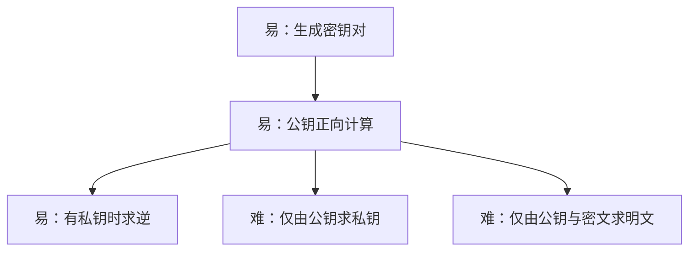
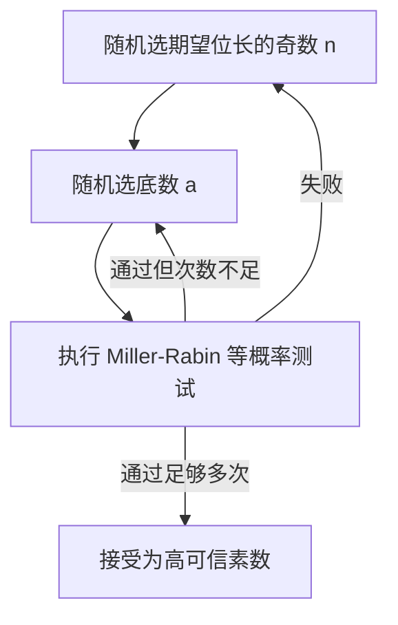

# 第9章 公钥密码学与RSA

## 本章导学

本章要解决的根本问题是：**通信双方事先没有共享秘密时，怎样建立保密通信，并让接收者验证消息来自谁**。公钥密码用一对数学相关、功能互补的密钥改变了传统密码的密钥分发方式；RSA 则把这一思想具体落实为模幂运算。

### 本章学习目标

- 理解公钥、私钥、明文、密文及加解密算法的关系。
- 区分保密、认证、[[Course Notes/密码学 (Cipher)/Digital Signature (II)/Digital Signature (II)|数字签名]]和密钥交换。
- 掌握单向函数、单向陷门函数及公钥体制六项要求。
- 能完成小参数 RSA 的密钥生成、加密和解密。
- 掌握快速模幂、CRT 私钥加速和概率素数选择流程。
- 理解 RSA 的穷举、因子分解、计时、故障和选择密文攻击。
- 理解随机填充与 OAEP 为什么是实用 RSA 的必要组成。

### 本章核心问题

1. 为什么公开加密密钥不会同时公开解密能力？
2. “用私钥变换消息”为什么提供认证，却不自动提供保密？
3. RSA 的正确性为什么依赖 $ed\equiv1\pmod{\phi(n)}$？
4. 大整数模幂和大素数生成怎样做到可计算？
5. 原始 RSA 的确定性和乘法结构为什么会带来攻击？

### 学习路线


## 9.1 公钥密码体制的原理

### 学习价值与知识背景

对称密码要求通信双方先共享秘密钥，或者依赖密钥分发中心；数字签名还要求接收者能验证消息确由某人产生。Diffie 和 Hellman 提出的公钥思想用两把不同密钥分别承担公开操作和秘密操作，从结构上回应了这两个问题。

教材特别纠正三种误解：

| 误解 | 正确认知 |
| --- | --- |
| 公钥密码天然比对称密码安全 | 安全性都取决于密钥长度、算法与攻击计算量 |
| 公钥密码可完全取代对称密码 | 公钥运算昂贵，主要用于密钥管理和签名 |
| 公钥密钥分发不需要协议与可信角色 | 公钥真实性仍需协议、证书或中心代理保障 |

### 9.1.1 公钥密码体制

#### 本节学习目标与核心问题

- 记住公钥体制的六个组成部分和四个基本步骤。
- 能根据安全目标判断该用谁的哪把密钥。
- 核心问题：公开的是“任何人都能做的操作”，秘密的是“只有持有者能做的互补操作”。

#### 六个组成部分

1. 明文。
2. 加密算法。
3. 公钥与私钥。
4. 密文。
5. 解密算法。

教材把公钥和私钥列为一对算法输入，因此合计称为六部分。仅由算法和加密密钥推出解密密钥在计算上必须不可行；RSA 还允许两把密钥交换操作顺序。

![[attachments/fig_9_1_202.png]]

**图 9.1 解读**：每个用户本地产生密钥对，公开其中一把并保护另一把。公钥可以被许多人保存，私钥无需分发。

#### 保密性

若 A 向 B 发送消息，使用 B 的公钥加密：

$$
Y=E(PU_b,X),
\qquad X=D(PR_b,Y).
$$

![[attachments/fig_9_2_pdf203.png]]

只有 B 拥有 $PR_b$，所以只有 B 能执行秘密逆变换。这里回答“谁能读”：**用接收者公钥加密，接收者私钥解密**。

#### 认证与数字签名

若 A 用自己的私钥变换消息：

$$
Y=E(PR_a,X),
\qquad X=D(PU_a,Y).
$$

![[attachments/fig_9_3_pdf204.png]]

任何人都能用 A 的公钥验证，因而可以确认操作必须由持有 $PR_a$ 的一方产生。但任何人也能恢复消息，所以该过程**不提供保密性**。实际数字签名通常只对消息的认证符/摘要做私钥运算，避免保存和传输整份明文与签名变换结果。

#### 同时认证和保密

教材给出的组合为：

$$
Z=E(PU_b,E(PR_a,X)),
$$

$$
X=D(PU_a,D(PR_b,Z)).
$$

![[attachments/fig_9_4_pdf205.png]]

先用发送者私钥提供来源认证，再用接收者公钥包住结果提供保密。代价是每次通信要执行四次公钥运算。

#### 对称密码与公钥密码对比

| 项目 | 对称密码 | 公钥密码 |
| --- | --- | --- |
| 密钥 | 收发共享同一秘密钥 | 公钥与私钥成对 |
| 公开条件 | 算法公开，密钥保密 | 算法和公钥公开，私钥保密 |
| 主要优势 | 高效处理大量数据 | 密钥管理、签名、认证 |
| 安全目标 | 由共享秘密控制 | 由互补密钥及困难问题控制 |

#### 生活化类比

保密可类比“任何人都能把信投入收件人的公开信箱，只有收件人有钥匙开箱”；签名可类比“只有本人能盖出的印章，任何人都能查验印章样式”。类比只帮助区分方向，不能替代数学安全条件。

#### 常见误区、记忆与学习建议

- 私钥运算不等于保密，因为公钥是公开的。
- 公钥可公开不等于其归属可不验证；伪造公钥归属会破坏整个模型。
- 记忆：**保密看接收者，认证看发送者**。
- 画两遍图 9.2 和图 9.3，并在每条箭头旁写出密钥拥有者。

### 9.1.2 公钥密码体制的应用

#### 三类应用

| 应用 | 发送方操作 | 主要目标 |
| --- | --- | --- |
| 加密/解密 | 用接收者公钥加密 | 保密性 |
| 数字签名 | 用发送者私钥生成签名 | 来源认证、完整性、不可否认相关能力 |
| 密钥交换 | 一方或双方使用私钥参与协议 | 建立会话密钥 |

教材算法能力表：RSA 和椭圆曲线可支持三类；Diffie-Hellman 只用于密钥交换；DSS 只用于数字签名。

#### 易混淆点与章节关联

“公钥密码体制”是双密钥机制总称，不表示每个算法都能承担三项任务。第 10 章将介绍其他公钥体制，第 13 章展开数字签名，第 15 章展开密钥管理与交换。

### 9.1.3 公钥密码的要求

#### 六项要求

1. 用户生成公钥/私钥对在计算上容易。
2. 已知公钥和消息，计算密文容易。
3. 持有私钥时，解密密文容易。
4. 已知公钥，求私钥不可行。
5. 已知公钥和密文，求明文不可行。
6. 对部分算法，两把密钥的操作顺序可交换。



#### 单向函数

$$
Y=f(X)\quad\text{容易},
\qquad X=f^{-1}(Y)\quad\text{不可行}.
$$

“容易”通常指输入长度的多项式时间；“不可行”指所需工作随输入规模增长过快。但密码学不能只满足最坏情况难，必须避免攻击者在实际输入上经常求逆。

#### 单向陷门函数

对函数族 $f_k$：

- 已知 $k,X$，易算 $Y=f_k(X)$；
- 已知陷门信息 $k,Y$，易算 $X=f_k^{-1}(Y)$；
- 未知陷门信息时，由 $Y$ 求 $X$ 不可行。

陷门不是普通输入参数，而是使原本困难的逆运算变得容易的秘密信息。RSA 中，因数 $p,q$ 或由它们导出的私钥信息承担这一角色。

#### 典型误区与记忆

- 单向函数不是数学上“没有逆”，而是逆在计算上不可行。
- 第六项不是所有公钥体制的必要条件。
- 记忆“**正向易、持陷门逆向易、无陷门逆向难**”。

### 9.1.4 公钥密码分析

#### 三类基本思路

1. **穷举私钥**：用足够长的密钥空间抵抗，但密钥越长运算越慢。
2. **由公钥推私钥**：寻找数学捷径；公钥算法安全性没有被“不可破解”数学证明一劳永逸地保证。
3. **穷举消息**：若消息空间很小，攻击者可用公开密钥加密所有候选并与密文比较。

#### 小消息空间攻击示例

若 RSA 只加密一个 56 位 DES 密钥，攻击者不必穷举 RSA 私钥，只需枚举 $2^{56}$ 个候选消息并公开加密比对。对策是给消息加入随机性，使同一候选不再固定映射到同一密文。

#### 生活化类比与学习建议

再坚固的保险箱，如果箱内物品只有“是/否”两种可能，也可以把两种情况分别试一次。评价公钥安全时，要同时看密钥空间和消息空间。

## 9.2 RSA 算法

### 9.2.1 RSA 算法描述

#### 本节学习目标与核心问题

- 会生成小参数 RSA 密钥对。
- 会完成加密、解密并解释正确性条件。
- 核心问题：如何让两个指数运算互为逆操作？

#### 密钥生成

1. 选择大素数 $p,q$，保密。
2. 计算 $n=pq$，公开。
3. 计算 $\phi(n)=(p-1)(q-1)$，保密。
4. 选择 $e$，满足 $1<e<\phi(n)$ 且 $\gcd(e,\phi(n))=1$，公开。
5. 计算

$$
d\equiv e^{-1}\pmod{\phi(n)},
\qquad ed\equiv1\pmod{\phi(n)}.
$$

公钥 $PU=\{e,n\}$，私钥 $PR=\{d,n\}$。

#### 加密与解密

$$
C=M^e\bmod n,
\qquad M=C^d\bmod n=M^{ed}\bmod n,
\qquad 0\le M<n.
$$

![[attachments/fig_9_5_pdf208.png]]

图 9.5 把密钥生成、Bob 加密、Alice 解密三段连接起来。$n$ 同时出现在公钥和私钥中；真正必须隐藏的是 $d$ 以及能导出它的 $p,q,\phi(n)$。

#### 教材示例

取 $p=17,q=11$：

$$
n=187,\qquad\phi(n)=160.
$$

选 $e=7$，由 $7\times23=161\equiv1\pmod{160}$ 得 $d=23$。对 $M=88$：

$$
C=88^7\bmod187=11,
\qquad M=11^{23}\bmod187=88.
$$

![[attachments/fig_9_6_pdf208.png]]

图 9.6 展示平方-乘法如何避免直接计算巨大整数幂。图 9.7 则说明实际文本需编码成小于 $n$ 的整数分组。

![[attachments/fig_9_7_pdf209.png]]

#### 常见误区、记忆与建议

- $e$ 与 $d$ 是模 $\phi(n)$ 的逆，不是普通实数倒数。
- 必须保证 $M<n$；RSA 不能不分组地处理任意大整数。
- 知道 $n,e$ 是设计要求，不是泄密。
- 记忆“**选两素数，乘成 n；算 φ，选 e；扩欧求 d**”。

### 9.2.2 计算问题

#### 快速模幂

模乘性质：

$$
[(a\bmod n)(b\bmod n)]\bmod n=(ab)\bmod n.
$$

把指数写成二进制：

$$
b=\sum_{b_i=1}2^i,
\qquad
a^b\bmod n=\prod_{b_i=1}(a^{2^i}\bmod n)\bmod n.
$$

```text
f = 1
for exponent bits from most significant to least significant:
    f = f^2 mod n
    if current bit is 1:
        f = f*a mod n
```

![[attachments/fig_9_8_pdf210.png]]

图 9.8 的核心是“每位必平方，位为 1 再乘底数”。表 9.4 以 $7^{560}\bmod561$ 展示中间结果。

#### 公钥运算优化

常选 $e=65537=2^{16}+1$，因为二进制中只有两个 1，模乘次数少。$e=3$、17 也计算快，但过小指数配合相同消息和多个互素模数会受 CRT 广播攻击；随机填充可阻止教材所述简单攻击。

#### 私钥运算的 CRT 加速

$$
V_p=C^{d\bmod(p-1)}\bmod p,
\qquad
V_q=C^{d\bmod(q-1)}\bmod q.
$$

$$
X_p=q(q^{-1}\bmod p),
\qquad X_q=p(p^{-1}\bmod q).
$$

$$
M=(V_pX_p+V_qX_q)\bmod n.
$$

把一个模 $n$ 的大运算拆成模 $p$、模 $q$ 的两个较小运算，教材给出约 4 倍加速。不能简单选择很小的 $d$，因为会引入密码分析弱点。

#### 素数选择流程



素数定理给出：在 $N$ 附近平均约每 $\ln N$ 个整数有一个素数；先排除偶数后，平均测试约 $\ln N/2$ 个奇数。找到 $p,q$ 后，再选与 $\phi(n)$ 互素的 $e$，用扩展欧几里得算法求 $d$。

#### 易错点与学习建议

- Miller-Rabin 通过一次只表示“可能是素数”，失败则确定是合数。
- 快速模幂必须每步取模，否则中间整数爆炸。
- 公钥指数小与私钥指数小的风险不同；不能因公钥优化而类推私钥也应小。

### 9.2.3 RSA 的安全性

#### 五类攻击总览

| 攻击 | 利用点 | 教材对策/限制 |
| --- | --- | --- |
| 穷举攻击 | 私钥空间 | 使用足够长密钥 |
| 数学攻击 | 分解 $n$、求 $\phi(n)$ 或 $d$ | 选择合适的大素数与密钥长度 |
| 计时攻击 | 运行时间依赖私钥位与数据 | 常数时间、随机延时、隐蔽 |
| 故障攻击 | 签名计算中的硬件错误 | 需要物理接触；加强硬件与结果检查 |
| 选择密文攻击 | 原始 RSA 的代数结构 | 随机填充，采用 OAEP |

#### 因子分解与参数选择

若分解 $n=pq$，即可求 $\phi(n)$ 和 $d$。教材还给出 RSA 参数约束：$p,q$ 位长接近；$p-1,q-1$ 各有大素因子；$\gcd(p-1,q-1)$ 较小；避免 $d<n^{1/4}$。

教材引用的历史建议包括 2048 位或 3072 位等级。应把这些数值理解为教材时代的标准记录，而不是脱离时间的永久安全承诺。

#### 计时攻击与隐蔽

平方-乘算法中每位都平方，但指数位为 1 时多一次乘法。若运行时间可被精确观察，攻击者可逐位推断私钥指数。

隐蔽过程：

$$
C'=C(r^e)\bmod n,
\qquad M'=(C')^d\bmod n,
\qquad M=M'r^{-1}\bmod n.
$$

因为 $r^{ed}\equiv r\pmod n$，最终仍恢复原消息，而实际幂运算输入被随机化。

#### 选择密文攻击

原始 RSA 具有乘法同态：

$$
E(M_1)E(M_2)\equiv E(M_1M_2)\pmod n.
$$

攻击者可把 $C$ 变成 $X=C2^e\bmod n$，请求目标私钥处理后得到 $2M\bmod n$，再消去 2。根因是原始 RSA 确定且保留代数结构。

#### OAEP

![[attachments/fig_9_9_pdf215.png]]

OAEP 编码步骤：

1. 把参数哈希 $H(P)$、填充和消息组成数据块 $DB$。
2. 随机选种子，用 `MGF(seed)` 掩蔽 $DB$ 得 `maskedDB`。
3. 用 `MGF(maskedDB)` 掩蔽种子得 `maskedSeed`。
4. 连接 `maskedSeed || maskedDB` 得编码消息 $EM$，再执行 RSA。

双向掩蔽使消息和随机种子互相绑定，同一消息不再固定映射为同一 RSA 输入。

#### 常见误区、记忆与学习建议

- “分解困难”不是原始 RSA 在任意使用方式下都安全的充分条件。
- 简单随机尾缀不等于经过分析的 OAEP。
- 计时、故障属于实现侧信道/物理攻击，不改变 RSA 数学等式，却能泄露私钥。
- 记忆“**数学看因子，时间看分支，故障看硬件，CCA 看代数，OAEP 加随机结构**”。

## 本章易混淆知识对比

| 易混淆项 | 区分 |
| --- | --- |
| 公钥公开 vs 公钥可信 | 可公开不代表归属无需认证 |
| 私钥变换 vs 保密 | 私钥变换主要用于来源认证，任何人可用公钥验证 |
| 单向函数 vs 单向陷门函数 | 后者拥有秘密陷门时可高效求逆 |
| $e^{-1}$ vs $1/e$ | RSA 中是模 $\phi(n)$ 的乘法逆元 |
| 快速模幂 vs 直接大整数幂 | 前者逐步平方、乘法并立即取模 |
| 随机填充 vs OAEP | OAEP 是结构化双掩蔽编码，不是随意加随机位 |
| 数学安全 vs 实现安全 | 计时和故障可绕过纯数学困难性 |

## 本章自学建议

1. 先用“谁的公钥/谁的私钥”画出保密与认证两张图。
2. 手算至少一组小 RSA：$p,q\to n,\phi\to e,d\to C,M$。
3. 用二进制指数手算一次平方-乘法，记录每步取模。
4. 对每类攻击写出“攻击者已知什么、利用什么、得到什么”。
5. 最后再学习 OAEP，先理解原始 RSA 的确定性和乘法性质，才能理解填充的必要性。

## Related

- [[第二章_数论基础_导学讲义]]
- [[第八章_随机位生成和流密码_导学讲义]]
- [[第十章_其他公钥密码体制_导学讲义]]
- [[第十三章_数字签名_导学讲义]]
- [[第十五章_密钥管理和分发_导学讲义]]

