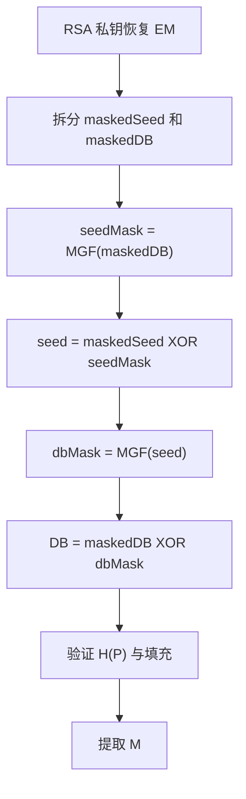

# 第9章 公钥密码学与RSA - 课后习题

> [!info] 内容说明
> 本文包含原教材本章全部 **7道思考题、19道习题，共26道**。题目原文来自本章教材原文并经PDF章末页复核；解答优先依据本章正文。

## 思考题

### 思考题 9.1

> [!question] **题目原文**
> 公钥密码体制的主要组成是什么？

#### 答题思路

按算法输入、输出和变换列举。

#### 解答

明文、加密算法、公钥、私钥、密文和解密算法。公钥与私钥是算法的一对互补输入，一个用于正向变换，另一个用于逆变换。

#### 依据

9.1.1 公钥密码体制。

---

### 思考题 9.2

> [!question] **题目原文**
> 公钥和私钥的作用是什么？

#### 答题思路

分别从保密和认证两个应用说明密钥方向。

#### 解答

为保密时，发送者用接收者[[Course Notes/密码学 (Cipher)/Public-Key Encryption (III)/Public-Key Encryption (III)|公钥加密]]，接收者用私钥解密；为认证/签名时，发送者用自己的私钥生成变换结果，验证者用发送者公钥验证。公钥可公开，私钥必须由所有者保护。

#### 依据

图 9.2、图 9.3。

---

### 思考题 9.3

> [!question] **题目原文**
> 公钥密码体制的三种应用是什么？

#### 答题思路

先按教材列出的三类应用作答，再分别说明每类应用中公钥和私钥承担的作用，避免只罗列名称而没有解释。

#### 解答

公钥密码体制有三类主要应用：

1. **加密/解密**：发送方用接收方公钥加密，只有持有对应私钥的接收方能够解密，用于提供保密性。
2. **[[Course Notes/密码学 (Cipher)/Digital Signature (II)/Digital Signature (II)|数字签名]]**：签名者用私钥生成签名，任何持有其公钥的人都可以验证，用于确认消息来源并检验完整性。
3. **密钥交换**：通信双方利用公钥密码技术安全协商或传递会话密钥，随后通常使用对称密码保护大量数据。

#### 依据

本章教材原文 **9.1.2 公钥密码体制的应用**，其中直接列出加密/解密、数字签名和密钥交换三类应用，并说明各类应用的密钥使用方向。

---

### 思考题 9.4

> [!question] **题目原文**
> 为了得到安全的算法，公钥密码体制应满足哪些要求？

#### 答题思路

分“合法用户容易”和“攻击者困难”，补充可选的密钥可交换性。

#### 解答

密钥对生成容易；公钥加密容易；私钥解密容易；由公钥求私钥不可行；由公钥和密文求明文不可行。对 RSA 等算法，还可要求两把密钥的操作顺序能够交换。

#### 依据

本章教材原文 **9.1.3 公钥密码的要求**。

---

### 思考题 9.5

> [!question] **题目原文**
> 什么是单向函数？

#### 答题思路

同时说明正向和逆向的计算复杂性。

#### 解答

对每个函数值存在唯一逆，正向 $Y=f(X)$ 容易计算，但仅由 $Y$ 求 $X=f^{-1}(Y)$ 在计算上不可行的函数。

#### 依据

本章教材原文 **9.1.3 公钥密码的要求**。

---

### 思考题 9.6

> [!question] **题目原文**
> 什么是单向陷门函数？

#### 答题思路

在单向函数上加入“知道附加秘密信息时可高效求逆”。

#### 解答

对函数族 $f_k$，已知 $k,X$ 时容易计算 $Y=f_k(X)$；已知陷门信息 $k,Y$ 时容易计算 $X=f_k^{-1}(Y)$；只知道 $Y$ 而不知道陷门时，求逆在计算上不可行。

#### 依据

本章教材原文 **9.1.3 公钥密码的要求**。

---

### 思考题 9.7

> [!question] **题目原文**
> 用一般术语描述挑选素数的有效过程。

#### 答题思路

复述随机候选和重复概率测试流程。

#### 解答

随机选目标位长的奇整数 $n$；随机选 $a<n$；执行 Miller-Rabin 等概率[[Course Notes/算法概论 （Algorithm）/1 3 素性测试/1.3 素性测试|素性测试]]；失败则换新候选，通过则换不同 $a$ 重测；通过足够多轮后，以很高可信度接受 $n$ 为素数。

#### 依据

9.2.2“密钥生成”。

---

## 习题

### 习题 9.1

> [!question] **题目原文**
> 在诸如RSA的公钥体制出现之前，就已有关于公钥体制的存在性证明，目的是说明公钥密码理论上可行。考虑函数 $f_1(x_1) = z_1$、$f_2(x_2, y_2) = z_2$ 和 $f_3(x_3, y_3) = z_3$，其中的所有值都是整数，且 $1 \leq x_i, y_i, z_i \leq N$。函数 $f_1$ 可用长为N的向量 $M_1$ 表示，其中 $M_1$ 的第k个分量是 $f_1(k)$；同样，$f_2$ 和 $f_3$ 可分别用 $N \times N$ 矩阵 $M_2$ 和 $M_3$ 表示。这样表示的目的是希望通过查表实现加密/解密过程。N是一个很大的数，所以这些表也非常大，在实际中不可能实现这些表，但原理上这些表是可以构建的。构建原理如下：首先，取 $M_1$ 为1到N之间的所有整数的一个随机置换，即1到N之间的每个整数在 $M_1$ 中恰好出现一次；$M_2$ 的每行都是前N个整数的随机置换；最后按下述条件生成 $M_3$：
>
> $$
> f_3(f_2(f_1(k), p), k) = p, \quad \forall 1 \leq k, p \leq N
> $$
>
> 也就是说，
> 1. $M_1$ 的输入为k，输出为x。
> 2. $M_2$ 的输入为x和p，输出为z。
> 3. $M_3$ 的输入为z和k，输出为p。
>
> 然后，公布已构建的三个表。
>
> a. 显然，可以构建满足这些条件的 $M_3$。例如，在下述的简单情况下填写表 $M_3$：
>
> $$
> M_1 = \begin{bmatrix}5 \\ 4 \\ 3 \\ 2 \\ 1\end{bmatrix}, \quad M_2 = \begin{bmatrix}5 & 2 & 3 & 1 & 3 \\ 4 & 2 & 5 & 4 & 5 \\ 1 & 3 & 1 & 4 & 2 \\ 3 & 1 & 5 & 2 & 4 \\ 2 & 5 & 4 & 3 & 1\end{bmatrix}
> $$
>
> 约定：$M_1$ 的第i个元素对应 $k=i$；$M_2$ 的第i行对应 $x=i$，$M_2$ 的第j列对应 $p=j$；$M_3$ 的第i行对应 $z=i$，$M_3$ 的第j列对应 $k=j$。
>
> b. 说明如何使用上述各表在两个用户间实现加密和解密。
>
> c. 说明这是一种安全的方法。

#### 答题思路

固定私钥索引 $k$，先由 $M_1[k]$ 得到公开行号 $x$；$M_2[x,p]=z$ 是明文到密文的置换；把该行求逆后填入 $M_3[z,k]=p$。

#### 解答

$$
M_3=\begin{bmatrix}
5&2&1&4&5\\
1&4&3&2&2\\
3&1&2&5&3\\
4&3&4&1&4\\
2&5&5&3&1
\end{bmatrix}.
$$

例如 $k=1$ 时 $x=M_1[1]=5$，$M_2$ 第 5 行把 $p=(1,2,3,4,5)$ 映射为 $z=(2,5,3,4,1)$，故 $M_3$ 第 1 列按 $z=1,2,3,4,5$ 依次填 $(5,1,3,4,2)$。

用户选择秘密 $k$，公开 $x=M_1[k]$。发送者查 $M_2[x,p]$ 得密文 $z$；接收者用秘密 $k$ 查 $M_3[z,k]$ 恢复 $p$。攻击者知道 $x$ 时，需要从巨大置换中反求 $k$；若 $N$ 足够大，穷举或存取整个表在计算和存储上不可行。

#### 依据

9.1.3 单向陷门函数与题目给定的查表构造。

---

### 习题 9.2

> [!question] **题目原文**
> 用图9.5所示的RSA算法对下列数据实现加密和解密：
> a. $p=3$；$q=11$，$e=7$；$M=5$；
> b. $p=5$；$q=11$，$e=3$；$M=9$；
> c. $p=7$；$q=11$，$e=17$；$M=8$；
> d. $p=11$；$q=13$，$e=11$；$M=7$；
> e. $p=17$；$q=31$，$e=7$；$M=2$。
>
> 提示：解密并不难，可以使用一些技巧。

#### 答题思路

逐组计算 $n=pq$、$\phi(n)$、$d=e^{-1}\bmod\phi(n)$、$C=M^e\bmod n$，最后复算 $C^d\bmod n$。

#### 解答

| 小题 | $n$ | $\phi(n)$ | $d$ | 密文 $C$ | 解密结果 |
| --- | ---: | ---: | ---: | ---: | ---: |
| a | 33 | 20 | 3 | 14 | 5 |
| b | 55 | 40 | 27 | 14 | 9 |
| c | 77 | 60 | 53 | 57 | 8 |
| d | 143 | 120 | 11 | 106 | 7 |
| e | 527 | 480 | 343 | 128 | 2 |

例如 a：$7\times3=21\equiv1\pmod{20}$，故 $d=3$；$5^7\bmod33=14$；$14^3\bmod33=5$。

#### 依据

9.2.1 RSA 密钥生成、加密和解密。

---

### 习题 9.3

> [!question] **题目原文**
> 在使用RSA的公钥体制中，已截获发给某用户的密文 $C=10$，该用户的公钥是 $e=5$，且 $n=35$，那么明文M是多少？

#### 答题思路

分解 $35=5\times7$，求 $\phi(35)=24$ 和 $d=5^{-1}\bmod24$，再解密。

#### 解答

$$
d=5,\qquad M=10^5\bmod35=5.
$$

验证：$5^5\bmod35=10$。

#### 依据

9.2.1；第 2 章扩展欧几里得算法。

---

### 习题 9.4

> [!question] **题目原文**
> 在RSA体制中，某给定用户的公钥为 $e=31$，且 $n=3599$，那么该用户的私钥是多少？提示：首先用试探法确定p和q，然后用扩展欧几里得算法求 $31 \bmod \phi(n)$ 的乘法逆元。

#### 答题思路

试除分解 $n$，计算欧拉函数，再用扩展欧几里得算法求逆。

#### 解答

$$
3599=59\times61,\qquad\phi(n)=58\times60=3480.
$$

扩展欧几里得：

$$
1=31\times3031-3480\times27,
$$

所以

$$
d=3031,\qquad PR=\{3031,3599\}.
$$

#### 依据

9.2.1 密钥生成。

---

### 习题 9.5

> [!question] **题目原文**
> 使用RSA算法时，可以由少量重复的编码恢复明文，原因是什么？

#### 答题思路

从原始 RSA 是公开、确定性映射入手，分析重复密文和小消息空间。

#### 解答

原始 RSA 在固定公钥下是确定性的：相同明文总生成相同密文。攻击者可用公开密钥加密可能的明文，建立“明文-密文”字典；观察到重复密文还能确定对应明文重复。若明文空间小或有高频结构，只需少量样本即可匹配恢复。随机化填充使同一明文每次编码成不同 RSA 输入，可破坏这种直接对应。

#### 依据

9.1.4 穷举消息攻击；9.2.3 OAEP。

---

### 习题 9.6

> [!question] **题目原文**
> 已知若干用RSA算法编码的分组，但不知道私钥，假设 $n=pq$，e是公钥。若某人告诉我们说，他知道其中的一个明文分组与n有公因子，这有帮助吗？

#### 答题思路

利用 $C=M^e\bmod n$ 保留与 $n$ 的非平凡公因子。

#### 解答

有帮助。若 $g=\gcd(M,n)$ 是非平凡因子，则 $g$ 为 $p$ 或 $q$。即使只知道对应密文 $C$，也有

$$
\gcd(C,n)=\gcd(M^e\bmod n,n)=\gcd(M^e,n),
$$

同样会暴露 $p$ 或 $q$。得到一个因子后计算另一个因子、$\phi(n)$ 和 $d$，即可破解该模数下全部密文。

#### 依据

9.2.1 RSA 公式；第 2 章最大公因子。

---

### 习题 9.7

> [!question] **题目原文**
> 在RSA公钥密码体制中，每个用户都有一个公钥e和一个私钥d。假定Bob的私钥已泄密。Bob决定生成新的公钥和私钥，而不生成新的模数，请问这样做安全吗？

#### 答题思路

说明旧的 $(e,d,n)$ 足以帮助攻击者分解 n，因此同一 n 下的新指数也不安全。

#### 解答

不安全。旧公钥 $e$ 和泄露的旧私钥 $d$ 给出

$$
k=ed-1,
$$

而 $k$ 是 $\phi(n)$ 或 Carmichael 函数相关周期的倍数。利用这一倍数可通过标准的随机平方根方法有效分解 $n$。一旦得到 $p,q$，攻击者就能计算 $\phi(n)$，进而从任意新公钥指数 $e'$ 求新私钥 $d'$。因此私钥泄露后必须更换模数及素因子。

#### 依据

9.2.3 因子分解与私钥关系。

---

### 习题 9.8

> [!question] **题目原文**
> 假设Bob使用RSA密码体制，其中模数n大到足以使得因子分解不可行。假设Alice给Bob发消息，其中的字母表示为 $0 \sim 25$（$A=0, \cdots, Z=25$）之间的数字。然后对每个字母用RSA算法单独加密，参数e和n都很大。这种方法安全吗？如果不安全，请给出最有效的攻击方法。

#### 答题思路

比较 26 个候选明文与 RSA 密钥空间大小。

#### 解答

不安全。攻击者用公开密钥对 0–25 各加密一次，建立 26 项查找表，然后把每个截获密文直接映射回字母。这是最有效的公开字典攻击，复杂度与大模数因子分解无关。原始 RSA 的确定性还会暴露相同字母位置。

#### 依据

9.1.4 穷举消息攻击。

---

### 习题 9.9

> [!question] **题目原文**
> 用电子表格软件（如Excel）或计算器做如下运算。记录所有模乘的中间结果，对每个主要的变换（如加密、解密和素数测试等）判断其中的模乘运算。
> a. 以2为底，用Miller-Rabin测试算法检测233～241之间的所有奇数的素性。
> b. 用参数为 $e=23$、$n=233 \times 241$ 的RSA算法加密消息分组 $M=2$。
> c. 根据上述公钥(e,n)计算相应的私钥 $(d, p, q)$。

#### 答题思路

对每个候选写 $n-1=2^s d$，计算 $2^d$ 及连续平方；再完成 RSA 密钥链和两种解密。

#### 解答

**a. 素性测试：**

| 候选 $n$ | $n-1=2^sd$ | 以 2 为底的关键序列 | 结论 |
| ---: | --- | --- | --- |
| 233 | $2^3\times29$ | $2^{29}\equiv1$ | 通过，素数 |
| 235 | $2\times117$ | $2^{117}\equiv192\ne\pm1$ | 合数 |
| 237 | $2^2\times59$ | $167\to160$，未到 $-1$ | 合数 |
| 239 | $2\times119$ | $2^{119}\equiv1$ | 通过，素数 |
| 241 | $2^4\times15$ | $233\to64\to240\to1$ | 通过，素数 |

233、239、241 实际为素数；235、237 分别被底数 2 检出为合数。

**b. 加密：**

$$
n=233\times241=56153,
\qquad C=2^{23}\bmod56153=21811.
$$

指数 $23=10111_2$ 的平方-乘结果：

| 位 | 平方后 | 位为1时再乘2后 |
| ---: | ---: | ---: |
| 1 | 1 | 2 |
| 0 | 4 | 4 |
| 1 | 16 | 32 |
| 1 | 1024 | 2048 |
| 1 | 38982 | 21811 |

**c. 私钥：**

$$
\phi(n)=232\times240=55680,
$$

$$
d=23^{-1}\bmod55680=19367.
$$

因此 $PR=(19367,233,241)$，或记核心私钥为 $\{19367,56153\}$。

**d(1). 不使用 CRT：** 计算

$$
21811^{19367}\bmod56153=2.
$$

按 $19367=100101110100111_2$ 从左到右，模幂累积结果为：

```text
21811, 47658, 8420, 715, 5848, 27353, 3103, 10090,
2711, 40360, 43376, 14958, 7358, 21688, 2
```

**d(2). 使用 CRT：**

$$
d_p=d\bmod232=111,
\qquad d_q=d\bmod240=167,
$$

$$
V_p=C^{111}\bmod233=2,
\qquad V_q=C^{167}\bmod241=2.
$$

两个同余式均给出 2，CRT 重构立即得到 $M=2\bmod56153$。

#### 依据

第 2 章 Miller-Rabin；9.2.1、9.2.2 快速模幂与 CRT。

---

### 习题 9.10

> [!question] **题目原文**
> 假设你按如下方式生成了一条经过认证且加密的消息：首先用私钥及RSA算法进行变换，然后用接收方的公钥及RSA算法对消息加密（注意，在变换前不要使用哈希函数）。该方案能正确工作吗［即对于发送方的模数 $n_S$ 和接收方的模数 $n_R$ 之间的所有可能关系（$n_S > n_R$，$n_S < n_R$，$n_S = n_R$），给出接收方能够重建原有消息的可能性］？对你的回答给出解释。如果答案是“否”，那么如何修改？

#### 答题思路

发送方私钥变换结果 $S=M^{d_S}\bmod n_S$ 属于 $[0,n_S-1]$。第二次 RSA 要求 $S<n_R$，逐种比较模数。

#### 解答

- 若 $n_S<n_R$，必有 $S<n_R$，外层加密可逆，接收者先用 $d_R$ 恢复 S，再用 $e_S$ 恢复 M。
- 若 $n_S=n_R$，同样满足范围要求，方案可逆。
- 若 $n_S>n_R$，某些 S 会满足 $S\ge n_R$。外层 RSA 实际只保留 $S\bmod n_R$，不同 S 可能合并，接收者无法保证恢复原签名块，继而无法保证恢复 M。

修改方法是把发送方私钥变换结果编码/分割成每个都小于 $n_R$ 的分组后再加密，并保留无歧义的长度与顺序；实用方案通常对消息摘要签名，并使用适当编码和混合加密分别处理消息与签名。

#### 依据

9.1.1 认证与保密组合；9.2.1 明文分组必须小于模数。

---

### 习题 9.11

> [!question] **题目原文**
> “我想告诉你，福尔摩斯，”华生激动地说，“你最近进行的网络安全活动让我对密码学产生了浓厚的兴趣，就在昨天，我发现一次一密的加密方法是可行的。”“噢？真的吗？”福尔摩斯从蒙眬睡意中醒来。“这么说，你找到了一种生成强密码序列的确定性方法？”“千真万确，福尔摩斯。这个想法很简单。对给定的单向函数F，通过将F应用到某个标准的参数序列，我生成了一个长伪随机数序列。假设密码分析者知道F和序列的一般性质，这个性质可能很简单，如 $S, S+1, S+2, \cdots$，但不知道S，由于F的单向性，无人能够对某个i由 $F(S+i)$ 推出S，即使他得到了序列的一段，他也不能确定其他部分。”“华生，我担心你的想法并非无懈可击，至少它要求F满足一些附加条件。我们考虑一下。例如，RSA加密函数 $F(M) = M^K \bmod N$，K是保密的，这个函数被认为是单向的，但我不赞成将这种方法用于类似于 $M=2,3,4,5,6,\cdots$ 的序列。”“为什么，福尔摩斯？”华生大惑不解，“为什么你认为如果K是保密的，那么像 $2^K \bmod N, 3^K \bmod N, 4^K \bmod N, \cdots$ 这样的序列不适合于一次一密？”“因为它至少是部分可预测的，亲爱的华生，即使K是保密的，如你刚才所说，假定密码分析者知道F和序列的一般性质，再假设他能截获一小段输出序列，在密码学界这种假设是可行的。对于该输出序列，已知最前面的两个元素，即使他不能预测出所有元素，但可以预测出该序列中后续的许多元素。因此，这样的序列在密码学意义上不能被认为是强序列。利用预测出的较长序列段，他可预测出序列中更多的元素。瞧，已知序列的一般性质和序列的前两个元素 $2^K \bmod N$ 和 $3^K \bmod N$，就可以很容易地算出后续元素。”请说明这是如何做到的。

#### 答题思路

利用 $(ab)^K=a^Kb^K$，把已知输出相乘或乘方。

#### 解答

令

$$
A=2^K\bmod N,
\qquad B=3^K\bmod N.
$$

则可预测：

$$
4^K\equiv A^2,\quad
6^K\equiv AB,\quad
8^K\equiv A^3,\quad
9^K\equiv B^2,\quad
12^K\equiv A^2B\pmod N.
$$

一般地，对任何 $m=2^u3^v$，都有

$$
m^K\equiv A^uB^v\pmod N.
$$

一旦再观察到某个新素因子（如 $5^K$）的输出，就能组合预测所有仅含这些已知素因子的后续项。单向性只阻止由单个输出恢复 K，不阻止利用函数的代数关系预测其他输出。

#### 依据

9.1.3 单向函数；RSA 模幂乘法性质。

---

### 习题 9.12

> [!question] **题目原文**
> 说明如何通过习题9.1中的矩阵 $M_1, M_2$ 和 $M_3$ 来描述RSA。

#### 答题思路

把秘密索引 k、公钥 x、明文 p、密文 z 分别映射到 RSA 的私钥、公钥、明文和密文。

#### 解答

对固定模数 n，可作如下抽象映射：

- $k$ 表示秘密解密信息 d（更完整地说是私钥材料）。
- $M_1[k]=x$ 表示由私钥材料得到公开指数/公钥标识 e。
- $M_2[x,p]=z$ 表示 $z=p^e\bmod n$。
- $M_3[z,k]=p$ 表示 $p=z^d\bmod n$。

于是

$$
M_3(M_2(M_1(k),p),k)=p
$$

正对应 RSA 的

$$
(p^e)^d\equiv p\pmod n.
$$

#### 依据

习题 9.1 的查表模型；9.2.1 RSA。

---

### 习题 9.13

> [!question] **题目原文**
> 考虑下列方法：
> 1. 挑选一个奇数E。
> 2. 挑选两个素数P和Q，其中 $(P-1)(Q-1)-1$ 是E的偶数倍。
> 3. P和Q相乘得N。
> 4. 计算 $D = \frac{(P-1)(Q-1)(E-1) + 1}{E}$。
>
> 这种方法是否与RSA等价？请说明原因。

#### 答题思路

先检查第 2 步是否可能成立，而不是直接操作第 4 步。

#### 解答

该过程按题面条件无法执行，因此不与 RSA 等价。对两个素数 P、Q，只要 N 是正常 RSA 模数，

$$
\phi(N)=(P-1)(Q-1)
$$

必为偶数，所以 $\phi(N)-1$ 必为奇数。E 是奇数，而 E 的“偶数倍”是 $2tE$，必为偶数。一个整数不可能同时为奇数和偶数，因此第 2 步不存在满足条件的 P、Q。

若题意仅要求 $\phi(N)-1$ 是 E 的某个整数倍，则可推出 $\phi(N)\equiv1\pmod E$，第 4 步会给出 $ED\equiv1\pmod{\phi(N)}$；但这不是 PDF 原题写出的“偶数倍”条件。

#### 依据

9.2.1 中 $ED\equiv1\pmod{\phi(N)}$ 的必要条件。

---

### 习题 9.14

> [!question] **题目原文**
> B用下述方法对发送给A的消息加密：
> 1. A选择两个大素数P和Q，它们与(P-1)和(Q-1)均互素。
> 2. A公布其公钥 $N = PQ$。
> 3. A计算 $P'$ 和 $Q'$，使得 $PP' \equiv 1 \pmod{Q-1}$ 且 $QQ' \equiv 1 \pmod{P-1}$。
> 4. 作为对消息M的加密，B计算 $C = M^N \pmod{N}$。
> 5. A求解 $M \equiv C^{P'} \pmod{Q}$ 和 $M \equiv C^{Q'} \pmod{P}$ 得出M。
> a. 说明这种方法的工作原理；
> b. 它与RSA有何不同？
> c. 与这种方法相比，RSA有哪些优点？
> d. 说明如何用习题9.1中的矩阵 $M_1, M_2$ 和 $M_3$ 描述这种方法。

#### 答题思路

分别在模 Q 和模 P 下化简指数，再用 CRT 唯一重构 $0\le M<N$。

#### 解答

**a. 正确性。** 模 Q：

$$
C^{P'}\equiv M^{PQP'}\pmod Q.
$$

由 $PP'\equiv1\pmod{Q-1}$ 且 $Q\equiv1\pmod{Q-1}$，有 $PQP'\equiv1\pmod{Q-1}$，故按费马定理 $C^{P'}\equiv M\pmod Q$。同理 $C^{Q'}\equiv M\pmod P$。CRT 唯一恢复模 $N$ 的 M。

**b. 与 RSA 的不同。** 本方案公开的指数固定为 $N=PQ$，并同时以 N 为模数；私钥操作由两个不同指数 $P',Q'$ 和 CRT 组成。RSA 公开独立选择的 e，使用统一的 d 满足 $ed\equiv1\pmod{\phi(N)}$。

**c. RSA 优点。** RSA 可选择汉明重量小的公开指数（如 65537），加密/验证更高效；密钥与算法结构更统一、标准化。题中方案的公开指数 N 与模数同样大，直接模幂成本高。

**d. 查表描述。** 令秘密 k 表示 $(P,Q,P',Q')$，$M_1[k]=N$；$M_2[N,M]=M^N\bmod N$；$M_3[C,k]$ 先算两个剩余 $C^{P'}\bmod Q$、$C^{Q'}\bmod P$，再用 CRT 输出 M。

#### 依据

第 2 章费马定理与 CRT；9.2.1、9.2.2。

---

### 习题 9.15

> [!question] **题目原文**
> “这是一个非常有趣的案例，华生。”福尔摩斯说，“这个年轻人爱上了一个女孩，这个女孩也爱他。但是女孩的父亲非常怪，他坚持要求他未来的女婿基于公钥密码体制设计一个简单的安全协议，以便他在公司的计算机网络中使用。这个年轻人提出了下列通信协议：假设用户A要将消息M发送给用户B［交换的消息形为(发送方的姓名，消息正文，接收方的姓名)］”
>
> 1. A将 $(A, E(PU_b, [M, A]), B)$ 发送给B；
> 2. B发送应答 $(B, E(PU_a, [M, B]), A)$ 给A。
>
> “这个协议确实很简单，但是女孩的父亲还是认为该协议不够简单，因为协议中存在一些冗余，可进一步简化如下：
>
> 1. A将 $(A, E(PU_b, M), B)$ 发送给B；
> 2. B发送应答 $(B, E(PU_a, M), A)$ 给A。
>
> 因此，女孩的父亲不允许其女儿与年轻人结婚，使得他们非常不愉快，于是年轻人来我这里请求帮助。”“嗯，我不知道你会怎样帮助他。”华生想到年轻人要失去他心爱的人，显得有些不快。
>
> “我想我可以帮助他，你知道，华生，冗余有时对保证协议的安全性是有好处的，因此女孩的父亲简化后的协议容易遭受一种攻击，而年轻人设计的协议能够抗这种攻击。”福尔摩斯若有所思地说，“有办法了，华生。瞧，敌手必须是网络用户中的一员，并且能够截获A和B交换的消息。因为是网络中的用户，所以他自己也有公钥，并且可以发消息给A或B，也可以接收A或B发出的消息。如果用这个简化后的协议，那么他可以按下述过程得出A以前发送给B的消息M。”请完成上述过程。

#### 答题思路

敌手不能直接解密给 B 的密文，但可把同一密文作为“自己发给 B 的新请求”，诱使 B 用敌手公钥返回 M。

#### 解答

设敌手为 C：

1. C 截获 A 到 B 的 $(A,E(PU_b,M),B)$。
2. C 保留密文不变，伪造外层身份，向 B 发送 $(C,E(PU_b,M),B)$。
3. B 用自己的私钥解出 M，并按简化协议向声称的发送方 C 返回 $(B,E(PU_c,M),C)$。
4. C 用自己的私钥解密 $E(PU_c,M)$，得到 M。

原协议中，B 解密后得到 $[M,A]$，发现内部身份 A 与外层声称的 C 不一致，从而拒绝请求。内部冗余实际完成了密文与会话身份的绑定。

#### 依据

9.1.1 公钥保密；协议消息中的身份绑定。

---

### 习题 9.16

> [!question] **题目原文**
> 运用图9.8所示的快速求幂算法计算 $5^{596} \bmod 1234$，并给出计算步骤。

#### 答题思路

写出 $596=1001010100_2$，从最高位到最低位，每位先平方，位为 1 再乘 5。

#### 解答

| 当前位 | 累积指数 c | 平方后 $f$ | 位为1后乘5的 $f$ |
| ---: | ---: | ---: | ---: |
| 1 | 1 | 1 | 5 |
| 0 | 2 | 25 | 25 |
| 0 | 4 | 625 | 625 |
| 1 | 9 | 681 | 937 |
| 0 | 18 | 595 | 595 |
| 1 | 37 | 1101 | 569 |
| 0 | 74 | 453 | 453 |
| 1 | 149 | 365 | 591 |
| 0 | 298 | 59 | 59 |
| 0 | 596 | 1013 | 1013 |

因此

$$
\boxed{5^{596}\bmod1234=1013}.
$$

#### 依据

9.2.2 图 9.8 平方-乘算法。

---

### 习题 9.17

> [!question] **题目原文**
> 下面是快速求幂算法的另一种实现，证明它与图9.8中的方法是等价的：
>
> 1. 令 $f\leftarrow1$、$T\leftarrow a$、$E\leftarrow b$。
> 2. 若 $E$ 是奇数，则令 $f\leftarrow f\times T$。
> 3. 令 $E\leftarrow\lfloor E/2\rfloor$。
> 4. 令 $T\leftarrow T\times T$。
> 5. 若 $E>0$，则返回步骤2。
> 6. 输出 $f$。

#### 答题思路

建立循环不变量 $fT^E=a^b$（模 n 版本为同余），分别验证 E 为奇数和偶数。

#### 解答

初始时

$$
fT^E=1\cdot a^b=a^b.
$$

若 E 为偶数，更新后 $E'=E/2,T'=T^2,f'=f$，于是

$$
f'(T')^{E'}=f(T^2)^{E/2}=fT^E.
$$

若 E 为奇数，先令 $f'=fT$，再令 $E'=(E-1)/2,T'=T^2$，于是

$$
f'(T')^{E'}=fT(T^2)^{(E-1)/2}=fT^E.
$$

不变量始终保持。结束时 $E=0$，故 $f=a^b$。在模幂中每次乘法后取模，不改变同余结果。该算法从最低有效位处理 b；图 9.8 从最高有效位处理 b，二者都实现同一二进制平方-乘分解。

#### 依据

9.2.2 二进制指数分解。

---

### 习题 9.18

> [!question] **题目原文**
> 本题说明选择密文攻击的简单应用。Bob截获了一份发给Alice的密文C，该密文是用Alice的公钥e加密的。Bob想获得原始消息 $M = C^d \bmod n$。Bob选择一个小于n的随机数r，并计算
>
> $$
> Z = r^e \bmod n, \quad X = ZC \bmod n, \quad t = r^{-1} \bmod n
> $$
>
> 接着，Bob让Alice用她的私钥对X进行认证（见图9.3），从而解密X。Alice返回 $Y = X^d \bmod n$。说明Bob如何利用获得的信息求M。

#### 答题思路

把 X 展开为 $(rM)^e$，再用 t 消去随机因子 r。

#### 解答

$$
X\equiv r^eM^e\equiv(rM)^e\pmod n.
$$

因此 Alice 的返回值为

$$
Y=X^d\equiv rM\pmod n.
$$

Bob 已知 $t=r^{-1}\bmod n$，所以

$$
\boxed{M=tY\bmod n}.
$$

#### 依据

9.2.3 RSA 乘法性质与选择密文攻击。

---

### 习题 9.19

> [!question] **题目原文**
> 图9.9给出了OAEP编码算法，请给出用于解密的OAEP解码算法。

#### 答题思路

RSA 私钥先恢复 EM；再按编码的逆序，先用 maskedDB 恢复种子，再用种子恢复 DB，最后验证参数哈希和填充。

#### 解答

1. 对 RSA 密文执行私钥运算，得到编码消息

$$
EM=maskedSeed\parallel maskedDB.
$$

2. 分离 `maskedSeed` 和 `maskedDB`。
3. 计算

$$
seedMask=MGF(maskedDB),
$$

$$
seed=maskedSeed\oplus seedMask.
$$

4. 计算

$$
dbMask=MGF(seed),
$$

$$
DB=maskedDB\oplus dbMask.
$$

5. 按编码格式解析 DB，验证开头的 $H(P)$ 与给定参数 P 的哈希一致，检查填充格式；验证失败则拒绝，成功则去掉 $H(P)$ 与填充，输出消息 M。



#### 依据

9.2.3 图 9.9 OAEP 编码。

---
