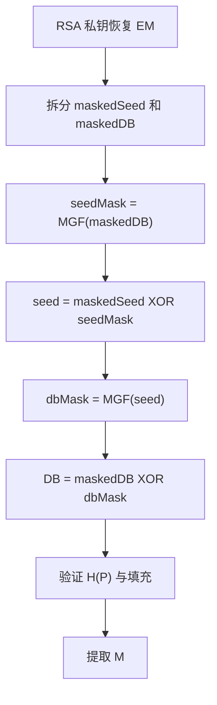

# 第9章 公钥密码学与RSA - 课后习题

> [!NOTE] 使用说明
> “题目原文”按教材章末题摘取。习题 9.1 的矩阵和 9.14 的指数已用 PDF 页面视觉核对，修正了只读教材原文文档中的 OCR 误识别；解题部分是依据教材所作的推导和计算。

## 思考题

### 9.1 公钥密码体制的主要组成是什么？

**题目原文**：公钥密码体制的主要组成是什么？

**教材依据**：9.1.1 公钥密码体制。

**解题思路**：按算法输入、输出和变换列举。

**参考解答**：明文、加密算法、公钥、私钥、密文和解密算法。公钥与私钥是算法的一对互补输入，一个用于正向变换，另一个用于逆变换。

**重点讲解**：教材把一对密钥分别计为两个组成部分，因此合计六项。

**易错点提示**：证书和 PKI 用于管理、认证公钥，不是基本加解密框图本身的六项组成。

**核验状态**：已由 9.1.1 核验。

### 9.2 公钥和私钥的作用是什么？

**题目原文**：公钥和私钥的作用是什么？

**教材依据**：图 9.2、图 9.3。

**解题思路**：分别从保密和认证两个应用说明密钥方向。

**参考解答**：为保密时，发送者用接收者公钥加密，接收者用私钥解密；为认证/签名时，发送者用自己的私钥生成变换结果，验证者用发送者公钥验证。公钥可公开，私钥必须由所有者保护。

**重点讲解**：保密回答“谁能读”，认证回答“谁产生”。

**易错点提示**：用私钥变换消息不提供保密，因为任何人都可用公钥恢复或验证。

**核验状态**：已由 9.1.1 核验。

### 9.3 公钥密码体制的三种应用是什么？

**题目原文**：公钥密码体制的三种应用是什么？

**教材依据**：9.1.2。

**解题思路**：直接按教材分类作答。

**参考解答**：加密/解密、数字签名、密钥交换。

**重点讲解**：具体算法可能只支持其中一类或两类；RSA 在教材表 9.3 中支持三类。

**易错点提示**：认证是签名应用的安全目标之一，不要把“认证”和“数字签名”重复列成两类而漏掉密钥交换。

**核验状态**：已由表 9.3 核验。

### 9.4 为了得到安全的算法，公钥密码体制应满足哪些要求？

**题目原文**：为了得到安全的算法，公钥密码体制应满足哪些要求？

**教材依据**：9.1.3。

**解题思路**：分“合法用户容易”和“攻击者困难”，补充可选的密钥可交换性。

**参考解答**：密钥对生成容易；公钥加密容易；私钥解密容易；由公钥求私钥不可行；由公钥和密文求明文不可行。对 RSA 等算法，还可要求两把密钥的操作顺序能够交换。

**重点讲解**：前三项保证可用性，后两项保证安全性，第六项是有用但非普遍必要的附加条件。

**易错点提示**：不能只写“算法要复杂、密钥要长”，应回答具体计算条件。

**核验状态**：已由 9.1.3 六项条件核验。

### 9.5 什么是单向函数？

**题目原文**：什么是单向函数？

**教材依据**：9.1.3。

**解题思路**：同时说明正向和逆向的计算复杂性。

**参考解答**：对每个函数值存在唯一逆，正向 $Y=f(X)$ 容易计算，但仅由 $Y$ 求 $X=f^{-1}(Y)$ 在计算上不可行的函数。

**重点讲解**：“不可行”是计算复杂性概念，不是数学上不存在逆。

**易错点提示**：不要把哈希函数的多对一性质直接套入教材此处“每个函数值存在唯一逆”的定义。

**核验状态**：已由教材定义核验。

### 9.6 什么是单向陷门函数？

**题目原文**：什么是单向陷门函数？

**教材依据**：9.1.3。

**解题思路**：在单向函数上加入“知道附加秘密信息时可高效求逆”。

**参考解答**：对函数族 $f_k$，已知 $k,X$ 时容易计算 $Y=f_k(X)$；已知陷门信息 $k,Y$ 时容易计算 $X=f_k^{-1}(Y)$；只知道 $Y$ 而不知道陷门时，求逆在计算上不可行。

**重点讲解**：陷门使合法私钥持有者能够求逆，而公开用户只能执行正向运算。

**易错点提示**：陷门不是普通公开参数。

**核验状态**：已由教材定义核验。

### 9.7 用一般术语描述挑选素数的有效过程。

**题目原文**：用一般术语描述挑选素数的有效过程。

**教材依据**：9.2.2“密钥生成”。

**解题思路**：复述随机候选和重复概率测试流程。

**参考解答**：随机选目标位长的奇整数 $n$；随机选 $a<n$；执行 Miller-Rabin 等概率素性测试；失败则换新候选，通过则换不同 $a$ 重测；通过足够多轮后，以很高可信度接受 $n$ 为素数。

**重点讲解**：失败能确定合数；通过一次只表示“可能是素数”。

**易错点提示**：不要说概率测试一次通过就严格证明素数。

**核验状态**：已由 9.2.2 四步流程核验。

## 习题

### 9.1 查表式公钥体制

#### 题目原文

考虑函数 $f_1(x_1)=z_1$、$f_2(x_2,y_2)=z_2$ 和 $f_3(x_3,y_3)=z_3$，各值满足 $1\le x_i,y_i,z_i\le N$。$M_1$ 是 1 到 $N$ 的随机置换，$M_2$ 每行也是 1 到 $N$ 的随机置换，并按

$$
f_3(f_2(f_1(k),p),k)=p
$$

构造 $M_3$。在 $N=5$ 的例子中：

$$
M_1=\begin{bmatrix}5\\4\\3\\2\\1\end{bmatrix},\qquad
M_2=\begin{bmatrix}
5&2&3&4&1\\
4&2&5&1&3\\
1&3&2&4&5\\
3&1&4&2&5\\
2&5&3&4&1
\end{bmatrix}.
$$

a. 填写 $M_3$。b. 说明如何在两个用户间实现加密和解密。c. 说明这是一种安全的方法。

#### 教材依据

9.1.3 单向陷门函数与题目给定的查表构造。

#### 解题思路

固定私钥索引 $k$，先由 $M_1[k]$ 得到公开行号 $x$；$M_2[x,p]=z$ 是明文到密文的置换；把该行求逆后填入 $M_3[z,k]=p$。

#### 参考解答

$$
M_3=\begin{bmatrix}
5&2&1&4&5\\
1&4&3&2&2\\
3&1&2&5&3\\
4&3&4&1&4\\
2&5&5&3&1
\end{bmatrix}.
$$

例如 $k=1$ 时 $x=M_1[1]=5$，$M_2$ 第 5 行把 $p=(1,2,3,4,5)$ 映射为 $z=(2,5,3,4,1)$，故 $M_3$ 第 1 列按 $z=1,2,3,4,5$ 依次填 $(5,1,3,4,2)$。

用户选择秘密 $k$，公开 $x=M_1[k]$。发送者查 $M_2[x,p]$ 得密文 $z$；接收者用秘密 $k$ 查 $M_3[z,k]$ 恢复 $p$。攻击者知道 $x$ 时，需要从巨大置换中反求 $k$；若 $N$ 足够大，穷举或存取整个表在计算和存储上不可行。

#### 重点讲解

这是存在性构造，不是实用方案。安全性来自表规模巨大和由公开 $x$ 反查秘密 $k$ 的工作量，而合法双方只有一次查表。

#### 易错点提示

- $M_3$ 的行索引是 $z$，列索引是 $k$。
- 教材原文 Markdown 中的 $M_2$ 有 OCR 错值；此处矩阵已按 PDF 第 216 页（书页 198）核验。

#### 核验状态

`M2` 已视觉核对；`M3` 的 25 项已按定义程序生成并逐列验证。

### 9.2 小参数 RSA 加解密

#### 题目原文

用图9.5所示的RSA算法对下列数据实现加密和解密：

a. $p=3,q=11,e=7,M=5$；b. $p=5,q=11,e=3,M=9$；c. $p=7,q=11,e=17,M=8$；d. $p=11,q=13,e=11,M=7$；e. $p=17,q=31,e=7,M=2$。

#### 教材依据

9.2.1 RSA 密钥生成、加密和解密。

#### 解题思路

逐组计算 $n=pq$、$\phi(n)$、$d=e^{-1}\bmod\phi(n)$、$C=M^e\bmod n$，最后复算 $C^d\bmod n$。

#### 参考解答

| 小题 | $n$ | $\phi(n)$ | $d$ | 密文 $C$ | 解密结果 |
| --- | ---: | ---: | ---: | ---: | ---: |
| a | 33 | 20 | 3 | 14 | 5 |
| b | 55 | 40 | 27 | 14 | 9 |
| c | 77 | 60 | 53 | 57 | 8 |
| d | 143 | 120 | 11 | 106 | 7 |
| e | 527 | 480 | 343 | 128 | 2 |

例如 a：$7\times3=21\equiv1\pmod{20}$，故 $d=3$；$5^7\bmod33=14$；$14^3\bmod33=5$。

#### 重点讲解

小参数题的固定链路是 `p,q -> n,phi -> d -> C -> M`。

#### 易错点提示

- d 小题中 $e=d=11$ 是允许的，因为 $11^2\equiv1\pmod{120}$。
- 每次乘方都应逐步取模。

#### 核验状态

五组结果均已独立程序复算。

### 9.3 截获密文求明文

#### 题目原文

已截获密文 $C=10$，公钥 $e=5,n=35$，明文 $M$ 是多少？

#### 教材依据

9.2.1；第 2 章扩展欧几里得算法。

#### 解题思路

分解 $35=5\times7$，求 $\phi(35)=24$ 和 $d=5^{-1}\bmod24$，再解密。

#### 参考解答

$$
d=5,\qquad M=10^5\bmod35=5.
$$

验证：$5^5\bmod35=10$。

#### 重点讲解

小模数可直接因子分解，所以公开 $n,e$ 足以恢复私钥。

#### 易错点提示

不要把 $d$ 写成 $1/5$；它是模 24 的逆元。

#### 核验状态

已独立复算。

### 9.4 由公钥求私钥

#### 题目原文

RSA 中某用户公钥为 $e=31,n=3599$，该用户的私钥是多少？

#### 教材依据

9.2.1 密钥生成。

#### 解题思路

试除分解 $n$，计算欧拉函数，再用扩展欧几里得算法求逆。

#### 参考解答

$$
3599=59\times61,\qquad\phi(n)=58\times60=3480.
$$

扩展欧几里得：

$$
1=31\times3031-3480\times27,
$$

所以

$$
d=3031,\qquad PR=\{3031,3599\}.
$$

#### 重点讲解

一旦 $n$ 被分解，求 $d$ 只是一次模逆运算。

#### 易错点提示

私钥通常写为 $\{d,n\}$；$p,q$ 也必须保密，因为它们能导出 d。

#### 核验状态

因子分解和模逆已独立复算。

### 9.5 重复编码为何泄露明文

#### 题目原文

使用RSA算法时，可以由少量重复的编码恢复明文，原因是什么？

#### 教材依据

9.1.4 穷举消息攻击；9.2.3 OAEP。

#### 解题思路

从原始 RSA 是公开、确定性映射入手，分析重复密文和小消息空间。

#### 参考解答

原始 RSA 在固定公钥下是确定性的：相同明文总生成相同密文。攻击者可用公开密钥加密可能的明文，建立“明文-密文”字典；观察到重复密文还能确定对应明文重复。若明文空间小或有高频结构，只需少量样本即可匹配恢复。随机化填充使同一明文每次编码成不同 RSA 输入，可破坏这种直接对应。

#### 重点讲解

问题不在因子分解，而在消息熵和确定性编码；即使 $n$ 很大，也不能弥补只有少数候选明文的风险。

#### 易错点提示

不要把“重复编码”解释成反复执行 RSA 会逐渐解出私钥。

#### 核验状态

已按 9.1.4、9.2.3 的教材结论核验。

### 9.6 明文与 n 有公因子

#### 题目原文

已知若干用RSA算法编码的分组，但不知道私钥，假设 $n=pq$，e是公钥。若某人告诉我们说，他知道其中的一个明文分组与n有公因子，这有帮助吗？

#### 教材依据

9.2.1 RSA 公式；第 2 章最大公因子。

#### 解题思路

利用 $C=M^e\bmod n$ 保留与 $n$ 的非平凡公因子。

#### 参考解答

有帮助。若 $g=\gcd(M,n)$ 是非平凡因子，则 $g$ 为 $p$ 或 $q$。即使只知道对应密文 $C$，也有

$$
\gcd(C,n)=\gcd(M^e\bmod n,n)=\gcd(M^e,n),
$$

同样会暴露 $p$ 或 $q$。得到一个因子后计算另一个因子、$\phi(n)$ 和 $d$，即可破解该模数下全部密文。

#### 重点讲解

模幂不会消除“能被 $p$ 整除”这一性质。

#### 易错点提示

若公因子是 1 或 n，则没有提供非平凡分解；题意需要非平凡公因子。

#### 核验状态

已按整除关系推导核验。

### 9.7 私钥泄露后复用模数

#### 题目原文

Bob的RSA私钥已泄密。Bob决定生成新的公钥和私钥，而不生成新的模数，请问这样做安全吗？

#### 教材依据

9.2.3 因子分解与私钥关系。

#### 解题思路

说明旧的 $(e,d,n)$ 足以帮助攻击者分解 n，因此同一 n 下的新指数也不安全。

#### 参考解答

不安全。旧公钥 $e$ 和泄露的旧私钥 $d$ 给出

$$
k=ed-1,
$$

而 $k$ 是 $\phi(n)$ 或 Carmichael 函数相关周期的倍数。利用这一倍数可通过标准的随机平方根方法有效分解 $n$。一旦得到 $p,q$，攻击者就能计算 $\phi(n)$，进而从任意新公钥指数 $e'$ 求新私钥 $d'$。因此私钥泄露后必须更换模数及素因子。

#### 重点讲解

模数不是无状态的公共常量；旧私钥泄露会把模数本身永久污染。

#### 易错点提示

只更换 $e,d$ 不会重新制造因子分解困难性。

#### 核验状态

结论已按 RSA 密钥关系核验；具体概率分解算法属于必要数学推导。

### 9.8 单字母 RSA

#### 题目原文

Alice把字母表示为 $0\sim25$，对每个字母单独用很大的 e 和 n 进行RSA加密。这种方法安全吗？如果不安全，请给出最有效的攻击方法。

#### 教材依据

9.1.4 穷举消息攻击。

#### 解题思路

比较 26 个候选明文与 RSA 密钥空间大小。

#### 参考解答

不安全。攻击者用公开密钥对 0–25 各加密一次，建立 26 项查找表，然后把每个截获密文直接映射回字母。这是最有效的公开字典攻击，复杂度与大模数因子分解无关。原始 RSA 的确定性还会暴露相同字母位置。

#### 重点讲解

消息空间只有 26，公开加密使离线枚举几乎没有成本。

#### 易错点提示

最有效攻击不是频率分析；先做精确的 26 项公钥加密字典即可。

#### 核验状态

已按 9.1.4 核验。

### 9.9 Miller-Rabin 与 RSA 完整计算

#### 题目原文

用电子表格软件或计算器记录所有模乘中间结果：a. 以2为底，用Miller-Rabin检测233～241之间所有奇数的素性；b. 用 $e=23,n=233\times241$ 加密 $M=2$；c. 计算私钥 $(d,p,q)$；d. 分别不用和使用中国剩余定理解密密文。

#### 教材依据

第 2 章 Miller-Rabin；9.2.1、9.2.2 快速模幂与 CRT。

#### 解题思路

对每个候选写 $n-1=2^s d$，计算 $2^d$ 及连续平方；再完成 RSA 密钥链和两种解密。

#### 参考解答

**a. 素性测试：**

| 候选 $n$ | $n-1=2^sd$ | 以 2 为底的关键序列 | 结论 |
| ---: | --- | --- | --- |
| 233 | $2^3\times29$ | $2^{29}\equiv1$ | 通过，素数 |
| 235 | $2\times117$ | $2^{117}\equiv192\ne\pm1$ | 合数 |
| 237 | $2^2\times59$ | $167\to160$，未到 $-1$ | 合数 |
| 239 | $2\times119$ | $2^{119}\equiv1$ | 通过，素数 |
| 241 | $2^4\times15$ | $233\to64\to240\to1$ | 通过，素数 |

233、239、241 实际为素数；235、237 分别被底数 2 检出为合数。

**b. 加密：**

$$
n=233\times241=56153,
\qquad C=2^{23}\bmod56153=21811.
$$

指数 $23=10111_2$ 的平方-乘结果：

| 位 | 平方后 | 位为1时再乘2后 |
| ---: | ---: | ---: |
| 1 | 1 | 2 |
| 0 | 4 | 4 |
| 1 | 16 | 32 |
| 1 | 1024 | 2048 |
| 1 | 38982 | 21811 |

**c. 私钥：**

$$
\phi(n)=232\times240=55680,
$$

$$
d=23^{-1}\bmod55680=19367.
$$

因此 $PR=(19367,233,241)$，或记核心私钥为 $\{19367,56153\}$。

**d(1). 不使用 CRT：** 计算

$$
21811^{19367}\bmod56153=2.
$$

按 $19367=100101110100111_2$ 从左到右，模幂累积结果为：

```text
21811, 47658, 8420, 715, 5848, 27353, 3103, 10090,
2711, 40360, 43376, 14958, 7358, 21688, 2
```

**d(2). 使用 CRT：**

$$
d_p=d\bmod232=111,
\qquad d_q=d\bmod240=167,
$$

$$
V_p=C^{111}\bmod233=2,
\qquad V_q=C^{167}\bmod241=2.
$$

两个同余式均给出 2，CRT 重构立即得到 $M=2\bmod56153$。

#### 重点讲解

Miller-Rabin 对合数的失败是确定证据；对候选的单底数通过通常只是概率证据，本题的小数还可用试除确认。CRT 解密把指数先分别模 $p-1$、$q-1$ 缩减。

#### 易错点提示

- PDF 原题含 d 小题，旧教材原文 Markdown 漏摘；此处按 PDF 第 217 页（书页 199）补全。
- 不要把 239 漏掉；区间内所有奇数是 233、235、237、239、241。

#### 核验状态

全部素性序列、密钥、密文、直接解密与 CRT 子结果已独立程序复算。

### 9.10 先签名后加密的模数边界

#### 题目原文

先用发送方私钥及RSA进行变换，再用接收方公钥及RSA加密，且变换前不使用哈希函数。对 $n_S>n_R$、$n_S<n_R$、$n_S=n_R$ 三种关系，接收方能否重建消息？若不能，如何修改？

#### 教材依据

9.1.1 认证与保密组合；9.2.1 明文分组必须小于模数。

#### 解题思路

发送方私钥变换结果 $S=M^{d_S}\bmod n_S$ 属于 $[0,n_S-1]$。第二次 RSA 要求 $S<n_R$，逐种比较模数。

#### 参考解答

- 若 $n_S<n_R$，必有 $S<n_R$，外层加密可逆，接收者先用 $d_R$ 恢复 S，再用 $e_S$ 恢复 M。
- 若 $n_S=n_R$，同样满足范围要求，方案可逆。
- 若 $n_S>n_R$，某些 S 会满足 $S\ge n_R$。外层 RSA 实际只保留 $S\bmod n_R$，不同 S 可能合并，接收者无法保证恢复原签名块，继而无法保证恢复 M。

修改方法是把发送方私钥变换结果编码/分割成每个都小于 $n_R$ 的分组后再加密，并保留无歧义的长度与顺序；实用方案通常对消息摘要签名，并使用适当编码和混合加密分别处理消息与签名。

#### 重点讲解

数学操作可交换不代表跨不同模数任意嵌套仍可逆；每一层都必须满足输入小于本层模数。

#### 易错点提示

简单改成“先加密后签名”只会把范围条件反转为需要 $n_R\le n_S$，仍不能覆盖所有关系。

#### 核验状态

已按 RSA 分组范围逐种推导。

### 9.11 单向函数输出序列的可预测性

#### 题目原文

已知序列前两项 $2^K\bmod N$ 和 $3^K\bmod N$，说明如何容易地算出后续许多项，从而证明 $2^K,3^K,4^K,\ldots\pmod N$ 不适合作强密码序列。

#### 教材依据

9.1.3 单向函数；RSA 模幂乘法性质。

#### 解题思路

利用 $(ab)^K=a^Kb^K$，把已知输出相乘或乘方。

#### 参考解答

令

$$
A=2^K\bmod N,
\qquad B=3^K\bmod N.
$$

则可预测：

$$
4^K\equiv A^2,\quad
6^K\equiv AB,\quad
8^K\equiv A^3,\quad
9^K\equiv B^2,\quad
12^K\equiv A^2B\pmod N.
$$

一般地，对任何 $m=2^u3^v$，都有

$$
m^K\equiv A^uB^v\pmod N.
$$

一旦再观察到某个新素因子（如 $5^K$）的输出，就能组合预测所有仅含这些已知素因子的后续项。单向性只阻止由单个输出恢复 K，不阻止利用函数的代数关系预测其他输出。

#### 重点讲解

密码学 PRNG 还需要输出之间不存在可利用相关，不能只要求每个单独输入难以求逆。

#### 易错点提示

不必先求 K；攻击直接在输出域中进行乘法组合。

#### 核验状态

已按模幂乘法性质推导。

### 9.12 用 M1、M2、M3 描述 RSA

#### 题目原文

说明如何通过习题9.1中的矩阵 $M_1,M_2,M_3$ 来描述RSA。

#### 教材依据

习题 9.1 的查表模型；9.2.1 RSA。

#### 解题思路

把秘密索引 k、公钥 x、明文 p、密文 z 分别映射到 RSA 的私钥、公钥、明文和密文。

#### 参考解答

对固定模数 n，可作如下抽象映射：

- $k$ 表示秘密解密信息 d（更完整地说是私钥材料）。
- $M_1[k]=x$ 表示由私钥材料得到公开指数/公钥标识 e。
- $M_2[x,p]=z$ 表示 $z=p^e\bmod n$。
- $M_3[z,k]=p$ 表示 $p=z^d\bmod n$。

于是

$$
M_3(M_2(M_1(k),p),k)=p
$$

正对应 RSA 的

$$
(p^e)^d\equiv p\pmod n.
$$

#### 重点讲解

矩阵是对函数关系的概念性查表表示，实际 RSA 用模幂算法计算，不会构造指数规模的完整表。

#### 易错点提示

RSA 公钥还包含 n；这里把 n 视为固定系统参数，映射重点在 e/d 的互补关系。

#### 核验状态

已按两种模型的输入输出对应核验。

### 9.13 所给密钥生成方法是否等价于 RSA

#### 题目原文

1. 挑选一个奇数 E。2. 挑选两个素数 P 和 Q，其中 $(P-1)(Q-1)-1$ 是 E 的偶数倍。3. 令 $N=PQ$。4. 计算

$$
D=\frac{(P-1)(Q-1)(E-1)+1}{E}.
$$

这种方法是否与 RSA 等价？

#### 教材依据

9.2.1 中 $ED\equiv1\pmod{\phi(N)}$ 的必要条件。

#### 解题思路

先检查第 2 步是否可能成立，而不是直接操作第 4 步。

#### 参考解答

该过程按题面条件无法执行，因此不与 RSA 等价。对两个素数 P、Q，只要 N 是正常 RSA 模数，

$$
\phi(N)=(P-1)(Q-1)
$$

必为偶数，所以 $\phi(N)-1$ 必为奇数。E 是奇数，而 E 的“偶数倍”是 $2tE$，必为偶数。一个整数不可能同时为奇数和偶数，因此第 2 步不存在满足条件的 P、Q。

若题意仅要求 $\phi(N)-1$ 是 E 的某个整数倍，则可推出 $\phi(N)\equiv1\pmod E$，第 4 步会给出 $ED\equiv1\pmod{\phi(N)}$；但这不是 PDF 原题写出的“偶数倍”条件。

#### 重点讲解

这是条件一致性检查题。算法等式看似能构造逆元，但参数选择条件本身矛盾。

#### 易错点提示

不要忽略“偶数倍”三个字而直接证明第 4 步。

#### 核验状态

题面已用 PDF 第 217 页视觉核对；奇偶矛盾已代数验证。

### 9.14 以 N 同时作指数和模数的方案

#### 题目原文

A选择两个大素数 P、Q，它们满足 P 与 $Q-1$ 互素、Q 与 $P-1$ 互素；公布 $N=PQ$；计算

$$
PP'\equiv1\pmod{Q-1},
\qquad QQ'\equiv1\pmod{P-1}.
$$

B 加密

$$
C=M^N\bmod N.
$$

A 由 $M\equiv C^{P'}\pmod Q$ 和 $M\equiv C^{Q'}\pmod P$ 求 M。a.说明工作原理；b.与RSA有何不同；c.RSA有哪些优点；d.用 $M_1,M_2,M_3$ 描述。

#### 教材依据

第 2 章费马定理与 CRT；9.2.1、9.2.2。

#### 解题思路

分别在模 Q 和模 P 下化简指数，再用 CRT 唯一重构 $0\le M<N$。

#### 参考解答

**a. 正确性。** 模 Q：

$$
C^{P'}\equiv M^{PQP'}\pmod Q.
$$

由 $PP'\equiv1\pmod{Q-1}$ 且 $Q\equiv1\pmod{Q-1}$，有 $PQP'\equiv1\pmod{Q-1}$，故按费马定理 $C^{P'}\equiv M\pmod Q$。同理 $C^{Q'}\equiv M\pmod P$。CRT 唯一恢复模 $N$ 的 M。

**b. 与 RSA 的不同。** 本方案公开的指数固定为 $N=PQ$，并同时以 N 为模数；私钥操作由两个不同指数 $P',Q'$ 和 CRT 组成。RSA 公开独立选择的 e，使用统一的 d 满足 $ed\equiv1\pmod{\phi(N)}$。

**c. RSA 优点。** RSA 可选择汉明重量小的公开指数（如 65537），加密/验证更高效；密钥与算法结构更统一、标准化。题中方案的公开指数 N 与模数同样大，直接模幂成本高。

**d. 查表描述。** 令秘密 k 表示 $(P,Q,P',Q')$，$M_1[k]=N$；$M_2[N,M]=M^N\bmod N$；$M_3[C,k]$ 先算两个剩余 $C^{P'}\bmod Q$、$C^{Q'}\bmod P$，再用 CRT 输出 M。

#### 重点讲解

方案的逆不是一个统一模 $\phi(N)$ 指数，而是在两个素数模数下分别求逆后重构。

#### 易错点提示

- PDF 原题第 4 步是 $C=M^N\bmod N$；旧教材原文 Markdown 误识别成未定义的 E。
- 第 1 步的实质约束是 P 与 $Q-1$、Q 与 $P-1$ 互素，才能定义 P'、Q'。

#### 核验状态

题面已用 PDF 第 218 页视觉核对；正确性已分别按模 P、Q 推导。

### 9.15 简化协议的重放/转发攻击

#### 题目原文

原协议把发送方身份放入公钥加密内容：

1. A发送 $(A,E(PU_b,[M,A]),B)$；
2. B应答 $(B,E(PU_a,[M,B]),A)$。

简化协议去掉内部身份：

1. A发送 $(A,E(PU_b,M),B)$；
2. B应答 $(B,E(PU_a,M),A)$。

敌手是网络用户、拥有自己的密钥对并能截获消息。说明敌手如何从简化协议得到 A 以前发给 B 的 M。

#### 教材依据

9.1.1 公钥保密；协议消息中的身份绑定。

#### 解题思路

敌手不能直接解密给 B 的密文，但可把同一密文作为“自己发给 B 的新请求”，诱使 B 用敌手公钥返回 M。

#### 参考解答

设敌手为 C：

1. C 截获 A 到 B 的 $(A,E(PU_b,M),B)$。
2. C 保留密文不变，伪造外层身份，向 B 发送 $(C,E(PU_b,M),B)$。
3. B 用自己的私钥解出 M，并按简化协议向声称的发送方 C 返回 $(B,E(PU_c,M),C)$。
4. C 用自己的私钥解密 $E(PU_c,M)$，得到 M。

原协议中，B 解密后得到 $[M,A]$，发现内部身份 A 与外层声称的 C 不一致，从而拒绝请求。内部冗余实际完成了密文与会话身份的绑定。

#### 重点讲解

加密只能保护内容，不能自动保证密文被放在正确的协议上下文中。

#### 易错点提示

攻击者不需要破解 B 私钥，而是滥用 B 的合法解密和响应行为作为转换接口。

#### 核验状态

攻击流程已逐步验证；原协议的身份检查能阻断第 2–3 步。

### 9.16 快速求幂

#### 题目原文

运用图9.8所示的快速求幂算法计算 $5^{596}\bmod1234$，并给出计算步骤。

#### 教材依据

9.2.2 图 9.8 平方-乘算法。

#### 解题思路

写出 $596=1001010100_2$，从最高位到最低位，每位先平方，位为 1 再乘 5。

#### 参考解答

| 当前位 | 累积指数 c | 平方后 $f$ | 位为1后乘5的 $f$ |
| ---: | ---: | ---: | ---: |
| 1 | 1 | 1 | 5 |
| 0 | 2 | 25 | 25 |
| 0 | 4 | 625 | 625 |
| 1 | 9 | 681 | 937 |
| 0 | 18 | 595 | 595 |
| 1 | 37 | 1101 | 569 |
| 0 | 74 | 453 | 453 |
| 1 | 149 | 365 | 591 |
| 0 | 298 | 59 | 59 |
| 0 | 596 | 1013 | 1013 |

因此

$$
\boxed{5^{596}\bmod1234=1013}.
$$

#### 重点讲解

表中的“平方后”与“再乘底数后”都立即模 1234，避免产生 $5^{596}$ 的巨大中间整数。

#### 易错点提示

- 二进制是 `1001010100`，不能从最低位按图 9.8 的左到右版本读取。
- 位为 0 时只平方，不乘 5。

#### 核验状态

十步中间结果和最终值已独立程序复算。

### 9.17 另一种快速求幂算法的等价性

#### 题目原文

算法：$f\leftarrow1,T\leftarrow a,E\leftarrow b$；若 E 为奇数则 $f\leftarrow fT$；$E\leftarrow\lfloor E/2\rfloor$；$T\leftarrow T^2$；E 大于 0 则重复；输出 f。证明它与图9.8等价。

#### 教材依据

9.2.2 二进制指数分解。

#### 解题思路

建立循环不变量 $fT^E=a^b$（模 n 版本为同余），分别验证 E 为奇数和偶数。

#### 参考解答

初始时

$$
fT^E=1\cdot a^b=a^b.
$$

若 E 为偶数，更新后 $E'=E/2,T'=T^2,f'=f$，于是

$$
f'(T')^{E'}=f(T^2)^{E/2}=fT^E.
$$

若 E 为奇数，先令 $f'=fT$，再令 $E'=(E-1)/2,T'=T^2$，于是

$$
f'(T')^{E'}=fT(T^2)^{(E-1)/2}=fT^E.
$$

不变量始终保持。结束时 $E=0$，故 $f=a^b$。在模幂中每次乘法后取模，不改变同余结果。该算法从最低有效位处理 b；图 9.8 从最高有效位处理 b，二者都实现同一二进制平方-乘分解。

#### 重点讲解

一个是“右到左”平方-乘，一个是“左到右”平方-乘；处理顺序不同，数学分解相同。

#### 易错点提示

伪代码省略了 `mod n`，用于 RSA 时应在 $fT$ 和 $T^2$ 后取模。

#### 核验状态

循环不变量已分奇偶两种情况证明。

### 9.18 RSA 选择密文攻击

#### 题目原文

Bob 截获 $C=M^e\bmod n$，选择随机数 r 并计算

$$
Z=r^e\bmod n,
\qquad X=ZC\bmod n,
\qquad t=r^{-1}\bmod n.
$$

Alice 返回 $Y=X^d\bmod n$。说明 Bob 如何求 M。

#### 教材依据

9.2.3 RSA 乘法性质与选择密文攻击。

#### 解题思路

把 X 展开为 $(rM)^e$，再用 t 消去随机因子 r。

#### 参考解答

$$
X\equiv r^eM^e\equiv(rM)^e\pmod n.
$$

因此 Alice 的返回值为

$$
Y=X^d\equiv rM\pmod n.
$$

Bob 已知 $t=r^{-1}\bmod n$，所以

$$
\boxed{M=tY\bmod n}.
$$

#### 重点讲解

Bob 把目标密文乘上一个可逆的公开加密因子，让解密接口返回“被 r 掩蔽的明文”，再自行去除 r。

#### 易错点提示

r 必须与 n 互素，$r^{-1}$ 才存在。

#### 核验状态

已按 RSA 乘法同态逐式推导。

### 9.19 OAEP 解码

#### 题目原文

图9.9给出了OAEP编码算法，请给出用于解密的OAEP解码算法。

#### 教材依据

9.2.3 图 9.9 OAEP 编码。

#### 解题思路

RSA 私钥先恢复 EM；再按编码的逆序，先用 maskedDB 恢复种子，再用种子恢复 DB，最后验证参数哈希和填充。

#### 参考解答

1. 对 RSA 密文执行私钥运算，得到编码消息

$$
EM=maskedSeed\parallel maskedDB.
$$

2. 分离 `maskedSeed` 和 `maskedDB`。
3. 计算

$$
seedMask=MGF(maskedDB),
$$

$$
seed=maskedSeed\oplus seedMask.
$$

4. 计算

$$
dbMask=MGF(seed),
$$

$$
DB=maskedDB\oplus dbMask.
$$

5. 按编码格式解析 DB，验证开头的 $H(P)$ 与给定参数 P 的哈希一致，检查填充格式；验证失败则拒绝，成功则去掉 $H(P)$ 与填充，输出消息 M。



#### 重点讲解

编码时 DB 先被 seed 掩蔽，seed 再被 maskedDB 掩蔽；解码必须按反向依赖顺序恢复。

#### 易错点提示

- 不能先用未知 seed 恢复 DB。
- 参数哈希和填充验证是解码的一部分，不应只做两次 XOR 后直接输出。

#### 核验状态

已逐步逆向图 9.9 的数据依赖核验。
