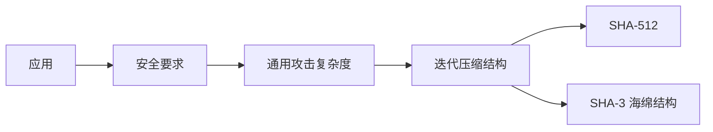

# 第11章 密码学哈希函数

## 本章复习

### 核心定义

哈希函数把变长消息映射为定长摘要：

$$
h=H(M).
$$

理想输出在大量输入上均匀分布、表观随机；输入少量改变应引起摘要大幅改变。密码学哈希的主要目标是支持数据完整性，并要求反求原像或构造碰撞在计算上不可行。

![[attachments/fig_11_1_pdf236.png]]

### 全章结构



## 11.1 密码学哈希函数的应用

### 11.1.1 消息认证

普通完整性检查：发送 $(M,H(M))$，接收者比较重新计算值。主动敌手可替换为 $(M',H(M'))$，故摘要必须安全传送或受到密钥保护。

![[attachments/fig_11_2_pdf237.png]]

教材四种方案：

| 方案 | 结构 | 认证 | 保密 |
| --- | --- | --- | --- |
| a | $E_K(M\parallel H(M))$ | 是 | 是 |
| b | $M\parallel E_K(H(M))$ | 是 | 否 |
| c | $M\parallel H(M\parallel S)$ | 是 | 否 |
| d | $E_K(M\parallel H(M\parallel S))$ | 是 | 是 |

![[attachments/fig_11_3_pdf238.png]]

MAC 是密钥和消息的定长函数；不知道密钥的敌手难以为篡改消息生成合法 MAC。详见第 12 章。

### 11.1.2 数字签名

发送者先计算 $H(M)$，再用私钥生成摘要签名；验证者用公钥验证，并将结果与自己计算的摘要比较。

![[attachments/fig_11_4_pdf239.png]]

- 只签摘要：认证、完整性和数字签名，不提供保密。
- 再用对称密钥加密消息和签名：同时提供保密。

### 11.1.3 其他应用

| 应用 | 哈希作用 | 关键保护点 |
| --- | --- | --- |
| 单向口令文件 | 存摘要而非明文 | 抗原像；实际还需盐和口令派生算法 |
| 入侵/病毒检测 | 重算文件摘要 | 基准摘要不可被攻击者修改 |
| PRF/PRNG | 生成伪随机输出 | 输出应具有伪随机性 |

## 11.2 两个简单的哈希函数

### XOR

$$
C_i=b_{i1}\oplus b_{i2}\oplus\cdots\oplus b_{im}.
$$

等价于每个位位置的纵向奇偶校验。对随机数据可检测错误，但对结构化数据和主动构造不安全。

### RXOR

每处理一块：

$$
H\leftarrow\operatorname{ROTL}(H,1)\oplus B_i.
$$

旋转改善位混合，但仍是线性函数，攻击者可计算校正分组制造目标摘要。

![[attachments/fig_11_5_pdf240.png]]

> [!WARNING] 关键区别
> 校验和的设计目标是检测随机错误；密码学哈希必须抵抗知道算法并主动选择修改方式的敌手。

## 11.3 要求与安全性

### 基本术语

- 原像：$h=H(x)$ 中的 x。
- 碰撞：$x\ne y$ 且 $H(x)=H(y)$。
- 任意长输入映射到 n 位输出时，碰撞必然存在；安全性要求寻找碰撞不可行。

### 11.3.1 安全要求

| 性质 | 给定条件 | 攻击目标 | 理想 m 位复杂度 |
| --- | --- | --- | ---: |
| 抗原像 | h | 找 y：$H(y)=h$ | $2^m$ |
| 抗第二原像 | x | 找 $y\ne x$：$H(y)=H(x)$ | $2^m$ |
| 抗碰撞 | 无固定消息 | 找任意 $x\ne y$：$H(x)=H(y)$ | $2^{m/2}$ |

其他功能要求：输入可变长、输出定长、计算高效、输出伪随机。

![[attachments/fig_11_6_pdf242.png]]

**关系：** 抗碰撞蕴含抗第二原像，反之不一定；抗原像与另外两种性质没有一般的双向蕴含。

### 应用需求

| 应用 | 原像 | 第二原像 | 碰撞 |
| --- | ---: | ---: | ---: |
| 哈希 + 数字签名 | 是 | 是 | 是 |
| 入侵/病毒检测 |  | 是 |  |
| 单向口令文件 | 是 |  |  |
| MAC | 是 | 是 | 是 |

### 11.3.2 穷举攻击

#### 原像与第二原像

随机试验命中给定 m 位摘要，平均尝试量为约 $2^{m-1}$，量级记为 $2^m$。

#### 碰撞与生日攻击

从 $2^m$ 个可能摘要中任意寻找重复，约 $2^{m/2}$ 次即有显著成功概率。

![[attachments/fig_11_7_pdf244.png]]

> [!IMPORTANT] 选长度
> 若要求 128 位抗碰撞安全强度，应选择至少 256 位摘要，而不是 128 位摘要。

### 11.3.3 密码分析与 Merkle-Damgård 结构

密码分析利用算法结构；安全目标是使其不优于通用攻击。

![[attachments/fig_11_8_pdf245.png]]

$$
\mathrm{CV}_0=\mathrm{IV},
$$

$$
\mathrm{CV}_i=f(\mathrm{CV}_{i-1},Y_{i-1}),
\qquad1\le i\le L,
$$

$$
H(M)=\mathrm{CV}_L.
$$

- b 位消息块与 n 位链接变量输入压缩函数 f，输出 n 位。
- 最后一块包含原消息长度。
- 在教材给出的条件下，抗碰撞压缩函数可构造抗碰撞迭代哈希。
- 密码分析重点通常落在 f 的轮结构和差分传播。

## 11.4 安全哈希算法

### SHA 参数

| 算法 | 最大消息长度 | 分组 | 字 | 摘要 |
| --- | ---: | ---: | ---: | ---: |
| SHA-1 | $<2^{64}$ | 512 | 32 | 160 |
| SHA-224 | $<2^{64}$ | 512 | 32 | 224 |
| SHA-256 | $<2^{64}$ | 512 | 32 | 256 |
| SHA-384 | $<2^{128}$ | 1024 | 64 | 384 |
| SHA-512 | $<2^{128}$ | 1024 | 64 | 512 |
| SHA-512/224 | $<2^{128}$ | 1024 | 64 | 224 |
| SHA-512/256 | $<2^{128}$ | 1024 | 64 | 256 |

SHA-1 已有实际碰撞；SHA-2 包括 SHA-224/256/384/512 等版本。本章重点为 SHA-512。

### 11.4.1 SHA-512 总体逻辑

![[attachments/fig_11_9_pdf247.png]]

#### 填充

原长度 l，附加 `1 || 0^k`：

$$
l+1+k\equiv896\pmod{1024},
\qquad0\le k\le1023.
$$

随后附加 128 位高位在前的原长度字段。最终长度为 1024 的整数倍。

#### 初始值

```text
H0 = 6a09e667f3bcc908    H4 = 510e527fade682d1
H1 = bb67ae8584caa73b    H5 = 9b05688c2b3e6c1f
H2 = 3c6ef372fe94f82b    H6 = 1f83d9abfb41bd6b
H3 = a54ff53a5f1d36f1    H7 = 5be0cd19137e2179
```

#### 分组处理

![[attachments/fig_11_10_pdf247.png]]

- 每个 1024 位分组分成 16 个 64 位字，再扩展为 80 字。
- 执行 80 轮，每轮使用 $W_t$ 和 $K_t$。
- 轮输出与分组输入链接值逐字模 $2^{64}$ 相加。

![[attachments/table_11_4_pdf248.png]]

### 11.4.2 SHA-512 轮函数

![[attachments/fig_11_11_pdf249.png]]

$$
T_1=h+\operatorname{Ch}(e,f,g)+\Sigma_1(e)+W_t+K_t,
$$

$$
T_2=\Sigma_0(a)+\operatorname{Maj}(a,b,c),
$$

全部加法模 $2^{64}$。

$$
\operatorname{Ch}(e,f,g)=(e\land f)\oplus(\neg e\land g),
$$

$$
\operatorname{Maj}(a,b,c)=(a\land b)\oplus(a\land c)\oplus(b\land c).
$$

$$
\Sigma_0(x)=\operatorname{ROTR}^{28}(x)\oplus\operatorname{ROTR}^{34}(x)\oplus\operatorname{ROTR}^{39}(x),
$$

$$
\Sigma_1(x)=\operatorname{ROTR}^{14}(x)\oplus\operatorname{ROTR}^{18}(x)\oplus\operatorname{ROTR}^{41}(x).
$$

更新：

$$
(a,b,c,d,e,f,g,h)\leftarrow(T_1+T_2,a,b,c,d+T_1,e,f,g).
$$

#### 消息扩展

![[attachments/fig_11_12_pdf249.png]]

$$
W_t=
\begin{cases}
M_t, & 0\le t\le15,\\
\sigma_1(W_{t-2})+W_{t-7}+\sigma_0(W_{t-15})+W_{t-16}, &16\le t\le79.
\end{cases}
$$

$$
\sigma_0(x)=\operatorname{ROTR}^{1}(x)\oplus\operatorname{ROTR}^{8}(x)\oplus\operatorname{SHR}^{7}(x),
$$

$$
\sigma_1(x)=\operatorname{ROTR}^{19}(x)\oplus\operatorname{ROTR}^{61}(x)\oplus\operatorname{SHR}^{6}(x).
$$

![[attachments/fig_11_13_pdf250.png]]

### 11.4.3 `abc` 示例

消息长度 24 位：填充 872 位后达到 896 位，再附加 128 位长度字段。

```text
W0  = 6162638000000000
W1 ... W14 = 0000000000000000
W15 = 0000000000000018
```

摘要：

```text
ddaf35a193617aba cc417349ae204131
12e6fa4e89a97ea2 0a9eeee64b55d39a
2192992a274fc1a8 36ba3c23a3feebbd
454d4423643ce80e 2a9ac94fa54ca49f
```

理想复杂度：碰撞 $2^{256}$，原像 $2^{512}$。

## 11.5 SHA-3

SHA-3 使用 Keccak 海绵结构，为 SHA-2 提供结构独立的标准选择。

### 11.5.1 海绵结构

参数：内部变换 f、位速率 r、填充 pad；状态宽度

$$
b=r+c.
$$

![[attachments/fig_11_14_pdf253.png]]

#### 两阶段

1. 吸收：$s\leftarrow f(s\oplus(P_i\parallel0^c))$。
2. 挤压：输出 s 的前 r 位；不够则继续执行 f 并输出新的前 r 位。

![[attachments/fig_11_15_pdf254.png]]

#### 参数权衡

| 摘要 | r | c | 轮数 | 碰撞强度 |
| ---: | ---: | ---: | ---: | ---: |
| 224 | 1152 | 448 | 24 | $2^{112}$ |
| 256 | 1088 | 512 | 24 | $2^{128}$ |
| 384 | 832 | 768 | 24 | $2^{192}$ |
| 512 | 576 | 1024 | 24 | $2^{256}$ |

r 越大吞吐越高；c 越大安全裕量越高。FIPS 202 使用 `pad10*1`。

### 11.5.2 Keccak-f

1600 位状态为 $5\times5$ 个 64 位通道：

$$
s[64(5y+x)+z]=a[x,y,z].
$$

![[attachments/fig_11_16_pdf256.png]]

24 轮，每轮：

$$
R=\iota\circ\chi\circ\pi\circ\rho\circ\theta.
$$

![[attachments/fig_11_17_pdf256.png]]

#### $\theta$

$$
C[x]=\bigoplus_{y=0}^{4}L[x,y],
$$

$$
L[x,y]\leftarrow L[x,y]\oplus C[x-1]\oplus\operatorname{ROT}(C[x+1],1).
$$

作用：跨列扩散，每位依赖自身与相邻两列。

![[attachments/fig_11_18_pdf257.png]]

#### $\rho$

通道内循环移位；$L[0,0]$ 不变，其余通道使用不同移位常数。作用：通道内部扩散。

#### $\pi$

$$
(x,y)\mapsto(y,2x+3y)\bmod5.
$$

作用：通道位置置换；$L[0,0]$ 不变。

![[attachments/fig_11_19_pdf259.png]]

#### $\chi$

$$
a[x,y,z]\leftarrow a[x,y,z]\oplus
(\neg a[x+1,y,z]\land a[x+2,y,z]).
$$

作用：行内非线性代替；唯一非线性阶跃。

#### $\iota$

$$
L[0,0]\leftarrow L[0,0]\oplus RC[i_r].
$$

作用：注入每轮不同常数，破坏对称性。

## 重点、难点与易错点

### 重点

- 哈希在认证、签名中的角色与“保护摘要”的必要性。
- 三类安全性质和 $2^m/2^{m/2}$ 复杂度。
- Merkle-Damgård 压缩链。
- SHA-512 填充、80 轮、消息扩展。
- SHA-3 的 r/c、吸收/挤压和五个阶跃函数。

### 难点

- 抗第二原像与抗碰撞的目标差异。
- SHA-512 大 Sigma、小 sigma 和移位常数。
- 高位在前与低位在前的字节解释。
- Keccak 的通道坐标、$\rho$ 与 $\pi$ 的区别。

### 高频易错点

1. 把裸哈希当消息认证。
2. 认为碰撞不存在，而非难以找到。
3. 把 m 位摘要的碰撞强度写成 $2^m$。
4. SHA-512 原长度已满足 896 模 1024 时不填充。
5. 把 `SHR` 写成循环移位。
6. 把 $\rho$ 和 $\pi$ 的作用对调。
7. 忽略 $\chi$ 是唯一非线性步骤。

## 关键词索引

| 关键词 | 位置 | 含义 |
| --- | --- | --- |
| 消息摘要 | 11.1.1 | 用于完整性/认证的哈希值 |
| 原像 | 11.3 | 映射到给定摘要的输入 |
| 第二原像 | 11.3.1 | 与给定消息摘要相同的另一消息 |
| 碰撞 | 11.3.1 | 任意两条不同消息摘要相同 |
| 生日攻击 | 11.3.2 | 约 $2^{m/2}$ 次寻找碰撞 |
| 压缩函数 | 11.3.3 | 链接变量与消息块到新链接变量 |
| SHA-512 | 11.4 | 1024 位分组、64 位字、512 位摘要 |
| 消息调度 | 11.4.2 | 从 16 字扩展到 80 字 |
| 海绵结构 | 11.5.1 | 吸收/挤压式变长输入输出结构 |
| 位速率 | 11.5.1 | 每次处理或输出的 r 位 |
| 容量 | 11.5.1 | 状态中 c 位安全容量部分 |
| Keccak-f | 11.5.2 | SHA-3 的 1600 位内部置换 |

## 教材内容与补充理解边界

> [!NOTE] 教材内容
> 算法结构、公式、参数表、复杂度和图表释义均依据第 11 章整理。

> [!INFO] 补充理解
> 对口令“加盐和使用专用派生算法”、对实际密钥派生和现代部署状态的提示属于工程补充，不替代教材中的原理定义。

## Related

- [[第十一章_密码学哈希函数_教材原文]]
- [[第十一章_密码学哈希函数_导学讲义]]
- [[第十一章_密码学哈希函数_课后习题]]
- [[第十二章_消息认证码_复习笔记]]
