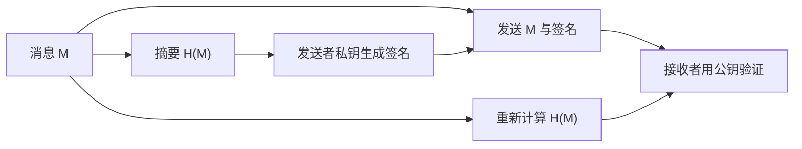
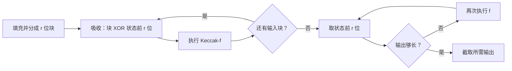
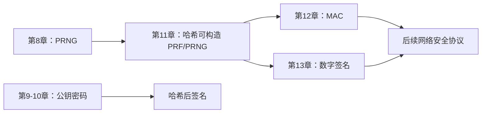

# 第11章 密码学哈希函数

## 本章导学

哈希函数把任意长度消息压缩成固定长度摘要：

$$
h=H(M).
$$

它不是把消息“加密成更短的密文”，也不承诺从摘要还原消息。它解决的是另一类问题：为消息生成一个对内容极其敏感、但长度固定的数字指纹。密码学要求敌手不能有效地倒推原像，也不能刻意制造相同指纹。

![[attachments/fig_11_1_pdf236.png]]

### 本章核心问题

1. 为什么消息与普通哈希值一起发送并不能抵抗主动攻击？
2. 抗原像、抗第二原像和抗碰撞分别限制敌手做什么？
3. 为什么 m 位哈希的碰撞安全强度通常只有约 m/2 位？
4. 怎样把定长压缩函数扩展为可处理任意长消息的哈希函数？
5. SHA-512 如何完成填充、消息扩展和 80 轮压缩？
6. SHA-3 的海绵结构与传统迭代哈希有什么不同？
7. Keccak 的 $\theta,\rho,\pi,\chi,\iota$ 五个阶跃函数各自承担什么任务？

### 学习目标

学完本章，你应能：

- 区分完整性、消息认证、数字签名与保密性；
- 根据攻击目标判断需要哪种哈希安全性质；
- 计算原像、第二原像、碰撞攻击的通用复杂度；
- 解释简单 XOR/RXOR 哈希为什么不具备密码学安全性；
- 复述 Merkle-Damgård 迭代结构和压缩函数的角色；
- 完成 SHA-512 的填充长度、长度字段和消息字扩展计算；
- 描述海绵结构的吸收、挤压以及速率/容量权衡；
- 说明 Keccak-f 五个阶跃函数的依赖关系和扩散方式。

## 11.1 密码学哈希函数的应用

### 本节学习目标

- 看懂哈希函数怎样参与消息认证和数字签名。
- 理解“哈希值必须被保护”的原因。
- 认识口令验证、文件完整性检查和伪随机函数等应用。

### 11.1.1 消息认证

#### 先区分完整性检查与认证

发送方把 $(M,H(M))$ 一起发送，接收方重新计算摘要并比较，只能检测传输中的偶然错误。主动敌手可以同时替换消息和摘要：

$$
(M,H(M))\longrightarrow(M',H(M')).
$$

接收者的比较仍会通过。图 11.2 正是这个区别：算法能够发现“不匹配”，但没有秘密或签名时，无法证明摘要来自合法发送者。

![[attachments/fig_11_2_pdf237.png]]

> [!IMPORTANT] 一句话边界
> 裸哈希提供内容指纹；只有当摘要受到密钥或签名保护时，才能抵抗主动伪造。

#### 教材给出的四种认证组合

![[attachments/fig_11_3_pdf238.png]]

| 方案 | 发送内容的核心形式 | 认证 | 保密性 | 主要特点 |
| --- | --- | --- | --- | --- |
| a | $E_K(M\parallel H(M))$ | 有 | 有 | 加密全部内容，开销大 |
| b | $M\parallel E_K(H(M))$ | 有 | 无 | 只保护摘要，减少加密量 |
| c | $M\parallel H(M\parallel S)$ | 有 | 无 | 共享秘密 S 不发送，不用加密算法 |
| d | $E_K(M\parallel H(M\parallel S))$ | 有 | 有 | 在 c 上增加保密性 |

教材随后引出 MAC：MAC 以密钥和消息为输入，输出定长认证值。验证者因为知道共享密钥，既能检测消息篡改，也能确认消息来自密钥持有者。第 12 章会专门讨论。

#### 生活类比

普通哈希像在包裹上写“重量 3.2 kg”：运输损坏可能导致重量对不上，但换包裹的人也能重写重量。MAC 像只有双方会盖的防伪章；数字签名则像可由公众验真的个人签章。类比只帮助区分作用，不表示真实协议只检查单个数字。

#### 常见误区

- **摘要短就天然安全。** 摘要长度只给出通用攻击上限，结构缺陷会让攻击更快。
- **哈希等于认证。** 无密钥哈希不能确认发送者。
- **认证等于保密。** 方案 b、c 能认证但消息仍是明文。
- **共享秘密直接拼接一定安全。** 教材用其说明基本思想；实际系统应使用经过分析的 MAC 构造。

### 11.1.2 数字签名

数字签名通常不直接对长消息执行昂贵的公钥运算，而是先计算摘要，再使用发送者私钥对摘要进行签名。任何拥有公钥的人都可以验证摘要与签名关系。

![[attachments/fig_11_4_pdf239.png]]



若还要求保密性，可再用对称密钥加密消息和签名组合。这里要区分两个密钥角色：私钥签名用于来源与完整性，对称密钥加密用于保密。

### 11.1.3 其他应用

#### 单向口令文件

系统存储口令的哈希值，登录时比较输入口令的哈希。数据库泄露后，敌手不能直接读取明文口令。教材强调的是单向性；实际系统还需使用盐和专用口令派生算法，这是工程补充。

#### 入侵与病毒检测

先在可信环境中保存文件摘要 $H(F)$，以后重新计算并比较。关键是基准摘要必须被安全保存；若攻击者能同时改文件和基准摘要，检测会失效。

#### PRF 与 PRNG

密码学哈希还能构造伪随机函数或伪随机数生成器，例如用于生成对称密钥。其依据之一是哈希输出应表现出良好的伪随机性。

## 11.2 两个简单的哈希函数

### 本节核心问题

**能够很好检测随机传输错误的校验函数，为什么不一定能抵抗主动敌手？**

### XOR 哈希

把消息分成 m 个 n 位分组，逐位异或：

$$
C_i=b_{i1}\oplus b_{i2}\oplus\cdots\oplus b_{im}.
$$

它相当于每个位位置独立计算奇偶校验。随机错误未被发现的概率可达 $2^{-n}$，但结构化数据会使有效位数下降。例如文本字节高位常为 0，某些输出位几乎没有信息。

### RXOR 哈希

循环异或在每处理一块前先把当前哈希值循环左移 1 位，再与新分组异或：

```text
H = 0
for each block B:
    H = ROTL(H, 1)
    H = H XOR B
```

旋转让不同输入位置交叉影响不同输出位，减少简单格式规律，但整个函数仍是线性的。

![[attachments/fig_11_5_pdf240.png]]

### 为什么不适合作密码学哈希

已知目标哈希时，攻击者可先准备任意替代消息，再附加一个可计算的校正分组，使最终 XOR/RXOR 达到目标值。这说明“输出分布看起来均匀”和“敌手无法制造碰撞”不是同一要求。

教材还讨论了“消息各分组 XOR 成校验块，再把消息与校验块一起 CBC 加密”的旧方案。由于 XOR 可交换，重排密文分组可能仍保持校验关系，说明把弱校验简单套入加密模式并不会自动得到安全认证。

### 记忆技巧

**错误检测假定错误随机，密码学安全假定敌手会设计错误。**

## 11.3 要求与安全性

### 原像与碰撞

若 $h=H(x)$，x 是 h 的一个原像。若

$$
x\ne y,
\qquad H(x)=H(y),
$$

则发生碰撞。任意长度消息被映射到有限长度输出，根据抽屉原理，碰撞必然存在；密码学要求的是**找到它在计算上不可行**。

### 11.3.1 密码学哈希函数的安全要求

| 要求 | 敌手得到什么 | 敌手目标 |
| --- | --- | --- |
| 输入长度可变 | 任意长度消息 | 函数可处理 |
| 输出长度固定 | 任意输入 | 生成定长摘要 |
| 高效 | x | 容易计算 $H(x)$ |
| 抗原像 | 给定 h | 找 y 使 $H(y)=h$ |
| 抗第二原像 | 给定 x | 找 $y\ne x$ 使 $H(y)=H(x)$ |
| 抗碰撞 | 无固定消息 | 找任意 $x\ne y$ 使摘要相同 |
| 伪随机性 | 多组输入输出 | 输出通过伪随机性测试 |

![[attachments/fig_11_6_pdf242.png]]

#### 三种安全性质的本质区别

- 抗原像：目标摘要固定，消息未知。
- 抗第二原像：第一条消息固定，要找另一条消息。
- 抗碰撞：两条消息都可由攻击者自由选择。

“抗强碰撞”意味着抗第二原像；反方向不一定成立。教材也指出，抗碰撞与抗原像之间没有简单的必然蕴含关系。

#### 应用为何需要不同性质

- 单向口令文件主要依赖抗原像。
- 文件完整性基准主要依赖抗第二原像。
- 数字签名与 MAC 通常需要三种性质。
- 双方一方生成文档、另一方签名时尤其需要抗碰撞，否则生成者可能准备一良一恶两份同摘要文档。

### 11.3.2 穷举攻击

对 m 位摘要，理想哈希下的通用复杂度：

| 攻击 | 典型尝试次数 | 安全强度来源 |
| --- | ---: | --- |
| 原像 | $2^m$ | 命中一个固定摘要 |
| 第二原像 | $2^m$ | 命中给定消息的摘要 |
| 碰撞 | $2^{m/2}$ | 生日悖论 |

生日攻击不是“反推出某条消息”，而是在许多自由选择的消息中寻找任意一对摘要相同者。图 11.7 展示了通过排版、措辞等方式构造大量语义相同变体的思路。

![[attachments/fig_11_7_pdf244.png]]

生活类比：若要找一个生日恰好是 1 月 1 日的人，平均需要接近 365 次尝试；若只要找任意两人生日相同，约 23 人就已有过半概率。固定目标与任意配对是两种任务。

### 11.3.3 密码分析与迭代结构

穷举攻击只依赖摘要长度；密码分析则利用具体算法结构。理想设计要求已知密码分析方法不优于通用攻击。

![[attachments/fig_11_8_pdf245.png]]

Merkle-Damgård 型迭代哈希把填充后的消息分为 L 个 b 位分组：

$$
\mathrm{CV}_0=\mathrm{IV},
$$

$$
\mathrm{CV}_i=f(\mathrm{CV}_{i-1},Y_{i-1}),
\qquad1\le i\le L,
$$

$$
H(M)=\mathrm{CV}_L.
$$

压缩函数 f 接收 n 位链接变量和 b 位消息块，输出 n 位新链接变量，通常 $b>n$。消息末尾加入总长度可以约束攻击者构造不同长度消息的方式。教材指出：当长度字段被包含且压缩函数抗碰撞时，迭代哈希也可获得抗碰撞性，因此核心设计任务转化为设计安全压缩函数。

## 11.4 安全哈希算法

### SHA 家族脉络

| 家族 | 代表 | 摘要长度 | 本章定位 |
| --- | --- | ---: | --- |
| SHA-1 | SHA-1 | 160 | 已出现实际碰撞，不再适合抗碰撞用途 |
| SHA-2 | SHA-224/256/384/512 等 | 224–512 | 本节详细讲 SHA-512 |
| SHA-3 | Keccak | 224–512 | 使用海绵结构，与 SHA-2 结构不同 |

SHA-512 接受长度小于 $2^{128}$ 位的消息，按 1024 位分组处理，字长 64 位，输出 512 位摘要。

### 11.4.1 SHA-512 总体逻辑

![[attachments/fig_11_9_pdf247.png]]

#### 步骤 1：填充

设原消息长度为 l。先附加一个 1，再附加 k 个 0，使

$$
l+1+k\equiv896\pmod{1024}.
$$

即使原长度已经同余 896，也必须增加完整的一段填充，故填充位数为 1–1024。

#### 步骤 2：附加长度字段

把原消息长度 l 编码为 128 位无符号整数，以高位在前格式附在末尾。最终总长度成为 1024 的整数倍。

#### 步骤 3：初始化 8 个 64 位链接字

```text
a = 6a09e667f3bcc908    e = 510e527fade682d1
b = bb67ae8584caa73b    f = 9b05688c2b3e6c1f
c = 3c6ef372fe94f82b    g = 1f83d9abfb41bd6b
d = a54ff53a5f1d36f1    h = 5be0cd19137e2179
```

这些值来自前 8 个素数平方根小数部分的前 64 位。

#### 步骤 4：逐块执行 80 轮压缩

![[attachments/fig_11_10_pdf247.png]]

每个 1024 位分组先扩展为 80 个 64 位字 $W_0,\ldots,W_{79}$。每轮还使用不同常数 $K_t$。

![[attachments/table_11_4_pdf248.png]]

80 轮输出与本分组输入链接值逐字模 $2^{64}$ 相加，形成下一个中间摘要，这一反馈防止简单地把轮函数输出直接当最终链接值。

#### 步骤 5：输出

最后一个分组处理后的 8 个 64 位字按顺序连接，得到 512 位摘要。

### 11.4.2 SHA-512 轮函数

![[attachments/fig_11_11_pdf249.png]]

每轮先计算：

$$
T_1=h+\operatorname{Ch}(e,f,g)+\Sigma_1(e)+W_t+K_t\pmod{2^{64}},
$$

$$
T_2=\Sigma_0(a)+\operatorname{Maj}(a,b,c)\pmod{2^{64}}.
$$

逻辑函数：

$$
\operatorname{Ch}(e,f,g)=(e\land f)\oplus(\neg e\land g),
$$

$$
\operatorname{Maj}(a,b,c)=(a\land b)\oplus(a\land c)\oplus(b\land c).
$$

大 Sigma 函数：

$$
\Sigma_0(x)=\operatorname{ROTR}^{28}(x)\oplus\operatorname{ROTR}^{34}(x)\oplus\operatorname{ROTR}^{39}(x),
$$

$$
\Sigma_1(x)=\operatorname{ROTR}^{14}(x)\oplus\operatorname{ROTR}^{18}(x)\oplus\operatorname{ROTR}^{41}(x).
$$

状态更新：

```text
h <- g        g <- f        f <- e        e <- d + T1
d <- c        c <- b        b <- a        a <- T1 + T2
```

六个字只轮转位置，a 和 e 是本轮新计算值。

#### 消息扩展

![[attachments/fig_11_12_pdf249.png]]

前 16 个字直接来自消息分组。对 $16\le t\le79$：

$$
W_t=\sigma_1(W_{t-2})+W_{t-7}+\sigma_0(W_{t-15})+W_{t-16}\pmod{2^{64}},
$$

$$
\sigma_0(x)=\operatorname{ROTR}^{1}(x)\oplus\operatorname{ROTR}^{8}(x)\oplus\operatorname{SHR}^{7}(x),
$$

$$
\sigma_1(x)=\operatorname{ROTR}^{19}(x)\oplus\operatorname{ROTR}^{61}(x)\oplus\operatorname{SHR}^{6}(x).
$$

`ROTR` 是循环右移，移出的位回到左端；`SHR` 是逻辑右移，左侧补 0。两者不可混用。

![[attachments/fig_11_13_pdf250.png]]

#### 安全强度

理想 512 位摘要的碰撞攻击约需 $2^{256}$ 次，原像攻击约需 $2^{512}$ 次。每一输出位经过消息扩展和多轮混合后依赖全部输入位。

### 11.4.3 `abc` 示例

`abc` 的 ASCII 共 24 位。填充一个 1 和 871 个 0 后达到 896 位，再附加 128 位长度字段，其最低字节表示十六进制 `18`。

首个消息字为：

```text
W0 = 6162638000000000
```

中间 $W_1$–$W_{14}$ 为 0，最后：

```text
W15 = 0000000000000018
```

标准 SHA-512 摘要为：

```text
ddaf35a193617aba cc417349ae204131
12e6fa4e89a97ea2 0a9eeee64b55d39a
2192992a274fc1a8 36ba3c23a3feebbd
454d4423643ce80e 2a9ac94fa54ca49f
```

把首字节从 `61` 改为 `63`，即把 `abc` 改为 `cbc`，摘要有约一半位改变，体现雪崩效应。雪崩效应是良好扩散的现象，但单凭一次示例不能证明抗碰撞安全性。

## 11.5 SHA-3

SHA-3 不是因为 SHA-2 已被攻破才出现，而是为了获得结构上独立的备用标准。NIST 最终选择 Keccak，并在 FIPS 202 中标准化。

### NIST 评估候选算法的视角

教材要求从一系列标准理解候选算法优劣，可归纳为：

- 安全性：抗碰撞、抗原像、抗第二原像及安全裕量；
- 性能与成本：软硬件速度、内存、功耗和实现面积；
- 算法与实现特征：简单性、灵活性、可分析性、并行能力以及不同平台适应性。

### 11.5.1 海绵结构

海绵函数由内部变换 f、位速率 r 和填充 pad 定义。内部状态长度

$$
b=r+c,
$$

其中 c 为容量。

![[attachments/fig_11_14_pdf253.png]]

#### r 与 c 的权衡

- r 大：每次吸收/挤压的数据多，速度快；
- c 大：保留在内部、不直接与消息块异或的部分更大，安全裕量高；
- 在 b 固定时，增大 c 必然减小 r，因此安全与吞吐量存在权衡。

#### 填充

- 简单填充 `pad10*`：一个 1 后接尽量少的 0。
- 多速率填充 `pad10*1`：首尾为 1，中间为尽量少的 0；FIPS 202 使用这一方式。
- 即使消息长度已经是 r 的整数倍，也添加一个填充分组，保证编码无歧义。

#### 吸收阶段

状态初值为全 0。每个 r 位消息块补 c 个 0，与状态前 r 位异或，再执行 f：

$$
s\leftarrow f\bigl(s\oplus(P_i\parallel0^c)\bigr).
$$

#### 挤压阶段

先输出状态前 r 位；若输出仍不够，继续执行 f，再取新的前 r 位，直到取得所需长度。

![[attachments/fig_11_15_pdf254.png]]



#### SHA-3 参数

| 摘要长度 | r | c | 碰撞强度 | 第二原像强度 |
| ---: | ---: | ---: | ---: | ---: |
| 224 | 1152 | 448 | $2^{112}$ | $2^{224}$ |
| 256 | 1088 | 512 | $2^{128}$ | $2^{256}$ |
| 384 | 832 | 768 | $2^{192}$ | $2^{384}$ |
| 512 | 576 | 1024 | $2^{256}$ | $2^{512}$ |

所有版本均有 $r+c=1600$、字长 64 位、24 轮。

### 11.5.2 SHA-3 迭代函数 Keccak-f

1600 位状态排列为 $5\times5$ 个通道，每通道 64 位：

$$
s[64(5y+x)+z]=a[x,y,z].
$$

![[attachments/fig_11_16_pdf256.png]]

每轮按顺序执行：

$$
R=\iota\circ\chi\circ\pi\circ\rho\circ\theta.
$$

![[attachments/fig_11_17_pdf256.png]]

#### $\theta$：跨列扩散

先求每列 5 个通道的异或：

$$
C[x]=\bigoplus_{y=0}^{4}L[x,y].
$$

再更新每个通道：

$$
L[x,y]\leftarrow L[x,y]\oplus C[x-1]\oplus\operatorname{ROT}(C[x+1],1).
$$

每位由自身、前一列同位和后一列邻位共同决定，承担主要的跨通道扩散。

![[attachments/fig_11_18_pdf257.png]]

#### $\rho$：通道内循环移位

$L[0,0]$ 不变，其余 24 个通道使用各不相同的移位量循环移位。它把同一通道内的位位置打散，使信息能在后续轮进入不同位依赖。

#### $\pi$：通道位置置换

旧位置 $(x,y)$ 移到

$$
(x',y')=(y,2x+3y)\bmod5.
$$

$L[0,0]$ 保持不动，其余通道在 $5\times5$ 矩阵中移动。

![[attachments/fig_11_19_pdf259.png]]

#### $\chi$：行内非线性代替

$$
a[x,y,z]\leftarrow a[x,y,z]
\oplus\bigl(\neg a[x+1,y,z]\land a[x+2,y,z]\bigr).
$$

这是五个阶跃函数中唯一的非线性映射。没有 $\chi$，整轮会成为线性变换，容易被线性代数分析。

#### $\iota$：加入轮常数

$$
L[0,0]\leftarrow L[0,0]\oplus RC[i_r].
$$

它只直接改变一个通道，但不同轮常数打破前四步可能保留的对称性；随后 $\theta,\rho,\pi,\chi$ 会把影响扩散到全状态。

### 五个阶跃函数对比

| 阶跃 | 操作范围 | 线性/非线性 | 主要作用 |
| --- | --- | --- | --- |
| $\theta$ | 列间 | 线性 | 跨列扩散 |
| $\rho$ | 通道内部 | 线性置换 | 位位置扩散 |
| $\pi$ | 通道之间 | 线性置换 | 重排通道 |
| $\chi$ | 每行相邻通道 | 非线性 | 提供非线性混合 |
| $\iota$ | $L[0,0]$ | 常数注入 | 打破轮对称性 |

## 常见误区与易混淆点

| 易混淆项 | 正确区分 |
| --- | --- |
| 哈希与加密 | 哈希通常不可逆且输出定长；加密必须可逆并由密钥控制 |
| 第二原像与碰撞 | 前者给定第一条消息，后者两条都可自由选择 |
| m 位摘要的安全性 | 原像约 m 位，碰撞通常约 m/2 位 |
| `ROTR` 与 `SHR` | 前者循环，后者丢弃低位并补 0 |
| SHA-2 与 SHA-3 | 摘要长度可相同，但内部结构不同 |
| 位速率 r 与容量 c | r 决定吞吐，c 主要影响安全裕量，且总和固定为 1600 |
| $\rho$ 与 $\pi$ | $\rho$ 在通道内移位，$\pi$ 在矩阵中移动通道 |

## 前后章节联系



## 学习建议

1. 用“目标是否固定”区分三类攻击，先判断任务再写复杂度。
2. 手算 SHA-512 填充时固定写出同余式 $l+1+k\equiv896\pmod{1024}$。
3. 把 SHA-512 的大 Sigma 与小 sigma 分两张卡片记忆，避免移位常数混淆。
4. 画出海绵状态的 r/c 分界，逐块模拟“异或后执行 f”。
5. 对 Keccak 五步使用口诀：**列扩散、道内转、通道搬、行非线性、常数破对称**。

## Related

- [[第十一章_密码学哈希函数_教材原文]]
- [[第十一章_密码学哈希函数_复习笔记]]
- [[第十一章_密码学哈希函数_课后习题]]
- [[第十二章_消息认证码_导学讲义]]
