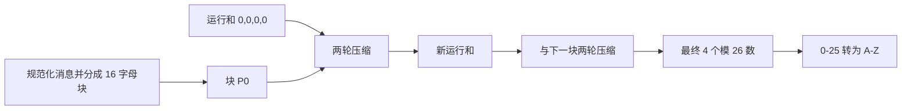
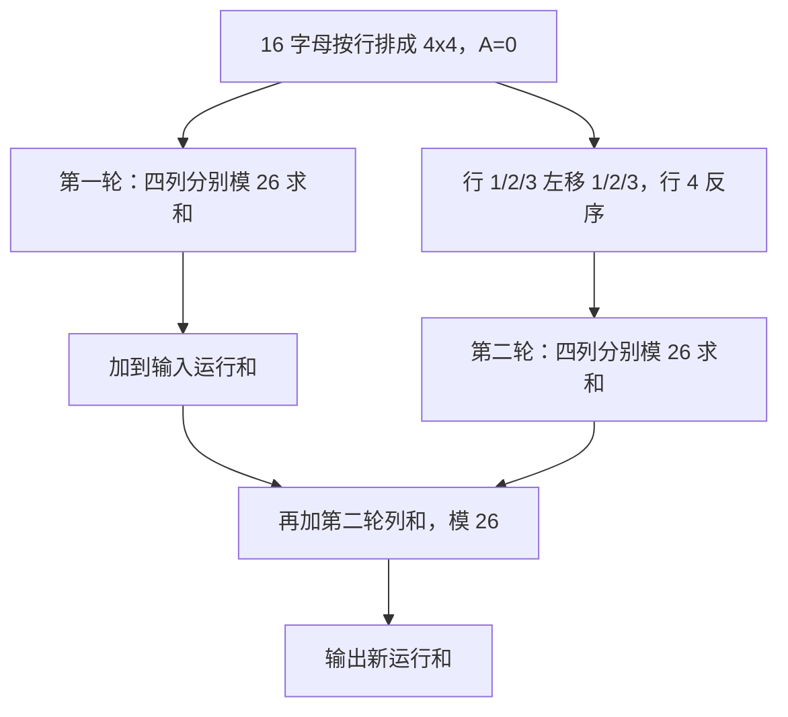

# 第11章 密码学哈希函数 - 课后习题

> [!info] 内容说明
> 本文包含原教材本章全部 **9道思考题、16道习题，共25道**。题目原文来自本章教材原文并经PDF章末页复核；解答优先依据本章正文。

## 思考题

### 思考题 11.1

> [!question] **题目原文**
> 安全哈希函数需要具有哪些特性？

#### 答题思路

先列功能性要求，再列密码学安全要求。

#### 解答

安全哈希函数应满足：

1. 可接受任意长度输入；
2. 产生固定长度输出；
3. 对任意输入易于计算；
4. 抗原像攻击，即给定 h 难以找到 $H(y)=h$ 的 y；
5. 抗第二原像攻击，即给定 x 难以找到 $y\ne x$ 且 $H(y)=H(x)$；
6. 抗碰撞攻击，即难以找到任意不同 x、y 使 $H(x)=H(y)$；
7. 输出具有良好的伪随机性。

#### 依据

11.3.1 表 11.1。

---

### 思考题 11.2

> [!question] **题目原文**
> 抗弱碰撞和抗强碰撞之间的区别是什么？

#### 答题思路

比较攻击者是否被给定第一条消息。

#### 解答

抗弱碰撞即抗第二原像：给定消息 x，难以找到另一条 $y\ne x$ 使

$$
H(y)=H(x).
$$

抗强碰撞即抗碰撞：攻击者可自由选择两条消息，仍难以找到任意 $x\ne y$ 使

$$
H(x)=H(y).
$$

对理想 m 位哈希，第二原像通用攻击约为 $2^m$，碰撞通用攻击约为 $2^{m/2}$。

#### 依据

11.3.1；图 11.6。

---

### 思考题 11.3

> [!question] **题目原文**
> 哈希函数中的压缩函数的作用是什么？

#### 答题思路

说明两个输入、一个输出及迭代链接。

#### 解答

压缩函数 f 接收前一阶段的 n 位链接变量和当前 b 位消息块，输出新的 n 位链接变量：

$$
\mathrm{CV}_i=f(\mathrm{CV}_{i-1},Y_{i-1}).
$$

它把较长的固定长度输入压缩成固定 n 位状态，并通过迭代使任意长消息最终得到定长摘要。设计安全迭代哈希的核心可归结为设计抗碰撞的压缩函数。

#### 依据

11.3.3；图 11.8。

---

### 思考题 11.4

> [!question] **题目原文**
> 高位在前格式和低位在前格式的区别是什么？

#### 答题思路

比较多字节整数的最低内存地址存放哪一个字节。

#### 解答

高位在前格式把整数的最高有效字节放在最低地址；低位在前格式把最低有效字节放在最低地址。例如字节序列 $a_1a_2a_3a_4$：

$$
\text{高位在前}=a_1 2^{24}+a_2 2^{16}+a_3 2^8+a_4,
$$

$$
\text{低位在前}=a_4 2^{24}+a_3 2^{16}+a_2 2^8+a_1.
$$

#### 依据

11.4.1 SHA-512 初始化值存储说明。

---

### 思考题 11.5

> [!question] **题目原文**
> SHA中使用的基本运算和逻辑函数是什么？

#### 答题思路

列出布尔运算、移位、模加以及 Ch/Maj/Sigma 函数。

#### 解答

SHA-512 使用：

- 按位 AND、OR、XOR、NOT；
- 64 位循环右移 `ROTR`；
- 逻辑右移 `SHR`；
- 模 $2^{64}$ 加法；
- 条件函数

$$
\operatorname{Ch}(x,y,z)=(x\land y)\oplus(\neg x\land z);
$$

- 多数函数

$$
\operatorname{Maj}(x,y,z)=(x\land y)\oplus(x\land z)\oplus(y\land z);
$$

- 由循环移位/逻辑移位异或组成的 $\Sigma_0,\Sigma_1,\sigma_0,\sigma_1$。

#### 依据

11.4.2 SHA-512 轮函数。

---

### 思考题 11.6

> [!question] **题目原文**
> 描述NIST评估 SHA-3候选算法的一系列标准。

#### 答题思路

按安全性、成本/性能、算法与实现特征三类归纳。

#### 解答

NIST 的评估重点可归纳为：

1. **安全性**：抗碰撞、抗原像、抗第二原像能力，针对已知密码分析的安全裕量，以及结构是否引入新的弱点。
2. **成本和性能**：软硬件速度、内存需求、芯片面积、功耗及不同消息长度下的效率。
3. **算法与实现特征**：设计简单、易于分析、软硬件适应性、并行能力、灵活性及实现安全性。

Keccak 在这些维度上取得综合优势，并提供了不同于 SHA-2 的海绵结构。

#### 依据

11.5 开头对 NISTIR 7896 和 Keccak 选择的说明。

---

### 思考题 11.7

> [!question] **题目原文**
> 给出海绵结构的定义。

#### 答题思路

写出参数、状态、吸收和挤压两阶段。

#### 解答

海绵结构由内部变换 f、位速率 r 和填充算法 pad 定义，内部状态宽度为

$$
b=r+c,
$$

c 为容量。消息填充后分成 r 位块。吸收阶段把每块补 c 个 0，与状态异或后执行 f：

$$
s\leftarrow f(s\oplus(P_i\parallel0^c)).
$$

挤压阶段反复输出状态前 r 位；若输出长度不足，再执行 f 并继续输出，最终截取所需位数。

#### 依据

11.5.1；图 11.15。

---

### 思考题 11.8

> [!question] **题目原文**
> 简要描述迭代函数f的内部结构。

#### 答题思路

说明状态矩阵、轮数和每轮五步。

#### 解答

Keccak-f 把 1600 位状态排列成 $5\times5$ 个 64 位通道：

$$
s[64(5y+x)+z]=a[x,y,z].
$$

它执行 24 轮，每轮依次执行

$$
\theta\rightarrow\rho\rightarrow\pi\rightarrow\chi\rightarrow\iota.
$$

前四步完成列扩散、通道内位移、通道位置置换和行内非线性代替，最后一步向 $L[0,0]$ 注入本轮常数。

#### 依据

11.5.2；图 11.16、图 11.17。

---

### 思考题 11.9

> [!question] **题目原文**
> 列出并简要描述构成迭代函数f的阶跃函数。

#### 答题思路

按执行顺序说明作用范围和目的。

#### 解答

| 阶跃 | 描述 |
| --- | --- |
| $\theta$ | 每个通道与相邻两列的列奇偶量异或，提供跨列扩散 |
| $\rho$ | 除 $L[0,0]$ 外，每个通道按不同常数循环移位，提供通道内扩散 |
| $\pi$ | 按 $(x,y)\mapsto(y,2x+3y)\bmod5$ 重排通道 |
| $\chi$ | 每位结合同行后两个通道更新，是唯一非线性步骤 |
| $\iota$ | $L[0,0]$ 与轮常数异或，打破不同轮和状态的对称性 |

#### 依据

11.5.2 表 11.6。

---

## 习题

### 习题 11.1

> [!question] **题目原文**
> 高速传输协议（Xpress Transfer Protocol，XTP）使用32位校验和函数，它是两个16位函数的连接，两个函数分别为XOR和RXOR，见11.4节和图11.5。
>
> a. 该校验和能否检测出由奇数个错误位引起的所有错误？说明原因。
>
> b. 该校验和能否检测出由偶数个错误位引起的所有错误？若不能，说明该校验和不能检测出的错误类型的特征。
>
> c. 若将该函数作为消息认证中的哈希函数，试分析其有效性。

#### 答题思路

把 XOR 看成 16 个独立奇偶校验，再分析旋转后错误落入的输出位置；最后从线性和输出长度判断密码学安全性。

#### 解答

**a. 能。** 若总错误位数为奇数，则至少有一个 XOR 输出位置收到奇数次翻转，因此 XOR 的 16 位部分必有一位改变。连接校验和因此一定改变。

**b. 不能。** 偶数个错误可能在 XOR 和 RXOR 两个映射中都成对抵消。对两个错误而言，一个典型未检出模式是：在两个分组的同一位位置翻转，且两个分组序号之差是 16 的倍数。这样普通 XOR 中落在同一列，RXOR 经按块旋转后仍落在同一输出位置，两次翻转均抵消。更一般地，每个 XOR 输出位置和每个 RXOR 输出位置都必须收到偶数次错误。

**c. 不适合作密码学消息认证哈希。** 原因包括：

- 函数完全线性，可通过增加或修改校正分组制造指定校验和；
- 32 位输出的通用碰撞复杂度仅约 $2^{16}$；
- 没有密钥，主动敌手可同时修改消息和重算校验和；
- 存在大量结构化碰撞。

#### 依据

11.2 XOR 与循环 XOR。

---

### 习题 11.2

> [!question] **题目原文**
> a. 设计哈希函数时，常用的一类方法是用无密钥的分组密码链接方案。例如，文献[DAVI89]中给出的方案如下：将消息M分成定长的分组 $M _ { 1 } , M _ { 2 } , \cdots , M _ { N }$ ，并用对称加密体制如DES算法算出哈希码H：
>
> $$
> \begin{array} { l } { H _ { i } = H _ { i - 1 } \oplus E ( M _ { i } , H _ { i - 1 } ) } \\ { \quad H = H _ { N } } \end{array}
> $$
>
> 假设加密算法使用DES。前面讲过DES的互补性（见习题4.14）：若 $Y = E ( K , X )$ ，则 $Y ^ { \prime } { = } E ( K ^ { \prime } , X ^ { \prime } )$ 。  
> 利用该性质说明如何修改由分组 $M _ { 1 } , M _ { 2 } , \cdots , M _ { N }$ 组成的消息而不改变其哈希码。
>
> b. 文献[MEYE88]中提出的类似方案使用了如下公式：
>
> $$
> H _ { i } = M _ { i } \oplus E ( H _ { i - 1 } , M _ { i } )
> $$
>
> 证明存在类似于习题11.2a的攻击方法，它可以成功地攻击该方案。

#### 答题思路

用上划线表示逐位取反，分别把压缩函数的两个输入同时取反。

#### 解答

DES 互补性为

$$
E(\overline K,\overline X)=\overline{E(K,X)}.
$$

**a.** 令压缩函数

$$
f(H,M)=H\oplus E(M,H).
$$

则

$$
\begin{aligned}
f(\overline H,\overline M)
&=\overline H\oplus E(\overline M,\overline H)\\
&=\overline H\oplus\overline{E(M,H)}\\
&=H\oplus E(M,H)\\
&=f(H,M).
\end{aligned}
$$

因此，只要在某一步把进入压缩函数的链接值和相应消息块同时取反，该步输出立即与原消息重新合并；此后的消息后缀保持不变，最终哈希也不变。这给出压缩函数输入对

$$
(H_{i-1},M_i)
\quad\text{与}\quad
(\overline{H_{i-1}},\overline{M_i})
$$

的直接碰撞。

**b.** 对

$$
g(H,M)=M\oplus E(H,M),
$$

同理：

$$
\begin{aligned}
g(\overline H,\overline M)
&=\overline M\oplus E(\overline H,\overline M)\\
&=\overline M\oplus\overline{E(H,M)}\\
&=M\oplus E(H,M)\\
&=g(H,M).
\end{aligned}
$$

两种方案的压缩函数都不抗碰撞。

> [!WARNING] REVIEW_NEEDED：固定 IV 下的推导边界
> 上式严格证明的是压缩函数的局部碰撞。若迭代哈希使用不可更改的固定 IV，攻击者还需构造一个修改前缀，使进入目标步的链接值变为原链接值的补码；不能把“把全部消息块取反”直接当成固定 IV 下的完整碰撞。

#### 依据

第 4 章 DES 互补性；11.3.3 压缩函数抗碰撞要求。

---

### 习题 11.3

> [!question] **题目原文**
> a. 考虑下列哈希函数。消息是 $Z _ { n }$ 中的整数序列 $M = ( a _ { 1 } , a _ { 2 } , \cdots , a _ { t } )$ 。对于某个预定义的n值，计算哈希值 $h = \sum _ { i = 1 } ^ { t } a _ { i }$ 。这个哈希函数满足表11.1中列出的哈希函数的要求吗？给出解释。
>
> b. 对于哈希函数 $h = \left( \sum _ { i = 1 } ^ { t } ( a _ { i } ) ^ { 2 } \right) { \bmod { n } }$ ，重做a问。
>
> c. 当M=(189,632,900,722,349)和 $n=989$ 时，计算b问中的哈希函数。

#### 答题思路

分别检查功能要求与安全要求；用交换顺序、加入 0、拆分或取负构造碰撞。

#### 解答

**a.** 该函数支持变长输入、固定输出并且计算高效，但不满足密码学安全要求：

- 给定 h，单元素消息 $(h)$ 就是原像；
- 重排任意消息元素，哈希不变；
- 加入 0 不改变哈希；
- 把某项 a 改为 $a+d$、另一项 b 改为 $b-d$，总和不变。

因此它不抗原像、第二原像和碰撞攻击。

**b.** 平方和仍支持变长输入、定长输出且高效，但也不安全：

- 重排元素不改变结果；
- 加入 0 不改变结果；
- 把 a 换成 $-a\bmod n$，平方相同；
- 大量不同平方组合会得到同一模 n 总和。

因此至少明显不抗第二原像和碰撞，也不能作为密码学单向函数。

**c.** 各项平方模 989 为：

| a | 189 | 632 | 900 | 722 | 349 |
| ---: | ---: | ---: | ---: | ---: | ---: |
| $a^2\bmod989$ | 117 | 857 | 9 | 81 | 154 |

所以

$$
h=(117+857+9+81+154)\bmod989=\boxed{229}.
$$

#### 依据

11.3.1 表 11.1。

---

### 习题 11.4

> [!question] **题目原文**
> 可以利用哈希函数构建类似于DES结构的分组密码。因为哈希函数是单向的，而分组密码必须是可逆的（才能解密），如何用哈希码构建分组密码？

#### 答题思路

把哈希函数作为 Feistel 轮函数；Feistel 整体可逆不要求轮函数可逆。

#### 解答

把输入分组分成左右两半 $(L_i,R_i)$，使用带轮密钥或轮参数的哈希型函数 F：

$$
L_{i+1}=R_i,
$$

$$
R_{i+1}=L_i\oplus F(R_i,K_i).
$$

解密时由输出恢复：

$$
R_i=L_{i+1},
$$

$$
L_i=R_{i+1}\oplus F(L_{i+1},K_i).
$$

即使 F 是单向、不可逆的哈希函数，XOR 与交换仍使整个 Feistel 轮可逆。多轮并以逆序使用轮密钥即可解密。

#### 依据

第 4 章 Feistel 结构；11.1 哈希函数单向性。

---

### 习题 11.5

> [!question] **题目原文**
> 考虑相反的问题：利用加密算法构建单向哈希函数。考虑使用有一个已知密钥的RSA算法。处理含有若干分组的消息：加密第一个分组，将加密结果与第二个分组异或并再次加密，以此类推。通过求解下面的问题，说明该方法是不安全的。已知两个分组消息 $B _ { 1 }$ 和 $B _ { 2 }$ ，其哈希码为
>
> $$
> \mathrm { R S A H } ( B _ { 1 } , B _ { 2 } ) = \mathrm { R S A } ( \mathrm { R S A } ( B _ { 1 } ) \oplus B _ { 2 } )
> $$
>
> 已知一个分组 $C _ { 1 }$ ，选择 $C _ { 2 }$ 使得 $\mathrm { R S A H } ( C _ { 1 } , C _ { 2 } ) = \mathrm { R S A H } ( B _ { 1 } , B _ { 2 } )$ 。于是，该哈希函数不满足抗弱碰撞性。

#### 答题思路

让两次最外层 RSA 的输入完全相同，直接解出 $C_2$。

#### 解答

目标内层值为

$$
T=\operatorname{RSA}(B_1)\oplus B_2.
$$

选择

$$
\boxed{C_2=\operatorname{RSA}(C_1)\oplus\operatorname{RSA}(B_1)\oplus B_2}.
$$

则

$$
\begin{aligned}
\operatorname{RSA}(C_1)\oplus C_2
&=\operatorname{RSA}(C_1)\oplus\operatorname{RSA}(C_1)
\oplus\operatorname{RSA}(B_1)\oplus B_2\\
&=\operatorname{RSA}(B_1)\oplus B_2=T.
\end{aligned}
$$

最外层 RSA 输入相同，故两个哈希值相同。攻击只使用公开 RSA 运算，不需要私钥。

#### 依据

第 9 章 RSA 公钥运算；11.3.1 抗第二原像。

---

### 习题 11.6

> [!question] **题目原文**
> 设H(m)是一个抗碰撞哈希函数，它将任意位长的消息映射为定长的n位哈希值。对于所有的消息x和$x ^ { \prime } , \ x \neq x ^ { \prime } .$ ，都有 $H ( x ) \neq H ( x ^ { \prime } )$ 。上述说法是否正确？给出解释。

#### 答题思路

比较无限输入空间与仅 $2^n$ 个输出。

#### 解答

不正确。n 位摘要只有 $2^n$ 个可能值，而任意长度消息的数量无限。根据抽屉原理，必然存在不同消息 $x\ne x'$ 满足

$$
H(x)=H(x').
$$

“抗碰撞”只表示在可行计算资源内难以找到这样的消息对，不表示函数是单射。

#### 依据

11.3 原像与碰撞；抽屉原理。

---

### 习题 11.7

> [!question] **题目原文**
> 在图11.12中，设用一个由80个字组成的数组（字长为64位）来存储 $W_t$ 的值，以便开始处理一个分组时可以预计算它们的值。现在假设存储空间是短缺资源。作为替代方案，考虑使用16个字大小的循环缓冲区，用值 $W _ { 0 }$ 到 $W _ { 1 5 }$ 进行初始化。设计一个算法，对每个步骤t，计算需要的输入 $W_{t \bmod 16}$

#### 答题思路

递推式只引用距当前 2、7、15、16 的字，它们都能在覆盖前保留于 16 槽缓冲区。

#### 解答

```text
for t = 0 to 15:
    B[t] = M[t]
    output B[t]

for t = 16 to 79:
    s0 = sigma0(B[(t - 15) mod 16])
    s1 = sigma1(B[(t - 2) mod 16])
    w  = s1 + B[(t - 7) mod 16] + s0 + B[t mod 16] mod 2^64
    B[t mod 16] = w
    output w
```

计算新值前，`B[t mod 16]` 仍保存 $W_{t-16}$；其余三个槽分别保存 $W_{t-15},W_{t-7},W_{t-2}$。计算完成后才覆盖最旧值。

#### 依据

11.4.2 SHA-512 消息扩展公式。

---

### 习题 11.8

> [!question] **题目原文**
> 给出 SHA-512中 $W_{16}$ $W_{17}$ 、 $W_{18}$ 和 $W_{19}$ 的值。

#### 答题思路

依次把 t=16、17、18、19 代入；后两项会用到刚算出的 $W_{16},W_{17}$。

#### 解答

全部加法模 $2^{64}$：

$$
W_{16}=\sigma_1(W_{14})+W_9+\sigma_0(W_1)+W_0,
$$

$$
W_{17}=\sigma_1(W_{15})+W_{10}+\sigma_0(W_2)+W_1,
$$

$$
W_{18}=\sigma_1(W_{16})+W_{11}+\sigma_0(W_3)+W_2,
$$

$$
W_{19}=\sigma_1(W_{17})+W_{12}+\sigma_0(W_4)+W_3.
$$

若题目沿用 11.4.3 的 `abc` 分组，则还可代入 $W_0=\texttt{6162638000000000}$、$W_{15}=\texttt{18}$、其余初始字为 0 继续求数值；本题题面本身未指定具体消息块，因此上述递推展开是一般答案。

#### 依据

11.4.2 消息扩展递推式。

---

### 习题 11.9

> [!question] **题目原文**
> 在SHA-512中，消息长度分别如下，给出填充字段的值。
>
> a. 1919位；
>
> b. 1920位；
>
> c. 1921位。

#### 答题思路

对每个原长度 l 解

$$
l+1+k\equiv896\pmod{1024},
$$

k 是 1 后面的 0 的数量。

#### 解答

| 原长度 l | $l\bmod1024$ | k | 填充字段 |
| ---: | ---: | ---: | --- |
| 1919 | 895 | 0 | `1` |
| 1920 | 896 | 1023 | `1` 后接 1023 个 `0` |
| 1921 | 897 | 1022 | `1` 后接 1022 个 `0` |

1920 位已经与 896 模 1024 同余，但仍必须填充，因此增加完整 1024 位填充字段。

#### 依据

11.4.1：填充后消息长度与 896 模 1024 同余，填充至少含一个 1。

---

### 习题 11.10

> [!question] **题目原文**
> 在SHA-512中，消息长度分别如下，给出长度字段的值。
>
> a. 1919位；
>
> b. 1920位；
>
> c. 1921位。

#### 答题思路

把十进制长度转换成 128 位大端十六进制整数。

#### 解答

$$
1919_{10}=\texttt{077f}_{16},
\quad1920_{10}=\texttt{0780}_{16},
\quad1921_{10}=\texttt{0781}_{16}.
$$

对应 128 位长度字段为：

```text
a. 0000000000000000000000000000077f
b. 00000000000000000000000000000780
c. 00000000000000000000000000000781
```

#### 依据

11.4.1：附加 128 位、最高有效字节在前的原消息位长度。

---

### 习题 11.11

> [!question] **题目原文**
> 设 $a _ { 1 } a _ { 2 } a _ { 3 } a _ { 4 }$ 是长为32位的字中的4字节。可将 $a _ { i }$ 视为0～255之间的一个二进制整数。在高位在前格式中，该字表示整数 $a _ { 1 } 2 ^ { 24 } + a _ { 2 } 2^{16} + a _ { 3 } 2 ^ { 8 } + a _ { 4 }$ ；在低位在前格式中，该字表示整数 $a _ { 4 } 2 ^ { 24 } + a _ { 3 } 2^{16} + a _ { 2 } 2 ^ { 8 } + a _ { 1 }$.
>
> a. 一些哈希函数如MD5使用的是低位在前格式。注意，消息摘要不依赖于底层结构很重要。因此，要在高位在前结构上执行MD5或RIPEMD-160的模 $2^{32}$ 加运算，就要进行调整。设 $X = x _ { 1 } x _ { 2 } x _ { 3 } x _ { 4 }$ 且$Y = y _ { 1 } y _ { 2 } y _ { 3 } y _ { 4 }$ ，说明MD5加法运算X+Y是如何在高位在前结构的机器上执行的。
>
> b. SHA使用高位在前格式，说明 SHA加法运算X+Y是如何在低位在前结构的机器上执行的。

#### 答题思路

算法规定的字节序与主机字节序不同，因此在主机整数加法前后进行 32 位字节交换。

#### 解答

定义字节交换

$$
\operatorname{BSWAP}(x_1x_2x_3x_4)=x_4x_3x_2x_1.
$$

**a. MD5 在高位在前机器。** 从消息读取 X、Y 后，先交换为主机能按 MD5 低位在前数值解释的 32 位整数：

$$
X_h=\operatorname{BSWAP}(X),
\qquad Y_h=\operatorname{BSWAP}(Y).
$$

执行

$$
Z_h=(X_h+Y_h)\bmod2^{32}.
$$

若 Z 要以 MD5 低位在前字节序写回字节流，则再执行

$$
Z=\operatorname{BSWAP}(Z_h).
$$

**b. SHA 在低位在前机器。** 同样，先把 SHA 的高位在前字节序输入字交换为主机整数，执行模 $2^{32}$ 加，再交换为高位在前输出：

$$
Z=\operatorname{BSWAP}left(
(\operatorname{BSWAP}(X)+\operatorname{BSWAP}(Y))\bmod2^{32}
\right).
$$

实现也可使用显式大端/小端读取函数，效果相同。

#### 依据

11.4.1 高位在前/低位在前；SHA 模字加法。

---

### 习题 11.12

> [!question] **题目原文**
> 本题介绍一个本质上和SHA类似的哈希函数，它对字母而非二进制数据进行操作，因此被称为趣味四字母哈希（tth）①。对于由许多字母组成的消息，tth生成一个哈希值，它由4个字母组成。首先，tth将消息分成由16个字母组成的多个分组，分组时忽略空格、标点符号和大写。消息不能被16整除时，用空白进行填充。维持四个数的运行和，其初值为(0,0,0,0)；将其输入压缩函数，以处理第一个分组。压缩函数由两轮组成。
>
> 第一轮取下一个文本分组，按行序排成4×4的文本分组，并将文本转换为数字（A=0,B=1等）。例如，对于分组ABCDEFGHIJKLMNOP，有
>
> | A   | B   | C   | D   |
> | --- | --- | --- | --- |
> | E   | F   | G   | H   |
> | I   | J   | K   | L   |
> | M   | N   | O   | P   |
>
> | 0 | 1 | 2 | 3 |
> | --- | --- | --- | --- |
> | 4 | 5 | 6 | 7 |
> | 8 | 9 | 10 | 11 |
> | 12 | 13 | 14 | 15 |
>
> 接着，对各列进行模26加，并将结果与运行和模26加。在本例中，运行和为(24,2,6,10)。
>
> 第二轮使用第一轮的矩阵，将第一行循环左移1位，将第二行循环左移2位，将第三行循环左移3位，并将第四行的元素反序。在本例中，有
>
> | B | C | D | A |
> | --- | --- | --- | --- |
> | G | H | E | F |
> | L | I | J | K |
> | P | O | N | M |
>
> | 1 | 2 | 3 | 0 |
> | --- | --- | --- | --- |
> | 6 | 7 | 4 | 5 |
> | 11 | 8 | 9 | 10 |
> | 15 | 14 | 13 | 12 |
>
> 现在，将各列分别模26后相加，并将结果与运行和相加。新的运行和为(5,7,9,11)。该运行和作为下一组文本的压缩函数的第一轮的输入。处理完最后一个分组后，将最终的运行和转换为字母。例如，若消息是ABCDEFGHIJKLMNOP，则哈希值为FHJL。
>
> a. 画图表示tth的总体逻辑和该压缩函数的逻辑，该图与图11.9和图11.10相仿。
>
> b. 计算 48 个字母的消息“Ileave twenty million dollars to my friendly cousin Bill.”的哈希值。
>
> c. 为了说明th的弱点，请找出一个48字母分组也生成相同的哈希值。提示：使用多个A。

#### 答题思路

把忽略空格、标点和大小写后的 48 个字母分成 3 块；每块分别计算原矩阵列和、变换矩阵列和并累加。碰撞利用整个构造对字母数值的线性关系。

#### 解答

**a. 总体逻辑：**



压缩函数：



**b. 计算给定消息。** 规范化后为：

```text
ileavetwentymilliondollarstomyfriendlycousinbill
```

恰有 48 个字母，分组及运行和如下：

| 分组 | 第一轮列和 | 第二轮列和 | 处理后运行和 | 字母表示 |
| --- | --- | --- | --- | --- |
| `ileavetwentymill` | (19,10,1,5) | (13,15,16,17) | (6,25,17,22) | GZRW |
| `iondollarstomyfr` | (25,15,22,8) | (4,9,7,24) | (9,23,20,2) | JXUC |
| `iendlycousinbill` | (14,2,8,15) | (4,6,14,15) | (1,5,16,6) | BFQG |

因此

$$
\boxed{\operatorname{tth}(M)=\texttt{BFQG}}.
$$

**c. 构造碰撞。** 以下 3 个 16 字母块组成另一条 48 字母消息：

```text
AAAAAAAAAAAAAAAA AAAAAAAAAAAAAAAA GFAAQAAAAAAAAAAA
```

去掉分组空格后为 48 个字母。A 的数值为 0，只有 G=6、F=5、Q=16 提供非零贡献。按同样两轮规则计算，最终运行和仍为

$$
(1,5,16,6),
$$

故其哈希同样是 `BFQG`。

#### 依据

11.3.3 迭代哈希结构；题面给出的两轮压缩规则。

---

### 习题 11.13

> [!question] **题目原文**
> 对表11.5中SHA-3所有可能的容量值，内部5×5状态矩阵中的哪些通道是全0的?

#### 答题思路

初始状态全 0，第一消息块只异或前 r 位；容量部分对应最后 $c/64$ 个通道，线性编号为 $r/64$ 到 24。

#### 解答

| SHA-3 摘要 | r | c | 容量全零通道 |
| ---: | ---: | ---: | --- |
| 224 | 1152 | 448 | $L[3,3],L[4,3],L[0,4],L[1,4],L[2,4],L[3,4],L[4,4]$ |
| 256 | 1088 | 512 | $L[2,3],L[3,3],L[4,3]$ 及 $L[0,4]$–$L[4,4]$ |
| 384 | 832 | 768 | $L[3,2],L[4,2]$，$L[0,3]$–$L[4,3]$，$L[0,4]$–$L[4,4]$ |
| 512 | 576 | 1024 | $L[4,1]$，以及第 2、3、4 行全部通道 $L[0,2]$–$L[4,4]$ |

这里“全零”指第一消息块与初始状态异或后、首次执行 Keccak-f 之前的容量通道。

#### 依据

11.5.1 表 11.5；11.5.2 状态映射

$$
s[64(5y+x)+z]=a[x,y,z].
$$

---

### 习题 11.14

> [!question] **题目原文**
> 考虑分组长度为1024位的SHA-3，设第一个消息分组 $\left( P _ { 0 } \right)$ 中的每个通道至少有一个非零位。开始时，内部状态矩阵中对应容量部分的初始状态都是零。说明经过多少运算后所有的通道至少都有一个非零位。注意：忽略置换，即跟踪原始的零通道，即使它们在矩阵中的位置已经改变。

#### 答题思路

$r=1024$ 对应前 16 个通道非零、后 9 个容量通道为零。检查 $\theta$ 的每个输出通道依赖哪些列。

#### 解答

1024 位消息块占 16 个通道：完整的 $y=0,1,2$ 三行共 15 个通道，再加 $L[0,3]$。因此 5 列中每列都已有消息非零通道。

$\theta$ 计算

$$
C[x]=\bigoplus_{y=0}^{4}L[x,y],
$$

并更新

$$
L[x,y]\leftarrow L[x,y]\oplus C[x-1]\oplus\operatorname{ROT}(C[x+1],1).
$$

每个原容量零通道都会混入相邻列的非零信息。因此按题目追踪“零/非零影响”的模型，**在吸收异或后的第一个 $\theta$ 阶跃完成时，全部 25 个通道都已受到非零消息位影响**。若把吸收 XOR 也算作一次运算，则是吸收 XOR 加第一次 $\theta$ 共两步。

#### 依据

11.5.1 吸收；11.5.2 $\theta$ 阶跃。

---

### 习题 11.15

> [!question] **题目原文**
> 考虑图11.16(a)中的状态矩阵。现在重新排列矩阵的行和列，使得L[0,0]在正中间。例如，对列按从左到右的顺序排列 $( \ x = 3 , \ x = 4 , \ x = 0 , \ x = 1 , \ x = 2 )$ ，对行按从上到下的顺序排列 $(y=2, y=1, y=0, y=4, y=6)$。考察该函数使用的置换算法及函数中的循环移位常数。使用这个重新排列的矩阵，描述置换算法。

#### 答题思路

把 $\pi$ 视为非中心 24 个通道上的一个长度 24 的循环；$\rho$ 的移位常数沿同一循环按三角数分配。

#### 解答

$L[0,0]$ 位于中心且始终不移动、不旋转。对其余通道，定义

$$
P(x,y)=(y,2x+3y)\bmod5.
$$

从 $(1,0)$ 开始反复应用 P，恰好遍历全部 24 个非中心通道并回到起点：

```text
(1,0) -> (0,2) -> (2,1) -> (1,2) -> (2,3) -> (3,3)
-> (3,0) -> (0,1) -> (1,3) -> (3,1) -> (1,4) -> (4,4)
-> (4,0) -> (0,3) -> (3,4) -> (4,3) -> (3,2) -> (2,2)
-> (2,0) -> (0,4) -> (4,2) -> (2,4) -> (4,1) -> (1,1)
-> (1,0)
```

在循环中第 t 个源通道先由 $\rho$ 循环移位

$$
g(t)=\frac{(t+1)(t+2)}2\bmod64,
\qquad0\le t<24,
$$

位，再由 $\pi$ 移到循环中的下一个坐标。移位量依次为：

```text
1, 3, 6, 10, 15, 21, 28, 36, 45, 55, 2, 14,
27, 41, 56, 8, 25, 43, 62, 18, 39, 61, 20, 44
```

因此重新排布后的矩阵可以理解为：中心通道固定，外围 24 通道沿一个闭合置换环移动，同时各自进行不同的通道内循环移位。

#### 依据

11.5.2 式（11.2）、（11.3）及表 11.7。

---

### 习题 11.16

> [!question] **题目原文**
> ι函数仅影响L[0,0]。11.6节讲过L[0,0]的改变通过单轮的θ函数扩散到状态的所有通道中。
>
> a. 证明上述事实。
>
> b. 矩阵中的所有位都受L[0,0]改变的影响时，需要经过多少次运算？

#### 答题思路

先追踪一个位差经过 $\theta$ 影响的列，再经 $\pi$ 重排，最后用 $\chi$ 的同行三通道依赖证明覆盖全部通道；随后做比特级结构依赖传播。

#### 解答

**a. 单轮覆盖所有通道。** 设 $L[0,0]$ 出现差分 $\Delta$。列奇偶量 $C[0]$ 因而改变。

在 $\theta$ 中：

- 第 1 列的每个通道异或 $C[0]$，故第 1 列 5 个通道受影响；
- 第 4 列的每个通道异或 $\operatorname{ROT}(C[0],1)$，故第 4 列 5 个通道受影响；
- 原来的 $L[0,0]$ 自身仍受影响。

因此 $\theta$ 后共有 11 个受影响通道。$\rho$ 只改变通道内位位置，$\pi$ 把这 11 个通道分布到各行。按

$$
(x,y)\mapsto(y,2x+3y)\bmod5
$$

重排后，每一行都包含足以通过

$$
a[x,y,z]\leftarrow a[x,y,z]\oplus
(\neg a[x+1,y,z]\land a[x+2,y,z])
$$

影响该行全部 5 个输出通道的输入依赖。因此在同一轮的 $\chi$ 完成后，25 个通道都受原 $L[0,0]$ 改变影响。$\iota$ 不会取消这一结构依赖。

**b. 覆盖全部 1600 位。** 通道全覆盖不等于每个通道的 64 位都已覆盖；$\rho$ 的不同循环移位量需要跨轮继续传播位位置。按阶跃函数的结构依赖追踪一个初始改变位：

| 时点 | 受影响位数 |
| --- | ---: |
| 第 1 轮 $\theta$ 后 | 11 |
| 第 1 轮 $\chi$ 后 | 33 |
| 第 2 轮 $\theta$ 后 | 303 |
| 第 2 轮 $\chi$ 后 | 763 |
| 第 3 轮 $\theta$ 后 | 1591 |
| 第 3 轮 $\chi$ 后 | 1600 |

所以需要 **3 轮**；更精确地说，在第 3 轮的 $\chi$ 阶跃完成时全部位都具有对初始改变的结构依赖。若把每个阶跃函数算作一次操作，则这是第 14 个阶跃操作。

#### 依据

11.5.2 的 $\theta,\rho,\pi,\chi,\iota$ 公式。

---
