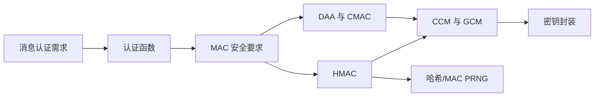
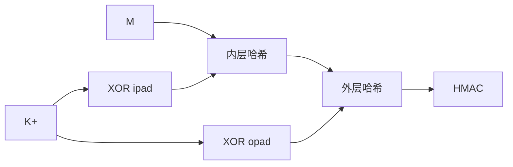

# 第12章 消息认证码

## 本章速览

消息认证解决三个核心问题：消息是否来自共享密钥持有者、内容是否被修改、受保护的顺序或时变信息是否被篡改。消息认证码（MAC）的抽象形式是

$$
T=\operatorname{MAC}(K,M),
$$

其中 K 为通信双方共享的秘密密钥，M 为任意长消息，T 为定长认证标记。MAC 不自动提供保密性，也不能像[[Course Notes/密码学 (Cipher)/Digital Signature (II)/Digital Signature (II)|数字签名]]一样向第三方提供不可否认性。



## 12.1 消息认证要求

### 攻击类型

| 攻击 | 含义 | 主要防护机制 |
| --- | --- | --- |
| 消息泄露 | 未授权者获知消息内容 | 加密 |
| 通信量分析 | 由频率、长度、端点推断信息 | 流量隐藏等 |
| 伪装 | 冒充合法实体插入消息 | 消息认证 |
| 内容修改 | 插入、删除、换位或修改消息内容 | 消息认证 |
| 序列修改 | 插入、删除或重排消息 | 消息认证与序号 |
| 计时修改 | 延迟或重放消息 | 消息认证与时变值 |
| 发送方否认 | 发送后否认行为 | 数字签名、协议证据 |
| 接收方否认 | 接收后否认行为 | 数字签名、仲裁协议 |

消息认证主要处理伪装、内容修改、序列修改和计时修改。要抵抗重放或乱序，序号、时间戳或 nonce 必须被认证函数覆盖；只认证业务正文不够。

## 12.2 消息认证函数

认证或数字签名机制具有两层功能：

1. 下层函数产生认证符；
2. 上层协议规定认证符的生成、传输、验证和失败处理方式。

下层可使用三类函数：

| 函数 | 认证符 | 密钥条件 | 备注 |
| --- | --- | --- | --- |
| 消息加密 | 整条密文 | 对称密钥或公钥机制 | 合法明文须有可识别结构 |
| MAC | $C(K,M)$ | 共享秘密密钥 | 认证，不自动保密 |
| 哈希函数 | $H(M)$ | 本身无密钥 | 摘要必须另行保护 |

### 12.2.1 消息加密

#### 对称加密

若只有 A、B 知道 K，密文可表明发送者是密钥持有者；但接收者还必须能判断解密结果是否为合法消息。若任意位串都可能是消息，任意伪造密文解密后也会得到某个位串，无法据此认证。

![[attachments/fig_12_1_pdf265.png]]

#### 错误控制码的位置

![[attachments/fig_12_2_pdf266.png]]

| 方式 | 顺序 | 认证意义 |
| --- | --- | --- |
| 内部错误控制 | $M\to F(M)\to E_K(M\parallel F)$ | FCS 被加密保护，可形成合法性结构 |
| 外部错误控制 | $M\to E_K(M)\to F(C)$ | 公开 FCS 可被修改者重算，只能检错 |

用于传输纠错时，外部纠错码可先纠正密文错误再解密。内部纠错码能否纠错取决于加密模式的错误传播是否仍在纠错码能力范围内。

协议头、校验和、序号等也可提供可识别结构并协助检测删除、重排和重放。

![[attachments/fig_12_3_pdf266.png]]

#### 公钥加密

| 处理 | 保密 | 来源认证 |
| --- | ---: | ---: |
| 用接收方公钥加密 | 是 | 否，任何人都能加密 |
| 用发送方私钥变换 | 否 | 是，形成签名性质 |
| 先私钥变换，再用接收方公钥加密 | 是 | 是 |

### 12.2.2 消息认证码

发送方附加 $T=C(K,M)$，接收方对收到的消息重新计算并比较。

![[attachments/fig_12_4_pdf268.png]]

MAC 的性质：

- 输入消息可变长，输出定长；
- 多对一，不要求可逆；
- 不知道 K 的敌手难以为新消息生成合法 T；
- 可独立于加密使用，也可与加密组合；
- 双方都能生成标记，因此不提供第三方不可否认性。

MAC 适用于不需要保密的广播、可执行程序或文件完整性保护，也适合在不同协议层分别处理认证与保密。

## 12.3 消息认证码的要求

### 候选密钥数量

设密钥长 k 位、MAC 长 n 位且 $k>n$。一个已知消息-MAC 对平均匹配

$$
2^{k-n}
$$

个密钥。增加独立消息-MAC 对可继续筛选候选密钥，但完整密钥搜索的量级仍是 $2^k$。

### 结构伪造

若一个错误方案只加密所有消息块的 XOR：

$$
\Delta(M)=X_1\oplus X_2\oplus\cdots\oplus X_m,
$$

$$
\operatorname{MAC}(K,M)=E_K(\Delta(M)),
$$

敌手可改变前 $m-1$ 块，再选择最后一块抵消差分，使总 XOR 不变，从而复用原 MAC。该攻击不需要恢复密钥。

### MAC 的三项要求

1. 已知 $(M,T)$ 时，构造 $M'\ne M$ 且 $C(K,M')=T$ 应在计算上不可行。
2. 随机消息的 n 位 MAC 应均匀分布，随机命中概率为 $2^{-n}$。
3. 对任何已知变换 $M'=f(M)$，两者 MAC 相同的概率仍应为 $2^{-n}$。

## 12.4 MAC 的安全性

抗计算性要求：即使敌手获得一个或多个合法消息-MAC 对，也不能为未查询的新消息计算合法 MAC。

### 12.4.1 穷举攻击

| 攻击路线 | 工作量 |
| --- | ---: |
| 搜索 k 位密钥 | $2^k$ |
| 直接猜 n 位标记 | $2^n$ |

通用攻击上限为

$$
\min(2^k,2^n).
$$

要达到 N 位安全强度，至少要求

$$
\min(k,n)\ge N.
$$

猜标记通常需要把伪造提交给验证者，不能像普通哈希碰撞那样完全离线验证。

### 12.4.2 密码分析

密码分析利用具体构造中的代数关系、长度边界或差分传播。理想 MAC 的最佳结构攻击不应优于密钥搜索或标记猜测。评估时必须同时看构造、密钥长度、标记长度和敌手可查询能力。

## 12.5 基于哈希函数的 MAC：HMAC

### 12.5.1 设计目标

- 不修改现有哈希函数实现；
- 可方便替换底层哈希函数；
- 保持接近原哈希的性能；
- 密钥处理简单；
- 可根据底层哈希性质分析安全性。

### 12.5.2 HMAC 算法

![[attachments/fig_12_5_pdf272.png]]

设哈希分组长度为 b，输出长度为 n。先规范化密钥：若 $|K|>b$，用 $H(K)$ 代替；再补 0 到 b 位，得到 $K^+$。

```text
ipad = 0x36 重复 b/8 次
opad = 0x5c 重复 b/8 次
```

$$
\operatorname{HMAC}(K,M)=
H\left((K^+\oplus\mathrm{opad})\parallel
H((K^+\oplus\mathrm{ipad})\parallel M)
\right).
$$



固定密钥时，可预计算处理 $K^+\oplus ipad$ 与 $K^+\oplus opad$ 后的中间链接值。

![[attachments/fig_12_6_pdf272.png]]

### 12.5.3 HMAC 的安全性

HMAC 的内外两层结构使攻击者不能把可见的最终标记直接当作秘密前缀哈希的内部链接值继续扩展。其安全分析可归约到底层压缩函数在秘密随机 IV 下的安全，或归约到底层哈希的碰撞困难性。公开哈希碰撞不自动等价于 HMAC 伪造，因为攻击者不知道密钥化输入。

## 12.6 基于分组密码的 MAC：DAA 和 CMAC

### 12.6.1 数据认证算法 DAA

DAA 使用 DES-CBC 和全 0 初始向量：

$$
O_1=E_K(D_1),
$$

$$
O_i=E_K(D_i\oplus O_{i-1}),\qquad 2\le i\le N.
$$

最终数据认证码 DAC 取 $O_N$ 或其最左侧 16–64 位。

![[attachments/fig_12_7_pdf274.png]]

标准 CBC-MAC 只适合固定长度消息域。若允许变长消息共享同一密钥，已知一条消息及其标记可帮助构造扩展消息伪造。

### 12.6.2 CMAC

CMAC 通过不同子密钥区分完整末块和填充末块。

![[attachments/fig_12_8_pdf275.png]]

| 最后一块 | 处理 |
| --- | --- |
| 完整 b 位 | $M_n\oplus K_1$ |
| 不完整 | 用 $1\parallel0^*$ 填充后异或 $K_2$ |

子密钥生成：

$$
L=E_K(0^b),\qquad K_1=L\cdot x,\qquad K_2=K_1\cdot x
$$

其中乘法在 $\mathrm{GF}(2^b)$ 中。实现规则：原最高位为 0 时左移一位；为 1 时左移后再异或约简常数。

| 分组长度 b | 约简常数 $R_b$ |
| ---: | ---: |
| 64 | `0x1B` |
| 128 | `0x87` |

## 12.7 认证加密：CCM 和 GCM

### 四种基本组合

| 记号 | 处理方式 | 典型验证顺序 |
| --- | --- | --- |
| H→E | $M\parallel H(M)$ 一起加密 | 解密后验证 |
| A→E | 对明文计算 MAC，再一起加密 | 解密后验证 |
| E→A | 先加密，再对密文认证 | 先验证密文 |
| E+A | 加密和认证分别作用于明文 | 分别处理 |

安全性取决于精确定义、nonce 约束和失败处理，不能仅凭组合名称判断。

### 12.7.1 CCM

CCM 使用 AES、CTR 和 CMAC，输入包括明文 P、关联数据 A 和每个实例唯一的时变值 N。

![[attachments/fig_12_9_pdf277.png]]

- 对格式化的 $(N,A,P)$ 做 CBC-MAC；
- 用 CTR 加密 P；
- 用计数器 0 的密钥流掩蔽认证标记；
- A 只认证不加密，P 同时加密与认证；
- CCM 属于改进的 E+A 结构。

### 12.7.2 GCM

GCM 由 GCTR 和 GHASH 组成，属于 E→A 结构。

#### GHASH

$$
Y_0=0^{128},
$$

$$
Y_i=(Y_{i-1}\oplus X_i)\cdot H
\quad\text{in }\mathrm{GF}(2^{128}).
$$

展开：

$$
Y_m=X_1H^m\oplus X_2H^{m-1}\oplus\cdots\oplus X_mH.
$$

各次幂可预计算，因此消息块贡献可并行。

#### GCTR

GCTR 加密递增计数器并与输入异或；最后不足一个分组时只取所需长度的密钥流。

![[attachments/fig_12_10_pdf279.png]]

#### GCM 总体流程

1. 计算 $H=E_K(0^{128})$。
2. 由 IV 生成预备计数器 $J_0$。
3. 用 $\operatorname{inc}_{32}(J_0)$ 开始 GCTR 加密 P 得 C。
4. GHASH 覆盖 A、C、填充及二者的位长度。
5. 用 $J_0$ 对 GHASH 结果执行 GCTR 并截断，得到 T。

![[attachments/fig_12_11_pdf280.png]]

认证解密时可先计算候选明文，但在标记常量时间比较成功前不得向应用释放明文。

## 12.8 密钥封装

### 12.8.1 应用背景

密钥加密密钥 KEK 用于安全传递新的对称密钥。被封装密钥可能长于一个 AES 分组，并且会被长期或重复使用，因此封装必须同时提供保密性、完整性和充分扩散。

### 12.8.2 密钥封装算法

输入分成 n 个 64 位块 $P_i$，初始化：

```text
A = A6A6A6A6A6A6A6A6
R[i] = P[i]
```

算法执行 $6n$ 次 [[Course Notes/密码学 (Cipher)/Practical Constructions of Symmetric-Key Primitive/Practical Constructions of Symmetric-Key Primitives (I)|AES]] 运算，使 A 和各 R 块交替混合；输出 $C_0=A$ 以及 $C_i=R[i]$，总长度比明文多 64 位。

![[attachments/fig_12_12_pdf282.png]]

![[attachments/fig_12_13_pdf282.png]]

### 12.8.3 密钥解封

解封以完全相反的轮次顺序使用 AES 解密。恢复后必须验证

$$
A=\texttt{A6A6A6A6A6A6A6A6}.
$$

不相等即返回失败，不得使用恢复出的密钥材料。

## 12.9 使用哈希函数和 MAC 的伪随机数生成器

### 12.9.1 基于哈希函数的 PRNG

秘密种子 V 形成内部状态，对变化的状态值反复哈希并连接输出，最后按请求位数截断。状态需周期性更新，种子熵至少满足目标安全强度。

![[attachments/fig_12_14_pdf284.png]]

### 12.9.2 基于 MAC 函数的 PRNG

基于 HMAC 的构造以 K、V 为内部状态，前一输出可作为后一 HMAC 的输入，并在实例化、重播种和生成过程中更新状态。

![[attachments/fig_12_15_pdf285.png]]

HMAC 每个输出块需要内外两层哈希，通常慢于直接哈希 PRNG，但密钥化结构提供了额外安全依据。

## 易混淆知识对比

| 概念 | 密钥 | 保密 | 完整性/来源认证 | 不可否认 |
| --- | --- | ---: | ---: | ---: |
| 对称加密 | 共享密钥 | 是 | 不一定 | 否 |
| 普通哈希 | 无 | 否 | 单独使用时否 | 否 |
| MAC | 共享密钥 | 否 | 是 | 否 |
| 数字签名 | 私钥签名、[公钥](<../../../../../Course Notes/密码学 (Cipher)/Key Management and the Public-Key Revolution/Key Management and the Public-Key Revolution.md>)验证 | 否 | 是 | 可支持 |
| [[AEAD]] | 共享密钥 | 是 | 是 | 否 |

| 构造 | 基础原语 | 主要特点 | 关键限制 |
| --- | --- | --- | --- |
| HMAC | 哈希函数 | 内外两层密钥化哈希 | 依赖哈希与密钥安全 |
| DAA/[[CBC]]-MAC | [分组密码](<../../../../../Course Notes/密码学 (Cipher)/Practical Constructions of Symmetric-Key Primitive/Practical Constructions of Symmetric-Key Primitives (I).md>) | CBC 最终链接值 | 直接形式只适合固定长度 |
| CMAC | 分组密码 | 子密钥区分末块边界 | 必须正确填充和选 K1/K2 |
| CCM | [CTR](<../../../../../Course Notes/密码学 (Cipher)/Private-Key Encryption (VI)/Private-Key Encryption (VI).md>) + CBC-MAC | 改进 E+A | nonce 必须满足唯一性 |
| GCM | GCTR + GHASH | E→A、易并行 | IV/nonce 复用危害严重 |

## 重点、难点与易错点

> [!IMPORTANT] 重点
> MAC 的安全强度同时受密钥长度和标记长度限制；认证范围必须覆盖正文之外的序号、类型和上下文。

> [!WARNING] 难点
> CBC-MAC 的扩展问题、CMAC 子密钥倍乘、GHASH 的[[Course Notes/编码论（Coding Theory）/基于多个共轭根构造循环码的例题解析/基于多个共轭根构造循环码的例题解析|有限域]]乘法和密钥解封的逆序循环，是本章主要推导点。

> [!CAUTION] 易错点
> - “加密了”不等于“已认证”。
> - MAC 双方共享密钥，不能提供数字签名式不可否认性。
> - HMAC 不是简单的 $H(K\parallel M)$。
> - GHASH 的乘法不是普通整数乘法。
> - 认证解密失败后不得输出暂存明文。
> - 密钥解封不仅把 E 换成 D，还必须完全逆转 j、i 的循环顺序。

## 补充理解

> [!NOTE] 补充内容，非教材原文
> 工程中应优先使用经过标准化的 AEAD 接口，而不是自行组合加密与 MAC。验证标记时采用常量时间比较；所有验证失败应统一处理，避免通过错误差异泄露信息。对 GCM、CCM 等方案，nonce 管理是协议状态的一部分，而不是可随意生成的附属参数。

## 关键词索引

- **A→E**：认证明文后一起加密。
- **DAA/DAC**：基于 [[Course Notes/密码学 (Cipher)/Practical Constructions of Symmetric-Key Primitive/Practical Constructions of Symmetric-Key Primitives (I)|DES]]-CBC 的数据认证算法/认证码。
- **E→A**：加密后认证密文。
- **GCM/GCTR/GHASH**：Galois/计数器认证加密及其两个组件。
- **HMAC**：基于哈希函数的消息认证码。
- **ICV**：密钥封装中的完整性校验值。
- **MAC**：使用共享密钥生成的定长消息认证标记。
- **CMAC**：用末块子密钥修正 CBC-MAC 的标准构造。
- **CCM**：计数器模式与 CBC-MAC 的认证加密组合。
- **密钥封装**：用 KEK 保护密钥材料的保密性与完整性。
- **认证符**：由消息认证函数生成、供接收者验证的值。
- **抗计算性**：已知合法样本仍难以为新消息产生合法标记。

## Related

- [[第十一章_密码学哈希函数_复习笔记]]
- [[第十二章_消息认证码_教材原文]]
- [[第十二章_消息认证码_导学讲义]]
- [[第十二章_消息认证码_课后习题]]
- [[第十三章_数字签名_复习笔记]]
