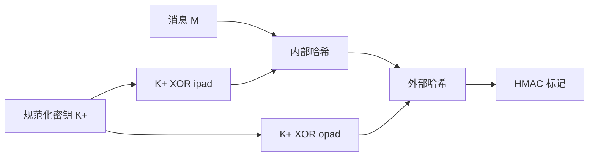

# 第12章 消息认证码

## 本章导学

加密回答“别人能否看懂消息”，消息认证回答“消息是否真的来自声称的发送者、内容和时序是否被改动”。MAC 把共享密钥和消息一起映射为定长标记：

$$
T=\operatorname{MAC}(K,M).
$$

没有密钥的人即使知道算法、消息和其他消息的标记，也应难以为新消息生成合法标记。

### 本章学习目标

1. 区分保密、认证、签名与抗否认。
2. 说明哈希、消息加密和 MAC 三类认证符生成方式。
3. 理解 MAC 的安全要求以及密钥长度与标记长度的共同限制。
4. 掌握 HMAC 的内外两层结构。
5. 理解 DAA/CBC-MAC 的定长限制和 CMAC 的修正。
6. 区分认证加密的四种组合，并理解 CCM、GCM。
7. 掌握 GHASH 的有限域递推与 GCTR 的并行特征。
8. 理解密钥封装为何同时提供保密和完整性。
9. 说明哈希/HMAC 如何生成伪随机位流。

## 12.1 消息认证要求

### 八类攻击

| 类别 | 含义 | 主要防护范畴 |
| --- | --- | --- |
| 泄露 | 未授权者得到消息 | 保密性 |
| 通信量分析 | 推断通信频率、长度、关系 | 保密性/流量隐藏 |
| 伪装 | 冒充合法源插入消息 | 消息认证 |
| 内容修改 | 插入、删除、换位、修改内容 | 消息认证 |
| 序列修改 | 插入、删除、重排消息序列 | 消息认证 |
| 计时修改 | 延时或重放消息/会话 | 消息认证与新鲜性机制 |
| 发送方否认 | 否认发送过消息 | 数字签名与协议 |
| 接收方否认 | 否认收到消息 | 数字签名与专用协议 |

消息认证主要抵抗第 3–6 类攻击。数字签名还能提供某些抗否认性质；MAC 由于双方共享同一密钥，不能证明究竟是哪一方生成了标记。

### 核心认识

认证不仅是“内容没变”，还常要把身份、序号、时间或时变值纳入保护范围。若序号不在 MAC 覆盖内，敌手可能重排消息而不改每条消息内容。

## 12.2 消息认证函数

任何认证或签名机制分两层：

1. 下层函数生成认证符；
2. 上层协议规定认证符覆盖什么、怎样传输、如何处理失败与重放。

三类下层函数：

| 类型 | 认证符 | 是否使用密钥 |
| --- | --- | --- |
| 哈希函数 | $H(M)$ | 否，需另行保护摘要 |
| 消息加密 | 整条密文 | 是 |
| MAC | $\operatorname{MAC}(K,M)$ | 是，共享密钥 |

### 12.2.1 消息加密

#### 对称加密

只有 A、B 知道 K 时，加密可提供保密，并在明文具有可识别结构时提供一定认证。问题是：任意密文经解密都会产生某个位串，如果所有位串都可能是合法消息，B 无法判断它是否由 A 生成。

![[attachments/fig_12_1_pdf265.png]]

解决方向是在明文内部加入不可随意伪造的结构，例如 FCS、格式字段、协议首部、序号等。

#### 内部与外部错误控制

![[attachments/fig_12_2_pdf266.png]]

- 内部错误控制：先计算 FCS，再把消息和 FCS 一起加密。敌手难以制造解密后结构正确的密文。
- 外部错误控制：先加密，再对密文计算 FCS。敌手能修改密文并重算公开 FCS，因此它只检测传输错误，不提供认证。

#### 协议结构

TCP 首部中的校验和、序号等可帮助接收者判断解密结果是否合法，并检测乱序、删除与重放。

![[attachments/fig_12_3_pdf266.png]]

#### 公钥加密

| 操作 | 结果 |
| --- | --- |
| 用接收者公钥加密 | 保密，但任何人都能生成，不能认证发送者 |
| 用发送者私钥变换 | 认证/签名，但任何人可用公钥恢复，不保密 |
| 先发送者私钥，再接收者公钥 | 认证与保密，但公钥运算开销大 |

### 12.2.2 消息认证码

发送方计算

$$
T=C(K,M),
$$

接收方用同一 K 对收到的 M 重算并比较。验证通过可支持：

- 内容未修改；
- 消息由共享密钥持有者生成；
- 若序号被覆盖，消息顺序未被篡改。

![[attachments/fig_12_4_pdf268.png]]

MAC 是多对一、无需可逆；加密必须可逆。MAC 可附在明文、与消息一起加密，或对密文计算。选择组合时必须由经过分析的协议明确规定。

#### 为什么不总用加密代替 MAC

- 广播消息可能只需认证而无需所有接收者解密；
- 高负载接收者可能只抽查认证；
- 程序和文件需要保持明文可运行但长期受完整性保护；
- 应用可能不需要保密；
- 认证与保密可放在不同协议层；
- 解密后加密保护消失，而附随 MAC 可继续验证存储数据。

> [!WARNING] MAC 不等于数字签名
> A、B 都知道同一密钥，因此两者都能生成合法 MAC，无法向第三方证明一定是 A 生成。

## 12.3 消息认证码的要求

### 多对一映射与密钥搜索

若密钥 k 位、标记 n 位且 $k>n$，一个已知 $(M,T)$ 往往匹配约

$$
2^{k-n}
$$

个候选密钥。更多消息-标记对逐轮筛选候选，但总密钥搜索量仍约 $2^k$。

### 不恢复密钥也能伪造

若 MAC 只加密所有消息块的 XOR：

$$
\Delta(M)=X_1\oplus\cdots\oplus X_m,
\qquad
\operatorname{MAC}(K,M)=E_K(\Delta(M)),
$$

攻击者可任意选择前 $m-1$ 个新块，再选择最后一块使总 XOR 不变，直接复用原 MAC。说明安全分析不能只看密钥穷举。

### 三项要求

1. 已知 $M,T$ 时，构造 $M'\ne M$ 且标记相同应不可行。
2. 对随机消息，n 位 MAC 应均匀分布，随机匹配概率为 $2^{-n}$。
3. 对任何已知变换 $M'=f(M)$，标记相同概率仍应为 $2^{-n}$，不能存在“弱位”。

## 12.4 MAC 的安全性

### 抗计算性

给定一个或多个合法消息-MAC 对，敌手对任何未查询的新消息 x 都难以计算合法标记。

### 12.4.1 穷举攻击

两条通用路线：

- 搜索 k 位密钥：约 $2^k$；
- 直接猜 n 位标记：约 $2^n$。

因此通用安全上限为

$$
\min(2^k,2^n),
$$

若目标安全强度为 N 位，应满足

$$
\min(k,n)\ge N.
$$

直接标记攻击通常不能完全离线完成，因为攻击者需要验证新消息的猜测是否被接收。

### 12.4.2 密码分析

密码分析利用具体 MAC 结构。理想设计要求最佳结构攻击不优于上述通用搜索。MAC 结构比哈希更多样，因此必须针对具体构造和安全模型评估。

## 12.5 基于哈希函数的 MAC：HMAC

普通哈希没有密钥，不能直接成为 MAC。HMAC 在不修改内部哈希实现的前提下，把密钥安全地嵌入内外两层哈希。

### 12.5.1 设计目标

- 直接复用现有哈希函数；
- 可方便替换更快或更安全的哈希；
- 尽量保持原哈希性能；
- 密钥处理简单；
- 安全性可依据底层哈希强度分析。

### 12.5.2 算法

![[attachments/fig_12_5_pdf272.png]]

设底层哈希分组长度为 b，输出 n 位。密钥处理：

- 若 $|K|>b$，先令 $K=H(K)$；
- 再用 0 补齐到 b 位，得 $K^+$。

常量：

```text
ipad = 0x36 重复 b/8 次
opad = 0x5c 重复 b/8 次
```

$$
\operatorname{HMAC}(K,M)=
H\left((K^+\oplus\mathrm{opad})\parallel
H((K^+\oplus\mathrm{ipad})\parallel M)
\right).
$$



内外常量使同一 K 形成两个不同的派生前缀。长消息下，额外开销相对较小。

### 高效实现

固定密钥期间可预计算：

$$
f(IV,K^+\oplus\mathrm{ipad}),
\qquad
f(IV,K^+\oplus\mathrm{opad}),
$$

作为内外哈希的新初始链接值。

![[attachments/fig_12_6_pdf272.png]]

### 12.5.3 安全性

HMAC 的安全可归约到底层压缩函数在秘密随机 IV 下的安全或哈希碰撞困难性。与裸哈希碰撞不同，攻击者不知道 K，不能任意离线生成 HMAC 输入输出对，因此裸哈希的公开碰撞成本不能机械地等同于 HMAC 伪造成本。

## 12.6 基于分组密码的 MAC：DAA 和 CMAC

### 12.6.1 DAA

DAA 使用 DES-CBC、全 0 IV：

$$
O_1=E_K(D_1),
$$

$$
O_i=E_K(D_i\oplus O_{i-1}),
$$

最终 DAC 是 $O_N$ 或其最左侧 16–64 位。

![[attachments/fig_12_7_pdf274.png]]

固定长度 CBC-MAC 可安全使用，但不同长度消息共享同一密钥会遭受扩展攻击。

### 12.6.2 CMAC

CMAC 用最后一块子密钥区分“完整最后块”和“填充最后块”。

![[attachments/fig_12_8_pdf275.png]]

- 完整最后块：$M_n\oplus K_1$；
- 不完整最后块：先用 `1 || 0*` 填充，再异或 $K_2$；
- 全链使用同一个分组密码密钥 K，最终可截断为 Tlen 位。

子密钥：

$$
L=E_K(0^b),
\qquad K_1=L\cdot x,
\qquad K_2=K_1\cdot x
$$

运算在 $\mathrm{GF}(2^b)$ 中。实现上是左移一位；若原最高位为 1，再异或约简常数：

| 分组长度 | 常数 |
| ---: | ---: |
| 64 | `0x1B` |
| 128 | `0x87` |

## 12.7 认证加密：CCM 和 GCM

认证加密同时提供保密性与完整性。

### 四种组合

| 方法 | 结构 | 验证顺序 |
| --- | --- | --- |
| H→E | 加密 $M\parallel H(M)$ | 先解密后验证 |
| A→E | MAC 明文，再加密 $M\parallel T$ | 先解密后验证 |
| E→A | 加密 M，再 MAC 密文 C | 先验证后解密 |
| E+A | 分别加密 M、MAC 明文 M | 解密与验证分别进行 |

组合是否安全依赖精确定义，不能只看箭头顺序。

### 12.7.1 CCM

CCM 结合 AES、CTR 和 CMAC，共用一个密钥，输入：

- P：既加密又认证的明文；
- A：只认证、不加密的关联数据；
- N：每个实例唯一的时变值。

认证时对格式化的 $(N,A,P)$ 做 CBC-MAC；加密时用 CTR 加密 P，并用计数器 0 的密钥流掩蔽标记。

![[attachments/fig_12_9_pdf277.png]]

CCM 更接近改进的 E+A：认证基于明文，明文和标记分别被 CTR 密钥流保护。解密后必须重算并比较标记，失败则返回无效。

### 12.7.2 GCM

GCM 结合 GCTR 与 GHASH，适合并行实现。

#### GHASH

$$
Y_0=0^{128},
$$

$$
Y_i=(Y_{i-1}\oplus X_i)\cdot H
\quad\text{in }\mathrm{GF}(2^{128}).
$$

展开为

$$
Y_m=X_1H^m\oplus X_2H^{m-1}\oplus\cdots\oplus X_mH.
$$

幂可预计算，各消息块贡献可并行。

#### GCTR

用 AES 加密递增计数器，与输入异或；最后不完整块只取所需密钥流前缀。

![[attachments/fig_12_10_pdf279.png]]

#### 完整 GCM

1. $H=E_K(0^{128})$；
2. 由 IV 生成 $J_0$；96 位 IV 时 $J_0=IV\parallel0^{31}\parallel1$；
3. $C=\operatorname{GCTR}_K(\operatorname{inc}_{32}(J_0),P)$；
4. GHASH 覆盖 A、C、二者长度；
5. 用 $J_0$ 的 GCTR 掩蔽 GHASH 结果并截断为标记 T。

![[attachments/fig_12_11_pdf280.png]]

GCM 是 E→A：标记基于密文和关联数据。接收方应先验证标记，再向应用释放明文。

## 12.8 密钥封装

### 12.8.1 为什么需要

通信双方用已有密钥加密密钥 KEK 安全传递新对称密钥。普通 AES 分组只有 128 位，而要封装的密钥可能有 192/256 位。密钥封装要求强雪崩和完整性，因为密钥被多次使用，泄露后影响巨大。

### 12.8.2 封装

输入为 n 个 64 位明文密钥块，初始完整性值：

```text
A = A6A6A6A6A6A6A6A6
```

算法进行 $6n$ 次 AES 运算，使 A 与各 R 块反复混合；输出多一个 64 位块 $C_0=A$。

![[attachments/fig_12_12_pdf282.png]]

![[attachments/fig_12_13_pdf282.png]]

### 12.8.3 解封

解封按相反阶段顺序使用解密函数，恢复 A 和 R。若最终

$$
A\ne\texttt{A6A6A6A6A6A6A6A6},
$$

则拒绝结果。ICV 检查使封装同时提供密钥保密和完整性。

## 12.9 使用哈希函数和 MAC 的 PRNG

### 12.9.1 基于哈希

以秘密种子 V 为状态，重复对变化的状态/计数值执行哈希并连接输出，必要时截断最后一块。种子长度应满足目标安全强度，标准还周期性更新 V。

![[attachments/fig_12_14_pdf284.png]]

### 12.9.2 基于 HMAC

使用 K 和 V 作为内部状态，典型链式形式让前一输出成为后一 HMAC 输入。周期性更新 K、V 可提高状态恢复后的安全性。

![[attachments/fig_12_15_pdf285.png]]

HMAC 每块需要内外两次哈希，性能低于直接哈希，但密钥化结构提供更强的安全信心。

## 常见误区

- MAC 提供认证，但不自动提供保密。
- 共享密钥 MAC 不能提供数字签名和第三方不可否认性。
- 标记截短会直接降低猜测攻击强度。
- CBC-MAC 只在固定长度域中直接安全；CMAC 解决变长边界区分。
- HMAC 不是简单的 $H(K\parallel M)$。
- CCM/GCM 的 nonce 必须满足各自唯一性要求，不能随意复用。
- GCM 的 GHASH 不是普通整数乘法，而是 $\mathrm{GF}(2^{128})$ 乘法。
- 认证解密失败时不能把未经验证的明文交给应用。

## 学习建议

1. 每个方案都写清“什么被认证、什么被加密、使用哪个密钥”。
2. 对 CBC-MAC/CMAC 用两块消息手算一次链值，理解扩展攻击。
3. 记忆 HMAC 时先写内部哈希，再在外部加 opad。
4. 对 GCM 并排画出 GCTR 的密文路径和 GHASH 的认证路径。
5. 密钥封装解封题按加密循环的完全逆序写，不要只把 E 改 D。

## Related

- [[第十一章_密码学哈希函数_导学讲义]]
- [[第十二章_消息认证码_教材原文]]
- [[第十二章_消息认证码_复习笔记]]
- [[第十二章_消息认证码_课后习题]]
- [[第十三章_数字签名_导学讲义]]
