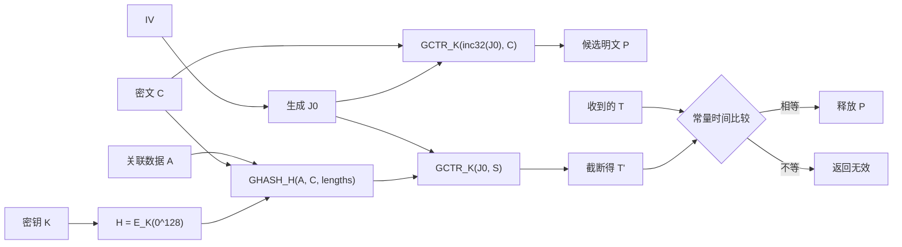
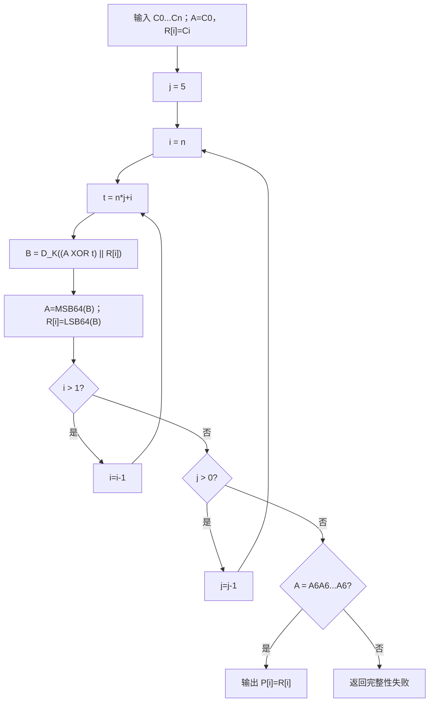

# 第12章 消息认证码 - 课后习题

> [!info] 内容说明
> 本文包含原教材本章全部 **9道思考题、11道习题，共20道**。题目原文来自本章教材原文并经PDF章末页复核；解答优先依据本章正文。

## 思考题

### 思考题 12.1

> [!question] **题目原文**
> 消息认证是为了对付哪些类型的攻击？

#### 答题思路

从八类攻击中区分保密、认证和数字签名各自处理的范围。

#### 解答

消息认证主要抵抗：

1. 伪装，即冒充合法实体插入消息；
2. 内容修改，即插入、删除、换位或修改消息内容；
3. 序列修改，即插入、删除或重排消息序列；
4. 计时修改，即延迟或重放消息。

消息泄露和通信量分析主要由保密机制处理；发送方或接收方否认通常还需要数字签名及相应协议。

#### 依据

12.1 消息认证要求。

---

### 思考题 12.2

> [!question] **题目原文**
> 消息认证或数字签名方法有哪两层功能？

#### 答题思路

分别说明底层认证函数和上层协议的职责。

#### 解答

第一层是下层函数，用于产生认证符，如哈希值、MAC 或数字签名。第二层是上层协议，规定怎样利用该认证符，使接收方验证来源、完整性、顺序和时效，并规定失败处理方式。

#### 依据

12.2 消息认证函数。

---

### 思考题 12.3

> [!question] **题目原文**
> 生成消息认证的方法有哪些？

#### 答题思路

列出教材给出的三类下层函数。

#### 解答

可使用：

1. 消息加密，把整条消息的密文作为认证依据；
2. 消息认证码，使用共享密钥和消息生成定长认证符；
3. 哈希函数，生成定长摘要，但摘要本身必须通过加密、共享秘密或数字签名得到保护。

#### 依据

12.2 消息认证函数。

---

### 思考题 12.4

> [!question] **题目原文**
> 使用对称加密和错误控制码认证消息时，这两个函数必须以何种顺序执行？

#### 答题思路

比较内部错误控制和外部错误控制能否阻止敌手重算公开校验值。

#### 解答

为提供消息认证，应先对明文计算错误控制码 FCS，再把消息与 FCS 一起加密：

$$
C=E_K(M\parallel F(M)).
$$

接收方先解密，再重新计算 FCS 并比较。若先加密、后对密文计算公开 FCS，敌手修改密文后可以重算 FCS，因此只能检测偶然传输错误，不能认证。

#### 依据

12.2.1；图 12.2。

---

### 思考题 12.5

> [!question] **题目原文**
> 什么是消息认证码？

#### 答题思路

给出输入、输出、验证方式和安全目标。

#### 解答

消息认证码是共享秘密密钥 K 和任意长消息 M 的函数，输出定长认证标记：

$$
T=C(K,M).
$$

发送方把 T 附在消息上，接收方用同一密钥重算并比较。合法 MAC 能证明消息由共享密钥持有者生成并且受认证的内容未被修改。

#### 依据

本章教材原文 **12.2.2 消息认证码**。

---

### 思考题 12.6

> [!question] **题目原文**
> 消息认证码和单向哈希函数的区别是什么？

#### 答题思路

比较是否使用秘密密钥，以及因此产生的来源认证能力。

#### 解答

普通单向哈希函数只以消息为输入，任何人都能计算 $H(M)$；MAC 还以共享秘密密钥为输入，只有密钥持有者能有效生成或验证 $C(K,M)$。因此普通哈希主要产生公开摘要，单独使用不能认证来源；MAC 可提供消息完整性和来源认证。

#### 依据

12.2、12.3；第 11 章哈希函数定义。

---

### 思考题 12.7

> [!question] **题目原文**
> 为提供消息认证，应以何种方式保证哈希值的安全？

#### 答题思路

说明摘要必须受到秘密或签名机制保护。

#### 解答

可采用以下方式保护哈希值：

- 用对称密钥加密摘要，或加密消息与摘要；
- 把只有通信双方知道的秘密值与消息一起哈希；
- 用发送方私钥对摘要签名；
- 使用经过标准化的 HMAC，把密钥嵌入内外两层哈希。

核心要求是敌手不能在修改消息后自行产生新的合法受保护摘要。

#### 依据

12.2；11.1.1 消息认证。

---

### 思考题 12.8

> [!question] **题目原文**
> 为了攻击MAC算法，必须恢复密钥吗?

#### 答题思路

区分密钥恢复攻击和直接伪造攻击。

#### 解答

不必须。敌手的目标通常是为未查询消息产生可接受的 MAC。除搜索密钥外，还可直接猜测 n 位标记，或利用算法结构构造与已知消息相同的内部状态或标记。只要伪造被接受，攻击就已成功，即使密钥仍未知。

#### 依据

12.3；12.4。

---

### 思考题 12.9

> [!question] **题目原文**
> 要用一个哈希函数替代另一个哈希函数，HMAC中需要做哪些改变？

#### 答题思路

HMAC 不修改哈希内部结构，只适配分组长度和输出参数。

#### 解答

把 HMAC 调用的底层 H 替换为新哈希函数，并按新函数的分组长度 b 重新确定 $K^+$、ipad 和 opad 的长度；长密钥也由新 H 先哈希。若协议规定标记长度，还需按新输出长度确定是否截断。HMAC 的内外嵌套结构不变。

#### 依据

12.5.1、12.5.2。

---

## 习题

### 习题 12.1

> [!question] **题目原文**
> 若F是错误检测函数，则其无论是用作内部函数还是用作外部函数（见图12.2），都具有错误检测能力。若被传输消息的任何位被改变，则不管是在加密函数内还是在加密函数外执行FCS，收到的FCS和算出的FCS都会不一致。有些编码还具有纠错能力，若在传输中有一位或一些位被改变，则纠错码应含有足够的冗余信息来确定错误位并纠正它。显然，纠错码用在加密函数外时具有纠错能力。纠错码用在加密函数内时具有纠错能力吗？

#### 答题思路

外部编码直接观察密文传输错误；内部编码必须先解密，再看解密模式把密文错误扩散成多少明文错误。

#### 解答

不一定，取决于加密模式的错误传播和纠错码能力。

- 外部纠错码覆盖密文，可在解密前定位并纠正传输错误，然后正确解密。
- 内部纠错码位于明文中，接收方必须先解密。若一个密文错误在解密后只造成有限、可定位且不超过纠错能力的明文错误，仍可纠正。例如流密码或 CTR 通常表现为相应位置位翻转。
- 若模式使错误扩散到一个或多个完整分组，产生的错误数量可能超过纠错能力，此时内部码只能检测或完全失效，不能保证纠正。

因此不能笼统断言内部纠错码始终具有纠错能力。

#### 依据

12.2.1；图 12.2；分组密码工作模式的错误传播性质。

---

### 习题 12.2

> [!question] **题目原文**
> 可以将12.6节中给出的数据认证算法定义为使用密文分组链接（CBC）方式的DES运算，其初始向量为0（见图12.7）。证明通过密文反馈模式可以得出同样的结果。

#### 答题思路

把每轮 DES 输出作为下一轮反馈，与下一数据块异或后再送入加密器。

#### 解答

DAA 的 CBC 递推为

$$
O_0=0,
$$

$$
O_i=E_K(D_i\oplus O_{i-1}),\qquad 1\le i\le N.
$$

从反馈结构观察，每一轮都把前一轮的完整加密输出 $O_{i-1}$ 反馈，与当前数据块 $D_i$ 异或，再送入 DES。初始反馈为 0，所以第一轮为 $O_1=E_K(D_1)$；后续轮与 CBC 递推完全相同，最终输出仍为 $O_N$，故得到相同 DAC。

#### 依据

12.6.1；图 12.7。

---

### 习题 12.3

> [!question] **题目原文**
> 12.6节的开头说，当给定一个分组消息X的CBCMAC值 $T = \mathrm { M A C } ( K , X )$ 时，敌手立即知道两个分组消息 $X \parallel ( X \oplus T )$ 的CBCMAC值，因为该值仍然是 $T$。证明上述结论。

#### 答题思路

对两分组消息逐轮代入 CBC 链接公式。

#### 解答

单分组 X、零 IV 的标记为

$$
T=E_K(X).
$$

对两分组消息 $X\parallel(X\oplus T)$：第一轮输出仍为 T。第二轮加密输入为

$$
(X\oplus T)\oplus T=X.
$$

所以最终输出

$$
E_K(X)=T.
$$

因此两分组消息的 CBC-MAC 与原单分组消息相同。

#### 依据

12.6 开头的 CBC-MAC 变长消息攻击。

---

### 习题 12.4

> [!question] **题目原文**
> 证明：对于CMAC，当最后一轮加密完成后，与第二个密钥异或的变异方法没有效果。下面考虑消息长度是分组长度的整数倍的情况。变异方法可以表示为 $\operatorname { V M A C } ( K , M ) = \operatorname { C B C } ( K , M ) \oplus K _ { 1 }$ 。假设敌手可以获得三条消息的MAC：消息 ${ \bf 0 } = { \bf 0 } ^ { n }$ ，其中n是分组的长度；消息 $1 = 1 ^ { n } ;$ 消息 $\mathbf { 1 } \| \mathbf{0}$ 。敌手可以得到 $T _ { 0 } = \mathrm { C B C } ( K , \mathbf { 0 } ) \oplus K _ { 1 } \ , \ T _ { 1 } = \mathrm { C B C } ( K , \mathbf { 1 } ) \oplus K _ { 1 }$ 和 $T _ { 2 } = \mathrm { C B C } ( K , [ \mathrm { C B C } ( K , \mathbf { 1 } ) ] ) \oplus K _ { 1 }$ 。证明敌手可以算出其未提问过的消息 $\mathbf{0}\parallel(T_0\oplus T_1)$ 的正确MAC值。

#### 答题思路

先把 $T_0\oplus T_1$ 展开，利用 $K_1$ 自消，再代入两分组 CBC。

#### 解答

记

$$
C_0=\operatorname{CBC}(K,\mathbf 0)=E_K(\mathbf 0),
$$

$$
C_1=\operatorname{CBC}(K,\mathbf 1)=E_K(\mathbf 1).
$$

则

$$
T_0=C_0\oplus K_1,\qquad T_1=C_1\oplus K_1,
$$

从而

$$
T_0\oplus T_1=C_0\oplus C_1.
$$

对未查询消息 $\mathbf 0\parallel(T_0\oplus T_1)$，第一轮链接值为 $C_0$，第二轮输入为

$$
(T_0\oplus T_1)\oplus C_0
=(C_0\oplus C_1)\oplus C_0=C_1.
$$

所以其 CBC 最终值为 $E_K(C_1)$，VMAC 为

$$
E_K(C_1)\oplus K_1=T_2.
$$

敌手已知 $T_2$，因此完成对未查询消息的伪造。

#### 依据

12.6.2 CMAC 对 CBC-MAC 的修正。

---

### 习题 12.5

> [!question] **题目原文**
> 在讨论CMAC子密钥生成时，说过首先要将分组密码应用到一个全0的分组。第一个子密钥从所得的密文导出，即先左移一位，然后根据条件和一个常数进行异或运算得到，其中常数依赖于分组的大小。第二个子密钥是采用相同的方式由第一个子密钥导出的。
>
> a. 对于长度为64位或128位的分组，需要什么常数？
>
> b. 说明如何进行左移和异或运算才能得到结果。

#### 答题思路

把有限域中的乘 x 写成位移与模多项式约简。

#### 解答

a. 约简常数为：

| 分组长度 | 常数 |
| ---: | ---: |
| 64 位 | `0x1B` |
| 128 位 | `0x87` |

b. 先计算 $L=E_K(0^b)$。定义倍乘函数：

$$
\operatorname{dbl}(X)=
\begin{cases}
X\ll1,&\operatorname{MSB}(X)=0,\\
(X\ll1)\oplus R_b,&\operatorname{MSB}(X)=1,
\end{cases}
$$

其中只保留 b 位，$R_b$ 放在最低有效字节位置。然后

$$
K_1=\operatorname{dbl}(L),\qquad K_2=\operatorname{dbl}(K_1).
$$

#### 依据

12.6.2；CMAC 子密钥生成。

---

### 习题 12.6

> [!question] **题目原文**
> 12.6节给出了三种实现认证加密的基本方法： $A\to E$、$E\to A$ 和 $E+A$。
>
> a. CCM使用的是哪种方法？
>
> b. GCM使用的是哪种方法？

#### 答题思路

判断认证作用在明文还是密文，以及标记与消息怎样加密。

#### 解答

a. CCM 使用改进的 $E+A$ 方法：CBC-MAC 认证格式化明文和关联数据，CTR 分别保护明文和认证标记。

b. GCM 使用 $E\to A$ 方法：先用 GCTR 加密明文得到密文，再由 GHASH 认证关联数据和密文。

#### 依据

12.7.1、12.7.2。

---

### 习题 12.7

> [!question] **题目原文**
> 证明GHASH函数的计算过程是 $( X _ { 1 } \cdot H^m ) \oplus ( X _ { 2 } \cdot H^{m-1} ) \oplus \cdots \oplus ( X _ { m - 1 } \cdot H^2 ) \oplus ( X _ { m } \cdot H )$

#### 答题思路

从 $Y_i=(Y_{i-1}\oplus X_i)H$ 逐步展开，并用归纳法证明。

#### 解答

GHASH 递推为

$$
Y_0=0,
$$

$$
Y_i=(Y_{i-1}\oplus X_i)H.
$$

前两步：

$$
Y_1=X_1H,
$$

$$
Y_2=(X_1H\oplus X_2)H=X_1H^2\oplus X_2H.
$$

假设

$$
Y_{m-1}=X_1H^{m-1}\oplus X_2H^{m-2}\oplus\cdots\oplus X_{m-1}H,
$$

则利用有限域乘法对 XOR 的分配律：

$$
\begin{aligned}
Y_m&=(Y_{m-1}\oplus X_m)H\\
&=X_1H^m\oplus X_2H^{m-1}\oplus\cdots\oplus X_{m-1}H^2\oplus X_mH.
\end{aligned}
$$

命题得证。

#### 依据

12.7.2 GHASH 定义。

---

### 习题 12.8

> [!question] **题目原文**
> 为认证解密过程画出类似于图12.11的流程图。

#### 答题思路

把接收的密文和关联数据分别送入解密与认证路径，最后比较标记。

#### 解答



等价步骤为：

1. $H=E_K(0^{128})$；
2. 由 IV 计算 $J_0$；
3. $P=\operatorname{GCTR}_K(\operatorname{inc}_{32}(J_0),C)$；
4. $S=\operatorname{GHASH}_H(A\parallel pad\parallel C\parallel pad\parallel len(A)\parallel len(C))$；
5. $T'=\operatorname{MSB}_t(\operatorname{GCTR}_K(J_0,S))$；
6. 比较 T 与 $T'$，相等才输出 P，否则返回失败。

#### 依据

12.7.2；图 12.10、图 12.11。

---

### 习题 12.9

> [!question] **题目原文**
> Alice想通过长度为2的字发送1位信息（是或否）给Bob。Alice和Bob有4个可能的密钥来进行认证。下表给出了每个密钥下为每条消息发送的2位字：
>
> | 密钥 | 消息0 | 消息1 |
> | --- | --- | --- |
> | 1 | 00 | 01 |
> | 2 | 10 | 00 |
> | 3 | 01 | 11 |
> | 4 | 11 | 10 |
>
> a. 上表对于Alice的操作是必需的。请为Bob 构建类似的表格用于认证。
>
> b. 敌手冒充Alice的成功概率是多少？
>
> c. 敌手对截获的消息进行替代的成功概率是多少？

#### 答题思路

对每个密钥反转 Alice 的编码表，再统计无密钥敌手选择任意 2 位字时被接受的密钥比例。

#### 解答

a. Bob 的验证表：

| 密钥 | 收到 00 | 收到 01 | 收到 10 | 收到 11 |
| ---: | :---: | :---: | :---: | :---: |
| 1 | 0 | 1 | 无效 | 无效 |
| 2 | 1 | 无效 | 0 | 无效 |
| 3 | 无效 | 0 | 无效 | 1 |
| 4 | 无效 | 无效 | 1 | 0 |

b. 四个密钥等概率。任意固定 2 位字在其中两个密钥下合法，因此冒充成功概率为

$$
\frac{2}{4}=\frac12.
$$

c. 截获一个合法字后，敌手不知道具体密钥；与该字相容的两个密钥中，替代为另一个适当字只能在其中一个密钥下表示相反消息，因此成功概率为

$$
\frac12.
$$

#### 依据

12.2.2 MAC 验证；12.4 标记猜测。

---

### 习题 12.10

> [!question] **题目原文**
> 画出类似于图12.12和图12.13的流程图，说明密钥解封算法。

#### 答题思路

把封装的 6 轮、每轮 n 块处理完全倒序，并用 AES 解密恢复 A、R。

#### 解答



伪代码：

```text
A = C[0]
for i = 1 to n
    R[i] = C[i]

for j = 5 downto 0
    for i = n downto 1
        t = n*j + i
        B = D(K, (A XOR t) || R[i])
        A = MSB64(B)
        R[i] = LSB64(B)

if A != A6A6A6A6A6A6A6A6
    return INVALID
for i = 1 to n
    P[i] = R[i]
```

#### 依据

12.8.2、12.8.3；图 12.12、图 12.13。

---

### 习题 12.11

> [!question] **题目原文**
> 考虑下面的密钥封装算法：
>
> 1. 初始化变量。
>
> - 令 $A=\mathtt{A6A6A6A6A6A6A6A6}$。
> - 对 $i=1,2,\ldots,n$，令 $R(i)=P_i$。
>
> 2. 计算中间值。
>
> - 对 $j=0,1,\ldots,5$，依次执行：
>   - 对 $i=1,2,\ldots,n$，计算
>     1. $B=E\bigl(K,\,A\parallel R(i)\bigr)$；
>     2. $t=nj+i$；
>     3. $A=t\oplus\operatorname{MSB}_{64}(B)$；
>     4. $R(i)=\operatorname{LSB}_{64}(B)$。
>
> 3. 输出结果。
>
> - 令 $C_0=A$。
> - 对 $i=1,2,\ldots,n$，令 $C_i=R(i)$。
>
> a. 该算法与 12.8 节中介绍的 SP 800-38F 算法，功能上有什么区别？
>
> b. 写出对应的密钥解封算法。

#### 答题思路

先比较状态更新顺序是否只是不同的寄存器表示，再逐次反演最内层更新。

#### 解答

a. 功能上没有区别。题给算法把 A 和各 $R(i)$ 作为寄存器原地更新，仍执行相同的 $6n$ 次 AES 变换、同一 t 值异或、同一初始完整性常量，并产生 n+1 个 64 位密文块。它是 SP 800-38F 封装过程的等价表示。

b. 对应解封必须按相反顺序处理：

```text
A = C0
for i = 1 to n
    R(i) = Ci

for j = 5 downto 0
    for i = n downto 1
        t = n*j + i
        B = D(K, [(A XOR t) || R(i)])
        A = MSB64(B)
        R(i) = LSB64(B)

if A != A6A6A6A6A6A6A6A6
    return INVALID

for i = 1 to n
    Pi = R(i)
```

理由是封装一步满足

$$
A'=t\oplus\operatorname{MSB}_{64}(B),\qquad R_i'=\operatorname{LSB}_{64}(B),
$$

所以解封先用 $A'\oplus t$ 恢复加密输出 B 的高 64 位，再与 $R_i'$ 拼接送入解密器。

#### 依据

12.8.2、12.8.3；SP 800-38F 密钥封装。

---
