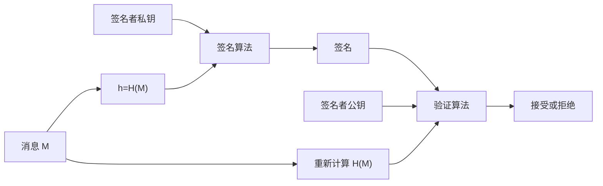
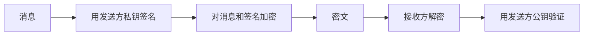

# 第13章 数字签名

## 本章导学

MAC 能证明消息来自“共享密钥持有者”，但通信双方都持有同一密钥，因此任何一方都可能生成合法 MAC。发生争议时，第三方无法判断究竟是谁生成了它。数字签名用私钥生成签名、用公钥验证，把“生成能力”和“验证能力”分开，从而处理完整性、来源认证和第三方仲裁问题。



### 本章学习目标

1. 解释数字签名为何能处理 MAC 无法解决的双方争议。
2. 区分攻击者能力、攻击结果和数字签名的设计要求。
3. 掌握 ElGamal、Schnorr、DSA、ECDSA 的签名与验证等式。
4. 理解每次签名随机数 k 的作用及泄露后果。
5. 理解 RSA-PSS 中哈希、盐、MGF1、掩蔽和结构校验的关系。
6. 比较直接数字签名、认证和保密的边界。

## 13.1 数字签名概述

### 本节核心问题

为什么“只有通信双方知道密钥”仍不足以解决争议？数字签名需要达到什么安全目标？

### 13.1.1 性质

设 John 和 Mary 共享 MAC 密钥。Mary 可以自行构造消息和合法 MAC，再声称消息来自 John；John 也可以否认真实发送过的消息，因为 Mary 确实具备伪造能力。共享密钥认证无法给第三方提供唯一归责证据。

数字签名应支持：

- 验证签名者，以及签名日期和时间；
- 认证被签名消息的内容；
- 争执时由第三方验证和仲裁。

![[attachments/fig_13_1_pdf288.png]]

生活类比：MAC 像两个人共用同一枚印章，印迹真实但无法判断是谁盖的；数字签名像只有签名者控制的专用印章，而任何人都持有可靠的验章方法。

> [!WARNING] 边界
> 数字签名不隐藏消息。需要保密时，应在签名机制之外使用加密。

### 13.1.2 攻击和伪造

#### 按攻击者获得的信息分类

| 攻击 | 攻击者能力 |
| --- | --- |
| 唯密钥攻击 | 只知道目标用户公钥 |
| 已知消息攻击 | 知道若干消息及其签名 |
| 一般选择消息攻击 | 预先选择消息并取得签名，与目标公钥无关 |
| 定向选择消息攻击 | 看到目标公钥后选择查询消息 |
| 适应性选择消息攻击 | 后续查询依赖先前得到的消息-签名对 |

适应性选择消息最强，因为攻击者可把签名者当作可反复查询的“签名先知”。现代安全目标通常要求：即使攻击者具有这种查询能力，也不能为任何未查询的新消息产生有效签名。

#### 按攻击结果分类

| 结果 | 含义 | 危害程度 |
| --- | --- | --- |
| 完全破译 | 恢复私钥 | 最高 |
| 通用伪造 | 获得任意消息的等效签名能力 | 很高 |
| 选择伪造 | 能伪造指定消息 | 高 |
| 存在性伪造 | 至少伪造一条但不能控制内容 | 最低但仍不可接受 |

### 13.1.3 数字签名要求

数字签名必须：

1. 依赖被签名消息的位模式；
2. 使用只有发送方知道的信息；
3. 容易生成；
4. 容易识别和验证；
5. 从签名伪造消息、或从消息伪造签名都在计算上不可行；
6. 签名副本便于保存。

哈希把任意长消息压缩为定长摘要，并把签名与消息内容绑定；但哈希抗碰撞、消息编码和签名格式仍必须正确设计。

### 13.1.4 直接数字签名

直接数字签名只涉及发送方和接收方，并假设接收方已可靠获得发送方公钥。

若同时需要保密，应采用“先签名，后加密”：



这样发生争执时，接收方可保存明文消息及其签名供第三方验证。若先加密、再对密文签名，第三方需要解密密钥才能理解被签名内容。

直接签名依赖私钥安全。签名者可能在争议时声称私钥早已泄露；攻击者也可能盗取私钥后伪造较早的时间戳。因此需要可靠时间戳、泄露报告、证书撤销与证书授权机制配合。

## 13.2 ElGamal 数字签名方案

### 为什么先学 ElGamal 签名

它把离散对数困难性、一次性随机数和模逆运算组合在一起，是理解 DSA 的直接基础。

### 密钥生成

选择素数 q 和其本原根 alpha。用户 A：

$$
1<X_A<q-1,
$$

$$
Y_A=\alpha^{X_A}\bmod q.
$$

私钥为 $X_A$，公钥为 $(q,\alpha,Y_A)$。

### 签名

先计算 $m=H(M)$，再选择与 $q-1$ 互素的一次性随机数 K：

$$
S_1=\alpha^K\bmod q,
$$

$$
S_2=K^{-1}(m-X_AS_1)\bmod(q-1).
$$

签名是 $(S_1,S_2)$。

### 验证与正确性

验证者比较

$$
V_1=\alpha^m\bmod q
$$

与

$$
V_2=Y_A^{S_1}S_1^{S_2}\bmod q.
$$

因为

$$
KS_2\equiv m-X_AS_1\pmod{q-1},
$$

所以

$$
Y_A^{S_1}S_1^{S_2}
=\alpha^{X_AS_1}\alpha^{KS_2}
\equiv\alpha^m\pmod q.
$$

教材例中 $q=19,\alpha=10,X_A=16,Y_A=4,m=14,K=5$，得到 $(S_1,S_2)=(3,4)$，验证两侧均为 16。

> [!IMPORTANT] 随机数条件
> K 必须保密、不可复用，并且与 q-1 互素，否则 $K^{-1}$ 不存在或私钥关系可能暴露。

## 13.3 Schnorr 数字签名方案

### 知识背景

Schnorr 签名同样基于离散对数，但把最昂贵的指数运算放在与消息无关的预处理阶段。

### 参数与密钥

选择素数 p、q，满足 $q\mid(p-1)$，并选择阶为 q 的元素 a：

$$
a^q\equiv1\pmod p.
$$

私钥 $0<s<q$，公钥

$$
v=a^{-s}\bmod p.
$$

### 签名

1. 随机选 $0<r<q$，预计算 $x=a^r\bmod p$；
2. $e=H(M\parallel x)$；
3. $y=(r+se)\bmod q$；
4. 签名为 $(e,y)$。

### 验证

$$
x'=a^yv^e\bmod p,
$$

接受条件为

$$
e=H(M\parallel x').
$$

正确性来自

$$
x'\equiv a^{r+se}a^{-se}\equiv a^r\equiv x\pmod p.
$$

记忆方法：承诺 $x$，挑战 $e$，响应 $y$；验证者用响应与公钥重建承诺。

## 13.4 NIST 数字签名算法

### 13.4.1 DSA 方法

DSA 只用于数字签名，不能用于加密或密钥交换。RSA 签名可看成对消息摘要进行 RSA 私钥运算；DSA 则把消息摘要、每次签名的随机数 k、私钥和全局参数共同送入签名函数，产生 r、s 两个分量。

![[attachments/fig_13_2_pdf293.png]]

### 13.4.2 DSA 算法

#### 全局参数与密钥

- 选择素数 q；
- 选择素数 p，使 $q\mid(p-1)$；
- 选择 $g=h^{(p-1)/q}\bmod p>1$，因此 g 的阶为 q；
- 私钥 $1\le x\le q-1$；
- 公钥 $y=g^x\bmod p$。

#### 签名

对每次签名选择唯一秘密随机数 $1\le k\le q-1$：

$$
r=(g^k\bmod p)\bmod q,
$$

$$
s=k^{-1}(H(M)+xr)\bmod q.
$$

若 r 或 s 为 0，应重新选择 k。

#### 验证

$$
w=s^{-1}\bmod q,
$$

$$
u_1=H(M)w\bmod q,
\qquad
u_2=rw\bmod q,
$$

$$
v=((g^{u_1}y^{u_2}\bmod p)\bmod q).
$$

当且仅当 $v=r$ 时接受。

![[attachments/fig_13_3_pdf294.png]]

![[attachments/fig_13_4_pdf294.png]]

### 为什么 k 泄露就泄露私钥

由签名式直接移项：

$$
x=(sk-H(M))r^{-1}\bmod q.
$$

所以每次 k 必须秘密且唯一。重复使用同一 k 时，两条签名方程可先解出 k，再恢复 x。k 不是可公开的普通随机数，而是一次性秘密。

## 13.5 椭圆曲线数字签名算法

ECDSA 把 DSA 的有限域指数运算替换为椭圆曲线点乘，在较短密钥下提供较高效率。

### 13.5.1 全局域参数

- 素数 q；
- 曲线参数 a、b，定义 $y^2=x^3+ax+b$；
- 基点 $G=(x_g,y_g)$；
- G 的阶 n，即最小正整数 n 满足 $nG=O$。

### 13.5.2 密钥生成

私钥

$$
d\in[1,n-1],
$$

公钥

$$
Q=dG.
$$

### 13.5.3 签名生成与认证

#### 签名

$$
P=(x,y)=kG,
\qquad r=x\bmod n,
$$

$$
e=H(m),
$$

$$
s=k^{-1}(e+dr)\bmod n.
$$

若 r 或 s 为 0，重新选择 k；签名为 $(r,s)$。

#### 验证

先检查 $1\le r,s\le n-1$，然后

$$
w=s^{-1}\bmod n,
$$

$$
u_1=ew\bmod n,
\qquad u_2=rw\bmod n,
$$

$$
X=u_1G+u_2Q.
$$

若 $X=O$ 则拒绝；否则令 $v=x_X\bmod n$，比较 $v=r$。

正确性：

$$
u_1G+u_2Q=(we+wrd)G=kG,
$$

因此验证点与签名时的点相同，x 坐标模 n 也相同。

![[attachments/fig_13_5_pdf297.png]]

### DSA 与 ECDSA 的联系

| 元素 | DSA | ECDSA |
| --- | --- | --- |
| 私钥 | x | d |
| 公钥 | $g^x\bmod p$ | $dG$ |
| 一次性值 | k | k |
| r 来源 | $g^k$ 的模运算 | $kG$ 的 x 坐标 |
| s | $k^{-1}(H+xr)$ | $k^{-1}(H+dr)$ |

## 13.6 RSA-PSS 数字签名算法

### 为什么需要 PSS

教材所述早期 RSA 签名方案的差别主要在摘要编码和验证格式。RSA-PSS 引入随机盐和可证明安全的编码结构，使其安全性能够与 RSA 基础问题关联；同一消息使用同一私钥多次签名也会得到不同签名。

### 13.6.1 掩蔽生成函数 MGF1

MGF1 用哈希函数把任意长度 X 扩展为 maskLen 字节掩码：

$$
T=H(X\parallel C_0)\parallel H(X\parallel C_1)\parallel\cdots,
$$

其中 $C_i$ 是 32 位计数器，最终取 T 的前 maskLen 字节。

MGF1 不是加密函数；它为 PSS 生成与 H 绑定的确定长度掩码。

### 13.6.2 签名操作

#### EMSA-PSS 编码

![[attachments/fig_13_6_pdf298.png]]

1. $mHash=Hash(M)$；
2. 随机生成 salt；
3. $M'=0^{64}\parallel mHash\parallel salt$；
4. $H=Hash(M')$；
5. $DB=PS\parallel0x01\parallel salt$；
6. $dbMask=MGF(H,emLen-hLen-1)$；
7. $maskedDB=DB\oplus dbMask$，清零超出 emBits 的高位；
8. $EM=maskedDB\parallel H\parallel0xBC$。

把 EM 解释为整数 m，再用 RSA 私钥运算：

$$
s=m^d\bmod n.
$$

### 13.6.3 签名验证

验证者用公钥恢复编码消息：

$$
m=s^e\bmod n.
$$

随后检查长度、最右侧 `0xBC`、被清零的高位和 $PS\parallel0x01$ 结构；用 H 重新生成 dbMask，恢复 DB 和 salt；最后重新计算

$$
H'=Hash(0^{64}\parallel Hash(M)\parallel salt)
$$

并比较 $H'=H$。

![[attachments/fig_13_7_pdf300.png]]

### 各字段为什么存在

| 字段 | 作用 |
| --- | --- |
| $Hash(M)$ | 把签名绑定到消息 |
| salt | 使同一消息的签名随机化 |
| MGF1 掩码 | 把 H 与 DB 结构混合 |
| $PS\parallel0x01$ | 提供可验证的编码边界 |
| `0xBC` | 固定尾标识 |
| 高位清零 | 保证编码整数落在 RSA 模数允许范围 |

## 常见误区与记忆技巧

- **签名不等于加密**：签名解决来源、完整性和仲裁，不隐藏消息。
- **验证通过不等于身份体系完整**：还要可靠绑定公钥与身份，后续由证书解决。
- **k 不是普通公开 nonce**：DSA/ECDSA/ElGamal 中的 k 必须秘密且不可复用。
- **r=0 或 s=0 不能凑合使用**：s=0 无逆元，验证无法进行。
- **RSA-PSS 不是“对哈希直接做 RSA”**：先执行带盐编码，再做私钥运算。
- **算法攻击与伪造结果分开记**：前者描述攻击者得到什么条件，后者描述最终达到什么能力。

记忆主线：

```text
ElGamal：指数等式
Schnorr：承诺-挑战-响应
DSA：有限域中的 r,s
ECDSA：把指数运算换成点乘
RSA-PSS：带盐编码后做 RSA
```

## 学习建议

1. 手写 DSA 与 ECDSA 的签名、验证公式并逐项对照。
2. 从签名式亲自推导一次 k 泄露后的私钥恢复公式。
3. 按 `DB -> maskedDB -> EM` 和逆方向各走一遍 RSA-PSS。
4. 回看第 2 章模逆/离散对数、第 10 章椭圆曲线、第 11 章哈希和第 12 章 MAC。

## Related

- [[第十章_其他公钥密码体制_导学讲义]]
- [[第十一章_密码学哈希函数_导学讲义]]
- [[第十二章_消息认证码_导学讲义]]
- [[第十三章_数字签名_教材原文]]
- [[第十三章_数字签名_复习笔记]]
- [[第十三章_数字签名_课后习题]]
- [[第十五章_密钥管理和分发_导学讲义]]
