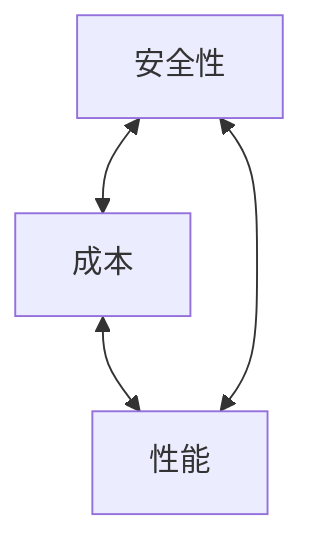

# 第14章 轻量级密码和后量子密码

## 本章导学

本章讨论两个不同方向的约束：轻量级密码面对的是“设备资源太少”，后量子密码面对的是“攻击者计算能力发生根本变化”。前者不能简单理解为把标准算法缩短，后者也不能简单理解为把现有公钥加长。

### 本章学习目标

1. 区分嵌入式系统、深度嵌入式系统和三类资源受限设备。
2. 解释芯片面积、能耗、内存、带宽、延迟之间的折中。
3. 理解 SEA、Photon、SipHash 的轻量化思路。
4. 区分 Shor 与 Grover 对公钥、对称密码和[[Course Notes/密码学 (Cipher)/Hash Functions and Applications (III)/Hash Functions and Applications (III)|哈希]]的影响。
5. 理解密码生命期为何使量子迁移必须提前开始。
6. 概述格、编码、多变量多项式和哈希签名四条后量子路线。

## 14.1 轻量级密码的概念

轻量级密码研究如何以极少系统资源实现安全算法，包括高效实现已有算法和设计新的轻量级算法。目标是在明确安全边界的前提下减少资源，不是无条件追求最小。

### 14.1.1 嵌入式系统

嵌入式系统是产品中实现一项或一组专用功能的电路或软件，与通用 PC、工作站和服务器不同。微控制器通常在单芯片上集成处理器、ROM/闪存、RAM、时钟和 I/O 控制器，频率较低、能效高、针对特定任务。

深度嵌入式系统通常无用户界面、程序逻辑固化、用途单一，适合传感器网络和物联网，但内存、处理器、时间与功耗极端受限。

### 14.1.2 资源受限设备

资源受限设备在 RAM、非易失存储、处理能力和传输速率方面受限。

| 类别 | RAM | 闪存/ROM | 能力概括 |
| --- | ---: | ---: | --- |
| 0 类 | 远小于 10 kB | 远小于 100 kB | 极端受限，通常预配置 |
| 1 类 | 约 10 kB | 约 100 kB | 可运行专用受限协议栈 |
| 2 类 | 约 50 kB | 约 250 kB | 可支持较完整协议，但仍需节能 |

典型 IEEE 802.15.4 设备仅有 20–250 kbps 数据率和最大 127 字节帧，密码开销会直接占用有限载荷与电量。

### 14.1.3 限制类别

| 限制 | 为什么重要 |
| --- | --- |
| 芯片面积 | 安全逻辑可用等价门 GE 很少 |
| 能耗 | 电池、能量采集和无线传输预算有限 |
| 代码与 RAM | ROM/闪存和运行内存极小 |
| 通信速率 | 标签、nonce、密钥交换信息也占带宽 |
| 执行时间 | RFID 等设备只在短暂通信窗口内可用 |

### 14.1.4 应用安全考虑

- RFID：防克隆、日志篡改、EPC 跟踪、盗窃和未授权重写。
- 家电/智能电视：认证控制命令和软件更新。
- 农业/医疗传感器：低功耗下保护测量值和设备身份。
- 工业系统：认证、授权和可用性关系到关键设施安全。
- 汽车：认证通信且防止由通信标识持续跟踪车辆。

### 14.1.5 设计折中

![[attachments/fig_14_1_pdf307.png]]

更长密钥和更多轮通常提高安全性，却增加能耗、延迟或面积；并行架构吞吐高但面积大，串行架构面积小但延迟高。正确设计先给出应用安全目标，再选择折中点。

### 14.1.6 安全要求与侧信道

ISO 29192 给出的最低轻量级安全强度为 80 位，许多标准建议至少 128 位；NIST 初步配置中的传统攻击要求至少 112 位。较短密钥只有在攻击模型和单密钥处理数据上限都明确时才可能接受。

![[attachments/fig_14_2_pdf307.png]]

侧信道攻击从运行时间、功耗、电磁或声音泄露中推断密钥。资源受限设备常暴露在物理不安全环境，因此算法数学安全并不够。

![[attachments/fig_14_3_pdf309.png]]

对策包括随机延迟、恒定时间/空指令、掩蔽和使功耗随机化；核心是降低秘密位与可测物理信号的相关性。

## 14.2 轻量级密码算法

典型特征是简单 XOR、旋转、小 S 盒和置换；较小分组/密钥；简单密钥扩展；简单轮函数配合较多轮数。安全裕量通常小于 AES、SHA-2 等通用标准。

### 14.2.1 带有关联数据的认证加密

#### 实现架构

![[attachments/fig_14_4_pdf310.png]]

| 架构 | 面积 | 延迟/吞吐 | 状态处理 |
| --- | --- | --- | --- |
| 并行/展开 | 最大 | 低延迟、高吞吐 | 多轮并行或流水 |
| 循环/未展开 | 中等 | 每周期一轮 | 保存完整状态复用轮电路 |
| 串行 | 最小 | 延迟最高 | 每次只更新部分状态 |

短分组会限制单密钥可安全处理的数据量。对 n 位分组，很多模式在处理 q 个分组后出现约 $q^2/2^n$ 的安全退化；64 位分组到约 $2^{32}$ 个分组就需警惕生日边界。

#### SEA

SEA 是可伸缩 Feistel 分组密码，使用 XOR、3 位 S 盒、字内/字间旋转和模 $2^b$ 加法。分组/密钥长度 n 要是 6b 的倍数，可适配处理器字长。

![[attachments/fig_14_5_pdf311.png]]

$$
L_{i+1}=R_i,
$$

$$
R_{i+1}=R(L_i)\oplus r(S(R_i\boxplus K_i)).
$$

SEA 用少量可复用运算换取紧凑实现，并通过轮数获得扩散。

### 14.2.2 哈希函数：Photon

轻量级哈希可针对较短消息优化，并在应用不要求碰撞安全时使用更小状态/输出。Photon 使用类似 SHA-3 的海绵结构。

![[attachments/fig_14_6_pdf312.png]]

状态满足

$$
t=c+r,
$$

消息在吸收阶段按 r 位异或进状态并执行置换 P；挤压阶段反复输出 r' 位并执行 P，直到得到 n 位摘要。Photon 的状态约 100–288 位，明显小于 SHA-3 的 1600 位。

![[attachments/fig_14_7_pdf313.png]]

Photon 的 12 轮置换依次执行 AddConstants、SubCells、ShiftRows、MixColumnsSerial，借鉴 AES 结构以复用已有分析经验。

### 14.2.3 消息认证码：SipHash

轻量级 MAC 可把 CMAC/HMAC 与轻量级分组密码/哈希结合，也可专门设计。SipHash 面向短消息，使用 128 位密钥、四个 64 位状态字和 64 位标签，不需要密钥扩展。

![[attachments/fig_14_8_pdf314.png]]

SipHash-c-d 中，c 是每个消息字之间的压缩轮数，d 是收尾轮数。消息吸收后把 $v_3$ 与 `0xff` 异或，执行 d 轮，再输出

$$
v_0\oplus v_1\oplus v_2\oplus v_3.
$$

SipHash-2-4 是快速选择，SipHash-4-8 用约一半速度换取更保守的安全性。

### 14.2.4 [[Course Notes/密码学 (Cipher)/Public-Key Encryption (III)/Public-Key Encryption (III)|非对称密码]]算法

教材指出轻量级非对称算法研究较少：公钥操作频率低、数据量小，且许多公钥设计已经较紧凑。潜在方向之一是在[[Course Notes/密码学 (Cipher)/Digital Signature (II)/Digital Signature (II)|数字签名]]中使用轻量级哈希。

## 14.3 后量子密码的概念

### 14.3.1 量子计算

量子计算利用叠加和纠缠等量子现象；量子比特不是简单的“同时存储所有答案”，算法必须通过干涉提高正确结果的测量概率。其密码影响来自特定算法，而非所有任务自动指数加速。

### 14.3.2 Shor 因子分解算法

Shor 算法可在多项式时间内完成整数因子分解和[[Course Notes/算法概论 （Algorithm）/6 4 离散对数的计算：大步小步法/6.4 离散对数的计算：大步小步法|离散对数]]，直接威胁 [[Course Notes/密码学 (Cipher)/Public-Key Encryption (III)/Public-Key Encryption (III)|RSA]]、DH、DSA、ECDH 和 ECDSA。单纯把 RSA/ECC 密钥加长不可持续：量子攻击成本线性增加时，传统实现成本会急剧上升。

![[attachments/fig_14_9_pdf316.png]]

### 14.3.3 Grover 算法

Grover 把无序搜索从 $O(N)$ 降为 $O(\sqrt N)$。对 n 位对称密钥，理想穷举强度约由 n 位降到 n/2 位；可把 [[Course Notes/密码学 (Cipher)/Practical Constructions of Symmetric-Key Primitive/Practical Constructions of Symmetric-Key Primitives (I)|AES]]-128 升至 AES-256。哈希原像搜索也出现平方加速，可通过增加输出长度缓解。它不像 Shor 那样直接摧毁现有对称结构。

### 14.3.4 密码生命期

密码生命期从密钥开始加密新数据的发起方使用期限 OUP，一直延伸到最后一份密文仍需解密的接收方使用期限 RUP 结束。长期保密数据可能今天被截获、未来被量子计算机解密，因此迁移不能等量子计算机出现后再开始。

![[attachments/pdf_14_10_pdf318.png]]

### 14.3.5 量子计算环境下的安全性

![[attachments/fig_14_11_pdf319.png]]

量子风险会沿依赖链传播：易受攻击的公钥算法影响安全协议，协议再影响产品和系统。

| 算法 | 大型量子计算机后的影响 |
| --- | --- |
| AES | Grover 降低穷举强度，可增加密钥长度 |
| SHA-2/SHA-3 | 可增加输出长度 |
| RSA | Shor 使其不再安全 |
| DSA/DH | Shor 使[有限域](<../../../../../Course Notes/编码论（Coding Theory）/基于多个共轭根构造循环码的例题解析/基于多个共轭根构造循环码的例题解析.md>)离散对数不再安全 |
| ECDSA/ECDH | Shor 使椭圆曲线离散对数不再安全 |

## 14.4 后量子密码算法

后量子公钥方案需要替代数字签名、加密和密钥建立/KEM。NIST 不只选择单一数学路线，因为用途、性能、密钥/签名大小和安全假设差异很大。

### 14.4.1 格密码算法

格由线性无关基向量的整数线性组合构成：

$$
L=\left\{\sum_{i=1}^n x_i b_i\mid x_i\in\mathbb Z\right\}.
$$

同一格可有许多基，短而近似正交的“好基”容易计算，长而扭曲的“坏基”可公开。安全性与高维最近向量问题 CVP、最短向量问题 SVP 及其变体相关。

![[attachments/fig_14_12_pdf321.png]]

NTRU 类方案用短向量基作私钥、同一格的长向量基作公钥；公开基难以恢复秘密好基。格方案通常简单、高效且易并行。

### 14.4.2 编码密码算法

$(n,k)$ 纠错码把 k 位消息映射为 n 位码字：

$$
c=mG,
$$

并满足

$$
GH^T=0.
$$

![[attachments/fig_14_13_pdf322.png]]

McEliece 方案公开经[[证明_逆矩阵乘积公式|可逆矩阵]]和置换隐藏的 Goppa 生成矩阵，发送方在码字中加入可纠正的随机错误；私钥持有者先解除置换，再用秘密码纠错。特点是速度快，但公钥很长。

### 14.4.3 多变量多项式密码算法

公钥是有限域上的多变量二次映射

$$
P(x_1,\ldots,x_n)=(p_1,\ldots,p_m),
$$

加密计算 $P(m)$，私钥是易求的逆映射。公开映射通常由易逆中心映射 F 与两个可逆仿射映射 S、T 组合隐藏：

$$
P=S\circ F\circ T.
$$

安全性基于求解多变量二次方程组的困难性。签名验证检查 $P(s)=H(m)$。这类签名通常需要很长密钥。

### 14.4.4 哈希签名算法

Lamport 一次性签名为摘要每一位准备两个秘密值，公钥是它们的哈希；签名按摘要位公开对应秘密值。一次签名会泄露一半私钥，因此密钥对只能使用一次。

Merkle 树把大量 Lamport 公钥的哈希组织成一棵树，只把根作为长期公钥；签名携带一次性签名、公钥和到根的认证路径。

![[attachments/fig_14_14_pdf325.png]]

若树有 $N=2^n$ 个叶子，可支持 N 份一次性签名。主要困难是必须可靠记录哪些叶子已使用；状态丢失或重复会导致安全问题。

## 四条后量子路线对比

| 路线 | 困难问题 | 优势 | 主要代价 |
| --- | --- | --- | --- |
| 格 | SVP/CVP 及变体 | 高效、易并行 | 参数和实现分析复杂 |
| 编码 | 隐藏纠错码解码 | 加解密快 | 公钥很长 |
| 多变量 | 有限域二次方程组 | 适合签名 | 密钥很长 |
| 哈希签名 | 哈希单向性 | 假设保守 | 状态/签名长度或次数限制 |

## 常见误区

- 轻量级不等于低安全；必须明确安全强度和单密钥数据上限。
- 小分组的生日边界比短密钥穷举更早出现。
- 侧信道攻击针对实现的物理泄露，不是算法公式本身。
- Shor 主要摧毁因子分解和离散对数公钥体系；Grover 提供平方级搜索加速。
- 后量子密码运行在普通计算机上，用于抵抗量子攻击；它不是量子密码通信。
- 哈希签名的状态管理是安全属性，不只是运维细节。

## 学习建议

1. 用“资源限制 -> 设计折中 -> 算法例子”串联 14.1–14.2。
2. 画出 Shor 与 Grover 分别影响哪些算法的表格。
3. 用 OUP/RUP 分析一份需要保密 20 年的数据为何应提前迁移。
4. 对四条后量子路线只先掌握困难问题、优势和代价，再学习具体算法。

## Related

- [[第八章_随机位生成和流密码_导学讲义]]
- [[第十一章_密码学哈希函数_导学讲义]]
- [[第十二章_消息认证码_导学讲义]]
- [[第十三章_数字签名_导学讲义]]
- [[第十四章_轻量级密码和后量子密码_教材原文]]
- [[第十四章_轻量级密码和后量子密码_复习笔记]]
- [[第十四章_轻量级密码和后量子密码_课后习题]]
