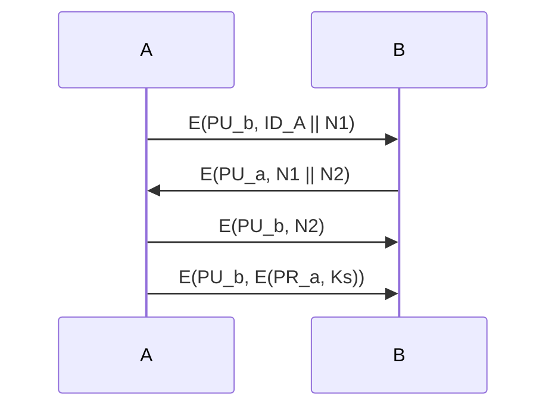

# 第15章 密钥管理和分发

## 本章导学

密码算法只说明“拿到正确密钥后如何加密、签名或认证”，并未说明密钥怎样安全到达通信者、怎样更新、撤销和销毁。密钥管理覆盖密钥生成、创建、保护、存储、交换、替换和使用，并监视密钥访问、用途与上下文。系统安全最终取决于这些管理环节是否可靠。

### 本章学习目标

1. 解释对称密钥分发的规模问题和四种基本方法。
2. 区分主密钥、会话密钥、临时密钥以及 KTC、KDC。
3. 分析公钥辅助分发会话密钥时的中间人风险。
4. 比较公钥公开发布、目录、授权中心和证书。
5. 掌握 X.509 证书字段、证书链、撤销和版本 3 扩展。
6. 理解 PKI 中终端实体、CA、RA、存储库与信赖方的职责。

## 15.1 使用对称加密的对称密钥分发

### 15.1.1 密钥分发方案

A、B 共享秘密密钥可通过四种方式建立：

1. A 选择密钥并物理交付给 B；
2. 第三方选择密钥并物理交付给 A、B；
3. 已有旧密钥时，一方用旧密钥加密新密钥；
4. A、B 各自与第三方有加密连接，由第三方安全传送新密钥。

物理交付可用于数量有限的链路设备，却无法支持大规模端到端通信。n 个实体两两共享不同密钥时，需要

$$
\frac{n(n-1)}{2}
$$

个密钥。1000 个节点约需 50 万个；10000 个应用约需 5000 万个。

用旧密钥加密新密钥还形成依赖链：旧密钥泄露时，攻击者可取得以后分发的密钥。大规模网络通常采用第三方分发，并让每个用户只与 KDC 共享一个长期密钥。

### 15.1.2 第三方密钥分发方案

![[attachments/fig_15_1_pdf329.png]]

#### KTC 与 KDC

| 机构 | 会话密钥由谁产生 | 机构的作用 |
| --- | --- | --- |
| 密钥转换中心 KTC | 通信实体 A | 解密 A 送来的密钥，再用 B 的主密钥重新加密 |
| 密钥分发中心 KDC | KDC | 生成会话密钥，分别用 A、B 的主密钥加密分发 |

A、B 分别与第三方共享长期主密钥 $K_{ma}$、$K_{mb}$；临时会话使用短期密钥 $K_s$。第三方可直接把 B 的密钥副本发送给 B，也可交给 A 转发。

完整协议还必须认证各方，并用时间戳、时变值或生命期限制重放。图中的“密钥被加密”本身不证明请求者身份。

### 15.1.3 密钥层次

![[attachments/fig_15_2_pdf330.png]]

- 高层密钥使用少、保护强，用来包装或分发低层密钥；
- 低层密钥使用频繁、更新频繁，限制单次泄露影响；
- 临时密钥只使用一次或生命期极短；
- 会话密钥只保护一次逻辑连接；
- 主密钥保护会话密钥分发，不直接承担大量业务数据加密。

生活类比：主密钥像保险柜钥匙，会话密钥像保险柜中每天更换的文件袋封条。让主密钥直接处理所有业务，相当于频繁把保险柜钥匙带到现场。

## 15.2 使用非对称加密的对称密钥分发

公钥运算慢，通常不加密大数据，而用于保护短小的会话密钥。

### 15.2.1 简单方案

![[attachments/fig_15_3_pdf331.png]]

1. A 临时生成公私钥对，发送 $PU_a\parallel ID_A$；
2. B 生成 $K_s$，发送 $E(PU_a,K_s)$；
3. A 用 $PR_a$ 恢复 $K_s$；
4. 会话结束后双方销毁 $K_s$。

该方案没有预存长期会话密钥，但没有认证 A 发送的公钥。

#### 中间人攻击

![[attachments/fig_15_4_pdf331.png]]

敌手 D 用自己的 $PU_d$ 替换 $PU_a$。B 把 $K_s$ 加密给 D；D 解密后再用 A 的真实公钥重加密转发。最终 A、B 都得到同一 $K_s$，却不知道 D 也持有它。

> [!WARNING] 核心结论
> 公钥可以公开，不代表任何标注为“A 的公钥”的值都可信。必须认证“身份 A 与公钥 $PU_a$ 的绑定”。

### 15.2.2 同时保证保密性和认证

![[attachments/fig_15_5_pdf332.png]]

教材方案先以 $N_1,N_2$ 完成双向挑战，再由 A 发送

$$
M=E(PU_b,E(PR_a,K_s)).
$$

B 计算

$$
D(PU_a,D(PR_b,M))
$$

恢复 $K_s$。外层保证只有 B 能读，内层把密钥与 A 的私钥绑定。前提是双方已经可靠获得对方公钥。

## 15.3 公钥分发

### 四种方案概览

| 方案 | 真实性来源 | 主要问题 |
| --- | --- | --- |
| 公开发布 | 无 | 任何人可冒充发布 |
| 公开目录 | 可信目录管理员 | 目录/管理员密钥成为集中风险 |
| 公钥授权 | 管理员实时签名应答 | 每次查询形成瓶颈 |
| 公钥证书 | CA 对身份、公钥、时效签名 | 需建立 CA 信任与撤销机制 |

### 15.3.1 公开发布

![[attachments/fig_15_6_pdf332.png]]

用户直接发送或广播公钥，最简单，但攻击者可发布“攻击者公钥 + A 的身份”，在 A 发现前解密本应发送给 A 的数据或伪造认证。

### 15.3.2 公开可访问目录

![[attachments/fig_15_7_pdf333.png]]

管理员保存 `{名称, 公钥}`，注册/更新必须当面或通过安全认证通信，用户通过认证通道访问目录。目录管理员私钥泄露或目录记录被篡改时，攻击者仍可冒充任意用户。

### 15.3.3 公钥授权

![[attachments/fig_15_8_pdf334.png]]

A 请求 B 的当前公钥，管理员用私钥签名返回：B 的公钥、原始请求和时间戳。原始请求绑定查询上下文，时间戳防止旧应答重放。A、B 获取彼此公钥后，再用 $N_1,N_2$ 完成双向认证。

优点是每次得到当前且经过认证的公钥；缺点是管理员在线参与，带来性能和可用性瓶颈。

### 15.3.4 公钥证书

证书把身份、公钥和时效性组成数据块，由可信 CA 数字签名。用户可公开分发证书，验证者无需每次在线查询 CA。

证书方案应满足：

1. 任何人都能读取拥有者名称和公钥；
2. 任何人都能验证证书来自 CA；
3. 只有 CA 能创建或更新证书；
4. 任何人都能验证证书是否仍及时有效。

教材简化形式：

$$
C_A=E(PR_{auth},[T\parallel ID_A\parallel PU_a]).
$$

![[attachments/fig_15_9_pdf335.png]]

时间戳/有效期阻止旧证书在私钥泄露和换钥后长期重放。证书可放在不受特别保护的目录中，因为篡改会使 CA 签名验证失败。

## 15.4 X.509 证书

X.509 定义公钥证书结构和基于证书的认证框架，不强制某一种签名算法或哈希函数。证书由 CA 签名，把主体身份绑定到主体公钥。

![[attachments/fig_15_10_pdf336.png]]

### 15.4.1 证书字段

![[attachments/fig_15_11_pdf338.png]]

| 字段 | 作用 |
| --- | --- |
| 版本号 | 选择 v1/v2/v3 结构 |
| 序列号 | 在发行 CA 内唯一标识证书 |
| 签名算法标识 | CA 使用的签名算法与参数 |
| 发行商 | 签发证书的 CA 名称 |
| 有效期 | 生效时间与终止时间 |
| 主体名 | 公钥对应的实体 |
| 主体公钥信息 | 公钥、算法和参数 |
| 发行商/主体唯一标识 | 处理名称复用，可选 |
| 扩展 | v3 的可选扩展集合 |
| 签名 | 覆盖其他所有字段的 CA 签名 |

#### 证书链

若 A 信任 $X_1$，B 的证书由 $X_2$ 签发，A 可先验证 $X_1<<X_2>>$，取得 $X_2$ 公钥，再验证 $X_2<<B>>$：

$$
X_1<<X_2>>\ X_2<<B>>.
$$

任意长链：

$$
X_1<<X_2>>\ X_2<<X_3>>\cdots X_N<<B>>.
$$

![[attachments/fig_15_12_pdf338.png]]

链上每一步都要验证签名、有效期、撤销状态和路径约束；得到某张末端证书不等于整条信任链已验证。

#### 证书撤销

证书可因主体私钥不安全、主体不再信任 CA/身份变化，或 CA 私钥不安全而提前撤销。CA 签发 CRL，记录尚未到期但已撤销证书的序列号、撤销时间、本次/下次发布时间。验证者必须检查撤销状态，可用本地缓存降低查询开销。

### 15.4.2 X.509 版本 3 扩展

每个扩展有标识、关键（critical）指示和值。未知关键扩展不能安全忽略，必须把证书视为非法。

#### 密钥和策略信息

- 授权密钥标识符、主体密钥标识符；
- 密钥使用、私钥使用期；
- 证书策略、策略映射。

#### 主体和发行商属性

- 主体可选名称；
- 发行商可选名称；
- 主体目录属性。

#### 证书路径约束

- 基本限制：是否为 CA、最大路径长度；
- 名称限制：后续证书名称空间；
- 策略限制：允许的策略和策略映射。

> [!IMPORTANT] 验证重点
> 证书签名有效只说明内容未被篡改且由该 CA 签发。还必须检查有效期、撤销、名称、用途、路径和策略。

## 15.5 公钥基础设施

PKI 是管理证书和公私钥对的策略、流程、服务器平台、软件与工作站集合，负责证书颁发、维护和撤销，使公钥可安全、方便、有效地获取。

![[attachments/fig_15_13_pdf341.png]]

| 组件 | 职责 |
| --- | --- |
| 终端实体 | 被认证的用户、设备、程序或服务 |
| CA | 创建并签名证书，发布 CRL，可生成密钥 |
| RA | 核验注册实体身份，分担 CA 管理工作 |
| 证书存储库 | 存储/检索证书和 CRL，可用 LDAP/HTTP 等 |
| 信赖方 | 依据证书内容作安全决策的用户或代理 |

信赖方 Alice 先安全获得 CA 公钥，再取得 Bob 证书并检查撤销，验证 CA 签名后才使用 Bob 公钥。根 CA 可签发从属 CA 证书形成层次；浏览器内置根证书意味着预先接受这些根作为信任锚。

## 常见误区

- “公钥”不代表“无需认证”；必须认证身份与公钥的绑定。
- 会话密钥与主密钥不是长度区别，而是用途和生命期区别。
- 加密新密钥不自动防重放，协议仍需时变值与身份绑定。
- 目录公开不等于目录内容可信；可信来自管理员的认证保护。
- 证书未过期不代表未撤销。
- CA 签名有效不代表证书适用于当前域名、用途或策略。
- 根证书不是由更高 CA 证明，而是由系统预置为信任锚。

## 学习建议

1. 对每个密钥分发协议逐条写清：谁生成密钥、谁认证谁、怎样保证新鲜性。
2. 用攻击者替换公钥的过程复述一次中间人攻击。
3. 把 X.509 验证分成“链、时间、撤销、名称、用途”五项。
4. 区分 CA 的签发职责和 RA 的身份核验职责。
5. 结合第 12 章 MAC、第 13 章签名和第 16 章认证理解协议上下文。

## Related

- [[第十二章_消息认证码_导学讲义]]
- [[第十三章_数字签名_导学讲义]]
- [[第十五章_密钥管理和分发_教材原文]]
- [[第十五章_密钥管理和分发_复习笔记]]
- [[第十五章_密钥管理和分发_课后习题]]
- [[第十六章_用户认证_导学讲义]]
