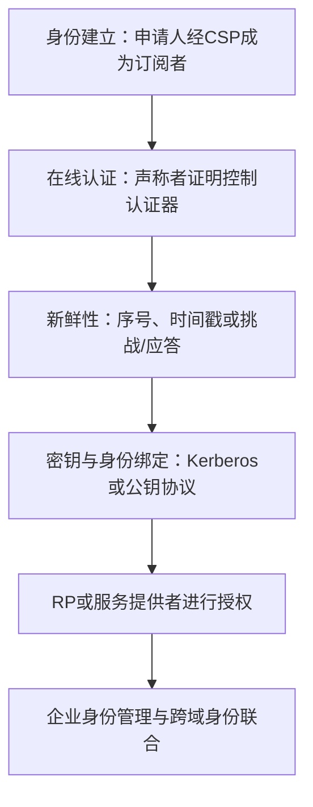

# 第16章 用户认证 - 复习笔记

## 本章复习

### 核心框架

### 重点、难点与易错点

| 类型 | 内容 |
| --- | --- |
| 重点 | NIST电子身份模型；三类因素；抗重放；Kerberos票据体系；身份联合 |
| 难点 | 协议字段的身份/密钥/新鲜性绑定；Kerberos三阶段；抑制重放攻击 |
| 易错点 | 把认证等同授权；把票据等同认证器；认为签名或加密自动防重放；混淆SSO与身份联合 |

## 16.1 远程用户认证原理

### 定义与边界

**用户认证**：确定用户，或代表用户执行的应用/过程的实际身份，是否与其声称身份一致。

**消息认证**：验证消息内容是否被修改以及消息来源是否可信。二者对象不同。

**授权**：认证后决定主体能够访问哪些资源。认证提供身份结论，授权消费该结论。

### 16.1.1 NIST电子身份认证模型

#### 三个概念

| 概念 | 定义 | 发生阶段 |
| --- | --- | --- |
| 数字身份 | 数字服务上下文中主体的唯一属性表示 | 全生命周期 |
| 身份证明 | 以一定可信度确认主体就是其声称对象 | 注册 |
| 数字认证 | 验证主体对一个或多个认证器的拥有和控制 | 后续访问 |

![[attachments/fig_16_1_pdf346.png]]

*图16.1：左侧是注册与身份证明，右侧是声称者、验证者和信赖方之间的在线认证。*

#### 六类实体

| 实体 | 核心职责 |
| --- | --- |
| 申请人 | 提交与数字身份相关的属性证据 |
| CSP | 身份证明，注册/颁发认证器与凭证 |
| 订阅者 | 从CSP取得凭证或认证器 |
| 声称者 | 在认证协议中声称身份并证明控制认证器 |
| 验证者 | 验证认证器、凭证及状态，形成身份结论 |
| 信赖方RP | 依赖身份结论执行交易或访问控制 |

> [!IMPORTANT] 逻辑关系
> 凭证把订阅者身份与认证器可信绑定；声称者证明当前控制认证器；验证者把结论交给RP。验证者与CSP不一定实时通信，数字证书就是可离线验证的例子。

### 16.1.2 认证方式

| 因素 | 教材定义 | 例子 | 典型缺陷 |
| --- | --- | --- | --- |
| 知识因素 | 个人了解的信息 | 口令、PIN、秘密问题 | 可共享、猜测、遗忘 |
| 占有因素 | 个人持有的物理实体 | 智能卡、无线标签、USB令牌 | 被盗、丢失、复制 |
| 内在因素 | 个人本身或行为 | 指纹、面部、虹膜、语音、打字节奏 | 假阳性、假阴性、成本 |

占有因素分为已连接硬件令牌和未连接硬件令牌。具体口令、卡、令牌或生物特征认证对象称为**认证器**。

### 16.1.3 多因素认证

**多因素认证**：组合一种以上身份认证手段，通常使用不同类别因素，如PIN加硬件令牌、PIN加生物特征。

![[attachments/fig_16_2_pdf348.png]]

*图16.2：不同因素的故障模式通常不相关，因此一个因素失陷不一定直接击穿全部认证。*

> [!WARNING] 易错点
> 两个知识因素仍可能是同一因素类别；多步骤不等于多因素。若PIN与令牌同时泄露，因素独立性的优势也会下降。

### 16.1.4 双向认证

#### 认证密钥交换的两个关注点

1. **保密性**：身份与会话密钥信息应受已有密钥或公钥保护。
2. **时效性**：必须确认消息属于当前会话，抵抗重放。

#### 重放攻击类型

1. 直接复制并重放消息。
2. 在有效时间窗内同时发送原消息和重放消息。
3. 阻止原消息，只发送时间窗内的重放消息。
4. 不修改消息，向原发送方反向重放。

#### 防护对比

| 方法 | 接收条件 | 主要限制 |
| --- | --- | --- |
| 序号 | 序号符合预期顺序 | 持久跟踪每个对端状态，开销高 |
| 时间戳 | 与接收者当前时间足够接近 | 依赖安全时钟同步和合理时间窗 |
| 挑战/应答 | 响应包含本次不可预测时变值 | 增加握手，不利于无连接应用 |

**关键判断**：随机数出现不等于安全；还要确认它由谁生成、是否不可预测、是否与身份、方向和会话密钥一同受保护。

## 16.2 使用对称加密的远程用户认证

### 16.2.1 双向认证

#### Needham-Schroeder协议

长期密钥：A-KDC共享$K_a$，B-KDC共享$K_b$。目标：建立$K_s$。

$$
\begin{aligned}
1.&\ A\to KDC: ID_A\parallel ID_B\parallel N_1\\
2.&\ KDC\to A: E(K_a,[K_s\parallel ID_B\parallel N_1\parallel E(K_b,[K_s\parallel ID_A])])\\
3.&\ A\to B: E(K_b,[K_s\parallel ID_A])\\
4.&\ B\to A: E(K_s,N_2)\\
5.&\ A\to B: E(K_s,f(N_2))
\end{aligned}
$$

| 字段 | 作用 |
| --- | --- |
| $N_1$ | A确认KDC响应属于本次请求 |
| B的票据 | 只允许B获得$K_s$及A身份 |
| $N_2,f(N_2)$ | B确认对端当前掌握$K_s$ |

**残余攻击**：若旧$K_s$泄露，攻击者可重放旧票据，截获B的新挑战并用旧$K_s$应答。B若不保存全部旧密钥，难以识别。

#### Denning时间戳修正

在KDC响应和票据中加入$T$，按下式检查：

$$
|\text{Clock}-T|<\Delta t_1+\Delta t_2
$$

$\Delta t_1$为正常时钟差，$\Delta t_2$为预期网络延迟。

**收益**：旧票据超窗后拒绝。  
**代价**：全网时钟同步成为安全依赖。

#### 抑制重放攻击

攻击者截获带未来时间的合法消息并暂不投递，等接收方时钟进入接受窗口后再重放。根因是发送者、接收者或KDC时钟失步。

防护：定期核对各方与KDC时钟，或改用接收方选择的不可预测时变值。

#### Neuman改进

- A、B分别提供$N_a$、$N_b$；
- B指定票据截止时间$T_b$；
- KDC把$K_s$与双方请求绑定；
- A返回$E(K_s,N_b)$证明掌握新密钥；
- 票据未过期时可复用，但新会话交换新的$N_a'$、$N_b'$。

只有B检查$T_b$，因此该时间只需与B自己的时钟一致，不要求全网同步。

## 16.3 Kerberos

### 总体定位

Kerberos是在开放分布式环境中提供客户端/服务器双向认证的集中式服务，仅使用对称密码。它应对工作站用户冒充、网络地址伪造、监听和重放。

### 16.3.1 Kerberos的动机

#### 三种分布式认证策略

1. 客户端确认用户身份，服务器信任用户ID。
2. 客户端系统向服务器认证，服务器信任客户端提供的用户身份。
3. 客户端向每个服务器证明身份，服务器也向客户端证明身份。

开放环境采用第三种，Kerberos支持第三种。

#### 四项要求

| 要求 | 含义 |
| --- | --- |
| 安全性 | 监听者不能冒充其他用户或取得有用信息 |
| 可靠性 | 认证服务高可用，可由分布式服务器备份 |
| 透明性 | 用户通常只需输入口令 |
| 可伸缩性 | 支持大量客户端和服务器 |

### 16.3.2 Kerberos版本4

#### 三阶段总览

![[attachments/fig_16_3_pdf356.png]]

*图16.3：AS认证登录，TGS授权具体服务，应用服务器验证服务票据和认证器。*

![[attachments/fig_16_4_pdf357.png]]

*图16.4：每个阶段都把会话密钥和只由目标服务器读取的票据交给客户端转发。*

| 阶段 | 客户端取得 | 使用的保护密钥 |
| --- | --- | --- |
| AS交换 | $K_{c,tgs}$、TGT | 客户端口令派生的$K_c$；TGT由$K_{tgs}$保护 |
| TGS交换 | $K_{c,V}$、服务票据$Ticket_V$ | 响应用$K_{c,tgs}$保护；票据由$K_V$保护 |
| C/V交换 | 应用服务、可选双向认证 | 票据中的$K_{c,V}$ |

#### 版本4消息摘要

**AS交换**

$$
C\to AS: ID_C\parallel ID_{tgs}\parallel TS_1
$$

$$
AS\to C:E(K_c,[K_{c,tgs}\parallel ID_{tgs}\parallel TS_2\parallel Lifetime_2\parallel Ticket_{tgs}])
$$

**TGS交换**

$$
C\to TGS:ID_V\parallel Ticket_{tgs}\parallel Authenticator_C
$$

$$
TGS\to C:E(K_{c,tgs},[K_{c,V}\parallel ID_V\parallel TS_4\parallel Ticket_V])
$$

**客户端/服务器交换**

$$
C\to V:Ticket_V\parallel Authenticator_C
$$

$$
V\to C:E(K_{c,V},[TS_5+1])
$$

#### 票据与认证器

| 对象 | 特征 | 证明内容 |
| --- | --- | --- |
| 票据 | 可在生命期内复用；由目标服务器长期密钥加密 | 安全分发会话密钥及身份/地址/服务/时间绑定 |
| 认证器 | 由对应会话密钥加密；一次性、生命期极短 | 当前提交者掌握会话密钥，是票据对应主体 |

> [!IMPORTANT] 教材原理
> 票据不能单独证明当前使用者身份；认证器才把当前请求与票据所有者绑定。

#### Kerberos域与多重Kerberos

Kerberos域是一组共享同一Kerberos数据库的受控节点。完全服务环境需要：

1. 用户在Kerberos服务器注册，数据库保存用户标识和口令信息；
2. Kerberos服务器与每台应用服务器共享特定密钥，应用服务器也完成注册；
3. 域间互操作时，两域Kerberos服务器相互注册并共享密钥。

主体名由服务或用户名、实例名、域名组成。

![[attachments/fig_16_5_pdf357.png]]

*图16.5：客户端先从本地TGS换取远程TGS票据，再从远程TGS换取远程服务票据。*

版本4若$N$个域全互联，需要$N(N-1)/2$次域间安全密钥交换。

### 16.3.3 Kerberos版本5

#### 环境改进

| 问题 | 版本5处理 |
| --- | --- |
| DES依赖 | 采用AES |
| IP地址依赖 | 类型/长度标记，支持多种地址 |
| 字节序不统一 | ASN.1和BER |
| 票据最长约21小时 | 显式开始、结束时间 |
| 不能转发证书 | 支持向前认证 |
| 域间关系$O(N^2)$ | 支持较少关系的域间认证 |

#### 技术改进

| 问题 | 版本5处理 |
| --- | --- |
| 不必要二次加密 | 删除冗余加密 |
| PCBC可遭分组交换 | 标准CBC加显式完整性机制 |
| 同一票据会话密钥复用 | 协商一次性子会话密钥 |
| 离线口令猜测 | 增加预认证，降低但不消除风险 |

![[attachments/table_16_3_pdf359.png]]

*表16.3：版本5仍为AS、TGS、客户端/服务器三阶段。*

| 新字段 | 作用 |
| --- | --- |
| Realm | 用户或服务所属域 |
| Options | 请求票据标志 |
| Times | `from`、`till`、`rtime` |
| Nonce | 绑定本次请求和响应 |
| Subkey | 特定应用子会话密钥 |
| Seq# | 应用消息排序与重放检测 |

## 16.4 使用非对称加密的远程用户认证

### 16.4.1 双向认证

#### Denning时间戳方案

认证服务器签名A、B的身份与公钥；A选择$K_s$，用B公钥保护，并用A私钥证明来源。AS只提供公钥证书，不接触$K_s$。时间戳用于新鲜性，但依赖同步。

#### Woo-Lam时变值方案

原签名绑定：

$$
N_a\parallel K_s\parallel ID_B
$$

修正版绑定：

$$
N_a\parallel K_s\parallel ID_A\parallel ID_B
$$

**修正原因**：$N_a$只在A生成的时变值中唯一，不保证跨主体唯一；$(ID_A,N_a)$才能唯一标识A的请求。加入双方身份避免未知密钥共享/身份错绑。

> [!WARNING] 协议审查法
> 签名或加密仅保护被覆盖字段。必须检查发起者、响应者、角色、时变值和会话密钥是否都被绑定。

### 16.4.2 单向认证

| 安全目标 | 结构 |
| --- | --- |
| 保密性 | $E(PU_b,K_s)\parallel E(K_s,M)$ |
| 认证/签名 | $M\parallel E(PR_a,H(M))$ |
| 保密与认证 | $E(PU_b,[M\parallel E(PR_a,H(M))])$ |
| 带证书的认证 | $M\parallel E(PR_a,H(M))\parallel E(PR_{as},[T\parallel ID_A\parallel PU_a])$ |

**要点**：长消息采用混合加密；签名不隐藏消息；证书保证验证签名所用公钥真实且及时。

## 16.5 联合身份管理

### 16.5.1 身份管理

**身份管理**：集中、自动地为主体定义身份、关联属性、完成认证，并在企业范围内提供资源访问。

**SSO**：用户单次认证后访问多个网络资源。

#### 典型服务

| 服务 | 内容 |
| --- | --- |
| 接触点 | 用户认证和用户/服务器会话管理 |
| SSO协议服务 | 中立供应商安全令牌服务 |
| 信任服务 | 伙伴信任、令牌交换和身份映射 |
| 密钥服务 | 密钥与证书管理 |
| 身份服务 | 本地身份数据存储接口 |
| 授权 | 基于认证授予服务和资源访问 |
| 规定 | 创建账户、注册、权限和证书 |
| 管理 | 运行时配置与部署 |

![[attachments/fig_16_6_pdf361.png]]

*图16.6：主体向身份提供者证明自身，属性服务维护属性，数据消费者用于授权和审计。*

### 16.5.2 身份联合

**身份联合**：身份管理跨多个自治安全域的扩展，通过标准和相互信任共享数字身份，使用户一次认证后访问多个域的资源。

![[attachments/fig_16_7_pdf363.png]]

*图16.7：身份提供者与跨域服务提供者通过联合关系交换必要身份和属性。*

#### 核心能力

1. 跨域SSO；
2. 身份属性的标准化表示；
3. 不同域之间的身份与属性映射；
4. 依据隐私和授权策略发布必要属性。

#### 对比

| 概念 | 范围 | 主要问题 |
| --- | --- | --- |
| 身份管理 | 一个企业或安全域 | 集中维护身份、属性、账户和访问 |
| SSO | 认证体验/协议能力 | 一次认证访问多个资源 |
| 身份联合 | 多个自治安全域 | 跨组织信任、属性交换和身份映射 |

## 关键词索引

| 关键词 | 快速定位 |
| --- | --- |
| 数字身份、身份证明、数字认证 | 16.1.1 |
| CSP、验证者、信赖方、订阅者 | 16.1.1 |
| 知识、占有、内在因素 | 16.1.2 |
| 多因素认证 | 16.1.3 |
| 重放、时间戳、时变值、挑战/应答 | 16.1.4 |
| 抑制重放 | 16.2.1 |
| AS、TGS、TGT、服务票据、认证器 | 16.3.2 |
| Kerberos域、主体、域间认证 | 16.3.2 |
| Realm、Subkey、Seq# | 16.3.3 |
| Woo-Lam、身份绑定 | 16.4.1 |
| 单向认证、混合加密 | 16.4.2 |
| SSO、身份管理、身份联合、身份映射 | 16.5 |

## 知识关联

- 第12章消息认证：区分消息来源/完整性与用户身份认证。
- 第13章数字签名：公钥单向认证与不可否认性基础。
- 第15章密钥管理和分发：KDC、证书和PKI为本章协议提供密钥与公钥真实性。
- 第17章及后续网络安全协议：使用本章的双向认证、证书和会话密钥建立思想。

## 教材内容与补充理解

> [!NOTE] 教材结论
> Kerberos票据负责安全分发密钥，认证器证明当前票据使用者；版本5在环境适应性和技术安全性两方面改进版本4；联合身份管理把身份管理扩展到多个安全域。

> [!INFO] 补充理解
> 可把所有认证协议统一视为“身份、认证器、新鲜性、对端、会话密钥、角色”六类语义的绑定问题。该视角用于辅助审查，不替代教材具体消息定义。

## Related

- [[第十六章_用户认证_教材原文]]
- [[第十六章_用户认证_导学讲义]]
- [[第十六章_用户认证_课后习题]]
- [[第十五章_密钥管理和分发_复习笔记]]
- [[第十三章_数字签名_复习笔记]]
