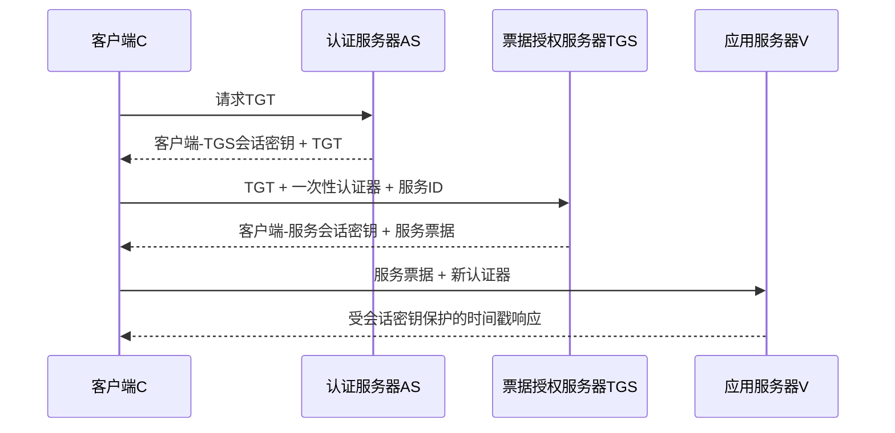

# 第16章 用户认证 - 导学讲义

## 本章导学

### 学习目标

学完本章，应当能够：

1. 区分用户认证、消息认证与授权。
2. 解释NIST电子身份模型中的角色和注册、认证、信赖过程。
3. 按知识、占有、内在三类因素判断单因素与多因素认证。
4. 解释重放攻击及序号、时间戳、挑战/应答三类防护方法。
5. 逐步说明Needham-Schroeder类协议和Kerberos的票据、认证器、会话密钥。
6. 比较Kerberos版本4与版本5，并解释域内、域间认证。
7. 分析[[Course Notes/密码学 (Cipher)/Key Management and the Public-Key Revolution/Key Management and the Public-Key Revolution|公钥]]双向认证和单向认证中身份、密钥、新鲜性如何绑定。
8. 区分身份管理、单点登录和跨安全域的身份联合。

### 本章核心问题

- 系统如何证明“正在操作的人确实是他声称的人”？
- 一段昨天合法的认证报文，为什么今天重放可能仍会骗过系统？
- Kerberos为什么需要AS、TGS、票据和认证器四类对象？
- 公钥已经能验证签名，为什么协议仍会因身份或时变值绑定不完整而失败？
- 单点登录与身份联合分别解决哪个范围内的问题？

### 为什么需要学习本章

加密回答“旁观者能否读懂”，完整性回答“内容是否被改过”，用户认证回答“对端究竟是谁”。网络中的地址、用户名和报文来源都可伪造；如果认证失败，后续访问控制即使执行得很准确，也可能把权限授给错误的人。本章因此把前面学习的对称加密、[[Course Notes/密码学 (Cipher)/Public-Key Encryption (III)/Public-Key Encryption (III)|公钥加密]]、[[Course Notes/密码学 (Cipher)/Digital Signature (II)/Digital Signature (II)|数字签名]]、证书和密钥分发组合成可运行的身份协议。

可以先建立一条主线：

> [!NOTE] 阅读方法
> 每看一个协议，都依次问四件事：谁要证明身份；证明材料受哪把密钥保护；接收者为何相信消息是新的；身份、对端和会话密钥是否同时被绑定。

## 16.1 远程用户认证原理

### 16.1.1 NIST电子身份认证模型

#### 本节学习目标

理解数字身份、身份证明、数字认证三个概念，并能沿图16.1解释六个角色的协作关系。

#### 核心问题

“注册时证明你是谁”和“以后登录时证明仍是同一人”为什么是两个不同过程？

#### 知识背景与原理

**数字身份**是在某项数字服务的上下文中对主体的唯一表示，由一个或多个属性构成。它不必在全世界唯一，只需在当前服务环境中足以区分主体。

**身份证明**发生在注册阶段：系统收集、验证关于申请人的证据，以一定可信度确认申请人就是其声称的对象。

**数字认证**发生在后续访问阶段：系统验证声称者是否确实控制与该数字身份绑定的认证器。成功认证说明“当前访问者与此前建立该凭证的人具有连续性”，而不是重新完成一次完整现实身份调查。

![[attachments/fig_16_1_pdf346.png]]

*图16.1把左侧的注册/身份证明与右侧的在线认证分开。*

六个角色可以按生命周期理解：

| 角色 | 所处环节 | 主要职责 |
| --- | --- | --- |
| 申请人 | 注册前 | 提交身份属性证据 |
| CSP | 注册与凭证管理 | 完成身份证明，注册/颁发认证器与凭证 |
| 订阅者 | 注册后 | 持有CSP建立的凭证或认证器 |
| 声称者 | 登录时 | 声称某身份并证明自己控制认证器 |
| 验证者 | 登录时 | 运行认证协议并验证凭证、认证器及其状态 |
| 信赖方RP | 认证后 | 依赖验证结果作出访问控制或交易决定 |

#### 示例与类比

第一次办理校园卡类似身份证明：学校核对录取信息和身份证，并把卡与学生身份绑定。以后刷卡进图书馆类似数字认证：闸机验证卡和认证协议，而不是每次重新审核录取档案。图书馆依据验证结果决定是否放行，扮演信赖方。

#### 常见误区

- **认证等于授权**：错。认证确定身份，授权决定该身份能做什么。
- **验证者一定就是CSP**：错。二者可以是同一系统，也可以通过凭证或逻辑连接分离。
- **数字身份一定对应自然人**：错。用户设备、代理进程和服务器也可成为主体。

#### 记忆技巧与章节联系

记为“申-CSP-订，声-验-RP”：前三者完成注册关系，后三者完成在线认证与使用。它把第15章的证书/凭证管理连接到本章的认证协议，也为16.5的身份提供者和服务提供者奠定角色基础。

### 16.1.2 认证方式

#### 本节学习目标

掌握三类认证因素，理解“认证因素”与具体“认证器”的区别。

#### 原理详解

三类因素回答三种不同的问题：

| 因素 | 判断依据 | 教材例子 | 主要风险 |
| --- | --- | --- | --- |
| 知识因素 | 你知道什么 | 口令、口令短语、PIN、秘密问题 | 可猜测、可共享、会遗忘 |
| 占有因素 | 你拥有什么 | 智能卡、USB令牌、电子徽章 | 可丢失、被盗、被复制 |
| 内在因素 | 你是什么或如何行动 | 指纹、面部、虹膜、声纹、打字节奏 | 假阳性、假阴性、成本和便利性 |

占有因素又分为已连接令牌和未连接令牌。前者通过物理或逻辑连接参与协议，后者通常显示认证数据，由用户手工输入。

具体用于认证的口令、卡或生物特征模板称为**认证器**。因素是分类，认证器是实际对象。

#### 生活类比

门锁密码是“知道”，实体钥匙是“拥有”，指纹是“本身”。三种锁都可能失败，但失败方式不同，这一点正是组合不同因素的价值。

#### 易混淆点

- 用户名通常用于声明身份，不应单独视为秘密。
- 两个口令仍属于同一类知识因素，并不自动成为多因素认证。
- 生物特征难以共享，但系统仍会发生误接受和误拒绝。

#### 学习建议

遇到任何登录方案，先把每个认证器归类，再判断攻击者取得其中一个后是否会连带取得另一个。

### 16.1.3 多因素认证

#### 本节学习目标

理解多因素认证为什么通常比单因素更安全，也能说明这种优势并非绝对。

![[attachments/fig_16_2_pdf348.png]]

*图16.2展示了将不同类别因素组合使用的思路。*

#### 原理详解

多因素认证使用一种以上的身份认证手段，典型组合是PIN加硬件令牌，或PIN加生物特征。其安全收益来自不同因素的故障模式通常不完全相关：偷到令牌不一定同时知道PIN，猜到PIN也不一定持有令牌。

然而，“通常不相关”不是数学保证。如果PIN写在令牌上，令牌丢失时两个因素会一起泄露；如果两个因素都经由同一台已被控制的终端提交，终端也可能同时截获它们。

#### 示例分析

银行卡加PIN是占有因素与知识因素的组合。攻击者仅复制卡号还不够，仅偷看PIN也不够；但卡和写有PIN的纸条放在同一钱包中，就破坏了独立性假设。

#### 常见误区与记忆技巧

- 多步骤不等于多因素。连续输入两次同一个口令仍是一个知识因素。
- 因素数量不是唯一指标，认证器实现、恢复流程和攻击面同样重要。
- 记忆：“不同类别、不同故障、共同通过”。

### 16.1.4 双向认证

#### 本节学习目标

认识双向认证的两个核心目标：保密地建立身份/密钥关系，以及证明消息具有时效性。

#### 重放攻击的四种形态

1. 复制旧消息并直接重放。
2. 在有效时间窗内同时投递原消息和重放消息，日志可能发现重复。
3. 阻止原消息，只在有效时间窗内投递重放消息，重复更难被察觉。
4. 把消息不加修改地反向发回发送者，利用对称协议中方向区分不足。

#### 三类抗重放方法

| 方法 | 新鲜性来源 | 优点 | 代价或限制 |
| --- | --- | --- | --- |
| 序号 | 单调递增顺序 | 不依赖时钟 | 各方要持久跟踪对端状态 |
| 时间戳 | 接近当前时间 | 适合减少握手 | 要求安全同步并设置时间窗 |
| 挑战/应答 | 接收方新生成的时变值 | 不依赖全网时钟 | 增加一次往返，不利于无连接通信 |

时间戳窗口过大给攻击者更多机会，过小又容易误拒绝正常网络延迟。挑战/应答中，接收方先提出不可预测的时变值，对端必须用受保护响应证明自己在“本次”会话中在线。

#### 生活类比

门卫每天问同一句口令，录音可被重放；门卫临时说“请回答数字7314加一”，旧录音就不能回答今天的新问题。这就是挑战/应答。

#### 常见误区与章节联系

- 加密旧消息不会自动使它变新。
- 时变值必须能唯一关联本次请求；仅出现一个随机数还不够，还要与身份、方向和会话密钥绑定。
- 本节是16.2全部协议分析、16.3认证器和16.4公钥协议修正的共同分析框架。

## 16.2 使用对称加密的远程用户认证

### 16.2.1 双向认证

#### 本节学习目标

理解KDC如何同时完成会话密钥分发和身份认证，并比较时变值协议、时间戳协议与改进协议。

#### Needham-Schroeder协议逐步理解

长期关系是A与KDC共享$K_a$，B与KDC共享$K_b$；目标是让A、B得到会话密钥$K_s$：

1. A用身份和新时变值$N_1$向KDC请求与B通信。
2. KDC给A一个由$K_a$保护的应答，其中既有$K_s$和$N_1$，又有只能由B打开的“票据”。
3. A把票据转发给B，B用$K_b$取出$K_s$与A的身份。
4. B用$K_s$加密新时变值$N_2$挑战A。
5. A返回$E(K_s,f(N_2))$，证明已经得到同一会话密钥。

$N_1$使A能确认KDC应答属于本次请求，$N_2$使B确认应答者现在掌握$K_s$。但若旧$K_s$泄露，敌手重放旧票据并截获挑战，就可伪造最后应答；B无法无限保存所有旧会话密钥来识别重放。

#### Denning时间戳修正与新风险

Denning在KDC应答和给B的票据中加入时间戳$T$。A和B按下式判断密钥是否新鲜：

$$
|\text{Clock}-T|<\Delta t_1+\Delta t_2
$$

$\Delta t_1$容纳正常时钟差，$\Delta t_2$容纳网络延迟。旧票据超出窗口后会被拒绝，但安全性转而依赖可靠同步。

如果某节点的时钟走快，攻击者可截获并“压住”带未来时间的合法消息，等接收方时钟进入接受窗口后再投递，这就是**抑制重放攻击**。因此要定期校准时钟，或改用由接收方选择的不可预测时变值。

#### Neuman改进策略

改进协议让A、B各自产生$N_a$、$N_b$，并由B指定票据截止时间$T_b$。KDC分别把会话密钥与双方的时变值绑定；A最后发送$E(K_s,N_b)$证明掌握新密钥。之后在$T_b$尚未过期时，可复用票据，但每个新会话仍交换新的$N_a'$和$N_b'$。

关键设计是：$T_b$只由B检查，所以只与B自己的时钟比较，不要求全网同步。

#### 对比与学习建议

| 协议思路 | 解决的问题 | 新增依赖或残余问题 |
| --- | --- | --- |
| Needham-Schroeder | 用双时变值认证新会话 | 旧会话密钥泄露后可重放旧票据 |
| Denning时间戳 | 使票据带明确时效 | 依赖安全时钟同步，可能遭抑制重放 |
| Neuman改进 | 双方时变值加单方截止时间 | 协议更复杂，但减少全网同步依赖 |

不要背消息串。对每个字段写出“谁生成、谁能解、由谁检查、检查什么”，协议就会变得可理解。

## 16.3 Kerberos

### 16.3.1 Kerberos的动机

#### 本节学习目标

理解开放分布式环境的威胁以及Kerberos的四项设计要求。

工作站上的用户名、网络地址和请求都可能被伪造，敌手还可监听并重放消息。因此开放环境需要第三种方案：客户端向服务端证明身份，服务端也向客户端证明身份。Kerberos以集中可信第三方提供这种认证，并只依赖对称密码。

四项要求是：

| 要求 | 含义 |
| --- | --- |
| 安全性 | 监听者不能冒充用户或取得有用秘密 |
| 可靠性 | 认证服务不可用会拖垮所有依赖服务，因此需要高可用和备份 |
| 透明性 | 用户除输入口令外尽量感受不到认证细节 |
| 可伸缩性 | 支持大量客户端和服务器，采用模块化分布式结构 |

#### 生活类比

Kerberos像校园统一办事大厅：学生先取得可证明“已经登录”的通行凭据，再换取图书馆、实验室等具体服务的票据；每个服务不必自己保存全校所有口令。

#### 易错点

Kerberos服务器是高价值信任中心。协议安全并不意味着服务器失陷后仍安全；教材明确指出整体安全依赖Kerberos服务器本身。

### 16.3.2 Kerberos版本4

#### 从简单方案到完整方案

最初方案由AS直接核对口令并给客户端某服务的票据，但会导致口令明文发送、每个服务重复输入口令、票据被窃取后可重放等问题。Kerberos逐步引入TGS、票据生命期、会话密钥和认证器解决这些问题。

完整版本4分为三次交换：

![[attachments/fig_16_3_pdf356.png]]

*图16.3给出Kerberos从AS到TGS再到应用服务器的整体视图。*

![[attachments/fig_16_4_pdf357.png]]

*图16.4展示各方信息交换，阅读时应区分“给客户端看的外层”和“只给目标服务器看的票据”。*

#### 三个容易混淆的对象

| 对象 | 谁能读取 | 是否可复用 | 作用 |
| --- | --- | --- | --- |
| TGT | TGS | 在生命期内可复用 | 让已登录客户端申请多个服务票据 |
| 服务票据 | 特定应用服务器 | 在生命期内可复用 | 向该服务器安全分发$K_{c,V}$和客户端绑定信息 |
| 认证器 | 持有对应会话密钥的TGS或服务器 | 一次性、极短生命期 | 证明当前提交者就是票据对应主体，并抵抗重放 |

票据主要安全分发密钥，本身不能证明“当前拿票的人就是票主”；认证器才把票据持有者的现场知识证明与身份、地址和时间戳联系起来。

#### 版本4三次交换的关键逻辑

1. **AS交换**：客户端从口令派生$K_c$，解开AS响应，取得$K_{c,\text{tgs}}$和TGT；口令不在网络上传输。
2. **TGS交换**：TGS解开TGT得到$K_{c,\text{tgs}}$，再用它验证认证器；随后返回$K_{c,V}$和服务票据。
3. **客户端/服务器交换**：服务器用自己的长期密钥解开服务票据，再用$K_{c,V}$验证新认证器。若要求双向认证，服务器返回$E(K_{c,V},TS_5+1)$。

#### 域和域间认证

一个Kerberos域是一组共享同一Kerberos数据库的受控节点。域内要求所有用户在Kerberos服务器注册，且Kerberos服务器与每个应用服务器共享一个特定密钥。主体名由服务/用户名、实例名和域名组成。

![[attachments/fig_16_5_pdf357.png]]

*图16.5中，客户端先从本地TGS取得远程TGS的票据，再向远程TGS取得目标服务器票据。*

版本4中，两个互操作域的Kerberos服务器需互相注册并共享密钥；若$N$个域都两两互操作，需要$N(N-1)/2$条关系，伸缩性较差。

#### 常见误区与记忆技巧

- TGT是给TGS看的，不是直接给应用服务器看的。
- 服务票据由客户端转发，但客户端不需要也不能修改其内部字段。
- “票据可复用，认证器一次性”是理解重放防护的关键。
- 记忆三段：“口令换TGT，TGT换服务票，服务票加认证器换服务”。

### 16.3.3 Kerberos版本5

#### 本节学习目标

从环境通用性和技术安全性两方面解释版本5为什么改进版本4。

#### 环境缺陷的修正

| 版本4局限 | 版本5改进 |
| --- | --- |
| 依赖DES | 采用AES，降低对单一旧密码的依赖 |
| 依赖IP地址 | 地址使用类型和长度标记，支持多种地址 |
| 字节顺序不统一 | 使用ASN.1与BER明确编码 |
| 8位、5分钟单位的生命期，最长约21小时 | 显式起止时间，生命期可灵活表示 |
| 证书不能转发 | 支持向前认证，让服务代表客户端访问其他服务 |
| 域间关系为$O(N^2)$ | 支持更少关系的域间认证方式 |

#### 技术不足的修正

版本5消除不必要的二次加密；以显式完整性机制和标准CBC替代有分组交换风险的PCBC；允许协商一次性子会话密钥；增加预认证以提高口令猜测成本，但不能彻底消除口令攻击。

![[attachments/table_16_3_pdf359.png]]

*表16.3是版本5消息交换的权威对照。先看三阶段，再看每阶段新增的Options、Times、Nonce、Realm等字段。*

版本5仍保留AS、TGS、服务三阶段。新增字段的意义是：

- `Realm`说明主体所属域；
- `Options`请求票据标志；
- `Times`表达起始、截止和更新截止时间；
- `Nonce`把响应绑定到本次请求；
- `Subkey`为具体应用子会话提供新密钥；
- `Seq#`帮助检测应用会话消息重放或乱序。

#### 易错点与学习建议

版本5不是推翻版本4，而是在保留票据体系的基础上增强编码、算法独立性、生命期、域间认证、完整性和子会话能力。复习时按“环境六项、技术四项、消息三阶段”组织，而不要把所有字段混成一张清单。

## 16.4 使用非对称加密的远程用户认证

### 16.4.1 双向认证

#### 本节学习目标

理解公钥证书、时变值和会话密钥在双向认证中的不同作用，并学会发现“字段未绑定”缺陷。

#### 时间戳方案

Denning方案由认证服务器签发A、B的当前公钥证明，A选择$K_s$并用B的公钥保护，再用A的私钥证明来源。认证服务器只提供公钥证书，不接触会话密钥。时间戳提供时效性，但要求时钟同步。

#### Woo-Lam时变值方案

七步方案以$N_a$关联A的请求，以$N_b$让B确认A已经取得$K_s$。KDC签名的核心材料向A证明$K_s$由KDC生成并面向B，外层公钥加密则只让预期接收者读取。

原方案只签名$\{N_a,K_s,ID_B\}$，后来修正为：

$$
\{N_a,K_s,ID_A,ID_B\}
$$

原因是$N_a$只保证在A自己产生的时变值中唯一，并不保证在所有主体之间全局唯一。只有$(ID_A,N_a)$共同标识A的请求；再加入$ID_B$，会话密钥才完整绑定双方身份。

#### 示例分析

如果不绑定$ID_A$，攻击者C可以复用与A相同的时变值，让KDC为C与B生成一个密钥，再把KDC签名材料转给A。A只看到自己认识的$N_a$和B的身份，可能误以为密钥属于A-B，而C也知道该密钥。加入$ID_A$后，A会发现签名材料中的发起者是C并拒绝。

#### 常见误区

- “用了签名”不代表签名字段已经覆盖协议所需的全部语义。
- 时变值只有与生成者身份共同出现时，才能跨主体唯一标识请求。
- 公钥加密解决谁能读，私钥签名解决谁发布；二者不能互换。

### 16.4.2 单向认证

#### 本节学习目标

按保密性、认证、二者兼有三种目标选择消息结构。

| 目标 | 教材结构 | 核心作用 |
| --- | --- | --- |
| 保密性 | $E(PU_b,K_s)\parallel E(K_s,M)$ | 公钥只封装一次性密钥，对称密钥加密长消息 |
| 认证/签名 | $M\parallel E(PR_a,H(M))$ | B验证A的签名，A难以否认 |
| 保密并认证 | $E(PU_b,[M\parallel E(PR_a,H(M))])$ | 只有B能读取消息与签名 |
| 带证书认证 | 消息、A的签名、AS签发的A公钥证书 | B先验证证书，再用A公钥验证消息 |

#### 示例分析

只签名而不加密时，任何人都能读取并转发消息。教材中的邮件示例说明，敌手可能移除原签名并附上自己的签名来抢占公开内容；把消息和原签名整体用接收方公钥加密，可把内容限制给B。

#### 易错点与前后联系

- 签名不提供保密性，加密也不自动提供发送方不可否认性。
- 长消息通常采用[[Course Notes/密码学 (Cipher)/Public-Key Encryption (I)/Public-Key Encryption (I)|混合加密]]，而不是直接用公钥算法处理全部消息。
- 公钥必须是当前且真实的，因此本节直接依赖第15章证书与PKI，并为后续电子邮件安全章节奠定基础。

## 16.5 联合身份管理

### 16.5.1 身份管理

#### 本节学习目标

理解企业内部身份管理、SSO及八类典型服务。

身份管理是在企业范围内集中、自动地定义身份、维护属性并认证用户或进程的方法。**单点登录（SSO）**使用户完成一次认证后访问多个网络资源。

典型服务可以分组记忆：

| 分组 | 服务 | 作用 |
| --- | --- | --- |
| 入口与会话 | 接触点、SSO协议服务 | 认证用户、管理会话、交换安全令牌 |
| 信任与密码 | 信任服务、密钥服务 | 建立伙伴信任，管理令牌、密钥和证书 |
| 身份与权限 | 身份服务、授权 | 访问身份数据，根据认证结果授予资源 |
| 生命周期 | 规定、管理 | 创建账户和权限，配置与部署系统 |

![[attachments/fig_16_6_pdf361.png]]

*图16.6中，主体向身份提供者证明自身；身份/属性提供者维护数据，数据消费者据此授权或审计。*

#### 示例与误区

企业新员工入职时，规定服务可在邮箱、文件系统和业务系统中创建账户；身份服务保存角色与属性；SSO减少重复登录；授权系统仍按每项资源策略决定访问范围。

SSO只减少认证次数，不等于用户自动拥有所有资源权限。认证、属性发布和授权仍是三个不同步骤。

### 16.5.2 身份联合

#### 本节学习目标

理解身份管理跨越多个自治安全域后，为什么需要信任、属性标准化和身份映射。

身份联合是身份管理向多个安全域的扩展。各组织仍保持自治控制，但通过协商标准和相互信任共享数字身份，使用户一次认证后可访问多个域中的应用和资源。

![[attachments/fig_16_7_pdf363.png]]

*图16.7突出跨域关系：身份提供者发布身份与属性信息，另一域的服务提供者依据信任关系消费这些信息。*

#### 三个核心能力

1. **跨域SSO**：本域完成认证，其他信任域接受认证结果。
2. **属性标准化**：账号、角色、位置、文件所有权等具有可交换表示。
3. **身份映射**：把一个域的标识符、角色和属性转换成另一个域需要的表示，同时只发布必要信息。

#### 生活类比与易混淆点

企业内部工牌访问多个内部系统是身份管理和SSO；员工凭本企业身份访问合作方福利系统，则属于身份联合。合作方不必接管本企业用户数据库，但必须信任本企业身份提供者，并把“本企业员工”映射为自己能理解的角色。

- SSO描述“少登录”，身份联合强调“跨自治域传递可接受的身份”。
- 联合不等于把所有身份数据集中到一个数据库。
- 服务提供者依赖身份数据作决定，但仍应执行自己的授权与隐私策略。

## 本章综合复盘

### 一条完整知识链

1. 现实主体经过身份证明成为订阅者。
2. CSP把身份与认证器绑定成凭证。
3. 声称者用单因素或多因素证明控制认证器。
4. 协议用时间戳、时变值或序号证明消息新鲜。
5. Kerberos或公钥协议把身份、对端和会话密钥绑定。
6. 验证结果传给信赖方，信赖方再做授权。
7. 身份管理在企业内复用该结果，身份联合把结果扩展到互信安全域。

### 高频易错点

- 用户认证不等于消息认证，也不等于授权。
- 两个同类认证器不一定构成多因素。
- 加密、签名和随机数都不能单独保证新鲜性；必须检查协议上下文。
- Kerberos票据用于安全分发密钥，认证器用于证明当前票据使用者。
- TGT面向TGS，服务票据面向具体服务器。
- 签名字段必须覆盖双方身份、时变值、密钥和必要角色。
- SSO与身份联合不是同义词。

### 学习建议

1. 手画Kerberos三阶段，分别标出每段的长期密钥、会话密钥和票据接收者。
2. 对16.2、16.4每个协议制作字段表，回答“生成者、加密者、解密者、检查目的”。
3. 用“旧消息重放会怎样”测试每个协议；若答案不清楚，说明尚未理解其新鲜性来源。
4. 复习时把Kerberos版本5差异分成环境六项与技术四项，不要混背。

### 推荐扩展阅读

> [!INFO] 教材外扩展
> 可在掌握教材后阅读NIST SP 800-63的数字身份角色定义，以及RFC 4120、RFC 4121中的Kerberos版本5消息与应用会话规范。扩展资料用于理解标准演进，不替代本章教材结论。

## Related

- [[第十六章_用户认证_教材原文]]
- [[第十六章_用户认证_复习笔记]]
- [[第十六章_用户认证_课后习题]]
- [[第十五章_密钥管理和分发_导学讲义]]
- [[第十三章_数字签名_导学讲义]]
