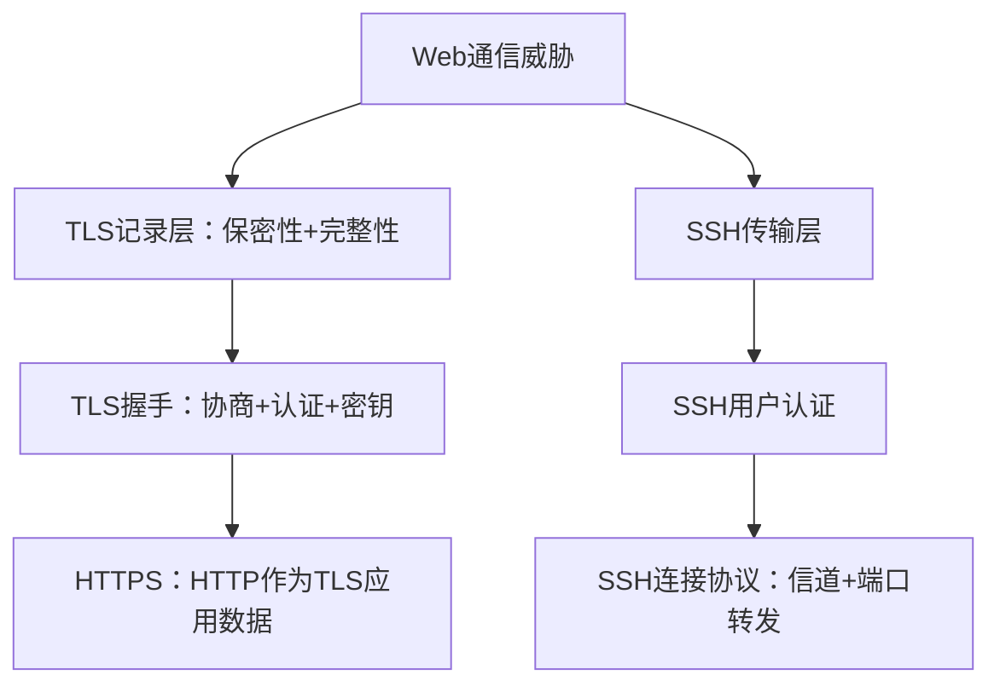

# 第17章 传输层安全 - 复习笔记

## 本章复习

### 核心关系

### 重点难点

| 类型 | 内容 |
| --- | --- |
| 重点 | TLS会话/连接；记录处理；握手四阶段；HTTPS；SSH三协议 |
| 难点 | 当前/挂起状态切换；MAC覆盖范围；主密钥与方向密钥导出；证书和Finished的证明边界 |
| 易错点 | 混写TLS 1.2与1.3；认为TLS能防TCP层DoS；混淆SSH主机认证与用户认证 |

## 17.1 Web安全性考虑

### 17.1.1 Web安全威胁

Web安全需要定制工具的原因：底层软件复杂且漏洞多；服务器通常连接企业核心资源；终端用户安全意识不足。

| 属性 | 典型威胁 | 后果 | 对策 |
| --- | --- | --- | --- |
| 完整性 | 修改数据、浏览器、内存、传输消息 | 信息丢失、机器损害 | 加密校验和 |
| 保密性 | 网络窃听、窃取服务端/客户端数据 | 信息和隐私泄露 | 加密、Web代理 |
| 拒绝服务 | 线程破坏、资源耗尽、DNS攻击 | 中断、干扰 | 难以完全防止 |
| 认证 | 冒充合法用户、伪造数据 | 错误身份和虚假信息 | 加密技术 |

攻击还可分被动/主动，或按服务器、浏览器、网络通信位置分类。本章聚焦通信安全。

### 17.1.2 网络流量安全方法

![[attachments/fig_17_1_pdf369.png]]

*图17.1：安全服务可位于网络层、TCP之上或应用层。*

| 层次 | 方法 | 主要优点 |
| --- | --- | --- |
| 网络层 | IPsec | 对用户和应用透明、通用、可过滤流量 |
| 传输层上方 | SSL/TLS | 通用；可透明集成或嵌入应用包 |
| 应用层 | 应用专用安全 | 按应用语义定制 |

## 17.2 传输层安全

### 17.2.1 TLS架构

![[attachments/fig_17_2_pdf370.png]]

*图17.2：记录协议承载握手、修改密码规范、警报和应用数据。*

#### 协议组成

| 协议 | 作用 |
| --- | --- |
| 记录协议 | 分段、完整性、加密和封装 |
| 握手协议 | 认证、算法协商、密钥建立 |
| 修改密码规范 | 把挂起密码状态切换为当前状态 |
| 警报协议 | 错误、严重程度和正常关闭通知 |
| 心跳协议 | 单独RFC定义的存活检测机制 |

#### 会话与连接

| TLS会话 | TLS连接 |
| --- | --- |
| 客户端与服务器之间的关联 | 一条短暂对等传输关系 |
| 由握手创建 | 每个连接关联一个会话 |
| 安全参数可被多个连接共享 | 保存每方向的具体连接状态 |
| 避免重复昂贵协商 | 实际承载记录 |

#### 会话状态

会话标识、对等证书、压缩方法、密码规范、48字节主密钥、可恢复标志。

#### 连接状态

客户端/服务器随机数；两个方向的写MAC密钥和写加密密钥；CBC IV；双方各自维护的64位序号。

**状态切换**：握手创建读/写挂起状态；修改密码规范后，挂起状态成为当前状态。

### 17.2.2 TLS记录协议

#### 服务

- 保密性：共享对称密钥加密；
- 完整性：共享MAC密钥计算HMAC。

![[attachments/fig_17_3_pdf371.png]]

*图17.3：分段、可选压缩、MAC、加密、加头；接收端反向处理。*

#### 发送步骤

1. 分段，每段不超过$2^{14}=16384$字节；
2. 可选无损压缩，增长不超过1024字节；
3. 计算MAC；
4. 对片段、MAC和分组密码填充进行加密；
5. 添加记录头；
6. 交给TCP。

#### HMAC与TLS MAC输入

$$
HMAC_K(M)=H[(K^+\oplus opad)\parallel H[(K^+\oplus ipad)\parallel M]]
$$

$$
HMAC_{hash}(MAC\_write\_secret,seq\_num\parallel type\parallel version\parallel length\parallel fragment)
$$

序号、类型、版本、长度和片段均被认证。

![[attachments/fig_17_4_pdf372.png]]

*图17.4：记录头是内容类型、主版本、从版本、长度。*

已定义内容类型：`change_cipher_spec`、`alert`、`handshake`、`application_data`。

> [!IMPORTANT] 顺序关系
> TLS记录序号不随记录显式发送，由双方按连接状态维护。TCP负责字节流有序交付，TLS按该顺序计算和验证MAC。

### 17.2.3 修改密码规范协议

![[attachments/fig_17_5_pdf372.png]]

*图17.5：修改密码规范净荷仅1字节且值为1；警报2字节；握手有类型、长度和内容。*

作用：把挂起`CipherSpec`复制到当前状态。从紧随其后的Finished开始使用新算法和密钥。

### 17.2.4 警报协议

2字节：严重程度（警告1/致命2）和警报码。致命警报立即终止连接；会话中其他连接可继续，但不能再新建连接。

`close_notify`声明TLS数据正常结束，可防止把未经通知的TCP截断误当成完整消息。

### 17.2.5 握手协议

#### 消息格式

类型1字节、长度3字节、参数内容。主要消息：`client_hello`、`server_hello`、`certificate`、`server_key_exchange`、`certificate_request`、`server_done`、`client_key_exchange`、`certificate_verify`、`finished`。

![[attachments/fig_17_6_pdf374.png]]

*图17.6：TLS 1.2教材握手的四阶段。*

#### 四阶段

| 阶段 | 关键消息 | 结果 |
| --- | --- | --- |
| 1 建立安全能力 | ClientHello、ServerHello | 版本、随机数、会话ID、密码组、压缩 |
| 2 服务器认证/密钥交换 | 证书、服务器密钥交换、证书请求、ServerDone | 认证服务器，给出密钥参数，可请求客户端证书 |
| 3 客户端认证/密钥交换 | 客户端证书、ClientKeyExchange、CertificateVerify | 传递次密钥或DH公钥，可证明客户端私钥控制 |
| 4 完成 | ChangeCipherSpec、Finished（双方） | 启用新状态并验证整个握手 |

#### 密钥交换方法

| 方法 | 认证与风险 |
| --- | --- |
| RSA | 用服务器RSA公钥保护次密钥，需要可信证书 |
| 固定DH | DH公钥参数在证书中 |
| 瞬时DH | 临时DH参数由RSA/DSS私钥签名，提供新鲜会话密钥 |
| 匿名DH | 无身份认证，易受中间人攻击 |

服务器参数签名绑定：

$$
hash(ClientRandom\parallel ServerRandom\parallel ServerParams)
$$

Finished：

$$
PRF(master\_secret,finished\_label,MD5(handshake)\parallel SHA1(handshake))
$$

#### 证明边界

| 机制 | 证明 |
| --- | --- |
| X.509证书 | 身份与公钥绑定 |
| 密钥交换参数签名 | 本次参数来自证书私钥持有者 |
| CertificateVerify | 客户端控制证书私钥 |
| Finished | 握手历史一致且双方掌握相同主密钥 |

### 17.2.6 密码计算

RSA中次密钥由客户端生成并用服务器公钥加密；DH中次密钥由双方DH计算得到。

$$
master\_secret=PRF(pre\_master\_secret,"master\ secret",ClientRandom\parallel ServerRandom)
$$

$$
key\_block=PRF(master\_secret,"key\ expansion",ServerRandom\parallel ClientRandom)
$$

密钥块依次导出客户端/服务器写MAC密钥、写密钥和IV。

![[attachments/fig_17_7_pdf377.png]]

*图17.7：P_hash以递归HMAC生成任意长度输出。*

$$
A(0)=seed,\quad A(i)=HMAC(secret,A(i-1))
$$

$$
P\_hash(secret,seed)=\bigparallel_{i=1}^{\infty}HMAC(secret,A(i)\parallel seed)
$$

$$
PRF(secret,label,seed)=P\_hash(secret,label\parallel seed)
$$

`label`实现用途分离，随机数把密钥材料绑定到具体握手。

### 17.2.7 SSL/TLS攻击

| 类别 | 教材例子 |
| --- | --- |
| 握手攻击 | RSA数据格式/编码攻击 |
| 记录与应用攻击 | BEAST选择明文、CRIME压缩泄漏 |
| PKI攻击 | 证书验证库和应用实现缺陷 |
| 其他 | 大量握手/重协商造成DoS |

**知识关联**：协议安全由密码原语、消息结构、证书验证、状态机和资源控制共同决定。

### 17.2.8 TLSv1.3

教材列出的主要变化：

- 删除压缩、非认证加密、静态RSA/DH、随机数时间戳、重新协商、修改密码规范、RC4和部分旧哈希签名；
- 使用DH/ECDH进行密钥交换，每次握手协商新密钥；
- 通过消息重排实现一轮往返握手。

> [!WARNING] 版本边界
> 17.2.1–17.2.6的状态和消息以教材TLS 1.2为主；不能把TLS 1.3删除项倒灌进前文。

## 17.3 HTTPS

HTTPS是HTTP的安全版本，通过TLS保护浏览器与网站通信。

| 服务 | 保护对象 |
| --- | --- |
| 加密 | URL、内容、表单、Cookie和HTTP头 |
| 完整性 | 检测有意或无意在途修改 |
| 认证 | 确认预期网站，抵抗中间人攻击 |

### 17.3.1 连接初始化

TCP连接建立后发送TLS ClientHello；TLS握手完成后发送第一个HTTP请求；HTTP数据均作为TLS应用数据。TLS会话可在不同时间支持多个TLS连接。

### 17.3.2 连接关闭

- HTTP：`Connection: close`；
- TLS：双方交换`close_notify`后关闭TCP；
- 不完全关闭：发送关闭警报后不等对端警报，仅在应用确认已收齐数据时可接受；
- 未经通知的TCP关闭：可能被利用进行截断，应警告。

## 17.4 SSH

![[attachments/fig_17_8_pdf380.png]]

*图17.8：SSH传输层、用户认证、连接协议依次构建在TCP之上。*

| 协议 | 服务 |
| --- | --- |
| 传输层 | 服务器认证、保密性、完整性、前向安全、可选压缩 |
| 用户认证 | 用户向服务器认证 |
| 连接 | 一条安全连接复用多个逻辑信道 |

### 17.4.1 传输层协议

#### 主机密钥模型

1. 客户端本地数据库保存主机名-公钥绑定；
2. CA认证主机名-公钥，客户端只安全保存CA根密钥。

#### 数据包格式

包长度、填充长度、净荷、随机填充、MAC。MAC覆盖隐式32位序号和未加密数据包；协商后除MAC外整个数据包加密。

![[attachments/fig_17_9_pdf381.png]]

*图17.9：标识串、算法协商、DH密钥交换、NEWKEYS、服务请求。*

![[attachments/fig_17_10_pdf382.png]]

*表17.3：教材SSH版本的密码、MAC、压缩选项。*

#### DH交换与认证

$$
e=g^x\bmod p,\qquad f=g^y\bmod p,\qquad K=g^{xy}\bmod p
$$

$$
H=hash(V_C\parallel V_S\parallel I_C\parallel I_S\parallel K_S\parallel e\parallel f\parallel K)
$$

服务器用主机私钥签名$H$；客户端验证主机密钥和签名。$H$同时成为初始会话标识。

标签`A`至`F`分别导出两个方向的IV、加密密钥和完整性密钥。

### 17.4.2 用户认证协议

请求包含用户名、服务名、方法名。服务器失败消息提供可继续方法和部分成功标志；全部方法成功后返回成功。

| 方法 | 核心机制 |
| --- | --- |
| 公钥 | 客户端私钥签名，服务器验证公钥可接受及签名 |
| 口令 | 口令在SSH认证消息内为明文，但由传输层加密 |
| 基于主机 | 客户端主机私钥签名，服务器信任主机已认证用户 |

### 17.4.3 连接协议

信道状态：打开、数据传输、关闭。双方各用本地信道号，窗口控制流量。

信道类型：会话、X11、前向TCP/IP、直接TCP/IP。

![[attachments/fig_17_11_pdf385.png]]

*图17.11：信道打开确认、双向数据和关闭。*

![[attachments/fig_17_12_pdf386.png]]

*图17.12：应用流量经SSH客户端、隧道、SSH服务器转发到目标端口。*

| 转发 | 含义 |
| --- | --- |
| 本地转发 | 本地SSH监听端口，把本地应用流量经隧道送往远端目标 |
| 远程转发 | 远端监听端口，把流量经隧道送回客户端侧目标 |

## 关键词索引

| 关键词 | 位置 |
| --- | --- |
| Web威胁、协议层位置 | 17.1 |
| TLS会话、连接、当前/挂起状态 | 17.2.1 |
| 记录协议、HMAC、序号 | 17.2.2 |
| 修改密码规范、警报 | 17.2.3–17.2.4 |
| ClientHello、Finished、密码组 | 17.2.5 |
| pre_master_secret、PRF、P_hash | 17.2.6 |
| BEAST、CRIME、PKI攻击 | 17.2.7 |
| TLS 1.3 | 17.2.8 |
| HTTPS、close_notify | 17.3 |
| SSH主机密钥、会话标识 | 17.4.1 |
| SSH用户认证、信道、端口转发 | 17.4.2–17.4.3 |

## 知识关联

- 第12章：TLS记录HMAC和SSH MAC。
- 第15章：服务器证书、CA和主机密钥信任。
- 第16章：TLS客户端/服务器认证和SSH用户认证。
- 第20章：与网络层IPsec比较安全服务位置。

## 教材内容与补充理解

> [!NOTE] 教材结论
> TLS记录协议提供保密性和完整性，握手建立认证与密钥；HTTPS把HTTP放在TLS上；SSH以三层协议构造安全远程访问和多路信道。

> [!INFO] 补充理解
> 可把TLS与SSH统一看成“先建立经认证的方向密钥，再把应用数据切成带序号的受保护单元”。该抽象用于比较协议，不替代其各自记录/数据包格式。

## Related

- [[第十七章_传输层安全_教材原文]]
- [[第十七章_传输层安全_导学讲义]]
- [[第十七章_传输层安全_课后习题]]
- [[第十六章_用户认证_复习笔记]]
- [[第十五章_密钥管理和分发_复习笔记]]
