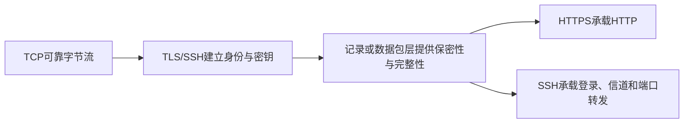
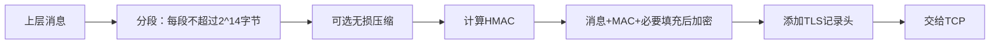

# 第17章 传输层安全 - 导学讲义

## 本章导学

### 学习目标

学完本章，应能：

1. 从安全服务所在协议层比较IPsec、TLS和应用专用安全。
2. 区分TLS会话、连接、当前状态和挂起状态。
3. 按顺序解释TLS记录协议的分段、压缩、MAC、加密和封装。
4. 说明TLS握手四阶段如何协商算法、认证对端并导出会话密钥。
5. 理解修改密码规范、警报、握手和记录协议的分工。
6. 解释HTTPS如何把HTTP放在TLS之上，并正确关闭连接。
7. 说明SSH传输层、用户认证、连接协议三层架构及端口转发。
8. 分析TLS能防御和不能防御的典型Web威胁。

### 本章核心问题

- 为什么安全服务放在不同协议层，会影响透明性、通用性和定制能力？
- TLS为什么既有“会话”又有“连接”？
- 握手阶段生成的状态，如何在恰当时刻切换成记录层正在使用的状态？
- 服务器证书、临时密钥交换和Finished消息分别证明什么？
- HTTPS与SSH都依赖TCP，它们保护的对象和使用方式有何不同？

### 学习主线

> [!NOTE] 教材版本上下文
> 本章先以TLS 1.2结构讲解记录和握手，再单列17.2.8介绍TLS 1.3改进。复习时必须区分两套机制，例如修改密码规范协议属于前面的TLS 1.2讲解，而TLS 1.3删除了它。

## 17.1 Web安全性考虑

### 17.1.1 Web安全威胁

#### 为什么Web需要专门安全机制

Web底层软件复杂，浏览器和服务器升级频繁；Web服务器常处在企业系统核心，一旦失陷可能成为进入内部资源的跳板；普通用户又往往不了解背后的安全风险。因此，通用密码工具必须被组织成易部署、可互操作的Web通信安全协议。

#### 威胁分类

| 安全属性 | 典型威胁 | 后果 | 教材对策 |
| --- | --- | --- | --- |
| 完整性 | 修改用户数据、浏览器、内存或在途消息 | 信息丢失、机器受损、引入后续漏洞 | 加密校验和 |
| 保密性 | 窃听、窃取服务器/客户端数据和会话信息 | 信息泄露、隐私丧失 | 加密、Web代理 |
| 拒绝服务 | 线程破坏、资源填满、DNS攻击 | 中断和阻止正常工作 | 难以完全防止 |
| 认证 | 冒充用户、伪造数据 | 错误身份和虚假信息 | 加密技术 |

威胁还可分为被动攻击和主动攻击，或按发生位置分为服务器、浏览器和二者之间的通信。本章重点是网络通信安全，而不是替代主机系统安全。

#### 常见误区

TLS能保护浏览器与服务器之间的传输，但不能自动修复服务器应用漏洞、客户端恶意软件或资源耗尽攻击。

### 17.1.2 网络流量安全方法

![[attachments/fig_17_1_pdf369.png]]

*图17.1比较网络层、传输层和应用层安全设施的位置。*

| 位置 | 代表方法 | 优点 | 代价 |
| --- | --- | --- | --- |
| 网络层 | IPsec | 对用户和应用透明、通用、可过滤所选IP流量 | 对应用语义缺少针对性 |
| TCP之上 | SSL/TLS | 可作为底层服务对应用透明，也可嵌入浏览器等软件 | 依赖面向连接的可靠传输 |
| 应用层 | 应用专用安全 | 可按应用需求定制消息和策略 | 每种应用分别设计和部署 |

#### 生活类比

网络层保护像整个运输道路设置安检；TLS像为每条端到端运输通道加密封；应用层安全像为某类特殊货物设计专用包装。位置越低通常越通用，位置越高越理解业务语义。

## 17.2 传输层安全

### 17.2.1 TLS架构

#### 两层协议结构

![[attachments/fig_17_2_pdf370.png]]

*图17.2：记录协议位于底层，上层有握手、修改密码规范、警报和应用数据；心跳由单独RFC定义。*

记录协议负责在已建立的密码状态下保护数据。握手协议协商算法、认证和密钥；修改密码规范协议切换密码状态；警报协议传递错误和关闭通知。

#### 会话与连接

| 概念 | 定义 | 生命周期与复用 |
| --- | --- | --- |
| TLS连接 | 一条提供安全服务的对等传输关系 | 短暂；每条连接隶属一个会话 |
| TLS会话 | 客户端与服务器间由握手创建的关联 | 保存可供多个连接共享的安全参数，避免反复昂贵协商 |

#### 会话状态参数

- 会话标识；
- 对等实体X.509v3证书，可为空；
- 压缩方法；
- 密码规范；
- 48字节主密钥；
- 可恢复标志。

#### 连接状态参数

- 客户端随机数、服务器随机数；
- 客户端写MAC密钥、服务器写MAC密钥；
- 客户端写密钥、服务器写密钥；
- CBC所需IV；
- 双方发送和接收的64位序号。

“写密钥”按发送方命名：客户端写密钥由客户端加密、服务器解密。每个方向使用不同密钥，避免方向混淆。

#### 当前状态与挂起状态

握手在不影响现有通信的情况下生成新的读/写挂起状态。协商完成后，修改密码规范消息把挂起状态复制为当前状态。这个双缓冲式设计使双方明确从哪一条记录开始使用新算法和新密钥。

### 17.2.2 TLS记录协议

#### 提供的服务

1. 保密性：使用握手定义的共享对称密钥加密净荷。
2. 消息完整性：使用握手定义的MAC密钥计算消息认证码。

![[attachments/fig_17_3_pdf371.png]]

*图17.3：发送方向下处理，接收方按相反顺序恢复。*

#### 发送流程

TLS MAC输入包含隐式序号、内容类型、版本、长度和压缩片段：

$$
\mathrm{HMAC}_{hash}(MAC\_write\_secret,seq\_num\parallel type\parallel version\parallel length\parallel fragment)
$$

把序号纳入MAC可检测删除、重复或顺序异常；把类型、版本和长度纳入可防止跨类型解释或字段篡改。

#### 记录头

![[attachments/fig_17_4_pdf372.png]]

*图17.4：记录头包含内容类型、主/从版本号和长度。*

内容类型区分`change_cipher_spec`、`alert`、`handshake`和`application_data`。TLS把上层应用数据视为不透明字节，因此HTTP等不同应用可共用记录服务。

#### 填充与顺序

分组密码需要填充，教材允许可变填充长度，以降低单纯按长度分析消息的能力。记录序号不在网络上显式传输，而由双方为连接分别维护；TCP先提供有序字节流，TLS按接收顺序推进序号。

#### 易错点

- TLS 1.2教材流程是先对压缩片段计算MAC，再把片段、MAC和填充加密。
- 记录不是应用消息边界的直接等价物；上层消息可被分段。
- TCP保证可靠有序，但TLS MAC仍绑定序号，形成密码层的顺序保护。

### 17.2.3 修改密码规范协议

![[attachments/fig_17_5_pdf372.png]]

*图17.5同时给出修改密码规范、警报和握手净荷格式。*

修改密码规范协议只有一条值为1的单字节消息。其语义是把挂起密码状态复制为当前状态。客户端和服务器各自发送该消息，然后紧接着用新状态保护Finished消息。

**为什么独立**：算法和密钥由握手协商，但记录层何时开始使用它们是状态切换问题。独立消息建立清晰边界，避免把“协商内容”和“启用时刻”混在一起。

### 17.2.4 警报协议

警报消息为2字节：第1字节表示警告或致命，第2字节表示具体代码。致命警报立即终止当前连接；会话中已有其他连接可继续，但不能再基于该会话建立新连接。警报也按当前记录状态压缩和加密。

关闭TLS时使用`close_notify`，它能让接收方区分正常结束和未通知的底层TCP截断。

### 17.2.5 握手协议

#### 握手的三项任务

1. 协商版本、密码组和压缩方法；
2. 认证服务器，并可选认证客户端；
3. 建立`pre_master_secret`、主密钥和连接写密钥。

![[attachments/fig_17_6_pdf374.png]]

*图17.6把完整握手分为四个阶段。*

#### 阶段1：建立安全能力

`ClientHello`提供最高版本、客户端随机数、会话ID、按优先级排序的密码组和压缩方法。`ServerHello`从客户端提议中选择双方支持的版本、密码组和压缩方法，并给出独立服务器随机数与会话ID。

随机数既参与密钥导出，也绑定服务器密钥交换签名，防止旧握手材料被直接重放。

#### 阶段2：服务器认证和密钥交换

除匿名DH外，服务器发送X.509证书。是否还要`server_key_exchange`取决于密钥交换类型：固定DH参数已在证书中，普通RSA可直接用证书公钥，而瞬时DH或临时RSA参数需要单独发送并签名。

服务器对参数的签名覆盖：

$$
hash(ClientHello.random\parallel ServerHello.random\parallel ServerParams)
$$

因此参数与本次客户端、服务器随机数绑定。匿名DH没有认证，容易遭中间人攻击。

服务器可用`certificate_request`请求客户端证书，最后用`server_done`结束本阶段。

#### 阶段3：客户端认证和密钥交换

客户端验证服务器证书和参数，按需发送自己的证书。`client_key_exchange`传递RSA加密的48字节次密钥，或客户端DH公钥。若客户端证书具有签名能力，`certificate_verify`通过签名握手历史证明客户端确实控制证书对应私钥。

#### 阶段4：完成

客户端先发送修改密码规范消息启用新状态，再发送由新密钥保护的Finished。Finished的PRF输入包含握手消息摘要，验证协商过程未被篡改且双方导出了同一主密钥。服务器也执行同样两步，然后应用数据才能开始。

#### 关键对比

| 对象 | 证明什么 |
| --- | --- |
| 服务器证书 | 公钥与服务器身份的可信绑定 |
| 参数签名 | 本次密钥交换参数确由证书私钥持有者发布 |
| 客户端证书验证 | 客户端控制其证书对应私钥 |
| Finished | 整个握手历史一致，双方掌握同一主密钥 |

### 17.2.6 密码计算

#### 次密钥与主密钥

RSA交换时，客户端生成48字节`pre_master_secret`并用服务器RSA公钥加密；DH交换时，双方通过DH计算得到共享次密钥。

主密钥为48字节：

$$
master\_secret=PRF(pre\_master\_secret,"master\ secret",ClientRandom\parallel ServerRandom)
$$

随后以相反随机数顺序扩展连接密钥块：

$$
key\_block=PRF(master\_secret,"key\ expansion",ServerRandom\parallel ClientRandom)
$$

密钥块按顺序提供客户端/服务器写MAC密钥、写加密密钥和IV。不同标签与随机数实现用途和连接分离。

#### P_hash与PRF

![[attachments/fig_17_7_pdf377.png]]

*图17.7：P_hash递归生成$A(i)$并拼接多个HMAC输出。*

$$
A(0)=seed,\qquad A(i)=HMAC_{hash}(secret,A(i-1))
$$

$$
P\_hash(secret,seed)=HMAC(secret,A(1)\parallel seed)\parallel HMAC(secret,A(2)\parallel seed)\parallel\cdots
$$

PRF接受`secret`、区分用途的`label`和`seed`，生成任意长度输出。学习时要理解“同一主秘密通过不同标签和方向随机数导出互不混用的材料”。

### 17.2.7 SSL/TLS攻击

教材把攻击分为四类：

| 类别 | 例子 | 启示 |
| --- | --- | --- |
| 握手协议攻击 | RSA编码/格式攻击 | 密码原语的使用方式同样决定安全性 |
| 记录和应用数据攻击 | BEAST、CRIME | CBC、压缩和浏览器上下文会组合成实际攻击 |
| PKI攻击 | 证书验证库缺陷 | 证书链验证实现是协议安全的一部分 |
| 其他攻击 | 过量握手导致DoS | 攻击者可利用客户端/服务器计算不对称 |

完美协议和实现不会一次完成；攻击推动协议、算法选择和软件实现持续修订。

### 17.2.8 TLSv1.3

#### 教材列出的改进

TLS 1.3删除压缩、非认证加密密码、静态RSA/DH、ClientHello随机数时间戳、重新协商、修改密码规范、RC4及MD5/SHA-224签名等旧功能，减少代码和攻击面。

密钥交换使用DH或ECDH，每次握手协商新密钥，避免服务器长期RSA私钥日后泄露导致历史握手全部可解。握手消息重排为一轮往返，客户端较早发送密钥交换参数，使服务器首个响应就能计算保护通信所需密钥。

#### 易错点

- 教材中的“TLS 1.3删除修改密码规范”不能反推前面TLS 1.2状态切换不存在。
- “禁用RSA”是指静态RSA密钥交换；不要把所有RSA签名概念混为同一用途。
- 一轮往返提高效率，但安全仍依赖认证和新鲜密钥交换。

## 17.3 HTTPS

HTTPS是HTTP在TLS上的安全使用，提供：

1. 加密：保护URL、内容、表单、Cookie和HTTP头；
2. 完整性：检测在途修改或损坏；
3. 认证：证明客户端与预期网站通信，抵抗中间人攻击。

### 17.3.1 连接初始化

客户端先建立TCP连接并发送TLS `ClientHello`，完成TLS握手后才发送第一个HTTP请求。所有HTTP数据作为TLS应用数据传输。HTTP层连接请求、TLS会话/连接与底层TCP连接是不同层次对象。

### 17.3.2 连接关闭

HTTP可用`Connection: close`声明结束；TLS双方应交换`close_notify`后再关闭TCP。若只发送关闭警报而不等待对端响应，是不完全关闭，只有应用已根据HTTP边界确认收到全部所需数据时才可接受。

未经`close_notify`和HTTP关闭指示的TCP断开可能是故障，也可能被攻击者用于截断数据，客户端应发出安全警告。

## 17.4 SSH

SSH最初用于替代TELNET等不安全远程登录，也支持文件传输、电子邮件、X隧道和其他基于TCP的应用。

![[attachments/fig_17_8_pdf380.png]]

*图17.8：SSH由传输层、用户认证和连接协议三层构成。*

| 协议 | 作用 |
| --- | --- |
| 传输层协议 | 服务器认证、保密性、完整性、前向安全和可选压缩 |
| 用户认证协议 | 让用户向服务器证明身份 |
| 连接协议 | 在一条安全SSH连接上复用多个逻辑信道 |

### 17.4.1 传输层协议

#### 主机密钥信任模型

客户端可维护“主机名到公钥”的本地数据库，或信任CA认证的主机密钥。前者无需中心机构但维护成本高；后者只需安全保存CA根密钥，但每台主机须取得证书。

#### SSH数据包

数据包包含包长、填充长度、净荷、随机填充和MAC。MAC覆盖隐式32位序号和未加密数据包，序号从0递增但不在网络上传输。协商完成后，除MAC字段外的整个数据包加密。

![[attachments/fig_17_9_pdf381.png]]

*图17.9：SSH先交换标识串和算法，再执行密钥交换、启用新密钥并请求服务。*

![[attachments/fig_17_10_pdf382.png]]

*表17.3列出教材对应SSH版本的密码、MAC和压缩算法选择。*

#### 传输层步骤

1. 交换协议/软件版本标识串；
2. 双方发送按偏好排列的算法列表，逐类选取共同支持的首项；
3. 执行Diffie-Hellman交换；服务器以主机私钥签名交换哈希$H$；
4. 交换`SSH_MSG_NEWKEYS`并启用由$K,H,session_id$导出的方向密钥；
5. 客户端请求用户认证或连接服务。

交换哈希覆盖双方标识串、算法提议、主机密钥、DH公钥和共享秘密。它既绑定算法协商与密钥交换，也充当连接会话标识。

#### 方向密钥生成

由$K,H,session\_id$分别加标签`A`到`F`导出客户端/服务器IV、加密密钥和完整性密钥。标签实现用途分离，两个方向不会复用同一密钥。

### 17.4.2 用户认证协议

客户端以`SSH_MSG_USERAUTH_REQUEST`声明用户名、服务名和方法。服务器用失败消息返回仍可继续的方法及“部分成功”标志；所有要求的方法完成后返回成功消息。

教材列出三种方法：

| 方法 | 证明方式 |
| --- | --- |
| 公钥 | 客户端提交公钥并用对应私钥签名，服务器检查密钥可接受性和签名 |
| 口令 | 在已加密的SSH传输层中发送明文口令 |
| 基于主机 | 客户端主机私钥签名，服务器信任该主机已经认证用户 |

“口令在认证协议中是明文”不等于网络窃听者可见，因为整个用户认证消息已由SSH传输层加密。

### 17.4.3 连接协议

连接协议把一条安全SSH连接当作隧道，复用多条逻辑信道。每端可使用自己的信道号，以窗口机制流控；信道经历打开、数据传输和关闭。

![[attachments/fig_17_11_pdf385.png]]

*图17.11：信道打开需确认，之后双向发送数据，最后任一方可关闭。*

四类信道是会话、X11、前向TCP/IP和直接TCP/IP。

#### 端口转发

![[attachments/fig_17_12_pdf386.png]]

*图17.12：应用原本的TCP流量被本地SSH实体截获，经加密隧道到远程SSH实体，再送往目标端口。*

- **本地转发**：客户端监听本地端口，把本地应用流量送入SSH隧道，远端再连接目标服务。
- **远程转发**：远端监听端口，经SSH隧道把流量送回客户端一侧指定目标，常用于从受防火墙保护的一侧主动建立向外连接。

#### 常见误区

- SSH端口转发保护隧道两端SSH实体之间的流量，隧道外最后一段是否安全取决于部署位置。
- 多个逻辑信道共享一条低层安全连接，但各自有信道号和流量窗口。
- SSH服务器认证发生在传输层，用户认证发生在其上的独立协议。

## 本章综合复盘

### TLS与SSH对比

| 维度 | TLS/HTTPS | SSH |
| --- | --- | --- |
| 基础传输 | TCP | TCP |
| 典型身份 | TLS服务器证书，可选客户端证书 | 服务器主机密钥，随后认证用户 |
| 数据组织 | TLS记录 | SSH数据包与多路逻辑信道 |
| 典型应用 | HTTP及其他TCP应用 | 远程登录、命令、文件、隧道 |
| 多路复用 | 会话可支持多个连接 | 单条SSH连接复用多个信道 |

### 高频易错点

- 会话保存共享安全参数，连接保存每方向具体密钥、IV和序号。
- 修改密码规范负责状态切换，Finished才验证握手历史。
- 匿名DH有保密交换但没有身份认证，仍可遭中间人攻击。
- HTTPS不能防止握手前的TCP SYN洪泛，也不能修复终端应用漏洞。
- SSH主机认证与SSH用户认证是两个阶段。

### 学习建议

1. 按TLS四阶段手画消息，不必先背所有消息名，先标出随机数、证书、密钥交换和Finished。
2. 对记录协议分别标出“MAC覆盖什么”和“加密覆盖什么”。
3. 把SSH看成先造安全隧道、再认证用户、最后在隧道上开信道。
4. 用“攻击发生在TCP前、握手中、记录中、应用端”判断TLS能否处理。

### 推荐扩展阅读

> [!INFO] 教材外扩展
> 可在掌握教材后对照RFC 5246理解TLS 1.2、对照TLS 1.3正式规范理解其最终消息结构，并阅读RFC 4250–4256系列了解SSH。扩展标准用于跟踪协议演进，不替代教材题目所依赖的版本语义。

## Related

- [[第十七章_传输层安全_教材原文]]
- [[第十七章_传输层安全_复习笔记]]
- [[第十七章_传输层安全_课后习题]]
- [[第十六章_用户认证_导学讲义]]
- [[第十五章_密钥管理和分发_导学讲义]]
