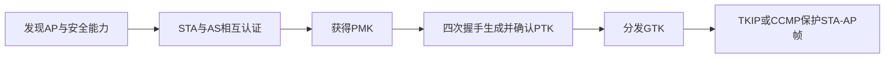
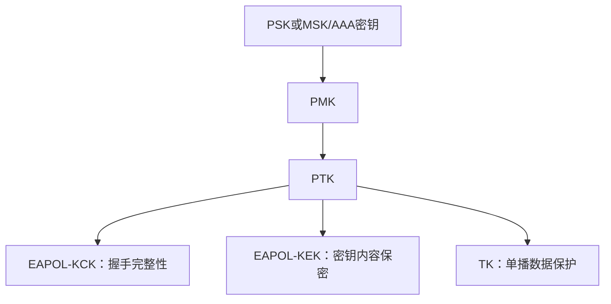

# 第18章 无线网络安全 - 导学讲义

## 本章导学

### 学习目标

1. 解释无线信道、移动性、资源和物理可接近性为何放大安全风险。
2. 识别无线关联、恶意AP、MAC欺骗、中间人、DoS和网络注入等威胁。
3. 从设备、数据流和屏障三方面制定移动设备安全策略。
4. 掌握STA、AP、BSS、IBSS、DS、ESS、MSDU和MPDU的关系。
5. 说明IEEE 802.11九项服务及关联与移动性的关系。
6. 按五阶段解释IEEE 802.11i从发现到连接终止的完整过程。
7. 理解802.1X/EAP认证、四次握手、PTK/GTK密钥层次。
8. 比较TKIP与CCMP并能读写802.11i PRF公式。

### 核心问题

- 无线通信为什么不仅是“把网线换成电波”？
- AP、认证服务器和STA在认证中分别扮演什么角色？
- 认证已经成功后，为什么还不能立即放行用户数据？
- PMK、PTK、KCK、KEK、TK和GTK为何需要分层？
- WEP为何即使用加密和CRC，仍不能提供可靠完整性？

### 全章主线

## 18.1 无线安全

### 为什么无线风险更高

| 因素 | 风险来源 |
| --- | --- |
| 信道 | 广播介质更易被窃听、干扰、注入和主动探测 |
| 移动性 | 设备跨越组织边界和网络位置，控制条件不断变化 |
| 资源 | 部分设备计算、内存和电量有限，易受DoS和恶意软件影响 |
| 易接近性 | 传感器、机器人等可能无人看管，物理攻击机会增加 |

![[attachments/fig_18_1_pdf389.png]]

*图18.1：无线环境的三个攻击面是无线客户端、无线接入点和无线传输介质。*

### 18.1.1 无线网络威胁

| 威胁 | 机制 | 主要后果 |
| --- | --- | --- |
| 意外关联 | 覆盖重叠，用户误连邻近AP | 资源暴露、流量进入错误网络 |
| 恶意关联 | 攻击设备伪装合法AP | 窃取口令、再渗透有线网络 |
| 自组网络 | 设备绕过AP直接组网 | 缺少中央控制与统一策略 |
| 非传统网络 | 蓝牙、条码阅读器等旁路连接 | 窃听、欺骗和管理盲区 |
| MAC欺骗 | 监听合法MAC后冒用 | 绕过仅基于地址的控制 |
| 中间人 | STA与AP均误信攻击者 | 窃听、修改、会话劫持 |
| DoS | 高频发送协议请求或干扰 | AP/无线端口资源耗尽 |
| 网络注入 | 注入路由、管理、重置命令 | 性能下降、网络状态被改变 |

#### 易错点

SSID隐藏、MAC白名单和降低信号强度只能增加发现或接入难度，不能替代密码认证；MAC地址可观察和伪造。

### 18.1.2 无线安全措施

#### 无线传输安全

- 信号隐藏：关闭SSID广播、使用不显眼名称、控制覆盖范围、远离外墙、定向天线和屏蔽；
- 加密：密钥安全时有效抵抗窃听；
- 加密加认证：抵抗修改和插入；
- 现场频谱调查和信号规划：降低无意干扰和DoS。

#### 接入点安全

IEEE 802.1X提供基于端口的网络接入控制，让设备在访问LAN/WLAN前完成认证，防止未授权设备成为后门。

#### 无线网络安全

使用加密、终端防病毒/反间谍/防火墙；修改路由器默认标识和管理口令；按需关闭广播；MAC白名单只作辅助措施。

> [!IMPORTANT] 分层防护
> “隐藏网络、认证接入、加密传输、保护终端”解决不同问题，任一项都不能单独覆盖无线网络全部攻击面。

## 18.2 移动设备安全

传统企业安全假设是设备、应用和网络边界集中受控。移动设备、云应用、动态边界和外部商务接入打破了这些假设，企业必须同时控制设备、身份、数据流和云同步。

### 18.2.1 安全威胁

| 威胁因素 | 风险 |
| --- | --- |
| 缺少物理控制 | 设备丢失、被盗、篡改；数据和企业凭证同时暴露 |
| 不可信设备 | BYOD可能未加密、越狱或绕过系统限制 |
| 不可信网络 | 公共Wi-Fi/蜂窝链路可遭窃听和中间人攻击 |
| 未知方应用 | 第三方应用可能携带恶意软件 |
| 与其他系统交互 | 自动同步把企业数据带到不受控设备或云 |
| 不可信内容 | 恶意二维码等内容可引导至恶意URL |
| 位置服务 | 位置信息泄露设备与使用者活动 |

### 18.2.2 移动设备安全策略

![[attachments/fig_18_2_pdf393.png]]

*图18.2：策略分为设备安全、数据流安全和屏障安全。*

#### 设备安全

自动锁定与PIN/口令；禁用自动保存凭证；远程清除和禁用；启用SSL；及时更新系统和应用；反病毒；敏感数据不落地或加密；限制越狱设备；应用白名单、签名验证和沙箱；限制同步/云存储；管理相机、二维码和位置服务。

#### 数据流安全

对移动设备与企业之间的全部流量加密，可使用SSL或VPN。接入企业资源时既认证设备，也认证设备用户，避免“拿到设备就等于拿到人员权限”。

#### 屏障安全

使用专用防火墙、入侵检测和入侵阻止，限制移动设备能访问的数据、应用和网络区域。

#### 生活类比

设备安全像锁好公文包；数据流安全像给运输路线加密封；屏障安全像企业大门和内部隔离区。三者必须同时存在。

## 18.3 IEEE 802.11无线局域网概述

### 基础术语

| 术语 | 作用 |
| --- | --- |
| STA | 符合802.11 MAC/物理层的基站设备 |
| AP | 提供基站功能并把关联STA接入DS |
| BSS | 由一个协调功能控制的STA集合 |
| IBSS | 无AP、STA直接通信的独立BSS |
| DS | 互连BSS并集成LAN以建立ESS的系统 |
| ESS | 多个互连BSS和集成LAN，对LLC表现为单一BSS |
| MSDU | MAC用户之间传输的数据单元 |
| MPDU | 对等MAC实体经物理层交换的数据单元 |

### 18.3.1 Wi-Fi联盟

Wi-Fi联盟解决不同厂商802.11产品互操作认证问题。教材中的WPA2整合IEEE 802.11i安全规范功能。应区分IEEE制定技术标准与Wi-Fi联盟进行产品兼容/认证。

### 18.3.2 IEEE 802协议架构

![[attachments/fig_18_3_pdf394.png]]

*图18.3：802.11由物理层、MAC层和上方LLC组织。*

- 物理层：编码/译码、位传输、介质、频带和天线；
- MAC层：介质访问控制、帧封装/拆封、寻址和错误检测；
- LLC层：跟踪成功接收并负责出错帧的重传逻辑。

![[attachments/fig_18_4_pdf395.png]]

*图18.4：通用MPDU含MAC控制、目的/源地址、MSDU和CRC。*

CRC是检错码，不是带秘密密钥的消息认证码。它能检测随机传输错误，但不能阻止知道其线性结构的主动攻击者调整数据和CRC。

### 18.3.3 网络构成和架构模型

![[attachments/fig_18_5_pdf396.png]]

*图18.5：多个BSS通过DS连接为ESS，AP承担BSS与DS之间的桥接/中继。*

基础设施BSS中，两个STA也经AP转发；IBSS中STA不经AP直接通信。DS可以是交换机、有线网络或无线网络，因此“DS”是逻辑功能，不等于无线介质。

### 18.3.4 IEEE 802.11服务

#### 九项服务

| 服务 | 提供者 | 目的 |
| --- | --- | --- |
| 关联、重新关联、解除关联 | DS | 维护STA位置，支持MSDU发送和移动 |
| 分发、整合 | DS | BSS间转发及与其他802.x LAN互连 |
| MSDU发送 | STA | 基础数据传输 |
| 认证、解除认证、隐私 | STA | LAN接入与安全 |

#### 关联与移动性

- 无过渡：STA固定或在同一BSS范围内移动；
- BSS过渡：STA在同一ESS内从一个BSS移动到另一个，使用重新关联更新AP位置；
- ESS过渡：STA进入不同ESS，上层连接不保证连续。

关联让DS知道某STA当前由哪个AP到达；没有位置绑定，分发服务就不知道把帧交给哪个AP。

## 18.4 IEEE 802.11i无线局域网安全

### 18.4.1 IEEE 802.11i服务

802.11i的RSN提供：

1. 认证：STA与AS相互认证并产生临时密钥；
2. 访问控制：强化认证、路由认证消息并辅助密钥交换；
3. 隐私和完整性：加密MAC层数据并附加完整性码。

![[attachments/fig_18_6_pdf398.png]]

*图18.6：802.1X/EAP负责认证和访问控制，TKIP或CCMP保护数据。*

### 18.4.2 IEEE 802.11i操作阶段

![[attachments/fig_18_7_pdf399.png]]

*图18.7：RSN经历发现、认证、密钥生成/分发、受保护传输和连接终止。*

| 阶段 | 核心任务 |
| --- | --- |
| 发现 | STA找到AP，协商密码套件和AKM，建立关联 |
| 认证 | STA与AS相互证明身份，AP只转发认证流量 |
| 密钥生成与分发 | STA与AP确认PMK并生成/安装PTK，分发GTK |
| 受保护数据传输 | TKIP/CCMP保护STA与AP之间的MPDU |
| 连接终止 | 拆除安全关联，回到初始状态 |

安全保护只覆盖STA到AP的无线链路；跨BSS的DS或到有线终端的后续路径需要高层端到端安全。

### 18.4.3 发现阶段

![[attachments/fig_18_8_pdf400.png]]

*图18.8上半部分是发现和关联，下半部分是802.1X/EAP认证。*

AP通过Beacon或Probe Response发布RSN安全能力。STA选择匹配的单播密码套件、组密码套件和AKM套件，再发关联请求。没有共同能力则拒绝关联。

可选保密/完整性套件包括WEP、TKIP、CCMP和厂商方法；AKM包括802.1X、预共享密钥和厂商方法。

“开放系统认证”只为兼容旧状态机交换身份，不提供实际密码安全。关联后，802.1X受控端口仍阻塞普通用户数据。

### 18.4.4 认证阶段

#### 802.1X角色

| 802.1X术语 | 802.11实体 | 作用 |
| --- | --- | --- |
| 请求者 | STA | 请求接入并参与EAP认证 |
| 认证器 | AP | 控制端口，转发STA-AS认证消息 |
| 认证服务器AS | 通常在有线侧 | 与STA相互认证并生成MSK |

不受控端口始终允许认证控制消息；受控端口只有在认证和密钥安装完成后才放行用户数据。

EAPOL通常用于STA-AP，RADIUS通常用于AP-AS。AAA服务器与STA可进行多轮挑战/响应；成功后产生MSK/AAA密钥。802.11i不规定MSK的具体安全分发细节，而依赖所选EAP方法。

认证成功后端口仍不立即放行，因为STA与AP还未通过四次握手安装用于无线链路的PTK。

### 18.4.5 密钥管理阶段

![[attachments/fig_18_9_pdf402.png]]

*图18.9：成对密钥和组密钥是两条独立层次。*

#### 成对密钥层次

PSK可直接作为PMK；802.1X环境下由MSK截取得到PMK。PTK由PMK、AP/STA MAC地址和双方时变值派生。地址阻止密钥被搬到其他设备关系，时变值使每次握手产生新材料。

#### 组密钥层次

GMK由AP持有并派生GTK。GTK保护多播/广播，利用已经建立的成对密钥安全分发；有设备离开时应更新GTK，避免离开者继续读取组流量。

#### 四次握手

![[attachments/fig_18_10_pdf404.png]]

*图18.10上部是PTK四次握手，下部是两次组密钥握手。*

1. AP发送Anonce；
2. STA生成Snonce，以PMK、两个地址和两个nonce生成PTK，并以KCK保护消息；
3. AP生成同一PTK，返回带MIC的确认/安装信息；
4. STA发送带MIC的确认。

四次握手确认双方拥有PMK、确认密码套件并生成新PTK，不在空中直接传输PMK或PTK。

组密钥握手中，AP用KEK包装GTK并附MIC，STA收到后带MIC确认。

### 18.4.6 安全数据传输阶段

| 项目 | TKIP | CCMP |
| --- | --- | --- |
| 目标 | 通过软件升级兼容WEP旧硬件 | 面向支持AES的新硬件 |
| 保密性 | RC4，逐帧动态密钥 | AES-CTR |
| 完整性 | Michael 64位MIC | CBC-MAC |
| 重放防护 | 单调递增TSC | 48位数据包号 |
| 数据密钥 | PTK中的TK，含方向MIC密钥 | 128位AES密钥 |

TKIP是过渡方案；CCMP把CTR保密性与CBC-MAC完整性组合。两者都使用每帧序列/数据包号抵抗重放。

### 18.4.7 IEEE 802.11i伪随机函数

PRF形式为$PRF(K,A,B,Len)$：K是秘密密钥，A是用途标签，B是场景数据，Len是输出位数。用途标签实现域分离。

PTK示例：

$$
PTK=PRF(PMK,"Pairwise\ key\ expansion",\min(AA,SA)\parallel\max(AA,SA)\parallel\min(ANonce,SNonce)\parallel\max(ANonce,SNonce),384)
$$

使用`min/max`把双方对地址和nonce的拼接顺序标准化，确保两端输入完全一致。

GTK示例：

$$
GTK=PRF(GMK,"Group\ key\ expansion",MAC\parallel Gnonce,256)
$$

![[attachments/fig_18_11_pdf406.png]]

*图18.11：计数器$i$递增，多次HMAC-SHA-1输出串联后截断到Len。*

$$
R=\bigparallel_{i=0}^{\lceil Len/160\rceil-1}HMAC\text{-}SHA1(K,A\parallel0\parallel B\parallel i)
$$

最终返回`Truncate-to-Len(R, Len)`。

### WEP认证图示

![[attachments/fig_18_12_pdf407.png]]

*图18.12：AP明文发送挑战，STA用共享WEP密钥加密后返回。该结构在习题中用于分析互认缺失和已知明文泄露密钥流。*

## 本章综合复盘

### 三组关键区分

| 概念A | 概念B | 区别 |
| --- | --- | --- |
| MSDU | MPDU | 上层交给MAC的数据 vs 对等MAC实体实际交换的帧 |
| 认证成功 | 受控端口开放 | 还需完成密钥安装/四次握手 |
| PTK | GTK | STA-AP单播组合密钥 vs AP分发的组播/广播密钥 |
| CRC | MIC/MAC | 检测随机错误的公开线性码 vs 带秘密密钥的抗伪造完整性 |

### 高频易错点

- DS不一定是无线网络。
- 开放系统认证不是密码学认证。
- AP在企业802.1X认证中主要转发STA-AS消息，不代替AS完成全部认证。
- 四次握手生成/确认PTK，不传输PMK明文。
- 802.11i只保护STA-AP链路，不自动提供端到端保护。
- WEP的CRC线性且RC4密文可按位翻转，ICV不能抵抗主动篡改。

### 学习建议

1. 先画STA-AP-AS三方图，再填EAPOL、RADIUS和端口状态。
2. 从根到叶重画PMK/PTK和GMK/GTK两棵密钥树。
3. 对四次握手逐条写出“此时谁能生成PTK、谁验证了PMK持有”。
4. 用$C=P\oplus KS$分析WEP习题，理解已知明文和位翻转为何不需要恢复长期密钥。

### 推荐扩展阅读

> [!INFO] 教材外扩展
> 掌握教材后可阅读IEEE 802.11i/802.1X和EAP相关标准，关注协议版本演进。扩展内容应与本章教材中的WPA2、TKIP、CCMP历史上下文分开记录。

## Related

- [[第十八章_无线网络安全_教材原文]]
- [[第十八章_无线网络安全_复习笔记]]
- [[第十八章_无线网络安全_课后习题]]
- [[第十六章_用户认证_导学讲义]]
- [[第十二章_消息认证码_导学讲义]]
