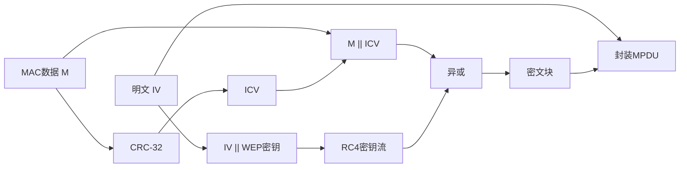
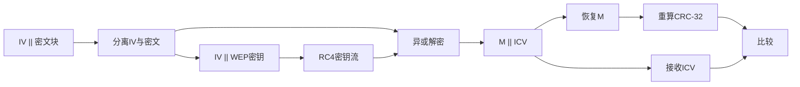

# 第 18 章 无线网络安全 - 课后习题

> [!info] 内容说明
> 本文包含原教材本章全部 **8道思考题、4道习题，共12道**。题目原文来自本章教材原文并经PDF章末页复核；解答优先依据本章正文。

## 思考题

### 思考题 18.1

> [!question] **题目原文**
> 802.11 WLAN的基本组成是什么？

#### 答题思路

从IEEE 802.11的架构层次回答：先说明最小单元BSS，再补充STA、AP、DS以及由多个BSS构成的ESS，避免把安全协议误当成网络组成。

#### 解答

IEEE 802.11 WLAN以**基站（STA）**和**基本服务集（BSS）**为基础。BSS中的STA使用同一MAC协议并竞争同一无线介质。基础设施型BSS通过**接入点（AP）**接入**分布式系统（DS）**；AP兼作网桥和中继点。两个或多个BSS经DS互连后形成**扩展服务集（ESS）**。不使用AP、由移动STA直接通信的BSS称为独立BSS（IBSS）。

#### 依据

本章18.3.3“IEEE 802.11网络构成和架构模型”直接定义了STA、BSS、AP、DS、IBSS和ESS。

---

### 思考题 18.2

> [!question] **题目原文**
> 定义一个扩展的服务集。

#### 答题思路

抓住ESS的组成方式和对上层呈现的逻辑形态两个要点作定义。

#### 解答

扩展服务集（ESS）是由分布式系统互连的两个或多个基本服务集（BSS）。尽管底层可能包含多个BSS和AP，但对逻辑链路控制（LLC）层而言，整个ESS表现为一个逻辑局域网。

#### 依据

本章18.3.3在图18.5后直接给出ESS定义。

---

### 思考题 18.3

> [!question] **题目原文**
> 列出并简要定义IEEE 802.11服务。

#### 答题思路

按教材表18.2完整列出9项服务，再用一句话说明每项服务的对象或作用，并区分基站服务与分布式系统服务。

#### 解答

IEEE 802.11定义9项服务：

1. **关联**：STA与AP建立初始联系，使DS知道STA的位置。
2. **重新关联**：把已有联系从一个AP转移到另一个AP，支持STA跨BSS移动。
3. **解除关联**：STA或AP终止已有联系。
4. **分发**：经DS把MPDU从一个BSS送往另一个BSS。
5. **整合**：在802.11 WLAN与802.x有线LAN之间完成地址翻译和介质转换。
6. **MSDU发送**：在MAC实体之间传送MSDU。
7. **认证**：确认STA身份，控制LAN接入。
8. **解除认证**：终止已建立的认证关系。
9. **隐私**：保护无线链路上的数据不被未授权读取。

其中关联、重新关联、解除关联、分发和整合由DS提供；认证、解除认证、MSDU发送和隐私由基站提供。

#### 依据

本章18.3.4及表18.2列出9项服务、提供者和目的，并在随后正文解释分发、整合及三种关联服务。

---

### 思考题 18.4

> [!question] **题目原文**
> 分布式系统是无线网络吗？

#### 答题思路

题目考查DS的实现边界。直接根据教材列出的可能实现判断它不是必然的无线网络。

#### 解答

不一定。分布式系统（DS）是连接多个BSS并在AP之间转发数据的逻辑骨干，其具体实现不由IEEE 802.11规定。教材明确指出，DS可以是交换机、有线网络，也可以是无线网络。因此不能把DS等同于无线网络。

#### 依据

本章18.3.3明确写道：“DS可以是一台交换机、一个有线网络或一个无线网络。”

---

### 思考题 18.5

> [!question] **题目原文**
> 关联和移动性之间有何关系？

#### 答题思路

从DS为何需要关联信息出发，再把三种移动性过渡映射到关联、重新关联和解除关联。

#### 解答

关联把STA的标识和当前位置登记到当前AP，使DS知道应把发往该STA的帧送到哪个AP。STA在同一ESS内从一个BSS移动到另一个BSS时，通过**重新关联**把联系转移到新AP；离开ESS或关闭时通过**解除关联**终止联系。因而，关联机制是IEEE 802.11支持BSS移动性的基础。

#### 依据

本章18.3.4先定义无过渡、BSS过渡和ESS过渡，再说明关联、重新关联与解除关联如何维护STA位置。

---

### 思考题 18.6

> [!question] **题目原文**
> IEEE 802.11i适用于哪些安全领域？

#### 答题思路

直接按18.4.1列出的RSN服务分类回答，并补充其保护范围只到STA与AP之间。

#### 解答

IEEE 802.11i主要适用于三个安全领域：

1. **认证**：STA与认证服务器相互认证，并生成无线链路使用的临时密钥。
2. **访问控制**：强化认证结果、正确路由消息并支持[[Course Notes/密码学 (Cipher)/Key Management and the Public-Key Revolution/Key Management and the Public-Key Revolution|密钥交换]]。
3. **隐私与信息完整性**：对MAC层数据加密并附加完整性代码。

其链路层保护重点是STA与AP之间；跨DS的端到端安全需要更高层机制补充。

#### 依据

本章18.4.1直接列出认证、访问控制、隐私和信息完整性；18.4.2说明802.11i只关注STA与AP之间的安全通信。

---

### 思考题 18.7

> [!question] **题目原文**
> 简要描述IEEE 802.11i操作的几个阶段。

#### 答题思路

按图18.7给出的时间顺序列出5个阶段，并为每个阶段概括目标，不展开握手细节。

#### 解答

IEEE 802.11i的RSN操作分为5个阶段：

1. **发现**：STA发现AP的安全策略，选择AP、密码套件和认证机制并建立关联。
2. **认证**：STA与认证服务器相互证明身份，AP只负责转发认证流量。
3. **密钥生成与分发**：STA与AP生成并安装加密和完整性密钥。
4. **受保护的数据传输**：使用协商的算法保护STA与AP之间的帧。
5. **连接终止**：拆除安全连接并回到初始状态。

#### 依据

本章18.4.2及图18.7逐项定义了发现、认证、密钥生成与分发、受保护的数据传输和连接终止。

---

### 思考题 18.8

> [!question] **题目原文**
> TKIP和CCMP的区别是什么？

#### 答题思路

从兼容目标、密码算法、完整性算法、密钥长度和抗重放方式五方面对照。

#### 解答

**TKIP**面向已有WEP设备的软件升级：用RC4提供保密性，用Michael生成64位MIC提供完整性，使用256位TK材料，并通过每帧递增的TSC防重放和派生动态RC4密钥。

**CCMP**面向具备新硬件支持的设备：以128位[[Course Notes/密码学 (Cipher)/Practical Constructions of Symmetric-Key Primitive/Practical Constructions of Symmetric-Key Primitives (I)|AES]]为基础，使用[[Course Notes/密码学 (Cipher)/Private-Key Encryption (VI)/Private-Key Encryption (VI)|CTR模式]]加密、[[Course Notes/密码学 (Cipher)/Private-Key Encryption (VI)/Private-Key Encryption (VI)|CBC]]-MAC认证，并用48位数据包号防重放。CCMP采用现代[[Course Notes/密码学 (Cipher)/Practical Constructions of Symmetric-Key Primitive/Practical Constructions of Symmetric-Key Primitives (I)|分组密码]]和组合模式，整体安全性高于为兼容旧设备而设计的TKIP。

#### 依据

本章18.4.6分别说明TKIP和CCMP的适用设备、完整性算法、保密算法、密钥材料及防重放计数器。

---

## 习题

### 习题 18.1

> [!question] **题目原文**
> 在IEEE 802.11中，开放系统认证通常由两次通信组成。一个认证由客户端请求，包含基站ID（通常是MAC地址）。随后是来自AP/路由器的一个认证响应，它包含成功或失败的消息。失败的一个例子是，客户端的MAC地址明显不包含在AP/路由器配置中。
> a. 这个认证方案的优点是什么？
> b. 这个认证方案的安全弱点是什么？

#### 答题思路

分别评价“部署收益”和“身份真实性”。流程只有请求与响应，且身份字段可观察，因此只能做简单准入筛选，不能形成密码学认证。

#### 解答

a. 优点是流程简单、开销小，并可按已配置的MAC地址列表做基本的接入管理，便于开放网络或兼容旧状态机。

b. 弱点是没有口令、共享密钥、挑战应答或[[Course Notes/密码学 (Cipher)/Digital Signature (II)/Digital Signature (II)|数字签名]]。MAC地址在无线帧中可被观察和伪造，攻击者复制一个获准地址即可冒充合法STA；同时STA也无法验证AP身份。因此它不提供密码学意义上的实体认证。

#### 依据

本章18.4.3明确指出开放系统认证仅交换标识，目的不是提供安全，而是兼容802.11状态机。MAC伪造风险是依据题设流程与本章18.1无线威胁模型作出的直接推导。

---

### 习题 18.2

> [!question] **题目原文**
> 在引入IEEE 802.11i前，IEEE 802.11的安全性方案是有线等效隐私（WEP）。WEP假设网络中的所有设备共享一个密钥。认证的目的是让STA证明它拥有这个密钥。认证过程如图18.12所示。STA给AP发送一条消息，请求认证。AP发出一个挑战，它是以明文方式发送的128字节的随机序列。STA用共享密钥加密挑战并返回给AP。AP解密传入的值并与自己发送的挑战进行比较。如果匹配，那么AP确认认证成功。
>
> a. 该认证方案的优点是什么？
> b. 该认证方案不完整。缺了什么？为何缺失的内容很重要？提示：增加一条或两条消息可以解决问题。
>
> ![[attachments/fig_18_12_pdf407.png]]
> *图18.12 WEP认证*
>
> c. 该方案的加密弱点是什么？

#### 答题思路

先确认挑战应答证明了什么，再检查认证方向和已知明密文对RC4的影响。

#### 解答

a. STA无需在空中直接发送共享密钥；正确加密随机挑战可以证明它掌握该密钥，且随机挑战能降低简单重放旧响应的作用。

b. 缺少AP对STA的反向证明，即没有**相互认证**。恶意AP可以冒充合法AP诱骗STA。可让STA再发送一个随机挑战，要求AP用共享密钥处理并返回；也可在原挑战响应后增加由AP认证的确认消息。

c. 挑战以明文发送，其加密结果也可被截获，攻击者因而得到一组RC4已知明文/密文并恢复对应密钥流。若IV重用或可操纵，就能伪造认证响应；WEP较短IV和RC4密钥调度弱点还会促进密钥恢复。

#### 依据

题目给出了WEP挑战应答流程；本章18.4指出原始802.11的WEP认证与隐私存在致命缺陷。相互认证和已知明文分析属于依据该流程、RC4[[Course Notes/密码学 (Cipher)/Private-Key Encryption(II-III)/Private-Key Encryption(II-III)|流密码]]性质（第8章）所作的必要推导。

---

### 习题 18.3

> [!question] **题目原文**
> 对WEP，数据完整性和数据保密性是用RC4流加密算法实现的。MPDU的发送方执行如下封装步骤。
> 1. 发送方选择一个初始向量（IV）值。
> 2. IV值和被发送方与接收方共享的WEP密钥串联，形成一个种子或密钥，并输入RC4。
> 3. 在MAC数据字段的所有位上计算一个32位循环冗余检验码（CRC），并附加到数据字段上。CRC是在数据链路控制协议中使用的一个常见检错码。此时，CRC充当一个完整性检验值（ICV）。
> 4. 使用RC4加密步骤3的结果，形成密文块。
> 5. 将明文IV附加到加密块中，形成待传输的已封装MPDU。
>
> a. 画出框图说明封装过程。
> b. 描述接收端恢复明文及执行完整性验证的步骤。
> c. 画出说明b问的框图。

#### 答题思路

按题设的5步封装流程正向画图，再严格逆序构造接收端：取IV、生成同一密钥流、异或解密、拆分并校验ICV。

#### 解答

a. 发送端流程：

b. 接收端从MPDU取出明文IV和密文块；将IV与共享WEP密钥串联并输入RC4，生成同一密钥流；密文与密钥流异或得到 $M\parallel ICV$；分离数据和ICV，对恢复的数据重新计算CRC-32；相等则接受，否则丢弃。

c. 接收端流程：

#### 依据

题目18.3直接给出WEP发送端5步封装算法；接收端是这些可逆步骤的逆过程。18.3.2还说明接收方重算CRC并与传入CRC比较。图示为依据题设流程整理。

---

### 习题 18.4

> [!question] **题目原文**
> 用CRC进行完整性验证的弱点是，它是一个线性函数。这意味着消息中的一位发生变化时，可以预测CRC的哪些位发生变化。此外，还可以确定消息中的哪些位组合可被翻转，使得CRC中的结果不变。许多明文消息的位翻转组合可以保持CRC不变，因此消息完整性会被攻破。但在WEP中，如果敌手不知道加密密钥，那么就不能访问明文，而只能访问密文分组。这是否意味着ICV不会受到位翻转攻击？说明原因。

#### 答题思路

把流密码的可控位翻转与CRC线性性质合并：攻击者不必知道明文，只需同步修改密文数据部分和加密的ICV部分。

#### 解答

不是。设原明文为 $M$，攻击者希望把它改为 $M'=M\oplus\Delta$。RC4是流密码，因此把密文数据部分异或同一差分 $\Delta$，接收端解密后就得到 $M'$。CRC具有线性（更准确地说是仿射可预测）性质，攻击者可由 $\Delta$ 计算相应的CRC差分，并把密文中的ICV部分同步异或该差分。接收端解密后得到的ICV便与 $CRC(M')$ 一致。

因此，不知道WEP密钥并不能阻止位翻转伪造；加密只隐藏值，并未把线性的CRC变成带密钥的完整性码。应使用MAC或[[Course Notes/密码学 (Cipher)/Message Authentication Codes(III)/Message Authentication Codes(III)|认证加密]]来提供抗篡改能力。

#### 依据

题目18.4已给出CRC线性和可预测位翻转这一前提；第8章流密码关系 $C=M\oplus K_s$ 说明修改密文会等量修改明文。本章18.4.6也通过TKIP的MIC和CCMP的CBC-MAC说明安全完整性需要带密钥的认证机制。

---
