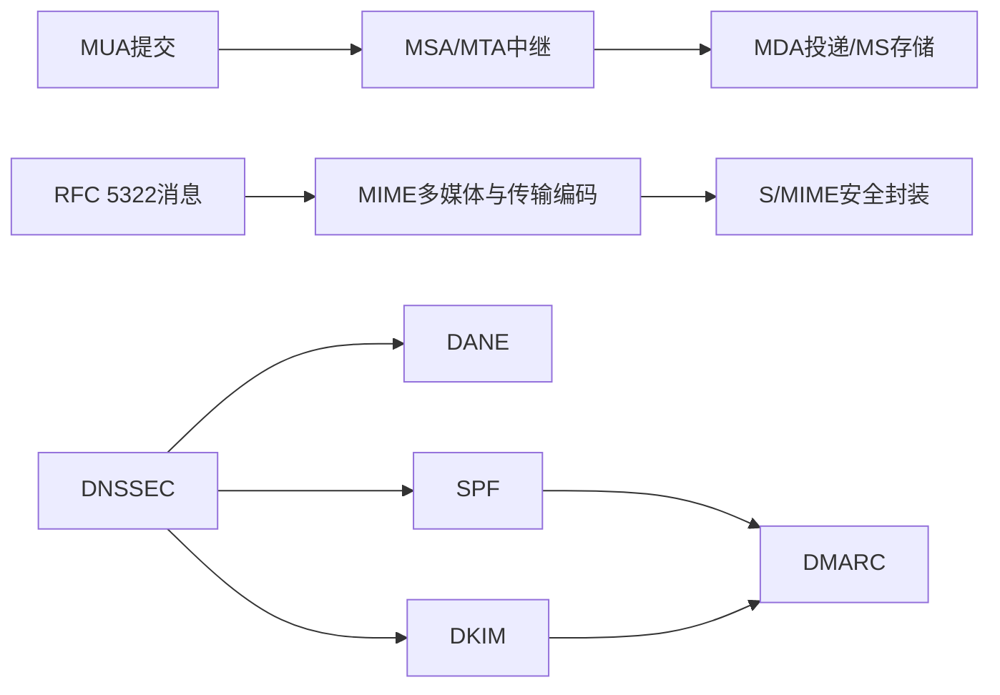

# 第19章 电子邮件安全 - 复习笔记

## 本章复习

### 核心链路

### 重点、难点、易错点

| 类型 | 内容 |
| --- | --- |
| 重点 | 邮件实体和协议；MIME；S/MIME；DNSSEC；DANE；SPF/DKIM/DMARC |
| 难点 | SMTP信封与消息头身份；S/MIME处理顺序；TLSA四模型；DMARC标识符匹配 |
| 易错点 | 把Base64当加密；把STARTTLS当端到端；把SPF当From认证；把DNSSEC当DNS加密 |

## 19.1 因特网邮件架构

### 19.1.1 电子邮件组件

![[attachments/fig_19_1_pdf409.png]]

*图19.1：发送MUA → MSA → MTA链 → MDA → MS → 接收MUA。*

| 缩写 | 定义 | 功能 |
| --- | --- | --- |
| MUA | 消息用户代理 | 创建、显示、提交和访问邮件 |
| MSA | 邮件提交代理 | 接收提交，执行授权、标准和域策略 |
| MTA | 消息传输代理 | 路由、中继，向头部添加路径信息 |
| MDA | 邮件投递代理 | 把消息从MHS投递到MS |
| MS | 消息存储 | 长期保存供MUA访问的邮件 |
| ADMD | 行政管理域 | 邮件提供者及其统一策略/信任范围 |

### 19.1.2 邮件协议

- SMTP：基于TCP的文本命令/应答协议，用于提交和中继；RFC 5321。
- SUBMISSION：MUA到MSA的首选提交标准，强调访问授权。
- POP3：TCP 110，检索/下载/删除服务器邮件。
- IMAP：TCP 143，在服务器上访问邮件，功能和认证能力更强。

**辨析**：RFC 5321描述SMTP传输；RFC 5322描述消息内容格式。

## 19.2 邮件格式

### 19.2.1 RFC 5322

消息由头部和正文组成，以第一个空行分隔。常见头部：`From`、`To`、`Subject`、`Date`、`Message-ID`。消息头部不等于SMTP信封。

### 19.2.2 MIME

**定义**：MIME是RFC 5322框架的扩展，用于描述和可靠传输多媒体、二进制及非ASCII内容。

#### 五个头部字段

`MIME-Version`、`Content-Type`、`Content-Transfer-Encoding`、`Content-ID`、`Content-Description`。

![[attachments/table_19_1_pdf412.png]]

*表19.1：七类MIME内容类型及其子类型。*

#### 关键内容类型

| 类型 | 关键点 |
| --- | --- |
| text | 文本；常见plain、enriched |
| multipart | mixed、parallel、alternative、digest；由boundary分隔 |
| message | rfc822、partial、external-body |
| application | 二进制或由专门应用处理的数据 |

#### 传输编码

| 编码 | 要点 |
| --- | --- |
| 7bit/8bit/binary | 不编码，只声明数据性质 |
| quoted-printable | 主要为ASCII时使用，尽量可读；不安全字节写成十六进制 |
| base64 | 每3字节映射为4个可打印ASCII字符，适合二进制 |
| x-token | 非标准扩展编码 |

> [!WARNING] Base64不是加密
> 它没有密钥，只改变表示。保密性不能建立在攻击者“不认识编码”上。

**规范格式**：把本地字符集、换行、记录属性等转换为统一表示，确保跨系统处理和签名验证的一致性。

## 19.3 电子邮件威胁与综合安全

| 类别 | 结果 | 主要应对 |
| --- | --- | --- |
| 真实性 | 未授权访问、冒充发送域 | S/MIME签名、SPF、DKIM、DMARC |
| 完整性 | 内容被修改 | TLS、S/MIME、DKIM |
| 保密性 | 敏感内容泄露 | TLS、S/MIME加密 |
| 可用性 | 无法收发 | 多服务器、云服务、抗DoS |

![[attachments/fig_19_2_pdf415.png]]

*图19.2：电子邮件安全机制的依赖与作用关系。*

| 保护层次 | 机制 | 保护对象 |
| --- | --- | --- |
| 逐跳 | STARTTLS | 相邻SMTP节点间的连接 |
| 端到端 | S/MIME | MIME消息内容 |
| DNS基础 | DNSSEC、DANE | RRset真实性、证书绑定 |
| 域级认证 | SPF、DKIM、DMARC | 发信主机、域签名、可见From对齐和策略 |

## 19.4 S/MIME

### 19.4.1 操作描述

| 服务 | 典型处理 |
| --- | --- |
| 数字签名 | SHA-256摘要；发送方RSA私钥签名 |
| 消息加密 | AES-128-CBC一次性内容密钥；接收方RSA公钥加密密钥 |
| 压缩 | 算法未规定 |
| 邮件兼容性 | Base64把8位二进制变为ASCII |

![[attachments/fig_19_3_pdf417.png]]

*图19.3：先签名后加密；接收时先解密后验签。*

#### 签名

1. 计算消息摘要。
2. 发送方私钥生成签名并附加身份信息。
3. 接收方用发送方公钥验证，重算摘要并比较。

**分离式签名**：签名与消息分开，适合独立保存、多方签署、检测文件后续变化。

#### 加密

1. 每条消息生成一次性内容加密密钥。
2. 以对称算法加密消息。
3. 以每个接收方的公钥加密内容密钥。
4. 接收方以私钥恢复密钥，再解密消息。

**顺序**：先签名后加密可隐藏签名者并便于保存明文签名；先加密后签名可不看明文验证外层签名。有损压缩应先压缩后签名。

### 19.4.2 S/MIME消息内容类型

| 类型 | 含义 |
| --- | --- |
| Data | 内部MIME内容 |
| SignedData | 数字签名封装 |
| EnvelopedData | 加密内容及面向接收方加密的内容密钥 |
| CompressedData | 压缩内容 |

### 19.4.3 S/MIME消息

- `envelopedData`：`RecipientInfo` + 加密内容；外层通常Base64。
- `signedData`：摘要算法、被签消息、`SignerInfo`、可选证书链。
- `multipart/signed`：可读消息 + 分离签名，称透明签名。
- `application/pkcs10`：证书注册请求。
- 仅含证书消息：发送证书或CRL。

### 19.4.4 S/MIME证书处理过程

使用X.509v3证书。用户代理负责密钥生成、向CA注册、公钥证书与CRL的本地存储/检索。

### 19.4.5 安全性增强服务

签收收据、安全标签、安全邮件列表、签名证书。

## 19.5 DNSSEC

### 19.5.1 域名系统

DNS四组件：域名空间、DNS数据库、域名服务器、解析器。邮件发送通过收件地址域查询MX记录。

![[attachments/fig_19_4_pdf423.png]]

*图19.4：本地查询、递归/迭代解析与TTL缓存。*

| RR | 含义 |
| --- | --- |
| A / AAAA | IPv4 / IPv6地址 |
| CNAME | 别名到规范名称 |
| MX | 邮件交换服务器 |
| NS | 权威域名服务器 |
| SOA | 区授权起点及参数 |
| SRV | 指定服务的服务器 |
| TXT | 任意文本；SPF/DMARC等可使用 |

### 19.5.2 DNS安全扩展

**服务**：数据源认证、数据完整性；不提供保密性。

| DNSSEC RR | 功能 |
| --- | --- |
| DNSKEY | 公钥 |
| RRSIG | RRset签名 |
| DS | 父区到子区的授权/信任链 |
| NSEC | 认证否定应答 |

信任锚通常从根区开始，DS逐级连接到目标区；解析器验证RRset对应RRSIG。

## 19.6 基于DNS的命名实体认证

### 19.6.1 TLSA记录

![[attachments/fig_19_5_pdf425.png]]

*图19.5：证书用途、选择器、匹配类型、证书相关数据。*

|  | 公共PKIX有效 | 不依赖公共PKIX |
| --- | --- | --- |
| 信任锚TA | PKIX-TA：限定公共CA | DANE-TA：域指定信任锚 |
| 终端实体EE | PKIX-EE：限定服务证书 | DANE-EE：域直接指定服务证书 |

选择器：整个证书或公钥；匹配类型：精确、SHA-256、SHA-512。

### 19.6.2 为SMTP使用DANE

DNSSEC认证的TLSA记录可指示必须加密、抵抗STARTTLS降级，并认证MUA到提交服务器或MTA间连接所用证书。

### 19.6.3 为S/MIME使用DNSSEC

SMIMEA把邮件地址域与S/MIME证书关联；格式和功能基本同TLSA，但面向消息字段中的邮件地址。

## 19.7 发送方策略框架

SPF以SMTP连接源IP和`MAIL FROM`/`HELO`域为输入，查询发送域DNS TXT策略。

![[attachments/fig_19_6_pdf426.png]]

*图19.6：信封发送域与消息头From域可以不一致。*

### 19.7.1 发送端的SPF

- 机制：`ip4`、`ip6`、`mx`、`include`、`all`。
- 修饰符：`+`允许，`-`失败，`~`软失败，`?`中立。

### 19.7.2 接收端的SPF

![[attachments/fig_19_7_pdf427.png]]

*图19.7：查询SPF RR并按机制和修饰符处理。*

无记录或格式错误时教材默认接收；SPF可在正文到达前执行。SPF不直接认证RFC 5322 From。

## 19.8 DKIM

### 19.8.1 电子邮件威胁

攻击者可能伪造任意头部、控制域或僵尸网络、重放合法签名消息、操纵DNS/IP路由、制造大量错误签名DoS。DKIM重点应对行政域外部敌手。

### 19.8.2 DKIM策略

![[attachments/fig_19_8_pdf429.png]]

*图19.8：发送域签名，接收域经DNS取公钥验签。*

DKIM覆盖正文和选定RFC 5322头部，通常由域内MUA/MSA/MTA完成，对用户透明。

### 19.8.3 DKIM功能流程

![[attachments/fig_19_9_pdf430.png]]

*图19.9：签名ADMD、验证ADMD、密钥仓库和邮件过滤系统。*

| 标记 | 含义 |
| --- | --- |
| `v` | 版本 |
| `a` | 签名算法 |
| `c` | 头部/正文规范化方法 |
| `d` | 签名域标识符 |
| `s` | 选择器，用于查找密钥 |
| `h` | 被签头部列表 |
| `bh` | 正文哈希 |
| `b` | Base64签名值 |

规范化分`simple`和`relaxed`，减少无语义格式变化造成的验签失败。

## 19.9 基于域的消息认证、报告和一致性

### 19.9.1 标识符匹配

| 机制 | 认证身份 |
| --- | --- |
| SPF | RFC 5321 `MAIL FROM`或`HELO`域 |
| DKIM | `DKIM-Signature`中的`d=`域 |
| DMARC | RFC 5322 `From`域与已通过的SPF或DKIM身份对齐 |

### 19.9.2 发送端的DMARC

| 标记 | 要点 |
| --- | --- |
| `v` | 版本，首项 |
| `p` | `none`、`quarantine`、`reject` |
| `aspf` / `adkim` | SPF/DKIM宽松或严格对齐 |
| `rua` / `ruf` | 汇总/鉴定报告URI |
| `ri` | 报告间隔，默认86400秒 |
| `pct` | 应用策略的邮件百分比，默认100 |
| `sp` | 子域策略 |

### 19.9.3 接收端的DMARC

提取From域 → 查询策略 → 验证DKIM/SPF → 标识符匹配 → 得到DMARC结论 → 投递/隔离/拒绝 → 收集报告数据。

![[attachments/fig_19_10_pdf433.png]]

*图19.10：DMARC处理与反馈闭环。*

### 19.9.4 DMARC报告

- 汇总报告：周期统计认证结果、对齐、处置、策略和数量。
- 鉴定报告：针对具体失败消息，提供头部和失败原因信息。

## 一页对比表

| 机制 | 保护对象 | 关键输入/证据 | 主要输出 |
| --- | --- | --- | --- |
| SMTP | 邮件传输 | 信封、命令/应答 | 消息转发 |
| MIME | 消息表示 | 内容类型、传输编码 | 可兼容的多媒体消息 |
| S/MIME | 消息内容 | 用户证书、签名、内容密钥 | 认证、完整性、保密性 |
| DNSSEC | DNS RRset | RRSIG、DNSKEY、DS、信任锚 | 可信DNS数据 |
| DANE | 域与证书 | TLSA/SMIMEA | 证书约束或直接绑定 |
| SPF | 源IP与信封域 | DNS SPF记录 | 主机授权结果 |
| DKIM | 正文与选定头部 | 域签名、DNS公钥 | 域责任与完整性结果 |
| DMARC | 可见From域 | SPF/DKIM结果及对齐 | 通过/失败、处置、报告 |

## 关键词索引

`ADMD`、`Base64`、`DKIM`、`DMARC`、`DNSKEY`、`DNSSEC`、`DANE`、`IMAP`、`MDA`、`MIME`、`MS`、`MSA`、`MTA`、`MUA`、`NSEC`、`POP3`、`RFC 5321`、`RFC 5322`、`RRSIG`、`S/MIME`、`SMTP`、`SPF`、`STARTTLS`、`TLSA`、`SMIMEA`、`分离式签名`、`规范格式`、`标识符匹配`。

## 教材内容与补充理解

> [!NOTE] 教材内容
> 本笔记中的协议定义、字段、步骤、算法和图表关系均按第19章整理。

> [!TIP] 补充理解
> 可用“链路、内容、域身份”三层模型统一理解本章：STARTTLS保护链路，S/MIME保护内容，SPF/DKIM/DMARC保护域身份；DNSSEC和DANE为其中的DNS与证书信任提供基础。

## Related

- [[第十三章_数字签名_复习笔记]]
- [[第十五章_密钥管理和分发_复习笔记]]
- [[第十六章_用户认证_复习笔记]]
- [[第十七章_传输层安全_复习笔记]]
- [[第二十章_IP安全_复习笔记]]
- [[第十九章_电子邮件安全_教材原文]]
- [[第十九章_电子邮件安全_导学讲义]]
- [[第十九章_电子邮件安全_课后习题]]
