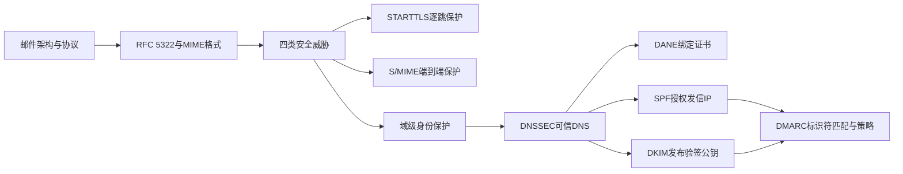
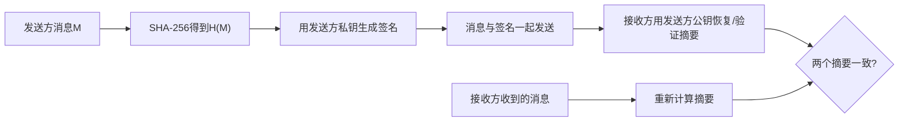

# 第19章 电子邮件安全 - 导学讲义

## 本章导学

### 学习目标

1. 说清一封邮件从MUA出发，经MSA、MTA、MDA到MS的完整路径。
2. 区分SMTP传输协议、RFC 5322消息格式与MIME扩展各自解决的问题。
3. 理解电子邮件真实性、完整性、保密性和可用性威胁，以及不同安全机制的保护边界。
4. 掌握S/MIME的签名、加密、压缩和邮件兼容性服务。
5. 解释DNSSEC如何为DNS数据建立来源认证和完整性保护。
6. 比较DANE的四种证书用途模型，并说明TLSA记录的字段作用。
7. 说明SPF、DKIM和DMARC分别认证什么、依赖什么、不能单独解决什么。
8. 能从端到端消息安全、逐跳传输安全和域级身份认证三个维度设计邮件防护。

### 核心问题

- 为什么邮件“能送达”不等于“内容可信、未被修改且未被窃听”？
- SMTP、MIME和S/MIME为什么不能互相替代？
- STARTTLS保护的是哪一段路径，S/MIME又保护什么对象？
- DNSSEC为什么是DANE、SPF、DKIM和DMARC可信运行的重要基础？
- SPF通过、DKIM通过与DMARC通过之间是什么关系？

### 为什么需要学习本章

电子邮件采用存储转发方式，一封邮件可能经过多个管理域和中继服务器。传统SMTP的目标是传递消息，而不是证明发送者身份或保护消息内容。因此，邮件安全不是加一个“加密开关”，而是由多种机制共同完成：[[Course Notes/Web隐私与安全（Security and Privacy of Web）/06-HTTPS与TLS/06-HTTPS与TLS|TLS]]保护相邻邮件服务器之间的链路，S/MIME保护消息本身，DNSSEC保护DNS查询结果，SPF约束可代表域发信的主机，DKIM证明域对特定消息负责，DMARC把认证结果与用户看见的From域对齐并给出处置和反馈策略。

### 全章知识地图



## 19.1 因特网邮件架构

### 本节目标与核心问题

目标是认识邮件系统中的角色和协议落点。核心问题是：用户点击“发送”后，究竟由谁提交、转发、投递和保存邮件？

### 19.1.1 电子邮件组件

![[attachments/fig_19_1_pdf409.png]]

*图19.1：邮件从发送方MUA进入MHS，经MSA、一个或多个MTA、MDA到达消息存储，接收方MUA再访问消息。*

| 组件 | 全称 | 主要职责 | 类比 |
| --- | --- | --- | --- |
| MUA | 消息用户代理 | 编写、格式化、发送、读取邮件 | 写信与读信的人/客户端 |
| MSA | 邮件提交代理 | 接收MUA提交，执行提交授权和域策略 | 邮局收件窗口 |
| MTA | 消息传输代理 | 选择下一跳并中继邮件，记录路径 | 邮件分拣与转运中心 |
| MDA | 邮件投递代理 | 将邮件从MHS送入消息存储 | 最后一公里投递员 |
| MS | 消息存储 | 长期保存邮件，供MUA访问 | 收件箱仓库 |
| ADMD | 行政管理域 | 统一管理邮件策略与信任决策 | 一家邮政运营机构 |

邮件系统的关键不是“客户端直接把邮件交给对方客户端”，而是MUA到MUA之间由MHS构造虚拟交换环境。MTA可以多跳中继，每个行政管理域可以有自己的接收、过滤、签名和转发策略。

### 19.1.2 邮件协议

| 协议/标准 | 用途 | 教材给出的常用端口或特征 |
| --- | --- | --- |
| SMTP | 提交和中继邮件；命令/应答式文本协议 | 基于TCP；命令通常为4字母，应答以3位代码开头 |
| SUBMISSION | MUA向MSA提交邮件 | 由SMTP发展而来，使用独立端口并强调访问授权 |
| POP3 | 从服务器下载、检索和删除邮件 | TCP 110 |
| IMAP | 在服务器上访问和管理邮件 | TCP 143；功能和认证能力较POP3强 |

SMTP负责“把邮件往前送”，POP3和IMAP负责“让收件客户端访问已存储邮件”。在SMTP、POP和IMAP上使用TLS时，TLS保护的是相应连接，而不是自动给整封邮件建立端到端保护。

> [!WARNING] 常见误区
> RFC 5321描述SMTP传输；RFC 5322描述消息内容格式。二者编号相近，但一个回答“怎样传”，另一个回答“邮件长什么样”。

## 19.2 邮件格式

### 本节目标与核心问题

目标是理解邮件内容的三层关系：RFC 5322定义基本消息结构，MIME描述多媒体内容及传输编码，S/MIME再在MIME实体上施加安全处理。

### 19.2.1 RFC 5322

RFC 5322消息由若干头部行和正文组成，两者以第一个空行分隔。常见头部有`From`、`To`、`Subject`、`Date`和`Message-ID`。这里的头部属于消息内容格式；SMTP信封则用于实际传输，两者中的发送身份可能不同。

```text
Date: October 8, 2009 2:15:49 PM EDT
From: William Stallings <ws@shore.net>
Subject: The Syntax in RFC 5322
To: Smith@other-host.com

Hello. This is the message body.
```

### 19.2.2 MIME

#### MIME为什么出现

传统SMTP/RFC 5322方案围绕7位ASCII文本设计，不能可靠承载任意二进制对象、非ASCII字符和复杂多媒体内容；不同网关还可能改变换行、长行、尾随空白或制表符。MIME通过增加头部字段、定义内容类型和定义传输编码解决这些兼容性问题。

#### 五个MIME头部字段

| 字段 | 作用 |
| --- | --- |
| MIME-Version | 指明遵循的MIME版本，参数值为1.0 |
| Content-Type | 描述正文数据类型和子类型 |
| Content-Transfer-Encoding | 指明适应传输环境所采用的编码 |
| Content-ID | 唯一标识MIME实体 |
| Content-Description | 给不可直接阅读对象提供文本说明 |

![[attachments/table_19_1_pdf412.png]]

*表19.1：MIME把内容组织为text、multipart、message、image、audio、video和application等类型，再以子类型说明具体格式。*

`multipart`的关键是边界字符串。`mixed`表示多个按序组合的部分，`parallel`允许并行呈现，`alternative`提供同一信息的多个表示，`digest`封装多条消息。`message/partial`可把大消息拆片，`message/external-body`只传递访问外部数据的信息。

#### 内容类型与传输编码不可混淆

| 概念 | 回答的问题 | 示例 |
| --- | --- | --- |
| 内容类型 | 数据是什么、应如何解释 | `text/plain`、`image/jpeg` |
| 传输编码 | 数据如何变成邮件链路可安全传送的表示 | `quoted-printable`、`base64` |

`quoted-printable`适合以可打印ASCII为主的内容，尽量保持人可读；`base64`把每3字节映射为4个ASCII字符，适合任意二进制内容。Base64是编码而非加密：没有密钥，任何知道规则的人都能还原。

#### 规范格式

签名前必须把本地格式转换为统一的规范格式。否则，发送端与接收端对换行、字符集或空白的不同处理会让同一语义内容产生不同字节串，进而导致签名验证失败。

## 19.3 电子邮件威胁与综合安全

### 四类安全目标

| 威胁类别 | 典型结果 | 对应防护方向 |
| --- | --- | --- |
| 真实性 | 冒充域、伪造发送地址、未授权MTA发信 | SPF、DKIM、DMARC、数字签名 |
| 完整性 | 中转过程中内容被替换 | TLS、S/MIME、DKIM |
| 保密性 | 邮件流量被监听、敏感数据泄露 | TLS、S/MIME加密 |
| 可用性 | 邮件服务器遭DoS/DDoS，无法收发 | 冗余服务器、云邮件服务、容量与流量防护 |

![[attachments/fig_19_2_pdf415.png]]

*图19.2：DNSSEC为DNS数据提供可信基础；DANE约束TLS证书；SPF认证SMTP信封来源；DKIM验证域签名；DMARC把SPF/DKIM结果与可见From域对齐；S/MIME保护消息内容。*

#### 三层防护模型

1. **逐跳链路保护**：STARTTLS在相邻SMTP节点之间建立TLS，保护该跳的SMTP信封和消息。
2. **端到端内容保护**：S/MIME直接签名和/或加密MIME实体，中继服务器无需看到明文。
3. **域级身份保护**：SPF、DKIM、DMARC判断“这个域是否授权该发送来源、是否对消息负责、可见身份是否对齐”。

> [!IMPORTANT] 边界意识
> STARTTLS的一跳结束后，下一跳是否仍加密要重新协商；SPF不检查正文完整性；DKIM不提供保密性；DMARC依赖SPF或DKIM结果，不能替代它们。

## 19.4 S/MIME

### 19.4.1 操作描述

S/MIME是MIME的安全增强，提供四项基本服务。

| 服务 | 典型算法/处理 | 解决的问题 |
| --- | --- | --- |
| 数字签名 | SHA-256摘要 + 发送方RSA私钥签名 | 来源认证、完整性、不可抵赖性 |
| 消息加密 | 一次性AES-128-CBC内容密钥 + 接收方RSA公钥封装密钥 | 保密性和密钥分发 |
| 压缩 | 算法未规定 | 节省传输和存储空间 |
| 邮件兼容性 | Base64 | 把任意8位字节流转为可打印ASCII |

![[attachments/fig_19_3_pdf417.png]]

*图19.3：教材给出的组合顺序是发送方先签名后加密，接收方先解密后验签。*

#### 数字签名流程



分离式签名与被签消息分开保存或传输，适合签名日志、检测文件后续修改以及多人独立签署同一文档。

#### 保密性流程

每封邮件随机生成一个一次性内容加密密钥，用它高效加密消息；再用每个接收方的公钥加密该内容密钥。这样既利用对称算法处理大量数据的效率，也利用公钥算法解决异步邮件场景的密钥分发问题。

#### 顺序为什么重要

- 先签名后加密：隐藏签名者身份，解密后可直接保留和验证原始明文签名，第三方验证较方便。
- 先加密后签名：无需读取明文即可验证外层签名，适合自动化检查。
- 有损压缩会改变内容；若要让签名覆盖压缩后的实际字节，应先压缩后签名。

### 19.4.2 S/MIME消息内容类型

| CMS内容类型 | 作用 |
| --- | --- |
| Data | 内部MIME编码内容，供其他类型封装 |
| SignedData | 应用数字签名 |
| EnvelopedData | 加密内容以及面向一个或多个接收方加密的内容密钥 |
| CompressedData | 对消息应用压缩 |

透明签名把可读消息和分离签名组织为`multipart/signed`，未实现S/MIME的实体仍可读取消息内容。

### 19.4.3 S/MIME消息

S/MIME先把MIME实体规范化，再连同算法标识符、证书等安全数据形成PKCS/CMS对象，最后把对象封装回MIME。常见形式包括：

- `envelopedData`：为每个接收方建立`RecipientInfo`，其中包含证书、密钥加密算法和加密后的会话密钥；
- `signedData`：包含被签消息、摘要算法标识、`SignerInfo`和可选证书链；
- `multipart/signed`透明签名：第一部分是可读内容，第二部分是`application/pkcs7-signature`；
- `application/pkcs10`：传输证书注册请求；
- 仅含证书消息：传送证书或CRL。

### 19.4.4 S/MIME证书处理过程

S/MIME使用X.509v3证书。用户代理要完成密钥生成、向CA注册公钥、在本地存储和检索证书/CRL等工作。验签需要发送方证书，加密流出邮件需要接收方证书。

### 19.4.5 安全性增强服务

| 增强服务 | 作用 |
| --- | --- |
| 签收收据 | 接收方对原消息及原签名再签名，提供收到消息的证据 |
| 安全标签 | 描述敏感性、访问控制、优先级或角色限制 |
| 安全邮件列表 | MLA代替发送方为多个接收方分别执行加密处理 |
| 签名证书 | 把发送方证书与其签名安全绑定 |

## 19.5 DNSSEC

### 19.5.1 域名系统

DNS由域名空间、分布式DNS数据库、域名服务器和解析器组成。发送MTA根据收件地址`@`右侧的域查询MX资源记录，找到下一跳接收MTA。

![[attachments/fig_19_4_pdf423.png]]

*图19.4：解析器先查询本地域名服务器；本地服务器命中数据库/缓存则直接响应，否则继续查询其他服务器，并按TTL缓存结果。*

#### 为什么DNS优于HOSTS.TXT

它使用层次命名、分布式存储和分区管理，允许不同机构独立更新自己的区域，并通过缓存扩展到全球规模。中心化的单一主机表会形成更新瓶颈、传播延迟和单点故障。

### 19.5.2 DNS安全扩展

DNSSEC由应答区管理机构对RRset进行数字签名，解析器验证签名，从而获得数据源认证和数据完整性。它不要求信任中间缓存或转发服务器。

| 记录 | 作用 |
| --- | --- |
| DNSKEY | 发布验证签名所需的公钥 |
| RRSIG | 保存RRset的数字签名 |
| DS | 把父区对下级区密钥的授权连接起来，建立信任链 |
| NSEC | 对“不存在该名称/类型”的否定应答进行认证 |

信任从预先信任的根区公钥（信任锚）出发，经DS逐级到达目标区。DNSSEC证明数据来自哪个区且未被修改，但它本身不加密DNS内容。

## 19.6 基于DNS的命名实体认证

DANE用DNSSEC把TLS使用的X.509证书或公钥与域名绑定，降低全球CA体系中“任一受信CA受损即可影响其他域”的风险。

### 19.6.1 TLSA记录

![[attachments/fig_19_5_pdf425.png]]

*图19.5：TLSA记录包含证书用途、选择器、匹配类型和证书相关数据。*

| 证书用途 | 依赖公共PKIX验证 | TLSA约束对象 | 直观含义 |
| --- | --- | --- | --- |
| PKIX-TA | 是 | CA/信任锚 | 公共CA链必须成立，且限定可接受的CA |
| PKIX-EE | 是 | 终端实体证书 | 公共CA链必须成立，且限定服务证书 |
| DANE-TA | 否 | 域指定的信任锚 | 域通过DNSSEC建立自己的CA信任锚 |
| DANE-EE | 否 | 域颁发/指定的终端证书 | 不依赖第三方CA，直接信任域声明的服务证书 |

记忆方法：前缀`PKIX`表示仍依赖公共PKI，前缀`DANE`表示由DNSSEC建立信任；后缀`TA`约束信任锚，`EE`约束终端实体。

选择器决定比较整个证书还是公钥；匹配类型决定精确比较，或比较SHA-256/SHA-512摘要；证书相关数据保存相应的原始值或摘要。

### 19.6.2 为SMTP使用DANE

STARTTLS可能被降级，TLS证书也可能自签名或名称不匹配。经DNSSEC认证的TLSA记录既可表达“必须加密”，阻止恶意降级，也可认证SMTP提交服务器或MTA间TLS连接所用证书。

### 19.6.3 为S/MIME使用DNSSEC

SMIMEA记录的格式和功能与TLSA基本相同，但它面向消息字段中邮件地址对应的域，帮助MUA验证S/MIME证书；TLSA主要面向外部SMTP信封和服务连接。

## 19.7 发送方策略框架

SPF让域所有者通过DNS TXT记录声明哪些主机/IP地址可在SMTP的`MAIL FROM`或`HELO`身份中使用该域名。

![[attachments/fig_19_6_pdf426.png]]

*图19.6：SMTP信封中的MAIL FROM域可以与RFC 5322消息头部的From域不同；SPF检查前者和连接源IP。*

### 19.7.1 发送端的SPF

| 机制 | 含义 |
| --- | --- |
| `ip4` / `ip6` | 声明授权IPv4/IPv6地址或范围 |
| `mx` | MX记录列出的主机也是合法发送方 |
| `include` | 递归引用其他域的SPF策略 |
| `all` | 匹配此前未匹配的所有地址 |

| 修饰符 | 结果倾向 |
| --- | --- |
| `+` | 允许；默认可省略 |
| `-` | 不允许 |
| `~` | 软失败，接收并重点检查 |
| `?` | 中立，记录未明确说明 |

### 19.7.2 接收端的SPF

![[attachments/fig_19_7_pdf427.png]]

*图19.7：接收方以连接源IP和SMTP信封域查询SPF记录，在投递到用户邮箱前形成检查结果。*

无SPF记录或记录格式错误时，教材给出的默认操作都是接收邮件；其他情形按机制和修饰符决定处理方式。SPF可以在接收正文前执行，但转发会改变连接源IP，且SPF不认证用户看见的RFC 5322 `From`字段，因此还需要DMARC做身份对齐。

## 19.8 DKIM

DKIM让签名行政域使用私钥对消息正文及选定的RFC 5322头部字段签名，接收方通过DNS获取公钥验签。它声明的是“某域愿意对这封邮件负责”，不是自动证明某个自然人的身份。

### 19.8.1 电子邮件威胁

教材把敌手分为低、中、专业三个层次。其能力可包括伪造头部、控制域和僵尸网络、重放已签邮件、操纵路由或DNS、制造大量错误签名实施DoS，以及监听无线信道。DKIM主要针对发送方和接收方行政域之外的敌手。

### 19.8.2 DKIM策略

![[attachments/fig_19_8_pdf429.png]]

*图19.8：发送域以私钥签名，接收域从DNS取得相应公钥并在投递前验签。*

DKIM与S/MIME的关键区别：DKIM通常部署在管理域的MUA/MSA/MTA并对用户透明，覆盖正文和选定头部；S/MIME通常由用户端密钥保护消息内容，要求通信端支持S/MIME。

### 19.8.3 DKIM功能流程

![[attachments/fig_19_9_pdf430.png]]

*图19.9：签名ADMD从密钥库取私钥生成签名；验证ADMD从DNS/密钥库取公钥验签，再结合签名者信誉过滤邮件。*

`DKIM-Signature`重要标记：

| 标记 | 含义 |
| --- | --- |
| `v` | 版本 |
| `a` | 签名算法，如`[[rsa]]-sha256` |
| `c` | 头部/正文规范化算法 |
| `d` | 签名域标识符SDID |
| `s` | 密钥选择器 |
| `h` | 被签名的头部字段列表 |
| `bh` | 规范化正文的哈希值 |
| `b` | Base64形式的签名数据 |

规范化的作用是允许某些不影响语义的格式变化，同时保证签名方与验证方得到相同字节表示。`simple`不允许更改，`relaxed`允许规定范围内的规范化变化。

## 19.9 基于域的消息认证、报告和一致性

DMARC把SPF和DKIM结果与用户可见的RFC 5322 `From`域对齐，并允许域所有者发布失败邮件处置策略和报告地址。

### 19.9.1 标识符匹配

- SPF认证SMTP信封中的`MAIL FROM`或`HELO`域；
- DKIM认证签名中的`d=`域及所覆盖内容；
- DMARC认证用户看到的RFC 5322 `From`域是否与至少一个已通过的SPF/DKIM身份匹配。

宽松匹配允许组织域一致，严格匹配要求域名精确一致。

### 19.9.2 发送端的DMARC

发送方先配置SPF和/或DKIM，再通过DNS TXT记录发布DMARC策略。常用字段包括：`v`版本、`p`策略、`aspf`和`adkim`匹配严格度、`rua`汇总报告地址、`ruf`鉴定报告地址、`ri`报告间隔、`pct`应用比例以及`sp`子域策略。

`p`可逐级从`none`过渡到`quarantine`再到`reject`，便于先观察报告，再逐步收紧处置。

### 19.9.3 接收端的DMARC

接收方提取RFC 5322 From域，查询DMARC策略，执行DKIM和SPF检查，再做标识符匹配，最后结合域策略和本地策略决定投递、隔离或拒绝。

![[attachments/fig_19_10_pdf433.png]]

*图19.10：DMARC把消息、SPF、DKIM、DNS策略和接收方处置串成一个闭环，并把结果反馈给发送域。*

### 19.9.4 DMARC报告

- 汇总报告周期性统计通过/失败数量、SPF/DKIM结果、域匹配、处置和策略执行情况；
- 鉴定报告针对具体失败消息，提供足以分析失败原因的头部和认证信息。

发送域可先以`p=none`收集数据，修复合法邮件流，再逐步提高到`quarantine`或`reject`。报告机制让认证从一次性判定变为可观测、可改进的运营过程。

## 综合比较

| 机制 | 主要对象 | 核心证据 | 主要保护 | 不能单独保证 |
| --- | --- | --- | --- | --- |
| STARTTLS | 相邻邮件节点连接 | TLS证书与会话密钥 | 逐跳保密性、完整性 | 端到端保护、域身份对齐 |
| S/MIME | MIME消息内容 | 用户证书、[数字签名](<../../../../../Course Notes/密码学 (Cipher)/Digital Signature (II)/Digital Signature (II).md>)、内容密钥 | 端到端认证/完整性/保密性 | 发信IP是否获域授权 |
| DNSSEC | DNS RRset | 区签名与信任链 | DNS来源认证、完整性 | DNS数据保密性 |
| DANE | TLS/S/MIME证书与域 | DNSSEC认证的TLSA/SMIMEA | 证书绑定、抗降级辅助 | 消息正文身份与内容安全 |
| SPF | SMTP信封域与源IP | 域发布的SPF记录 | 发信主机授权 | 正文完整性、可见From身份 |
| DKIM | 正文和选定头部 | 域私钥签名、DNS[公钥](<../../../../../Course Notes/密码学 (Cipher)/Key Management and the Public-Key Revolution/Key Management and the Public-Key Revolution.md>) | 域责任与内容完整性 | 保密性、可见From一定对齐 |
| DMARC | RFC 5322 From域 | SPF/DKIM通过且身份对齐 | 处置策略、报告、抗域欺骗 | 没有SPF/DKIM时独立认证 |

## 易混淆点与记忆技巧

1. **5321管信封，5322管信纸**：SMTP信封用于路由，消息头部用于展示。
2. **MIME描述和搬运，S/MIME签名和加密**：MIME本身不提供密码学安全。
3. **SPF看路、DKIM看章、DMARC看门面**：SPF看源IP与信封域，DKIM看域签名，DMARC看可见From域是否对齐。
4. **DNSSEC签数据，不藏数据**：提供认证和完整性，不提供保密性。
5. **PKIX/DANE决定信任来源，TA/EE决定约束层级**。

## 与前后章节的联系

- 第12、13章的[[Course Notes/密码学 (Cipher)/Hash Functions and Applications (III)/Hash Functions and Applications (III)|哈希]]、MAC和数字签名是S/MIME与DKIM的密码学基础。
- 第14、15章的密钥分发、X.509和PKI解释证书验证与CA风险。
- 第17章的TLS说明STARTTLS和DANE所保护的传输连接。
- 第20章的IP安全提供网络层保护，保护对象和部署层次与邮件安全不同。

## 学习建议

1. 先画出邮件角色和两种“From”：SMTP信封身份、RFC 5322可见身份。
2. 对每个机制固定回答四问：保护对象、密钥/证据来源、验证位置、保护边界。
3. 用一封伪造邮件走完SPF、DKIM、DMARC判断链，避免只背定义。
4. 复习DANE时先用2×2矩阵记忆，再补TLSA的选择器和匹配类型。

## 推荐扩展阅读

以下为教材列出的标准，适合在掌握本章主线后查阅：RFC 5321、RFC 5322、RFC 2045～2049、RFC 5751、RFC 4033～4035、RFC 6698、RFC 7208、RFC 6376和RFC 7489。
