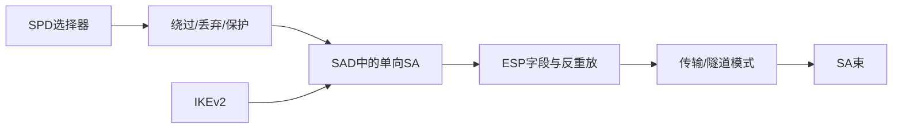

# 第20章 IP安全 - 复习笔记

## 本章复习

### 核心链路

### 高频辨析

| 对比 | 结论 |
| --- | --- |
| SPD vs SAD | SPD是流量政策；SAD是已建立SA状态 |
| SPI vs SA | SPI只在给定目的地址和协议下定位SA，完整标识是三元组 |
| 传输 vs 隧道 | 前者保护IP净荷；后者封装并保护整个内部IP包 |
| IKE SA vs CHILD SA | 前者保护IKE控制交换；后者保护实际IP流量 |
| 加密 vs 认证范围 | ESP加密净荷和尾部；认证覆盖ESP头和密文 |

## 20.1 IP安全概述

### 20.1.1 IPsec的应用

分支机构VPN、远程访问、合作伙伴互连、电子商务安全增强。IP层统一保护所有上层应用。

### 20.1.2 IPsec文档

- 架构RFC 4301；
- AH RFC 4302，新应用不建议；
- ESP RFC 4303；
- IKEv2 RFC 7296；
- 密码算法和策略/MIB等配套文档。

### 20.1.3 IPsec服务

访问控制、拒绝重放、无连接完整性、保密性、数据源认证、有限流量保密性。

## 20.2 IP安全策略

![[attachments/fig_20_1_pdf438.png]]

*图20.1：SPD、SAD、IKE与IPsec处理关系。*

### 20.2.1 安全关联

SA是单向逻辑连接。唯一标识：

$$
(\mathrm{SPI},\mathrm{Destination\ IP},\mathrm{AH/ESP})
$$

### 20.2.2 安全关联数据库

SAD参数：SPI、序号计数器和溢出标志、反重放窗口、AH/ESP算法与密钥、SA生命期、传输/隧道模式、路径MTU。

### 20.2.3 安全性策略数据库

选择器：本地/远程IP、下一层协议、名称、本地/远程端口。动作：绕过、丢弃、保护。匹配顺序重要。

### 20.2.4 IP流量处理

![[attachments/fig_20_2_pdf440.png]]

*图20.2：出站查SPD，保护流量再查SAD，无SA则调用IKE。*

![[attachments/fig_20_3_pdf440.png]]

*图20.3：入站安全包查SAD；普通包查SPD确认允许绕过。*

## 20.3 封装安全净荷

### 20.3.1 ESP格式

![[attachments/fig_20_4_pdf441.png]]

*图20.4：SPI、序号、净荷、填充、填充长度、下一头部、可选ICV。*

| 字段 | 是否加密 | 是否由独立ICV覆盖 |
| --- | --- | --- |
| SPI、序号 | 否 | 是 |
| 净荷、填充、填充长度、下一头部 | 是 | 是（以密文形式） |
| ICV | 否 | 否 |
| 外层IP头 | 否 | ESP不覆盖 |

### 20.3.2 加密和认证算法

ICV在加密后计算。认证加密算法可把完整性标记编码在净荷处理结果中，不一定另有独立ICV字段。

### 20.3.3 填充

满足密码分组长度、32位对齐、隐藏实际长度。

### 20.3.4 反重放服务

![[attachments/fig_20_5_pdf443.png]]

*图20.5：滑动窗口和已接收位图。*

- 左侧：太旧，丢弃；
- 窗口内已标记：重放，丢弃；
- 窗口内未标记：验MAC，成功后标记；
- 右侧：验MAC，成功后右移窗口；
- 序号达到$2^{32}-1$：停止SA，协商新SA，禁止回绕。

### 20.3.5 传输和隧道模式

![[attachments/fig_20_6_pdf443.png]]

*图20.6：ESP加密和认证范围。*

![[attachments/fig_20_7_pdf444.png]]

*图20.7：主机到主机传输模式。*

| 项目 | 传输模式 | 隧道模式 |
| --- | --- | --- |
| 加密 | IP净荷 | 整个内部IP包 |
| 外层头 | 原IP头 | 新增隧道端点IP头 |
| 常见部署 | 主机到主机 | 网关到网关/主机到网关 |
| 地址隐藏 | 否 | 隐藏内部地址 |

![[attachments/fig_20_8_pdf445.png]]

*图20.8：IPsec隧道模式VPN。*

![[attachments/fig_20_9_pdf446.png]]

*图20.9：两种模式的协议架构。*

## 20.4 组合安全关联

传输邻接：无隧道，对同一包依次应用多协议。隧道迭代：多层隧道可在不同节点终止。

### 20.4.1 认证和保密性

- 带认证ESP：先加密，后认证密文；
- ESP传输 + AH传输：AH在外，覆盖ESP及原IP头不可变/可预测部分；
- AH传输 + ESP隧道：先认证原包，再把认证后的整个内部包加密。

### 20.4.2 安全关联的基本组合

![[attachments/fig_20_10_pdf448.png]]

*图20.10：四类SA组合。*

1. 主机到主机；
2. 网关到网关VPN；
3. 网关隧道叠加端到端SA；
4. 远程主机到网关，可再延伸端到端保护。

## 20.5 因特网密钥交换

手工管理适合小型静态环境；自动管理按需创建SA。Oakley提供强化DH思想，ISAKMP提供协商框架，IKEv2整合实际交换。

### 20.5.1 密钥确定协议

$$
K=(Y_B)^{X_A}\bmod q=(Y_A)^{X_B}\bmod q
$$

裸DH缺少身份认证、易遭中间人和计算阻塞。IKE加入cookie/抗阻塞、参数协商、时变值、公钥交换和认证。

![[attachments/fig_20_11_pdf451.png]]

*图20.11：IKE_SA_INIT两条消息 + IKE_AUTH两条消息。*

| 阶段 | 内容 | 结果 |
| --- | --- | --- |
| IKE_SA_INIT | SA、KE、Nonce | IKE SA与共享密钥材料 |
| IKE_AUTH | ID、CERT、AUTH、CHILD SA、TS | 相互认证和首个IPsec SA |
| CREATE_CHILD_SA | SA、Nonce、可选KE/TS | 新建/更新CHILD SA |
| INFORMATIONAL | Notify/Delete/Configuration | 管理与错误通知 |

### 20.5.2 头部和净荷格式

![[attachments/fig_20_12_pdf452.png]]

*图20.12：IKE头部和通用净荷头。*

IKE头部：双方SPI、下一净荷、版本、交换类型、标志、消息ID、长度。净荷：SA、KE、ID、CERT、CERTREQ、AUTH、Nonce、Notify、Delete、Vendor ID、TS、Encrypted、Configuration、EAP。

## 关键词索引

`AH`、`CHILD SA`、`ESP`、`ICV`、`IKE SA`、`IKEv2`、`IPsec`、`ISAKMP`、`Oakley`、`SAD`、`SA`、`SPD`、`SPI`、`VPN`、`反重放窗口`、`传输邻接`、`传输模式`、`隧道迭代`、`隧道模式`、`流量选择器`。

## 教材内容与补充理解

> [!NOTE] 教材内容
> 协议字段、处理顺序、服务范围和交换格式按第20章整理。

> [!TIP] 补充理解
> 可以把IPsec看成“规则表SPD + 会话状态SAD + 数据面ESP + 控制面IKE”。该模型帮助定位每类字段和故障。

## Related

- [[第七章_分组密码的工作模式_复习笔记]]
- [[第十二章_消息认证码_复习笔记]]
- [[第十四章_轻量级密码和后量子密码_复习笔记]]
- [[第十五章_密钥管理和分发_复习笔记]]
- [[第十七章_传输层安全_复习笔记]]
- [[第二十章_IP安全_教材原文]]
- [[第二十章_IP安全_导学讲义]]
- [[第二十章_IP安全_课后习题]]
