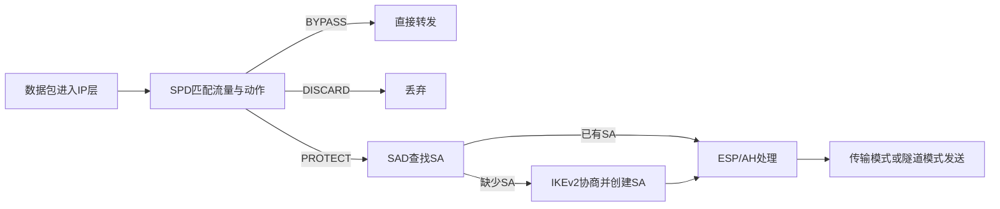
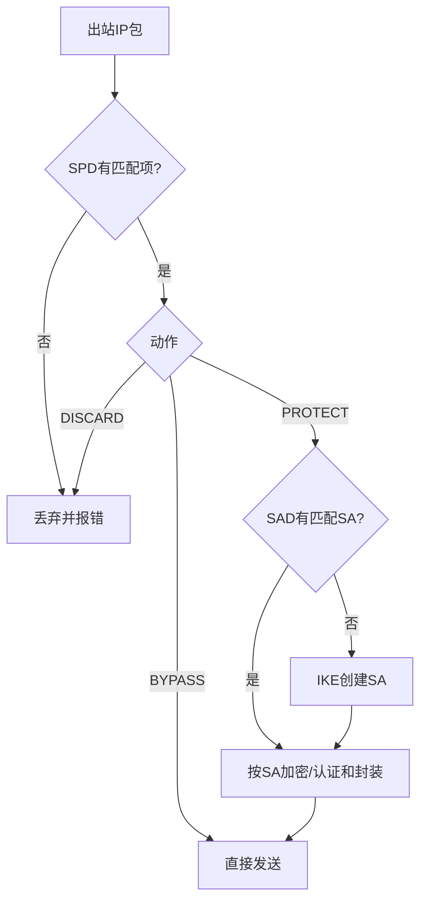
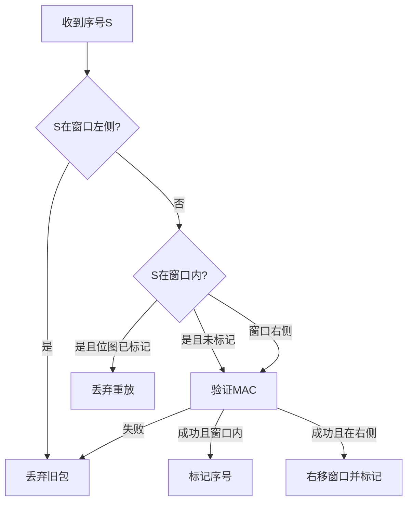

# 第20章 IP安全 - 导学讲义

## 本章导学

### 学习目标

1. 解释IPsec为何能在不修改应用的情况下保护IP层流量。
2. 掌握SA的单向性及其三元组标识。
3. 区分安全策略数据库SPD和安全关联数据库SAD。
4. 按步骤分析出站与入站IPsec数据包处理。
5. 读懂ESP字段、加密/认证范围、填充和反重放窗口。
6. 比较传输模式和隧道模式的保护对象、端点和应用场景。
7. 理解传输邻接、隧道迭代和四类SA组合。
8. 说明IKEv2如何协商算法、完成认证、建立IKE SA和IPsec SA。

### 核心问题

- 为什么一条双向安全通信至少需要两个SA？
- SPD和SAD分别回答什么问题？SPI为什么只有本地意义？
- ESP的哪些字段被加密，哪些字段被认证？
- IP无序且可能丢包，反重放窗口怎样既拒绝旧包又容忍乱序？
- 传输模式和隧道模式为什么适合不同部署位置？
- IKEv2的前两条消息与后两条消息分别建立什么信任？

### 为什么需要学习IPsec

应用层协议只能保护采用它们的特定应用。IPsec位于IP层，可按管理员策略保护远程登录、文件传输、邮件、Web等各种上层流量。它常用于站点到站点VPN、远程访问VPN、合作伙伴外连网和应用安全的纵深增强。

### 全章主线

## 20.1 IP安全概述

### 20.1.1 IPsec的应用

| 场景 | 部署方式 | 价值 |
| --- | --- | --- |
| 分支机构互连 | 两端安全网关建立隧道 | 以公共网络实现站点到站点VPN |
| 远程访问 | 用户主机到企业网关建立隧道 | 远程用户安全访问内网 |
| 合作伙伴外连网 | 企业边界之间受控保护 | 认证、保密和密钥交换 |
| 电子商务增强 | IP层叠加保护 | 为管理员指定的流量统一加密/认证 |

IP级安全的三项核心是认证、保密性和密钥管理。认证既确认数据源，也检测传输篡改；保密性阻止窃听；密钥管理负责安全建立和更新密钥。

### 20.1.2 IPsec文档

| 类别 | 作用 |
| --- | --- |
| 架构 | 定义安全需求、概念和处理框架；RFC 4301 |
| AH | 认证扩展头；RFC 4302；教材指出新应用不建议使用 |
| ESP | 加密或加密/认证组合；RFC 4303 |
| IKE | 协商SA和自动密钥管理；IKEv2见RFC 7296 |
| 密码算法 | 定义加密、认证、PRF和密钥交换算法 |

### 20.1.3 IPsec服务

IPsec提供访问控制、拒绝重放、无连接完整性、保密性、数据源认证和有限流量保密性。具体能否得到某项服务，取决于所选协议、算法、SA选项和部署位置。

> [!WARNING] 常见误区
> IPsec不是“默认加密所有IP包”。SPD可让流量绕过、丢弃或受保护；ESP也可以只做认证而不做加密，具体由SA决定。

## 20.2 IP安全策略

![[attachments/fig_20_1_pdf438.png]]

*图20.1：SPD决定流量应如何处理；SAD保存已建立SA的具体状态；IKE在需要时建立IKE SA和IPsec SA。*

### 20.2.1 安全关联

安全关联（SA）是从发送方到接收方的**单向逻辑连接**。双向通信需要两个方向独立的SA，因为两个方向的序号、密钥、SPI和生命周期可不同。

一个SA由三元组唯一标识：

$$
(\text{SPI},\ \text{目的IP地址},\ \text{安全协议标识})
$$

- SPI：32位、由接收端选取、只有本地意义，用于在接收端定位SA；
- 目的IP地址：SA的目的端点；
- 协议标识：区分AH或ESP。

### 20.2.2 安全关联数据库

SAD中的每个条目描述一个已建立SA的“运行状态”。

| 参数 | 作用 |
| --- | --- |
| SPI | 入站定位SA；出站写入AH/ESP头 |
| 序号计数器/溢出标志 | 生成单调递增序号；溢出时停止SA |
| 反重放窗口 | 记录哪些序号已通过认证 |
| AH/ESP信息 | 算法、密钥、IV、密钥生命期等 |
| SA生命期 | 按时间或字节数触发替换/终止 |
| 协议模式 | 传输、隧道或通配 |
| 路径MTU | 控制无需分段的数据包大小 |

### 20.2.3 安全性策略数据库

SPD通过选择器描述流量子集，再为其指定`BYPASS`、`DISCARD`或`PROTECT`。选择器包括远程/本地IP、下一层协议、操作系统用户名称、本地/远程端口。

教材表20.1的思想是按顺序匹配规则：IKE UDP 500和ICMP错误可绕过；内联网或特定HTTP服务器流量用ESP保护；已由TLS保护的443流量可避免双重加密；未授权的DMZ流量丢弃；其余因特网流量绕过。

**一句话区分**：SPD回答“这类包要不要保护、用哪个SA”；SAD回答“这个SA具体用什么密钥、算法、序号和模式”。

### 20.2.4 IP流量处理

![[attachments/fig_20_2_pdf440.png]]

*图20.2：出站处理先查SPD；PROTECT但无匹配SA时调用IKE；随后按SAD执行ESP/AH。*

![[attachments/fig_20_3_pdf440.png]]

*图20.3：入站先辨认普通IP、AH或ESP；安全包必须匹配SAD并通过处理，普通包还要符合SPD允许绕过的策略。*

入站包不能因为“没有ESP头”就默认放行。如果SPD要求该流量必须受保护，收到明文包应丢弃；这防止攻击者通过去掉安全封装来绕过策略。

## 20.3 封装安全净荷

ESP可提供保密性、数据源认证、无连接完整性、反重放和有限流量保密性。认证加密算法如GCM可在一种变换中同时提供加密和完整性。

### 20.3.1 ESP格式

![[attachments/fig_20_4_pdf441.png]]

*图20.4：ESP由SPI、序号、可变净荷、填充、填充长度、下一个头部和可选ICV组成；IV和TFC填充按算法/模式出现。*

| 字段 | 位数/长度 | 作用 |
| --- | --- | --- |
| SPI | 32位 | 标识SA |
| 序号 | 32位 | 单调递增，用于反重放 |
| 净荷数据 | 可变 | 传输层段或整个内部IP包 |
| 填充 | 0～255字节 | 分组对齐、32位对齐、长度隐藏 |
| 填充长度 | 8位 | 填充字节数 |
| 下一个头部 | 8位 | 指明封装内容类型 |
| ICV | 可变 | 完整性检查值 |

### 20.3.2 加密和认证算法

加密覆盖净荷数据、填充、填充长度和下一个头部。显式IV通常位于净荷数据开头且不加密。ICV在加密后计算，覆盖ESP头部和密文但不覆盖ICV自身。先验密文完整性可让接收方在昂贵解密前拒绝伪造包，并支持并行处理。

### 20.3.3 填充

填充有三种目的：满足分组密码输入长度、让ESP尾部和密文满足32位对齐、隐藏实际净荷长度以提供有限流量保密性。不要把“为了分组对齐”当成唯一答案。

### 20.3.4 反重放服务

发送方建立SA时把计数器置0，首包序号为1。启用反重放时，达到$2^{32}-1$后不得回绕，必须建立新SA。

![[attachments/fig_20_5_pdf443.png]]

*图20.5：窗口右边缘N是已认证的最大序号，位图记录窗口内哪些序号已收到。*

窗口容忍乱序但不容忍重复：在窗口内不代表自动接收，还要检查位图并验证MAC。

### 20.3.5 传输和隧道模式

![[attachments/fig_20_6_pdf443.png]]

*图20.6：传输模式保护原IP包的净荷；隧道模式把整个原IP包作为新外部IP包的净荷。*

![[attachments/fig_20_7_pdf444.png]]

*图20.7：端到端传输模式中，中间路由器仍读取原IP头，目的主机按SPI处理ESP。*

| 对比 | 传输模式 | 隧道模式 |
| --- | --- | --- |
| 保护对象 | IP净荷及ESP尾部 | 整个内部IP数据包 |
| 新外部IP头 | 无 | 有 |
| 常见端点 | 主机到主机 | 网关到网关、主机到网关 |
| 中间路由可见 | 原始源/目的IP | 只见隧道端点地址 |
| 优点 | 开销较小、端到端 | 隐藏内部地址、集中部署、支持VPN |

![[attachments/fig_20_8_pdf445.png]]

*图20.8：站点到站点VPN由边界设备建立ESP隧道，内部主机可不实现IPsec；远程用户主机则需实现IPsec。*

![[attachments/fig_20_9_pdf446.png]]

*图20.9：IPv4/IPv6中传输模式与隧道模式的协议层次。*

生活类比：传输模式像把信的正文放入保密袋但保留原信封；隧道模式像把原信封连同正文整体装进另一个外层信封，路上只看得到隧道两端。

## 20.4 组合安全关联

一个SA只能对应AH或ESP。需要组合多种服务或在不同端点分层保护时，要使用SA束。

- **传输邻接**：不建立隧道，对同一IP包依次应用多个安全协议；
- **隧道迭代**：通过多个起止点不同的隧道嵌套安全协议。

### 20.4.1 认证和保密性

| 方案 | 处理顺序 | 覆盖特点 |
| --- | --- | --- |
| 带认证ESP | 加密后计算ICV | 认证密文和ESP头；传输模式不认证原IP头 |
| ESP后AH传输邻接 | 内层ESP加密，外层AH认证 | 认证密文，并覆盖原IP头不可变/可预测部分；开销更大 |
| AH传输 + ESP隧道 | 先认证内部包，再整体加密 | 认证信息也被加密，可在解密后保存明文认证证据 |

### 20.4.2 安全关联的基本组合

![[attachments/fig_20_10_pdf448.png]]

*图20.10：四种基本部署是主机到主机、网关到网关、网关隧道叠加端到端保护、远程主机到企业网关并可继续端到端保护。*

1. 主机到主机：可用传输/隧道AH或ESP，也可组合。
2. 网关到网关：主机不实现IPsec，单一隧道SA形成VPN。
3. 网关隧道 + 端到端：站点统一保护上再给特定应用/用户加一层主机SA。
4. 远程主机到网关：远程访问隧道，必要时再到内网主机建立端到端SA。

## 20.5 因特网密钥交换

手工密钥管理适合小型静态环境；自动管理可按需为大规模系统创建和更新SA。教材用Oakley表示强化的Diffie-Hellman密钥确定思想，用ISAKMP表示协商格式和框架；IKEv2把这些功能整合为实际协议。

### 20.5.1 密钥确定协议

Diffie-Hellman共享密钥为：

$$
K=(Y_B)^{X_A}\bmod q=(Y_A)^{X_B}\bmod q=\alpha^{X_AX_B}\bmod q
$$

裸DH不提供身份认证，易遭中间人攻击；大量伪造请求还可诱导受害者执行昂贵模幂运算。IKE增加cookie/抗阻塞思想、DH参数协商、时变值、DH公钥交换和交换认证。

#### IKEv2初始交换

![[attachments/fig_20_11_pdf451.png]]

*图20.11：前两条消息协商算法、交换DH值和时变值，建立IKE SA；后两条加密消息相互认证并建立第一个IPsec CHILD SA。*

| 交换 | 主要内容 | 结果 |
| --- | --- | --- |
| IKE_SA_INIT | `SAi1/SAr1`、`KEi/KEr`、`Ni/Nr` | 协商密码套件和DH秘密，建立保护后续交换的IKE SA |
| IKE_AUTH | `ID`、可选证书、`AUTH`、`SAi2/SAr2`、`TSi/TSr` | 相互认证，建立第一个IPsec SA |
| CREATE_CHILD_SA | 新SA、时变值、可选新DH和选择器 | 新建或更新CHILD SA |
| INFORMATIONAL | 通知、删除、配置等 | 管理SA和报告状态/错误 |

### 20.5.2 头部和净荷格式

![[attachments/fig_20_12_pdf452.png]]

*图20.12：IKE头部标识IKE SA、版本、交换类型、消息ID和长度；每个净荷再以通用净荷头连接。*

IKE头部包括发起者/响应者SPI、下一个净荷、版本、交换类型、标志、消息ID和总长度。通用净荷头中的“临界”位决定接收方不认识该净荷时是跳过还是拒绝整条消息。

| 净荷 | 作用 |
| --- | --- |
| SA | 携带建议、协议、变换和属性 |
| KE | DH组号和[密钥交换](<../../../../../Course Notes/密码学 (Cipher)/Key Management and the Public-Key Revolution/Key Management and the Public-Key Revolution.md>)数据 |
| ID / CERT / CERTREQ / AUTH | 身份、证书、证书请求和认证 |
| Nonce | 防重放并参与[[密钥派生]] |
| Notify / Delete | 状态、错误和删除SA |
| TS | 标识由IPsec保护的流量范围 |
| Encrypted | 加密封装其他IKE净荷 |
| Configuration / EAP | 配置交换和扩展认证 |

## 易混淆点与记忆技巧

1. **SA单向，双向成对**。
2. **SPD管政策，SAD管状态，SPI找状态**。
3. **传输护净荷，隧道包全包**。
4. **ESP头不加密，ESP尾被加密；认证覆盖ESP头和密文，不覆盖外层IP头与ICV自身**。
5. **IKE SA保护控制交换，CHILD SA保护实际IP流量**。

## 与前后章节的联系

- 第7章的工作模式和第12章的MAC/AEAD用于ESP变换。
- 第10、14、15章的DH、证书和[[Course Notes/密码学 (Cipher)/Key Management and the Public-Key Revolution/Key Management and the Public-Key Revolution|密钥管理]]是IKE认证与密钥确定基础。
- 第17章[[Course Notes/Web隐私与安全（Security and Privacy of Web）/06-HTTPS与TLS/06-HTTPS与TLS|TLS]]位于传输层之上，通常按连接/应用保护；IPsec位于网络层，对应用透明。
- 第21章端点安全强调主机自身防护，IPsec不能替代终端防恶意软件和访问控制。

## 学习建议

1. 用同一个数据包分别走一次出站和入站流程。
2. 画出传输模式、隧道模式及“ESP后AH”和“AH后ESP隧道”四个结构。
3. 做反重放题时固定写出窗口边界、位图状态、MAC结果三个条件。
4. 背IKE参数时不要死记缩写，按“协商算法 → DH/时变值 → 身份认证 → 流量选择器”理解。
