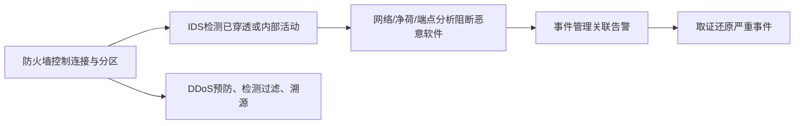

# 第21章 网络端点安全 - 导学讲义

## 本章导学

### 学习目标

1. 说明防火墙在纵深防御中的位置、目标、能力和限制。
2. 比较数据包过滤、状态检查、应用层网关和电路层网关。
3. 解释DMZ、外部防火墙和内部防火墙的分区逻辑。
4. 掌握IDS的传感器、分析器、用户接口及两种检测方法。
5. 比较HIDS和NIDS的可见范围、优势和部署位置。
6. 区分八类恶意软件，并理解五类恶意软件防御要素。
7. 分析SYN洪泛、直接式和反射式DDoS的机制。
8. 说明DDoS攻击前、攻击中、攻击后的三道防线。

### 核心问题

- 防火墙为什么不能成为唯一安全边界？
- “允许TCP高端口返回流量”为什么会制造入站漏洞？
- 误用检测和异常检测为何分别面临未知攻击与误报问题？
- HIDS看到的进程/文件事实与NIDS看到的网络流量有何互补？
- 恶意软件防御为什么必须贯穿网络、净荷、端点、事件和取证？
- DDoS为何不能只靠目标服务器本地过滤解决？

### 全章主线

## 21.1 防火墙

防火墙把网络边界变成受控阻止点，集中执行访问策略、审计和告警。它是主机安全和IDS的补充，不是替代品。

### 21.1.1 防火墙的特征

#### 三个设计目标

1. 内外流量必须全部经过防火墙；
2. 只允许本地安全策略授权的流量；
3. 防火墙自身必须抗渗透、运行在可信系统上。

#### 四种控制

| 控制 | 问题 |
| --- | --- |
| 服务控制 | 哪些服务可以进出 |
| 方向控制 | 服务可由哪个方向发起 |
| 用户控制 | 哪些用户可访问服务 |
| 行为控制 | 服务允许怎样使用，如邮件过滤 |

防火墙可形成统一阻止点、监控点、NAT/网络管理平台和VPN平台。其边界也很明确：无法防御绕过防火墙的链路、内部人员、跨分区无线通信，以及在外部感染后带回内网的设备。

### 21.1.2 防火墙的类型

![[attachments/fig_21_1_pdf457.png]]

*图21.1：数据包过滤、状态检查、应用层网关和电路层网关检查的层次及连接方式不同。*

#### 数据包过滤防火墙

按源/目的IP、源/目的端口、IP协议和接口逐包匹配规则。规则自上而下，首项匹配；无匹配时应用默认策略。

| 默认策略 | 安全性 | 运维特点 |
| --- | --- | --- |
| 默认丢弃 | 更保守 | 服务必须逐项放行，容易显式发现策略需求 |
| 默认转发 | 更易用 | 新威胁出现时管理员必须及时补充拒绝规则 |

![[attachments/fig_21_2_pdf458.png]]

*图21.2：示例规则说明端口过滤、ACK检查和FTP动态端口带来的策略难题。*

数据包过滤简单、快速、对用户透明，但看不到应用语义，日志和用户认证能力有限，容易受IP欺骗、源路由、极小分片和配置错误影响。

| 攻击 | 机制 | 对策 |
| --- | --- | --- |
| IP地址欺骗 | 外部包伪装内部源地址 | 外部接口丢弃源地址属于内部网的包 |
| 源路由 | 发送者指定路径以绕过控制 | 丢弃使用源路由选项的数据包 |
| 极小数据段 | 把TCP头关键字段放入后续分片 | 要求首片含最小TCP头；缓存/重组并统一过滤 |

#### 状态检查防火墙

它在逐包字段之外维护连接目录，只允许与已建立/允许连接状态匹配的返回流量。这样不必向所有外部主机无条件开放内部高端口。有些实现还跟踪TCP序号或理解FTP、SIP等协议的关联连接。

#### 应用层网关

应用代理终止客户端连接，再建立到服务器的第二条连接，理解应用命令，可执行细粒度策略、用户认证和完整日志。缺点是每种应用都需代理实现，双连接检查带来处理开销。

#### 电路层网关

同样建立两个TCP连接，但连接建立后通常只中继TCP段，不检查内容。适合信任内部用户、主要控制连接建立的场景，开销低于应用代理，应用语义控制也更弱。

#### 易混淆对比

| 类型 | 记忆状态 | 检查净荷 | 终止连接 |
| --- | --- | --- | --- |
| 数据包过滤 | 否 | 否 | 否 |
| 状态检查 | 是 | 通常否/有限 | 否 |
| 应用层网关 | 是 | 是，理解应用 | 是，两段连接 |
| 电路层网关 | 是 | 建立后通常不检查 | 是，两段连接 |

### 21.1.3 DMZ网络

![[attachments/fig_21_3_pdf461.png]]

*图21.3：DMZ位于外部与内部防火墙之间，承载需要被外部访问但不应直接进入内部网的Web、邮件和DNS服务器。*

外部防火墙保护DMZ并提供基本边界控制；内部防火墙采用更严格规则保护内部服务器/工作站，同时在DMZ和内部网之间双向隔离。多个内部防火墙还可把服务器、工作站和业务区彼此隔离。

生活类比：DMZ像办公楼的接待大厅。访客可进入大厅办理业务，但不能因此直接进入档案室；大厅内设备若被攻陷，也不能自动获得内部权限。

## 21.2 入侵检测系统

入侵是违反安全策略并影响保密性、完整性或可用性的行为。IDS收集并分析主机或网络事件，实时或近实时发现未授权访问并告警。

| 逻辑组件 | 职责 |
| --- | --- |
| 传感器 | 收集数据包、日志、系统调用等证据 |
| 分析器 | 从一个或多个传感器判断是否入侵并给出证据/响应建议 |
| 用户接口 | 显示输出、管理和控制IDS |

### 21.2.1 基本原理

早期检测能减少损失并加速恢复；有效IDS具有威慑作用；检测记录还能揭示攻击技术，反过来改进预防措施。

### 21.2.2 入侵检测方法

![[attachments/fig_21_4_pdf462.png]]

*图21.4：误用检测匹配已知攻击规则；异常检测寻找偏离正常行为的活动。*

| 方法 | 优点 | 缺点 |
| --- | --- | --- |
| 误用检测 | 已知攻击准确度高、误报少 | 难发现没有签名的新攻击 |
| 异常检测 | 可发现未知攻击 | 正常与攻击行为重叠，需在误报与漏报间折中 |

![[attachments/fig_21_5_pdf463.png]]

*图21.5：降低判定阈值可抓住更多入侵但增加误报；提高阈值减少误报但增加漏报。*

**误报**：正常活动被报警；**漏报**：入侵发生却未报警。只报告“准确率”会掩盖低基率下的判断问题，应结合入侵先验率、误报率和漏报率理解告警可信度。

### 21.2.3 基于主机的入侵检测技术

HIDS监控单台主机的进程、账号、文件和系统调用，能看到攻击的实际结果，也能检测内部授权用户的越权。常用异常策略包括事件频率阈值和每用户活动配置文件。

### 21.2.4 基于网络的入侵检测系统

NIDS以混杂模式捕获所在网段流量，分析网络、传输和应用协议。它只能看到传感器所在网段，因此需在关键节点布置多个传感器。

| 签名 | 检测对象 |
| --- | --- |
| 字符串签名 | 攻击文本串或复合关键词 |
| 端口签名 | 对未使用或高风险端口的异常访问 |
| 头部签名 | SYN+FIN等危险/不合逻辑字段组合 |

![[attachments/fig_21_6_pdf464.png]]

*图21.6：传感器可放在主防火墙外、DMZ、内部防火墙后骨干网，以及特定用户/服务器局域网。*

| 位置 | 主要观察价值 |
| --- | --- |
| 外部防火墙外 | 了解企业面对的总体威胁 |
| DMZ | 观察针对公开服务的渗透 |
| 内部骨干 | 观察已穿透边界或内部攻击 |
| 用户/服务器LAN | 观察特定网段和内部横向活动 |

## 21.3 恶意软件

### 21.3.1 恶意软件的类型

| 类型 | 核心特征 |
| --- | --- |
| 病毒 | 自复制并附着宿主程序，通常需宿主执行传播 |
| 蠕虫 | 独立、自复制、借网络自动传播 |
| 特洛伊木马 | 外观合法，隐藏恶意功能并利用调用者权限 |
| 间谍软件 | 秘密安装并收集个人/企业信息 |
| Rootkit | 隐藏入侵活动并维持根级访问 |
| 后门 | 绕过安全控制的秘密访问途径 |
| 移动代码 | 脚本、宏等跨异构平台执行的可移植指令 |
| 僵尸 | 接收远程控制并代表攻击者发起攻击；群体构成僵尸网络 |

### 21.3.2 恶意软件防御

![[attachments/fig_21_7_pdf466.png]]

*图21.7：防御横跨网络流量分析、净荷分析、端点行为分析、事件管理和取证。*

| 要素 | 观察对象 | 典型方法 |
| --- | --- | --- |
| 网络流量分析 | 流量大小、方向、连接、DNS等模式 | 签名、异常基线、DDoS/僵尸网络迹象 |
| 净荷分析 | 数据包中的应用内容 | 恶意签名、异常内容、沙箱 |
| 端点行为分析 | 进程、应用、文件、系统行为 | 杀毒、白名单、容器隔离 |
| 事件管理 | 多设备日志与告警 | 收集、聚合、规范化、关联、警报、合规报告 |
| 取证 | 严重事件证据 | 识别、收集、检查、分析并维持完整性和监管链 |

前三项偏实时/近实时检测和阻断；事件管理与取证把攻击后的事实转化为改进控制、签名和行为基线的依据。

## 21.4 分布式拒绝服务攻击

### 21.4.1 DDoS攻击描述

![[attachments/fig_21_8_pdf468.png]]

*图21.8：SYN洪泛消耗服务器半开连接状态；反射洪泛消耗目标网络带宽。*

SYN洪泛：大量伪造源地址的SYN让服务器为半开连接保存状态，耗尽内部资源。反射洪泛：僵尸把目标地址伪装为请求源，反射器把大量响应发给目标，耗尽传输能力。

![[attachments/fig_21_9_part1_pdf468.png]]

*图21.9(a)：直接式DDoS由攻击者控制主僵尸，再控制大量从僵尸直接攻击目标。*

![[attachments/fig_21_9_part2_pdf469.png]]

*图21.9(b)：反射式DDoS再加入未感染反射器，使攻击来源更分散、流量更大、溯源更难。*

### 21.4.2 构建攻击网络

攻击者需要DDoS软件、广泛存在的未修补漏洞和发现脆弱主机的扫描策略。

| 扫描 | 特点 |
| --- | --- |
| 随机扫描 | 各感染主机随机探测地址，流量大、易造成早期破坏 |
| 攻击列表 | 先收集脆弱主机列表，再分片快速感染，隐蔽准备成本高 |
| 局部扫描 | 使用感染主机已有信息寻找更多目标 |
| 局域子网扫描 | 突破边界后利用内部地址结构横向感染 |

### 21.4.3 DDoS防御策略

1. 攻击前：资源配额、后备资源、协议与系统加固，预防和抢占；
2. 攻击中：检测流量/行为模式，尽早过滤；
3. 攻击中及攻击后：追踪、识别来源，为缓解和后续预防提供依据。

> [!IMPORTANT] 保护位置
> 当目标接入链路已经被淹没时，目标本地丢包也无法恢复带宽。有效缓解常需在上游网络、服务提供商或分布式清洗节点更靠近流量源处完成。

## 易混淆点与记忆技巧

1. **过滤器看包，状态墙看连接，应用代理看命令，电路代理只接线**。
2. **DMZ可被访问，不等于被信任**。
3. **误用认旧招，异常找偏离**。
4. **HIDS看主机结果，NIDS看网段流量**。
5. **病毒依附宿主，蠕虫独立传播，僵尸接受控制**。

## 与前后章节的联系

- 第18章的无线与移动端点说明边界可能被绕过。
- 第19章邮件认证和安全网关可与应用层防火墙/DLP配合。
- 第20章IPsec保护通信，但不能判断端点是否已被恶意软件控制。
- 第22章云环境把防火墙、IDS和事件管理扩展到虚拟化与多租户边界。

## 学习建议

1. 防火墙规则题始终按“方向、五元组、状态/ACK、首项匹配”逐包走表。
2. 异常检测题同时写出先验率、条件检测率和后验概率，避免忽视基率。
3. 画DMZ时明确三类区：因特网、DMZ、内部网，以及每道防火墙的方向性规则。
4. DDoS分析先判断消耗的是主机状态还是链路带宽，再选择防御位置。
