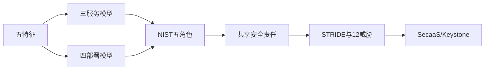

# 第22章 云计算 - 复习笔记

## 本章复习

### 核心链路

## 22.1 云计算

### 22.1.1 云计算元素

五特征：广泛网络接入、快速可伸缩性、计量服务、按需自助服务、资源池化。

![[attachments/fig_22_1_pdf475.png]]

*图22.1：五特征、三服务、四部署。*

### 22.1.2 云服务模型

![[attachments/fig_22_2_pdf476.png]]

*图22.2：SaaS/PaaS/IaaS职责分离。*

| 模型 | 用户控制 |
| --- | --- |
| SaaS | 数据、账号和有限应用配置 |
| PaaS | 自建应用和数据 |
| IaaS | OS、应用、数据、部分网络控制 |

控制越多，用户补丁、配置和安全责任越大。

### 22.1.3 云部署模型

![[attachments/fig_22_3_pdf477.png]]

*图22.3：公有云多租户隔离。*

![[attachments/fig_22_4_pdf478.png]]

*图22.4：内部或外包专用私有云。*

| 模型 | 关键词 |
| --- | --- |
| 公有 | 公众、多租户、低成本、高伸缩 |
| 私有 | 单企业专用、控制强、成本高 |
| 社区 | 类似需求机构共享、受控交换 |
| 混合 | 多云保持独立但绑定，支持数据/应用便携 |

### 22.1.4 云计算参考架构

![[attachments/fig_22_5_pdf479.png]]

*图22.5：CSC、CSP、审计者、经销商、承载商。*

![[attachments/fig_22_6_pdf480.png]]

*图22.6：五角色与三类网络交互。*

经销商：服务中介、固定聚合、动态套利。参考架构描述“什么”，不是具体实现“怎么做”。

## 22.2 云安全的概念

关注管理、合规、可信、架构、IAM、软件隔离、数据保护、可用性和应急响应。责任由CSC、CSP和第三方按服务栈共享；企业上云后仍对安全与隐私策略负责。

## 22.3 云安全风险与对策

### 22.3.1 STRIDE威胁模型

| S | T | R | I | D | E |
| --- | --- | --- | --- | --- | --- |
| 身份欺骗 | 篡改 | 抵赖 | 信息泄露 | 拒绝服务 | 提升权限 |
| 认证 | 完整性 | 不可抵赖 | 保密性 | 可用性 | 授权 |

### 22.3.2 数据泄露

静止、传输、使用中保护；访问控制；客户端加密且不向CSP交密钥。

### 22.3.3 弱身份、凭证和访问管理

身份提供/撤销、强认证、授权、联邦、审计和最小权限。

### 22.3.4 不安全的API

安全模型、强认证/授权、传输加密、监控和依赖链。

### 22.3.5 系统漏洞

持续风险分析、漏洞检测、补丁和人员培训。

### 22.3.6 账号劫持

禁共享凭证、双因素认证、主动监测、明确SLA。

### 22.3.7 恶意的内部人员

供应链评估、合同人力要求、透明控制、漏洞报告流程。

### 22.3.8 高级持续威胁

![[attachments/fig_22_7_pdf486.png]]

*图22.7：威胁情报缩短APT发现和补救时间。*

研究→初始攻击→立足→持久→侦察→横向→提权→收集/加密→外传→长期存在。

### 22.3.9 数据丢失

定期备份、地理冗余、验证恢复和最新副本。

### 22.3.10 尽职调查不足

核实基础设施、认证合规、CSP持续尽职和数据保护；审查合同。

### 22.3.11 滥用及恶意使用云服务

加强注册、信用卡欺诈检查、流量监控和公共黑名单。

### 22.3.12 拒绝服务

持续威胁情报和自动化核心服务保护。

### 22.3.13 共享技术中的漏洞

VM隔离并非充分条件；安全配置、变更监控、强管理认证、及时补丁、扫描和审计。

## 22.4 云安全即服务

![[attachments/fig_22_8_pdf488.png]]

*图22.8：SecaaS服务类别。*

IAM、DLP、Web安全、邮件安全、安全评估、入侵管理、SIEM、加密、业务连续性/灾难恢复、网络安全。

## 22.5 开源云安全模块

Keystone：身份、令牌、服务目录、策略。

![[attachments/fig_22_9_pdf490.png]]

*图22.9：Keystone协调认证；Nova管理计算，Glance管理镜像，Swift管理对象存储。*

## 关键词索引

`CSC`、`CSP`、`IaaS`、`Keystone`、`OpenStack`、`PaaS`、`SaaS`、`SecaaS`、`STRIDE`、`云审计者`、`云承载商`、`云经销商`、`公有云`、`私有云`、`社区云`、`混合云`、`共享责任`、`多租户`。

## 教材内容与补充理解

> [!NOTE] 教材内容
> 特征、模型、角色、风险和OpenStack模块均按第22章整理。

> [!TIP] 补充理解
> 云安全的核心不是“位置在云”，而是控制权、可见性和责任被拆分。每个风险都应追问：谁能控制、谁能观察、谁最终负责。

## Related

- [[第十五章_密钥管理和分发_复习笔记]]
- [[第二十章_IP安全_复习笔记]]
- [[第二十一章_网络端点安全_复习笔记]]
- [[第二十三章_物联网安全_复习笔记]]
- [[第二十二章_云计算_教材原文]]
- [[第二十二章_云计算_导学讲义]]
- [[第二十二章_云计算_课后习题]]
