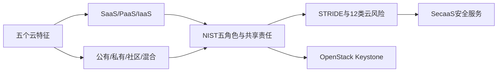

# 第22章 云计算 - 导学讲义

## 本章导学

### 学习目标

1. 用五个基本特征准确解释云计算，而不是把“远程服务器”都称为云。
2. 比较SaaS、PaaS和IaaS的用户控制范围与提供商责任。
3. 区分公有云、私有云、社区云和混合云。
4. 掌握NIST参考架构的五个角色及其交互。
5. 理解云中的共享责任、多租户、可审计性和可用性问题。
6. 用STRIDE分析云威胁，并掌握12类主要风险及对策。
7. 说明SecaaS的服务类别与责任转移边界。
8. 理解OpenStack Keystone的身份、令牌、服务目录和策略功能。

### 核心问题

- 云计算与普通托管服务器的本质差别是什么？
- 服务模型改变时，用户和CSP分别管理哪一层？
- 资源放到云上后，企业为什么仍对安全和隐私策略负责？
- 多租户隔离失败会怎样跨越客户边界？
- STRIDE是威胁分类，12类云风险又如何落到实际控制？
- SecaaS转移了操作责任，是否也转移了最终问责？

### 全章知识地图

## 22.1 云计算

### 22.1.1 云计算元素

云计算是对共享、可配置资源池进行无所不在、方便、按需的网络访问，并以最少管理交互快速配置和释放资源的模型。

![[attachments/fig_22_1_pdf475.png]]

*图22.1：云模型由五个基本特征、三个服务模型和四个部署模型组成。*

| 特征 | 本质 | 例子 |
| --- | --- | --- |
| 广泛网络接入 | 通过标准网络机制供多类客户端使用 | 手机、笔记本、其他云服务访问 |
| 快速可伸缩性 | 资源可随需求快速扩大或缩小 | 高峰增服务器，任务后释放 |
| 计量服务 | 自动度量、控制、报告资源使用 | 存储、处理、带宽、活跃账号计费 |
| 按需自助服务 | 用户无需逐次人工联系提供商即可配置 | 自助开通虚拟机/存储 |
| 资源池化 | 多租户共享资源，动态分配，位置相对独立 | 共享CPU、存储、带宽和VM |

记忆法：**网、弹、量、需、池**。

### 22.1.2 云服务模型

![[attachments/fig_22_2_pdf476.png]]

*图22.2：从SaaS到IaaS，用户控制逐层增加，同时运维和安全责任也增加。*

| 模型 | 用户获得 | 用户主要控制 | CSP主要控制 |
| --- | --- | --- | --- |
| SaaS | 可直接使用的云应用 | 业务数据、账号、部分应用配置 | 应用、运行时、OS、虚拟化、硬件 |
| PaaS | 开发和运行应用的平台 | 自建应用与数据 | 运行时、中间件、OS及基础设施 |
| IaaS | 计算、存储、网络和虚拟硬件 | OS、应用、数据，部分主机网络控制 | 物理设施、硬件、虚拟化底座 |

类比：SaaS像入住酒店直接使用房间；PaaS像租用配好设备的厨房制作产品；IaaS像租毛坯场地，内部系统由租户搭建。控制越多，自行加固、补丁和配置的责任越多。

### 22.1.3 云部署模型

![[attachments/fig_22_3_pdf477.png]]

*图22.3：公有云用多租户基础设施为不同企业隔离资源。*

![[attachments/fig_22_4_pdf478.png]]

*图22.4：私有云可在企业内部，也可由外部提供商用专用基础设施托管。*

| 模型 | 使用者与所有权 | 主要优势 | 主要权衡 |
| --- | --- | --- | --- |
| 公有云 | 面向公众/行业，多租户，由CSP运营 | 成本低、伸缩性高、专业能力强 | 控制、位置、SLA和隐私约束需核查 |
| 私有云 | 单一企业专用，可自管或外包 | 控制和安全性强、快速内部部署 | 成本高、伸缩受自有资源限制 |
| 社区云 | 需求相似的若干机构共享 | 合规/业务目标一致，成本分摊 | 规模和治理复杂度居中 |
| 混合云 | 两种以上独立云通过技术绑定 | 敏感数据留私有区，其他业务利用公有伸缩 | 数据/应用便携、策略一致性和接口复杂 |

**服务模型**回答“提供哪一层能力”，**部署模型**回答“谁使用、谁拥有、怎样隔离和管理”。二者是两个独立维度。

### 22.1.4 云计算参考架构

参考架构是用于讨论需求、结构和操作的高层概念模型，描述“需要什么”，不是某个具体产品“如何实现”。

![[attachments/fig_22_5_pdf479.png]]

*图22.5：NIST参考架构定义CSC、CSP、云审计者、云经销商和云承载商五个角色。*

| 角色 | 职责 |
| --- | --- |
| CSC | 与CSP建立商业关系并消费云服务 |
| CSP | 提供SaaS/PaaS/IaaS及相应处理、存储和接口 |
| 云审计者 | 独立评估安全、隐私、性能和控制合规性 |
| 云经销商 | 中介、聚合或套利多个云服务，管理交付关系 |
| 云承载商 | 提供CSC与CSP之间的连接和传输，支持SLA |

![[attachments/fig_22_6_pdf480.png]]

*图22.6：CSC可直接或经承载商/经销商取得服务，审计者独立收集证据；企业网、承载网和CSP数据中心网承担不同责任。*

经销商的三类支持：服务中介增加身份、性能或安全能力；服务聚合固定组合多种服务；服务套利动态选择最合适的服务来源。

## 22.2 云安全的概念

云迁移改变控制位置，不消除企业责任。安全通常由CSC、CSP和第三方共同承担：用户负责应用级和数据使用安全；CSP负责物理设施及其管理的软件/边界；中间软件栈可能共享责任。

| 关注域 | 关键问题 |
| --- | --- |
| 管理与合规 | 企业制度是否覆盖云生命周期；法律、数据位置、电子发现和合同是否满足 |
| 可信性与审计 | 能否看到CSP控制效果；数据所有权是否明确；能否持续监控 |
| 架构与隔离 | 多租户虚拟化和未虚拟化共享资源是否可靠隔离 |
| IAM | 认证、授权、身份生命周期和企业身份联邦是否可信 |
| 数据保护 | 静止、传输、使用中的数据与清除；密钥由谁掌握 |
| 可用性 | SLA、备份、恢复、灾难恢复和业务连续性 |
| 应急响应 | CSC/CSP如何协调、共享证据和履行通知责任 |

用户侧加密且密钥不交给CSP，可降低提供商或其他租户读取静态数据的风险，但不能防止数据被删除、服务不可用或密钥自身丢失。

> [!WARNING] 常见误区
> “CSP安全能力强”不等于“用户无需配置安全”。错误IAM、暴露API、公开存储桶和未修补IaaS操作系统仍可能由CSC负责。

## 22.3 云安全风险与对策

### 22.3.1 STRIDE威胁模型

| 字母 | 威胁 | 对应安全目标/控制 |
| --- | --- | --- |
| S | 身份欺骗 | 认证 |
| T | 篡改数据 | 完整性 |
| R | 抵赖 | 不可抵赖、审计证据 |
| I | 信息泄露 | 保密性 |
| D | 拒绝服务 | 可用性 |
| E | 提升权限 | 授权、最小权限 |

STRIDE用于系统地提问，并非控制清单：识别威胁后仍要结合资产、攻击面、责任和风险选择措施。

### 22.3.2 数据泄露

保护静止、传输和使用中的数据，控制访问；理想情形是客户端加密且CSP不持有密钥。多租户数据库依赖可靠的租户标签和访问控制。

### 22.3.3 弱身份、凭证和访问管理

IAM覆盖身份提供/撤销、认证、授权、策略和审计。应支持企业身份提供者交换属性，避免离职账号、共享凭证和过度授权长期存在。

### 22.3.4 不安全的API

API承载管理和服务交互，必须分析安全模型，结合强认证、访问控制、传输加密、活动监控，并理解第三方/组件依赖链。

### 22.3.5 系统漏洞

对OS和平台软件持续执行风险分析、漏洞扫描、补丁管理和人员培训；共享环境中的一个漏洞可能跨租户扩大影响。

### 22.3.6 账号劫持

攻击者窃取凭证后可读写数据、欺骗他人或攻击同一多租户环境。避免共享凭证，使用强双因素认证、主动监控并理解CSP策略/SLA。

### 22.3.7 恶意的内部人员

CSP管理员等高权限角色带来集中风险。对策包括供应链评估、合同化人力资源要求、控制透明度和明确的漏洞报告流程。

### 22.3.8 高级持续威胁

APT长期隐蔽访问，目标通常是窃取高价值数据。典型路径是研究→社会工程初始攻击→立足→持久化→侦察→横向移动→提权→收集加密→外传→长期维持。

![[attachments/fig_22_7_pdf486.png]]

*图22.7：威胁情报可在公开通告之前预警，或缩短发现和补救时间。*

### 22.3.9 数据丢失

意外/恶意删除数据和备份可造成永久丢失。应有定期备份、版本化、地理冗余，并验证恢复流程和最新副本可用性。

### 22.3.10 尽职调查不足

迁移前核实基础设施、认证/合规、CSP持续尽职证明和数据保护控制；审查合同、退出/迁移机制和灾难场景。

### 22.3.11 滥用及恶意使用云服务

低门槛注册和免费资源可被用于垃圾邮件、恶意代码和DoS。CSP加强注册/信用卡欺诈检查、流量监控和黑名单；CSC仍监控自身资源异常。

### 22.3.12 拒绝服务

持续威胁情报和自动化防护核心云服务；同时在SLA、容量、配额和多区域恢复上规划可用性。

### 22.3.13 共享技术中的漏洞

CPU缓存、GPU等底层组件未必具备强多租户隔离。VM隔离只是整体战略的一部分；还需安全配置、变更监控、强管理认证、SLA补丁、漏洞扫描和配置审计。

## 22.4 云安全即服务

SecaaS是通过云向云内基础设施/软件或用户内部系统提供安全应用与服务。

![[attachments/fig_22_8_pdf488.png]]

*图22.8：SecaaS覆盖身份、DLP、Web/邮件安全、评估、入侵、SIEM、加密、连续性和网络安全。*

| 服务 | 核心功能 |
| --- | --- |
| IAM | 认证、授权、身份生命周期 |
| DLP | 监视和保护静止、传输、使用中的数据 |
| Web/邮件安全 | 恶意软件、钓鱼、附件、访问和外发控制 |
| 安全评估 | 独立审计，CSP提供工具和接入点 |
| 入侵管理 | IDS检测、IPS阻断和响应 |
| SIEM | 汇聚真实/虚拟环境日志，关联、报告和告警 |
| 加密 | 数据、邮件、管理和身份信息加密及密钥管理 |
| 连续性/灾难恢复 | 冗余、故障转移、多地备份和恢复 |
| 网络安全 | 边界/服务器防火墙、DoS防护及资源访问监控 |

SecaaS可转移技术运行工作，但CSC仍要定义策略、确认合规、检查SLA和评估提供商效果。

## 22.5 开源云安全模块

OpenStack是支持创建和管理大规模虚拟专用服务器的开源云操作系统，提供多租户IaaS。Keystone是其共享安全服务模块。

| Keystone功能 | 作用 |
| --- | --- |
| 身份 | 认证用户，定义项目角色和权限，支持口令、LDAP、外部认证 |
| 令牌 | 认证后签发访问令牌，服务据此向Keystone验证 |
| 服务目录 | 注册服务端点，客户端查询应调用的端点 |
| 策略 | 各OpenStack服务通过策略文件定义资源访问级别 |

![[attachments/fig_22_9_pdf490.png]]

*图22.9：用户先从Keystone取得令牌和服务目录，再由Nova协调计算实例、Glance提供镜像、Swift提供对象存储。*

Nova管理虚拟机实例生命周期；Glance发现、注册和检索VM镜像；Swift是冗余、可扩展的分布式对象存储。Keystone不代替这些模块，而是提供统一身份与授权入口。

## 易混淆点与记忆技巧

1. **S/P/I是服务层，公私社混是部署权属**。
2. **CSC消费，CSP提供，审计者查，经销商组合，承载商连接**。
3. **上云不卸责，控制随模型分层**。
4. **S/T/R/I/D/E：骗、改、赖、泄、断、提权**。
5. **Keystone管身份入口，Nova管计算，Glance管镜像，Swift管对象**。

## 与前后章节的联系

- 第15章PKI与身份管理支撑云IAM和API认证。
- 第20章IPsec可保护CSC与CSP之间的专用连接。
- 第21章防火墙、IDS、SIEM、DLP和灾难恢复在SecaaS中被服务化。
- 第23章物联网设备常把计算和存储迁移到云，形成设备—网关—云的跨域安全责任。

## 学习建议

1. 为SaaS/PaaS/IaaS分别画“用户负责/提供商负责”分层图。
2. 将每个云风险映射到STRIDE字母、受影响资产、责任方和对策。
3. 做架构题先识别五种角色，再讨论连接、SLA、审计和数据流。
4. 把Keystone启动VM流程按“认证→令牌→目录→策略→调用服务”复述。
