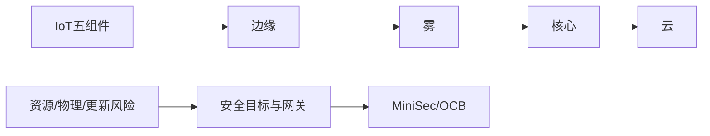

# 第23章 物联网安全 - 复习笔记

## 本章复习

## 23.1 物联网

### 23.1.1 物联网上的“物”

智能设备扩展互连，传感、通信并作用于物理环境；多数是低带宽、低频深度嵌入设备，也有视频等高带宽设备。

### 23.1.2 演化

IT设备→OT嵌入设备→个人无线设备→传感器/执行器单用途设备。

### 23.1.3 物联网设备的组件

![[attachments/fig_23_1_pdf492.png]]

*图23.1：传感器、执行器、微控制器、收发机、电源。*

RFID：标签保存标识，阅读器读取/改写并连接计算系统。

### 23.1.4 物联网与云环境

![[attachments/fig_23_2_pdf493.png]]

*图23.2：边缘—雾—核心—云。*

| 层 | 作用 |
| --- | --- |
| 边缘 | 设备、网关、协议转换、初步聚合 |
| 雾 | 近端估计、格式化、解码、减少、告警，低延迟 |
| 核心 | 高容量骨干、互连和冗余 |
| 云 | 集中存储、分析、设备管理应用 |

## 23.2 物联网安全的概念与目标

![[attachments/fig_23_3_pdf494.png]]

*图23.3：设备能力不同，安全区域不能跨网关自动延伸。*

### 23.2.1 物联网生态系统的独特特征

攻击面大、资源有限、生态复杂、标准碎片、快速广泛部署、集成困难、影响物理安全、低成本、人才不足、更新困难、不安全编程、责任不清。

### 23.2.2 物联网安全目标

限制逻辑接入、限制物理访问、防编程入侵、防数据修改、检测事件、逆境保持功能、事故后恢复。

### 23.2.3 防篡改和篡改检测

| 概念 | 定义 |
| --- | --- |
| 篡改 | 未授权修改并改变功能或降低安全性 |
| 防篡改 | 组件被动抵抗或留下可见证据 |
| 篡改检测 | 察觉非法物理访问 |

方法：钢壳/锁/封装、封条；开关、环境/电源传感器、柔性电路/电阻丝/光纤。

### 23.2.4 网关安全

![[attachments/fig_23_4_pdf497.png]]

*图23.4：访问标识、设备/应用认证、数据与隐私保护、诊断维护、更新和配置。*

### 23.2.5 物联网安全环境

![[attachments/fig_23_5_pdf498.png]]

*图23.5：访问控制、篡改保护、数据保护、网络安全跨越四层。*

## 23.3 一个开源物联网安全模块

MiniSec：TinyOS链路安全，提供保密性、身份验证、重放保护、弱新鲜度、低能耗和抗丢包。

### 23.3.1 加密算法

历史MiniSec采用80位Skipjack和OCB；80位强度通常不足，新设计应选现代轻量级算法。设备对之间使用唯一密钥。

### 23.3.2 操作模式

| MiniSec-U | MiniSec-B |
| --- | --- |
| 单播、每发送方同步计数器 | 广播、时间段$E_i$+布隆过滤器 |
| 拒绝相同/更小计数器 | 拒绝旧时间段和当前期已出现消息 |
| 丢包多时重同步 | 避免每发送方状态，扩展性强 |

### 23.3.3 偏移码本模式

![[attachments/fig_23_6_pdf500.png]]

*图23.6：OCB一次遍历生成密文和认证标签。*

$$
C[i]=E_K(M[i]\oplus Z[i])\oplus Z[i]
$$

$$
\begin{aligned}
L&=E_K(0^n),\quad R=E_K(N\oplus L)\\
L(i)&=2L(i-1)\\
Z[1]&=L\oplus R\\
Z[i]&=Z[i-1]\oplus L(\operatorname{ntz}(i))
\end{aligned}
$$

同一密钥下$N$必须每消息唯一；$N$无需保密。不同$Z[i]$使相同分组产生不同密文。

$$
\mathrm{Tag}=E_K(\mathrm{Checksum}\oplus Z[m])[\text{first }\tau\text{ bits}]
$$

![[attachments/fig_23_7_pdf501.png]]

*图23.7：验签通过后接受解密明文。*

$$
M[i]=D_K(C[i]\oplus Z[i])\oplus Z[i]
$$

## 关键词索引

`IoT`、`MiniSec-B`、`MiniSec-U`、`OCB`、`RFID`、`TinyOS`、`传感器`、`执行器`、`微控制器`、`收发机`、`边缘`、`雾计算`、`核心网络`、`漏洞修补`、`防篡改`、`篡改检测`、`网关安全`。

## 教材内容与补充理解

> [!NOTE] 教材内容
> 架构、目标、MiniSec机制和OCB公式按第23章整理。

> [!TIP] 补充理解
> IoT安全必须同时保护信息和物理过程。执行器攻击的后果可能超出数据CIA，安全降级和人工接管因而是核心设计目标。

## Related

- [[第七章_分组密码的工作模式_复习笔记]]
- [[第十二章_消息认证码_复习笔记]]
- [[第十四章_轻量级密码和后量子密码_复习笔记]]
- [[第十八章_无线网络安全_复习笔记]]
- [[第二十二章_云计算_复习笔记]]
- [[第二十三章_物联网安全_教材原文]]
- [[第二十三章_物联网安全_导学讲义]]
- [[第二十三章_物联网安全_课后习题]]
