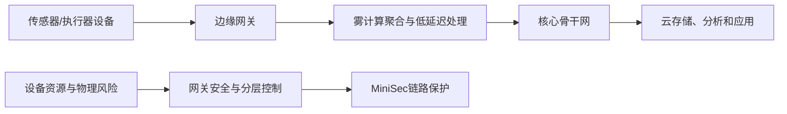

# 第23章 物联网安全 - 导学讲义

## 本章导学

### 学习目标

1. 解释物联网的范围及因特网四代终端演化。
2. 识别传感器、执行器、微控制器、收发机和电源五个设备组件。
3. 掌握边缘、雾、核心和云的处理位置与数据流。
4. 说明物联网生态系统在资源、规模、物理影响和更新方面的独特安全挑战。
5. 理解七类物联网安全目标及不利条件下的安全降级。
6. 区分防篡改与篡改检测，并列举实现方法。
7. 说明网关在认证、协议转换、数据保护、更新和审计中的作用。
8. 理解MiniSec-U、MiniSec-B和OCB[[Course Notes/密码学 (Cipher)/Message Authentication Codes(III)/Message Authentication Codes(III)|认证加密]]机制。

### 核心问题

- 物联网中的“物”为什么不仅是连上网的普通计算机？
- 为什么低功耗和低成本会直接限制可用安全控制？
- 雾计算为什么不是云计算的另一个名称？
- 网关建立了到云的安全连接后，设备到网关这一段是否也安全？
- MiniSec-U为何不适合大规模广播？MiniSec-B怎样减少每发送方状态？
- OCB怎样让相同明文分组产生不同密文并同时生成认证标签？

### 全章主线

## 23.1 物联网

### 23.1.1 物联网上的“物”

物联网是从大型家电到微型传感器等智能设备的扩展互连。设备通过短程移动收发机实现人与物、物与物通信，发送传感数据、作用于物理环境，并参与工厂、城市等更大系统的管理。

多数深度嵌入式设备低带宽、低频采集并间歇发包；摄像机、视频电话等也可能需要高带宽流媒体。不能用单一硬件能力概括所有IoT设备。

### 23.1.2 演化

| 代 | 终端 | 购买/管理者 | 连接 |
| --- | --- | --- | --- |
| IT | 计算机、服务器、路由器、防火墙 | IT部门 | 主要有线 |
| OT | 医疗设备、SCADA、过程控制、查询机 | OT部门 | 主要有线 |
| 个人技术 | 手机、平板、电子书阅读器 | 消费者/员工 | 多种无线 |
| 传感器/执行器 | 单用途嵌入式设备 | 消费者、IT、OT | 通常单一无线，属于更大系统 |

第四代以数十亿嵌入式设备为特征，形成物联网。

### 23.1.3 物联网设备的组件

![[attachments/fig_23_1_pdf492.png]]

*图23.1：物理量经传感器进入微控制器，控制器可驱动执行器，并由收发机通信、电源供能。*

| 组件 | 功能 | 安全含义 |
| --- | --- | --- |
| 传感器 | 把物理/化学/生物参数变成电子信号 | 假数据会污染决策 |
| 执行器 | 把控制信号作用于物理环境 | 被劫持可能造成现实伤害 |
| 微控制器 | 提供设备计算和控制“智能” | 固件、启动和权限是关键攻击面 |
| 收发机 | 以Wi-Fi、ZigBee等通信 | 窃听、重放、注入和干扰 |
| 电源 | 通常为电池 | 安全计算/通信消耗影响寿命，可遭耗电攻击 |

RFID标签保存可编程标识信息，阅读器在一定距离内读取或重写，并把结果交给计算机系统。RFID扩展了资产、人和动物跟踪能力，也带来未授权读取和跟踪隐私问题。

### 23.1.4 物联网与云环境

![[attachments/fig_23_2_pdf493.png]]

*图23.2：边缘设备和网关产生数据，雾在近端处理，核心互连区域，云集中存储和运行应用。*

#### 四层架构

| 层 | 位置与职责 |
| --- | --- |
| 边缘 | 传感器、执行器和网关；设备互联、协议转换和初步聚合 |
| 雾 | 靠近数据源；估计、格式化、扩展/解码、净化/减少、评估告警 |
| 核心 | 高性能路由器和大容量链路，互连分散雾网络并提供冗余/外网访问 |
| 云 | 集中存储、处理、分析以及设备交互/管理应用 |

#### 云与雾

| 对比 | 云 | 雾 |
| --- | --- | --- |
| 资源位置 | 中心 | 边缘附近 |
| 延迟 | 较高 | 较低 |
| 控制 | 集中/分层，完全控制倾向 | 分布式/分层，部分控制 |
| 设备规模 | 数千万/数亿 | 数十亿 |
| 内容生产者 | 人为主 | 设备/传感器为主 |
| 价值 | 大规模集中存储和分析 | 近端过滤、实时响应、减少带宽和隐私暴露 |

生活类比：云像中央研究院，适合长期积累和复杂分析；雾像现场实验室，先筛选异常并迅速响应，避免把每个原始样本都运回总部。

## 23.2 物联网安全的概念与目标

![[attachments/fig_23_3_pdf494.png]]

*图23.3：中央平台、网关、不受约束设备和受约束设备具有不同安全能力；网关到中心安全不能自动覆盖设备到网关。*

### 23.2.1 物联网生态系统的独特特征

| 特征 | 安全挑战 |
| --- | --- |
| 攻击面大 | 设备、协议、应用和数据数量巨大 |
| 资源有限 | 内存、CPU和电池限制先进安全控制 |
| 生态复杂 | 依赖、互连、云和多组织责任难评估 |
| 标准/法规碎片化 | 缺少统一全面指导 |
| 广泛快速部署 | 关键基础设施成为高价值目标，规划常不足 |
| 安全集成困难 | 协议、认证方案和利益方需求不一致 |
| 影响物理安全 | 执行器被控可伤害环境和人员 |
| 低成本压力 | 制造商和客户可能牺牲安全特性 |
| 缺乏专业知识 | 技术变化快、人才不足 |
| 更新困难 | 固件漏洞多、用户可能无法或不知道怎样修补 |
| 编程不安全 | 功能/上市速度优先于安全开发生命周期 |
| 责任不明确 | 多供应链和组件交互造成事故问责冲突 |

**漏洞修补**的关键不仅是存在补丁，还要能在现场条件下测试、可信分发、验证来源、快速部署并保证失败时可恢复。

### 23.2.2 物联网安全目标

1. 限制对IoT网络的逻辑接入：分层网络、网关/防火墙、独立凭据；
2. 限制网络和组件的物理访问：锁、读卡器、看守；
3. 防止组件被编程入侵：补丁、禁用端口、最小权限、审计、杀毒/完整性检查；
4. 防止传输和静止数据被未授权修改；
5. 尽早检测事件、故障、不可用服务和资源耗尽；
6. 不利条件下保持功能：冗余、故障隔离、从自动到人工的安全降级；
7. 事故后快速恢复：预先准备响应计划。

### 23.2.3 防篡改和篡改检测

- 篡改：未经授权修改并改变预期功能或降低安全性；
- 防篡改：组件提供被动物理保护；
- 篡改检测：让系统察觉非法物理访问。

| 方法 | 示例 |
| --- | --- |
| 物理加固 | 钢外壳、锁、安全螺栓、紧密封装/光纤包层 |
| 留下证据 | 防拆封条和胶带 |
| 开关 | 水银、磁性、压力触点检测开启/移动 |
| 传感器 | 温度、辐射、电压和功率异常 |
| 检测电路 | 柔性电路、电阻丝、光纤检测击穿 |

防篡改降低成功概率或留下痕迹；篡改检测还要把事件可靠报告，并定义擦除密钥、进入安全模式等响应。

### 23.2.4 网关安全

网关是受约束设备与高级网络的信任转换点，需支持设备访问标识、设备认证、与应用相互认证、静态/传输数据保护、隐私、自诊断/自修复/远程维护、固件软件更新和多种安全配置。

![[attachments/fig_23_4_pdf497.png]]

*图23.4：网关同时面对设备侧、应用侧和管理侧，需要认证、授权、数据保护、更新与审计。*

物联网总体要求还包括通信安全、数据管理安全、服务提供安全、策略/技术集成、相互认证和授权、安全审计。资源不足可能让某些设备无法加密本地数据，此时必须明确剩余风险，不能假设网关能回溯保护设备内部。

### 23.2.5 物联网安全环境

![[attachments/fig_23_5_pdf498.png]]

*图23.5：用户认证/访问控制、物理篡改保护、数据保护和网络安全分布于设备、雾、核心和云。*

RBAC把权限分配给角色，再根据职责把用户映射到角色，适合跨设备和数据管理访问。防篡改在设备/雾层尤其重要；数据保密和网络安全必须贯穿所有层。

## 23.3 一个开源物联网安全模块

MiniSec是TinyOS无线传感器网络的链路级安全模块，面向约48KB代码、10KB RAM等严格资源环境，提供保密性、身份验证和重放保护。

设计目标包括数据认证、保密性、重放保护、弱新鲜度、低能耗以及在高丢包环境下保持弹性。

### 23.3.1 加密算法

教材中的MiniSec使用80位密钥Skipjack，选择理由是代码/数据存储和加解密/密钥设置效率。但教材也明确指出80位密钥通常不安全，未来IoT模块应使用新型轻量级算法。学习时应区分“历史实现选择”和“当前强度建议”。

MiniSec为每对设备使用唯一密钥，并采用OCB操作模式。

### 23.3.2 操作模式

| 模式 | 场景 | 反重放/新鲜度机制 | 状态代价 |
| --- | --- | --- | --- |
| MiniSec-U | 单源/单播 | 发送接收同步单调计数器；拒绝相同或更小值；丢包多时重同步 | 接收方为每发送方保存计数器 |
| MiniSec-B | 多源广播 | 时间段$E_i$拒绝旧时期；布隆过滤器检测当前期重复；时变元素含`nodeID.E_i.C_ab` | 不需每发送方同步计数器，适合大网络 |

两种模式都把计数器作为OCB时变输入，并明文发送最低有效位以帮助同步。每个包包含加密数据、OCB认证标签和MiniSec计数器。

### 23.3.3 偏移码本模式

OCB是高效认证加密模式，每个完整明文分组只需一次[[Course Notes/密码学 (Cipher)/Practical Constructions of Symmetric-Key Primitive/Practical Constructions of Symmetric-Key Primitives (I)|分组密码]]调用，并允许并行。它在产生密文的同一次消息遍历中生成认证信息。

![[attachments/fig_23_6_pdf500.png]]

*图23.6：每个明文分组先异或唯一偏移，再加密并再次异或偏移；校验和用于生成标签。*

对完整分组：

$$
C[i]=E_K(M[i]\oplus Z[i])\oplus Z[i]
$$

偏移由密钥和每消息唯一时变值$N$导出：

$$
\begin{aligned}
L(0)&=L=E_K(0^n)\\
R&=E_K(N\oplus L)\\
L(i)&=2\cdot L(i-1)\\
Z[1]&=L\oplus R\\
Z[i]&=Z[i-1]\oplus L(\operatorname{ntz}(i))
\end{aligned}
$$

不同分组使用不同$Z[i]$，不同消息必须使用不同$N$，因此相同明文分组不会像ECB那样产生相同密文。时变值不必保密，但同一密钥下必须唯一。

最后不足$n$位的分组采用专门的长度/截断处理，使密文与明文等长。校验和与偏移生成$	au$位标签：

$$
\mathrm{Tag}=E_K(\mathrm{Checksum}\oplus Z[m])[\text{first }\tau\text{ bits}]
$$

![[attachments/fig_23_7_pdf501.png]]

*图23.7：接收方逆转偏移加密得到明文，并重算校验和与标签，只在标签一致时接受。*

解密完整分组：

$$
M[i]=D_K(C[i]\oplus Z[i])\oplus Z[i]
$$

> [!IMPORTANT] 时变值唯一性
> OCB安全依赖同一密钥下时变值不重复。时变值可以公开，但不能复用；“公开”与“可重复”不是一回事。

## 易混淆点与记忆技巧

1. **传感器看环境，执行器改环境，控制器做决策，收发机传消息，电源定预算**。
2. **雾靠近物，云集中算；核心负责连，边缘负责感和动**。
3. **防篡改阻止/留痕，篡改检测负责发现**。
4. **U为单播计数器，B为广播时间段+布隆过滤器**。
5. **OCB偏移破除ECB模式泄露，标签同时给出完整性**。

## 与前后章节的联系

- 第7章工作模式和第12章认证加密是OCB理解基础。
- 第14章轻量级密码说明资源受限设备的算法权衡。
- 第18章无线安全适用于IoT收发机和网关链路。
- 第21章端点/恶意软件与物理篡改共同形成IoT设备防护。
- 第22章云共享责任延伸到IoT边缘—雾—云数据链。

## 学习建议

1. 对一个智能温控器画出五组件与边缘—雾—核心—云路径。
2. 每项安全目标同时考虑逻辑、物理和运行安全后果。
3. 比较MiniSec-U/B时固定回答发送方状态、接收方状态、丢包和广播扩展性。
4. OCB先掌握“唯一时变值→唯一偏移→并行加密+标签”主线，再学习末分组公式。
