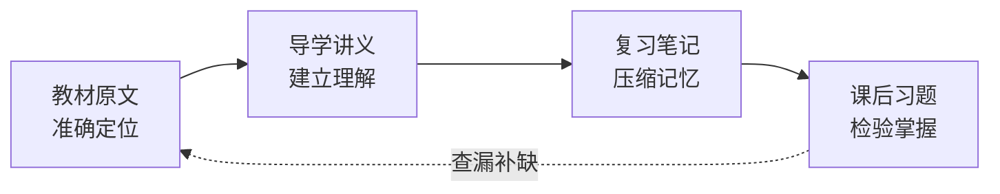

<div align="center">

# 密码编码学与网络安全 · 中文 Obsidian 学习知识库

把 544 页教材重建成一套可检索、可复习、可练习、可审计的学习系统。

[](https://obsidian.md/)


[进入知识库](_index.md) ·
[视频学习路线](视频观看顺序规划.md) ·
[查看建设进度](_manifest/progress.md) ·
[质量审计](_manifest/companion-content-quality-audit.md)

</div>

---

> 这不是一份按章节堆放的笔记合集。它把 William Stallings《密码编码学与网络安全：原理与实践（第八版）》拆解为原文、导学、复习与习题四个相互关联的层次，让同一知识点能够被理解、定位、记忆并检验。

## 为什么值得使用

| 你需要的 | 仓库提供的 |
| --- | --- |
| 从零建立知识框架 | 面向初学者的导学讲义、核心问题、概念辨析与学习目标 |
| 回到教材核对细节 | 按章节整理的教材原文、页码映射与图表附件 |
| 面向考试快速收束 | 复习笔记、重点归纳、易混淆点与速记线索 |
| 从“看懂”走向“会做” | 23 章课后习题与 443 个结构化题块 |
| 检查资料是否可信 | 来源哈希、页面映射、附件索引、QA 报告和人工审查清单 |

## 一眼看懂知识库

| 23 章 | 5 个附录 | 544 页 | 305 张 | 92 个 | 905 条 |
| :---: | :---: | :---: | :---: | :---: | :---: |
| 正文章节 | 数学与算法附录 | 逐页唯一映射 | 正式图表附件 | Mermaid 图 | Wiki 链接 |



## 知识地图

| 模块 | 主要内容 | 直达 |
| --- | --- | --- |
| 背景知识 | 安全概念、攻击模型、数论基础 | [开始学习](%231%20背景知识/) |
| 对称密码 | 古典密码、DES、有限域、AES、工作模式、流密码 | [进入模块](%232%20对称密码/) |
| 非对称密码 | RSA、Diffie-Hellman、ElGamal、椭圆曲线密码 | [进入模块](%233%20非对称密码/) |
| 数据完整性 | 哈希函数、消息认证码、数字签名、后量子密码 | [进入模块](%234%20密码学数据完整性算法/) |
| 互信 | 密钥管理与分发、用户认证 | [进入模块](%235%20互信/) |
| 网络安全 | TLS、无线安全、邮件安全、IPsec、端点、云与物联网安全 | [进入模块](%236%20网络和因特网安全/) |

附录覆盖线性代数、安全性度量、DES、简化 AES 与生日攻击的数学基础。完整章节入口与每章四类文档请见 [课程总索引](_index.md)。

## 选择你的学习路线

### 零基础系统学习

`导学讲义` → `教材原文` → `复习笔记` → `课后习题`

先用讲义建立直觉，再回到教材核对定义与推导；完成复习压缩后，用习题验证是否真正掌握。

### 考试冲刺

`考试范围` → `复习笔记` → `课后习题` → `错题回溯`

从 [考试范围](../考试范围/0857考试范围.png) 确认边界，按章复习并做题；遇到薄弱点，再通过索引回到讲义或原文。

### 视频与教材同步

按照 [配套视频观看顺序](视频观看顺序规划.md)，依次串联密码学引论、现代密码学、密码学原理和网络安全课程，使视频进度与教材章节保持一致。

## 四层内容体系

| 文档层 | 作用 | 适合什么时候打开 |
| --- | --- | --- |
| 教材原文 | 保留章节结构、定义、公式、图表与上下文 | 查证概念、精读推导、追溯出处 |
| 导学讲义 | 解释核心问题、前置知识、常见误区与知识联系 | 首次学习、跨章节建立框架 |
| 复习笔记 | 提炼考点、关键结论、辨析项与记忆线索 | 二轮复习、考前快速回顾 |
| 课后习题 | 汇总题目、答案、思路、难点与相关知识点 | 练习、自测、错题复盘 |

## 快速开始

1. 下载或克隆本仓库。
2. 在 [Obsidian](https://obsidian.md/) 中选择“打开本地仓库”，目录指向本仓库根目录。
3. 打开 [课程总索引](_index.md)，从目标章节进入。
4. 第一次学习建议从导学讲义开始；已经进入复习阶段则直接使用复习笔记与课后习题。

仅使用普通 Markdown 阅读器也能浏览内容；Obsidian 可进一步呈现 Wiki 链接、关系跳转、LaTeX 公式与 Mermaid 图。

## 仓库结构

```text
密码编码学与网络安全（第八版）/
├── README.md
├── _index.md                     # 全书导航
├── 视频观看顺序规划.md           # 视频与章节对应关系
├── #1 背景知识/ ... #6 网络和因特网安全/
├── #附录A ... #附录E/
├── _manifest/                    # 进度、映射、索引与 QA
└── 各章节/
    ├── 教材原文.md
    ├── 导学讲义.md
    ├── 复习笔记.md
    ├── 课后习题.md
    └── attachments/
```

## 质量不是口号

- **来源可追溯**：源文件元数据和 SHA-256 被单独记录，降低处理过程中误用版本的风险。
- **页面不失联**：PDF 1–544 页建立逐页唯一映射，包含前置页、正文、附录和参考文献。
- **附件可核验**：305 张正式 PNG 均进入附件索引，并由 Markdown 相对路径引用。
- **图表可渲染**：92 个 Mermaid 代码块已完成解析与浏览器渲染检查。
- **问题不隐藏**：已知 OCR 差异、教材缺参和待确认内容集中记录在 [QA 报告](_manifest/qa-report.md) 与 [人工审查清单](_manifest/人工审查清单.md) 中。

当前状态为：第 1–23 章及附录 A–E 的配套文档已完成，自动 QA 已通过，等待最终统一人工审查。这里的“完成”不等于内容永远不会出错；发现问题时，请优先依据原教材与勘误信息核对。

## 适合谁

- 正在学习密码学、网络空间安全或信息安全课程的学生
- 准备相关专业课考试，需要系统复习材料的考生
- 想快速查阅 AES、RSA、哈希、数字签名、TLS、IPsec 等主题的开发者
- 希望研究“扫描教材如何重建为可审计知识库”的 Obsidian 用户

## 版权与使用说明

本仓库用于个人学习、课程复习与知识整理。教材及其原始内容的版权归原作者和出版方所有，请通过合法渠道获取正版教材。本仓库未声明开源许可证；未经权利人许可，请勿复制、分发教材内容或用于商业用途。

---

<div align="center">

**从算法原理到协议实践，从第一次读懂到考前最后一次回顾。**

[现在开始](_index.md)

</div>
