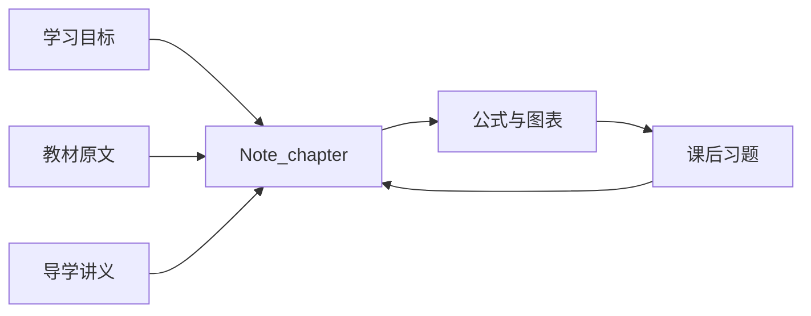

<div align="center">

# 密码编码学与网络安全

### 从数学基础到安全协议，一套真正面向复习的中文 Obsidian 知识库

[](https://obsidian.md/)


**原理有出处，知识有主线，复习有抓手。**

[从第 1 章开始](%231%20背景知识/第1章%20信息与网络安全概念/Note_chapter_1.md) ·
[浏览课程索引](_index.md) ·
[查看知识地图](#知识地图)

</div>

---

这是一套围绕 William Stallings《密码编码学与网络安全：原理与实践（第八版）》构建的中文学习知识库。它不满足于“把教材搬进 Markdown”，而是以 **`Note_chapter_**` 主复习笔记**为核心，把学习目标、概念关系、算法流程、关键公式、易混淆点和典型考点组织成可以反复调用的知识体系。

> 不只是读完一本书，而是把 544 页内容变成一条清晰、可检索、能用于考试与实践的知识链。

## 为什么是 `Note_chapter_**`

复习时最怕的不是资料少，而是资料太散。`Note_chapter_**` 承担每章的主入口：先告诉你这一章要掌握什么，再沿着教材逻辑串起概念、算法、图表与结论。

| 主笔记解决的问题 | 你得到的结果 |
| --- | --- |
| 这一章到底在讲什么 | 从学习目标出发建立完整章节框架 |
| 概念之间如何连接 | 用主线、层级和对比表还原知识关系 |
| 哪些细节值得反复看 | 聚焦定义、公式、算法步骤与关键条件 |
| 相似概念怎样区分 | 集中辨析边界、适用场景和常见误区 |
| 做错题后回到哪里 | 按章节与知识点快速定位薄弱环节 |



## 一座为复习而建的知识库

| 23 章 | 5 个附录 | 544 页 | 6 大模块 |
| :---: | :---: | :---: | :---: |
| 完整课程脉络 | 数学与算法补充 | 教材内容基础 | 从密码原理到网络实践 |

### 一条明确的主线

所有复习活动围绕 `Note_chapter_**` 展开。你不需要在多个版本的笔记之间来回选择：主笔记负责形成记忆结构，其他资料在需要时提供证据、解释和训练。

### 一套完整的支撑材料

- **教材原文**：查证定义、条件、推导与上下文。
- **导学讲义**：补足前置知识，拆解难点，建立直觉。
- **复习笔记**：提供额外的归纳、对比与速记视角。
- **课后习题**：把“看懂”转换为“能够独立作答”。
- **图表附件**：保留算法结构、协议流程与教材图示。

### 一种适合 Obsidian 的组织方式

章节、知识点、图片和配套资料通过 Markdown 与 Wiki 链接连接；LaTeX 承载公式，Mermaid 重建流程与关系。既可以按章节线性复习，也可以通过链接在概念之间快速跳转。

## 知识地图

| 模块 | 学习主题 | 入口 |
| --- | --- | --- |
| 背景知识 | 安全目标、攻击与服务、密码学概览、数论基础 | [进入背景知识](%231%20背景知识/) |
| 对称密码 | 古典密码、DES、有限域、AES、工作模式、流密码 | [进入对称密码](%232%20对称密码/) |
| 非对称密码 | RSA、离散对数、Diffie-Hellman、ElGamal、椭圆曲线 | [进入非对称密码](%233%20非对称密码/) |
| 数据完整性 | 哈希函数、消息认证码、数字签名、轻量级与后量子密码 | [进入数据完整性](%234%20密码学数据完整性算法/) |
| 互信 | 密钥管理、密钥分发、用户认证 | [进入互信](%235%20互信/) |
| 网络安全 | TLS、无线网络、电子邮件、IPsec、端点、云与物联网安全 | [进入网络安全](%236%20网络和因特网安全/) |

### 数学与算法附录

| 附录 | 主题 | 入口 |
| --- | --- | --- |
| A | 线性代数的基本概念 | [打开附录 A](%23附录A%20线性代数的基本概念/) |
| B | 保密性和安全性度量 | [打开附录 B](%23附录B%20保密性和安全性度量/) |
| C | 数据加密标准 | [打开附录 C](%23附录C%20数据加密标准/) |
| D | 简化 AES | [打开附录 D](%23附录D%20简化AES/) |
| E | 生日攻击的数学基础 | [打开附录 E](%23附录E%20生日攻击的数学基础/) |

## 最顺手的复习方式

### 第一轮：建立章节主线

打开目标章节的 `Note_chapter_**`，先读学习目标和全章结构，再沿着笔记顺序理解概念、公式与算法。此时重点是回答两个问题：这一章解决什么问题？各知识点为什么按这个顺序出现？

### 第二轮：把理解变成记忆

回到主笔记中的定义表、对比项、流程图和结论，尝试脱离正文复述。遇到不能解释的步骤，再打开同章导学讲义；遇到表述或条件不确定，再回到教材原文。

### 第三轮：用题目暴露薄弱点

完成同章课后习题。错题不只记录答案，而是回到 `Note_chapter_**` 定位对应知识点，补上条件、推导或概念边界，再重新作答。

```text
Note_chapter_**
      |
      |-- 建立框架
      |-- 记忆核心
      |-- 定位弱点
      |
      +--> 课后习题 --> 错题 --> 回到 Note_chapter_**
      |
      +--> 教材原文 / 导学讲义 / 复习笔记
```

## 适合谁

- 系统学习密码学、网络空间安全或信息安全课程的学生
- 准备密码学与网络安全相关专业课考试的考生
- 希望快速复习 AES、RSA、哈希、数字签名、TLS、IPsec 等核心主题的开发者
- 想把教材、笔记、公式和图表组织成长期知识资产的 Obsidian 用户

## 快速开始

1. 在 [Obsidian](https://obsidian.md/) 中打开 `密码编码学与网络安全（第八版）` 目录。
2. 从 [课程总索引](_index.md) 选择目标章节。
3. 优先打开章节内的 `Note_chapter_**.md`，以主笔记展开复习。
4. 使用同章原文、讲义和习题完成查证、理解与训练闭环。

普通 Markdown 阅读器也可以浏览内容；使用 Obsidian 能获得更完整的 Wiki 链接、公式、图表和关系跳转体验。

## 目录结构

```text
密码编码学与网络安全（第八版）/
├── README.md
├── _index.md
├── #1 背景知识/
├── #2 对称密码/
├── #3 非对称密码/
├── #4 密码学数据完整性算法/
├── #5 互信/
├── #6 网络和因特网安全/
├── #附录A ... #附录E/
└── 各章节/
    ├── Note_chapter_**.md        # 主复习入口
    ├── 教材原文.md               # 定义与出处
    ├── 导学讲义.md               # 理解与拆解
    ├── 复习笔记.md               # 补充归纳
    ├── 课后习题.md               # 训练与检验
    └── attachments/              # 图表与附件
```

## 内容设计原则

- **忠实教材**：概念、公式、算法与协议以教材内容为依据。
- **面向复习**：先呈现学习目标与章节主线，再展开细节。
- **强调联系**：通过对比、流程和交叉链接连接分散知识点。
- **便于查证**：原文、页面映射与图表附件保留追溯路径。
- **支持训练**：知识点与课后习题形成复习闭环。

## 版权说明

本知识库用于个人学习、课程复习与知识整理。教材及其原始内容的版权归原作者和出版方所有，请通过合法渠道获取正版教材。未经权利人许可，请勿复制、分发教材内容或用于商业用途。

---

<div align="center">

### 从 `Note_chapter_**` 开始，把复杂的安全知识变成清晰的复习路径。

[开始复习](%231%20背景知识/第1章%20信息与网络安全概念/Note_chapter_1.md) · [浏览全部章节](_index.md)

</div>
